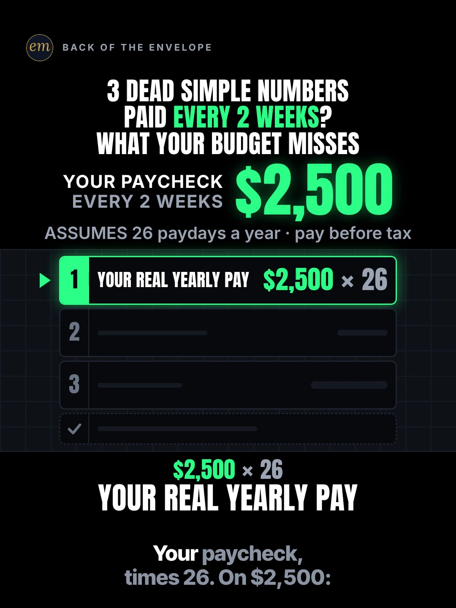

# 01a publishing sheet: paid every 2 weeks, what your budget misses

YouTube Shorts (@envelopemath) and Instagram Reels (@envelopemath). Prepared 2026-10-13. Machine-readable twin: `publishing/01a-scoreboard-paid-biweekly.json`.

- **Video.** `renders/channel/01a-scoreboard-paid-biweekly.mp4`: the condensed cut (13.9 s: a 11.4 s body + the 2.5 s card; sha256 `935ade00…`), promoted and shipped on 2026-10-13. It replaces the 27.0 s round-2 cut (the owner: "too many still moments"), which is in git (`471c793`). The condense moved the clock and merged some captions; the numbers, the captions' facts and the verdict stay, so the copy carried over unchanged. Nothing below names a timestamp except the cover, which was re-picked by content on the shipped file. The ship rebuilt this sheet and re-exported both covers from it (`python3 publishing/tools/build_publishing.py 01a-scoreboard-paid-biweekly --covers`); on the shipped specs the maths check runs 396 checks, 0 failed.
- **Numbers.** Every figure comes from `teasers/v2/01-dead-simple-list.md` (01a) and its check, `python3 teasers/v2/checks/01-dead-simple-list.py`: 400 checks, 0 failed on `studio/specs/` (run 2026-10-13). `python3 publishing/tools/build_publishing.py 01a-scoreboard-paid-biweekly --check` checks this sheet's limits, paste blocks and figures, re-does the calendar arithmetic, keeps every 13 as '13 months' or '13th month', and keeps 'gross, before tax' and the 27-payday caveat in the copy.
- **Honesty rules kept.** The title asks and never gives the result, and neither does the cover (frame 1: the question, the $2,500 input and slot 1's working, no answer). The Instagram caption keeps every result below 'more'. Every claim stays inside the video's own verdict, "every 2 weeks = 13 months of pay a year", on a gross $2,500 example, and the copy says the calendar's exception (about 1 year in 11 has 27 paydays). No advice, no urgency, and 'Not financial advice.' is in both.
- **Sources.** None of the copy's numbers needs an outside figure: they are calendar arithmetic on an example paycheck. The write-up's two BLS context facts (biweekly is the most common US pay period; the $1,251 median weekly pay behind the $2,500) stay out of the copy, as the write-up keeps them out of the caption.
- **Brand.** No company or brand is named in the copy, so no affiliation line is needed. The on-screen series name 'dead simple numbers' is Master Money's phrase (the write-up's own risk note), so the copy does not use it as a series name; the long alt text quotes it only because it is on screen.

---

## YouTube Shorts

### Title (vidIQ title score, short-form, scored against this channel)

| # | Title | Score | Chars |
|---|---|---:|---:|
| 1 | Paid Biweekly? What Your Monthly Budget Misses | 91 | 46 |
| 2 | Paid Biweekly? What Your Budget Misses | 91 | 38 |
| 3 | Paid Every 2 Weeks? What Your Monthly Budget Misses #budgeting #paycheck #biweekly | 85 | 82 |

**Pick (paste):**

```
Paid Biweekly? What Your Monthly Budget Misses
```

- 46 of 100 characters.
- The whole title is 46 characters, so the Shorts player shows it uncut. 'Paid Biweekly?' names the viewer's situation (R7), and 'What Your Monthly Budget Misses' is the write-up's R5 line: it says a number is missing without saying which.
- It raises the write-up's title from 86 to 91. 'Biweekly' does the work: the same title with 'Every 2 Weeks' scores 85-86, and the searched phrases all say 'biweekly' ('budgeting biweekly paycheck' 5,267 a month, 'how to budget your biweekly paycheck' 4,943, 'why paychecks are biweekly' 5,364 at competition 7.1).
- Left out on purpose: '3 paycheck months' (4,295 a month) and '2 extra paychecks'. They name the mechanism the video pays off in its third slot, so they sit in the description, the tags and below the caption's fold instead. The closest same-idea Short (Jelfri Torres, 7 Oct 2026) puts the answer in its title: 'Paid Biweekly? Find Your 2 Extra Paychecks'.
- vidIQ's model ranks titles but does not predict views; options 1 and 2 tie, so the pick is decided on meaning.
- Also scored, not used: "Paid Every 2 Weeks? What Your Budget Misses" 86 (the write-up's title, the header's words); "Paid Every 2 Weeks? The Pay Your Budget Forgets" 86 (teasers.json's title, the round-2 header); "Paid Every 2 Weeks? What Your Monthly Budget Misses" 85; "Paid Every 2 Weeks (Biweekly)? What Your Monthly Budget Misses" 85; "Paid Biweekly? What Your Monthly Budget Misses Every Year" 82; "Paid Biweekly? What Your Monthly Budget Misses #budgeting #paycheck #biweekly" 80 (the pick with the house hashtags: 11 points lower); "Paid Biweekly? The Paycheck Math Your Monthly Budget Misses" 79.

### Description (paste)

```
Paid biweekly, every 2 weeks? That's 26 paychecks a year, not 24. On $2,500 a check: $65,000 a year, not $60,000. The 2 extra checks add up to a 13th month of pay that a budget built on 2 checks a month never counts.

The math, shown:
• Your paycheck × 26: $2,500 × 26 = $65,000 a year.
• Not × 24 (twice a month): that's only $60,000.
• A normal month: 2 checks, $2,500 × 2 = $5,000. 12 normal months: $60,000.
• $65,000 − $60,000 = $5,000: your 2 extra checks, from the 2 months with 3 paydays.
• Check: 10 months × 2 + 2 months × 3 = 26 paydays.
• $65,000 ÷ $5,000 = 13 months of pay. Every year.

Run yours: paycheck × 26, minus 12 months of 2 checks.

Follow for the math behind your money — shown, not hand-waved. @envelopemath

Animation and original sound: The Back of the Envelope. Example paycheck: $2,500 every 2 weeks, gross (before tax). 26 paydays a year (364 days ÷ 14); about 1 year in 11, the calendar fits 27. Not financial advice.
#budgeting #paycheck #biweekly
```

980 of 5,000 characters (1,005 UTF-8 bytes; YouTube counts this limit in bytes, and `×`, `•`, `—`, `−`, `÷` take 2-3 each). No `<` or `>`, which YouTube rejects. It follows the house template: an answer-first opening line for the search snippet, then 'The math, shown:' bullets, then the follow line. The credit, assumptions and 'Not financial advice.' line comes next, and the 3 hashtags close it. The opening line uses 'biweekly' and 'every 2 weeks' together, the search word and the header's words. The on-screen series name 'dead simple numbers' is left out: it is Master Money's phrase (the write-up's risk note), so the copy uses the house 'The math, shown:'.

### Hashtags (order matters)

1. `#budgeting`: the broad layer ('budgeting' 166,248 searches a month at competition 25.8, overall 76.4, the best opportunity in the cluster; down 26.1% on its 30-day baseline).
2. `#paycheck`: the object ('paycheck' 38,765 a month; 'paycheck breakdown' 31,692, up 671.3% on its baseline, competition 21.2).
3. `#biweekly`: the exact situation: every biweekly-budget phrase in the research carries the word ('budgeting biweekly paycheck' 5,267, 'how to budget your money biweekly' 5,053).

The title carries no hashtags, so YouTube shows these 3, the description's first, above the title. Over 60 hashtags and YouTube ignores all of them. `#Shorts` isn't needed.

### Tags (paste; 386 of 500 characters as YouTube counts them: commas count, and a tag with a space counts 2 more for the quotes YouTube adds)

```
biweekly paycheck, paid biweekly, budgeting biweekly paycheck, how to budget your biweekly paycheck, how to budget your money biweekly, why paychecks are biweekly, 3 paycheck months, 26 paychecks, paid every two weeks, paycheck breakdown, how to budget your paycheck, budgeting, how to budget, paycheck, money math, math animation, the back of the envelope, envelope math
```

Tags carry little weight. These mirror the keyword research plus the house's channel tags. '3 paycheck months' and '26 paychecks' carry the mechanism the title keeps back. Left out on purpose: 'paycheck to paycheck' (52,983 a month, up 258.9%) and 'how to stop living paycheck to paycheck' (28,764) want a way out of a tight budget, not this calendar fact; 'biweekly paycheck', 'biweekly pay', 'paid every two weeks' and 'extra paycheck' are all under 750 a month, kept only where they name the video exactly.

### Pinned comment (post it, then pin it)

```
Has your payroll had a 27-payday year yet? About 1 year in 11, the calendar fits 27 paydays instead of 26. On $2,500 checks, that year pays $67,500.

The working: $2,500 × 26 = $65,000, not × 24 = $60,000. The 2 extra checks ($5,000) come from the 2 months with 3 paydays, and $65,000 ÷ $5,000 = 13 months of pay. Gross, before tax.
```

The question comes first so it shows in the collapsed preview: it is the write-up's own pinned question (the 27-payday year), and it asks about the viewer's own payroll (R3). The first paragraph is the write-up's pinned comment; it answers the comment to expect ('my year had 27 checks'). The second is the working, for the commenters who check the multiplication, and it repeats 'gross, before tax'.

### Related video and end screen

- **Related video:** [Pay the Minimum on $5,000? 238 Months.](https://www.youtube.com/shorts/8__HTUa2PoU) (`8__HTUa2PoU`). Same viewer: someone budgeting a paycheck month by month. It asks a question in its title like this one, and it is the channel's best Reel (7,302 plays, 27.4% skip rate).
- **Swap later:** 01b or 01c (the same dead-simple-list series), once published. Then point theirs at this Short.
- **End screen:** Shorts have no end screens or cards. The Related video link is the Shorts equivalent.

### Thumbnail and settings

- **Thumbnail:** in the YouTube app, pick frame 1 (the clean cover: the question, the $2,500 hero and slot 1's working, no answer), the same content as the Instagram cover below.
- **Settings:** Category Education. Not made for kids. Altered or synthetic content: No (it's an animated chart, not realistic footage). Remixing allowed. No captions needed: there's no narration and all the text is on screen.

### Posting window

- **When:** First Tue-Thu evening after the condensed cut ships and passes QA, 21:30-22:30 ET (01:30-02:30 UTC the next day): Tue 13 Oct 2026 at the earliest; in the suggested order (01b, 01c, 01a, one evening each) that is Thu 15 Oct. Sunday 06:00-08:00 ET is the alternative.
- **Spacing:** Keep it at least 6 h from any other upload on the channel, and on a different evening from 01b and 01c (the same series). Suggested order: 01b, 01c, then 01a. 01a's topic is not tied to a date; the other two quote 2026 figures that SSA and the IRS published in October 2025, so their 2027 updates may come out about now.
- **Why:** The channel's own October Shorts, median views by posting slot (vidIQ, 2026-10-13): Sunday 05:00-08:00 ET 1,198 (n = 2), weekday 22:00-00:30 ET 642 (n = 3), weekday midday 263 (n = 2); 06c (Mon 03:45 ET) has 760 and 06b (Mon 12:14 ET) 61 a day or less after posting, too young to compare. The evening slot is also the best one on Instagram, so one evening serves both. n = 7 and confounded by topic, so treat it as a test. Search demand: 'paycheck breakdown' runs +671.3% and 'paycheck to paycheck' +258.9% over their 30-day baselines, while 'budgeting' is down 26.1%.

---

## Instagram Reels

### Caption (paste)

```
Paid every 2 weeks (biweekly)? Here's what a monthly budget built on 2 paychecks a month misses, worked on a $2,500 check.

The math, shown (gross, before tax):
• Your paycheck × 26 paydays: $2,500 × 26 = $65,000 a year. Not × 24: that's only $60,000.
• A normal month: 2 checks, $5,000. 12 normal months: $60,000.
• $65,000 − $60,000 = $5,000: your 2 extra checks, from the 2 months with 3 paydays (10 × 2 + 2 × 3 = 26).

Every 2 weeks = 13 months of pay a year. Your monthly budget is wrong, in your favor.

Run yours: paycheck × 26, minus 12 months of 2 checks. About 1 year in 11 has 27 paydays instead of 26. Not financial advice.

Has your payroll had a 27-payday year yet?

Follow for the math behind your money — shown, not hand-waved. @envelopemath
Animation and original sound: The Back of the Envelope.

#budgeting #paycheck #biweekly #personalfinance #moneymath
```

- 873 of 2,200 characters.
- **First 125 characters:** the header's question with the search word 'biweekly', the 'monthly budget' it corrects and the input ($2,500), with no result. The write-up says caption line 1 is the verdict (R11); the house rule moves the verdict below 'more', because the caption overlays the Reel from frame 1. The numbers and the verdict sit below the fold, where Instagram search and Google indexing still read them.
- The verdict line keeps the write-up's own words ('Your monthly budget is wrong, in your favor') and the caption keeps its 'Run yours' rule, a calculation, not advice.
- The caption follows the house close: the follow line plus the credit.

### Hashtags (5, Instagram's cap since Dec 2025)

`#budgeting #paycheck #biweekly #personalfinance #moneymath`

Three are the write-up's own (`#paycheck #biweekly #moneymath #budgeting`, all kept):

- `#biweekly` names the exact situation. The biggest biweekly Reel in the outlier search (@thebudgetingprincess, 1.9M) opens on 'If you get paid bi-weekly this is for you'.
- `#paycheck` and `#budgeting` name the object and the job.

`#personalfinance` is the broad layer, as on 06b and 06c, and `#moneymath` is the write-up's series tag.

### Alt text

- **Short (92 characters; paste this one into Instagram):** Animation: $2,500 every 2 weeks is 26 checks, $65,000 a year, not $60,000: 13 months of pay.
  - It stays at or under 100 characters, so it fits the field however short it is. It says 'every 2 weeks' and 'not', with no '×' or '=', so screen readers read it cleanly. Every figure is exact, so none needs 'about'.
- **Long (for anywhere with room, such as a website embed):** Animation on a black scoreboard. The header reads: 3 dead simple numbers. Paid every 2 weeks? What your budget misses. A green counter shows your paycheck, $2,500 every 2 weeks. Slot 1, your real yearly pay: $2,500 × 26 rolls up to $65,000, with the note 'not × 24 = $60,000'; below the board that $60,000 is struck out. Slot 2, a normal month: $2,500 × 2 = $5,000; × 12 = $60,000. Slot 3, the 2 checks your budget forgets: $65,000 − $60,000 = $5,000. The top counter turns to 'your 2 extra checks' and rolls to $5,000 as 2 bill icons drop in. A check line reads 10 × 2 + 2 × 3 = 26 paydays. Verdict: every 2 weeks = 13 months of pay a year.
- **Where:** Advanced settings → Accessibility → Alt text, if your app shows it for Reels.

### Cover



- **Files:** `publishing/01a-scoreboard-paid-biweekly-cover-3x4.jpg` (1080×1440) and `publishing/01a-scoreboard-paid-biweekly-cover-9x16.jpg` (1080×1920). Both come from the shipped (13.9 s) render at 0 s (frame 0).
- **Frame, by content:** The clean cover, frame 1: the header '3 DEAD SIMPLE NUMBERS / PAID EVERY 2 WEEKS? / WHAT YOUR BUDGET MISSES' ('EVERY 2 WEEKS' in green), the green hero 'YOUR PAYCHECK / EVERY 2 WEEKS $2,500', the footer 'ASSUMES 26 paydays a year · pay before tax', slot 1 lit with 'YOUR REAL YEARLY PAY' and its working '$2,500 × 26', slots 2, 3 and the check slot empty, and the first caption. It asks and does not answer, like the title and the caption. The write-up names frame 1 as the Instagram cover. On any cut, use the last frame before slot 1's working turns into the rolling counter. On the shipped 13.9 s condensed cut, frame 0 (0.00 s) is that frame and the only clean one: from frame 1 (0.03 s) slot 1's working swaps to the rolling odometer (mean frame-to-frame luma change 0.69, 270×480 greyscale). Frame 0 shows the whole first caption, 'Your paycheck, times 26. On $2,500:', with 'Your paycheck,' lit (the kit lights it word by word); the grey words still read. On the 27.0 s pre-condense render frames 0-4 held that picture, with only 'Your' lit. If the cut changes, re-pick it by content.
- **Crop:** 3:4 = 1080×1440 from y 60 to 1500 of the 1080×1920 frame: the badge, the header, the hero, the footer, the 4 slots, the label stack and the caption; it drops the empty floor. A centred grid crop (y 240-1680) cuts the badge and the header's first line.
- **How to set it:** In 'Edit cover', pick frame 1 of the video (or upload the 9:16 JPG), then drag 'Profile grid' to the top so the tile matches the 3:4 JPG. Do not upload the 3:4 JPG as the Reel cover: Instagram centre-crops it to 9:16 in the Reels tab and cuts the header.
- **Re-export:** `ffmpeg -ss 0 -i renders/channel/01a-scoreboard-paid-biweekly.mp4 -frames:v 1 -vf "crop=1080:1440:0:60" -q:v 2 publishing/01a-scoreboard-paid-biweekly-cover-3x4.jpg` and `ffmpeg -ss 0 -i renders/channel/01a-scoreboard-paid-biweekly.mp4 -frames:v 1 -q:v 2 publishing/01a-scoreboard-paid-biweekly-cover-9x16.jpg`, or `python3 publishing/tools/build_publishing.py 01a-scoreboard-paid-biweekly --covers`.
- **Not used:** the verdict hold (the finished board with 'EVERY 2 WEEKS = 13 MONTHS OF PAY A YEAR'). It is the save-worthy frame, but it shows the answer, against the write-up's cover note and the title's no-result rule.
- **Shipped cut (2026-10-13):** frame 1 was re-picked by content on the shipped file and both JPGs re-exported from it. It is the same picture as the pre-condense cut's frame 1, except that 'Your paycheck,' is lit in the hook caption (the old frame lit only 'Your').

### First comment (post it, then pin it)

```
Every 2 weeks = 13 months of pay a year: $2,500 × 26 = $65,000, not × 24 = $60,000 (gross). About 1 year in 11 has 27 paydays. Has your payroll had a 27-payday year yet?
```

### Trial Reels

**Post as a regular Reel, not a Trial.** @envelopemath has 8 followers, so a regular Reel is already shown almost entirely to non-followers, which is all a Trial Reel adds. A Trial would also keep it off the profile grid until shared. A hook test afterwards, if you want one: the other cut as a Trial with MANUAL graduation 48-72 h later. The condensed cut replaced the pre-condense render in renders/channel on 2026-10-13; get the pre-condense one from git with `git show 471c793:renders/channel/01a-scoreboard-paid-biweekly.mp4 > 01a-27s.mp4` (sha256 cf626877…). Compare skip rate (October Reels ran 27.0-65.1%; 06c's condensed cut 40.3%) and average watched %, then share the winner. vidIQ's publish tool exposes Trial (MANUAL or SS_PERFORMANCE) for this connected account. Confirm eligibility in the app.

### Posting window and settings

- **When:** Same evening as YouTube, about 15 min after the Short: 21:45-22:45 ET, Tue 13 Oct 2026 at the earliest (Thu 15 Oct in the suggested order), on a different evening from 01b and 01c.
- **Why:** October Reels, median plays by posting slot (owner insights, 2026-10-13): weekday 22:00-00:30 ET 5,449 (n = 3, including the two best: 7,302 and 5,449), weekday midday 1,212 (n = 2), Sunday 05:00-08:00 ET 1,087 (n = 2). 06c, posted Mon 03:46 ET, has 1,711 plays with a 40.3% skip rate. Skip rate tracks plays more closely than the hour does: 27.0-27.4% for the top two, 56.9-65.1% for the bottom two. The condense matters more than the hour.
- **Audio:** Rename the original audio to 'Paid biweekly? The math — The Back of the Envelope' if the app allows; it is the score, with no voice.
- **Share to feed:** On.

---

## Why these choices (research evidence)

**1. Search demand (vidIQ keyword research, pulled 2026-10-13).** vidIQ refreshes each keyword on its own schedule, so the last column gives each row's snapshot date. Seven rows are older snapshots.

| Keyword | Est. searches/month | Competition | Overall | Note | vidIQ as of |
|---|---:|---:|---:|---|---|
| paycheck to paycheck | 52,983 | 48.1 | 63.1 | +258.9% vs its 30-day baseline (14,764); a different need, not in the tags | 2026-10-12 |
| paycheck | 38,765 | 66.5 | 54.5 | -15.1% vs its baseline (45,675); broad and crowded | 2026-10-12 |
| paycheck breakdown | 31,692 | 21.2 | 71.8 | +671.3% vs its baseline (4,109); the fastest-rising phrase here | 2026-10-12 |
| how to budget your paycheck | 5,383 | 26.9 | 62.7 | -45.8% vs its baseline (9,935) | 2026-09-16 |
| why paychecks are biweekly | 5,364 | 7.1 | 70.6 | competition 7.1, the lowest here | 2026-09-13 |
| budgeting biweekly paycheck | 5,267 | 17.1 | 66.5 |  | 2026-06-22 |
| how to budget your money biweekly | 5,053 | 11.5 | 68.6 |  | 2026-10-12 |
| how to budget your biweekly paycheck | 4,943 | 17.6 | 66.0 |  | 2026-10-07 |
| 3 paycheck months | 4,295 | 21.6 | 63.9 | the video's mechanism: tags and below the fold, not the title | 2026-10-07 |
| budgeting | 166,248 | 25.8 | 76.4 | -26.1% vs its baseline (225,000); the cluster's best opportunity score | 2026-10-12 |
| how to budget | 66,391 | 33.5 | 69.8 | flat (-0.5%) | 2026-10-12 |
| biweekly paycheck | 0 (<750) | 18.2 | 32.7 | <750/month (overall 32.7) | no snapshot |
| biweekly pay | 0 (<750) | 18.7 | 32.5 | <750/month | no snapshot |
| paid every two weeks | 0 (<750) | 15.5 | 33.8 | <750/month: the header's words, but searchers say 'biweekly' | no snapshot |
| extra paycheck | 0 (<750) | 29.5 | 28.2 | <750/month | no snapshot |

The exact phrases are small: the biweekly-budget questions sit at about 5,000 a month each, at low competition (7.1-17.6), and every one of them says 'biweekly'. So the title says 'biweekly', and the header's own words ('paid every two weeks', under 750) stay on screen. '3 paycheck months' (4,295) names the mechanism, so it goes to the tags and below the caption's fold. The broad layer is 'budgeting' (166,248, overall 76.4) and 'paycheck' (38,765). 'Paycheck breakdown' (+671.3%) and 'paycheck to paycheck' (+258.9%) are rising, but only the first fits this video.

**2. The same idea on YouTube is old and small (vidIQ YouTube search, under 4 min, by views and by relevance).**

| Title | Channel (subs) | Views | Date |
|---|---|---:|---|
| Being Paid Biweekly Is Not The Same As Being Paid Twice A Month! | Reni The Resource (41,800) | 30,557 | 2022-02-28 |
| Is Biweekly Pay A Scam? | Morning Thoughts Media (8,200) | 11,461 | 2023-06-14 |
| How to save 3k in 2 months (bi-weekly pay) | Cash stuffing & budgeting | The Budgeting Princess (1,600) | 9,513 | 2023-06-08 |
| How many paychecks is [twice per month] vs [every two weeks] | Travis Sickle (93,400) | 6,567 | 2023-07-14 |
| Here Are the 3 Paycheck Months for 2021 | Michael Saves (185,000) | 1,801 | 2020-09-08 |
| 3 Paycheck Months 2026 and How to Use Them | Clarissa Explains Money (1,230) | 1,619 | 2025-12-02 |
| If you get paid bi-weekly, here are your 3 paycheck months of 2024 #shorts #paycheck #money | Andrew Giancola (39,600) | 1,123 | 2024-01-14 |
| The 3 paycheck month is a myth #moneymanagement #budget #budgeting | DACY Financial Coaching (5,010) | 1,048 | 2024-08-14 |
| Paid Biweekly? Find Your 2 Extra Paychecks | Jelfri Torres (20,700) | 537 | 2026-10-07 |
| Paid every 2 weeks? Bills money per paycheck #shorts | Dixon App Studio (2) | 32 | 2026-10-12 |
| Why 26 Paychecks Feel Like Free $4,000 💰 | finai4u (3) | 4 | 2026-10-08 |

The '26 paychecks, not 24' fact has been posted for years, mostly as calendar tips ('here are your 3 paycheck months of 2024'). The biggest same-idea Short found is Reni The Resource's 2022 'Being Paid Biweekly Is Not The Same As Being Paid Twice A Month!' (30,557 views, 70 comments); the rest are under 12,000. Four channels posted it in the last 7 days (7-12 Oct 2026), all under 600 views, and Jelfri Torres's twin names the answer in its title ('Find Your 2 Extra Paychecks').

None turns the 2 extra checks into the verdict this video lands, 'a 13th month of pay', and none works one viewer's paycheck on screen. So the pick asks the familiar question ('Paid Biweekly?') and keeps the payoff for the video.

**3. 'Paid bi-weekly' travels as a hook on Instagram and TikTok (vidIQ IG/TikTok outlier search, since June 2024, at least 5K views).**

- **@mastermoneyco** (Instagram), "4 DEAD SIMPLE NUMBERS That Tell You What You Actually Make": 1.8M (28.4x); the TikTok original 3M (140.0x).
  - The format's model (the write-up's H84). It has a presenter; this teaser is the faceless test.
- **@thebudgetingprincess** (Instagram), "If you get paid bi-weekly this is for you": 1.9M (9.1x). Its caption opens 'Save $5,000 in 26 paychecks…'.
- **@blend404** (TikTok), "HOW TO: SAVE FOR A 6 MONTH SAVINGS GOAL ON A BI WEEKLY PAY SCHEDULE": 298.3K (247.3x). Static text over music.
- The two biweekly outliers open by naming the viewer's pay schedule with no result, which is what this Short's header, cover and caption do. The concept search found no Reel or TikTok of the '13th month of pay' idea itself at 5K views or more.

**4. Our own October numbers (vidIQ: public YouTube stats, Instagram owner insights; refreshed 2026-10-13).**

| YouTube Short | Posted (ET) | Views |
|---|---|---:|
| Can You Find the Missing Dollar? (`LjHDFzVxRyM`) | Sun 07:04 | 1,254 |
| You Can Lean on $1 Million. Not on $1 Billion. (`hJBvmGA6sZ0`) | Thu 00:25 | 1,221 |
| Your Interest Has a Speed Limit (`XVUeMcTg9OQ`) | Sun 05:49 | 1,141 |
| What If You Bought Starbucks Stock Instead of a $4 Latte Every Day? (06c) (`fbpdKf4Wy8c`) | Mon 03:45 | 760 |
| Pay the Minimum on $5,000? 238 Months. (`8__HTUa2PoU`) | Mon 22:09 | 642 |
| A $2 Lottery Ticket Was Worth $6.98. Until the Fine Print. (`FW_oxA3kbsM`) | Wed 12:03 | 348 |
| You Can Carry $1 Million. Not in Pennies. (`mXbKY_R63h4`) | Thu 13:38 | 177 |
| Start Investing 10 Years Late? You Get Half. (`EqFQCJheCMU`) | Tue 22:27 | 161 |
| What If You Bought Netflix Stock Instead of Paying for Netflix? (06b) (`krfZEHhb0xU`) | Mon 12:14 | 61 |

| Instagram Reel | Posted (ET) | Plays | Skip rate | Avg watched |
|---|---|---:|---:|---:|
| $5,000 on the minimum (`DeIvYk7I4Qr`) | Mon 22:46 | 7,302 | 27.4% | 56.5% |
| $1M stack vs Burj Khalifa (`DeOEthJJ1TG`) | Thu 00:28 | 5,449 | 27.0% | 83.1% |
| Missing dollar (`DeWgFZRoR_S`) | Sun 07:05 | 1,997 | 32.0% | 81.3% |
| Powerball $6.98 (`DeMvZv9IqRw`) | Wed 12:05 | 1,825 | 58.7% | 57.9% |
| 06c latte vs Starbucks stock (`DeYuqT4pjVC`) | Mon 03:46 | 1,711 | 40.3% | 69.1% |
| $1M in pennies (`DePe11HIHwn`) | Thu 13:37 | 598 | 42.0% | 66.7% |
| 10 years late (`DeLSd9io8UK`) | Tue 22:30 | 219 | 65.1% | 30.6% |
| Speed limit (e) (`DeEW2ZMIiYd`) | Sun 05:54 | 177 | 56.9% | 31.2% |

Channel totals:

- **YouTube:** 53 subscribers, 10,221 views and 41 videos (+27 subscribers, +5,127 views and 11 videos in 30 days).
- **Instagram:** 8 followers and 20,518 views in 30 days.

06b went live on both on Mon 12 Oct at about 12:14 ET (YouTube `krfZEHhb0xU`, Instagram `DeZov75oo9o`), with the house 3-hashtag title (its sheet's option 3): 61 views and 7 plays the next morning, too young to compare. 06c, a day older, has 760 views and 1,711 plays (40.3% skip).

Medians by posting slot (n = 2-3 each, confounded by topic; 06b and 06c left out as too young):

- **YouTube:** Sunday early morning ET 1,198, weekday 22:00-00:30 ET 642, weekday midday 263.
- **Instagram:** weekday 22:00-00:30 ET 5,449, midday 1,212, Sunday early morning 1,087.

One weekday evening is the best Instagram slot and the second-best YouTube slot, so the plan posts both then. On Instagram, skip rate predicts plays better than the hour does (27.0-27.4% for the top two, 56.9-65.1% for the bottom two). So the window is a light-touch test, and the condense (fewer still moments) is the bigger reach lever.

**5. Platform rules applied.**

- **YouTube title:** 100 characters. The Shorts player shows only the opening, so the keywords come first.
- **YouTube description:** 5,000 characters.
- **YouTube hashtags:** the first 3 show; over 60 and all are ignored; `#Shorts` isn't needed.
- **YouTube tags:** 500 characters, low weight.
- **YouTube Shorts:** no end screens. The Related video link is the Shorts equivalent.
- **YouTube AI disclosure:** only for realistic altered content.
- **Instagram caption:** 2,200 characters, about 125 shown before 'more'.
- **Instagram hashtags:** 5 at most.
- **Instagram search and Google:** keywords in the caption feed Instagram search, and Google indexes public professional posts (since 10 Jul 2025).
- **Instagram grid:** a 3:4 crop of the 9:16 cover.
- **Trial Reels:** shown to non-followers only.

**6. Limits.**

- @envelopemath's YouTube Analytics (audience hours, geography) were not read here; the 06b and 06c sheets found vidIQ's YouTube authorization is a different channel. Check Studio → Analytics → Audience → 'When your viewers are on YouTube' before posting.
- vidIQ has no hashtag-volume data; hashtag picks lean on keyword volume and on the write-up's and the outliers' own tags.
- Title scores are vidIQ's short-form CTR model for this channel; they rank options but do not predict views.
- The video, the cover and the video facts are the shipped condensed cut (2026-10-13); the copy is cut-independent and carried over from the pre-condense cut unchanged.

---

## Check log (adversarial pass, 2026-10-13)

- **Maths.** `python3 teasers/v2/checks/01-dead-simple-list.py`: 400 checks, 0 failed on `studio/specs/` and 392 checks, 0 failed with `--spec` on the three condensed WIP specs. Every public figure traces to the 01a maths table: $2,500 × 26 = $65,000; × 24 = $60,000; $2,500 × 2 = $5,000; × 12 = $60,000; $65,000 − $60,000 = $5,000 (2 extra checks); 10 × 2 + 2 × 3 = 26; 364 ÷ 14 = 26; $65,000 ÷ $5,000 = 13; a 27-payday year $67,500, about 1 year in 11. The data file recomputes each one.
- **Limits.** Title 46/100. Description 980 characters (1,005 bytes) of 5,000. 3 hashtags. Tags 386/500 as YouTube counts them. Instagram caption 873/2,200, with the first 125 characters result-free. 5 hashtags. Short alt text 92. No `<` or `>`.
- **vidIQ.** Keywords pulled 2026-10-13 (table above). 10 titles scored against this channel: the pick 91, the write-up's title 86. Channel 53 subscribers / 10,221 views / 41 videos; Instagram owner insights refreshed (8 followers, 20,518 views in 30 days).
- **vidIQ re-queried.** After the build: the pick's title score 91; '3 paycheck months' 4,295 / 21.6 (snapshot 2026-10-07). At the adversarial check: the pick's title score 91; 'why paychecks are biweekly' 5,364 / 7.1 (snapshot 2026-09-13); 'paycheck breakdown' 31,692 / 21.2 (+671.3% on its 4,109 baseline). All match.
- **Changed.**
  - The long alt text said the note 'not × 24 = $60,000' is struck out. On screen the note under slot 1 stays as it is and the $60,000 in the label stack below the board is struck (checked on a frame of the render); the alt text now says so. It also said the 2 bills drop in 'beside your 2 extra checks' while slot 3 lands; it now says the top counter turns to 'your 2 extra checks' and rolls to $5,000 as the bills drop in, which is what both cuts show.
  - The math run said 397 checks: the condense updated the check script since, and it now runs 400 on `studio/specs/` (392 on the WIP specs), 0 failed.
  - Posting window: all three 01 sheets said 'Tue 13 Oct at the earliest' but ask for three different evenings in the order 01b, 01c, 01a, so this one now names Thu 15 Oct for that order.
  - The description note listed its 2-3-byte characters without the minus sign (−, 3 bytes) the description uses; `DESC_MULTIBYTE` now lists it.
  - The no-result check missed a title-case give-away: 'Paid Biweekly? Your Budget Misses 2 Extra Checks' passed, because the title pattern matched 'extra' and '2 checks' in lower case only. Both patterns are now case-blind and also catch 'bonus' (as in 'a bonus month'). 11 broken copies of the three 01 data files now fail by name (a bare 13, two give-away titles for each teaser, $184,500 without 2026, 1.1% without 'about', $45 without 'a year', a 'Yes' before the fold, a $46).
- **Checked.**
  - The cover, frame 1, carries no result (both JPGs read by eye). On the render frames 0-4 hold that picture and slot 1's counter starts at frame 11 (measured); on the condensed WIP spec the roll starts on frame 2, so frame 0 is still the last clean frame.
  - No company or brand is named in the copy, so it needs no affiliation line. 'Not financial advice.' is in the description and the caption, and 'Run yours' is a calculation, not advice.
  - The pre-condense render in git (`471c793`) had the same sha256 as `renders/channel` before the ship, so the Trial Reels `git show` command fetches this file.
- **Kept on purpose.**
  - The cover is frame 1 (no result), as the write-up asks.
  - '3 paycheck months' and '2 extra checks' stay out of the title and the caption's first 125 characters: they name what the third slot pays off.
  - The write-up's 'caption line 1 is the verdict' gives way to the house rule (no result in the first 125 characters); the verdict is the caption's fifth line.
  - The BLS context facts stay out of the copy, as in the write-up's caption.
- **Done on ship (2026-10-13).** Rebuilt with `--covers` from the shipped condensed cut (13.9 s). Frame 1 was re-picked by content and is still frame 0, now with 'Your paycheck,' lit in the hook caption. The Video bullet, the cut and the check counts follow the shipped file (396 checks, 0 failed on `studio/specs/`), and the long alt text was re-read against the condensed beat sheet: every beat it names is in the shipped cut, so no copy changed.
