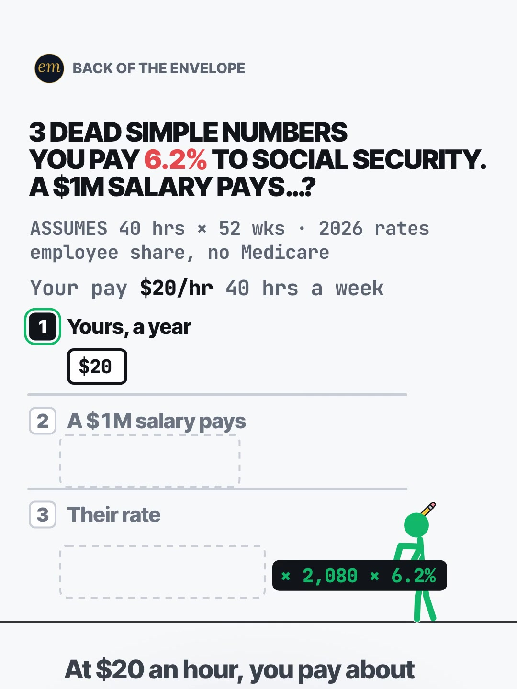

# 01b publishing sheet: you pay 6.2% Social Security, what does a $1M salary pay?

YouTube Shorts (@envelopemath) and Instagram Reels (@envelopemath). Prepared 2026-10-13. Machine-readable twin: `publishing/01b-becker-rig-20-an-hour.json`.

- **Video.** `renders/channel/01b-becker-rig-20-an-hour.mp4`: the condensed cut (14.5 s: a 12 s body + the 2.5 s card; sha256 `5b45401d…`), promoted and shipped on 2026-10-13. It replaces the 26.5 s round-2 cut (the owner: "too many still moments"), which is in git (`471c793`). The condense moved the clock and merged some captions; the numbers, the captions' facts and the verdict stay, so the copy carried over unchanged. Nothing below names a timestamp except the cover, which was re-picked by content on the shipped file. The ship rebuilt this sheet and re-exported both covers from it (`python3 publishing/tools/build_publishing.py 01b-becker-rig-20-an-hour --covers`); on the shipped specs the maths check runs 396 checks, 0 failed. The id keeps its round-2 slug (`20-an-hour`); viewers never see it, and since the write-up's hook pass 2 the topic is the Social Security wage cap.
- **Numbers.** Every figure comes from `teasers/v2/01-dead-simple-list.md` (01b) and its check, `python3 teasers/v2/checks/01-dead-simple-list.py`: 400 checks, 0 failed on `studio/specs/` (run 2026-10-13). `python3 publishing/tools/build_publishing.py 01b-becker-rig-20-an-hour --check` checks this sheet's limits, paste blocks and figures, recomputes every figure from the 2026 rate and wage base, keeps $184,500 beside its year, keeps every rounded figure 'about' or '≈', and keeps 'employee share' and the Medicare exclusion in the copy.
- **Honesty rules kept.** The title asks and never gives the result, and neither does the cover (frame 1: the question, the $20/hr input and 3 empty ledges). The Instagram caption keeps every result below 'more', the struck $62,000 guess and the $184,500 cap included. Every claim stays inside the video's verdict, "You pay 6.2%. A $1M salary pays ≈ 1.1%", with its conditions: 2026 figures, employee share, Medicare not counted. The series takes no side on the cap; the pinned comment gives both sides in numbers, as the write-up asks. No advice, no urgency, and 'Not financial advice.' is in both.
- **Sources.** The 6.2% employee rate and the 2026 wage base of $184,500: SSA's '2026 Social Security Changes' fact sheet and Kiplinger, as in the write-up. SSA is a government agency and Kiplinger is cited only as a source, so, as on 06b and 06c (whose sources are named without one), the copy needs no affiliation line: no company or brand is its subject.

---

## YouTube Shorts

### Title (vidIQ title score, short-form, scored against this channel)

| # | Title | Score | Chars |
|---|---|---:|---:|
| 1 | You Pay 6.2% Social Security. What Does a Million-Dollar Salary Pay? | 92 | 68 |
| 2 | You Pay 6.2% Social Security. What Does a Millionaire Pay? | 92 | 58 |
| 3 | You Pay 6.2% Social Security Tax. What Does a $1M Salary Pay? #SocialSecurity #taxes #paycheck | 83 | 94 |

**Pick (paste):**

```
You Pay 6.2% Social Security. What Does a Million-Dollar Salary Pay?
```

- 68 of 100 characters.
- 'Social Security' sits at characters 14-28, and the whole title is 68 characters, so the Shorts player shows it uncut. It plants the viewer's own rate (6.2%) and leaves the rival's open, the write-up's R5 move: the viewer's flat-rate guess is the wrong answer the video strikes out.
- 'Million-dollar salary' is what the VO says, and it scores 92 against 81 for the write-up's '$1M salary'. It also keeps the rival a salary, not a fortune, which is what the maths is about.
- Left out on purpose: 'cap', 'wage base' and '$184,500'. They name the twist the second ledge pays off, so they sit in the description, the tags and below the caption's fold instead.
- vidIQ's model ranks titles but does not predict views; options 1 and 2 tie, so the pick is decided on accuracy.
- Also scored, not used: "You Pay 6.2% Social Security. What Does a Millionaire Pay on a $1M Salary?" 92 (both words, no gain, 74 chars); "You Pay 6.2% in Social Security Tax. What Does a $1 Million Salary Pay?" 84; "You Pay 6.2% Social Security Tax. What Does a $1M Salary Pay?" 82; "Social Security Tax: You Pay 6.2%. What Does a $1M Salary Pay?" 82; "You Pay 6.2% Social Security Tax. What Does Someone Earning $1 Million Pay?" 82; "You Pay 6.2% Social Security. What Does a $1M Salary Pay?" 81 (the write-up's title); "You Pay 6.2% Social Security. What Does a $1M Earner Pay?" 81.

### Description (paste)

```
You pay 6.2% Social Security tax on every paycheck. What does a million-dollar salary pay? In 2026 the 6.2% stops at $184,500 of wages, so a $1M salary pays $11,439: about 1.1% of its pay. You pay more than five times their rate.

The math, shown:
• At $20 an hour, full time (40 hrs × 52 wks = 2,080 hours): $20 × 2,080 × 6.2% ≈ $2,579 a year. All $41,600 is under the 2026 cap of $184,500, so every dollar pays 6.2%.
• The flat-rate guess: $1,000,000 × 6.2% = $62,000. No.
• In 2026 it stops at $184,500 (the wage base): $184,500 × 6.2% = $11,439, the most anyone's wages pay.
• $11,439 ÷ $1,000,000 ≈ 1.1% of their pay.
• You: 6.2% on every dollar, all year. Them: about 1.1%. More than five times their rate.

Follow for the math behind your money — shown, not hand-waved. @envelopemath

Animation and original sound: The Back of the Envelope. 2026 Social Security tax, employee share: 6.2% of wages up to $184,500 (SSA, 2026 Social Security Changes; Kiplinger). Employers pay a matching 6.2% to the same cap. Medicare (1.45%, no cap) is not counted. Not modelled: self-employment tax, and a second job (each employer withholds to the cap; the excess comes back at tax time). Not financial advice.
#SocialSecurity #taxes #paycheck
```

1,234 of 5,000 characters (1,256 UTF-8 bytes; YouTube counts this limit in bytes, and `≈`, `×`, `•`, `—`, `÷` take 2-3 each). No `<` or `>`, which YouTube rejects. It follows the house template: an answer-first opening line for the search snippet, then 'The math, shown:' bullets, then the follow line. The credit, assumptions and 'Not financial advice.' line comes next, and the 3 hashtags close it. Every line that names $184,500 also names 2026: SSA updates the wage base each year. The on-screen series name 'dead simple numbers' is left out: it is Master Money's phrase (the write-up's risk note), so the copy uses the house 'The math, shown:'.

### Hashtags (order matters)

1. `#SocialSecurity`: the topic ('social security' 318,231 searches a month, up 19.8% on its 30-day baseline; 'social security taxes' 7,310).
2. `#taxes`: the category ('taxes' 82,933 a month, up 11.0%), shared with 01c.
3. `#paycheck`: where the 6.2% shows up ('paycheck' 38,765 a month), shared with 01a, so the series shares it.

The title carries no hashtags, so YouTube shows these 3, the description's first, above the title. Over 60 hashtags and YouTube ignores all of them. `#Shorts` isn't needed.

### Tags (paste; 381 of 500 characters as YouTube counts them: commas count, and a tag with a space counts 2 more for the quotes YouTube adds)

```
social security tax, social security taxes, social security, social security tax cap, the social security cap, social security wage base, social security tax limit, social security 2026, fica tax, fica taxes, fica, payroll taxes, 6.2% social security, millionaires social security, taxes, paycheck, money math, math animation, the back of the envelope, envelope math
```

Tags carry little weight. These mirror the keyword research plus the house's channel tags. The cap phrases carry the twist the title keeps back. Left out on purpose: 'social security cap proposal' (3,590 a month) and 'scrap the cap' (under 750) are policy intent, and the series takes no side; 'how to pay no social security tax' (4,117) is avoidance intent; 'medicare tax' (5,169) is a tax the video does not count; 'social security benefits' (58,949) and 'social security update' (80,835) want benefit news.

### Pinned comment (post it, then pin it)

```
What's your hourly wage? Up to $184,500 of pay in 2026, Social Security takes 6.2% of every dollar: at $20 an hour full time, ≈ $2,579 a year.

Both sides, in numbers: in dollars the $1M salary still pays 4.4× what you pay (≈ $2,579), on 24× the pay. And the cap works both ways: pay above $184,500 (2026) doesn't count toward their Social Security benefit either. Social Security only, employee share: Medicare (1.45%) has no cap.
```

The question comes first so it shows in the collapsed preview, and it asks for the viewer's own number (R3): under the cap, any wage pays 6.2% on every dollar. The second paragraph is the write-up's pinned comment: it answers the fairness comments the write-up expects ('scrap the cap') with both sides in numbers, so the series takes no side. It also repeats the conditions (2026, employee share, no Medicare).

### Related video and end screen

- **Related video:** [You Can Lean on $1 Million. Not on $1 Billion.](https://www.youtube.com/shorts/hJBvmGA6sZ0) (`hJBvmGA6sZ0`). The same $1 million, seen another way (a stack of bills), for the viewer this title draws. It is the channel's second-best Short (1,221 views).
- **Swap later:** 01c (the same dead-simple-list series, also a paycheck tax), once published; then 01a. Then point theirs at this Short.
- **End screen:** Shorts have no end screens or cards. The Related video link is the Shorts equivalent.

### Thumbnail and settings

- **Thumbnail:** in the YouTube app, pick frame 1 (the clean cover: the question with the red 6.2%, the $20/hr input and 3 empty ledges), the same content as the Instagram cover below.
- **Settings:** Category Education. Not made for kids. Altered or synthetic content: No (it's an animated chart, not realistic footage). Remixing allowed. No captions needed: there's no narration and all the text is on screen.

### Posting window

- **When:** First Tue-Thu evening after the condensed cut ships and passes QA, 21:30-22:30 ET (01:30-02:30 UTC the next day): Tue 13 Oct 2026 at the earliest. Sunday 06:00-08:00 ET is the alternative.
- **Spacing:** Keep it at least 6 h from any other upload on the channel, and on a different evening from 01a and 01c (the same series). Suggested order: 01b first, then 01c, then 01a (see why).
- **Why:** The channel's own October Shorts, median views by posting slot (vidIQ, 2026-10-13): Sunday 05:00-08:00 ET 1,198 (n = 2), weekday 22:00-00:30 ET 642 (n = 3), weekday midday 263 (n = 2); 06c (Mon 03:45 ET) has 760 and 06b (Mon 12:14 ET) 61 a day or less after posting, too young to compare. The evening slot is also the best one on Instagram, so one evening serves both. n = 7 and confounded by topic, so treat it as a test. Why first: 'social security' runs +19.8% and 'social security benefits' +31.7% over their 30-day baselines, and SSA published the 2026 wage base ($184,500) with its COLA fact sheet in October 2025 (the write-up's source), so the 2027 figure may come out about now. Every line naming $184,500 also names 2026, so the copy stays true; posting early avoids 'that's last year's cap' comments, and the pinned reply can name the new figure once SSA publishes it.

---

## Instagram Reels

### Caption (paste)

```
You pay 6.2% Social Security tax on every paycheck. What does a million-dollar salary pay? The math, on a $20/hr wage.

At $20 an hour, full time: $20 × 2,080 hours × 6.2% ≈ $2,579 a year. All $41,600 is taxed: every dollar, all year.

A million-dollar salary at a flat 6.2% would pay $62,000. It doesn't. In 2026 the tax stops at $184,500 of wages:
• $184,500 × 6.2% = $11,439, the most anyone's wages pay in 2026.
• $11,439 ÷ $1,000,000 ≈ 1.1% of their pay.

You pay 6.2%. A $1M salary pays ≈ 1.1%. You pay more than five times their rate.

2026 figures, employee share (employers match it to the same cap). Medicare (1.45%) has no cap and isn't counted. Not financial advice.

What's your hourly wage?

Follow for the math behind your money — shown, not hand-waved. @envelopemath
Animation and original sound: The Back of the Envelope.

#socialsecurity #taxes #paycheck #moneymath #personalfinance
```

- 900 of 2,200 characters.
- **First 125 characters:** the question with the keywords 'Social Security tax' and 'million-dollar salary' and the $20/hr input, with no result. The write-up says caption line 1 is the verdict (R11) and its own caption opens with the cap; the house rule moves both below 'more', because the caption overlays the Reel from frame 1. The numbers sit below the fold, where Instagram search and Google indexing still read them.
- The verdict is the write-up's share line ('You pay 6.2%. A $1M salary pays ≈ 1.1%'), and the conditions line follows it (2026, employee share, no Medicare).
- The caption follows the house close: the follow line plus the credit.

### Hashtags (5, Instagram's cap since Dec 2025)

`#socialsecurity #taxes #paycheck #moneymath #personalfinance`

Four are the write-up's own (`#socialsecurity #paycheck #moneymath #taxes`, all kept):

- `#socialsecurity` names the topic. The Social Security hearing clip in the outlier search (1.8M on Instagram) is in the same news stream.
- `#taxes` and `#paycheck` name the category and where the 6.2% shows up.

`#personalfinance` is the broad layer, as on 06b and 06c, and `#moneymath` is the write-up's series tag.

### Alt text

- **Short (93 characters; paste this one into Instagram):** Animation: you pay 6.2% Social Security on all your pay; a $1M salary pays about 1.1% (2026).
  - It stays at or under 100 characters, so it fits the field however short it is. It says 'about', not '≈', so screen readers read it cleanly. The 1.1% keeps its 'about', as everywhere else, and the year stays with it.
- **Long (for anywhere with room, such as a website embed):** Animation on a white background. The header reads: 3 dead simple numbers. You pay 6.2% to Social Security. A $1M salary pays…? A green stick figure throws formula plates onto 3 numbered ledges. Yours, a year: $20 an hour × 2,080 hours × 6.2% ≈ $2,579, in red. A $1M salary pays: he works the flat-rate guess, $1,000,000 × 6.2% = $62,000, and strikes it out in red; the real block, $184,500 (the 2026 cap), crushes it: × 6.2% = $11,439. Their rate: $11,439 ÷ $1,000,000 ≈ 1.1%, on a gold plate, and he jumps, shocked. Verdict: You pay 6.2%. A $1M salary pays about 1.1%.
- **Where:** Advanced settings → Accessibility → Alt text, if your app shows it for Reels.

### Cover



- **Files:** `publishing/01b-becker-rig-20-an-hour-cover-3x4.jpg` (1080×1440) and `publishing/01b-becker-rig-20-an-hour-cover-9x16.jpg` (1080×1920). Both come from the shipped (14.5 s) render at 0 s (frame 0).
- **Frame, by content:** The clean cover, frame 1: the header '3 DEAD SIMPLE NUMBERS / YOU PAY 6.2% TO SOCIAL SECURITY. / A $1M SALARY PAYS…?' ('6.2%' in red), the footer 'ASSUMES 40 hrs × 52 wks · 2026 rates / employee share, no Medicare', the input line 'Your pay $20/hr 40 hrs a week', 3 numbered ledges labelled 'Yours, a year / A $1M salary pays / Their rate' (the last two with empty sockets), ① active with its '$20' block, and the green stick figure holding the '× 2,080 × 6.2%' plate. No result: it asks and does not answer, like the title and the caption. The write-up names frame 1 as the Instagram cover. On any cut, use the opening frame, before the figure flips the plate. A cut whose hook caption is already up on its first frame (the shipped condensed cut's is) still gives a clean cover: 'At $20 an hour, you pay about' holds no result. On the shipped 14.5 s condensed cut, frame 0 (0.00 s) is that frame and the only still one: the complete hook caption 'At $20 an hour, you pay about' is already up (it holds no result), and from frame 1 (0.03 s) the figure dips to flip the plate (mean frame-to-frame luma change 1.57, 270×480 greyscale). On the 26.5 s pre-condense render frame 0 had no caption. If the cut changes, re-pick it by content.
- **Crop:** 3:4 = 1080×1440, the top 1440 rows (y 0 to 1440) of the 1080×1920 frame: the badge, the header, the footer, the input line, the 3 ledges, the figure and the floor line, with even margins above the badge and below the floor; it drops the empty floor below. A crop from y 60 (as on 01a) leaves 200 px of empty floor. A centred grid crop (y 240-1680) cuts the badge and leaves the header on the edge.
- **How to set it:** In 'Edit cover', pick frame 1 of the video (or upload the 9:16 JPG), then drag 'Profile grid' to the top so the tile matches the 3:4 JPG. Do not upload the 3:4 JPG as the Reel cover: Instagram centre-crops it to 9:16 in the Reels tab and cuts the header.
- **Re-export:** `ffmpeg -ss 0 -i renders/channel/01b-becker-rig-20-an-hour.mp4 -frames:v 1 -vf "crop=1080:1440:0:0" -q:v 2 publishing/01b-becker-rig-20-an-hour-cover-3x4.jpg` and `ffmpeg -ss 0 -i renders/channel/01b-becker-rig-20-an-hour.mp4 -frames:v 1 -q:v 2 publishing/01b-becker-rig-20-an-hour-cover-9x16.jpg`, or `python3 publishing/tools/build_publishing.py 01b-becker-rig-20-an-hour --covers`.
- **Not used:** the verdict hold (the finished sheet with 'You pay 6.2%. A $1M salary pays ≈ 1.1%.'). It is the save-worthy frame, but it shows the answer, against the write-up's cover note and the title's no-result rule.
- **Shipped cut (2026-10-13):** frame 1 was re-picked by content on the shipped file and both JPGs re-exported from it: the same picture as the pre-condense cut's frame 1, plus the complete hook caption, which holds no result.

### First comment (post it, then pin it)

```
You pay 6.2% on every dollar. A $1M salary pays ≈ 1.1%: the 6.2% stops at $184,500 of pay in 2026. Employee share; Medicare not counted. What's your hourly wage?
```

### Trial Reels

**Post as a regular Reel, not a Trial.** @envelopemath has 8 followers, so a regular Reel is already shown almost entirely to non-followers, which is all a Trial Reel adds. A Trial would also keep it off the profile grid until shared. A hook test afterwards, if you want one: the other cut as a Trial with MANUAL graduation 48-72 h later. The condensed cut replaced the pre-condense render in renders/channel on 2026-10-13; get the pre-condense one from git with `git show 471c793:renders/channel/01b-becker-rig-20-an-hour.mp4 > 01b-26.5s.mp4` (sha256 869e23a7…). Compare skip rate (October Reels ran 27.0-65.1%; 06c's condensed cut 40.3%) and average watched %, then share the winner. vidIQ's publish tool exposes Trial (MANUAL or SS_PERFORMANCE) for this connected account. Confirm eligibility in the app.

### Posting window and settings

- **When:** Same evening as YouTube, about 15 min after the Short: 21:45-22:45 ET, Tue 13 Oct 2026 at the earliest, on a different evening from 01a and 01c.
- **Why:** October Reels, median plays by posting slot (owner insights, 2026-10-13): weekday 22:00-00:30 ET 5,449 (n = 3, including the two best: 7,302 and 5,449), weekday midday 1,212 (n = 2), Sunday 05:00-08:00 ET 1,087 (n = 2). 06c, posted Mon 03:46 ET, has 1,711 plays with a 40.3% skip rate. Skip rate tracks plays more closely than the hour does: 27.0-27.4% for the top two, 56.9-65.1% for the bottom two. The condense matters more than the hour.
- **Audio:** Rename the original audio to 'Social Security vs a $1M salary — The Back of the Envelope' if the app allows; it is the score, with no voice.
- **Share to feed:** On.

---

## Why these choices (research evidence)

**1. Search demand (vidIQ keyword research, pulled 2026-10-13).** vidIQ refreshes each keyword on its own schedule, so the last column gives each row's snapshot date. Six rows are older snapshots.

| Keyword | Est. searches/month | Competition | Overall | Note | vidIQ as of |
|---|---:|---:|---:|---|---|
| social security | 318,231 | 76.0 | 58.9 | +19.8% vs its 30-day baseline (265,693); very high competition | 2026-10-12 |
| social security benefits | 58,949 | 52.6 | 61.7 | +31.7% vs its baseline (44,753); benefit news, not in the tags | 2026-10-12 |
| fica | 23,427 | 54.4 | 57.4 | -32.3% vs its baseline (34,616) | 2026-10-12 |
| social security taxes | 7,310 | 50.2 | 54.5 |  | 2026-10-12 |
| social security tax | 5,251 | 50.3 | 53.2 | seed; -46.2% vs its baseline (9,765) | 2026-10-12 |
| fica taxes | 5,031 | 32.6 | 60.1 |  | 2026-09-17 |
| payroll taxes | 4,429 | 46.8 | 53.9 |  | 2026-09-03 |
| how to pay no social security tax | 4,117 | 32.5 | 59.4 | avoidance intent: not in the tags | 2026-07-30 |
| the social security cap | 3,857 | 51.9 | 51.4 | the twist: in the tags, not in the title | 2026-05-01 |
| social security cap proposal | 3,590 | 19.9 | 63.9 | policy intent: not in the tags | 2026-05-02 |
| fica tax | 3,430 | 22.8 | 62.5 |  | 2026-09-19 |
| taxes | 82,933 | 52.5 | 63.1 | +11.0% vs its baseline (74,718) | 2026-10-12 |
| social security wage base | 0 (<750) | 23.9 | 30.4 | <750/month: SSA's own term | no snapshot |
| social security tax limit | 0 (<750) | 27.3 | 29.1 | <750/month | no snapshot |
| social security tax cap | 0 (<750) | 35.5 | 25.8 | <750/month | no snapshot |
| scrap the cap | 0 (<750) | 23.3 | 30.7 | <750/month; the slogan the write-up expects in the comments | no snapshot |

'Social Security' is the big, crowded word (318,231 a month, competition 76.0, rising 19.8%); the tax phrases are mid-sized ('social security taxes' 7,310, 'social security tax' 5,251, 'fica taxes' 5,031). So the title leads with the viewer's '6.2% Social Security' and the description's first line says 'Social Security tax'. The cap itself is barely searched by name ('the social security cap' 3,857; 'wage base', 'tax limit', 'tax cap' and 'scrap the cap' all under 750), which suits a title that keeps the twist for the video.

**2. The cap is covered on YouTube, but as a date, not a rate (vidIQ YouTube search and outliers, Shorts, by views and by relevance).**

| Title | Channel (subs) | Views | Date |
|---|---|---:|---|
| Social Security Tax Hits Working People Hardest, Senator Says | Viral Flux Daily (4,780) | 46,137 | 2026-09-28 |
| The Social Security FICA payroll tax on your earnings caps out at $184,500 and 2026 | The Medicare Family (200,000) | 2,756 | 2026-08-08 |
| The Social Security tax cap means millionaires stop paying in #Shorts | The WLTH Hub (38) | 1,094 | 2026-09-25 |
| Social Security Tax Hike: Are You Ready for 2026? #shorts | Guardian Financial, Inc. (41,900) | 523 | 2026-04-06 |
| Millionaires Stop Paying Social Security #Shorts | FinanceGuyFi (15) | 338 | 2026-03-10 |
| High-Income Paycheck Mystery: Social Security Tax Explained! #shorts | Guardian Financial, Inc. (41,900) | 249 | 2026-10-11 |
| 2026 Social Security Tax Cap: $184,500 - What High Earners Should Know | TaxSaveUSA (1) | 83 | 2026-09-30 |
| The Day Millionaires Stop Paying Social Security Tax | The Cents of It (7) | 4 | 2026-09-17 |

The cap gets posted in two ways: 'the day millionaires stop paying' (a date in March or April) and high-earner tips ('what high earners should know'). The biggest same-topic Short found is a 6-second politics clip (46,137 views); the explainers are all under 2,800, and three were posted in the last month.

None sets the rate a $1M salary pays (≈ 1.1%) against the viewer's own 6.2%, and none works the flat-rate guess and strikes it out. So the pick plants the viewer's rate and asks the rival's, the one question only this video answers on screen.

**3. The rate gap travels on Instagram and TikTok (vidIQ IG/TikTok outlier search, since June 2024, at least 5K views).**

- **@rogue_knigh_t** (Instagram), a static tweet that opens on giving 6.2% of your paycheck to Social Security: 1.3M (42.8x).
  - The viewer's own 6.2% is the hook, as in this header.
- **@oddsonpolitics_** (Instagram), "Murray: Is it true that people making under $184,000 pay a 12.4% Social Security tax rate?": 1.8M (3.7x); the TikTok post 328.5K (114.6x).
- **@mcbnnews0** (TikTok), the same hearing clip: 129K (113.0x).
- The hearing clip asks the same question as this Short, the rate by income, and opens on the question, not the answer. Its 12.4% counts the employer's half; this Short and its copy use the employee share (6.2%), as the footer says.

**4. Our own October numbers (vidIQ: public YouTube stats, Instagram owner insights; refreshed 2026-10-13).**

| YouTube Short | Posted (ET) | Views |
|---|---|---:|
| Can You Find the Missing Dollar? (`LjHDFzVxRyM`) | Sun 07:04 | 1,254 |
| You Can Lean on $1 Million. Not on $1 Billion. (`hJBvmGA6sZ0`) | Thu 00:25 | 1,221 |
| Your Interest Has a Speed Limit (`XVUeMcTg9OQ`) | Sun 05:49 | 1,141 |
| What If You Bought Starbucks Stock Instead of a $4 Latte Every Day? (06c) (`fbpdKf4Wy8c`) | Mon 03:45 | 760 |
| Pay the Minimum on $5,000? 238 Months. (`8__HTUa2PoU`) | Mon 22:09 | 642 |
| A $2 Lottery Ticket Was Worth $6.98. Until the Fine Print. (`FW_oxA3kbsM`) | Wed 12:03 | 348 |
| You Can Carry $1 Million. Not in Pennies. (`mXbKY_R63h4`) | Thu 13:38 | 177 |
| Start Investing 10 Years Late? You Get Half. (`EqFQCJheCMU`) | Tue 22:27 | 161 |
| What If You Bought Netflix Stock Instead of Paying for Netflix? (06b) (`krfZEHhb0xU`) | Mon 12:14 | 61 |

| Instagram Reel | Posted (ET) | Plays | Skip rate | Avg watched |
|---|---|---:|---:|---:|
| $5,000 on the minimum (`DeIvYk7I4Qr`) | Mon 22:46 | 7,302 | 27.4% | 56.5% |
| $1M stack vs Burj Khalifa (`DeOEthJJ1TG`) | Thu 00:28 | 5,449 | 27.0% | 83.1% |
| Missing dollar (`DeWgFZRoR_S`) | Sun 07:05 | 1,997 | 32.0% | 81.3% |
| Powerball $6.98 (`DeMvZv9IqRw`) | Wed 12:05 | 1,825 | 58.7% | 57.9% |
| 06c latte vs Starbucks stock (`DeYuqT4pjVC`) | Mon 03:46 | 1,711 | 40.3% | 69.1% |
| $1M in pennies (`DePe11HIHwn`) | Thu 13:37 | 598 | 42.0% | 66.7% |
| 10 years late (`DeLSd9io8UK`) | Tue 22:30 | 219 | 65.1% | 30.6% |
| Speed limit (e) (`DeEW2ZMIiYd`) | Sun 05:54 | 177 | 56.9% | 31.2% |

Channel totals:

- **YouTube:** 53 subscribers, 10,221 views and 41 videos (+27 subscribers, +5,127 views and 11 videos in 30 days).
- **Instagram:** 8 followers and 20,518 views in 30 days.

06b went live on both on Mon 12 Oct at about 12:14 ET (YouTube `krfZEHhb0xU`, Instagram `DeZov75oo9o`), with the house 3-hashtag title (its sheet's option 3): 61 views and 7 plays the next morning, too young to compare. 06c, a day older, has 760 views and 1,711 plays (40.3% skip).

The two $1 million Shorts split: the Burj Khalifa stack drew 1,221 views and 5,449 plays (27.0% skip), the pennies one 177 and 598: the same $1 million, very different results.

Medians by posting slot (n = 2-3 each, confounded by topic; 06b and 06c left out as too young):

- **YouTube:** Sunday early morning ET 1,198, weekday 22:00-00:30 ET 642, weekday midday 263.
- **Instagram:** weekday 22:00-00:30 ET 5,449, midday 1,212, Sunday early morning 1,087.

One weekday evening is the best Instagram slot and the second-best YouTube slot, so the plan posts both then. On Instagram, skip rate predicts plays better than the hour does (27.0-27.4% for the top two, 56.9-65.1% for the bottom two). So the window is a light-touch test, and the condense (fewer still moments) is the bigger reach lever.

**5. Platform rules applied.**

- **YouTube title:** 100 characters. The Shorts player shows only the opening, so the keywords come first.
- **YouTube description:** 5,000 characters.
- **YouTube hashtags:** the first 3 show; over 60 and all are ignored; `#Shorts` isn't needed.
- **YouTube tags:** 500 characters, low weight.
- **YouTube Shorts:** no end screens. The Related video link is the Shorts equivalent.
- **YouTube AI disclosure:** only for realistic altered content.
- **Instagram caption:** 2,200 characters, about 125 shown before 'more'.
- **Instagram hashtags:** 5 at most.
- **Instagram search and Google:** keywords in the caption feed Instagram search, and Google indexes public professional posts (since 10 Jul 2025).
- **Instagram grid:** a 3:4 crop of the 9:16 cover.
- **Trial Reels:** shown to non-followers only.

**6. Limits.**

- @envelopemath's YouTube Analytics (audience hours, geography) were not read here; the 06b and 06c sheets found vidIQ's YouTube authorization is a different channel. Check Studio → Analytics → Audience → 'When your viewers are on YouTube' before posting.
- vidIQ has no hashtag-volume data; hashtag picks lean on keyword volume and on the write-up's and the outliers' own tags.
- Title scores are vidIQ's short-form CTR model for this channel; they rank options but do not predict views.
- The 2026 wage base ($184,500) is the write-up's figure (SSA and Kiplinger). SSA's 2027 figure was not looked up here; when it is published, the copy stays true because it names 2026 wherever it names $184,500.
- The video, the cover and the video facts are the shipped condensed cut (2026-10-13); the copy is cut-independent and carried over from the pre-condense cut unchanged.

---

## Check log (adversarial pass, 2026-10-13)

- **Maths.** `python3 teasers/v2/checks/01-dead-simple-list.py`: 400 checks, 0 failed on `studio/specs/` and 392 checks, 0 failed with `--spec` on the three condensed WIP specs. Every public figure traces to the 01b maths table: 40 × 52 = 2,080; $20 × 2,080 × 6.2% = $2,579.20 ≈ $2,579; $20 × 2,080 = $41,600, under $184,500; the struck guess $1,000,000 × 6.2% = $62,000; $184,500 × 6.2% = $11,439; $11,439 ÷ $1,000,000 = 1.1439% ≈ 1.1%; 6.2 ÷ 1.1439 = 5.42 ('more than five times'); pinned 4.4× and 24×. The data file recomputes each one.
- **Limits.** Title 68/100. Description 1,234 characters (1,256 bytes) of 5,000. 3 hashtags. Tags 381/500 as YouTube counts them. Instagram caption 900/2,200, with the first 125 characters result-free. 5 hashtags. Short alt text 93. No `<` or `>`.
- **vidIQ.** Keywords pulled 2026-10-13 (table above). 10 titles scored against this channel: the pick 92, the write-up's title 81. Channel 53 subscribers / 10,221 views / 41 videos; Instagram owner insights refreshed (8 followers, 20,518 views in 30 days).
- **vidIQ re-queried.** After the build: the pick's title score 92; 'social security taxes' 7,310 / 50.2. At the adversarial check: the pick's title score 92; 'social security tax' 5,251 / 50.3 (-46.2% on its 9,765 baseline). All match.
- **Changed.**
  - The cover note said 'on any cut, use the last frame before the first caption word appears'. The condensed WIP spec starts its hook caption before frame 1, so that cut has no caption-free frame and the rule would point at nothing. The cover is now 'the opening frame, before the figure flips the plate', and the note says the hook caption ('At $20 an hour, you pay about') holds no result.
  - The pinned comment's '$20 an hour, ≈ $2,579 a year' now says 'full time': the $2,579 is $20 × 2,080 hours (40 × 52), as the description and the caption already say.
  - The math run said 397 checks: the condense updated the check script since, and it now runs 400 on `studio/specs/` (392 on the WIP specs), 0 failed.
  - The no-result patterns matched 'cap', 'stops' and 'wage base' in lower case only, so a title-case 'Hits the Cap' passed. Both patterns are now case-blind and also catch 'less' and 'lower' (the rival's rate is the payoff). Each of this sheet's rules now fails a broken copy by name ('Hits the Cap', 'Pay Less?', $184,500 without 2026, 1.1% without 'about').
- **Checked.**
  - The cover, frame 1, carries no result (both JPGs read by eye): on the render frame 0 is the only caption-free frame (the first caption word fades in at frame 1, the plate flip starts at frame 4, measured).
  - The long alt text names only beats both cuts keep (the struck $62,000, the crushing $184,500 block, the shocked jump), and the copy names no timestamp.
  - Brands: SSA is a government agency and Kiplinger is named only as a source, as 06b and 06c name their sources (Macrotrends, CNBC, FinanceBuzz) with no affiliation line; no company is the copy's subject.
  - 'Not financial advice.' is in the description and the caption. No side on the cap: the pinned comment gives both sides in numbers, as the write-up asks.
  - The pre-condense render in git (`471c793`) had the same sha256 as `renders/channel` before the ship, so the Trial Reels `git show` command fetches this file.
- **Kept on purpose.**
  - The cover is frame 1 (no result), as the write-up asks.
  - 'Million-dollar salary', not 'millionaire': the same score, and accurate (the maths is about a salary).
  - 'Cap', 'wage base' and $184,500 stay out of the title and the caption's first 125 characters: they name what the second ledge pays off.
  - The write-up's caption opens with the cap ('6.2% of every dollar you earn, up to $184,500'); the house rule moves it below 'more'.
  - The short alt text keeps the verdict's 'you pay 6.2%' framing: it is the video's own verdict, and the year stays with it.
- **Done on ship (2026-10-13).** Rebuilt with `--covers` from the shipped condensed cut (14.5 s). Frame 1 was re-picked by content and is still frame 0, now with the complete hook caption on it. The Video bullet, the cut and the check counts follow the shipped file (396 checks, 0 failed on `studio/specs/`), and the long alt text was re-read against the condensed beat sheet: every beat it names is in the shipped cut, so no copy changed.
