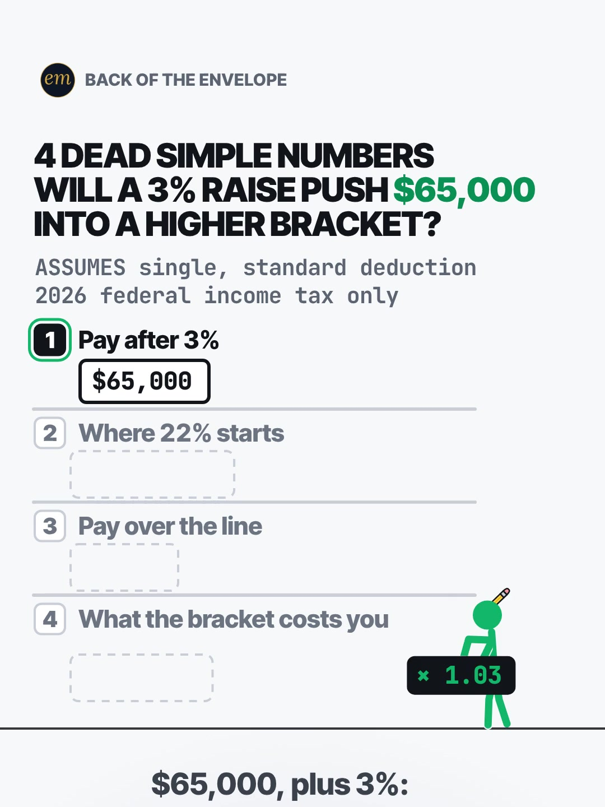

# 01c publishing sheet: will a 3% raise push you into a higher tax bracket?

YouTube Shorts (@envelopemath) and Instagram Reels (@envelopemath). Prepared 2026-10-13. Machine-readable twin: `publishing/01c-becker-rig-60k-a-year.json`.

- **Video.** `renders/channel/01c-becker-rig-60k-a-year.mp4`: the condensed cut (14.767 s: a 12.25 s body + the 2.517 s card; sha256 `8799d217…`), promoted and shipped on 2026-10-13. It replaces the 27.8 s round-2 cut (the owner: "too many still moments"), which is in git (`471c793`). The condense moved the clock and merged some captions; the numbers, the captions' facts and the verdict stay, so the copy carried over unchanged. Nothing below names a timestamp except the cover, which was re-picked by content on the shipped file. The ship rebuilt this sheet and re-exported both covers from it (`python3 publishing/tools/build_publishing.py 01c-becker-rig-60k-a-year --covers`); on the shipped specs the maths check runs 396 checks, 0 failed.
- **Numbers.** Every figure comes from `teasers/v2/01-dead-simple-list.md` (01c) and its check, `python3 teasers/v2/checks/01-dead-simple-list.py`: 400 checks, 0 failed on `studio/specs/` (run 2026-10-13). `python3 publishing/tools/build_publishing.py 01c-becker-rig-60k-a-year --check` checks this sheet's limits, paste blocks and figures, recomputes the full 2026 federal tax before and after the raise, keeps the 2026 bracket figures beside their year and the $45 beside 'a year', and keeps 'single filer' and 'federal income tax only' in the copy.
- **Honesty rules kept.** The title asks and never gives the result ('Yes', $45), and neither does the cover (frame 1: the question, the $65,000 block and 4 empty ledges). The title's 'What It Really Costs' echoes the last ledge's label, 'What the bracket costs you', which is on screen from frame 1. The Instagram caption keeps every result below 'more'. Every claim stays inside the video's verdict, "Higher bracket? Yes. It costs you $45 a year", with its conditions: 2026, single filer, standard deduction, federal income tax only, and only for salaries a 3% raise carries across the line. No advice, no urgency, and 'Not financial advice.' is in both.
- **Sources.** The 2026 single brackets (12% to $50,400 of taxable income, 22% above) and the $16,100 standard deduction: the IRS (Rev. Proc. 2025-32 and its newsroom release), the Tax Foundation and CPA Practice Advisor, as in the write-up. They are cited as sources only; no company or brand is the copy's subject, so, as on 06b and 06c, no affiliation line is needed.

---

## YouTube Shorts

### Title (vidIQ title score, short-form, scored against this channel)

| # | Title | Score | Chars |
|---|---|---:|---:|
| 1 | Does a 3% Raise Put You in a Higher Tax Bracket? What It Really Costs on $65,000 | 94 | 80 |
| 2 | Does a Raise Put You in a Higher Tax Bracket? What It Really Costs on $65,000 | 94 | 77 |
| 3 | Will a 3% Raise Push You Into a Higher Tax Bracket? #taxbracket #raise #taxes | 85 | 77 |

**Pick (paste):**

```
Does a 3% Raise Put You in a Higher Tax Bracket? What It Really Costs on $65,000
```

- 80 of 100 characters.
- The first question, 'Does a 3% Raise Put You in a Higher Tax Bracket?', is the first 48 characters, so a title cut short still asks it whole. It is the searched question ('does a raise put you in a higher tax bracket', 4,364 a month) with the video's 3%, and it carries 'higher tax bracket' (4,543, competition 15.3).
- The second question, 'What It Really Costs on $65,000', is the last ledge's label ('What the bracket costs you', on screen from frame 1) on the header's input. It promises a cost and does not give it; the description's first line answers it ('Yes. It costs $45 a year'), as the house template does.
- Most same-idea titles in the research answer 'no' outright ('No, It Doesn't', 'A Raise Will Never Lower Your Paycheck'), and the ones that only ask ('Can a Raise Make You Take Home Less Money?') answer 'no' in their descriptions where they have one. This video's honest answer is 'yes, and it costs $45 a year', so the title asks and lets the video say it.
- It raises the write-up's title from 85 to 94. vidIQ's model ranks titles but does not predict views; options 1 and 2 tie, so the pick is decided on accuracy.
- Also scored, not used: "Does a Raise Put You in a Higher Tax Bracket? What It Really Costs" 91; "Will a 3% Raise Push You Into a Higher Tax Bracket? What It Really Costs" 90; "Will Your Raise Push You Into a Higher Tax Bracket? The 2026 Math on $65,000" 89; "Does a Raise Put You in a Higher Tax Bracket? What the Bracket Costs on $65,000" 89 (the last ledge's label word for word); "Will a 3% Raise Push You Into a Higher Tax Bracket?" 85 (the write-up's title); "Will a 3% Raise Push $65,000 Into a Higher Tax Bracket?" 84 (the on-screen header's grammar); "Will a 3% Raise Push You Into a Higher Tax Bracket? #taxes #taxbracket #raise" 85 (option 3's first hashtag order, not the description's).

### Description (paste)

```
Does a 3% raise push $65,000 into a higher tax bracket? Yes. It costs $45 a year, not your raise. In 2026, 22% starts at $66,500 of pay for a single filer on the standard deduction, and a 3% raise takes $65,000 to $66,950: $450 over the line.

The math, shown:
• $65,000 × 1.03 = $66,950 (a $1,950 raise).
• Where 22% starts in 2026: $50,400 of taxed pay + the $16,100 standard deduction = $66,500 of pay.
• $66,950 − $66,500 = $450 over the line.
• Only those $450 pay 22% instead of 12%: 10 points more. $450 × 10% = $45 a year.
• Not your whole raise. Not your whole pay. Every other dollar is taxed exactly as before.
• Check, full 2026 federal tax: $5,620 before, $5,899 after. The $279 of tax on the raise is $45 a year more than the same $1,950 taxed all at 12% ($234).

Crossed the line too? (new pay − $66,500) × 10% is all the bracket costs you, for any salary a 3% raise carries across it ($64,564 to $66,499).

Follow for the math behind your money — shown, not hand-waved. @envelopemath

Animation and original sound: The Back of the Envelope. 2026 federal income tax, single filer: standard deduction $16,100; 12% bracket to $50,400 of taxable income, 22% above it (IRS; Tax Foundation; CPA Practice Advisor). Federal income tax only: no state tax, FICA or credits; pre-tax 401(k) or HSA deferrals move the line up; other filing statuses have their own lines. Not financial advice.
#taxbracket #raise #taxes
```

1,421 of 5,000 characters (1,442 UTF-8 bytes; YouTube counts this limit in bytes, and `×`, `•`, `—`, `−` take 2-3 each). No `<` or `>`, which YouTube rejects. It follows the house template: an answer-first opening line for the search snippet, then 'The math, shown:' bullets, then the follow line. The credit, assumptions and 'Not financial advice.' line comes next, and the 3 hashtags close it. The opening line answers the title, as the house template does for the search snippet; the title and the caption's first 125 characters do not. Every line that names $50,400 or $16,100 also names 2026: the IRS updates both each year. The on-screen series name 'dead simple numbers' is left out: it is Master Money's phrase (the write-up's risk note), so the copy uses the house 'The math, shown:'.

### Hashtags (order matters)

1. `#taxbracket`: the exact topic ('tax bracket' 5,134 searches a month, competition 28.2; '2026 tax brackets' 8,249).
2. `#raise`: the trigger ('pay raise' 9,533 a month, up 76.6% on its 30-day baseline).
3. `#taxes`: the category ('taxes' 82,933 a month, up 11.0%), shared with 01b, so the series shares it.

The title carries no hashtags, so YouTube shows these 3, the description's first, above the title. Over 60 hashtags and YouTube ignores all of them. `#Shorts` isn't needed.

### Tags (paste; 354 of 500 characters as YouTube counts them: commas count, and a tag with a space counts 2 more for the quotes YouTube adds)

```
tax bracket, tax brackets, higher tax bracket, does a raise put you in a higher tax bracket, will a raise put me in a higher tax bracket, tax bracket myth, 2026 tax brackets, tax brackets explained, income tax bracket explained, marginal tax rate, pay raise, raise, taxes, money math, math animation, the back of the envelope, envelope math
```

Tags carry little weight. These mirror the keyword research plus the house's channel tags. 'Marginal tax rate' is under 750 a month but names the rule the video shows. Left out on purpose: 'will bonus push me into higher tax bracket' (3,429 a month): bonuses are withheld differently, and the video is about a raise; 'income tax' (64,908, up 149.6%) is mostly searched outside the US.

### Pinned comment (post it, then pin it)

```
What's your salary? If a 3% raise carries it over $66,500 (2026, single filer, standard deduction), the bracket costs (new pay − $66,500) × 10% a year. That covers salaries from $64,564 to $66,499: below, a 3% raise doesn't reach the line; above, you were already in 22%.

If the myth were true (all taxed pay 10 points more): 10% × $50,850 = $5,085 a year. Real extra: $45 a year. On the whole $1,950 raise: federal income tax $279, FICA $149.18, so you keep ≈ $1,522.
```

The question comes first so it shows in the collapsed preview, and it asks for the viewer's own number (R3). It answers the comment the write-up expects ('what about my salary?') with the caption's rule and its salary window, and says what happens on either side of it. The second paragraph is the write-up's pinned comment: the myth's $5,085 against the real $45, and what the raise leaves after federal tax and FICA.

### Related video and end screen

- **Related video:** [A $2 Lottery Ticket Was Worth $6.98. Until the Fine Print.](https://www.youtube.com/shorts/FW_oxA3kbsM) (`FW_oxA3kbsM`). The same 'what do you really keep after tax?' question, on a jackpot instead of a raise; its Reel works through cash, the crowd and tax.
- **Swap later:** 01b (the same dead-simple-list series, also a paycheck tax), once published; then 01a. Then point theirs at this Short.
- **End screen:** Shorts have no end screens or cards. The Related video link is the Shorts equivalent.

### Thumbnail and settings

- **Thumbnail:** in the YouTube app, pick frame 1 (the clean cover: the question with the green $65,000 and 4 labelled, empty ledges), the same content as the Instagram cover below.
- **Settings:** Category Education. Not made for kids. Altered or synthetic content: No (it's an animated chart, not realistic footage). Remixing allowed. No captions needed: there's no narration and all the text is on screen.

### Posting window

- **When:** First Tue-Thu evening after the condensed cut ships and passes QA, 21:30-22:30 ET (01:30-02:30 UTC the next day): Tue 13 Oct 2026 at the earliest; in the suggested order (01b, 01c, 01a, one evening each) that is Wed 14 Oct. Sunday 06:00-08:00 ET is the alternative.
- **Spacing:** Keep it at least 6 h from any other upload on the channel, and on a different evening from 01a and 01b (the same series). Suggested order: 01b, then 01c, then 01a (see why).
- **Why:** The channel's own October Shorts, median views by posting slot (vidIQ, 2026-10-13): Sunday 05:00-08:00 ET 1,198 (n = 2), weekday 22:00-00:30 ET 642 (n = 3), weekday midday 263 (n = 2); 06c (Mon 03:45 ET) has 760 and 06b (Mon 12:14 ET) 61 a day or less after posting, too young to compare. The evening slot is also the best one on Instagram, so one evening serves both. n = 7 and confounded by topic, so treat it as a test. Why second: 'pay raise' runs +76.6% over its 30-day baseline, and the IRS published the 2026 brackets on 9 Oct 2025 (the write-up's sources), so the 2027 ones may come out about now. Every line naming $50,400 or $16,100 also names 2026, so the copy stays true; posting early avoids 'those are last year's brackets' comments.

---

## Instagram Reels

### Caption (paste)

```
Will a 3% raise push $65,000 into a higher tax bracket? And if it does, what does the bracket cost you? The 2026 math, shown.

Single filer, standard deduction, 2026 federal income tax:
• Pay after 3%: $65,000 × 1.03 = $66,950 (a $1,950 raise).
• Where 22% starts in 2026: $50,400 of taxed pay + the $16,100 deduction = $66,500 of pay.
• Pay over the line: $66,950 − $66,500 = $450.
• What the bracket costs you: those $450 pay 22% instead of 12%. $450 × 10% = $45 a year.

Higher bracket? Yes. It costs you $45 a year. Not your whole raise, not your whole pay: every other dollar is taxed exactly as before.

Crossed the line too? (new pay − $66,500) × 10% is all the bracket costs you, for salaries from $64,564 to $66,499 with a 3% raise. Federal income tax only: no state tax or FICA, and pre-tax 401(k) or HSA deferrals move the line up. Not financial advice.

What's your salary?

Follow for the math behind your money — shown, not hand-waved. @envelopemath
Animation and original sound: The Back of the Envelope.

#taxbracket #taxes #raise #moneymath #personalfinance
```

- 1,074 of 2,200 characters.
- **First 125 characters:** the header's question with the keyword 'higher tax bracket', the last ledge's question ('what does the bracket cost you?') and '2026', with no result. The write-up says caption line 1 is the verdict (R11) and its own caption opens with 'Higher bracket? Yes. It costs $45'; the house rule moves the verdict below 'more', because the caption overlays the Reel from frame 1. The numbers sit below the fold, where Instagram search and Google indexing still read them.
- The 4 bullets carry the 4 ledges' own labels, so the caption reads like the sheet. The conditions line keeps 'federal income tax only' and the 401(k)/HSA caveat from the write-up's footer.
- The caption follows the house close: the follow line plus the credit.

### Hashtags (5, Instagram's cap since Dec 2025)

`#taxbracket #taxes #raise #moneymath #personalfinance`

Four are the write-up's own (`#taxbracket #raise #moneymath #taxes`, all kept):

- `#taxbracket` names the myth. The biggest myth Reel in the outlier search (@kaciebarrett, 326.4K) is about a promotion that 'cost' take-home pay.
- `#raise` and `#taxes` name the trigger and the category.

`#personalfinance` is the broad layer, as on 06b and 06c, and `#moneymath` is the write-up's series tag.

### Alt text

- **Short (90 characters; paste this one into Instagram):** Animation: a 3% raise on $65,000 crosses the 22% line by $450 (2026). It costs $45 a year.
  - It stays at or under 100 characters, so it fits the field however short it is, with no '×', '−' or '=', so screen readers read it cleanly. Every figure is exact, so none needs 'about'; the $45 keeps its 'a year' and the line keeps its year.
- **Long (for anywhere with room, such as a website embed):** Animation on a white background. The header reads: 4 dead simple numbers. Will a 3% raise push $65,000 into a higher bracket? A green stick figure throws formula plates onto 4 numbered ledges. Pay after 3%: $65,000 × 1.03 = $66,950 (+$1,950 raise). Where 22% starts in 2026 (single filer): $50,400 + $16,100 = $66,500 of pay. Pay over the line: $66,950 − $66,500 = $450, taxed 22%, not 12%. What the bracket costs you: $450 × 10% = $45, slammed onto a gold plate with a 'yes!' jump; he points at the $450 and at the $45, and shrugs. Verdict: Higher bracket? Yes. It costs you $45 a year.
- **Where:** Advanced settings → Accessibility → Alt text, if your app shows it for Reels.

### Cover



- **Files:** `publishing/01c-becker-rig-60k-a-year-cover-3x4.jpg` (1080×1440) and `publishing/01c-becker-rig-60k-a-year-cover-9x16.jpg` (1080×1920). Both come from the shipped (14.767 s) render at 0 s (frame 0).
- **Frame, by content:** The clean cover, frame 1: the header '4 DEAD SIMPLE NUMBERS / WILL A 3% RAISE PUSH $65,000 / INTO A HIGHER BRACKET?' ('$65,000' in green), the footer 'ASSUMES single, standard deduction / 2026 federal income tax only', 4 numbered ledges labelled 'Pay after 3% / Where 22% starts / Pay over the line / What the bracket costs you' (the last three with empty sockets), ① active with its '$65,000' block, and the green stick figure holding the '× 1.03' plate. No result: it asks and does not answer, like the title and the caption. The write-up names frame 1 as the Instagram cover. On any cut, use the opening frame, before the figure flips the plate. A cut whose hook caption is already up on its first frame (the shipped condensed cut's is) still gives a clean cover: '$65,000, plus 3%:' holds no result. On the shipped 14.767 s condensed cut, frame 0 (0.00 s) is that frame and the only still one: the complete hook caption '$65,000, plus 3%:' is already up (it holds no result), and from frame 1 (0.03 s) the figure dips to flip the plate (mean frame-to-frame luma change 1.02, 270×480 greyscale). On the 27.8 s pre-condense render frame 0 had no caption. If the cut changes, re-pick it by content.
- **Crop:** 3:4 = 1080×1440, the top 1440 rows (y 0 to 1440) of the 1080×1920 frame: the badge, the header, the footer, the 4 ledges, the figure and the floor line, with even margins above the badge and below the floor; it drops the empty floor below. A crop from y 60 (as on 01a) leaves 200 px of empty floor. A centred grid crop (y 240-1680) cuts the badge and leaves the header on the edge.
- **How to set it:** In 'Edit cover', pick frame 1 of the video (or upload the 9:16 JPG), then drag 'Profile grid' to the top so the tile matches the 3:4 JPG. Do not upload the 3:4 JPG as the Reel cover: Instagram centre-crops it to 9:16 in the Reels tab and cuts the header.
- **Re-export:** `ffmpeg -ss 0 -i renders/channel/01c-becker-rig-60k-a-year.mp4 -frames:v 1 -vf "crop=1080:1440:0:0" -q:v 2 publishing/01c-becker-rig-60k-a-year-cover-3x4.jpg` and `ffmpeg -ss 0 -i renders/channel/01c-becker-rig-60k-a-year.mp4 -frames:v 1 -q:v 2 publishing/01c-becker-rig-60k-a-year-cover-9x16.jpg`, or `python3 publishing/tools/build_publishing.py 01c-becker-rig-60k-a-year --covers`.
- **Not used:** the verdict hold (the finished sheet with '$45' on its gold plate and 'Higher bracket? Yes. It costs you $45 a year'). It is the save-worthy frame, but it shows the answer, against the write-up's cover note and the title's no-result rule.
- **Shipped cut (2026-10-13):** frame 1 was re-picked by content on the shipped file and both JPGs re-exported from it: the same picture as the pre-condense cut's frame 1, plus the complete hook caption, which holds no result.

### First comment (post it, then pin it)

```
Higher bracket? Yes: the $450 over the 2026 line ($66,500 of pay, single filer, standard deduction) pays 22%, not 12%. It costs you $45 a year, federal income tax only. What's your salary?
```

### Trial Reels

**Post as a regular Reel, not a Trial.** @envelopemath has 8 followers, so a regular Reel is already shown almost entirely to non-followers, which is all a Trial Reel adds. A Trial would also keep it off the profile grid until shared. A hook test afterwards, if you want one: the other cut as a Trial with MANUAL graduation 48-72 h later. The condensed cut replaced the pre-condense render in renders/channel on 2026-10-13; get the pre-condense one from git with `git show 471c793:renders/channel/01c-becker-rig-60k-a-year.mp4 > 01c-27.8s.mp4` (sha256 8d9f9761…). Compare skip rate (October Reels ran 27.0-65.1%; 06c's condensed cut 40.3%) and average watched %, then share the winner. vidIQ's publish tool exposes Trial (MANUAL or SS_PERFORMANCE) for this connected account. Confirm eligibility in the app.

### Posting window and settings

- **When:** Same evening as YouTube, about 15 min after the Short: 21:45-22:45 ET, Tue 13 Oct 2026 at the earliest (Wed 14 Oct in the suggested order), on a different evening from 01a and 01b.
- **Why:** October Reels, median plays by posting slot (owner insights, 2026-10-13): weekday 22:00-00:30 ET 5,449 (n = 3, including the two best: 7,302 and 5,449), weekday midday 1,212 (n = 2), Sunday 05:00-08:00 ET 1,087 (n = 2). 06c, posted Mon 03:46 ET, has 1,711 plays with a 40.3% skip rate. Skip rate tracks plays more closely than the hour does: 27.0-27.4% for the top two, 56.9-65.1% for the bottom two. The condense matters more than the hour.
- **Audio:** Rename the original audio to 'A 3% raise vs the tax bracket — The Back of the Envelope' if the app allows; it is the score, with no voice.
- **Share to feed:** On.

---

## Why these choices (research evidence)

**1. Search demand (vidIQ keyword research, pulled 2026-10-13).** vidIQ refreshes each keyword on its own schedule, so the last column gives each row's snapshot date. Six rows are older snapshots.

| Keyword | Est. searches/month | Competition | Overall | Note | vidIQ as of |
|---|---:|---:|---:|---|---|
| taxes | 82,933 | 52.5 | 63.1 | +11.0% vs its 30-day baseline (74,718) | 2026-10-12 |
| pay raise | 9,533 | 50.7 | 55.4 | +76.6% vs its baseline (5,399): the fastest-rising phrase here | 2026-10-12 |
| 2026 tax brackets | 8,249 | 41.7 | 58.4 |  | 2026-10-12 |
| tax bracket | 5,134 | 28.2 | 62.0 | seed | 2026-09-19 |
| income tax bracket explained | 4,922 | 35.7 | 58.8 |  | 2026-05-17 |
| why your paycheck is smaller after a raise tax bracket myth | 4,801 | 18.5 | 65.6 | the same myth, as a question | 2026-08-26 |
| higher tax bracket | 4,543 | 15.3 | 66.6 | competition 15.3, the lowest here | 2026-09-05 |
| does a raise put you in a higher tax bracket | 4,364 | 30.8 | 60.3 | the title's question, but for '3%' | 2026-10-12 |
| tax bracket myth | 3,992 | 21.0 | 63.9 |  | 2026-09-19 |
| tax brackets | 3,655 | 42.5 | 54.9 |  | 2026-09-04 |
| will bonus push me into higher tax bracket | 3,429 | 21.2 | 63.2 | a bonus, not a raise: not in the tags | 2026-10-12 |
| marginal tax rate | 0 (<750) | 26.9 | 29.2 | <750/month: the textbook name for what the video shows | no snapshot |

The myth is searched as a question: 'does a raise put you in a higher tax bracket' (4,364), 'why your paycheck is smaller after a raise' (4,801) and 'tax bracket myth' (3,992), all at low competition (18.5-30.8). The pick asks the first one, word for word but for the 3%. 'Higher tax bracket' (4,543) has the lowest competition here (15.3). 'Pay raise' (9,533) is rising fastest (+76.6%), and '2026 tax brackets' (8,249) is the dated search the copy's year answers. 'Marginal tax rate' is under 750: viewers say 'bracket', so the copy does too.

**2. The myth is crowded on YouTube, and nearly every title answers 'no' (vidIQ YouTube search, under 4 min, by views and by relevance).**

| Title | Channel (subs) | Views | Date |
|---|---|---:|---|
| STOP Panicking About Higher Tax Brackets! 🛑 | Stuff Deconstructed (5,670) | 5,730 | 2026-01-09 |
| How Tax Brackets Actually Work — Explained Simply | Gordon Tax (560) | 3,612 | 2025-12-01 |
| The Tax Bracket Mistake That's Costing You Money! | Mike's Financial Edge (35,400) | 3,410 | 2025-05-07 |
| This Tax Myth Is Costing You Money | Figure Finance (348) | 2,303 | 2026-07-16 |
| The tax bracket myth that's costing people raises and bonuses | Afford Anything Podcast (66,600) | 1,812 | 2026-08-14 |
| Should You Turn Down a Raise or Bonus if it puts You in a Higher Tax Bracket? #tax #shorts | Trey Taurman CPA (984) | 1,372 | 2022-09-30 |
| The Tax Bracket Lie That Costs You Money 💸 #shorts #viral #trending #explorerpage #reels #fyp | OutOfContext (18) | 1,275 | 2026-10-01 |
| Can a Raise Make You Take Home Less Money? | Numbers Behind the News (16) | 1,135 | 2026-10-02 |
| Why You Should NEVER Turn Down a Raise | Policy Pulse (0) | 1,099 | 2026-09-04 |
| A Raise Will Never Lower Your Paycheck (Tax Bracket Myth) | Zackery Atlas (130) | 534 | 2026-10-07 |
| "A Raise Puts Me in a Higher Tax Bracket" — No, It Doesn't. #taxes #personalfinance  #payrise | Hustle Lab (52) | 282 | 2026-09-15 |
| Will a Raise Put You in a Higher Tax Bracket? (The Real Math) | Paycheck Math (1) | 62 | 2026-08-08 |

Twelve same-idea Shorts and short videos, eight of them since July 2026, all under 5,800 views. Almost every title gives its answer away ('No, It Doesn't', 'A Raise Will Never Lower Your Paycheck', 'Why You Should NEVER Turn Down a Raise'). One, Figure Finance's stickman animation, is the same kind of look as this Becker Rig cut.

This video's honest answer differs: for $65,000 and a 3% raise the answer is 'yes, and it costs $45 a year', worked on the 2026 brackets. So the pick asks the searched question and keeps both the 'yes' and the $45 for the video.

**3. The raise-and-tax worry travels on Instagram and TikTok (vidIQ IG/TikTok outlier search, since June 2024, at least 5K views).**

- **@kaciebarrett** (Instagram), "I JUST GOT A PROMOTION AT WORK": 326.4K (34.3x). The myth itself: a promotion blamed for lower take-home pay.
- **@moneywithpete** (TikTok), "THE HIDDEN UK SALARY TRAP!": 372.2K (108.5x). A drawn, faceless whiteboard animation about UK thresholds.
- **@mastermoneyco** (TikTok), "4 DEAD SIMPLE NUMBERS That Tell You What You Actually Make": 3M (140.0x). The format's model, with a presenter.
- The worry ('will my raise cost me?') draws views as a story or a trap; the numbered, worked answer is this Short's angle. The concept search found no US Reel or TikTok that works a real raise across a 2026 bracket line at 5K views or more.

**4. Our own October numbers (vidIQ: public YouTube stats, Instagram owner insights; refreshed 2026-10-13).**

| YouTube Short | Posted (ET) | Views |
|---|---|---:|
| Can You Find the Missing Dollar? (`LjHDFzVxRyM`) | Sun 07:04 | 1,254 |
| You Can Lean on $1 Million. Not on $1 Billion. (`hJBvmGA6sZ0`) | Thu 00:25 | 1,221 |
| Your Interest Has a Speed Limit (`XVUeMcTg9OQ`) | Sun 05:49 | 1,141 |
| What If You Bought Starbucks Stock Instead of a $4 Latte Every Day? (06c) (`fbpdKf4Wy8c`) | Mon 03:45 | 760 |
| Pay the Minimum on $5,000? 238 Months. (`8__HTUa2PoU`) | Mon 22:09 | 642 |
| A $2 Lottery Ticket Was Worth $6.98. Until the Fine Print. (`FW_oxA3kbsM`) | Wed 12:03 | 348 |
| You Can Carry $1 Million. Not in Pennies. (`mXbKY_R63h4`) | Thu 13:38 | 177 |
| Start Investing 10 Years Late? You Get Half. (`EqFQCJheCMU`) | Tue 22:27 | 161 |
| What If You Bought Netflix Stock Instead of Paying for Netflix? (06b) (`krfZEHhb0xU`) | Mon 12:14 | 61 |

| Instagram Reel | Posted (ET) | Plays | Skip rate | Avg watched |
|---|---|---:|---:|---:|
| $5,000 on the minimum (`DeIvYk7I4Qr`) | Mon 22:46 | 7,302 | 27.4% | 56.5% |
| $1M stack vs Burj Khalifa (`DeOEthJJ1TG`) | Thu 00:28 | 5,449 | 27.0% | 83.1% |
| Missing dollar (`DeWgFZRoR_S`) | Sun 07:05 | 1,997 | 32.0% | 81.3% |
| Powerball $6.98 (`DeMvZv9IqRw`) | Wed 12:05 | 1,825 | 58.7% | 57.9% |
| 06c latte vs Starbucks stock (`DeYuqT4pjVC`) | Mon 03:46 | 1,711 | 40.3% | 69.1% |
| $1M in pennies (`DePe11HIHwn`) | Thu 13:37 | 598 | 42.0% | 66.7% |
| 10 years late (`DeLSd9io8UK`) | Tue 22:30 | 219 | 65.1% | 30.6% |
| Speed limit (e) (`DeEW2ZMIiYd`) | Sun 05:54 | 177 | 56.9% | 31.2% |

Channel totals:

- **YouTube:** 53 subscribers, 10,221 views and 41 videos (+27 subscribers, +5,127 views and 11 videos in 30 days).
- **Instagram:** 8 followers and 20,518 views in 30 days.

06b went live on both on Mon 12 Oct at about 12:14 ET (YouTube `krfZEHhb0xU`, Instagram `DeZov75oo9o`), with the house 3-hashtag title (its sheet's option 3): 61 views and 7 plays the next morning, too young to compare. 06c, a day older, has 760 views and 1,711 plays (40.3% skip).

The channel's best Reel ('Pay the Minimum on $5,000? 238 Months.', 7,302 plays) is, like this one, a question a viewer already worries about, answered with one exact number.

Medians by posting slot (n = 2-3 each, confounded by topic; 06b and 06c left out as too young):

- **YouTube:** Sunday early morning ET 1,198, weekday 22:00-00:30 ET 642, weekday midday 263.
- **Instagram:** weekday 22:00-00:30 ET 5,449, midday 1,212, Sunday early morning 1,087.

One weekday evening is the best Instagram slot and the second-best YouTube slot, so the plan posts both then. On Instagram, skip rate predicts plays better than the hour does (27.0-27.4% for the top two, 56.9-65.1% for the bottom two). So the window is a light-touch test, and the condense (fewer still moments) is the bigger reach lever.

**5. Platform rules applied.**

- **YouTube title:** 100 characters. The Shorts player shows only the opening, so the keywords come first.
- **YouTube description:** 5,000 characters.
- **YouTube hashtags:** the first 3 show; over 60 and all are ignored; `#Shorts` isn't needed.
- **YouTube tags:** 500 characters, low weight.
- **YouTube Shorts:** no end screens. The Related video link is the Shorts equivalent.
- **YouTube AI disclosure:** only for realistic altered content.
- **Instagram caption:** 2,200 characters, about 125 shown before 'more'.
- **Instagram hashtags:** 5 at most.
- **Instagram search and Google:** keywords in the caption feed Instagram search, and Google indexes public professional posts (since 10 Jul 2025).
- **Instagram grid:** a 3:4 crop of the 9:16 cover.
- **Trial Reels:** shown to non-followers only.

**6. Limits.**

- @envelopemath's YouTube Analytics (audience hours, geography) were not read here; the 06b and 06c sheets found vidIQ's YouTube authorization is a different channel. Check Studio → Analytics → Audience → 'When your viewers are on YouTube' before posting.
- vidIQ has no hashtag-volume data; hashtag picks lean on keyword volume and on the write-up's and the outliers' own tags.
- Title scores are vidIQ's short-form CTR model for this channel; they rank options but do not predict views.
- The 2026 brackets and standard deduction are the write-up's figures (IRS, Tax Foundation, CPA Practice Advisor). The 2027 figures were not looked up here; when the IRS publishes them, the copy stays true because it names 2026 wherever it names $50,400 or $16,100.
- The video, the cover and the video facts are the shipped condensed cut (2026-10-13); the copy is cut-independent and carried over from the pre-condense cut unchanged.

---

## Check log (adversarial pass, 2026-10-13)

- **Maths.** `python3 teasers/v2/checks/01-dead-simple-list.py`: 400 checks, 0 failed on `studio/specs/` and 392 checks, 0 failed with `--spec` on the three condensed WIP specs. Every public figure traces to the 01c maths table: $65,000 × 1.03 = $66,950 (+$1,950); $50,400 + $16,100 = $66,500; $66,950 − $66,500 = $450; $450 × 10% = $45; full 2026 tax $5,620 → $5,899, $279 on the raise vs $234 all at 12%; the rule's window $64,564 to $66,499; pinned 10% × $50,850 = $5,085, FICA $149.18, kept ≈ $1,522. The data file recomputes each one.
- **Limits.** Title 80/100. Description 1,421 characters (1,442 bytes) of 5,000. 3 hashtags. Tags 354/500 as YouTube counts them. Instagram caption 1,074/2,200, with the first 125 characters result-free. 5 hashtags. Short alt text 90. No `<` or `>`.
- **vidIQ.** Keywords pulled 2026-10-13 (table above). 10 titles scored against this channel: the pick 94, the write-up's title 85. Channel 53 subscribers / 10,221 views / 41 videos; Instagram owner insights refreshed (8 followers, 20,518 views in 30 days).
- **vidIQ re-queried.** After the build: the pick's title score 94; 'does a raise put you in a higher tax bracket' 4,364 / 30.8. At the adversarial check: the pick's title score 94; 'higher tax bracket' 4,543 / 15.3 (snapshot 2026-09-05). All match.
- **Changed.**
  - The long alt text said he 'wags no, no' after the slam. The condensed WIP spec drops the wag (he points at the $450, then at the $45), so the alt text now names only what both cuts show: he points at the $450 and at the $45, and shrugs.
  - The cover note said 'on any cut, use the last frame before the first caption word appears'. The condensed WIP spec starts its hook caption before frame 1, so that cut has no caption-free frame and the rule would point at nothing. The cover is now 'the opening frame, before the figure flips the plate', and the note says the hook caption ('$65,000, plus 3%:') holds no result.
  - The short alt text said 'a 3% raise puts $65,000 into the 22% bracket by $450': it is the raised pay, not $65,000, that crosses. It now reads 'a 3% raise on $65,000 crosses the 22% line by $450 (2026)' (90 characters), with the year the line belongs to.
  - The Instagram first comment names the standard deduction beside the single filer: the $66,500 line depends on both.
  - Title option 3 had its hashtags in another order than the description's (#taxes #taxbracket #raise). It now uses the description's order (#taxbracket #raise #taxes), re-scored: 85, the same.
  - Posting window: all three 01 sheets said 'Tue 13 Oct at the earliest' but ask for three different evenings in the order 01b, 01c, 01a, so this one now names Wed 14 Oct for that order.
  - The no-result patterns now also catch 'whole' ('Not your whole raise' is the video's payoff line). Broken copies with that title, a 'Yes' before the fold, $45 without 'a year' and a $46 each fail by name.
  - The math run said 397 checks: the condense updated the check script since, and it now runs 400 on `studio/specs/` (392 on the WIP specs), 0 failed. The description note now lists the minus sign (−, 3 bytes) among its multi-byte characters (`DESC_MULTIBYTE`).
- **Checked.**
  - The cover, frame 1, carries no result (both JPGs read by eye): on the render frame 0 is the only caption-free frame (the first caption word fades in at frame 1, the plate flip starts at frame 4, measured).
  - Brands: the IRS is a government agency, and the Tax Foundation and CPA Practice Advisor are named only as sources, as 06b and 06c name their sources with no affiliation line; no company is the copy's subject.
  - 'Not financial advice.' is in the description and the caption; the '(new pay − $66,500) × 10%' rule and the 401(k)/HSA line are the write-up's calculation and footer, not advice.
  - The pre-condense render in git (`471c793`) had the same sha256 as `renders/channel` before the ship, so the Trial Reels `git show` command fetches this file.
- **Kept on purpose.**
  - The cover is frame 1 (no result), as the write-up asks.
  - The title keeps '3%' and '$65,000': the honest 'yes' holds only for a raise that crosses the line, and option 2 (no 3%) scores the same.
  - 'What It Really Costs' promises a cost without naming it, and hints no more than frame 1 does: it is the last ledge's own label ('What the bracket costs you'), on screen from frame 1. The video pays it off with the $45.
  - The write-up's caption opens with the verdict ('Higher bracket? Yes. It costs $45'); the house rule moves it below 'more'.
- **Done on ship (2026-10-13).** Rebuilt with `--covers` from the shipped condensed cut (14.767 s). Frame 1 was re-picked by content and is still frame 0, now with the complete hook caption on it. The Video bullet, the cut and the check counts follow the shipped file (396 checks, 0 failed on `studio/specs/`), and the long alt text was re-read against the condensed beat sheet: every beat it names is in the shipped cut, so no copy changed.
