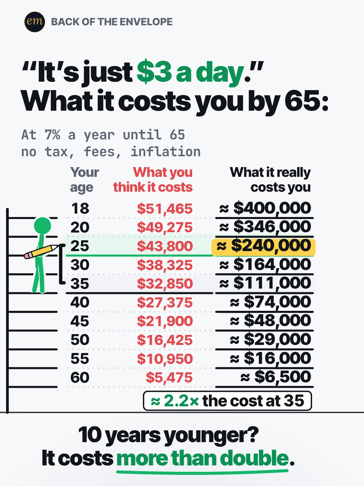

# 02a publishing sheet: "It's just $3 a day", by age

YouTube Shorts (@envelopemath) and Instagram Reels (@envelopemath). Prepared 2026-10-13. Machine-readable twin: `publishing/02a-becker-rig-3-a-day-by-age.json`.

- **Video.** `renders/channel/02a-becker-rig-3-a-day-by-age.mp4`: the condensed cut (10.3 s: a 7.8 s body + the 2.5 s card; sha256 `c93abea3…`), promoted and shipped on 2026-10-13. It replaces the 15.9 s round-2 cut (the owner: "too many still moments"), which is in git (`471c793`). The condense moved the clock and merged some captions; the numbers, the captions' facts and the verdict stay, so the copy carried over unchanged. Nothing below names a timestamp except the cover, which was re-picked by content on the shipped file. The ship rebuilt this sheet and re-exported both covers from it (`python3 publishing/tools/build_publishing.py 02a-becker-rig-3-a-day-by-age --covers`); on the shipped specs the maths check runs PASSED: all 225 checks.
- **Numbers.** Every figure comes from `teasers/v2/02-find-your-row.md` (02a) and its check, `python3 teasers/v2/checks/02-find-your-row.py`: PASSED: all 183 checks on `studio/specs/` (run 2026-10-13), and all 216 checks with `--spec` on the condensed cuts in `studio/specs-wip/`, which carry every string and number the copy quotes. The builder runs it through `publishing/data/checks/02-find-your-row.py`, which passes its output through and adds the summary line in the builder's form. `python3 publishing/tools/build_publishing.py 02a-becker-rig-3-a-day-by-age --check` checks this sheet's limits, paste blocks and figures, recomputes every row it names from $91.25 a month at 7% ÷ 12, and keeps each row's figures beside their age.
- **Honesty rules kept.** The title asks and never gives a result, and the Instagram caption's first 125 characters carry no figure but $3 and 65. Every claim stays inside the video's own verdict ("10 years younger? It costs more than double.") and its footer (7% a year until 65; no tax, fees or inflation). The copy calls 7% an assumption, not a forecast, and says what "costs you" means: what the same $3 a day would have grown to. No advice, no urgency, and 'Not financial advice.' is in both.
- **Brand.** None is named. The video's $3 is a generic daily amount with no product or logo, and the copy keeps it that way, so no affiliation line is needed.
- **Cover.** The write-up picks the completed table as the cover (Gage Heward's one cover A/B: 4,348 vs 2,844, n = 1), so the cover shows every row's answer, as a find-your-row table has to. The title and the caption's opening stay result-free.

---

## YouTube Shorts

### Title (vidIQ title score, short-form, scored against this channel)

| # | Title | Score | Chars |
|---|---|---:|---:|
| 1 | "It's Just $3 a Day." What It Really Costs You by 65 — Find Your Age | 97 | 68 |
| 2 | "It's Just $3 a Day." What It Really Costs You by 65 If You Don't Invest It. Find Your Age | 98 | 90 |
| 3 | "It's Just $3 a Day." What It Really Costs You by 65, by Age | 96 | 60 |

**Pick (paste):**

```
"It's Just $3 a Day." What It Really Costs You by 65 — Find Your Age
```

- 68 of 100 characters.
- The quote is the hook the write-up's hook pass adopted (7.5 from two judges): the viewer's own excuse, read back. Every quoted version scores 94-98 and every unquoted one 88-95, so the quote stays.
- 'Really' comes from the green column's label ('What it really costs you') and lifts the write-up's title from 94 to 96-98. '— Find Your Age' is the format's one instruction: the viewer's job is to find their row.
- No result in it: the only figures are the $3 input and the 65 horizon, both on frame 1. The 'invest' versions (98) are kept as option 2; vidIQ's model ranks titles but does not predict views, so the pick is decided on what shows first and on staying advice-free.
- Also scored, not used: ""It's Just $3 a Day." What It Really Costs You by 65 If You Invested It Instead. Find Your Age" 98 (95 chars; 'what it costs you if you invested it' reads backwards); ""It's Just $3 a Day." What It Really Costs You by 65, Find Your Age" 97 (the pick with a comma splice); "What $3 a Day Really Costs You by 65 If You'd Invested It Instead, by Age" 95; ""It's Just $3 a Day." What It Really Costs You by 65 #compoundinterest #investing #personalfinance" 95 (the house 3-hashtag form, 97 chars); ""It's Just $3 a Day": What It Costs You by 65, by Age" 94 (the write-up's title); "Your Life If You Invested $3 a Day Instead of Spending It, by Age" 94 (borrows the 'your life if you invested $5 a day' search phrase); "What $3 a Day Really Costs You by 65, by Age" 88 (without the quote); "What Spending $3 a Day Really Costs You by 65 #compoundinterest #investing #personalfinance" 88.

### Description (paste)

```
"It's just $3 a day." Find your age. Red is the $3 a day you'd hand over by 65; green is what it would have grown to at 7% a year. At 25: $43,800 handed over vs about $240,000. Every 10 years younger, it costs you more than double.

The math, shown:
• $3 × 365 = $1,095 a year. ÷ 12 = $91.25 a month, added at the end of each month until 65.
• Red, what you think it costs: $1,095 × the years left to 65. At 18 that's $51,465.
• Green, what it really costs you: the same $91.25 a month grown at 7% ÷ 12 each month. At 18: ≈ $400,000 (≈ 7.8× the red).
• At 25: $43,800 vs ≈ $240,000 (≈ 5.5×). At 35: $32,850 vs ≈ $111,000.
• 25 vs 35: it costs ≈ 2.2× as much at 25.
• It holds for every pair of whole ages 10 years apart, from 18 vs 28 up to 54 vs 64: the younger age always costs more than double (the closest is 18 vs 28, ≈ 2.09×).
• Why: at 7%, money roughly doubles every decade (72 ÷ 7 ≈ 10.3 years), and 10 years younger also adds 10 years of deposits.

Follow for the math behind your money — shown, not hand-waved. @envelopemath

Animation and original sound: The Back of the Envelope. $3 a day is a hypothetical amount, and 7% a year is an assumption, not a forecast: 7% ÷ 12 each month (about 7.23% a year effective), deposits at the end of each month, stopping at 65. Green is rounded to the nearest $1,000 ($100 below $10,000). No tax, fees or inflation. Not financial advice.
#CompoundInterest #PersonalFinance #investing
```

1,433 of 5,000 characters (1,475 UTF-8 bytes; YouTube counts this limit in bytes, and `≈`, `×`, `•`, `—`, `÷` take 2-3 each). No `<` or `>`, which YouTube rejects. It follows the house template: an answer-first opening line for the search snippet, then 'The math, shown:' bullets, then the follow line. The credit, assumptions and 'Not financial advice.' line comes next, and the 3 hashtags close it. The 'Doesn't Add Up' series line is left out, as on 06b and 06c: the 'more than double' rests on a stated 7% and on no tax, fees or inflation, so 'a number that shouldn't be true' would oversell it.

### Hashtags (order matters)

1. `#CompoundInterest`: the exact topic of the green column ('compound interest' 137,873 searches a month; down 17.3% on its 30-day baseline, still the biggest on-topic phrase).
2. `#PersonalFinance`: the broad category ('personal finance' 1,436,792 a month) and the most used hashtag in the channel's titles (5 of the 29 recent Shorts vidIQ lists).
3. `#investing`: the alternative the red column is measured against ('investing' 613,566 a month), and the first title hashtag on the channel's 'Start Investing 10 Years Late?' Short, the same idea in another format.

The title carries no hashtags, so YouTube shows these 3, the description's first, above the title. Over 60 hashtags and YouTube ignores all of them. `#Shorts` isn't needed.

### Tags (paste; 331 of 500 characters as YouTube counts them: commas count, and a tag with a space counts 2 more for the quotes YouTube adds)

```
compound interest, compound interest explained, compound interest by age, what if you invested $3 a day, cost of waiting to invest, what happens if you invest at the age of 18, latte factor, small daily expenses, opportunity cost, personal finance, money math, math animation, the back of the envelope, envelope math
```

Tags carry little weight. These mirror the keyword research plus the house's channel tags. 'cost of waiting to invest' (3,507 a month, competition 22.6) is the verdict's idea; 'latte factor' and 'small daily expenses' name the habit the $3 stands for without naming a product. Left out on purpose: 'how to invest at 18' (8,452) and 'what should i invest in at 18 years old' (4,956) are how-to and advice intent; 'your life if you invested $5 a day' (43,958) names a different amount; vidIQ's matching terms for '3 a day' return only meals and water.

### Pinned comment (post it, then pin it)

```
What rate would you plug in? 7% is a round, middle-of-the-road rate, not a prediction (7% ÷ 12 each month, about 7.23% a year effective). At 10%, the 25 row becomes ≈ $577,000 and the 18 row ≈ $1,170,000.

Rule of thumb: at 7%, money roughly doubles every decade (72 ÷ 7 ≈ 10.3 years), and starting 10 years younger also adds 10 years of deposits, so each decade younger costs you more than double. Spend $6 a day? Double your row.
```

The question comes first so it shows in the collapsed preview: the write-up found that comments on by-age tables argue about the rate (Gage Heward's: '10% vs 7% vs 8%'), so the pinned comment invites that argument and answers it with the 10% rows. The rest is the write-up's pinned comment: why each decade more than doubles, and the scaling rule (every cell is linear in the daily amount), which lets a viewer who spends more than $3 find their own number.

### Related video and end screen

- **Related video:** [Start Investing 10 Years Late? You Get Half.](https://www.youtube.com/shorts/EqFQCJheCMU) (`EqFQCJheCMU`). The verdict's twin in another format: $10,000 once at 25 vs 35 halves; $3 a day, with the extra 10 years of deposits, more than doubles. Live since Tue 6 Oct 2026, 22:27 ET.
- **Swap later:** 02b or 02c, the other find-your-row tables, once published; then point theirs at this Short.
- **End screen:** Shorts have no end screens or cards. The Related video link is the Shorts equivalent.

### Thumbnail and settings

- **Thumbnail:** in the YouTube app, pick the finished-table frame (all 10 rows, the gold plate on the 25 row and the verdict), the same content as the Instagram cover below.
- **Settings:** Category Education. Not made for kids. Altered or synthetic content: No (it's an animated chart, not realistic footage). Remixing allowed. No captions needed: there's no narration and all the text is on screen.

### Posting window

- **When:** First Tue-Thu evening after the 02a condensed cut ships and passes QA, 21:30-22:30 ET (01:30-02:30 UTC the next day). Sunday 06:00-08:00 ET is the alternative.
- **Spacing:** Keep it at least 6 h from any other upload on the channel, and post one find-your-row teaser (02a, 02b, 02c) per evening: the three share a format and a cover style.
- **Why:** The channel's own October Shorts, median views by posting slot (vidIQ, 2026-10-13): Sunday 05:00-08:00 ET 1,198 (n = 2), weekday 22:00-00:30 ET 642 (n = 3), weekday midday 263 (n = 2). 06c (Mon 03:45 ET) had 760 views by 13 Oct; 06b (Mon 12:14 ET, the day before) had 61. The evening slot is also the best one on Instagram, so one evening serves both. n = 7 and confounded by topic, so treat it as a test. Search demand for 'compound interest' is down 17.3% on its baseline and 'financial literacy' up 11.9%; neither is a reason to rush.

---

## Instagram Reels

### Caption (paste)

```
"It's just $3 a day." Find your age: what $3 a day really costs you by 65, next to what you think it costs. Compound interest, by age.

Red is what you'd hand over by 65. Green is what that $3 a day really costs you, if you'd invested it at 7% a year instead of spending it.

The math, shown:
• $3 × 365 = $1,095 a year, or $91.25 a month.
• At 18: $51,465 handed over vs ≈ $400,000 (≈ 7.8×).
• At 25: $43,800 vs ≈ $240,000 (≈ 5.5×).
• At 35: $32,850 vs ≈ $111,000.
• Every 10 years younger, it costs you more than double: 25 vs 35 is ≈ 2.2×.

7% ÷ 12 each month (about 7.23% a year), deposits at the end of each month until 65. 7% is an assumption, not a forecast. No tax, fees or inflation. Not financial advice.

Spend $6 a day? Double your row. What rate would you plug in?

Follow for the math behind your money — shown, not hand-waved. @envelopemath
Animation and original sound: The Back of the Envelope.

#compoundinterest #personalfinance #investingforbeginners #financialliteracy #moneytips
```

- 1,000 of 2,200 characters.
- **First 125 characters:** the write-up's caption line 1 ('"It's just $3 a day." Find your age.'), then the question in the viewer's words and the keyword 'compound interest'. The only figures are $3 and 65, both inputs on frame 1. The numbers sit below 'more', where Instagram search and Google indexing still read them.
- The second paragraph is the write-up's caption, which says what red and green mean, so the 'costs you' framing is explained before any number.
- The assumptions paragraph says 7% is an assumption, not a forecast, and repeats the footer's 'no tax, fees or inflation'. The caption follows the house close: the follow line plus the credit.

### Hashtags (5, Instagram's cap since Dec 2025)

`#compoundinterest #personalfinance #investingforbeginners #financialliteracy #moneytips`

Three are specific:

- `#compoundinterest` names the topic ('compound interest' 137,873 searches a month on YouTube).
- `#investingforbeginners` and `#financialliteracy` are the tags two of the by-age outliers in section 3 use (@mike.cpa, @robeverydayfinance); 'financial literacy' is rising (+11.9%).

`#personalfinance` is the broad layer, and `#moneytips` ('money tips' 111,384 a month, +81.6%) is the habit angle the caption's '$6 a day' line plays to.

### Alt text

- **Short (90 characters; paste this one into Instagram):** Table by age: $3 a day handed over by 65 vs grown at 7%. At 25: $43,800 vs about $240,000.
  - It stays at or under 100 characters, so it fits the field however short it is. It says 'about', not '≈', so screen readers read it cleanly, and it names the 25 row, the one the video's verdict lands on.
- **Long (for anywhere with room, such as a website embed):** Animation on a white page. The header quotes: 'It's just $3 a day.' What it costs you by 65. Footer: at 7% a year until 65, no tax, fees or inflation. A green stick figure stands beside shelves with a row for each age from 18 to 60: what you think it costs, in red ($3 a day times the years left to 65), and what it really costs you, the same money grown at 7% a year. He shrugs, then points at 18: about $400,000, about 7.8 times the red $51,465; then at 25: about $240,000. Then he draws a bracket from the 35 row up to the 25 row, and the 25 row's figure lands on a gold plate: about 2.2 times the cost at 35. Verdict: 10 years younger? It costs more than double.
- **Where:** Advanced settings → Accessibility → Alt text, if your app shows it for Reels.

### Cover



- **Files:** `publishing/02a-becker-rig-3-a-day-by-age-cover-3x4.jpg` (1080×1440) and `publishing/02a-becker-rig-3-a-day-by-age-cover-9x16.jpg` (1080×1920). Both come from the shipped (10.3 s) render at 7 s (frame 210).
- **Frame, by content:** The finished table, which the write-up names as the cover (its beat sheet marks the hold after the payoff 'the cover frame', and its Instagram note says 'Cover: the completed table'): all 10 rows from 18 to 60, red beside green; the 25 row's ≈ $240,000 on the gold plate; the bracket from the 35 row up to the 25 row; the pill '≈ 2.2× the cost at 35'; the figure pointing at the plate, pencil in hand; and the verdict '10 years younger? / It costs more than double.' under the table. Use the first settled frame of that hold, after the impact's shake and before the end card. On the shipped 10.3 s condensed cut the payoff lands at 6.30 s (frame 189) with the impact's shake; from 6.90 s (frame 207) the mean frame-to-frame luma change (270×480 greyscale) stays at or under 0.009 until the end card cuts in at 7.80 s. The cover is taken at 7.0 s (frame 210), inside that hold. On the 15.9 s pre-condense render it was 11.4 s (frame 342). If the cut changes, re-pick it by content.
- **Crop:** 3:4 = 1080×1440 from y 78 to 1518 of the 1080×1920 frame. The content runs from y 112 (the badge) to y 1484 (the verdict's underline), so the crop centres it: badge, quoted header, footer, all 10 rows with the plate, bracket and pill, and the verdict; it drops the empty floor. A centred grid crop (y 240-1680) loses the badge and leaves the header on the top edge.
- **How to set it:** In 'Edit cover', pick the finished-table frame from the video (or upload the 9:16 JPG), then drag 'Profile grid' to the top so the tile matches the 3:4 JPG. Do not upload the 3:4 JPG as the Reel cover: Instagram centre-crops it to 9:16 in the Reels tab and cuts the header and the verdict.
- **Re-export:** `ffmpeg -ss 7.0 -i renders/channel/02a-becker-rig-3-a-day-by-age.mp4 -frames:v 1 -vf "crop=1080:1440:0:78" -q:v 2 publishing/02a-becker-rig-3-a-day-by-age-cover-3x4.jpg` and `ffmpeg -ss 7.0 -i renders/channel/02a-becker-rig-3-a-day-by-age.mp4 -frames:v 1 -q:v 2 publishing/02a-becker-rig-3-a-day-by-age-cover-9x16.jpg`, or `python3 publishing/tools/build_publishing.py 02a-becker-rig-3-a-day-by-age --covers`.
- **Not used:** frame 1 (the quoted header over the 18 row only). It asks without answering, but the write-up chooses the completed table, after Gage Heward's one cover A/B (4,348 vs 2,844, n = 1), and a by-age table shows every viewer a different answer, so the cover gives no single result away.
- **Shipped cut (2026-10-13):** the finished table was re-picked by content on the shipped file (the first settled frame after the gold plate lands, 7.0 s) and both JPGs re-exported from it. It shows the same table, plate, bracket, pill and verdict as the pre-condense cover.

### First comment (post it, then pin it)

```
At 25: $43,800 handed over vs ≈ $240,000 at 7% a year. 10 years younger costs more than double. What rate would you plug in?
```

### Trial Reels

**Post as a regular Reel, not a Trial.** @envelopemath has 8 followers, so a regular Reel is already shown almost entirely to non-followers, which is all a Trial Reel adds. A Trial would also keep it off the profile grid until shared. A version test afterwards, if you want one. The write-up's Instagram A version is this cut with captions off (the same spec rendered with "captions": false); it is not in renders/channel, so it needs a studio render first. Post it as a Trial with MANUAL graduation 48-72 h later and compare skip rate (October Reels ran 27.0-65.1%) and average watched %, then share the winner. vidIQ's publish tool exposes Trial (MANUAL or SS_PERFORMANCE) for this connected account. Confirm eligibility in the app.

### Posting window and settings

- **When:** Same evening as YouTube, about 15 min after the Short: 21:45-22:45 ET.
- **Why:** October Reels, median plays by posting slot (owner insights, 2026-10-13): weekday 22:00-00:30 ET 5,449 (n = 3, including the two best: 7,302 and 5,449), weekday midday 1,212 (n = 2), Sunday 05:00-08:00 ET 1,087 (n = 2). Skip rate tracks plays more closely than the hour does: 27.0-27.4% for the top two, 56.9-65.1% for the bottom two. The same idea's other Reel ('10 years late', 219 plays) had the worst skip rate (65.1%), so the cover and the first 125 characters matter more than the hour.
- **Audio:** Rename the original audio to '$3 a day, by age — The Back of the Envelope' if the app allows; it is the score, with no voice. The write-up suggests trending in-app audio for the Instagram cut (Gage Heward's 1,150,974-play version ran a pop track); if you try it, test it as the Trial above.
- **Share to feed:** On.

---

## Why these choices (research evidence)

**1. Search demand (vidIQ keyword research, pulled 2026-10-13).** vidIQ refreshes each keyword on its own schedule, so the last column gives each row's snapshot date. Four rows are older snapshots.

| Keyword | Est. searches/month | Competition | Overall | Note | vidIQ as of |
|---|---:|---:|---:|---|---|
| compound interest | 137,873 | 50.6 | 65.8 | seed; -17.3% vs its 30-day baseline (166,772); the green column's topic | 2026-10-12 |
| compound interest explained | 51,994 | 40.3 | 66.1 | -11.3% vs its baseline (58,623); the US is its top market | 2026-10-12 |
| your life if you invested $5 a day | 43,958 | 56.5 | 59.0 | -1.8%: a daily amount over a lifetime has demand; another amount, so not a tag | 2026-10-12 |
| how to invest at 18 | 8,452 | 44.0 | 57.6 | how-to intent, not a tag | 2026-10-12 |
| your life if you invested 5 dollars a day | 5,410 | 31.2 | 61.0 |  | 2026-08-16 |
| what happens if you invested $10 a day | 5,384 | 23.9 | 63.9 | competition 23.9 | 2026-08-24 |
| what happens if you invest at the age of 18 | 4,027 | 37.0 | 57.5 | the first row's question | 2026-08-11 |
| cost of waiting to invest | 3,507 | 22.6 | 62.7 | the verdict's idea; low competition | 2026-09-13 |
| your life if you invest $300 a month starting at 18 vs. 28 | 3,172 | 23.3 | 62.0 | the same 10-year gap, monthly | 2026-10-12 |
| financial literacy | 256,914 | 46.7 | 69.8 | +11.9% vs its baseline (229,567) | 2026-10-12 |
| personal finance (topic) | 1,436,792 | 60.0 | 71.1 | -18.1% vs its baseline (1,754,064) | 2026-10-12 |
| money tips | 111,384 | 42.0 | 68.4 | +81.6% vs its baseline (61,342) | 2026-10-12 |
| 3 a day (matching terms) | 0 (<750) |  |  | every match is about meals or water: no '$3 a day' money phrase is indexed | no snapshot |

'compound interest' is the big on-topic phrase (137,873 a month at competition 50.6), so it leads the hashtags. The long tail around this video is 'a daily amount, invested, over a lifetime' ('your life if you invested $5 a day', 43,958 at competition 56.5; the '$10 a day' and '5 dollars' versions 5,384-5,410 at 23.9-31.2) and 'starting at 18' (3,172-8,452 at 23.3-44.0), plus 'cost of waiting to invest' (3,507 at 22.6), but most of it is how-to intent or names another amount, so the title keeps the video's own words and the tags take the neutral phrases. No '$3 a day' money phrase reaches vidIQ's index.

**2. The same idea on YouTube is small and talked through (vidIQ YouTube search, under 4 min).**

| Title | Channel (subs) | Views | Date |
|---|---|---:|---|
| What happens if you invest $1 per day starting at 18🤯💰📈 | Nick Meyer, CFP® (296,000) | 2,061 | 2021-09-30 |
| Just invest $1 per day, everyday, and thank me later... 🤝😎 | Infinity Investing (11,200) | 1,580 | 2022-07-23 |
| $1 a Day From Age 18 Could Become $132,000 #shorts | FinancialShift (5) | 307 | 2026-06-20 |
| The $3 Decision That Costs You $1 Million by Age 65 (The Math Will Shock You) #Shorts | TopFindsNow (64) | 103 | 2026-07-18 |
| $1 a day makes you a millionaire | Money Minute Lab (3) | 56 | 2026-04-19 |

Five channels have posted 'a small daily amount, invested from a young age'. None passes 2,100 views: the biggest is a CFP's 15-second $1-a-day Short from 2021 (2,061). All of them give one age, not a row for every age, and the only $3 version ('The $3 Decision That Costs You $1 Million by Age 65 (The Math Will Shock You)') has 103 views with the kind of hype title the house avoids. So the pick keeps the video's own quote and asks the viewer to find their row.

Next door, the compounding explainers travel: Zack D. Films' 'How Saving Every Month Builds Wealth 😮' (30,891,874 views), Graham Stephan's 'Do THIS in Your 20's To Become a MILLIONAIRE' (3,865,020) and Brian Feroldi's 'The Power of Compounding' (3,281,518, outlier score 127) are among the biggest Shorts the searches returned.

**3. The by-age list and the small-habit sum travel on TikTok and Instagram (vidIQ IG/TikTok outlier search, last 30 days).**

- **@keysfinance** (TikTok), "How to retire with $2M": 3.3M (1,457.8x). **@robeverydayfinance** (TikTok), "How much you need to invest monthly for $2m": 602.8K (145.7x). **@trellthetrainer** (Instagram), "HOW TO RETIRE WITH $5M": 1.5M (3.7x). All three are a column of starting ages with one number each: the find-your-row grammar.
- **@mike.cpa** (TikTok), "why you need to start early ROTH IRA": 1.7M (385.0x), 18 vs 25 as static text with music only.
- **@felix.padilla.eng** (TikTok), "HOW MUCH MONEY YOU WASTE WITHOUT NOTICING": 260.8K (243.9x), and **@spendshiftofficial** (Instagram), "A $150 Saturday … $78,000 every 10 years": 201K (101.7x). Small habits added up, no voice.
- The no-voice ones (@mike.cpa, @felix.padilla.eng, @spendshiftofficial) reach 100-385x their medians, which backs the write-up's music-only Instagram cut. None of them puts what you think it costs beside what it really costs, row by row; 02a does.

**4. Our own October numbers (vidIQ: public YouTube stats, Instagram owner insights; pulled 2026-10-13).**

| YouTube Short | Posted (ET) | Views |
|---|---|---:|
| Can You Find the Missing Dollar? (`LjHDFzVxRyM`) | Sun 07:04 | 1,254 |
| You Can Lean on $1 Million. Not on $1 Billion. (`hJBvmGA6sZ0`) | Thu 00:25 | 1,221 |
| Your Interest Has a Speed Limit (`XVUeMcTg9OQ`) | Sun 05:49 | 1,141 |
| What If You Bought Starbucks Stock Instead of a $4 Latte Every Day? (06c) (`fbpdKf4Wy8c`) | Mon 03:45 | 760 |
| Pay the Minimum on $5,000? 238 Months. (`8__HTUa2PoU`) | Mon 22:09 | 642 |
| A $2 Lottery Ticket Was Worth $6.98. Until the Fine Print. (`FW_oxA3kbsM`) | Wed 12:03 | 348 |
| You Can Carry $1 Million. Not in Pennies. (`mXbKY_R63h4`) | Thu 13:38 | 177 |
| Start Investing 10 Years Late? You Get Half. (`EqFQCJheCMU`) | Tue 22:27 | 161 |
| What If You Bought Netflix Stock Instead of Paying for Netflix? (06b) (`krfZEHhb0xU`) | Mon 12:14 | 61 |

| Instagram Reel | Posted (ET) | Plays | Skip rate | Avg watched |
|---|---|---:|---:|---:|
| $5,000 on the minimum (`DeIvYk7I4Qr`) | Mon 22:46 | 7,302 | 27.4% | 56.5% |
| $1M stack vs Burj Khalifa (`DeOEthJJ1TG`) | Thu 00:28 | 5,449 | 27.0% | 83.1% |
| Missing dollar (`DeWgFZRoR_S`) | Sun 07:05 | 1,997 | 32.0% | 81.3% |
| Powerball $6.98 (`DeMvZv9IqRw`) | Wed 12:05 | 1,825 | 58.7% | 57.9% |
| 06c latte vs Starbucks stock (`DeYuqT4pjVC`) | Mon 03:46 | 1,711 | 40.3% | 69.1% |
| $1M in pennies (`DePe11HIHwn`) | Thu 13:37 | 598 | 42.0% | 66.7% |
| 10 years late (`DeLSd9io8UK`) | Tue 22:30 | 219 | 65.1% | 30.6% |
| Speed limit (e) (`DeEW2ZMIiYd`) | Sun 05:54 | 177 | 56.9% | 31.2% |

Channel totals:

- **YouTube:** 53 subscribers, 10,221 views and 41 videos (+27 subscribers, +5,127 views and 11 videos in 30 days).
- **Instagram:** 8 followers and 20,518 views in 30 days.

06b went up on both platforms on Mon 12 Oct at 12:14 ET, midday: 61 views on YouTube by 13 Oct, and its Reel's insights are not in yet (Instagram lags). It is left out of the medians, as is 06c (760 views, 1,711 plays, 40.3% skip), both too young.

Medians by posting slot (n = 2-3 each, confounded by topic):

- **YouTube:** Sunday early morning ET 1,198, weekday 22:00-00:30 ET 642, weekday midday 263.
- **Instagram:** weekday 22:00-00:30 ET 5,449, midday 1,212, Sunday early morning 1,087.

**A warning for 02a:** 'Start Investing 10 Years Late? You Get Half.' is 02a's verdict in a domino format, and it is the channel's weakest October post on both platforms (161 views; 219 plays with a 65.1% skip rate). 02a changes the frame-1 hook (the viewer's own excuse, quoted), shows a row for every age, and puts the 'you think' number in red beside the real one. Skip rate is the number to watch on day 1.

**5. Platform rules applied.**

- **YouTube title:** 100 characters. The Shorts player shows only the opening, so the keywords come first.
- **YouTube description:** 5,000 characters.
- **YouTube hashtags:** the first 3 show; over 60 and all are ignored; `#Shorts` isn't needed.
- **YouTube tags:** 500 characters, low weight.
- **YouTube Shorts:** no end screens. The Related video link is the Shorts equivalent.
- **YouTube AI disclosure:** only for realistic altered content.
- **Instagram caption:** 2,200 characters, about 125 shown before 'more'.
- **Instagram hashtags:** 5 at most.
- **Instagram search and Google:** keywords in the caption feed Instagram search, and Google indexes public professional posts (since 10 Jul 2025).
- **Instagram grid:** a 3:4 crop of the 9:16 cover.
- **Trial Reels:** shown to non-followers only.

**6. Limits.**

- vidIQ's YouTube authorization is a different channel (UCRC5v_El2fibbkqsZs6uFjA), so @envelopemath's YouTube Analytics (audience hours, geography) were not readable. Check Studio → Analytics → Audience → 'When your viewers are on YouTube' before posting.
- vidIQ has no hashtag-volume data; hashtag picks lean on keyword volume and on the outliers' own tags.
- Title scores are vidIQ's short-form CTR model for this channel; they rank options but do not predict views.
- The render in renders/channel is the shipped condensed cut (2026-10-13). The cover's time and frame are measured on it; the copy names no other timestamp and carried over from the pre-condense cut unchanged.
- Outlier views and medians are vidIQ's index at pull time; the same-idea Shorts' own maths (for example a $3 habit 'costing $1 million') is not checked here and is not in the copy.

---

## Check log (adversarial pass, 2026-10-13)

- **Maths.** `python3 teasers/v2/checks/02-find-your-row.py`: PASSED: all 183 checks at this check (all 177 checks at the first build; the condense pass has since made the check cut-aware), and all 216 checks with `--spec` on the condensed cut, which keeps every string and number the copy quotes. Every public figure traces to the 02a maths table: $1,095 / $91.25; 18 $51,465 / ≈ $400,000 (≈ 7.8×); 25 $43,800 / ≈ $240,000 (≈ 5.5×); 35 $32,850 / ≈ $111,000; 25 vs 35 ≈ 2.2×; the verdict holds for every pair 10 years apart from 18 vs 28 to 54 vs 64 (closest ≈ 2.09×, 18 vs 28); 72 ÷ 7 ≈ 10.3; at 10% ≈ $577,000 and ≈ $1,170,000. The data file recomputes each from $91.25 a month at 7% ÷ 12.
- **Limits.** Title 68/100. Description 1,433 characters (1,475 bytes) of 5,000. 3 hashtags. Tags 331/500 as YouTube counts them. Instagram caption 1,000/2,200, with the first 125 characters result-free. 5 hashtags. Short alt text 90. No `<` or `>`.
- **vidIQ.** Keywords pulled 2026-10-13 (table above). 11 titles scored against this channel: the pick 97, the top 98 (twice), the write-up's title 94. Channel 53 subscribers / 10,221 views / 41 videos; Instagram owner insights refreshed (8 followers, 20,518 views in 30 days).
- **vidIQ re-queried.** The pick's title score 97; 'compound interest' 137,873 / 50.6 (−17.3%); the channel 53 / 10,221 / 41; the related Short (`EqFQCJheCMU`) 162 views, Tue 6 Oct 22:27 ET. All match (one view of drift). The channel's 29 recent Shorts carry #PersonalFinance in 5 titles, the most of any hashtag.
- **Changed.**
  - The description's verdict-range bullet said 'At every whole age from 18 to 54, 10 years younger costs more than double (2.09× at 18 is the closest)', which reads as 54 vs 44 and leaves '2.09× at 18' unexplained. It now names the pairs the check asserts (18 vs 28 up to 54 vs 64) and gives ≈ 2.09× its '≈' and its pair. A new copy rule keeps 2.09 with '18 vs 28' and 64 with '54 vs 64', and the rounded-ratio rule now covers 2.09.
  - The maths count: the sheet said 177 checks; the 02 check now prints 183 on `studio/specs/` (and 216 on the condensed cuts with `--spec`), so the intro, `facts` and this log say so.
  - Hashtag notes: #investing is the first title hashtag on 'Start Investing 10 Years Late?', not 'the third tag' (it is not among that Short's tags); #PersonalFinance is in 5 of the 29 recent Shorts vidIQ lists, not '5 of the last 30'.
  - Keyword outro: 'at low competition (22.6-44.0)' covered 'your life if you invested $5 a day', which is at 56.5; it now gives each cluster's own range.
- **Mutation test.** At the first build, five mutations of a scratch copy each failed by name: a green figure under the wrong age, a dropped '≈', the verdict without '10 years younger', a result in the title, and a spelled-out '$6'. At this check, four more fail by name: '≈ 2.09×' moved away from '18 vs 28', '2.09×' without its '≈', '54 vs 44' (44 is no maths figure), and 'up to age 64' without its 54. The first of them passed until the rule was tightened to the pair itself, not just the line. The files on disk were not touched.
- **Generator.** Unchanged. The 02 check prints 'PASSED: all N checks', and the builder reads only 'N checks, F failed', so `MATH_SCRIPT` is `publishing/data/checks/02-find-your-row.py`, a pass-through that runs the 02 check unchanged and adds that line (exit code passed through).
- **Kept on purpose.**
  - The cover is the finished table with the verdict, not frame 1: the write-up names it, and a by-age table answers a different row for each viewer.
  - The title keeps the quote and drops 'invest': the 'invest' versions score 1 point higher but read as a nudge, and the description's first line explains the comparison.
  - The copy names no product: the write-up's $3 is generic, so 'latte factor' appears only as a tag, the generic concept 06c's sheet also uses.
  - The cover frame was re-exported to a scratch folder: both JPGs are byte-identical to the files here. The condensed cut's spec carries the same header, footer, rows, captions, pick labels and verdict, so no copy changes on ship.
- **Done on ship (2026-10-13).** Rebuilt with `--covers` from the shipped condensed cut (10.3 s). The finished table was re-picked by content at 7.0 s (frame 210), the first settled stretch of the verdict hold. The Video bullet, the cut and the check counts follow the shipped file (PASSED: all 225 checks on `studio/specs/`), and the long alt text was re-read against the condensed beat sheet: every beat it names is in the shipped cut, so no copy changed.
