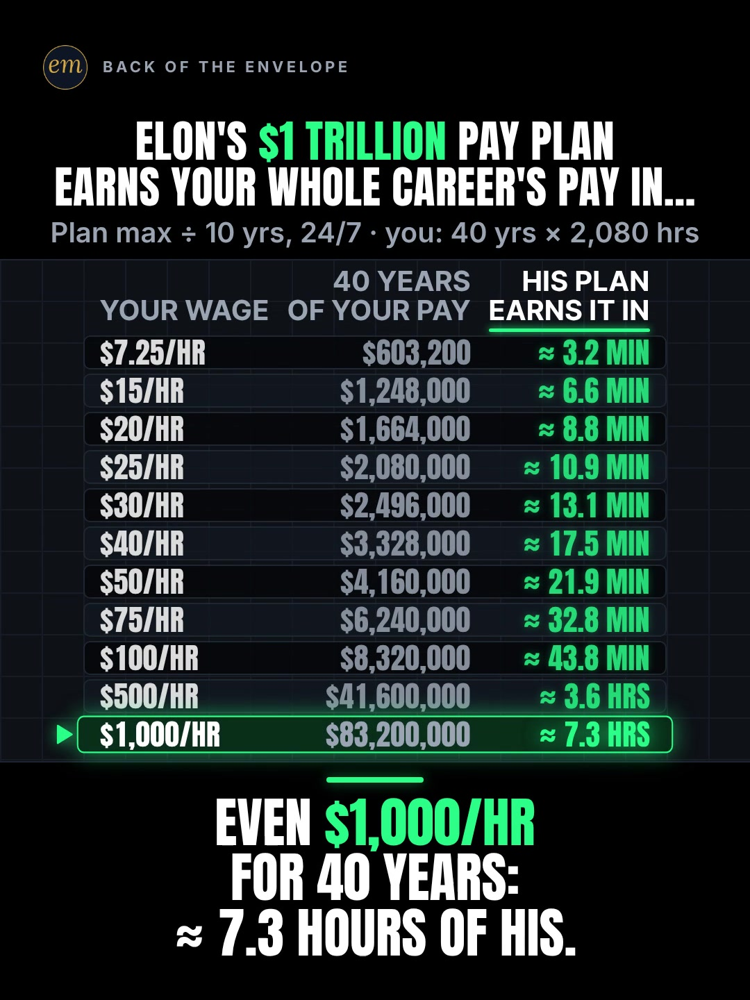

# 02b publishing sheet: Elon's $1 trillion pay plan vs your career's pay

YouTube Shorts (@envelopemath) and Instagram Reels (@envelopemath). Prepared 2026-10-13. Machine-readable twin: `publishing/02b-scoreboard-trillion-at-your-wage.json`.

- **Video.** `renders/channel/02b-scoreboard-trillion-at-your-wage.mp4`: the condensed cut (10.1 s: a 7.6 s body + the 2.5 s card; sha256 `93aa989f…`), promoted and shipped on 2026-10-13. It replaces the 16.5 s round-2 cut (the owner: "too many still moments"), which is in git (`471c793`). The condense moved the clock and merged some captions; the numbers, the captions' facts and the verdict stay, so the copy carried over unchanged. Nothing below names a timestamp except the cover, which was re-picked by content on the shipped file. The ship rebuilt this sheet and re-exported both covers from it (`python3 publishing/tools/build_publishing.py 02b-scoreboard-trillion-at-your-wage --covers`); on the shipped specs the maths check runs PASSED: all 225 checks.
- **Numbers.** Every figure comes from `teasers/v2/02-find-your-row.md` (02b) and its check, `python3 teasers/v2/checks/02-find-your-row.py`: PASSED: all 183 checks on `studio/specs/` (run 2026-10-13), and all 216 checks with `--spec` on the condensed cuts in `studio/specs-wip/`, which carry every string and number the copy quotes. The builder runs it through `publishing/data/checks/02-find-your-row.py`, which passes its output through and adds the summary line in the builder's form. `python3 publishing/tools/build_publishing.py 02b-scoreboard-trillion-at-your-wage --check` checks this sheet's limits, paste blocks and figures, recomputes the plan's ≈ $3,169 a second and every row it names, and keeps each row's figures beside their wage.
- **Honesty rules kept.** The title asks and never gives a result, and the Instagram caption's first 125 characters carry no figure but the $1 trillion and the 40 years, both on frame 1. The description, the caption, the pinned comment and the long alt text say the $1 trillion is the plan's maximum ('up to', 'max', 'if every target is hit'), and the first three say it is Tesla stock, not cash; the title and the short alt text use the header's own words ('$1 trillion pay plan'). ≈ $3,169 a second is that maximum averaged over 10 years, not a forecast. No advice, no urgency, and 'Not financial advice.' is in both.
- **Brand and person.** "Tesla" names the company whose shareholders approved the plan, and "Elon Musk" the person it is for; neither is used for anything else. Both platforms' copy says 'Not affiliated with or endorsed by Tesla or Elon Musk.' The video has no logo or photo: the names are text only. No share price is named, so no adjusted-price wording is needed.
- **News context.** Third-party videos in the research report that Musk became a trillionaire by net worth in June 2026 after a SpaceX listing (not verified here). That is a different $1 trillion, so every copy item says 'pay plan' and none says 'his trillion'.

---

## YouTube Shorts

### Title (vidIQ title score, short-form, scored against this channel)

| # | Title | Score | Chars |
|---|---|---:|---:|
| 1 | How Long Would It Take Elon Musk's $1 Trillion Pay Plan to Earn Your Whole Career's Pay? | 98 | 88 |
| 2 | How Long Would It Take Elon Musk's Pay Plan to Earn Your Whole Career's Pay? Find Your Wage | 98 | 91 |
| 3 | 40 Years at Your Wage vs Elon Musk's $1 Trillion Pay Plan: How Fast Does He Earn It? | 95 | 84 |

**Pick (paste):**

```
How Long Would It Take Elon Musk's $1 Trillion Pay Plan to Earn Your Whole Career's Pay?
```

- 88 of 100 characters.
- 'Elon Musk's $1 Trillion Pay Plan' sits at characters 24-55, and the whole question is 88 characters. Every 'How long would it take' version scores 97-98, every title that opens 'How Fast' 93-94.
- No result in it: the only figure is the plan's $1 trillion, which the header shows on frame 1, and the answer (minutes, then hours) is what the video pays off. It raises the write-up's title from 93 to 98.
- 'Pay Plan', not 'his trillion': third-party videos report Musk's net worth passing $1 trillion in June 2026, a different number, so the title names the plan.
- Also scored, not used: "How Long Would It Take Elon Musk's Pay Plan to Earn Your 40-Year Salary? Find Your Wage" 98 ('salary' for an hourly wage); "How Long Would It Take Elon Musk's $1 Trillion Pay Plan to Earn Your 40-Year Pay?" 97; "How Fast Does Elon Musk's $1 Trillion Pay Plan Earn Your Whole Career's Pay? #ElonMusk #Tesla #money" 94 (the house 3-hashtag form, exactly 100 chars); "How Fast Elon's $1 Trillion Pay Plan Earns Your Whole Career's Pay" 93 (the write-up's title); "How Fast Does Elon Musk's $1 Trillion Pay Plan Earn Your Whole Career's Pay?" 93; "Your Whole Career's Pay vs Elon Musk's $1 Trillion Pay Plan, by Wage" 92.

### Description (paste)

```
How long would it take Elon Musk's $1 trillion Tesla pay plan to earn your whole career's pay? At the $7.25 federal minimum wage, 40 years of pay is $603,200: the plan's average earns that in about 3.2 minutes. Even at $1,000 an hour, 40 years ($83,200,000) takes it about 7.3 hours.

The math, shown:
• The plan: up to $1 trillion in Tesla stock over the next decade, if every target is hit. Spread evenly over 10 years, day and night (315,576,000 seconds): ≈ $3,169 a second, about $11.4 million an hour.
• Your career: your wage × 2,080 hours a year × 40 years = your wage × 83,200 hours, before tax.
• $7.25/hr: $603,200 ≈ 3.2 minutes of the plan.
• $20/hr: $1,664,000 ≈ 8.8 minutes. Under 9.
• $100/hr: $8,320,000 ≈ 43.8 minutes.
• $1,000/hr: $83,200,000 ≈ 7.3 hours.

Follow for the math behind your money — shown, not hand-waved. @envelopemath

Animation and original sound: The Back of the Envelope. In Nov 2025, Tesla shareholders approved a pay plan that could give Elon Musk up to $1 trillion in Tesla stock over the next decade, paid in tranches only if targets are hit (Reuters; Anadolu Agency). ≈ $3,169 a second is that maximum averaged evenly over 10 years of 365.25 days, 24 hours a day: stock, not cash, and not a forecast. $7.25 is the US federal minimum wage, in force since July 2009 (US Department of Labor). Not financial advice. Not affiliated with or endorsed by Tesla or Elon Musk.
#ElonMusk #Tesla #MinimumWage
```

1,437 of 5,000 characters (1,466 UTF-8 bytes; YouTube counts this limit in bytes, and `≈`, `×`, `•`, `—` take 2-3 each). No `<` or `>`, which YouTube rejects. It follows the house template: an answer-first opening line for the search snippet, then 'The math, shown:' bullets, then the follow line. The credit, assumptions and 'Not financial advice.' line comes next, and the 3 hashtags close it. The 'Doesn't Add Up' series line is left out, as on 06b and 06c: the minutes rest on the plan's maximum spread evenly over 10 years, so 'a number that shouldn't be true' would oversell it.

### Hashtags (order matters)

1. `#ElonMusk`: the person the plan is for ('elon musk' 1,516,854 searches a month; down 3.9% on its 30-day baseline, by far the biggest phrase here).
2. `#Tesla`: the company whose shareholders approved it ('tesla' 1,116,464 a month).
3. `#MinimumWage`: the video's first row and first caption ('minimum wage' 11,780 a month; down 33.9% on its baseline, but the only wage phrase with volume).

The title carries no hashtags, so YouTube shows these 3, the description's first, above the title. Over 60 hashtags and YouTube ignores all of them. `#Shorts` isn't needed.

### Tags (paste; 375 of 500 characters as YouTube counts them: commas count, and a tag with a space counts 2 more for the quotes YouTube adds)

```
elon musk, elon musk trillion dollar pay package, tesla shareholders approve $1 trillion pay package for elon musk, elon musk 1 trillion, how long would it take to earn elon musk salary, how much does elon musk make per minute, how much money does elon musk make per second, tesla, minimum wage, money math, math animation, the back of the envelope, envelope math
```

Tags carry little weight. These mirror the keyword research plus the house's channel tags; 'elon musk trillion dollar pay package' (3,720) and the shareholder-vote phrase (3,660) are the exact topic. Left out on purpose: 'spacex elon musk pay package' (3,378) is another company's plan; 'why elon musk has no salary' (4,407) and the other 'elon musk salary' phrases want his base salary; 'andrew tate on elon musk pay package' (5,039) is about another person.

### Pinned comment (post it, then pin it)

```
Which row is yours? Your 40-year career is 83,200 hours (2,080 a year × 40), before tax.

It's Tesla stock, paid in tranches only if targets are hit, so ≈ $3,169 a second is the plan's $1 trillion maximum averaged over 10 years (315,576,000 seconds): about $11.4 million an hour.
```

The question comes first so it shows in the collapsed preview, and it asks for the viewer's own row (R3); the hours let a viewer whose wage is not on the board do their own. The second paragraph is the write-up's pinned comment: it answers the two comments to expect, 'it's stock, not cash' and 'he only gets it if the targets are hit'.

### Related video and end screen

- **Related video:** [You Can Lean on $1 Million. Not on $1 Billion.](https://www.youtube.com/shorts/hJBvmGA6sZ0) (`hJBvmGA6sZ0`). The same viewer intent, the scale of a fortune in something you can picture; it is the channel's second-best October Short (1,221 views). Live since Thu 8 Oct 2026, 00:25 ET.
- **Swap later:** 02a or 02c, the other find-your-row tables, once published; then point theirs at this Short.
- **End screen:** Shorts have no end screens or cards. The Related video link is the Shorts equivalent.

### Thumbnail and settings

- **Thumbnail:** in the YouTube app, pick the finished-board frame (all 11 rows, the $1,000/hr row lit and the verdict), the same content as the Instagram cover below.
- **Settings:** Category Education. Not made for kids. Altered or synthetic content: No (it's an animated chart, not realistic footage). Remixing allowed. No captions needed: there's no narration and all the text is on screen.

### Posting window

- **When:** First Tue-Thu evening after the 02b condensed cut ships and passes QA, 21:30-22:30 ET (01:30-02:30 UTC the next day). Sunday 06:00-08:00 ET is the alternative.
- **Spacing:** Keep it at least 6 h from any other upload on the channel, and post one find-your-row teaser (02a, 02b, 02c) per evening. Keep it at least a few days from 10b: the write-up flags that 10b uses the same device (40 years of your pay against a mega-rate clock).
- **Why:** The channel's own October Shorts, median views by posting slot (vidIQ, 2026-10-13): Sunday 05:00-08:00 ET 1,198 (n = 2), weekday 22:00-00:30 ET 642 (n = 3), weekday midday 263 (n = 2). 06c (Mon 03:45 ET) had 760 views by 13 Oct; 06b (Mon 12:14 ET, the day before) had 61. The evening slot is also the best one on Instagram, so one evening serves both. n = 7 and confounded by topic, so treat it as a test. There is no news peg: the plan was approved in Nov 2025, and 'elon musk' searches are flat (-3.9%).

---

## Instagram Reels

### Caption (paste)

```
Find your wage: how long would Elon Musk's $1 trillion pay plan take to earn your whole 40-year career's pay?

Your career: your wage × 2,080 hours a year × 40 years = your wage × 83,200 hours, before tax. The plan: up to $1 trillion in Tesla stock over the next decade if every target is hit, spread evenly over 10 years, day and night: ≈ $3,169 a second.

The math, shown:
• $7.25/hr (the federal minimum): $603,200 ≈ 3.2 minutes of the plan.
• $20/hr: $1,664,000 ≈ 8.8 minutes.
• $100/hr: $8,320,000 ≈ 43.8 minutes.
• $1,000/hr: $83,200,000 ≈ 7.3 hours.

Even $1,000 an hour for 40 years: ≈ 7.3 hours of his.

Why a trillion? In Nov 2025, Tesla shareholders approved a pay plan that could give Elon Musk up to $1 trillion in Tesla stock over the next decade, if every target is hit. It's stock, paid in tranches, not cash, and ≈ $3,169 a second is that maximum averaged. Not financial advice. Not affiliated with or endorsed by Tesla or Elon Musk.

Which row is yours?

Follow for the math behind your money — shown, not hand-waved. @envelopemath
Animation and original sound: The Back of the Envelope.

#elonmusk #tesla #minimumwage #moneyfacts #personalfinance
```

- 1,165 of 2,200 characters.
- **First 125 characters:** the write-up's caption line 1 ('Find your wage'), then the header as a question. The only figures are the $1 trillion and the 40 years, both on frame 1. The minutes and hours sit below 'more', where Instagram search and Google indexing still read them.
- The second paragraph gives both inputs before any result: the career (wage × 83,200 hours, before tax) and the plan's maximum spread over 10 years. The 'Why a trillion?' paragraph is the write-up's caption, with 'stock, not cash' added.
- The caption follows the house close: the follow line plus the credit.

### Hashtags (5, Instagram's cap since Dec 2025)

`#elonmusk #tesla #minimumwage #moneyfacts #personalfinance`

Three are specific:

- `#elonmusk` and `#tesla` name the person and the company the plan is about (the two biggest phrases in the research).
- `#minimumwage` names the first row, the one most viewers measure themselves against.

`#moneyfacts` is the tag on the channel's own 'You Can Lean on $1 Million. Not on $1 Billion.' (1,221 views), the same big-number scale, and `#personalfinance` is the broad layer.

### Alt text

- **Short (93 characters; paste this one into Instagram):** Table: how long Elon Musk's $1 trillion pay plan takes to earn 40 years of your pay, by wage.
  - It stays at or under 100 characters, so it fits the field however short it is. It carries no result, and the long version gives the rows. 'Pay plan' keeps it from reading as his net worth.
- **Long (for anywhere with room, such as a website embed):** Animation on a black scoreboard. Header: Elon's $1 trillion pay plan earns your whole career's pay in… Footer: plan max ÷ 10 years, 24/7; you: 40 years × 2,080 hours. 11 rows, a wage on each, from the $7.25 federal minimum to $1,000 an hour: 40 years of that pay, and how long the plan's average (about $3,169 a second) takes to earn it. A pointer lights $7.25 an hour: $603,200, about 3.2 minutes. Then $20 an hour: $1,664,000, about 8.8 minutes. Then $1,000 an hour: $83,200,000, about 7.3 hours. Verdict: even $1,000 an hour for 40 years: about 7.3 hours of his.
- **Where:** Advanced settings → Accessibility → Alt text, if your app shows it for Reels.

### Cover



- **Files:** `publishing/02b-scoreboard-trillion-at-your-wage-cover-3x4.jpg` (1080×1440) and `publishing/02b-scoreboard-trillion-at-your-wage-cover-9x16.jpg` (1080×1920). Both come from the shipped (10.1 s) render at 6.5 s (frame 195).
- **Frame, by content:** The finished board with the $1,000/hr row lit, which the write-up names as the Instagram cover ('the completed table, with the $1,000/hr row lit'): the header 'ELON'S $1 TRILLION PAY PLAN / EARNS YOUR WHOLE CAREER'S PAY IN…', the footer, all 11 wage rows from $7.25/hr to $1,000/hr with their 40-year pay and their time, the pointer and glow on '$1,000/HR · $83,200,000 · ≈ 7.3 HRS', and the verdict 'EVEN $1,000/HR / FOR 40 YEARS: / ≈ 7.3 HOURS OF HIS.' in the strip. Use the first settled frame after the verdict lands, before the end card. On the shipped 10.1 s condensed cut the verdict slams in at 6.05 s and settles by 6.33 s (frame 190); from there the mean frame-to-frame luma change (270×480 greyscale) stays at or under 0.007 until the end card cuts in at 7.60 s. The cover is taken at 6.5 s (frame 195), inside that hold. On the 16.5 s pre-condense render it was 11.0 s (frame 330). If the cut changes, re-pick it by content.
- **Crop:** 3:4 = 1080×1440 from y 76 to 1516 of the 1080×1920 frame. The content runs from y 141 (the badge) to y 1452 (the verdict's last line), so the crop centres it: badge, header, footer, the whole board and the verdict; it drops the empty black floor. A centred grid crop (y 240-1680) loses the badge and leaves the header on the top edge.
- **How to set it:** In 'Edit cover', pick the finished-board frame from the video (or upload the 9:16 JPG), then drag 'Profile grid' to the top so the tile matches the 3:4 JPG. Do not upload the 3:4 JPG as the Reel cover: Instagram centre-crops it to 9:16 in the Reels tab and cuts the header and the verdict.
- **Re-export:** `ffmpeg -ss 6.5 -i renders/channel/02b-scoreboard-trillion-at-your-wage.mp4 -frames:v 1 -vf "crop=1080:1440:0:76" -q:v 2 publishing/02b-scoreboard-trillion-at-your-wage-cover-3x4.jpg` and `ffmpeg -ss 6.5 -i renders/channel/02b-scoreboard-trillion-at-your-wage.mp4 -frames:v 1 -q:v 2 publishing/02b-scoreboard-trillion-at-your-wage-cover-9x16.jpg`, or `python3 publishing/tools/build_publishing.py 02b-scoreboard-trillion-at-your-wage --covers`.
- **Not used:** frame 1 (the header over the $7.25 row only, '≈ 3.2 MIN' already on it). The write-up chooses the completed table, after Gage Heward's one cover A/B (4,348 vs 2,844, n = 1); every viewer still has to find their own wage on it.
- **Shipped cut (2026-10-13):** the finished board was re-picked by content on the shipped file (the first settled frame after the verdict lands, 6.5 s) and both JPGs re-exported from it. It shows the same board, lit $1,000/hr row and verdict as the pre-condense cover.

### First comment (post it, then pin it)

```
At $7.25 an hour, 40 years of pay ($603,200) takes the plan ≈ 3.2 minutes. At $1,000 an hour, ≈ 7.3 hours. Which row is yours?
```

### Trial Reels

**Post as a regular Reel, not a Trial.** @envelopemath has 8 followers, so a regular Reel is already shown almost entirely to non-followers, which is all a Trial Reel adds. A Trial would also keep it off the profile grid until shared. A version test afterwards, if you want one: the same spec rendered with "captions": false (the write-up says the music-only cut with the pointer labels works on this look, as HD Guy's Shorts run). It is not in renders/channel, so it needs a studio render first. Post it as a Trial with MANUAL graduation 48-72 h later and compare skip rate (October Reels ran 27.0-65.1%) and average watched %, then share the winner. vidIQ's publish tool exposes Trial (MANUAL or SS_PERFORMANCE) for this connected account. Confirm eligibility in the app.

### Posting window and settings

- **When:** Same evening as YouTube, about 15 min after the Short: 21:45-22:45 ET.
- **Why:** October Reels, median plays by posting slot (owner insights, 2026-10-13): weekday 22:00-00:30 ET 5,449 (n = 3, including the two best: 7,302 and 5,449), weekday midday 1,212 (n = 2), Sunday 05:00-08:00 ET 1,087 (n = 2). Skip rate tracks plays more closely than the hour does: 27.0-27.4% for the top two, 56.9-65.1% for the bottom two. The best of them, '$1M stack vs Burj Khalifa' (5,449 plays, 27.0% skip), is the same big-number scale as this Reel.
- **Audio:** Rename the original audio to 'Your career vs a $1 trillion pay plan — The Back of the Envelope' if the app allows; it is the score, with no voice.
- **Share to feed:** On.

---

## Why these choices (research evidence)

**1. Search demand (vidIQ keyword research, pulled 2026-10-13).** vidIQ refreshes each keyword on its own schedule, so the last column gives each row's snapshot date. Five rows are older snapshots.

| Keyword | Est. searches/month | Competition | Overall | Note | vidIQ as of |
|---|---:|---:|---:|---|---|
| elon musk (topic) | 1,516,854 | 58.6 | 71.9 | -3.9% vs its 30-day baseline (1,578,257) | 2026-10-12 |
| tesla (topic) | 1,116,464 | 57.2 | 71.3 | -10.0% vs its baseline (1,240,321) | 2026-10-12 |
| minimum wage | 11,780 | 61.0 | 52.1 | -33.9% vs its baseline (17,822) | 2026-10-12 |
| how much does elon musk make per minute | 5,322 | 36.9 | 58.6 | the per-time framing | 2026-06-04 |
| elon musk 1 trillion | 5,270 | 51.0 | 52.9 | -0.8%; may now mean his reported net worth, not the plan | 2026-10-12 |
| how much does elon musk make in a day? | 4,831 | 36.5 | 58.4 |  | 2026-09-30 |
| how much money does elon musk make per second? | 4,824 | 52.0 | 52.2 |  | 2026-10-12 |
| why elon musk has no salary | 4,407 | 38.0 | 57.4 | base-salary intent, not a tag | 2026-10-12 |
| how long would it take to earn elon musk salary shorts | 3,963 | 40.8 | 55.9 | the title's grammar | 2026-10-12 |
| elon musk trillion dollar pay package | 3,720 | 50.5 | 51.8 | seed: the exact topic | 2026-08-22 |
| tesla shareholders approve $1 trillion pay package for elon musk | 3,660 | 58.0 | 48.7 | the news event (Nov 2025) | 2026-02-25 |
| spacex elon musk pay package | 3,378 | 56.0 | 49.2 | another company's plan, not a tag | 2026-05-30 |

'elon musk' (1,516,854 a month) and 'tesla' (1,116,464) dwarf everything specific, so they lead the hashtags. The specific phrases are a cluster of 3,700-5,300 a month at competition 37-58: 'how much does elon musk make per minute / per second / in a day', 'how long would it take to earn elon musk salary' and the pay-package phrases. The title takes the 'how long would it take' grammar and the pay-plan words; the tags take the rest.

**2. The pay plan itself is covered as news; nobody prices it in the viewer's own career (vidIQ YouTube search, under 4 min).**

| Title | Channel (subs) | Views | Date |
|---|---|---:|---|
| How rich is Elon Musk ACTUALLY!! #shorts #interestingfacts | Think Witus (164,000) | 3,775,532 | 2025-10-22 |
| how much money does Elon Musk make? | Finance Data (3,110) | 721,054 | 2023-09-26 |
| 🤯 $1 TRILLION PAYDAY! 💰 Elon Musk's Historic Tesla Stock Compensation Approved by Shareholders! 🚀 | Manish Talks (2,280) | 1,242 | 2025-11-07 |
| Tesla VP Said ONE Sentence… Elon Made $1 Trillion. 😳 | The Wade Report (7,140) | 1,104 | 2025-11-13 |
| Elon Musk’s $1 Trillion Paycheck! #shorts #viral #fyp | Money Mechanics with Nash (1,350) | 337 | 2025-10-02 |
| Elon Musk is a Trillionaire | Thomas Mulligan (2,150,000) | 7,599,420 | 2026-06-13 |

The pay-plan Shorts are news reads with hype titles and small views (337-1,242). The ones that travel re-price his money for the viewer: Finance Data's 16-second 'how much money does Elon Musk make?' (721,054 on 3,110 subscribers) and Think Witus' 'How rich is Elon Musk ACTUALLY!!' (3,775,532). None found sets the plan against a whole career's pay, row by row. Since June 2026 the biggest Musk Shorts are about his reported trillionaire net worth (Thomas Mulligan, 7,599,420; FactTechz, 5,682,014), a different number, which is why the copy always says 'pay plan'.

Next door, Mark Tilbury's 'What if everyone got $1 billion? 😳' (37,854,551) shows how far a big-number re-pricing can go.

**3. 'He earns your money in minutes' travels on TikTok and Instagram, with no voice (vidIQ IG/TikTok outlier search, last 30 days).**

- **@money_reel** (TikTok), "Making $300 A Second, Jeff Bezos Pays His $1,000 Illegal Fence Fine In 4 Seconds.": 1.5M (3,333.3x).
- **@rich.empire769** (TikTok), "Jeff Bezos spends $25 million a year to keep his superyacht afloat, except he earns that in JUST 3 HOURS": 464.6K (175.9x).
- **@plumbriteservices** (Instagram), "Billionaires' sallary in minutes:": 866.3K (36.6x). **@histainment** (Instagram), "If you have a $1 net worth, you are closer to the 2nd richest person on earth than he is to Elon.": 661.2K (86.2x).
- All four are music only, with the comparison in static text: a billionaire's rate turned into a unit the viewer owns. None uses the viewer's own wage or a whole career, which 02b does on every row. Their on-screen line states a result; this Reel's caption keeps it below 'more' because the board shows it from frame 1.

**4. Our own October numbers (vidIQ: public YouTube stats, Instagram owner insights; pulled 2026-10-13).**

| YouTube Short | Posted (ET) | Views |
|---|---|---:|
| Can You Find the Missing Dollar? (`LjHDFzVxRyM`) | Sun 07:04 | 1,254 |
| You Can Lean on $1 Million. Not on $1 Billion. (`hJBvmGA6sZ0`) | Thu 00:25 | 1,221 |
| Your Interest Has a Speed Limit (`XVUeMcTg9OQ`) | Sun 05:49 | 1,141 |
| What If You Bought Starbucks Stock Instead of a $4 Latte Every Day? (06c) (`fbpdKf4Wy8c`) | Mon 03:45 | 760 |
| Pay the Minimum on $5,000? 238 Months. (`8__HTUa2PoU`) | Mon 22:09 | 642 |
| A $2 Lottery Ticket Was Worth $6.98. Until the Fine Print. (`FW_oxA3kbsM`) | Wed 12:03 | 348 |
| You Can Carry $1 Million. Not in Pennies. (`mXbKY_R63h4`) | Thu 13:38 | 177 |
| Start Investing 10 Years Late? You Get Half. (`EqFQCJheCMU`) | Tue 22:27 | 161 |
| What If You Bought Netflix Stock Instead of Paying for Netflix? (06b) (`krfZEHhb0xU`) | Mon 12:14 | 61 |

| Instagram Reel | Posted (ET) | Plays | Skip rate | Avg watched |
|---|---|---:|---:|---:|
| $5,000 on the minimum (`DeIvYk7I4Qr`) | Mon 22:46 | 7,302 | 27.4% | 56.5% |
| $1M stack vs Burj Khalifa (`DeOEthJJ1TG`) | Thu 00:28 | 5,449 | 27.0% | 83.1% |
| Missing dollar (`DeWgFZRoR_S`) | Sun 07:05 | 1,997 | 32.0% | 81.3% |
| Powerball $6.98 (`DeMvZv9IqRw`) | Wed 12:05 | 1,825 | 58.7% | 57.9% |
| 06c latte vs Starbucks stock (`DeYuqT4pjVC`) | Mon 03:46 | 1,711 | 40.3% | 69.1% |
| $1M in pennies (`DePe11HIHwn`) | Thu 13:37 | 598 | 42.0% | 66.7% |
| 10 years late (`DeLSd9io8UK`) | Tue 22:30 | 219 | 65.1% | 30.6% |
| Speed limit (e) (`DeEW2ZMIiYd`) | Sun 05:54 | 177 | 56.9% | 31.2% |

Channel totals:

- **YouTube:** 53 subscribers, 10,221 views and 41 videos (+27 subscribers, +5,127 views and 11 videos in 30 days).
- **Instagram:** 8 followers and 20,518 views in 30 days.

06b went up on both platforms on Mon 12 Oct at 12:14 ET, midday: 61 views on YouTube by 13 Oct, and its Reel's insights are not in yet (Instagram lags). It is left out of the medians, as is 06c (760 views, 1,711 plays, 40.3% skip), both too young.

Medians by posting slot (n = 2-3 each, confounded by topic):

- **YouTube:** Sunday early morning ET 1,198, weekday 22:00-00:30 ET 642, weekday midday 263.
- **Instagram:** weekday 22:00-00:30 ET 5,449, midday 1,212, Sunday early morning 1,087.

The channel's two big-number scale posts ('You Can Lean on $1 Million. Not on $1 Billion.': 1,221 views, 5,449 plays, 27.0% skip) are among its best, which is the closest read on how 02b's 'a trillion in your units' may do.

**5. Platform rules applied.**

- **YouTube title:** 100 characters. The Shorts player shows only the opening, so the keywords come first.
- **YouTube description:** 5,000 characters.
- **YouTube hashtags:** the first 3 show; over 60 and all are ignored; `#Shorts` isn't needed.
- **YouTube tags:** 500 characters, low weight.
- **YouTube Shorts:** no end screens. The Related video link is the Shorts equivalent.
- **YouTube AI disclosure:** only for realistic altered content.
- **Instagram caption:** 2,200 characters, about 125 shown before 'more'.
- **Instagram hashtags:** 5 at most.
- **Instagram search and Google:** keywords in the caption feed Instagram search, and Google indexes public professional posts (since 10 Jul 2025).
- **Instagram grid:** a 3:4 crop of the 9:16 cover.
- **Trial Reels:** shown to non-followers only.

**6. Limits.**

- vidIQ's YouTube authorization is a different channel (UCRC5v_El2fibbkqsZs6uFjA), so @envelopemath's YouTube Analytics (audience hours, geography) were not readable. Check Studio → Analytics → Audience → 'When your viewers are on YouTube' before posting.
- vidIQ has no hashtag-volume data; hashtag picks lean on keyword volume and on the outliers' own tags.
- Title scores are vidIQ's short-form CTR model for this channel; they rank options but do not predict views.
- The render in renders/channel is the shipped condensed cut (2026-10-13). The cover's time and frame are measured on it; the copy names no other timestamp and carried over from the pre-condense cut unchanged.
- Musk's reported trillionaire net worth after a SpaceX listing (June 2026) comes only from third-party video titles and descriptions; it is not verified here and is not in the copy.
- dol.gov and the Reuters original could not be opened in the write-up's research (the proxy blocks dol.gov); the plan and the minimum wage rest on the write-up's named sources.

---

## Check log (adversarial pass, 2026-10-13)

- **Maths.** `python3 teasers/v2/checks/02-find-your-row.py`: PASSED: all 183 checks at this check (all 177 checks at the first build; the condense pass has since made the check cut-aware), and all 216 checks with `--spec` on the condensed cut, which keeps every string and number the copy quotes. Every public figure traces to the 02b maths table: 315,576,000 s; ≈ $3,169 a second; about $11.4 million an hour; 83,200 hours; $7.25 $603,200 ≈ 3.2 min; $20 $1,664,000 ≈ 8.8 min (under 9); $100 $8,320,000 ≈ 43.8 min; $1,000 $83,200,000 ≈ 7.3 hrs. The data file recomputes each.
- **Limits.** Title 88/100. Description 1,437 characters (1,466 bytes) of 5,000. 3 hashtags. Tags 375/500 as YouTube counts them. Instagram caption 1,165/2,200, with the first 125 characters result-free. 5 hashtags. Short alt text 93. No `<` or `>`.
- **vidIQ.** Keywords pulled 2026-10-13 (table above). 9 titles scored against this channel: the pick 98, the write-up's title 93. Channel 53 subscribers / 10,221 views / 41 videos; Instagram owner insights refreshed (8 followers, 20,518 views in 30 days).
- **vidIQ re-queried.** The pick's title score 98; the title's search phrase, 'how long would it take to earn elon musk salary shorts', 3,963 / 40.8 (the only matching term); the channel 53 / 10,221 / 41; the related Short (`hJBvmGA6sZ0`) 1,222 views, Thu 8 Oct 00:25 ET, with #moneyfacts first among its title hashtags. All match (one view of drift).
- **Changed.**
  - The intro said every copy item that names the $1 trillion calls it the maximum and says it is stock. The title and the short alt text do neither (they use the header's words), and the long alt text says 'max' but not 'stock', so the intro now names which items say what. The copy rules already held each item to that.
  - A new copy rule, line by line: any '$1 trillion' that is not the header's '$1 trillion (Tesla) pay plan' must carry 'up to', 'max' or 'maximum' on its own line. The item-level rule let a bare '$1 trillion in Tesla stock' through as long as 'maximum' appeared anywhere else in the item. The copy already met the new rule; no copy changed.
  - The pick's note quoted the search as 'how long would it take to earn elon musk salary'; vidIQ indexes it only with 'shorts' on the end, so the note now quotes that.
  - Title bullet: 'every How fast version 93-94' missed option 3, which ends 'How Fast Does He Earn It?' and scores 95; it now says 'every title that opens How Fast'.
  - #MinimumWage note: 'first spoken line' became 'first caption'. The video has no narration; its captions are on-screen text. `facts.vo_roundings` became `facts.caption_roundings` for the same reason.
  - The maths count: the sheet said 177 checks; the 02 check now prints 183 on `studio/specs/` (and 216 on the condensed cuts with `--spec`), so the intro, `facts` and this log say so.
- **Mutation test.** At the first build, four mutations of a scratch copy each failed by name: a time under the wrong wage, a dropped '≈', 'his $1 trillion', and a result in the caption's first 125 characters. At this check, four more fail by name: the description without either 'up to', the caption's inputs paragraph without 'up to', the caption without the affiliation line, and '≈ 7.3 hours' moved under $100/hr. The two 'up to' mutations passed at first: the item-level rule was still met by 'that maximum' further down. The new line-level rule (below) catches both. The files on disk were not touched.
- **Generator.** Unchanged. The 02 check prints 'PASSED: all N checks', and the builder reads only 'N checks, F failed', so `MATH_SCRIPT` is `publishing/data/checks/02-find-your-row.py`, a pass-through that runs the 02 check unchanged and adds that line (exit code passed through).
- **Kept on purpose.**
  - The rows and the verdict keep one rounding (≈ 3.2 minutes, ≈ 7.3 hours) everywhere in the copy; the captions' '≈ 3 minutes' and '≈ 7 hours' stay in the video only.
  - The title and the short alt text say '$1 trillion pay plan' without 'up to', as the header does; every longer item says it is the maximum (in the description, the first bullet).
  - #ElonMusk and #Tesla lead the hashtags: they name the person and the company the video is about (descriptive use), and both platforms carry 'Not affiliated with or endorsed by Tesla or Elon Musk.'
  - The cover is the finished board with the verdict, as the write-up names it. Re-exported to a scratch folder, both JPGs are byte-identical to the files here, and the condensed cut's spec carries the same header, footer, rows, captions, pick labels and verdict, so no copy changes on ship.
- **Done on ship (2026-10-13).** Rebuilt with `--covers` from the shipped condensed cut (10.1 s). The finished board was re-picked by content at 6.5 s (frame 195), inside the settled verdict hold. The Video bullet, the cut and the check counts follow the shipped file (PASSED: all 225 checks on `studio/specs/`), and the long alt text was re-read against the condensed beat sheet: every beat it names is in the shipped cut, so no copy changed.
