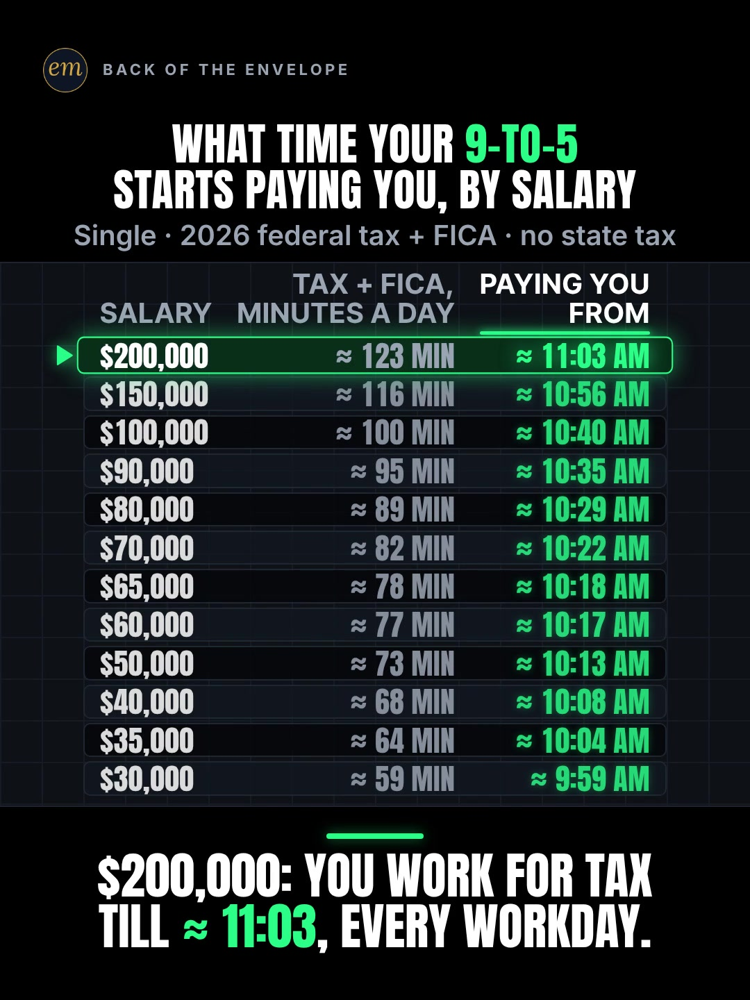

# 02c publishing sheet: what time your 9-to-5 starts paying you

YouTube Shorts (@envelopemath) and Instagram Reels (@envelopemath). Prepared 2026-10-13. Machine-readable twin: `publishing/02c-scoreboard-salary-per-hour.json`.

- **Video.** `renders/channel/02c-scoreboard-salary-per-hour.mp4`: the condensed cut (10.1 s: a 7.6 s body + the 2.5 s card; sha256 `11fb6900…`), promoted and shipped on 2026-10-13. It replaces the 15.5 s round-2 cut (the owner: "too many still moments"), which is in git (`471c793`). The condense moved the clock and merged some captions; the numbers, the captions' facts and the verdict stay, so the copy carried over unchanged. Nothing below names a timestamp except the cover, which was re-picked by content on the shipped file. The ship rebuilt this sheet and re-exported both covers from it (`python3 publishing/tools/build_publishing.py 02c-scoreboard-salary-per-hour --covers`); on the shipped specs the maths check runs PASSED: all 225 checks.
- **Numbers.** Every figure comes from `teasers/v2/02-find-your-row.md` (02c) and its check, `python3 teasers/v2/checks/02-find-your-row.py`: PASSED: all 183 checks on `studio/specs/` (run 2026-10-13), and all 216 checks with `--spec` on the condensed cuts in `studio/specs-wip/`, which carry every string and number the copy quotes. The builder runs it through `publishing/data/checks/02-find-your-row.py`, which passes its output through and adds the summary line in the builder's form. `python3 publishing/tools/build_publishing.py 02c-scoreboard-salary-per-hour --check` checks this sheet's limits, paste blocks and figures, recomputes 2026 federal tax + FICA for every salary it names, and keeps each clock time beside its salary.
- **Honesty rules kept.** The title asks and never gives a result (no clock time), and so do the Instagram caption's first 125 characters. The description, the caption and the pinned comment say what the clock is: the tax share of the year read as the same share of each 8-hour day, an average (tax comes out of every paycheck, not the first hour). The description and the caption state the basis (single filer, 2026 federal income tax + FICA, no state tax), and all three say state tax, 401(k) and health premiums would push the time later. The short items (title, first comment, short alt text) carry the video's own words; the long alt text gives the footer's basis. No advice, no urgency, and 'Not financial advice.' is in both.
- **Brand.** None is named in the video. The copy names 'Tax Freedom Day' (a Tax Foundation term) to explain the average, so both platforms' copy says 'Not affiliated with or endorsed by the Tax Foundation.' The IRS, SSA and BLS are cited as sources only.

---

## YouTube Shorts

### Title (vidIQ title score, short-form, scored against this channel)

| # | Title | Score | Chars |
|---|---|---:|---:|
| 1 | How Much of Your 9-to-5 Goes to Taxes? What Time It Starts Paying You, by Salary | 97 | 80 |
| 2 | How Much of Your 9-to-5 Goes to Taxes? What Time You Start Getting Paid, by Salary | 98 | 82 |
| 3 | What Time Does Your 9-to-5 Start Paying You After Taxes? Find Your Salary | 95 | 73 |

**Pick (paste):**

```
How Much of Your 9-to-5 Goes to Taxes? What Time It Starts Paying You, by Salary
```

- 80 of 100 characters.
- The first question, 'How Much of Your 9-to-5 Goes to Taxes?', is the first 38 characters, so a title cut short still asks it whole, with 'taxes' (82,933 searches a month, +11.0%) in it.
- No result in it: no clock time, no minutes and no salary figure; the answer is the time on your row. It raises the write-up's title from 87 to 97.
- 'Taxes' here means 2026 federal income tax + FICA for a single filer, which the description's first line and the video's footer say.
- Also scored, not used: "What Time Does Your 9-to-5 Start Paying You? #taxes #salary #personalfinance" 94 (the house 3-hashtag form); "What Time Your 9-to-5 Actually Starts Paying You After Taxes, by Salary" 89; "What Time Your 9-to-5 Starts Paying You, by Salary" 87 (the write-up's title); "You Work for Taxes Until What Time Every Day? Find Your Salary" 87.

### Description (paste)

```
What time does your 9-to-5 start paying you? Find your salary. 2026 federal income tax + FICA take a share of your pay; the same share of an 8-hour day is how long you work for tax each morning. At $65,000, about the US median full-time pay, that's till about 10:18 am. At $100,000, about 10:40. At $200,000, about 11:03.

The math, shown:
• A 9-to-5 is 480 minutes. Minutes of tax a day = 480 × (federal income tax + FICA) ÷ salary. Your clock = 9:00 am + those minutes.
• At $65,000: $65,000 − $16,100 standard deduction = $48,900 taxable. Federal tax $5,620 + FICA (7.65%) $4,972.50 = $10,592.50, 16.30% of pay: ≈ 78 minutes, so ≈ 10:18 am.
• At $100,000: ≈ 100 minutes (1 hr 40 min) a day, so ≈ 10:40 am.
• At $200,000: $36,734 tax + $14,339 FICA = $51,073, 25.54% of pay: ≈ 123 minutes, so ≈ 11:03 am.
• The share rises with every row: at $30,000 it's 12.38% (≈ 9:59 am); at $200,000, 25.54%.

Follow for the math behind your money — shown, not hand-waved. @envelopemath

Animation and original sound: The Back of the Envelope. 2026 federal brackets and the $16,100 standard deduction for a single filer (IRS, Rev. Proc. 2025-32); FICA is 6.2% Social Security on wages up to $184,500 plus 1.45% Medicare (SSA). Median full-time pay: $1,251 a week in Q2 2026 (BLS), about $65,000 a year. Wages only; no state or local tax, 401(k) or health premiums, which would push your time later. It's an average, the idea behind Tax Freedom Day applied to a single workday: tax comes out of every paycheck, not the first hour of each morning. Not financial advice. Not affiliated with or endorsed by the Tax Foundation.
#taxes #salary #PersonalFinance
```

1,643 of 5,000 characters (1,673 UTF-8 bytes; YouTube counts this limit in bytes, and `≈`, `×`, `•`, `—`, `÷` take 2-3 each). No `<` or `>`, which YouTube rejects. It follows the house template: an answer-first opening line for the search snippet, then 'The math, shown:' bullets, then the follow line. The credit, assumptions and 'Not financial advice.' line comes next, and the 3 hashtags close it. The 'Doesn't Add Up' series line is left out, as on 06b and 06c: the clock is an average on a stated basis, so 'a number that shouldn't be true' would oversell it.

### Hashtags (order matters)

1. `#taxes`: the topic ('taxes' 82,933 searches a month, +11.0% on its 30-day baseline; the US is its top market).
2. `#salary`: the viewer's row ('100k salary' 12,623 a month; the after-tax salary phrases run 3,650-7,394 at competition 14.6-25.9).
3. `#PersonalFinance`: the broad category ('personal finance' 1,436,792 a month) and the most used hashtag in the channel's titles (5 of the 29 recent Shorts vidIQ lists).

The title carries no hashtags, so YouTube shows these 3, the description's first, above the title. Over 60 hashtags and YouTube ignores all of them. `#Shorts` isn't needed.

### Tags (paste; 278 of 500 characters as YouTube counts them: commas count, and a tag with a space counts 2 more for the quotes YouTube adds)

```
taxes, salary after taxes, how much you actually keep from a $100k salary after taxes, 80k salary after taxes, 100k salary, federal income tax, fica, tax freedom day, take home pay, personal finance, money math, math animation, the back of the envelope, envelope math
```

Tags carry little weight. These mirror the keyword research plus the house's channel tags. 'how much you actually keep from a $100k salary after taxes' (5,111 a month, competition 25.9) is the closest search to the video's question; 'tax freedom day' is under 750 a month but is the idea the clock borrows. Left out on purpose: 'income tax' (64,908) is mostly India; 'working 9 to 5' (44,885) is mostly the song; '9 to 5 trap' (17,829) wants to quit the job.

### Pinned comment (post it, then pin it)

```
What time does your day start paying you?

It's an average, the same idea as Tax Freedom Day: tax comes out of every paycheck, not the first hour of each morning. FICA (Social Security + Medicare) is a payroll tax, so it's in. State income tax, 401(k) and health premiums would push your time later.
```

The question comes first so it shows in the collapsed preview, and it invites the line the write-up expects viewers to repeat about themselves ('I work for tax till 10:18'). The rest is the write-up's pinned comment, which answers the comments to expect: 'FICA isn't income tax', state tax, and 'tax isn't taken in the morning'.

### Related video and end screen

- **Related video:** [Pay the Minimum on $5,000? 238 Months.](https://www.youtube.com/shorts/8__HTUa2PoU) (`8__HTUa2PoU`). The same viewer, an everyday paycheck question. Its Instagram twin is the channel's best October Reel (7,302 plays, 27.4% skip); the Short has 642 views. Live since Mon 5 Oct 2026, 22:09 ET.
- **Swap later:** 02a or 02b, the other find-your-row tables, once published; then point theirs at this Short.
- **End screen:** Shorts have no end screens or cards. The Related video link is the Shorts equivalent.

### Thumbnail and settings

- **Thumbnail:** in the YouTube app, pick the finished-board frame (all 12 rows, the $200,000 row lit and the verdict), the same content as the Instagram cover below.
- **Settings:** Category Education. Not made for kids. Altered or synthetic content: No (it's an animated chart, not realistic footage). Remixing allowed. No captions needed: there's no narration and all the text is on screen.

### Posting window

- **When:** First Tue-Thu evening after the 02c condensed cut ships and passes QA, 21:30-22:30 ET (01:30-02:30 UTC the next day). Sunday 06:00-08:00 ET is the alternative.
- **Spacing:** Keep it at least 6 h from any other upload on the channel, and post one find-your-row teaser (02a, 02b, 02c) per evening.
- **Why:** The channel's own October Shorts, median views by posting slot (vidIQ, 2026-10-13): Sunday 05:00-08:00 ET 1,198 (n = 2), weekday 22:00-00:30 ET 642 (n = 3), weekday midday 263 (n = 2). 06c (Mon 03:45 ET) had 760 views by 13 Oct; 06b (Mon 12:14 ET, the day before) had 61. The evening slot is also the best one on Instagram, so one evening serves both. n = 7 and confounded by topic, so treat it as a test. 'taxes' searches run +11.0% over their baseline; the basis is 2026 tax, so post it in 2026.

---

## Instagram Reels

### Caption (paste)

```
Find your salary: what time does your 9-to-5 start paying you, after 2026 federal income tax + FICA?

Federal income tax + FICA take a share of your pay. Read it as the same share of every 8-hour workday, and that's how long you work for tax each morning before your 9-to-5 starts paying you.

The math, shown:
• Minutes of tax a day = 480 × (tax + FICA) ÷ salary. Your clock = 9:00 am + those minutes.
• At $30,000: ≈ 59 minutes, so ≈ 9:59 am.
• At $65,000, about the US median full-time pay: ≈ 78 minutes, so ≈ 10:18 am.
• At $100,000: ≈ 1 hr 40 min, so ≈ 10:40 am.
• At $200,000: ≈ 123 minutes, so ≈ 11:03 am, every workday.

Single filer, $16,100 standard deduction, 2026 brackets; FICA = 6.2% Social Security (to $184,500) + 1.45% Medicare. No state tax, 401(k) or health premiums, which would push your time later. It's an average, the Tax Freedom Day idea applied to a single workday: tax comes out of every paycheck, not the first hour. Not financial advice. Not affiliated with or endorsed by the Tax Foundation.

What time does your day start paying you?

Follow for the math behind your money — shown, not hand-waved. @envelopemath
Animation and original sound: The Back of the Envelope.

#taxes #paycheck #salary #personalfinance #financialliteracy
```

- 1,260 of 2,200 characters.
- **First 125 characters:** the write-up's caption line 1 ('Find your salary'), then the header as a question with its tax basis. No clock time, no minutes and no salary figure; the times sit below 'more', where Instagram search and Google indexing still read them.
- The second paragraph says what the clock means before any number, so no time is read as a payroll fact.
- The rows quoted are the board's own: the bottom row, the median, six figures and the verdict's top row. The caption follows the house close: the follow line plus the credit.

### Hashtags (5, Instagram's cap since Dec 2025)

`#taxes #paycheck #salary #personalfinance #financialliteracy`

Three are specific:

- `#taxes` names the topic ('taxes' 82,933 a month on YouTube, rising).
- `#paycheck` is the word on the biggest after-tax outlier in section 3 ('your paycheck AFTER TAXES!', 14.2M), and `#salary` names the viewer's row.

`#personalfinance` and `#financialliteracy` ('financial literacy' 256,914 a month, +11.9%) are the broad layer.

### Alt text

- **Short (86 characters; paste this one into Instagram):** Table by salary: what time a 9-to-5 starts paying you after 2026 federal tax and FICA.
  - It stays at or under 100 characters, so it fits the field however short it is. It carries no result, and the long version gives the rows.
- **Long (for anywhere with room, such as a website embed):** Animation on a black scoreboard. Header: What time your 9-to-5 starts paying you, by salary. Footer: single, 2026 federal tax + FICA, no state tax. 12 rows, a salary on each from $200,000 down to $30,000: minutes of tax a day, and the time the day starts paying you; at $200,000, about 11:03 am; at $30,000, about 9:59 am. A pointer lights $65,000, about the US median full-time pay: about 78 minutes, about 10:18 am. Then $100,000: about 1 hr 40 min, about 10:40 am. Verdict: $200,000: you work for tax till about 11:03, every workday.
- **Where:** Advanced settings → Accessibility → Alt text, if your app shows it for Reels.

### Cover



- **Files:** `publishing/02c-scoreboard-salary-per-hour-cover-3x4.jpg` (1080×1440) and `publishing/02c-scoreboard-salary-per-hour-cover-9x16.jpg` (1080×1920). Both come from the shipped (10.1 s) render at 7.1 s (frame 213).
- **Frame, by content:** The finished board with the $200,000 row lit, which the write-up names as the cover ('the finished board with the $200,000 row lit'): the header 'WHAT TIME YOUR 9-TO-5 / STARTS PAYING YOU, BY SALARY', the footer, all 12 salary rows from $200,000 to $30,000 at full brightness with their minutes and their clock, the pointer and glow on '$200,000 · ≈ 123 MIN · ≈ 11:03 AM', and the verdict '$200,000: YOU WORK FOR TAX / TILL ≈ 11:03, EVERY WORKDAY.' in the strip. Use the settled frame after the other rows come back to full brightness, before the end card, so every viewer can read their row. On the shipped 10.1 s condensed cut the verdict slams in at 6.05 s with the $200,000 row lit and the others dimmed; the other rows come back to full brightness by about 6.9 s; from 6.93 s (frame 208) the mean frame-to-frame luma change (270×480 greyscale) stays at or under 0.016 until the end card cuts in at 7.60 s. The cover is taken at 7.1 s (frame 213), inside that hold. On the 15.5 s pre-condense render it was 12.5 s (frame 375). If the cut changes, re-pick it by content.
- **Crop:** 3:4 = 1080×1440 from y 72 to 1512 of the 1080×1920 frame. The content runs from y 141 (the badge) to y 1444 (the verdict's last line), so the crop centres it: badge, header, footer, the whole board and the verdict; it drops the empty black floor. A centred grid crop (y 240-1680) loses the badge and leaves the header on the top edge.
- **How to set it:** In 'Edit cover', pick the finished-board frame from the video (or upload the 9:16 JPG), then drag 'Profile grid' to the top so the tile matches the 3:4 JPG. Do not upload the 3:4 JPG as the Reel cover: Instagram centre-crops it to 9:16 in the Reels tab and cuts the header and the verdict.
- **Re-export:** `ffmpeg -ss 7.1 -i renders/channel/02c-scoreboard-salary-per-hour.mp4 -frames:v 1 -vf "crop=1080:1440:0:72" -q:v 2 publishing/02c-scoreboard-salary-per-hour-cover-3x4.jpg` and `ffmpeg -ss 7.1 -i renders/channel/02c-scoreboard-salary-per-hour.mp4 -frames:v 1 -q:v 2 publishing/02c-scoreboard-salary-per-hour-cover-9x16.jpg`, or `python3 publishing/tools/build_publishing.py 02c-scoreboard-salary-per-hour --covers`.
- **Not used:** the frame just after the verdict lands, with the other rows dimmed: it reads as one salary's answer, and the point of the board is that every viewer finds their own. Frame 1 (the header over the $200,000 row only) is not used either: the write-up chooses the finished board, after Gage Heward's one cover A/B (4,348 vs 2,844, n = 1).
- **Shipped cut (2026-10-13):** the settled finished board, every row at full brightness, was re-picked by content on the shipped file (7.1 s) and both JPGs re-exported from it. It shows the same board, lit $200,000 row and verdict as the pre-condense cover.

### First comment (post it, then pin it)

```
At $65,000, about the US median full-time pay, you work for tax till ≈ 10:18 am. At $200,000, till ≈ 11:03. What time does your day start paying you?
```

### Trial Reels

**Post as a regular Reel, not a Trial.** @envelopemath has 8 followers, so a regular Reel is already shown almost entirely to non-followers, which is all a Trial Reel adds. A Trial would also keep it off the profile grid until shared. A version test afterwards, if you want one. The write-up's Instagram cut is music-only with captions off (the same spec rendered with "captions": false: the header and the clock column carry it); it is not in renders/channel, so it needs a studio render first. Post it as a Trial with MANUAL graduation 48-72 h later and compare skip rate (October Reels ran 27.0-65.1%) and average watched %, then share the winner. vidIQ's publish tool exposes Trial (MANUAL or SS_PERFORMANCE) for this connected account. Confirm eligibility in the app.

### Posting window and settings

- **When:** Same evening as YouTube, about 15 min after the Short: 21:45-22:45 ET.
- **Why:** October Reels, median plays by posting slot (owner insights, 2026-10-13): weekday 22:00-00:30 ET 5,449 (n = 3, including the two best: 7,302 and 5,449), weekday midday 1,212 (n = 2), Sunday 05:00-08:00 ET 1,087 (n = 2). Skip rate tracks plays more closely than the hour does: 27.0-27.4% for the top two, 56.9-65.1% for the bottom two. The best of them ('$5,000 on the minimum', 7,302 plays) is the same everyday-paycheck viewer.
- **Audio:** Rename the original audio to 'What time your 9-to-5 starts paying you — The Back of the Envelope' if the app allows; it is the score, with no voice.
- **Share to feed:** On.

---

## Why these choices (research evidence)

**1. Search demand (vidIQ keyword research, pulled 2026-10-13).** vidIQ refreshes each keyword on its own schedule, so the last column gives each row's snapshot date. Four rows are older snapshots.

| Keyword | Est. searches/month | Competition | Overall | Note | vidIQ as of |
|---|---:|---:|---:|---|---|
| taxes | 82,933 | 52.5 | 63.1 | +11.0% vs its 30-day baseline (74,718); the US is its top market | 2026-10-12 |
| income tax | 64,908 | 54.7 | 61.2 | +149.6%, but 55% India: not this video's tax | 2026-10-12 |
| irs | 62,989 | 42.1 | 66.1 | +7.4% vs its baseline | 2026-10-12 |
| working 9 to 5 | 44,885 | 54.0 | 60.1 | -45.7% vs its baseline; mostly the song, not a tag | 2026-10-12 |
| 9 to 5 trap | 17,829 | 19.2 | 70.4 | +34.7% vs its baseline (13,236): quitting-the-job intent, not a tag | 2026-10-12 |
| 100k salary | 12,623 | 56.5 | 54.1 | the six-figure row | 2026-10-12 |
| reality of my 48 lpa microsoft salary after taxes | 7,394 | 25.3 | 64.5 | India; shows 'salary after taxes' demand | 2026-09-30 |
| how much you actually keep from a $100k salary after taxes | 5,111 | 25.9 | 62.9 | the closest search to the video's question | 2026-06-24 |
| 80k salary after taxes | 4,215 | 14.6 | 66.6 | competition 14.6 | 2026-05-15 |
| what a $100k salary actually looks like after taxes and bills | 3,650 | 19.7 | 64.0 |  | 2026-09-15 |
| tax freedom day | 0 (<750) | 41.2 | 23.5 | <750/month: the idea the clock borrows; a tag only | no snapshot |
| how much tax do i pay | 0 (<750) | 35.6 | 25.8 | <750/month | no snapshot |
| paycheck taxes | 0 (<750) | 19.0 | 32.4 | <750/month | no snapshot |

'taxes' is the big on-topic phrase (82,933 a month) and it is rising (+11.0%), so it leads the title's search words and the hashtags. The after-tax salary phrases are small (3,650-7,394) but low in competition (14.6-25.9), so they go in the tags. The 9-to-5 phrases are big but about the song or quitting, and 'tax freedom day' is under 750 a month, so neither carries the title.

**2. 'How much of my pay is tax' travels; nobody tells it as clock time (vidIQ YouTube search, under 4 min).**

| Title | Channel (subs) | Views | Date |
|---|---|---:|---|
| How Do Taxes Work? | Gohar Khan (7,960,000) | 24,131,064 | 2024-03-24 |
| || DAY 41/100 || 🇺🇸 America Mein 👉 $8,000 Salary… Account Mein Kitna Aata Hai? 😳🇺🇸 | Inspiring Bharat 🇮🇳 (14,800) | 2,693,076 | 2026-02-27 |
| How Much Of Lebron James’s Salary Does He Get To Keep? #fyp #nba #lebronjames #money | Makeshift Project (2,470,000) | 1,490,051 | 2025-12-15 |
| Why $250,000 From Your Own Business Beats a $400,000 Salary | Karlton Dennis (1,140,000) | 514,614 | 2026-08-29 |
| You Work For The Government! #shorts #taxes #employees | Mark Cassara | Legacy Wealth Academy (23,600) | 148 | 2022-01-11 |

Take-home-pay Shorts travel when they price one salary the viewer can picture: a US salary's take-home for a Hindi-language audience (2,693,076), LeBron James' (1,490,051), and the broad 'How Do Taxes Work?' (24,131,064). None found reads the tax share as a time of day, and none tabulates it by salary. The closest framing, 'You Work For The Government!', has 148 views. So the title asks the familiar question ('how much goes to taxes') and promises the new unit (what time).

**3. 'Your pay after taxes' is a proven Reel topic, mostly as a picture (vidIQ IG/TikTok outlier search, last 30 days).**

- **@builtbymali** (Instagram), "your paycheck AFTER TAXES!": 14.2M (9,981.0x). **@recipesbyaisha** (Instagram), "Salary before tax": 344.9K (106.6x). The shrink as a visual metaphor, no voice.
- **@mastermoneyco** (TikTok and Instagram), "4 DEAD SIMPLE NUMBERS That Tell You What You Actually Make": 3M (140.0x) and 1.8M (28.4x). The write-up's H84, the payout frame its header borrows.
- **@moneymovesjake** (TikTok), "If you make $25/hour, you take home about $17.50 after taxes.": 166.4K (397.1x). After-tax pay re-priced in work time, static text, music only.
- None states the bite as a time of day, and none puts every salary on one board; 02c does both. The two picture Reels and the static-text one run without a voice, which backs the write-up's music-only Instagram cut.

**4. Our own October numbers (vidIQ: public YouTube stats, Instagram owner insights; pulled 2026-10-13).**

| YouTube Short | Posted (ET) | Views |
|---|---|---:|
| Can You Find the Missing Dollar? (`LjHDFzVxRyM`) | Sun 07:04 | 1,254 |
| You Can Lean on $1 Million. Not on $1 Billion. (`hJBvmGA6sZ0`) | Thu 00:25 | 1,221 |
| Your Interest Has a Speed Limit (`XVUeMcTg9OQ`) | Sun 05:49 | 1,141 |
| What If You Bought Starbucks Stock Instead of a $4 Latte Every Day? (06c) (`fbpdKf4Wy8c`) | Mon 03:45 | 760 |
| Pay the Minimum on $5,000? 238 Months. (`8__HTUa2PoU`) | Mon 22:09 | 642 |
| A $2 Lottery Ticket Was Worth $6.98. Until the Fine Print. (`FW_oxA3kbsM`) | Wed 12:03 | 348 |
| You Can Carry $1 Million. Not in Pennies. (`mXbKY_R63h4`) | Thu 13:38 | 177 |
| Start Investing 10 Years Late? You Get Half. (`EqFQCJheCMU`) | Tue 22:27 | 161 |
| What If You Bought Netflix Stock Instead of Paying for Netflix? (06b) (`krfZEHhb0xU`) | Mon 12:14 | 61 |

| Instagram Reel | Posted (ET) | Plays | Skip rate | Avg watched |
|---|---|---:|---:|---:|
| $5,000 on the minimum (`DeIvYk7I4Qr`) | Mon 22:46 | 7,302 | 27.4% | 56.5% |
| $1M stack vs Burj Khalifa (`DeOEthJJ1TG`) | Thu 00:28 | 5,449 | 27.0% | 83.1% |
| Missing dollar (`DeWgFZRoR_S`) | Sun 07:05 | 1,997 | 32.0% | 81.3% |
| Powerball $6.98 (`DeMvZv9IqRw`) | Wed 12:05 | 1,825 | 58.7% | 57.9% |
| 06c latte vs Starbucks stock (`DeYuqT4pjVC`) | Mon 03:46 | 1,711 | 40.3% | 69.1% |
| $1M in pennies (`DePe11HIHwn`) | Thu 13:37 | 598 | 42.0% | 66.7% |
| 10 years late (`DeLSd9io8UK`) | Tue 22:30 | 219 | 65.1% | 30.6% |
| Speed limit (e) (`DeEW2ZMIiYd`) | Sun 05:54 | 177 | 56.9% | 31.2% |

Channel totals:

- **YouTube:** 53 subscribers, 10,221 views and 41 videos (+27 subscribers, +5,127 views and 11 videos in 30 days).
- **Instagram:** 8 followers and 20,518 views in 30 days.

06b went up on both platforms on Mon 12 Oct at 12:14 ET, midday: 61 views on YouTube by 13 Oct, and its Reel's insights are not in yet (Instagram lags). It is left out of the medians, as is 06c (760 views, 1,711 plays, 40.3% skip), both too young.

Medians by posting slot (n = 2-3 each, confounded by topic):

- **YouTube:** Sunday early morning ET 1,198, weekday 22:00-00:30 ET 642, weekday midday 263.
- **Instagram:** weekday 22:00-00:30 ET 5,449, midday 1,212, Sunday early morning 1,087.

The Powerball Short, where 'cash, the crowd and tax take their cut', is the channel's only other tax read (348 views; 1,825 plays, 58.7% skip). 02c leads with the viewer's own salary instead of someone else's jackpot.

**5. Platform rules applied.**

- **YouTube title:** 100 characters. The Shorts player shows only the opening, so the keywords come first.
- **YouTube description:** 5,000 characters.
- **YouTube hashtags:** the first 3 show; over 60 and all are ignored; `#Shorts` isn't needed.
- **YouTube tags:** 500 characters, low weight.
- **YouTube Shorts:** no end screens. The Related video link is the Shorts equivalent.
- **YouTube AI disclosure:** only for realistic altered content.
- **Instagram caption:** 2,200 characters, about 125 shown before 'more'.
- **Instagram hashtags:** 5 at most.
- **Instagram search and Google:** keywords in the caption feed Instagram search, and Google indexes public professional posts (since 10 Jul 2025).
- **Instagram grid:** a 3:4 crop of the 9:16 cover.
- **Trial Reels:** shown to non-followers only.

**6. Limits.**

- vidIQ's YouTube authorization is a different channel (UCRC5v_El2fibbkqsZs6uFjA), so @envelopemath's YouTube Analytics (audience hours, geography) were not readable. Check Studio → Analytics → Audience → 'When your viewers are on YouTube' before posting.
- vidIQ has no hashtag-volume data; hashtag picks lean on keyword volume and on the outliers' own tags.
- Title scores are vidIQ's short-form CTR model for this channel; they rank options but do not predict views.
- The render in renders/channel is the shipped condensed cut (2026-10-13). The cover's time and frame are measured on it; the copy names no other timestamp and carried over from the pre-condense cut unchanged.
- irs.gov and bls.gov could not be opened in the write-up's research (the proxy blocks them); the brackets, the wage base and the median rest on the write-up's named sources.
- The figures are for a single filer in 2026; married filers, other years and state tax give other times, and the copy says so only for state tax, 401(k) and health premiums.

---

## Check log (adversarial pass, 2026-10-13)

- **Maths.** `python3 teasers/v2/checks/02-find-your-row.py`: PASSED: all 183 checks at this check (all 177 checks at the first build; the condense pass has since made the check cut-aware), and all 216 checks with `--spec` on the condensed cut, which keeps every string and number the copy quotes. Every public figure traces to the 02c maths table: $65,000 → $48,900 taxable, $5,620 + $4,972.50 = $10,592.50 (16.30%), ≈ 78 min, ≈ 10:18 am; $100,000 ≈ 100 min (1 hr 40 min), ≈ 10:40 am; $200,000 $36,734 + $14,339 = $51,073 (25.54%), ≈ 123 min, ≈ 11:03 am; $30,000 12.38%, ≈ 59 min, ≈ 9:59 am; $1,251 × 52 ≈ $65,000. The data file recomputes each from the 2026 brackets and FICA.
- **Limits.** Title 80/100. Description 1,643 characters (1,673 bytes) of 5,000. 3 hashtags. Tags 278/500 as YouTube counts them. Instagram caption 1,260/2,200, with the first 125 characters result-free. 5 hashtags. Short alt text 86. No `<` or `>`.
- **vidIQ.** Keywords pulled 2026-10-13 (table above). 7 titles scored against this channel: the pick 97, the top 98, the write-up's title 87. Channel 53 subscribers / 10,221 views / 41 videos; Instagram owner insights refreshed (8 followers, 20,518 views in 30 days).
- **vidIQ re-queried.** The pick's title score 97; 'taxes' 82,933 / 52.5 (+11.0%); the channel 53 / 10,221 / 41; the related Short (`8__HTUa2PoU`) 642 views, Mon 5 Oct 22:09 ET. All match. The channel's 29 recent Shorts carry #PersonalFinance in 5 titles, the most of any hashtag.
- **Changed.**
  - The intro said every copy item explains the average and states the basis. The title, the first comment and the short alt text do neither (they carry the video's own words), and the pinned comment explains the average but not 'single filer' or '2026'. The intro now names which items say what, and two copy rules hold it: the description and the caption name the single filer, 2026 and no state tax, and those two plus the pinned comment say 401(k) and health premiums would push the time later.
  - Related video: its 'why' cited the Instagram Reel's plays as if they were the Short's; it now gives both (7,302 plays on Instagram, 642 views on YouTube).
  - #PersonalFinance note: 5 of the 29 recent Shorts vidIQ lists, not '5 of its last 30'.
  - The maths count: the sheet said 177 checks; the 02 check now prints 183 on `studio/specs/` (and 216 on the condensed cuts with `--spec`), so the intro, `facts` and this log say so.
- **Mutation test.** At the first build, five mutations of a scratch copy each failed by name: a clock time under the wrong salary, a bare clock time, the caption without 'average', the caption without the Tax Foundation line, and a result in the title. At this check, two more fail by name: the caption without 'single filer', and the pinned comment without its 401(k) line. The files on disk were not touched.
- **Generator.** Unchanged. The 02 check prints 'PASSED: all N checks', and the builder reads only 'N checks, F failed', so `MATH_SCRIPT` is `publishing/data/checks/02-find-your-row.py`, a pass-through that runs the 02 check unchanged and adds that line (exit code passed through).
- **Kept on purpose.**
  - The pick is 1 point under the top score: 'start getting paid' would state the average as a payroll fact.
  - 'Taxes' in the title: the video counts 2026 federal income tax + FICA for a single filer. State tax would make the time later; a married filer or one with credits pays less and gets an earlier time. The title asks the question the board answers on its stated basis, which the description's first line and the footer give (the limits list names the other filers).
  - 'Tax Freedom Day' is named to explain the average, so both platforms carry the Tax Foundation line.
  - The cover is the settled finished board with every row at full brightness, not the moment the verdict lands with the others dimmed. Re-exported to a scratch folder, both JPGs are byte-identical to the files here, and the condensed cut's spec carries the same header, footer, rows, captions, pick labels and verdict, so no copy changes on ship.
- **Done on ship (2026-10-13).** Rebuilt with `--covers` from the shipped condensed cut (10.1 s). The settled finished board was re-picked by content at 7.1 s (frame 213), every row back at full brightness. The Video bullet, the cut and the check counts follow the shipped file (PASSED: all 225 checks on `studio/specs/`), and the long alt text was re-read against the condensed beat sheet: every beat it names is in the shipped cut, so no copy changed.
