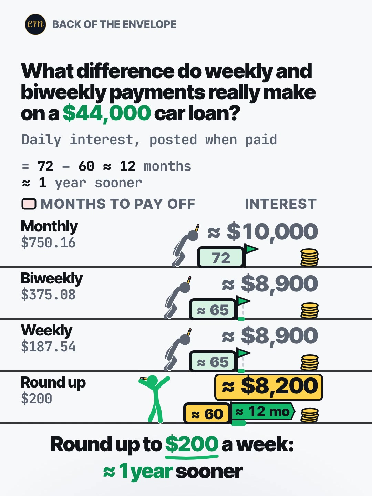

# 03a publishing sheet: weekly and biweekly payments on a $44,000 car loan

YouTube Shorts (@envelopemath) and Instagram Reels (@envelopemath). Prepared 2026-10-13. Machine-readable twin: `publishing/03a-becker-rig-car-loan-weekly.json`.

- **Video.** `renders/channel/03a-becker-rig-car-loan-weekly.mp4`: the pre-condense round-2 cut (39.7 s: a 37.2 s body + the 2.5 s card; sha256 `4b1c8e07…`). The 03 condense is in progress in parallel (timing only: the numbers, the captions' facts and the verdict stay). Nothing below names a timestamp except the cover, which is picked by content (the finished board), so the copy carries over to the condensed cut unchanged. The ship step rebuilds this sheet and re-exports both covers from the final file: `python3 publishing/tools/build_publishing.py 03a-becker-rig-car-loan-weekly --covers`.
- **Numbers.** Every figure comes from `teasers/v2/03-what-difference.md` (03a) and its check, `python3 teasers/v2/checks/03-what-difference.py`: 528 checks, 0 failed on `studio/specs/` (run 2026-10-13). The builder runs it through `publishing/data/checks/03-what-difference.py`, which passes its output through and adds the summary line in the builder's form. `python3 publishing/tools/build_publishing.py 03a-becker-rig-car-loan-weekly --check` checks this sheet's limits, paste blocks and figures, re-runs the four schedules day by day, keeps every rounded figure 'about' or '≈', and keeps every 13 as '13 monthly payments' or '13 ×'.
- **Honesty rules kept.** The title asks and never gives the result; the Instagram caption keeps every result below 'more'. The cover is the finished board, as the write-up's Instagram note asks (as on 06c). Every claim stays inside the video's verdict, "Round up to $200 a week: ≈ 1 year sooner", and the copy says its condition: simple interest charged daily, each payment applied the day it lands (the pinned comment asks whether the viewer's lender does). The year and the ≈ $1,800 are against paying monthly, and the copy says so wherever it gives them. No advice, no urgency, and 'Not financial advice.' is in both.
- **Sources and brand.** $44,000 at 7% over 72 months is a round loan just under Edmunds' Q3 2026 averages ($44,664 at 7.0%), so the copy says '≈ the average new-car loan', never 'the average'. Edmunds is named only as that source, and both platforms' copy says 'Not affiliated with or endorsed by Edmunds.'

---

## YouTube Shorts

### Title (vidIQ title score, short-form, scored against this channel)

| # | Title | Score | Chars |
|---|---|---:|---:|
| 1 | What Difference Do Weekly Car Payments Really Make on a $44,000 Car Loan? | 93 | 73 |
| 2 | Weekly vs Biweekly Car Payments on a $44,000 Loan: What Difference Does It Make? | 93 | 80 |
| 3 | Do Biweekly Car Payments Really Pay Off Your Car Loan Faster? | 91 | 61 |

**Pick (paste):**

```
What Difference Do Weekly Car Payments Really Make on a $44,000 Car Loan?
```

- 73 of 100 characters.
- The stake carries the score: every title with '$44,000' scored 92-93, and the 'what difference' titles without it 84. The pick keeps the write-up's question word for word ('What Difference Do Weekly Car Payments Really Make on …'), the frame of the 1.9M H48 TikTok, and adds 'Car Loan' (18,346 searches a month).
- It names no result: weekly vs biweekly, the 13 payments and the rounding lever are all the video's. 'Really' is the write-up's R5 cue that the popular hack is oversold.
- Options 1 and 2 tie at 93; the pick is decided on shape (a question, not 'X vs Y') and length (73 vs 80 characters). vidIQ's model ranks titles but does not predict views.
- Also scored, not used: "What Difference Do Weekly Car Payments Really Make on $44,000?" 92 (the write-up's title); "Weekly vs Biweekly Car Payments on a $44,000 Car Loan: What Difference Does It Make?" 93 (84 chars, no gain over option 2); "Weekly vs Biweekly vs Monthly Car Payments on $44,000: What Difference Does It Make?" 92; "Weekly vs Biweekly Car Payments: What Difference Do They Really Make?" 84 (without the stake: 8-9 points lower); "What Difference Do Weekly and Biweekly Car Payments Really Make?" 84 (without the stake); "Weekly vs Biweekly Car Payments: What Difference Do They Really Make? #carloan #biweekly #debtpayoff" 84 (the house 3-hashtag form).

### Description (paste)

```
What difference do weekly car payments really make on a $44,000 car loan? Weekly beats biweekly by only about $35: both add up to 13 monthly payments a year, not 12. Rounding the weekly payment up to $200, about $12 more a week, pays it off about a year sooner than paying monthly and saves about $1,800 of interest.

The math, shown ($44,000 at 7% APR over 72 months):
• Monthly: $750.16 a month for 72 months. About $10,000 of interest.
• Biweekly: $375.08 × 26 = $9,752.08 a year. About 65 months and about $8,900 of interest: about $1,100 less.
• Weekly: $187.54 × 52 = $9,752.08 a year, the same. About 65 months and about $8,900 too: only about $35 better than biweekly.
• Why: 13 × $750.16 = $9,752.08. Both are 13 monthly payments a year, not 12.
• Round up: $187.54 + $12.46 = $200 a week. About 60 months and about $8,200 of interest: about $1,800 less than monthly.
• 72 − 60 ≈ 12 months: about a year sooner than monthly.

Follow for the math behind your money — shown, not hand-waved. @envelopemath

Animation and original sound: The Back of the Envelope. $44,000 at 7% APR over 72 months ≈ the average new-car loan (Edmunds, Q3 2026: $44,664 at 7.0%). Simple interest charged daily; assumes each payment is applied the day it lands. Not financial advice. Not affiliated with or endorsed by Edmunds.
#carloan #biweekly #debtpayoff
```

1,343 of 5,000 characters (1,366 UTF-8 bytes; YouTube counts this limit in bytes, and `≈`, `×`, `•`, `—` take 2-3 each). No `<` or `>`, which YouTube rejects. It follows the house template: an answer-first opening line for the search snippet, then 'The math, shown:' bullets, then the follow line. The credit, assumptions and 'Not financial advice.' line comes next, and the 3 hashtags close it. The opening line is the title's question with the write-up's caption answer, for the search snippet. The 'Doesn't Add Up' series line is left out, as on 06b and 06c.

### Hashtags (order matters)

1. `#carloan`: the topic ('car loan' 18,346 searches a month, down 30.3% on its 30-day baseline but the biggest exact phrase), and the H48 outlier's own tag.
2. `#biweekly`: the schedule the hook names; the write-up's tag.
3. `#debtpayoff`: the outcome ('pay off debt' 32,458 a month, up 66.2%); the H48 outlier's and the write-up's tag.

The title carries no hashtags, so YouTube shows these 3, the description's first, above the title. Over 60 hashtags and YouTube ignores all of them. `#Shorts` isn't needed.

### Tags (paste; 353 of 500 characters as YouTube counts them: commas count, and a tag with a space counts 2 more for the quotes YouTube adds)

```
biweekly car payments, weekly car payments, car loan, how to pay off car loan, payoff car loan early, how to reduce car loan interest, car loan interest, car loan explained, biweekly payments, car payment, auto loan, daily simple interest, pay off debt, debt payoff, money math, math animation, the back of the envelope, envelope math
```

Tags carry little weight. These mirror the keyword research plus the house's channel tags; 'biweekly car payments' is under 750 a month but names the video exactly. Left out on purpose: 'should i pay off car loan early' (5,252) is advice intent; 'car payment trap' (15,474, up 239.1%) is about long loans and investing the payment, not this question.

### Pinned comment (post it, then pin it)

```
Does your lender apply a weekly payment the day it lands, or hold it until the due date? These numbers assume the day it lands. Drop your loan amount, APR and months and we'll run yours next.

The working: interest $10,011.20 paying monthly (72 payments), $8,916.74 biweekly (142), $8,881.25 weekly (282; $35.49 less than biweekly) and $8,184.40 at $200 a week (261 payments, about 60 months).
```

The question comes first so it shows in the collapsed preview: it is the write-up's pinned comment, and it starts the argument the write-up expects (whether the lender posts a weekly payment the day it lands). Its second sentence is the write-up's assumption, not its 'That decides whether any of this works': a lender that holds weekly payments still gets the 13th monthly payment a year, so the extra payments still count; only the exact figures move. The ask for the viewer's numbers sets up the comment-reply sequel (H50's 127.3x was one). The second paragraph is the exact working behind the rounded board, for the commenters who check it.

### Related video and end screen

- **Related video:** [Pay the Minimum on $5,000? 238 Months.](https://www.youtube.com/shorts/8__HTUa2PoU) (`8__HTUa2PoU`). Same viewer, same idea from the other side: what a payment schedule does to a debt. It is October's debt Short (642 views), and its Instagram twin is the channel's best Reel (7,302 plays, 27.4% skip). (June's 'Why the minimum payment keeps you in debt for 19 years' has more views, 1,230, but is an older, narrated Short.)
- **Swap later:** 03c (just $100 extra on a mortgage) or 03b (card minimum), the same what-difference series, once published. Then point theirs at this Short.
- **End screen:** Shorts have no end screens or cards. The Related video link is the Shorts equivalent.

### Thumbnail and settings

- **Thumbnail:** in the YouTube app, pick the finished-board frame (four lanes run, the gold plate on ≈ $8,200, the verdict), the same content as the Instagram cover below.
- **Settings:** Category Education. Not made for kids. Altered or synthetic content: No (it's an animated chart, not realistic footage). Remixing allowed. No captions needed: there's no narration and all the text is on screen.

### Posting window

- **When:** First free Tue-Thu evening after the condensed cut ships and passes QA, 21:30-22:30 ET (01:30-02:30 UTC the next day). Sunday 06:00-08:00 ET is the alternative.
- **Spacing:** Keep it at least 6 h from any other upload on the channel, and on a different evening from 03b and 03c. Suggested order within the series: 03c, then 03a, then 03b.
- **Why:** The channel's own October Shorts, median views by posting slot (vidIQ, 2026-10-13): Sunday 05:00-08:00 ET 1,198 (n = 2), weekday 22:00-00:30 ET 642 (n = 3), weekday midday 263 (n = 2); 06c (Mon 03:45 ET) has 760 and 06b (Mon 12:14 ET) 61, too young to compare. The evening slot is also the best one on Instagram, so one evening serves both. n = 7 and confounded by topic, so treat it as a test. Search demand: 'pay off debt' runs +66.2% over its 30-day baseline, while 'car loan' is down 30.3%. Edmunds' Q3 release (October 2026) is the news peg for the $44,000.

---

## Instagram Reels

### Caption (paste)

```
What difference do weekly and biweekly car payments really make on a $44,000 car loan at 7% over 72 months? Worked out, payment by payment.

Weekly barely beats biweekly. Rounding up is the real trick.

The math, shown:
• Monthly: $750.16 a month. 72 months, about $10,000 of interest.
• Biweekly: $375.08 × 26 = $9,752.08 a year. About 65 months, about $1,100 less interest.
• Weekly: $187.54 × 52 = $9,752.08 a year, the same 13 monthly payments. About 65 months too, only about $35 better than biweekly.
• Round up to $200 a week ($12.46 more): about 60 months. Against monthly: about $1,800 less interest and about a year sooner.

$44,000 at 7% ≈ the average new-car loan (Edmunds, Q3 2026: $44,664 at 7.0%). Simple interest charged daily; assumes each payment is applied the day it lands. Not financial advice. Not affiliated with or endorsed by Edmunds.

Does your lender apply a weekly payment the day it lands?

Follow for the math behind your money — shown, not hand-waved. @envelopemath
Animation and original sound: The Back of the Envelope.

#carloan #biweekly #debtpayoff #micropayments #personalfinance
```

- 1,116 of 2,200 characters.
- **First 125 characters:** the header's question plus the inputs, with no result. The write-up's caption line 1 is the verdict ('Weekly barely beats biweekly. Rounding up is the real trick!'); the house rule moves it below 'more', because the caption overlays the Reel from frame 1, and drops its exclamation mark. The numbers sit below the fold, where Instagram search and Google indexing still read them.
- The posting condition (daily interest, each payment applied the day it lands) sits right under the math, and the closing question asks the viewer to check their own lender.
- The caption follows the house close: the follow line plus the credit.

### Hashtags (5, Instagram's cap since Dec 2025)

`#carloan #biweekly #debtpayoff #micropayments #personalfinance`

Four are the write-up's own (`#carloan #debtpayoff #biweekly #micropayments`; its `#mathtok` is a TikTok tag):

- `#carloan` and `#debtpayoff` are on the H48 outlier this Short is modelled on (1.9M views), and `#micropayments` is the tag 4 of that creator's 5 breakouts carried.
- `#biweekly` names the schedule the hook asks about.

`#personalfinance` is the broad layer, as on 06b and 06c.

### Alt text

- **Short (96 characters; paste this one into Instagram):** Chart: a $44,000 car loan paid 4 ways; rounding up to $200 a week beats monthly by about a year.
  - It stays at or under 100 characters, so it fits the field however short it is. It says 'about', not '≈', so screen readers read it cleanly, and it keeps the verdict's lever, its 'about' and its baseline (monthly).
- **Long (for anywhere with room, such as a website embed):** Animation on a white background. The header asks: what difference do weekly and biweekly payments really make on a $44,000 car loan? 4 lanes, each a stick figure behind a crate on a time lane. Monthly ($750.16 a month) has already run: 72 months and about $10,000 of interest. Biweekly ($375.08) and Weekly ($187.54) both land at about 65 months and about $8,900: both add up to 13 monthly payments a year, so weekly is only about $35 better. Round up ($200 a week) lands at about 60 months and about $8,200 of interest, about $1,800 less than Monthly, and a banner shows about 12 months saved against Monthly's 72. Verdict: round up to $200 a week, about 1 year sooner.
- **Where:** Advanced settings → Accessibility → Alt text, if your app shows it for Reels.

### Cover



- **Files:** `publishing/03a-becker-rig-car-loan-weekly-cover-3x4.jpg` (1080×1440) and `publishing/03a-becker-rig-car-loan-weekly-cover-9x16.jpg` (1080×1920). Both come from the pre-condense (39.7 s) render at 35 s (frame 1050).
- **Frame, by content:** The finished board: all 4 lanes run (Monthly 72 and ≈ $10,000; Biweekly and Weekly ≈ 65 and ≈ $8,900; Round up ≈ 60 with the gold plate on ≈ $8,200 and the '≈ 12 mo' banner on its flag), the winner with his arms up, the working slot '= 72 − 60 ≈ 12 months / ≈ 1 year sooner' and the verdict 'Round up to $200 a week: ≈ 1 year sooner', under the question. The write-up names the finished board as the Instagram cover. On any cut, use a frame after the last read settles and before the end card. On the pre-condense 39.7 s render the last read settles by frame 1040 (34.67 s); from then only the winner's idle wave moves (frame-to-frame mean luma change ≤ 0.014) until the end card cuts in at 37.2 s. Frame 1050 (35.00 s) is used, a still point of the wave (0.002). If the cut changes, re-pick it by content.
- **Crop:** 3:4 = 1080×1440 from y 72 to 1512 of the 1080×1920 frame: the badge, the question, the footer, the working slot, the 4 lanes and the verdict, with even margins (40 px above the badge and below the verdict); it drops the empty floor. A centred grid crop (y 240-1680) cuts the badge and the question.
- **How to set it:** In 'Edit cover', pick the finished-board frame from the video (or upload the 9:16 JPG), then drag 'Profile grid' to the top so the tile matches the 3:4 JPG. Do not upload the 3:4 JPG as the Reel cover: Instagram centre-crops it to 9:16 in the Reels tab and cuts the question.
- **Re-export:** `ffmpeg -ss 35.0 -i renders/channel/03a-becker-rig-car-loan-weekly.mp4 -frames:v 1 -vf "crop=1080:1440:0:72" -q:v 2 publishing/03a-becker-rig-car-loan-weekly-cover-3x4.jpg` and `ffmpeg -ss 35.0 -i renders/channel/03a-becker-rig-car-loan-weekly.mp4 -frames:v 1 -q:v 2 publishing/03a-becker-rig-car-loan-weekly-cover-9x16.jpg`, or `python3 publishing/tools/build_publishing.py 03a-becker-rig-car-loan-weekly --covers`.
- **Not used:** frame 1 (the question, Monthly already run at 72 and ≈ $10,000, the other 3 lanes waiting with '?' crates). It carries only the baseline, but the write-up names the finished board as the cover (Gage's one A/B favoured a finished-table cover).
- **When the condensed cut ships:** re-pick the finished board by content on the shipped file (a frame after the last read settles, before the end card) and re-export both JPGs with `--covers`.

### First comment (post it, then pin it)

```
Weekly beats biweekly by only about $35: both are 13 monthly payments a year. Rounding up to $200 a week ($12.46 more) saves about $1,800 and about a year against paying monthly. Does your lender apply weekly payments the day they land?
```

### Trial Reels

**Post as a regular Reel, not a Trial.** @envelopemath has 8 followers, so a regular Reel is already shown almost entirely to non-followers, which is all a Trial Reel adds. A Trial would also keep it off the profile grid until shared. A hook test afterwards, if you want one: the other cut as a Trial with MANUAL graduation 48-72 h later. Once the condensed cut replaces this render in renders/channel, get the pre-condense one from git with `git show 471c793:renders/channel/03a-becker-rig-car-loan-weekly.mp4 > 03a-39.7s.mp4` (sha256 4b1c8e07…). Compare skip rate (October Reels ran 27.0-65.1%; 06c's condensed cut 40.3%) and average watched %, then share the winner. vidIQ's publish tool exposes Trial (MANUAL or SS_PERFORMANCE) for this connected account. Confirm eligibility in the app.

### Posting window and settings

- **When:** Same evening as YouTube, about 15 min after the Short: 21:45-22:45 ET, on a different evening from 03b and 03c.
- **Why:** October Reels, median plays by posting slot (owner insights, 2026-10-13): weekday 22:00-00:30 ET 5,449 (n = 3, including the two best: 7,302 and 5,449), weekday midday 1,212 (n = 2), Sunday 05:00-08:00 ET 1,087 (n = 2). 06c, posted Mon 03:46 ET, has 1,711 plays with a 40.3% skip rate. Skip rate tracks plays more closely than the hour does: 27.0-27.4% for the top two, 56.9-65.1% for the bottom two. The condense matters more than the hour.
- **Audio:** Rename the original audio to 'Weekly vs biweekly car loan — The Back of the Envelope' if the app allows; it is the score, with no voice.
- **Share to feed:** On.

---

## Why these choices (research evidence)

**1. Search demand (vidIQ keyword research, pulled 2026-10-13).** vidIQ refreshes each keyword on its own schedule, so the last column gives each row's snapshot date. Six rows are older snapshots.

| Keyword | Est. searches/month | Competition | Overall | Note | vidIQ as of |
|---|---:|---:|---:|---|---|
| car loan | 18,346 | 61.0 | 53.8 | seed; -30.3% vs its 30-day baseline (26,309); the biggest exact phrase, crowded | 2026-10-12 |
| car payment trap | 15,474 | 36.1 | 63.1 | +239.1%; long loans and investing the payment, not this question | 2026-10-12 |
| car loan explained | 9,373 | 30.7 | 63.3 |  | 2026-10-12 |
| payoff car loan early | 5,422 | 43.2 | 56.2 |  | 2026-02-25 |
| how to way to pay off your car loan in half the time! | 5,317 | 30.0 | 61.4 | a hack title indexed as a query | 2026-06-09 |
| should i pay off car loan early | 5,252 | 28.4 | 62.0 | advice intent: not in the tags | 2026-05-04 |
| how to reduce car loan interest | 5,249 | 26.3 | 62.8 |  | 2026-05-23 |
| how to pay off car loan | 5,207 | 32.5 | 60.3 |  | 2026-08-14 |
| biweekly mortgage payments | 4,353 | 27.3 | 61.7 | the same 13-payment idea, on mortgages | 2026-06-10 |
| pay off debt | 32,458 | 44.2 | 62.7 | +66.2% vs its baseline (19,529) | 2026-10-12 |
| biweekly car payments | 0 (<750) | 20.2 | 31.9 | <750/month; in the tags because it names the video | no snapshot |
| pay off car loan | 0 (<750) | 37.5 | 25.0 | <750/month as typed; 'how to pay off car loan' carries the demand | no snapshot |

Nobody searches the hook's exact words ('biweekly car payments' and 'pay off car loan' are under 750 a month); people search 'car loan' (18,346) and the how-to questions around it (5,207-5,422 each, competition 26-43). So the title keeps the write-up's question and ends on 'Car Loan', and the how-to phrases go to the tags. 'Biweekly' is searched for mortgages (4,353), which is the 03c viewer.

**2. The biweekly hack is old on YouTube; the weekly-vs-biweekly answer is not (vidIQ YouTube search, under 4 min, by views and by relevance).**

| Title | Channel (subs) | Views | Date |
|---|---|---:|---|
| Never Make A Car Payment Without Doing This 🤫🚘 #carshopping #cars #personalfinance #money | Garner Ted (101,000) | 252,915 | 2024-09-11 |
| A Biweekly Mortgage Payment Is Not Magic | The Ramsey Show Highlights (4,600,000) | 223,682 | 2026-08-07 |
| Bi-Weekly Payments 101 | VOB TV (518) | 106,464 | 2015-10-27 |
| Stitch: Bi-weekly Payments Can Save You a TON on your Loan Balance for Cars or Mortgages | Humphrey Yang (2,090,000) | 36,997 | 2024-07-28 |
| Is it better to pay car loan twice a month? | People·WHYS (42,500) | 7,282 | 2022-08-25 |
| 💰 Monthly vs. Bi-Weekly Car Payments: Which Is Better for You? | Gaby Rincon (719) | 3,390 | 2025-04-04 |
| Hack Your Car Payments Round Up or Go Bi-Weekly | Regina The Queen of Car Loans (4,700) | 1,149 | 2026-01-03 |
| Slash your car loan without a refi: bi-weekly payments, spare-change round-up straight to principal! | FinanciallyFitPodcast (6) | 995 | 2025-08-02 |
| Instead of paying once a month, switch to biweekly car payments | BillyTheCarKid (2,770) | 747 | 2025-09-02 |

'Pay your car biweekly' has been posted for a decade: Garner Ted's 2024 Short (252,915 views, a title that hides the answer) and VOB TV's 2015 explainer (106,464) lead; Ramsey's 'A Biweekly Mortgage Payment Is Not Magic' (223,682, Aug 2026) takes on the same hack for mortgages. Regina's 'Round Up or Go Bi-Weekly' (Jan 2026) names both of this Short's levers in its title.

No title or description read here compares weekly with biweekly on one real loan, sizes the gap (≈ $35) or shows that rounding up, not the schedule, moves the date. The one 'Monthly vs. Bi-Weekly' title asks 'which is better?' (3,390), the shape the write-up designs against; the pick asks 'what difference … really make'.

**3. Car-loan payment maths is breaking out on TikTok and Instagram right now (vidIQ IG/TikTok outlier search, since June 2024, at least 5K views).**

- **@thedebtfreedomproject** (TikTok), "What difference does monthly, biweekly, and weekly payments make on paying off a car loan?": 1.9M (902.5x). The write-up's H48 model. Its caption, "Look what a difference rounding makes!", names the lever with no number, which is what this Short's caption does above the fold.
- **@julian_miles85** (TikTok), "Fastest way to pay off Car Loans💎": 1.1M (1214.1x). Weekly instead of monthly, talking head; his "Car Interest Math Explained" has 211.3K (233.2x).
- **@maplelens2** (TikTok), "How Are Americans Affording $100,000 Trucks On Average Salaries?": 348.8K (497.9x). An animated explainer, the closest outlier to this Short's look.
- **@sarahsellsrides** (Instagram), "What payments will realistically look like on a $40,000 car in 2026": 214.3K (133.8x), on a loan the size of this one.
- None puts a result in its on-screen hook: two ask a question, one names the stake, one promises a method.

**4. Our own October numbers (vidIQ: public YouTube stats, Instagram owner insights; refreshed 2026-10-13).**

| YouTube Short | Posted (ET) | Views |
|---|---|---:|
| Can You Find the Missing Dollar? (`LjHDFzVxRyM`) | Sun 07:04 | 1,254 |
| You Can Lean on $1 Million. Not on $1 Billion. (`hJBvmGA6sZ0`) | Thu 00:25 | 1,221 |
| Your Interest Has a Speed Limit (`XVUeMcTg9OQ`) | Sun 05:49 | 1,141 |
| What If You Bought Starbucks Stock Instead of a $4 Latte Every Day? (06c) (`fbpdKf4Wy8c`) | Mon 03:45 | 760 |
| Pay the Minimum on $5,000? 238 Months. (`8__HTUa2PoU`) | Mon 22:09 | 642 |
| A $2 Lottery Ticket Was Worth $6.98. Until the Fine Print. (`FW_oxA3kbsM`) | Wed 12:03 | 348 |
| You Can Carry $1 Million. Not in Pennies. (`mXbKY_R63h4`) | Thu 13:38 | 177 |
| Start Investing 10 Years Late? You Get Half. (`EqFQCJheCMU`) | Tue 22:27 | 161 |
| What If You Bought Netflix Stock Instead of Paying for Netflix? (06b) (`krfZEHhb0xU`) | Mon 12:14 | 61 |

| Instagram Reel | Posted (ET) | Plays | Skip rate | Avg watched |
|---|---|---:|---:|---:|
| $5,000 on the minimum (`DeIvYk7I4Qr`) | Mon 22:46 | 7,302 | 27.4% | 56.5% |
| $1M stack vs Burj Khalifa (`DeOEthJJ1TG`) | Thu 00:28 | 5,449 | 27.0% | 83.1% |
| Missing dollar (`DeWgFZRoR_S`) | Sun 07:05 | 1,997 | 32.0% | 81.3% |
| Powerball $6.98 (`DeMvZv9IqRw`) | Wed 12:05 | 1,825 | 58.7% | 57.9% |
| 06c latte vs Starbucks stock (`DeYuqT4pjVC`) | Mon 03:46 | 1,711 | 40.3% | 69.1% |
| $1M in pennies (`DePe11HIHwn`) | Thu 13:37 | 598 | 42.0% | 66.7% |
| 10 years late (`DeLSd9io8UK`) | Tue 22:30 | 219 | 65.1% | 30.6% |
| Speed limit (e) (`DeEW2ZMIiYd`) | Sun 05:54 | 177 | 56.9% | 31.2% |

Channel totals:

- **YouTube:** 53 subscribers, 10,221 views and 41 videos (+27 subscribers, +5,127 views and 11 videos in 30 days).
- **Instagram:** 8 followers and 20,518 views in 30 days.

Debt-payoff maths is the channel's best-performing topic on Instagram: the 5 Oct '$5,000 on the minimum' Reel leads on plays (7,302) and skip rate (27.4%). The channel's only car Short so far is June's 'The $1.3 million mistake you're making every month' (`0PFU6V3XSuo`, 176 views), an invest-the-payment argument, not this one. 06b (Mon 12 Oct, 12:14 ET) and 06c (Mon 12 Oct, 03:45 ET) are too young to compare.

Medians by posting slot (n = 2-3 each, confounded by topic; 06b and 06c left out as too young):

- **YouTube:** Sunday early morning ET 1,198, weekday 22:00-00:30 ET 642, weekday midday 263.
- **Instagram:** weekday 22:00-00:30 ET 5,449, midday 1,212, Sunday early morning 1,087.

One weekday evening is the best Instagram slot and the second-best YouTube slot, so the plan posts both then. On Instagram, skip rate predicts plays better than the hour does (27.0-27.4% for the top two, 56.9-65.1% for the bottom two). So the window is a light-touch test, and the condense (fewer still moments) is the bigger reach lever.

**5. Platform rules applied.**

- **YouTube title:** 100 characters. The Shorts player shows only the opening, so the keywords come first.
- **YouTube description:** 5,000 characters.
- **YouTube hashtags:** the first 3 show; over 60 and all are ignored; `#Shorts` isn't needed.
- **YouTube tags:** 500 characters, low weight.
- **YouTube Shorts:** no end screens. The Related video link is the Shorts equivalent.
- **YouTube AI disclosure:** only for realistic altered content.
- **Instagram caption:** 2,200 characters, about 125 shown before 'more'.
- **Instagram hashtags:** 5 at most.
- **Instagram search and Google:** keywords in the caption feed Instagram search, and Google indexes public professional posts (since 10 Jul 2025).
- **Instagram grid:** a 3:4 crop of the 9:16 cover.
- **Trial Reels:** shown to non-followers only.

**6. Limits.**

- @envelopemath's YouTube Analytics (audience hours, geography) were not read here; the 06b and 06c sheets found vidIQ's YouTube authorization is a different channel. Check Studio → Analytics → Audience → 'When your viewers are on YouTube' before posting.
- vidIQ has no hashtag-volume data; hashtag picks lean on keyword volume and on the write-up's and the outliers' own tags.
- Title scores are vidIQ's short-form CTR model for this channel; they rank options but do not predict views.
- The write-up's sources rest on search-result text: its egress proxy blocked the primary pages. Before posting, open Edmunds' Q3 2026 new-vehicle finance release and confirm $44,664 at 7.0% (the write-up's open item 1).
- Whether a lender posts a weekly payment the day it lands is the video's stated assumption, not a fact about any lender; the pinned comment asks the viewer to check theirs.
- The video, the cover and the video facts are the pre-condense cut; the copy is cut-independent, and the ship step refreshes the rest from the final file.

---

## Check log (first build and adversarial pass, 2026-10-13)

- **Maths.** `python3 teasers/v2/checks/03-what-difference.py`: 528 checks, 0 failed. Every public figure traces to the 03a maths table: $750.16, $375.08, $187.54; $9,752.08 = 13 × $750.16 = $375.08 × 26 = $187.54 × 52; monthly 72 payments, $10,011.20 ≈ $10,000; biweekly 142 (65.36 months ≈ 65), $8,916.74 ≈ $8,900, ≈ $1,100 less; weekly 282 (64.90 months ≈ 65), $8,881.25, $35.49 ≈ $35 better; round up $187.54 + $12.46 = $200, 261 payments (60.07 months ≈ 60), $8,184.40 ≈ $8,200, ≈ $1,800 less; 72 − 60 ≈ 12 months ≈ 1 year. The data file re-runs the four schedules and gets every one.
- **Limits.** Title 73/100. Description 1,343 characters (1,366 bytes) of 5,000. 3 hashtags. Tags 353/500 as YouTube counts them. Instagram caption 1,116/2,200, with the first 125 characters result-free. 5 hashtags. Short alt text 96. No `<` or `>`.
- **vidIQ.** Keywords pulled 2026-10-13 (table above). 9 titles scored against this channel: the pick 93 (tied with option 2), the write-up's title 92. Channel 53 subscribers / 10,221 views / 41 videos; Instagram owner insights refreshed (8 followers, 20,518 views in 30 days).
- **vidIQ re-queried** after the build: the pick's title score 93; 'car loan' 18,346 / 61.0 (snapshot 2026-10-12). Again at the adversarial check: the pick 93; 'car loan' 18,346 / 61.0 (−30.3%); 'pay off debt' 32,458 / 44.2 (+66.2%); 8__HTUa2PoU 642 views. All match.
- **Mutation test.** Seven breaks on scratch copies of this file all fail by name: '$1,800' without its 'about', '13 payments' for '13 monthly payments', the Edmunds line dropped from the caption, a title that names the round-up, a '$36' gap, the 'day it lands' condition dropped from the pinned comment, and a spelled-out 'twelve'.
- **Kept on purpose.**
  - The cover and the YouTube frame show the finished board, as the write-up's Instagram note asks (as on 06c). The no-result rule covers the title and the caption's first 125 characters.
  - The write-up's caption line 1 (the verdict) sits below the fold, without its exclamation mark.
  - '≈ the average new-car loan', never 'the average': $44,000 is a round loan under Edmunds' $44,664, not its rounding.
- **Adversarial pass (2026-10-13): changed.**
  - The round-up's 'about a year sooner' and '≈ $1,800 less' never named their baseline. Read after 'rounding the weekly payment up', they say a year sooner than weekly, but both are against paying monthly (the round-up's crate lands about 5 months before weekly's). The description, the caption, the first comment and both alt texts now say 'than monthly' or 'against paying monthly', and a new COPY_RULE requires it on every line that gives the $1,800 or the year. Five breaks (each phrase dropped in turn) fail by name.
  - The pinned comment said 'That decides whether any of this works.' That overstates the condition: a lender that holds weekly payments until the due date still gets 13 monthly payments a year, so the extra payment still counts and only the exact figures move. It now says 'These numbers assume the day it lands.', the write-up's own assumption.
  - The long alt text said Round up 'strains, then lands'. That is a round-2 beat the condensed cut's spec drops (its round-up lane no longer has the long lead-in the kit strains on), so the alt text no longer describes it (copy stays cut-independent).
  - The related video's note called '238 Months' the channel's best debt Short. June's 'Why the minimum payment keeps you in debt for 19 years' has 1,230 views to its 642; the note now says October's debt Short, with the best Reel as its Instagram twin.
  - The maths count is now 528 checks, 0 failed: the 03 check became cut-aware during the parallel condense (525 at the first build).
- **Adversarial pass: checked, no change.** Every figure in the copy against the write-up's 03a table and the check's output; the title, description, tags, hashtags, caption and alt text against both platforms' limits; Edmunds named only as the source, with its affiliation line in both; no advice; the cover (35.0 s) read as a still: the finished board, the question and the verdict, all on the 3:4 crop.
- **Still to do.** The primary-source check above, and the ship rebuild (`--covers`) on the condensed file.
