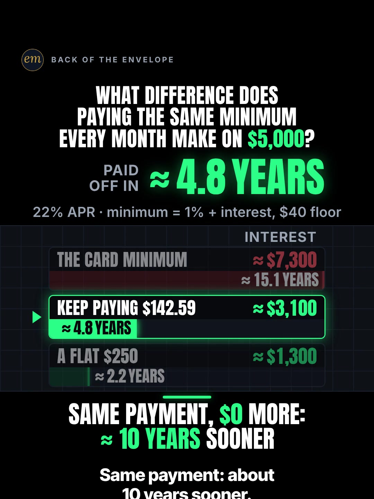

# 03b publishing sheet: paying the same card minimum every month on $5,000

YouTube Shorts (@envelopemath) and Instagram Reels (@envelopemath). Prepared 2026-10-13. Machine-readable twin: `publishing/03b-scoreboard-card-minimum.json`.

- **Video.** `renders/channel/03b-scoreboard-card-minimum.mp4`: the condensed cut (14.167 s: a 11.65 s body + the 2.517 s card; sha256 `c5f2f4f4…`), promoted and shipped on 2026-10-13. It replaces the 33.1 s round-2 cut (the owner: "too many still moments"), which is in git (`471c793`). The condense moved the clock and merged some captions; the numbers, the captions' facts and the verdict stay, so the copy carried over unchanged. Nothing below names a timestamp except the cover, which was re-picked by content on the shipped file. The ship rebuilt this sheet and re-exported both covers from it (`python3 publishing/tools/build_publishing.py 03b-scoreboard-card-minimum --covers`); on the shipped specs the maths check runs 565 checks, 0 failed.
- **Numbers.** Every figure comes from `teasers/v2/03-what-difference.md` (03b) and its check, `python3 teasers/v2/checks/03-what-difference.py`: 528 checks, 0 failed on `studio/specs/` (run 2026-10-13). The builder runs it through `publishing/data/checks/03-what-difference.py`, which passes its output through and adds the summary line in the builder's form. `python3 publishing/tools/build_publishing.py 03b-scoreboard-card-minimum --check` checks this sheet's limits, paste blocks and figures, re-runs the card month by month, keeps every '$0 more' tied to the first minimum, and keeps any interest saving out of the copy (the write-up's rule: the shown totals would drift).
- **Honesty rules kept.** The title asks and never gives the result; the Instagram caption keeps every result below 'more'. The cover is the payoff frame, as the write-up's Instagram note asks (as on 06c). Every claim stays inside the video's verdict, "Same payment, $0 more: ≈ 10 years sooner", and the copy says its anchor and conditions: '$0 more' is measured against the first minimum, at 22% APR, with no new charges, on one issuer's formula. The write-up's imperative caption line 1 ('Never let your minimum shrink!') became the title's question, so the copy describes a calculation and gives no advice. No urgency, and 'Not financial advice.' is in both.
- **Sources and brand.** 22% is the write-up's rounding of the Federal Reserve's Q2 2026 rate for card accounts that pay interest (22.15%). The minimum formula is one big bank's cardmember agreement; as in the write-up's caption, the copy does not name the bank, so no company is named and no affiliation line is needed.
- **Same topic, different card.** The channel already posted this mechanism on 5 Oct ('Pay the Minimum on $5,000? 238 Months.', its best Reel) at 25.99% APR and a $25 floor, so its numbers differ (238 months, not about 15 years). Both state their inputs; see the related video and the posting order.

---

## YouTube Shorts

### Title (vidIQ title score, short-form, scored against this channel)

| # | Title | Score | Chars |
|---|---|---:|---:|
| 1 | What If You Never Let Your Credit Card Minimum Payment Shrink? $5,000 at 22% | 97 | 76 |
| 2 | What If You Never Let Your Credit Card Minimum Payment Shrink? | 96 | 62 |
| 3 | What Difference Does Paying the Same Credit Card Minimum Every Month Make on $5,000? | 90 | 84 |

**Pick (paste):**

```
What If You Never Let Your Credit Card Minimum Payment Shrink? $5,000 at 22%
```

- 76 of 100 characters.
- It asks the hook's question in the viewer's words: 'paying the SAME minimum every month' is never letting the minimum shrink. The frame-1 label stack already shows it shrinking ('starts at $142.59, then shrinks'), so the title reveals nothing the first second doesn't, and it names no result.
- 'Credit Card Minimum Payment' (5,182 searches a month) sits at characters 28-54, and the stake ($5,000 at 22%) closes it. It raises the write-up's title from 90 to 97.
- Left to the tags: 'credit card minimum payment trap' (7,301 a month, up 81.3%). The copy never calls the minimum a trap; the video's own words are 'more than you owed'. vidIQ's model ranks titles but does not predict views.
- Also scored, not used: "What Difference Does Paying the Same Card Minimum Every Month Make on $5,000?" 90 (the write-up's title); "The Credit Card Minimum Payment Trap: What If You Paid the Same Minimum Every Month?" 90 ('trap' is the searched word, but the copy does not call the minimum a trap); "What Difference Does Paying the SAME Credit Card Minimum Every Month Make?" 89 (the on-screen header's words); "Your Credit Card Minimum Payment Shrinks. What If You Paid the Same One Every Month?" 88; "Credit Card Minimum Payment on $5,000: What If You Keep Paying the First One?" 87; "$5,000 on a Credit Card: What Difference Does Paying the Same Minimum Every Month Make?" 87; "Credit Card Minimum Payment on $5,000: What Difference Does Paying the Same One Make?" 85.

### Description (paste)

```
What if you never let your credit card minimum payment shrink? On $5,000 at 22% APR, paying the minimum takes about 15 years and about $7,300 of interest, more than the $5,000 owed. Paying the first minimum, $142.59, every month ($0 more than the first bill) clears it in about 4.8 years with about $3,100 of interest: about 10 years sooner.

The math, shown:
• The minimum is 1% of the balance plus the interest, with a $40 floor. Month 1: $91.67 of interest + 1% of $5,091.67 ($50.92) = $142.59.
• It shrinks as the balance shrinks: $127.40 in month 12, $99.66 in month 36.
• Paid that way: 181 payments (about 15.1 years) and about $7,300 of interest.
• Held at the first minimum: $142.59 − $142.59 = $0 more. 57 payments (about 4.8 years) and about $3,100 of interest.
• (181 − 57) ÷ 12 ≈ 10.3 years: about 10 years sooner.
• A flat $250 ($107.41 more than the first minimum): about 2.2 years and about $1,300 of interest.

Follow for the math behind your money — shown, not hand-waved. @envelopemath

Animation and original sound: The Back of the Envelope. 22% ≈ the Federal Reserve's Q2 2026 average for credit card accounts that pay interest (22.15%). Assumes no new charges. Minimum formula from a big-bank cardmember agreement (1% of the new balance + interest, $40 floor); yours is in your agreement under "Minimum Payment", and formulas vary by issuer. "$0 more" is measured against the first minimum: by month 36 the held payment is $42.93 above that month's $99.66 minimum. Not financial advice.
#creditcarddebt #minimumpayment #debtpayoff
```

1,552 of 5,000 characters (1,575 UTF-8 bytes; YouTube counts this limit in bytes, and `≈`, `•`, `—`, `÷` take 2-3 each). No `<` or `>`, which YouTube rejects. It follows the house template: an answer-first opening line for the search snippet, then 'The math, shown:' bullets, then the follow line. The credit, assumptions and 'Not financial advice.' line comes next, and the 3 hashtags close it. The opening line is the title's question with both pairs of totals, as the write-up's caption gives them, and no interest saving (the write-up's rule). The '$0 more' anchor and its month-36 gap answer the comment the write-up expects ('that IS paying more'). The 'Doesn't Add Up' series line is left out, as on 06b and 06c.

### Hashtags (order matters)

1. `#creditcarddebt`: the topic ('credit card debt' 94,095 searches a month, up 41.0% on its 30-day baseline), and the write-up's first tag.
2. `#minimumpayment`: the exact subject ('credit card minimum payment' 5,182 a month; 'credit card minimum payment trap' 7,301, up 81.3%).
3. `#debtpayoff`: the outcome, and the write-up's second tag; the same third-layer tag as 03a.

The title carries no hashtags, so YouTube shows these 3, the description's first, above the title. Over 60 hashtags and YouTube ignores all of them. `#Shorts` isn't needed.

### Tags (paste; 395 of 500 characters as YouTube counts them: commas count, and a tag with a space counts 2 more for the quotes YouTube adds)

```
credit card minimum payment, credit card minimum payment trap, minimum payment, how long to pay off credit card, what happens if i only pay the minimum payment on my credit card, minimum payment calculator, pay off credit card debt, how to pay off debt fast, credit card debt, credit card interest, debt payoff, money math, math animation, the back of the envelope, envelope math
```

Tags carry little weight. These mirror the keyword research plus the house's channel tags. 'credit card minimum payment trap' (7,301 a month, up 81.3%) is here, not in the copy. Left out on purpose: 'why you should not pay the minimum credit card payment' (4,879) is advice framing; 'why your minimum payment never goes down' (3,349) states the opposite belief.

### Pinned comment (post it, then pin it)

```
What formula does your card use: 1%, 2% or 3%? Rounding up to $150 ($7.41 above the first minimum) only takes it from 57 months to 52.

The working: first minimum $91.67 + $50.92 = $142.59. On the minimum: 181 payments, $7,340.79 of interest. Held at $142.59: 57 payments, $3,081.74 of interest. 22% APR, no new charges.
```

The question comes first so it shows in the collapsed preview: it is the write-up's pinned comment, reordered, and it asks for the viewer's own card (R3); posted formulas are the 'now do 2%' sequel the write-up plans. The $150 line answers 'just round up' with the write-up's own figure. The second paragraph is the exact working, with no interest saving stated (the write-up's rule).

### Related video and end screen

- **Related video:** [Pay the Minimum on $5,000? 238 Months.](https://www.youtube.com/shorts/8__HTUa2PoU) (`8__HTUa2PoU`). The channel's own Short on the same mechanism at a different card: 25.99% APR and a $25 floor, so its numbers differ (238 months on the minimum; $158.29 held, 54 months). Both state their inputs, and side by side they show the rate and the floor move the answer while the lever (hold the first payment) does the same work. It is also the channel's best Reel (7,302 plays, 27.4% skip).
- **Swap later:** 03c (just $100 extra on a mortgage) or 03a (car loan: weekly vs biweekly), the same what-difference series, once published.
- **End screen:** Shorts have no end screens or cards. The Related video link is the Shorts equivalent.

### Thumbnail and settings

- **Thumbnail:** in the YouTube app, pick the verdict-hold frame ('PAID OFF IN ≈ 4.8 YEARS' over the board and the verdict), the same content as the Instagram cover below.
- **Settings:** Category Education. Not made for kids. Altered or synthetic content: No (it's an animated chart, not realistic footage). Remixing allowed. No captions needed: there's no narration and all the text is on screen.

### Posting window

- **When:** First free Tue-Thu evening after the condensed cut ships and passes QA, 21:30-22:30 ET (01:30-02:30 UTC the next day). Sunday 06:00-08:00 ET is the alternative.
- **Spacing:** Keep it at least 6 h from any other upload on the channel, and on a different evening from 03a and 03c. Suggested order within the series: 03c, 03a, then 03b last, the furthest from the channel's 5 Oct Short on the same mechanism ('238 Months', at 25.99%).
- **Why:** The channel's own October Shorts, median views by posting slot (vidIQ, 2026-10-13): Sunday 05:00-08:00 ET 1,198 (n = 2), weekday 22:00-00:30 ET 642 (n = 3), weekday midday 263 (n = 2); 06c (Mon 03:45 ET) has 760 and 06b (Mon 12:14 ET) 61, too young to compare. The evening slot is also the best one on Instagram, so one evening serves both. n = 7 and confounded by topic, so treat it as a test. Search demand: 'credit card debt' runs +41.0% and 'credit card minimum payment trap' +81.3% over their 30-day baselines.

---

## Instagram Reels

### Caption (paste)

```
What if you never let your credit card minimum payment shrink? The same payment every month, worked out on $5,000 at 22% APR.

Same payment, $0 more than the first minimum: about 10 years sooner.

The math, shown:
• The minimum is 1% of the balance plus interest, with a $40 floor: $142.59 in month 1, $99.66 in month 36.
• Paid that way: about 15 years and about $7,300 of interest, more than the $5,000 owed.
• Held at the first minimum, $142.59 ($0 more than the first bill): about 4.8 years and about $3,100 of interest.
• A flat $250: about 2.2 years.

"$0 more" is against the first minimum: by month 36 the held payment is $42.93 above that month's minimum. 22% ≈ the Federal Reserve's Q2 2026 average for cards that charge interest (22.15%). Assumes no new charges. Minimum formula from a big-bank cardmember agreement; yours is in your agreement under "Minimum Payment". Not financial advice.

What formula does your card use: 1%, 2% or 3%?

Follow for the math behind your money — shown, not hand-waved. @envelopemath
Animation and original sound: The Back of the Envelope.

#creditcarddebt #minimumpayment #debtpayoff #creditcard #personalfinance
```

- 1,157 of 2,200 characters.
- **First 125 characters:** the title's question plus 'the same payment every month' and the inputs, with no result. The write-up's caption line 1 ('Never let your minimum shrink!') is an instruction, so the copy asks it as a question instead, and the verdict sits just below 'more', in the screen's own words plus its anchor ('than the first minimum').
- Both totals, never a saving: the write-up keeps the interest saving off the screen and out of the caption because the shown totals would drift (7,300 − 3,100 ≠ the exact 4,259.05).
- The caption follows the house close: the follow line plus the credit.

### Hashtags (5, Instagram's cap since Dec 2025)

`#creditcarddebt #minimumpayment #debtpayoff #creditcard #personalfinance`

Three are the write-up's own (`#creditcarddebt #debtpayoff #minimumpayment`; its `#mathtok` is a TikTok tag):

- `#minimumpayment` names the subject, `#creditcarddebt` the debt and `#debtpayoff` the outcome.
- `#creditcard` and `#personalfinance` are the broad layer; the channel's 5 Oct Short on the same mechanism (its best Reel) carries both.

### Alt text

- **Short (99 characters; paste this one into Instagram):** Chart: $5,000 at 22%: the minimum takes about 15 years; holding the first $142.59, about 4.8 years.
  - It stays at or under 100 characters, so it fits the field however short it is. It says 'about', not '≈', so screen readers read it cleanly, and both payoffs keep their 'about'.
- **Long (for anywhere with room, such as a website embed):** Animation on a dark scoreboard. The header asks: what difference does paying the same minimum every month make on $5,000? At 22% APR, with a minimum of 1% plus interest and a $40 floor, a red counter reads paid off in about 15.1 years: the card minimum starts at $142.59, shrinks to $99.66 by year 3, and costs about $7,300 of interest, more than the $5,000 owed. The row 'Keep paying $142.59' is $0 more than the first minimum, and its bar lands at about 4.8 years and about $3,100 of interest. A flat $250 lands at about 2.2 years. Verdict: same payment, $0 more, about 10 years sooner.
- **Where:** Advanced settings → Accessibility → Alt text, if your app shows it for Reels.

### Cover



- **Files:** `publishing/03b-scoreboard-card-minimum-cover-3x4.jpg` (1080×1440) and `publishing/03b-scoreboard-card-minimum-cover-9x16.jpg` (1080×1920). Both come from the shipped (14.167 s) render at 11.5 s (frame 345).
- **Frame, by content:** The payoff hold: the hero 'PAID OFF IN ≈ 4.8 YEARS' in green, the footer '22% APR · minimum = 1% + interest, $40 floor', the board (THE CARD MINIMUM ≈ $7,300 over its red ≈ 15.1-year bar; KEEP PAYING $142.59 lit green, ≈ $3,100 and ≈ 4.8 YEARS; A FLAT $250 ≈ $1,300 and ≈ 2.2 YEARS) and the verdict 'SAME PAYMENT, $0 MORE: ≈ 10 YEARS SOONER', under the question. The write-up names this payoff frame as the Instagram cover. On the condensed cut the last caption ('Same payment: about 10 years sooner.', the verdict's own words) stays under the verdict until the last body frame, so use a settled frame of the verdict hold, with the caption on it, before the end card. On the shipped 14.167 s condensed cut the board settles in the verdict hold by 11.43 s (frame 343), and from then the picture is near-still (frame-to-frame mean luma change ≤ 0.033) with the last caption ('Same payment: about 10 years sooner.') under the verdict; the caption clears only on the last body frame (11.63 s) before the end card. Frame 345 (11.50 s) is used. On the 33.1 s pre-condense render it was frame 858 (28.60 s), after the caption cleared. If the cut changes, re-pick it by content.
- **Crop:** 3:4 = 1080×1440, the top 1440 rows (y 0 to 1440) of the 1080×1920 frame: the badge, the question, the hero, the footer, the board and the verdict, with even margins (141 px above the badge, 145 px below the verdict); it drops the empty floor. A centred grid crop (y 240-1680) cuts the badge and the question.
- **How to set it:** In 'Edit cover', pick the verdict frame from the video (or upload the 9:16 JPG), then drag 'Profile grid' to the top so the tile matches the 3:4 JPG. Do not upload the 3:4 JPG as the Reel cover: Instagram centre-crops it to 9:16 in the Reels tab and cuts the question.
- **Re-export:** `ffmpeg -ss 11.5 -i renders/channel/03b-scoreboard-card-minimum.mp4 -frames:v 1 -vf "crop=1080:1440:0:0" -q:v 2 publishing/03b-scoreboard-card-minimum-cover-3x4.jpg` and `ffmpeg -ss 11.5 -i renders/channel/03b-scoreboard-card-minimum.mp4 -frames:v 1 -q:v 2 publishing/03b-scoreboard-card-minimum-cover-9x16.jpg`, or `python3 publishing/tools/build_publishing.py 03b-scoreboard-card-minimum --covers`.
- **Not used:** frame 1 (the question over the red '≈ 15.1 YEARS' hero, with the two other rows still showing '?'). It carries only the baseline, but the write-up names the payoff frame as the cover, and the save-worthy thing here is the worked board.
- **Shipped cut (2026-10-13):** the payoff hold was re-picked by content on the shipped file (a settled frame of the verdict hold, 11.5 s; the last caption now stays under the verdict) and both JPGs re-exported from it. It shows the same hero, board and verdict as the pre-condense cover, plus that caption.

### First comment (post it, then pin it)

```
Same payment, $0 more than the first minimum: about 4.8 years instead of about 15, on $5,000 at 22% with no new charges. What formula does your card use: 1%, 2% or 3%?
```

### Trial Reels

**Post as a regular Reel, not a Trial.** @envelopemath has 8 followers, so a regular Reel is already shown almost entirely to non-followers, which is all a Trial Reel adds. A Trial would also keep it off the profile grid until shared. A hook test afterwards, if you want one: the other cut as a Trial with MANUAL graduation 48-72 h later. The condensed cut replaced the pre-condense render in renders/channel on 2026-10-13; get the pre-condense one from git with `git show 471c793:renders/channel/03b-scoreboard-card-minimum.mp4 > 03b-33.1s.mp4` (sha256 5a95cc3d…). Compare skip rate (October Reels ran 27.0-65.1%; the 5 Oct minimum-payment Reel 27.4%) and average watched %, then share the winner. vidIQ's publish tool exposes Trial (MANUAL or SS_PERFORMANCE) for this connected account. Confirm eligibility in the app.

### Posting window and settings

- **When:** Same evening as YouTube, about 15 min after the Short: 21:45-22:45 ET, on a different evening from 03a and 03c (03b last).
- **Why:** October Reels, median plays by posting slot (owner insights, 2026-10-13): weekday 22:00-00:30 ET 5,449 (n = 3, including the two best: 7,302 and 5,449), weekday midday 1,212 (n = 2), Sunday 05:00-08:00 ET 1,087 (n = 2). The best of all is the 5 Oct '$5,000 on the minimum' Reel (7,302 plays, 27.4% skip, 12 saves), this Short's topic twin. Skip rate tracks plays more closely than the hour does: 27.0-27.4% for the top two, 56.9-65.1% for the bottom two. The condense matters more than the hour.
- **Audio:** Rename the original audio to 'Same minimum, every month — The Back of the Envelope' if the app allows; it is the score, with no voice.
- **Share to feed:** On.

---

## Why these choices (research evidence)

**1. Search demand (vidIQ keyword research, pulled 2026-10-13).** vidIQ refreshes each keyword on its own schedule, so the last column gives each row's snapshot date. Seven rows are older snapshots.

| Keyword | Est. searches/month | Competition | Overall | Note | vidIQ as of |
|---|---:|---:|---:|---|---|
| credit card minimum payment trap | 7,301 | 15.0 | 68.6 | +81.3% vs its 30-day baseline (4,027); in the tags, not the copy | 2026-10-12 |
| minimum bill payment credit card | 5,316 | 16.9 | 66.6 |  | 2026-10-12 |
| credit card minimum payment | 5,182 | 21.9 | 64.5 | seed; flat (0%) | 2026-10-02 |
| minimum payment calculator | 5,086 | 10.3 | 69.1 |  | 2026-10-02 |
| why you should not pay the minimum credit card payment | 4,879 | 27.2 | 62.2 | advice framing: not in the tags | 2026-09-28 |
| how does the credit card minimum payment trap work | 3,922 | 9.0 | 68.6 |  | 2026-07-06 |
| why is the minimum credit card payment a trap? | 3,689 | 5.3 | 69.8 | competition 5.3, the lowest here | 2026-10-03 |
| what happens if i only pay the minimum payment on my credit card | 3,382 | 26.1 | 61.2 | the video's baseline question | 2026-09-07 |
| why your minimum payment never goes down | 3,349 | 16.0 | 65.2 | the opposite belief: the video shows it does | 2026-09-28 |
| pay off credit card debt | 9,231 | 44.0 | 57.9 |  | 2026-10-12 |
| how to pay off debt fast | 22,921 | 28.0 | 67.9 | -25.7% vs its baseline (30,851) | 2026-10-12 |
| credit card debt | 94,095 | 64.2 | 58.9 | +41.0% vs its baseline (66,734) | 2026-10-12 |

Every minimum-payment phrase sits at about 3,300-7,300 searches a month at low competition (5.3-27.2), and the 'trap' framing is the one rising (+81.3%). The title carries 'credit card minimum payment'; 'trap' stays in the tags because the copy describes the maths, not a villain. The broad layer is 'credit card debt' (94,095, up 41.0%) and 'how to pay off debt fast' (22,921).

**2. The same lever on YouTube: a crowded week of small channels (vidIQ YouTube search, under 4 min, by views and by relevance).**

| Title | Channel (subs) | Views | Date |
|---|---|---:|---|
| Minimum Amount Due is a TRAP! | Credit Card Best Practices | Ankur Warikoo #shorts | warikoo (7,150,000) | 775,317 | 2023-05-30 |
| What happens if we pay only minimum amount due on credit card? | Rupyz B2B E-Commerce (11,900) | 346,000 | 2022-05-26 |
| How Minimum Credit Card Payment Works | The Credit Brothers (65,400) | 12,364 | 2024-11-10 |
| The Credit Card Minimum Payment Trap (and the Simple Fix) | The One Man Tech Startup (1,070) | 5,624 | 2026-09-26 |
| Why Does Paying the Minimum Keep You in Debt? | Theo Asks Why (2,360) | 1,078 | 2026-10-02 |
| Why Does Paying the Minimum Keep You in Debt for Years? | Money, Decoded (2) | 204 | 2026-10-01 |
| Why Your Credit Card WANTS You to Pay the Minimum | Paid In Full with Walt (3) | 33 | 2026-09-26 |
| credit card minimum payments be like 🏃 | US Money Mechanics (4) | 18 | 2026-09-28 |
| Your Minimum Payment Is Designed to Shrink | SmartSpendFinance (1) | 7 | 2026-10-03 |
| Credit Card Minimum Payment: How Long to Pay Off $5,000? | The Dollar Candy (0) | 4 | 2026-10-06 |

The minimum-payment explainer is old and big in India (warikoo 775,317; Rupyz 346,000) and steady in the US (The Credit Brothers 12,364). The exact lever, 'keep paying your first minimum', went up on at least 7 small channels between 26 Sep and 6 Oct 2026, all under 5,700 views; the biggest is The One Man Tech Startup's (5,624).

This channel has covered the shrinking minimum three times, all on $5,000 at 25.99% APR: 'Why the minimum payment keeps you in debt for 19 years' (June, 1,230 views, against a fixed $200), 'Why your credit-card balance barely moves' (June, 80, the first payment frozen) and 'Pay the Minimum on $5,000? 238 Months.' (5 Oct, 642 views and the best Reel, 7,302 plays, the first payment held). This Short's new angle is the question 'what difference does the SAME payment make', at the Fed's 22%, with the $0 lever named and a $250 row for scale. None of the same-idea titles asks it that way.

**3. Worked card maths travels on Instagram; the exact lever has no outlier yet (vidIQ IG/TikTok outlier search, since June 2024, at least 5K views).**

- **@ashallaboutmoney** (Instagram), "Paying Off Maxed Out $5500 CREDIT CARD IN 1 YEAR": 666.2K (69.7x). The maths written out by hand on paper, the closest outlier to a worked board.
- **@priceofavocadotoast** (TikTok), "Stop paying extra on all of your credit cards": 113.6K (87.8x); **@debtefficiency** (TikTok), "$160,000 in credit card debt paid off…": 380K (17.3x).
- The concept search found no Reel or TikTok of 'keep paying the first minimum' itself at 5K views or more. The nearest proof is our own: the 5 Oct '$5,000 on the minimum' Reel, 7,302 plays with a 27.4% skip rate, the channel's best.

**4. Our own October numbers (vidIQ: public YouTube stats, Instagram owner insights; refreshed 2026-10-13).**

| YouTube Short | Posted (ET) | Views |
|---|---|---:|
| Can You Find the Missing Dollar? (`LjHDFzVxRyM`) | Sun 07:04 | 1,254 |
| You Can Lean on $1 Million. Not on $1 Billion. (`hJBvmGA6sZ0`) | Thu 00:25 | 1,221 |
| Your Interest Has a Speed Limit (`XVUeMcTg9OQ`) | Sun 05:49 | 1,141 |
| What If You Bought Starbucks Stock Instead of a $4 Latte Every Day? (06c) (`fbpdKf4Wy8c`) | Mon 03:45 | 760 |
| Pay the Minimum on $5,000? 238 Months. (`8__HTUa2PoU`) | Mon 22:09 | 642 |
| A $2 Lottery Ticket Was Worth $6.98. Until the Fine Print. (`FW_oxA3kbsM`) | Wed 12:03 | 348 |
| You Can Carry $1 Million. Not in Pennies. (`mXbKY_R63h4`) | Thu 13:38 | 177 |
| Start Investing 10 Years Late? You Get Half. (`EqFQCJheCMU`) | Tue 22:27 | 161 |
| What If You Bought Netflix Stock Instead of Paying for Netflix? (06b) (`krfZEHhb0xU`) | Mon 12:14 | 61 |

| Instagram Reel | Posted (ET) | Plays | Skip rate | Avg watched |
|---|---|---:|---:|---:|
| $5,000 on the minimum (`DeIvYk7I4Qr`) | Mon 22:46 | 7,302 | 27.4% | 56.5% |
| $1M stack vs Burj Khalifa (`DeOEthJJ1TG`) | Thu 00:28 | 5,449 | 27.0% | 83.1% |
| Missing dollar (`DeWgFZRoR_S`) | Sun 07:05 | 1,997 | 32.0% | 81.3% |
| Powerball $6.98 (`DeMvZv9IqRw`) | Wed 12:05 | 1,825 | 58.7% | 57.9% |
| 06c latte vs Starbucks stock (`DeYuqT4pjVC`) | Mon 03:46 | 1,711 | 40.3% | 69.1% |
| $1M in pennies (`DePe11HIHwn`) | Thu 13:37 | 598 | 42.0% | 66.7% |
| 10 years late (`DeLSd9io8UK`) | Tue 22:30 | 219 | 65.1% | 30.6% |
| Speed limit (e) (`DeEW2ZMIiYd`) | Sun 05:54 | 177 | 56.9% | 31.2% |

Channel totals:

- **YouTube:** 53 subscribers, 10,221 views and 41 videos (+27 subscribers, +5,127 views and 11 videos in 30 days).
- **Instagram:** 8 followers and 20,518 views in 30 days.

This topic is the channel's proven one: the 5 Oct '$5,000 on the minimum' Short (YouTube `8__HTUa2PoU`, Instagram `DeIvYk7I4Qr`) is the best Reel by plays and skip rate. It used 25.99% APR and a $25 floor, so its answer (238 months) differs from this Short's (about 15 years at 22% and a $40 floor). A viewer who saw both may ask why; the copy names the 22%, the formula and the $40 floor, and the related video makes the comparison explicit. 06b (Mon 12 Oct, 12:14 ET) and 06c (Mon 12 Oct, 03:45 ET) are too young to compare.

Medians by posting slot (n = 2-3 each, confounded by topic; 06b and 06c left out as too young):

- **YouTube:** Sunday early morning ET 1,198, weekday 22:00-00:30 ET 642, weekday midday 263.
- **Instagram:** weekday 22:00-00:30 ET 5,449, midday 1,212, Sunday early morning 1,087.

One weekday evening is the best Instagram slot and the second-best YouTube slot, so the plan posts both then. On Instagram, skip rate predicts plays better than the hour does (27.0-27.4% for the top two, 56.9-65.1% for the bottom two). So the window is a light-touch test, and the condense (fewer still moments) is the bigger reach lever.

**5. Platform rules applied.**

- **YouTube title:** 100 characters. The Shorts player shows only the opening, so the keywords come first.
- **YouTube description:** 5,000 characters.
- **YouTube hashtags:** the first 3 show; over 60 and all are ignored; `#Shorts` isn't needed.
- **YouTube tags:** 500 characters, low weight.
- **YouTube Shorts:** no end screens. The Related video link is the Shorts equivalent.
- **YouTube AI disclosure:** only for realistic altered content.
- **Instagram caption:** 2,200 characters, about 125 shown before 'more'.
- **Instagram hashtags:** 5 at most.
- **Instagram search and Google:** keywords in the caption feed Instagram search, and Google indexes public professional posts (since 10 Jul 2025).
- **Instagram grid:** a 3:4 crop of the 9:16 cover.
- **Trial Reels:** shown to non-followers only.

**6. Limits.**

- @envelopemath's YouTube Analytics (audience hours, geography) were not read here; the 06b and 06c sheets found vidIQ's YouTube authorization is a different channel. Check Studio → Analytics → Audience → 'When your viewers are on YouTube' before posting.
- vidIQ has no hashtag-volume data; hashtag picks lean on keyword volume and on the write-up's and the outliers' own tags.
- Title scores are vidIQ's short-form CTR model for this channel; they rank options but do not predict views.
- The write-up's sources rest on search-result text: its egress proxy blocked the primary pages. Before posting, open the Fed's G.19 release of Aug 7, 2026 (22.15%) and the cardmember agreement PDF the write-up cites (the formula), its open item 1.
- The video, the cover and the video facts are the shipped condensed cut (2026-10-13); the copy is cut-independent and carried over from the pre-condense cut unchanged.

---

## Check log (first build and adversarial pass, 2026-10-13)

- **Maths.** `python3 teasers/v2/checks/03-what-difference.py`: 528 checks, 0 failed. Every public figure traces to the 03b maths table: $91.67 + $50.92 = $142.59; $127.40 (month 12), $99.66 (month 36); 181 payments ≈ 15.1 years, $7,340.79 ≈ $7,300; 57 payments ≈ 4.8 years, $3,081.74 ≈ $3,100; (181 − 57) ÷ 12 ≈ 10.3 ≈ 10 years; $250 − $142.59 = $107.41, 26 payments ≈ 2.2 years, ≈ $1,300; $150: 52 payments; $142.59 − $99.66 = $42.93. The data file re-runs the card and gets every one.
- **Limits.** Title 76/100. Description 1,552 characters (1,575 bytes) of 5,000. 3 hashtags. Tags 395/500 as YouTube counts them. Instagram caption 1,157/2,200, with the first 125 characters result-free. 5 hashtags. Short alt text 99. No `<` or `>`.
- **vidIQ.** Keywords pulled 2026-10-13 (table above). 10 titles scored against this channel: the pick 97, the write-up's title 90. Channel 53 subscribers / 10,221 views / 41 videos; Instagram owner insights refreshed (8 followers, 20,518 views in 30 days).
- **vidIQ re-queried** after the build: the pick's title score 97; 'credit card minimum payment' 5,182 / 21.9 (snapshot 2026-10-02). Again at the adversarial check: the pick 97; 'credit card minimum payment' 5,182 / 21.9; 'credit card minimum payment trap' 7,301 / 15.0 (+81.3%); the three own Shorts' views (642, 1,230, 80). All match.
- **Mutation test.** Six breaks on scratch copies of this file all fail by name: a stated '$4,200' saving, '$0 more' without its first-minimum anchor, $99.66 without month 36, '4.8 years' without its 'about', a result in the caption's first 125 characters, and the word 'trap' in the caption.
- **Found on the way.** The channel's 5 Oct Short and two June Shorts cover the same mechanism at 25.99% APR (238 months). The copy states this Short's inputs so the two answers can sit side by side; the related video links them and the posting order puts 03b last in the series.
- **Kept on purpose.**
  - The cover and the YouTube frame show the payoff, as the write-up's Instagram note asks (as on 06c). The no-result rule covers the title and the caption's first 125 characters.
  - No interest saving anywhere (the write-up's rule), only the two totals.
  - The card issuer is not named, as in the write-up's caption ('a big-bank cardmember agreement').
- **Adversarial pass (2026-10-13): changed.**
  - The short alt text ended 'the first $142.59, held, about 4.8.', a bare 4.8 that a screen reader reads without its unit. It now reads 'holding the first $142.59, about 4.8 years.' (99 characters), and a new COPY_RULE keeps 15.1, 4.8 and 2.2 with 'years' everywhere; the old text fails it by name.
  - The maths count is now 528 checks, 0 failed: the 03 check became cut-aware during the parallel condense (525 at the first build).
- **Adversarial pass: checked, no change.** Every figure in the copy against the write-up's 03b table and the check's output (the card re-run month by month); limits on both platforms; no company named (the formula is 'a big-bank cardmember agreement', as in the write-up's caption; the Federal Reserve is a source, not a brand), so no affiliation line; no advice and no 'trap' in the copy; the channel's 5 Oct Short's inputs (25.99%, $25 floor, 1% of the balance + interest) re-checked against its own description and re-computed: 238 months, $158.29 held for 54. The cover (28.6 s) read as a still: the payoff hold, the question and the verdict, all on the 3:4 crop.
- **Still to do.** The primary-source check above.
- **Done on ship (2026-10-13).** Rebuilt with `--covers` from the shipped condensed cut (14.167 s). The payoff hold was re-picked by content at 11.5 s (frame 345), with the last caption under the verdict. The Video bullet, the cut and the check counts follow the shipped file (565 checks, 0 failed on `studio/specs/`), and the long alt text was re-read against the condensed beat sheet: every beat it names is in the shipped cut, so no copy changed.
