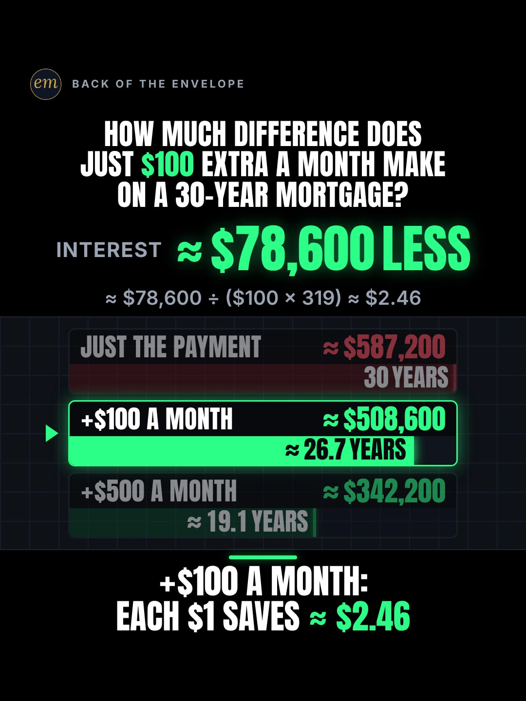

# 03c publishing sheet: just $100 extra a month on a 30-year mortgage

YouTube Shorts (@envelopemath) and Instagram Reels (@envelopemath). Prepared 2026-10-13. Machine-readable twin: `publishing/03c-scoreboard-mortgage-extra-100.json`.

- **Video.** `renders/channel/03c-scoreboard-mortgage-extra-100.mp4`: the condensed cut (15.367 s: a 12.85 s body + the 2.517 s card; sha256 `3f04b6e2…`), promoted and shipped on 2026-10-13. It replaces the 32.3 s round-2 cut (the owner: "too many still moments"), which is in git (`471c793`). The condense moved the clock and merged some captions; the numbers, the captions' facts and the verdict stay, so the copy carried over unchanged. Nothing below names a timestamp except the cover, which was re-picked by content on the shipped file. The ship rebuilt this sheet and re-exported both covers from it (`python3 publishing/tools/build_publishing.py 03c-scoreboard-mortgage-extra-100 --covers`); on the shipped specs the maths check runs 565 checks, 0 failed.
- **Numbers.** Every figure comes from `teasers/v2/03-what-difference.md` (03c) and its check, `python3 teasers/v2/checks/03-what-difference.py`: 528 checks, 0 failed on `studio/specs/` (run 2026-10-13). The builder runs it through `publishing/data/checks/03-what-difference.py`, which passes its output through and adds the summary line in the builder's form (the check prints '0 failures', the builder reads '0 failed'). `python3 publishing/tools/build_publishing.py 03c-scoreboard-mortgage-extra-100 --check` checks this sheet's limits, paste blocks and figures, re-runs the amortisation payment by payment, keeps every rounded figure 'about' or '≈', and keeps each saving beside the extra payment that earns it.
- **Honesty rules kept.** The title asks and never gives the result; the Instagram caption keeps every result below 'more'. The cover is the verdict hold, as the write-up's Instagram note asks (as on 06c). Every claim stays inside the video's own verdict, "+$100 a month: each $1 saves ≈ $2.46", and the copy says its conditions: a fixed 7.3% rate, every extra dollar applied to principal, principal and interest only. No advice (the 'pay it down or invest it' argument is left alone, as the write-up asks), no urgency, and 'Not financial advice.' is in both.
- **Sources and brand.** 7.3% is the write-up's rounding of Freddie Mac's 30-year average for the week of Oct 1, 2026 (7.28%). Freddie Mac is named only as that source, and both platforms' copy says 'Not affiliated with or endorsed by Freddie Mac.' The write-up's second rate source (MBA, 7.30%) stays out of the copy because the write-up could not confirm which page holds it (its open item 2). The $400,000 loan is a round example; its NAR anchor stays in the write-up.

---

## YouTube Shorts

### Title (vidIQ title score, short-form, scored against this channel)

| # | Title | Score | Chars |
|---|---|---:|---:|
| 1 | What Happens If You Pay Just $100 Extra a Month on a 30-Year Mortgage? | 98 | 70 |
| 2 | What Happens If You Pay Just $100 Extra a Month on Your Mortgage? #mortgage #homeloan #debtfree | 97 | 95 |
| 3 | How Much Difference Does Just $100 Extra a Month Make on a Mortgage? | 94 | 68 |

**Pick (paste):**

```
What Happens If You Pay Just $100 Extra a Month on a 30-Year Mortgage?
```

- 70 of 100 characters.
- 'What happens if you pay … extra … on your mortgage' is the grammar of the two biggest question-titled same-idea Shorts in the research (Tim Hart, 25,292 views; Ace Alfalla's '… an extra $100 every month?', 17,855). The pick keeps the write-up's 'just' (the R5 word that says $100 is too small to matter) and the header's '30-Year Mortgage'.
- It raises the write-up's title from 94 to 98. It names no result: the 40 months, the ≈ $78,600 and the ≈ $2.46 are all the video's.
- Several same-idea titles give the answer away ('Cuts 3 YEARS Off', 'Skip 39 Payments', 'Saves $61,698'); this one asks it. vidIQ's model ranks titles but does not predict views.
- Also scored, not used: "What Happens If You Pay Just $100 Extra a Month on Your Mortgage?" 97 (the pick with 'Your Mortgage'); "How Much Does Just $100 Extra a Month Save on a $400,000 Mortgage?" 95 ('save' presumes the direction of the answer); "How Much Difference Does Just $100 Extra a Month Make on a 30-Year Mortgage?" 94 (the on-screen header); "Just $100 Extra a Month on a 30-Year Mortgage: How Much Difference Does It Make?" 94; "Can Just $100 Extra a Month Pay Off Your Mortgage Early?" 85 (a yes/no question scores lowest).

### Description (paste)

```
What happens if you pay just $100 extra a month on a 30-year mortgage? On $400,000 at 7.3%, about $78,600 less interest and 40 months sooner: each extra $1 saves about $2.46. $500 extra a month: about 11 years sooner and about $245,000 less.

The math, shown:
• The payment: $2,742.29 a month for 360 months. The interest alone is about $587,200, more than the loan ($2,742.29 × 360 − $400,000).
• +$100: $2,742.29 + $100 = $2,842.29 a month. 320 payments (about 26.7 years): 40 months sooner. Interest about $508,600: about $78,600 less.
• +$500: $2,742.29 + $500 = $3,242.29 a month. 229 payments (about 19.1 years): about 11 years sooner. Interest about $342,200: about $245,000 less.
• The full $100 goes in for 319 months: $100 × 319 = $31,900. About $78,600 ÷ $31,900 ≈ $2.46 of interest saved per extra $1.

Follow for the math behind your money — shown, not hand-waved. @envelopemath

Animation and original sound: The Back of the Envelope. 7.3% ≈ the Freddie Mac 30-year fixed average for the week of Oct 1, 2026 (7.28%). Assumes a fixed rate and that every extra dollar is applied to principal the month it is paid; principal and interest only (taxes, insurance and PMI not included). Not financial advice. Not affiliated with or endorsed by Freddie Mac.
#mortgage #homeloan #debtfree
```

1,294 of 5,000 characters (1,313 UTF-8 bytes; YouTube counts this limit in bytes, and `≈`, `×`, `•`, `—`, `÷` take 2-3 each). No `<` or `>`, which YouTube rejects. It follows the house template: an answer-first opening line for the search snippet, then 'The math, shown:' bullets, then the follow line. The credit, assumptions and 'Not financial advice.' line comes next, and the 3 hashtags close it. The opening line is the title's question with the write-up's caption answer, for the search snippet. The 'Doesn't Add Up' series line is left out, as on 06b and 06c. MBA's 7.30% stays out (the write-up's open item 2).

### Hashtags (order matters)

1. `#mortgage`: the topic ('mortgage' 158,339 searches a month, up 43.0% on its 30-day baseline).
2. `#homeloan`: the write-up's second tag; the mortgage Shorts in the research carry it (#HomeLoan, #homeloans).
3. `#debtfree`: the outcome the video measures ('debt free' 27,923 a month, flat), and the write-up's third tag.

The title carries no hashtags, so YouTube shows these 3, the description's first, above the title. Over 60 hashtags and YouTube ignores all of them. `#Shorts` isn't needed.

### Tags (paste; 350 of 500 characters as YouTube counts them: commas count, and a tag with a space counts 2 more for the quotes YouTube adds)

```
extra mortgage payment, extra $100 a month mortgage, how to pay off your mortgage early, pay off mortgage early, 30 year mortgage, mortgage payoff, mortgage interest, extra principal payment, biweekly mortgage payments, mortgage tips, mortgage, home loan, debt free, money math, math animation, the back of the envelope, envelope math
```

Tags carry little weight. These mirror the keyword research plus the house's channel tags. 'how to pay off your mortgage early' (13,722 a month, up 306.3%) is the fastest-rising phrase in the cluster. Left out on purpose: 'paying off the mortgage early vs. investing the extra payment' (3,462) and 'when paying off your mortgage is the wrong move' (5,674) are the advice argument the write-up leaves alone; 'why did my mortgage payment go up' (46,825, up 626.3%) is about escrow, not this video.

### Pinned comment (post it, then pin it)

```
Does your servicer apply extra payments to principal? Extra payments only shorten the loan if it does; some apply them to next month's payment instead. Drop your balance, rate and extra amount and we'll put your row on the board.

The working: interest $587,216.16 with no extra, $508,590.78 with +$100 (320 payments) and $342,178.64 with +$500 (229 payments). $78,625.38 ÷ $31,900 ≈ $2.46 per extra $1. Fixed 7.3%, principal and interest only.
```

The question comes first so it shows in the collapsed preview; it is the write-up's pinned comment turned into a question, and it asks for the viewer's own numbers (R3), the comment-reply sequel engine ('now do $50', 'now do 6%'). The second paragraph is the exact working, for the commenters who check the rounding. It does not take a side on 'invest the $100 instead', the comment fight the write-up expects and leaves alone.

### Related video and end screen

- **Related video:** [Your $400,000 house costs you $958,000](https://www.youtube.com/shorts/hW38hkzo_vY) (`hW38hkzo_vY`). The channel's own Short on the same $400,000, 30-year loan with a different lever (one extra payment a year). It was made in June at that month's rate, so its totals differ from this Short's 7.3%; both name their inputs. Same viewer, next question.
- **Swap later:** 03a (car loan: weekly vs biweekly) or 03b (card minimum), the same what-difference series, once published. Then point theirs at this Short.
- **End screen:** Shorts have no end screens or cards. The Related video link is the Shorts equivalent.

### Thumbnail and settings

- **Thumbnail:** in the YouTube app, pick the verdict-hold frame ('≈ $78,600 LESS' over the board and the verdict), the same content as the Instagram cover below.
- **Settings:** Category Education. Not made for kids. Altered or synthetic content: No (it's an animated chart, not realistic footage). Remixing allowed. No captions needed: there's no narration and all the text is on screen.

### Posting window

- **When:** First free Tue-Thu evening after the condensed cut ships and passes QA, 21:30-22:30 ET (01:30-02:30 UTC the next day). Sunday 06:00-08:00 ET is the alternative.
- **Spacing:** Keep it at least 6 h from any other upload on the channel, and on a different evening from 03a and 03b. Suggested order within the series: 03c first (the strongest title score and rising mortgage demand), then 03a, then 03b.
- **Why:** The channel's own October Shorts, median views by posting slot (vidIQ, 2026-10-13): Sunday 05:00-08:00 ET 1,198 (n = 2), weekday 22:00-00:30 ET 642 (n = 3), weekday midday 263 (n = 2); 06c (Mon 03:45 ET) has 760 and 06b (Mon 12:14 ET) 61, too young to compare. The evening slot is also the best one on Instagram, so one evening serves both. n = 7 and confounded by topic, so treat it as a test. Search demand: 'mortgage' runs +43.0% and 'how to pay off your mortgage early' +306.3% over their 30-day baselines, while 'pay off mortgage early' is down 62.9%.

---

## Instagram Reels

### Caption (paste)

```
What happens if you pay just $100 extra a month on a 30-year mortgage? Worked out on a $400,000 loan at 7.3%, principal and interest only.

Yes, just $100 a month really makes a difference.

The math, shown:
• The payment: $2,742.29 a month. Over 360 months the interest alone is about $587,200, more than the loan.
• +$100 a month ($2,842.29): 40 months sooner and about $78,600 less interest.
• +$500 a month ($3,242.29): about 11 years sooner and about $245,000 less.
• The $100 goes in for 319 months ($31,900), so each extra $1 saves about $2.46 of interest.

7.3% ≈ the Freddie Mac average for the week of Oct 1, 2026 (7.28%). Assumes a fixed rate and that every extra dollar is applied to principal; taxes, insurance and PMI not included. Not financial advice. Not affiliated with or endorsed by Freddie Mac.

Does your servicer apply extra payments to principal?

Follow for the math behind your money — shown, not hand-waved. @envelopemath
Animation and original sound: The Back of the Envelope.

#mortgage #homeloan #debtfree #mortgagetips #personalfinance
```

- 1,066 of 2,200 characters.
- **First 125 characters:** the header's question plus the inputs, with no result. The write-up's caption line 1 is the verdict ('Yes, just $100 a month really makes a difference!'); the house rule moves it below 'more', because the caption overlays the Reel from frame 1, and drops its exclamation mark. The numbers sit below the fold, where Instagram search and Google indexing still read them.
- The conditions (a fixed rate, extra applied to principal, principal and interest only) sit right under the math, so the 40 months is never quoted without them.
- The caption follows the house close: the follow line plus the credit.

### Hashtags (5, Instagram's cap since Dec 2025)

`#mortgage #homeloan #debtfree #mortgagetips #personalfinance`

Three are the write-up's own (`#mortgage #homeloan #debtfree`; its `#mathtok` is a TikTok tag):

- `#mortgage` and `#homeloan` name the debt; `#debtfree` names the outcome.
- `#mortgagetips` is the tag of the faceless text-on-screen mortgage Reels that lead the outlier search ('mortgage tips' 6,769 searches a month on YouTube).

`#personalfinance` is the broad layer, as on 06b and 06c.

### Alt text

- **Short (94 characters; paste this one into Instagram):** Chart: just $100 extra a month on a $400,000 mortgage at 7.3% saves about $78,600 of interest.
  - It stays at or under 100 characters, so it fits the field however short it is. It says 'about', not '≈', so screen readers read it cleanly, and it keeps the rate and the loan size with the saving.
- **Long (for anywhere with room, such as a website embed):** Animation on a dark scoreboard. The header asks: how much difference does just $100 extra a month make on a 30-year mortgage? A red counter shows about $587,200 of interest on $400,000 at 7.3% over 30 years, more than the loan, at $2,742.29 a month. Adding $100 a month, the bar lands at about 26.7 years: 40 months sooner and about $78,600 less interest. Adding $500 a month, it lands at about 19.1 years: about 11 years sooner and about $245,000 less. Verdict: +$100 a month, each $1 saves about $2.46.
- **Where:** Advanced settings → Accessibility → Alt text, if your app shows it for Reels.

### Cover



- **Files:** `publishing/03c-scoreboard-mortgage-extra-100-cover-3x4.jpg` (1080×1440) and `publishing/03c-scoreboard-mortgage-extra-100-cover-9x16.jpg` (1080×1920). Both come from the shipped (15.367 s) render at 12.6 s (frame 378).
- **Frame, by content:** The verdict hold: the hero 'INTEREST ≈ $78,600 LESS', the footer '≈ $78,600 ÷ ($100 × 319) ≈ $2.46', the board (JUST THE PAYMENT ≈ $587,200 over its red 30-year bar; +$100 A MONTH lit, ≈ $508,600 and ≈ 26.7 YEARS; +$500 A MONTH ≈ $342,200 and ≈ 19.1 YEARS) and the verdict '+$100 A MONTH: EACH $1 SAVES ≈ $2.46', with the question still in the header. The write-up names this frame as the Instagram cover. On the condensed cut the last caption ('Each dollar of that $100 saves about $2.46.', the verdict's own words) stays under the verdict until the last body frames, so use a settled frame of the verdict hold, with the caption on it, before the end card. On the shipped 15.367 s condensed cut the verdict hold settles by 12.47 s (frame 374), and from then the picture is near-still (frame-to-frame mean luma change ≤ 0.026) with the last caption ('Each dollar of that $100 saves about $2.46.') under the verdict; the caption clears at 12.80 s, two frames before the end card. Frame 378 (12.60 s) is used. On the 32.3 s pre-condense render it was frame 834 (27.80 s), after the caption cleared. If the cut changes, re-pick it by content.
- **Crop:** 3:4 = 1080×1440, the top 1440 rows (y 0 to 1440) of the 1080×1920 frame: the badge, the question, the hero, the footer, the board and the verdict, with even margins (141 px above the badge, 145 px below the verdict); it drops the empty floor. A centred grid crop (y 240-1680) cuts the badge and the question.
- **How to set it:** In 'Edit cover', pick the verdict frame from the video (or upload the 9:16 JPG), then drag 'Profile grid' to the top so the tile matches the 3:4 JPG. Do not upload the 3:4 JPG as the Reel cover: Instagram centre-crops it to 9:16 in the Reels tab and cuts the question.
- **Re-export:** `ffmpeg -ss 12.6 -i renders/channel/03c-scoreboard-mortgage-extra-100.mp4 -frames:v 1 -vf "crop=1080:1440:0:0" -q:v 2 publishing/03c-scoreboard-mortgage-extra-100-cover-3x4.jpg` and `ffmpeg -ss 12.6 -i renders/channel/03c-scoreboard-mortgage-extra-100.mp4 -frames:v 1 -q:v 2 publishing/03c-scoreboard-mortgage-extra-100-cover-9x16.jpg`, or `python3 publishing/tools/build_publishing.py 03c-scoreboard-mortgage-extra-100 --covers`.
- **Not used:** frame 1 (the question over the red ≈ $587,200 counter, with the +$100 and +$500 lanes still showing '?'). It carries no answer, but the write-up names the verdict frame as the cover, and the faceless mortgage Reels that lead the outlier search show their numbers on the cover too.
- **Shipped cut (2026-10-13):** the verdict hold was re-picked by content on the shipped file (a settled frame, 12.6 s; the last caption now stays under the verdict) and both JPGs re-exported from it. It shows the same hero, board and verdict as the pre-condense cover, plus that caption.

### First comment (post it, then pin it)

```
+$100 a month on $400,000 at 7.3%: 40 months sooner and about $78,600 less interest, about $2.46 per extra $1. Does your servicer apply extra payments to principal?
```

### Trial Reels

**Post as a regular Reel, not a Trial.** @envelopemath has 8 followers, so a regular Reel is already shown almost entirely to non-followers, which is all a Trial Reel adds. A Trial would also keep it off the profile grid until shared. A hook test afterwards, if you want one: the other cut as a Trial with MANUAL graduation 48-72 h later. The condensed cut replaced the pre-condense render in renders/channel on 2026-10-13; get the pre-condense one from git with `git show 471c793:renders/channel/03c-scoreboard-mortgage-extra-100.mp4 > 03c-32.3s.mp4` (sha256 06a5286a…). Compare skip rate (October Reels ran 27.0-65.1%; 06c's condensed cut 40.3%) and average watched %, then share the winner. vidIQ's publish tool exposes Trial (MANUAL or SS_PERFORMANCE) for this connected account. Confirm eligibility in the app.

### Posting window and settings

- **When:** Same evening as YouTube, about 15 min after the Short: 21:45-22:45 ET, on a different evening from 03a and 03b.
- **Why:** October Reels, median plays by posting slot (owner insights, 2026-10-13): weekday 22:00-00:30 ET 5,449 (n = 3, including the two best: 7,302 and 5,449), weekday midday 1,212 (n = 2), Sunday 05:00-08:00 ET 1,087 (n = 2). 06c, posted Mon 03:46 ET, has 1,711 plays with a 40.3% skip rate. Skip rate tracks plays more closely than the hour does: 27.0-27.4% for the top two, 56.9-65.1% for the bottom two. The condense matters more than the hour.
- **Audio:** Rename the original audio to 'Just $100 extra a month — The Back of the Envelope' if the app allows; it is the score, with no voice.
- **Share to feed:** On.

---

## Why these choices (research evidence)

**1. Search demand (vidIQ keyword research, pulled 2026-10-13).** vidIQ refreshes each keyword on its own schedule, so the last column gives each row's snapshot date. Four rows are older snapshots.

| Keyword | Est. searches/month | Competition | Overall | Note | vidIQ as of |
|---|---:|---:|---:|---|---|
| how to pay off your mortgage early | 13,722 | 35.2 | 63.0 | +306.3% vs its 30-day baseline (3,377): the fastest-rising phrase here | 2026-10-12 |
| pay off mortgage early | 7,158 | 23.9 | 65.0 | -62.9% vs its baseline (19,269) | 2026-10-12 |
| mortgage tips | 6,769 | 29.9 | 62.3 | -74.3% vs its baseline (26,313) | 2026-10-12 |
| how i plan to pay off my 30 year mortgage faster | 5,410 | 23.0 | 64.2 |  | 2026-07-26 |
| what one extra payment a year does to a 30-year mortgage | 5,033 | 22.4 | 64.2 | the neighbouring lever (the channel's June Short) | 2026-09-04 |
| how to pay 30 year mortgage in 10 years | 4,829 | 37.0 | 58.2 |  | 2026-10-12 |
| biweekly mortgage payments | 4,353 | 27.3 | 61.7 |  | 2026-06-10 |
| extra mortgage payment | 4,274 | 13.6 | 67.1 | seed; competition 13.6, the lowest here | 2026-09-01 |
| paying off the mortgage early vs. investing the extra payment | 3,462 | 44.5 | 53.9 | the comment fight to expect; the copy stays out of it | 2026-10-12 |
| mortgage (topic) | 158,339 | 70.0 | 58.6 | +43.0% vs its 30-day baseline (110,700) | 2026-10-12 |
| why did my mortgage payment go up | 46,825 | 23.2 | 72.6 | +626.3%; escrow and insurance, not this video | 2026-10-12 |
| extra $100 a month on mortgage | 0 (<750) |  |  | <750/month; no competition score | no snapshot |

The exact phrase ('extra $100 a month on mortgage') is under 750 a month, but the questions around it are not: 'how to pay off your mortgage early' (13,722, up 306.3%) and 'extra mortgage payment' (4,274, competition 13.6) are in the tags, and 'mortgage' itself is up 43.0%. The 'pay it down or invest' phrases (3,462-5,674) are the argument the write-up leaves alone, so they stay out of the copy.

**2. The same idea on YouTube is crowded and small (vidIQ YouTube search, under 4 min, by views and by relevance since Oct 2025).**

| Title | Channel (subs) | Views | Date |
|---|---|---:|---|
| Banks Hate This Mortgage Trick (Saves $100,000) | Meres Mortgage (11,300) | 42,340 | 2025-10-21 |
| What Happens If You Pay Extra On Your Mortgage Every Month? | Tim Hart Loan Officer (1,870) | 25,292 | 2025-07-24 |
| What happens to your mortgage when you pay an extra $100 every month? | Ace Alfalla (2,610) | 17,855 | 2021-11-11 |
| Unlock Huge Mortgage Savings with Just $100! | Melissa Kerick | Melissa Kerick - Sr. Loan Advisor (275) | 2,263 | 2024-04-23 |
| The "Secret Mortgage Trick" to pay off your mortgage faster is a LIE 💡 | Sophie Matthews (24) | 1,233 | 2026-09-12 |
| Why Does $100 Extra a Month Save So Much on a Mortgage? | AutoPayPlus (41) | 1,058 | 2026-06-05 |
| The $100 Trick That Cuts 3 YEARS Off Your Mortgage | Larry Mastropieri (167) | 833 | 2025-12-05 |
| Pay Off Your Mortgage Faster With Just $100 Extra Per Month | MoneyInNumbers (1) | 173 | 2026-09-19 |
| $100 Extra a Month Saves $61,698 in Interest #personalfinance #money #mortgage #homeowner | The Total Cost (5) | 24 | 2026-10-06 |
| Pay $100 Extra on Your Mortgage, Skip 39 Payments | Receipt Math (9,320) | 16 | 2026-09-30 |

'Extra $100 a month on a mortgage' is a staple: ten Shorts in the table, five posted since June 2026, and three of the ten on a $400,000 loan. The biggest is Meres Mortgage's 'Banks Hate This Mortgage Trick (Saves $100,000)' (42,340); the question-titled ones are older (Tim Hart 25,292, Ace Alfalla 17,855 in 2021). Half the titles since December 2025 give the answer ('Cuts 3 YEARS', 'Skip 39 Payments', 'Saves $61,698'), and all of those sit under 1,300 views.

None of the titles or descriptions read turns the saving into a per-dollar rate (this Short's ≈ $2.46 per extra $1) or sets a $500 option beside the $100 one. So the pick asks the familiar question and keeps both payoffs for the video. Receipt Math's 30 Sep Short ($400,000 at 7.03%, 39 payments sooner) agrees with this one's 40 at 7.3%.

**3. Faceless mortgage-payoff Reels are the biggest outliers on Instagram (vidIQ IG/TikTok outlier search, since June 2024, at least 5K views).**

- **@kirstenodonnell_mortgages_** (Instagram), "YOUR BANK HOPES YOU NEVER LEARN THIS": 2.4M (856.2x). Faceless text over a static video, music only.
- **@bri_thetxmlo** (Instagram), "Your bank hopes you never learn this": 922.5K (4231.8x). The same template.
- **@tommysellsit** (Instagram), "Mortgage Tips. Most people think a 30-year mortgage means you're locked in for 30 years.": 1.2M (139.4x).
- **@moneymovesjake** (TikTok), "Your Bank Doesn't Want YOU To Know THIS!": 909.9K (2171.6x); **@buynotrentguy** (TikTok), "Paying your mortgage off faster": 932.9K (377.6x).
- Faceless and music-only, like this Short, is the format that travels. Their shared hook ('your bank hopes you never learn this') is a claim this channel does not make (no hype): the header here is the question, and the numbers do the work. That is also why `#mortgagetips` is in the Instagram tags.

**4. Our own October numbers (vidIQ: public YouTube stats, Instagram owner insights; refreshed 2026-10-13).**

| YouTube Short | Posted (ET) | Views |
|---|---|---:|
| Can You Find the Missing Dollar? (`LjHDFzVxRyM`) | Sun 07:04 | 1,254 |
| You Can Lean on $1 Million. Not on $1 Billion. (`hJBvmGA6sZ0`) | Thu 00:25 | 1,221 |
| Your Interest Has a Speed Limit (`XVUeMcTg9OQ`) | Sun 05:49 | 1,141 |
| What If You Bought Starbucks Stock Instead of a $4 Latte Every Day? (06c) (`fbpdKf4Wy8c`) | Mon 03:45 | 760 |
| Pay the Minimum on $5,000? 238 Months. (`8__HTUa2PoU`) | Mon 22:09 | 642 |
| A $2 Lottery Ticket Was Worth $6.98. Until the Fine Print. (`FW_oxA3kbsM`) | Wed 12:03 | 348 |
| You Can Carry $1 Million. Not in Pennies. (`mXbKY_R63h4`) | Thu 13:38 | 177 |
| Start Investing 10 Years Late? You Get Half. (`EqFQCJheCMU`) | Tue 22:27 | 161 |
| What If You Bought Netflix Stock Instead of Paying for Netflix? (06b) (`krfZEHhb0xU`) | Mon 12:14 | 61 |

| Instagram Reel | Posted (ET) | Plays | Skip rate | Avg watched |
|---|---|---:|---:|---:|
| $5,000 on the minimum (`DeIvYk7I4Qr`) | Mon 22:46 | 7,302 | 27.4% | 56.5% |
| $1M stack vs Burj Khalifa (`DeOEthJJ1TG`) | Thu 00:28 | 5,449 | 27.0% | 83.1% |
| Missing dollar (`DeWgFZRoR_S`) | Sun 07:05 | 1,997 | 32.0% | 81.3% |
| Powerball $6.98 (`DeMvZv9IqRw`) | Wed 12:05 | 1,825 | 58.7% | 57.9% |
| 06c latte vs Starbucks stock (`DeYuqT4pjVC`) | Mon 03:46 | 1,711 | 40.3% | 69.1% |
| $1M in pennies (`DePe11HIHwn`) | Thu 13:37 | 598 | 42.0% | 66.7% |
| 10 years late (`DeLSd9io8UK`) | Tue 22:30 | 219 | 65.1% | 30.6% |
| Speed limit (e) (`DeEW2ZMIiYd`) | Sun 05:54 | 177 | 56.9% | 31.2% |

Channel totals:

- **YouTube:** 53 subscribers, 10,221 views and 41 videos (+27 subscribers, +5,127 views and 11 videos in 30 days).
- **Instagram:** 8 followers and 20,518 views in 30 days.

The channel has covered this loan before: 'Your $400,000 house costs you $958,000' (`hW38hkzo_vY`, June 2026, 364 views) used one extra payment a year at June's rate. It is this Short's related video. 06b (Mon 12 Oct, 12:14 ET) and 06c (Mon 12 Oct, 03:45 ET) are too young to compare.

Medians by posting slot (n = 2-3 each, confounded by topic; 06b and 06c left out as too young):

- **YouTube:** Sunday early morning ET 1,198, weekday 22:00-00:30 ET 642, weekday midday 263.
- **Instagram:** weekday 22:00-00:30 ET 5,449, midday 1,212, Sunday early morning 1,087.

One weekday evening is the best Instagram slot and the second-best YouTube slot, so the plan posts both then. On Instagram, skip rate predicts plays better than the hour does (27.0-27.4% for the top two, 56.9-65.1% for the bottom two). So the window is a light-touch test, and the condense (fewer still moments) is the bigger reach lever.

**5. Platform rules applied.**

- **YouTube title:** 100 characters. The Shorts player shows only the opening, so the keywords come first.
- **YouTube description:** 5,000 characters.
- **YouTube hashtags:** the first 3 show; over 60 and all are ignored; `#Shorts` isn't needed.
- **YouTube tags:** 500 characters, low weight.
- **YouTube Shorts:** no end screens. The Related video link is the Shorts equivalent.
- **YouTube AI disclosure:** only for realistic altered content.
- **Instagram caption:** 2,200 characters, about 125 shown before 'more'.
- **Instagram hashtags:** 5 at most.
- **Instagram search and Google:** keywords in the caption feed Instagram search, and Google indexes public professional posts (since 10 Jul 2025).
- **Instagram grid:** a 3:4 crop of the 9:16 cover.
- **Trial Reels:** shown to non-followers only.

**6. Limits.**

- @envelopemath's YouTube Analytics (audience hours, geography) were not read here; the 06b and 06c sheets found vidIQ's YouTube authorization is a different channel. Check Studio → Analytics → Audience → 'When your viewers are on YouTube' before posting.
- vidIQ has no hashtag-volume data; hashtag picks lean on keyword volume and on the write-up's and the outliers' own tags.
- Title scores are vidIQ's short-form CTR model for this channel; they rank options but do not predict views.
- The write-up's sources rest on search-result text: its egress proxy blocked the primary pages. Before posting, open Freddie Mac's PMMS for Oct 1, 2026 and confirm 7.28% (the write-up's open item 1).
- The video, the cover and the video facts are the shipped condensed cut (2026-10-13); the copy is cut-independent and carried over from the pre-condense cut unchanged.

---

## Check log (first build and adversarial pass, 2026-10-13)

- **Maths.** `python3 teasers/v2/checks/03-what-difference.py`: 528 checks, 0 failed. Every public figure traces to the 03c maths table: $2,742.29 × 360, interest $587,216.16 ≈ $587,200 (more than the loan); +$100: $2,842.29, 320 payments ≈ 26.7 years, 40 months sooner, ≈ $78,600 less; +$500: $3,242.29, 229 payments ≈ 19.1 years, ≈ 11 years sooner, ≈ $245,000 less; $100 × 319 = $31,900; ≈ $78,600 ÷ $31,900 ≈ $2.46. The data file re-runs the amortisation and gets every one.
- **Limits.** Title 70/100. Description 1,294 characters (1,313 bytes) of 5,000. 3 hashtags. Tags 350/500 as YouTube counts them. Instagram caption 1,066/2,200, with the first 125 characters result-free. 5 hashtags. Short alt text 94. No `<` or `>`.
- **vidIQ.** Keywords pulled 2026-10-13 (table above). 8 titles scored against this channel: the pick 98, the write-up's title 94. Channel 53 subscribers / 10,221 views / 41 videos; Instagram owner insights refreshed (8 followers, 20,518 views in 30 days).
- **vidIQ re-queried** after the build: the pick's title score 98; 'extra mortgage payment' 4,274 / 13.6 (snapshot 2026-09-01). Again at the adversarial check: the pick 98; 'extra mortgage payment' 4,274 / 13.6; 'how to pay off your mortgage early' 13,722 / 35.2 (+306.3%); hW38hkzo_vY 364 views. All match.
- **Mutation test.** Six breaks on scratch copies of this file: '$78,600' without its 'about', the $500 results moved off their '$500', the Freddie Mac line dropped from the caption, '$2.46' without its per-$1 unit, a result in the caption's first 125 characters, and the principal assumption dropped from the caption. The last one first passed (the caption's closing question still says 'principal'), so the rule now requires the stated assumption ('Assumes … applied to principal'); all six now fail by name.
- **Kept on purpose.**
  - The cover and the YouTube frame show the verdict, as the write-up's Instagram note asks (as on 06c). The no-result rule covers the title and the caption's first 125 characters.
  - The write-up's caption line 1 ('Yes, just $100 a month really makes a difference!') sits below the fold, without its exclamation mark.
  - The pinned comment takes no side on 'invest the $100 instead'; the write-up leaves that argument to a later P4 duel.
  - MBA's 7.30% stays out of the copy (unconfirmed page); NAR's $429,100 stays in the write-up.
- **Adversarial pass (2026-10-13): changed** (notes only; the copy passed).
  - The pick's note said 'Just $100 extra a month' is 'in the first 37 characters'; it sits at characters 25-47.
  - A title bullet called Tim Hart's and Ace Alfalla's 'the two biggest same-idea Shorts'; Meres Mortgage's (42,340) is bigger. They are the two biggest question-titled ones.
  - The keyword note said 'how to pay off your mortgage early' and 'extra mortgage payment' are in the description; neither phrase is. They are in the tags.
  - The maths count is now 528 checks, 0 failed: the 03 check became cut-aware during the parallel condense (525 at the first build).
- **Adversarial pass: checked, no change.** Every figure in the copy against the write-up's 03c table and the check's output (the amortisation re-run payment by payment); limits on both platforms; Freddie Mac named only as the rate source, with its affiliation line in both; MBA and NAR kept out; no advice, and the pinned comment takes no side on investing the $100; the exact 40 months never gets an 'about'. The cover (27.8 s) read as a still: the verdict hold, the question and the $2.46 kicker, all on the 3:4 crop. Kept on purpose: the tag 'biweekly mortgage payments' (the neighbouring extra-principal lever, low weight).
- **Still to do.** The primary-source check above.
- **Done on ship (2026-10-13).** Rebuilt with `--covers` from the shipped condensed cut (15.367 s). The verdict hold was re-picked by content at 12.6 s (frame 378), with the last caption under the verdict. The Video bullet, the cut and the check counts follow the shipped file (565 checks, 0 failed on `studio/specs/`), and the long alt text was re-read against the condensed beat sheet: every beat it names is in the shipped cut, so no copy changed.
