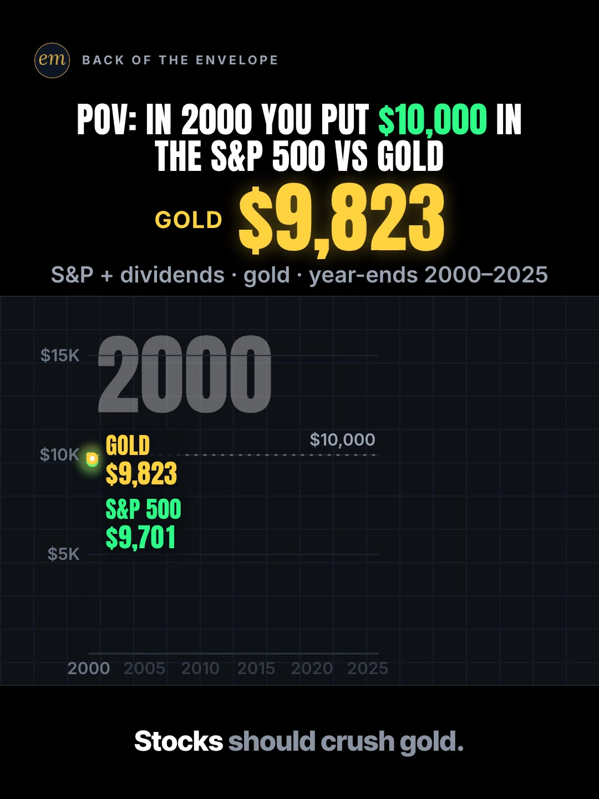

# 04a publishing sheet: $10,000 in the S&P 500 vs gold since 2000

YouTube Shorts (@envelopemath) and Instagram Reels (@envelopemath). Prepared 2026-10-13. Machine-readable twin: `publishing/04a-scoreboard-sp500-vs-gold.json`.

- **Video.** `renders/channel/04a-scoreboard-sp500-vs-gold.mp4`: the pre-condense cut (48 s: a 45.5 s body + the 2.5 s card; sha256 `0127a013…`), the round-2 Scoreboard cut as `renders/channel` holds it on 2026-10-13. A condensed cut is built in `studio/specs-wip/` and not yet shipped (timing only: the numbers, captions and verdict stay). Nothing below names a timestamp except the cover, which is picked by content (frame 1), so the copy carries over. The ship step rebuilds this sheet and re-exports both covers from the final file: `python3 publishing/tools/build_publishing.py 04a-scoreboard-sp500-vs-gold --covers`.
- **Numbers.** Every figure comes from `teasers/v2/04-chart-race.md` (04a) and its check, `python3 teasers/v2/checks/04-chart-race.py`: 657 checks, 0 failed on `studio/specs/` and 698 checks, 0 failed with `--spec` on the three condensed cuts in `studio/specs-wip/` (run 2026-10-13), so the copy's figures hold on both cuts. `python3 publishing/tools/build_publishing.py 04a-scoreboard-sp500-vs-gold --check` checks this sheet's limits, paste blocks and figures, recomputes every figure from the 04a year-end table, keeps each figure with its own asset (gold or the S&P 500) and each year's figure beside its year.
- **Honesty rules kept.** The title asks and never gives the winner, and the cover (frame 1, both lines just under $10,000) does not show it either. The Instagram caption keeps every result below 'more'. The copy names the start year's effect wherever it gives the verdict: start in 2010 and the S&P 500 wins (≈ ×8.3 vs ≈ ×3.9), the write-up's own answer to 'cherry-picked'. No advice, no urgency, and 'Not financial advice.' is in both.
- **Brand.** "S&P 500" names the index the maths is about (S&P Dow Jones Indices' total-return series); both platforms' copy says 'Not affiliated with or endorsed by S&P Dow Jones Indices.' The video has no logos or flags: the names are text only. No share price is named; gold is named by its price an ounce, a commodity price, so no split-adjusted wording applies.
- **News context.** Third-party Reels in the research show gold in the news in 2026 (not verified here). The copy stops at the Dec 31, 2025 close, as the video does, and the write-up's single-source Sep 30, 2026 gold close is not used.

---

## YouTube Shorts

### Title (vidIQ title score, short-form, scored against this channel)

| # | Title | Score | Chars |
|---|---|---:|---:|
| 1 | What If You Invested $10,000 in Gold and the S&P 500 in 2000? Which One Won? | 98 | 76 |
| 2 | Gold vs the S&P 500 Since 2000: What Did $10,000 in Each Become? | 97 | 64 |
| 3 | What If You Invested $10,000 in Gold and the S&P 500 in 2000? #gold #sp500 #linechart | 94 | 85 |

**Pick (paste):**

```
What If You Invested $10,000 in Gold and the S&P 500 in 2000? Which One Won?
```

- 76 of 100 characters.
- It raises the write-up's title from 94 to 98. The first question is the write-up's own title with the two names swapped and 'GOLD' in title case; 'Which One Won?' asks for the payoff without naming it.
- No winner in it: the video's whole turn is that gold beat stocks, so neither 'gold' nor 'stocks' is the subject of a verb. The only figures are the stake and the start year, both on frame 1.
- Option 2 is one point lower and keyword-first; vidIQ's model ranks titles but does not predict views, so the pick is the benchmark's grammar.
- 06b and 06c went up with the house 3-hashtag form in the title. To post this one that way, paste option 3 as it stands: its hashtags are the description's first three, as YouTube needs.
- Also scored, not used: "What If You Invested $10,000 in Gold vs the S&P 500 in 2000?" 95 (the pick without its question); "What If You Invested $10,000 in the S&P 500 and GOLD in 2000?" 94 (the write-up's title); "Gold vs Stocks Since 2000: What Did $10,000 in Each Become?" 90 ('gold vs stocks' is the biggest phrase (10,983 a month) but scores lower here); "$10,000 in 2000: Stocks or Gold?" 60 (the write-up's A/B title); "What If You Put $10,000 in Gold and $10,000 in the S&P 500 in 2000? #gold #sp500 #investing" 95 (the first build's option 3; '#investing' is not among the description's first three hashtags, so it can't be pasted as is).

### Description (paste)

```
What if you invested $10,000 in gold and $10,000 in the S&P 500 at the start of 2000? By the Dec 31, 2025 close, gold was worth about $150,000 and the S&P 500, with dividends reinvested, about $75,300. Gold was ahead at all 26 year-ends.

The math, shown:
• Each line is $10,000 grown by each year's return, compounded: the S&P 500's total return, and gold's change in year-end price.
• By 2002: the S&P 500 ≈ −38% and gold ≈ +21%, both counted from the start.
• 2008: the S&P 500 −37.00%, gold +5.6%.
• 2013: gold drops ≈ 28% in one year. Stocks run and close in, but in 2021 the S&P 500 ($49,395) is still behind gold ($63,518).
• 2025: gold +64.57%. Final: the S&P 500 ≈ $75,300 (≈ ×7.53), gold ≈ $150,000 (≈ ×15.0).
• Per year: the S&P 500 ≈ 8.1%, gold ≈ 11.0%. Doublings: the S&P 500 ≈ 2.9, gold ≈ 3.9. So gold ended ≈ 2× the S&P 500, ≈ one extra doubling.
• The start year picks the winner: start in 2010 and the S&P 500 grows ≈ ×8.3, gold only ≈ ×3.9.

Follow for the math behind your money — shown, not hand-waved. @envelopemath

Animation and original sound: The Back of the Envelope. S&P 500 total return by year, dividends reinvested (S&P Dow Jones Indices data via Slickcharts; checked against UMD, YCharts and NYU Stern). Gold: the change in its year-end price (Visual Capitalist), up to a Dec 31, 2025 close of $4,319.37 an ounce (metalcharts.org and pricegold.net; checked against VanEck and thegoldprice.net). Bought at the Dec 31, 1999 close and valued at the Dec 31, 2025 close; no fees, tax, gold storage or dealer spread. On thegoldprice.net's table (a different price basis) gold ends at ≈ $154,000, still ≈ 2× the S&P 500. Not financial advice. Not affiliated with or endorsed by S&P Dow Jones Indices.
#gold #sp500 #linechart
```

1,748 of 5,000 characters (1,808 UTF-8 bytes; YouTube counts this limit in bytes, and `≈`, `×`, `•`, `—`, `−` take 2-3 each). No `<` or `>`, which YouTube rejects. It follows the house template: an answer-first opening line for the search snippet, then 'The math, shown:' bullets, then the follow line. The credit, assumptions and 'Not financial advice.' line comes next, and the 3 hashtags close it. The 'Doesn't Add Up' series line is left out, as on 06b and 06c: the verdict depends on the start year, which the last bullet says, so 'a number that shouldn't be true' would oversell it. The 2002 figures are cumulative since Jan 2000, as the video's VO says ('By 2002').

### Hashtags (order matters)

1. `#gold`: the winner's name and the bigger phrase ('gold' 617,868 searches a month, down 6.1% on its 30-day baseline).
2. `#sp500`: the other racer ('s&p 500' 95,512 a month, down 33.1%). Of the 11 same-idea Shorts in the research, 3 carry it in the title and 6 have no hashtag there; ChartOrbit's own gold race has it in its description.
3. `#linechart`: the write-up's YouTube note: the tail of ChartOrbit's winning era ('#linechart #datavisualization'). Its NETFLIX and DISNEY title is itself a searched phrase with the tail (5,397 a month), so the tag ties this race to the format's searchers.

The title carries no hashtags, so YouTube shows these 3, the description's first, above the title. Over 60 hashtags and YouTube ignores all of them. `#Shorts` isn't needed.

### Tags (paste; 269 of 500 characters as YouTube counts them: commas count, and a tag with a space counts 2 more for the quotes YouTube adds)

```
gold vs stocks, s&p 500 vs gold, gold vs s&p 500, what if you invested, what if you invested in gold, gold investment, s&p 500, s&p 500 total return, stock market crash, line chart race, money math, math animation, the back of the envelope, envelope math
```

Tags carry little weight. These mirror the keyword research plus the house's channel tags; 'stock market crash' (140,294 a month, +64.7%) covers the race's 2002, 2008 and 2022 drops. Left out on purpose: 'how to invest in gold' (27,832, +37.2%) and 'gold price' (81,421) want a how-to or today's price; 'gold vs s&p 500 last 20 years' (3,934, competition 8.9) names a 20-year window, and this race runs 26; 'gold vs silver' (28,892) is another race.

### Pinned comment (post it, then pin it)

```
Start in Jan 2010 instead and the S&P 500 grows ≈ ×8.3 by Dec 2025, gold only ≈ ×3.9: stocks win. Same race, different start year. Swap in your own amount: since 2000, gold ≈ ×15.0 and the S&P 500 ≈ ×7.53. Which start year should we race next?

The basis: the S&P 500's total return (dividends reinvested) and gold's year-end price, from the Dec 31, 1999 close to the Dec 31, 2025 close. No fees, tax, storage or dealer spread.
```

The first paragraph is the write-up's pinned comment, reworded so every multiple sits after its own asset. It answers the comment the write-up expects ('start date cherry-picked') with numbers before anyone asks, gives the multiples for the viewer's own amount (R3), and ends on a question. The second paragraph is the assumption line the one-line Scoreboard footer can't hold, which the write-up sends here and to the description.

### Related video and end screen

- **Related video:** [What If You Bought Starbucks Stock Instead of a $4 Latte Every Day?](https://www.youtube.com/shorts/fbpdKf4Wy8c) (`fbpdKf4Wy8c`). The same 'what if you invested' viewer and the same race-chart idea; 06c is the channel's best stock 'what if' so far (760 views by 13 Oct). Live since Mon 12 Oct 2026, 03:45 ET.
- **Swap later:** 04c (USA vs Europe), the other Scoreboard chart race, once published; then point 04c's Related video at this Short.
- **End screen:** Shorts have no end screens or cards. The Related video link is the Shorts equivalent.

### Thumbnail and settings

- **Thumbnail:** in the YouTube app, pick frame 1 (the header, gold's tip on top and both lines just under the dashed $10,000 line), the same content as the Instagram cover below.
- **Settings:** Category Education. Not made for kids. Altered or synthetic content: No (it's an animated chart, not realistic footage). Remixing allowed. No captions needed: there's no narration and all the text is on screen.

### Posting window

- **When:** First Tue-Thu evening after the 04a condensed cut ships and passes QA, 21:30-22:30 ET (01:30-02:30 UTC the next day). Sunday 06:00-08:00 ET is the alternative.
- **Spacing:** Keep it at least 6 h from any other upload on the channel, post one chart race (04a, 04b, 04c) per evening, and keep the two Scoreboard races (04a, 04c) at least a day apart.
- **Why:** The channel's own October Shorts, median views by posting slot (vidIQ, 2026-10-13): Sunday 05:00-08:00 ET 1,198 (n = 2), weekday 22:00-00:30 ET 642 (n = 3), weekday midday 263 (n = 2). The evening slot is also the best one on Instagram, so one evening serves both. n = 7 and confounded by topic, so treat it as a test. Search demand: 'gold vs stocks' is down 37.3% on its 30-day baseline and 'how to invest in gold' up 37.2%, and third-party Reels on gold's 2026 price are travelling (section 3), so gold is in the news; the copy stops at the Dec 31, 2025 close.

---

## Instagram Reels

### Caption (paste)

```
The start year picks the winner. What if you invested $10,000 in gold and $10,000 in the S&P 500 in 2000?

POV: Jan 2000, $10,000 in each. One line is the S&P 500 with dividends reinvested, the other is gold at its year-end price, raced year by year to Dec 2025.

The math, shown:
• By 2002: stocks ≈ −38%, gold ≈ +21%.
• 2008: stocks crash again (−37.00%). Gold keeps climbing (+5.6%).
• 2013: gold drops ≈ 28% in one year. Stocks close in, but in 2021 they're still behind.
• End of 2025: the S&P 500 ≈ $75,300. Gold ≈ $150,000.
• Per year: the S&P 500 ≈ 8.1%, gold ≈ 11.0%. Gold ended ≈ 2× the S&P 500, ≈ one extra doubling.

Gold was ahead at all 26 year-ends. Start in 2010 instead and the S&P 500 grows ≈ ×8.3, gold ≈ ×3.9.

Bought at the Dec 31, 1999 close, valued at the Dec 31, 2025 close. No fees, tax or storage costs. Not financial advice. Not affiliated with or endorsed by S&P Dow Jones Indices.

Which start year should we race next?

Follow for the math behind your money — shown, not hand-waved. @envelopemath
Animation and original sound: The Back of the Envelope.

#gold #sp500 #linechart #investing #personalfinance
```

- 1,135 of 2,200 characters.
- **First 125 characters:** the write-up's curiosity line, then the title's question. The only figures are the stake and the start year, both on frame 1. The finals and the verdict sit below 'more', where Instagram search and Google indexing still read them.
- The 2010 line follows the verdict, so the verdict is never quoted without its start year; it is the write-up's answer to the 'cherry-picked' comments it expects.
- The caption follows the house close: the follow line plus the credit.

### Hashtags (5, Instagram's cap since Dec 2025)

`#gold #sp500 #linechart #investing #personalfinance`

Three are specific:

- `#gold` and `#sp500` name the two racers. They are the tags the same-idea Shorts use: 3 of the 11 carry each in the title, and ChartOrbit's own gold race carries both in its description.
- `#linechart` is the format's tag, from the write-up's caption (`#linechart #investing #gold #sp500`).

`#investing` (from the write-up's caption) and `#personalfinance` are the broad layer, as on 06b.

### Alt text

- **Short (95 characters; paste this one into Instagram):** Chart: $10,000 in gold vs the S&P 500, 2000 to 2025: gold about $150,000, stocks about $75,300.
  - It stays at or under 100 characters, so it fits the field however short it is. It says 'to' and 'about', not '-' and '≈', so screen readers read it cleanly. The long version carries the 2010 caveat and the verdict.
- **Long (for anywhere with room, such as a website embed):** Animation on a black scoreboard. Header: POV: in 2000 you put $10,000 in the S&P 500 vs gold. Two lines race year by year from 2000 to 2025 over a dashed $10,000 line, both starting just under it. Stocks are down about 38% and gold up about 21% by 2002. Stocks crash again in 2008 while gold keeps climbing; gold drops about 28% in 2013; stocks climb and close in but are still behind in 2021. Finish: the S&P 500 about $75,300, then gold about $150,000 after a spike in 2025. Gold made about 3.9 doublings, the S&P 500 about 2.9. Verdict: gold ended about 2× the S&P 500, about one extra doubling.
- **Where:** Advanced settings → Accessibility → Alt text, if your app shows it for Reels.

### Cover



- **Files:** `publishing/04a-scoreboard-sp500-vs-gold-cover-3x4.jpg` (1080×1440) and `publishing/04a-scoreboard-sp500-vs-gold-cover-9x16.jpg` (1080×1920). Both come from the pre-condense (48 s) render at 0 s (frame 0).
- **Frame, by content:** Frame 1, which the write-up names as the Instagram cover: the header 'POV: IN 2000 YOU PUT $10,000 IN / THE S&P 500 VS GOLD' with $10,000 the only accent, the hero 'GOLD $9,823', the footer 'S&P + dividends · gold · year-ends 2000–2025', the dim 2000 year clock, both tips already just under the dashed $10,000 line ('GOLD $9,823', 'S&P 500 $9,701' on this render; the write-up gives $9,724 and $9,535 for the condensed cut's frame 1) on the empty 2000-2025 axis, and the first caption 'Stocks should crush gold.' It sets up the race and the wrong belief, and shows neither final. On any cut, use the first frame, while both tips sit under the stake line. On the pre-condense 48.0 s render, frame 0 (0.00 s) shows that state: the race clock starts at −0.4 s, so the tips are already moving, and from frame 1 the mean frame-to-frame luma change (270×480 greyscale) runs at about 0.003 as they fall. If the cut changes, re-pick it by content.
- **Crop:** 3:4 = 1080×1440 from y 64 to 1504 of the 1080×1920 frame. The content runs from y 141 (the badge) to y 1427 (the caption), so the crop centres it: badge, header, hero, footer, the whole plot and the first caption; it drops the empty black floor. A centred grid crop (y 240-1680) loses the badge and leaves the header on the top edge.
- **How to set it:** In 'Edit cover', pick frame 1 of the video (or upload the 9:16 JPG), then drag 'Profile grid' to the top so the tile matches the 3:4 JPG. Do not upload the 3:4 JPG as the Reel cover: Instagram centre-crops it to 9:16 in the Reels tab and cuts the header.
- **Re-export:** `ffmpeg -ss 0 -i renders/channel/04a-scoreboard-sp500-vs-gold.mp4 -frames:v 1 -vf "crop=1080:1440:0:64" -q:v 2 publishing/04a-scoreboard-sp500-vs-gold-cover-3x4.jpg` and `ffmpeg -ss 0 -i renders/channel/04a-scoreboard-sp500-vs-gold.mp4 -frames:v 1 -q:v 2 publishing/04a-scoreboard-sp500-vs-gold-cover-9x16.jpg`, or `python3 publishing/tools/build_publishing.py 04a-scoreboard-sp500-vs-gold --covers`.
- **Not used:** the climax ('GOLD ≈ $150,000' over both finished lines) and the verdict hold ('Gold ended ≈ 2× the S&P 500'). They are the save-worthy frames, but they show the winner the title asks about, against the write-up's cover note.
- **Condensed cut:** the ship step re-picks this frame by content on the final file (the first frame, both tips under the stake line) and re-exports both JPGs with `--covers`.

### First comment (post it, then pin it)

```
Start in 2010 instead and the S&P 500 grows ≈ ×8.3, gold ≈ ×3.9. Since 2000: gold ≈ ×15.0, the S&P 500 ≈ ×7.53. Which start year should we race next?
```

### Trial Reels

**Post as a regular Reel, not a Trial.** @envelopemath has 8 followers, so a regular Reel is already shown almost entirely to non-followers, which is all a Trial Reel adds. A Trial would also keep it off the profile grid until shared. A hook test afterwards, if you want one: the other cut as a Trial with MANUAL graduation 48-72 h later. Once the condensed cut ships, the pre-condense render is in git: `git show 471c793:renders/channel/04a-scoreboard-sp500-vs-gold.mp4 > 04a-pre-condense.mp4` (sha256 0127a013…). Compare skip rate (October Reels ran 27.0-65.1%) and average watched %, then share the winner. vidIQ's publish tool exposes Trial (MANUAL or SS_PERFORMANCE) for this connected account. Confirm eligibility in the app.

### Posting window and settings

- **When:** Same evening as YouTube, about 15 min after the Short: 21:45-22:45 ET.
- **Why:** October Reels, median plays by posting slot (owner insights, 2026-10-13): weekday 22:00-00:30 ET 5,449 (n = 3, including the two best: 7,302 and 5,449), weekday midday 1,212 (n = 2), Sunday 05:00-08:00 ET 1,087 (n = 2). Skip rate tracks plays more closely than the hour does: 27.0-27.4% for the top two, 56.9-65.1% for the bottom two. The condense matters more than the hour.
- **Audio:** Rename the original audio to 'Gold vs the S&P 500 since 2000 — The Back of the Envelope' if the app allows; it is the score, with no voice.
- **Share to feed:** On.

---

## Why these choices (research evidence)

**1. Search demand (vidIQ keyword research, pulled 2026-10-13).** vidIQ refreshes each keyword on its own schedule, so the last column gives each row's snapshot date. Five rows are older snapshots.

| Keyword | Est. searches/month | Competition | Overall | Note | vidIQ as of |
|---|---:|---:|---:|---|---|
| gold (topic) | 617,868 | 71.0 | 63.5 | -6.1% vs its 30-day baseline (658,202) | 2026-10-12 |
| stock market crash | 140,294 | 60.3 | 62.0 | +64.7% vs its baseline (85,194); the race's 2002, 2008 and 2022 drops | 2026-10-12 |
| s&p 500 (topic) | 95,512 | 63.1 | 59.4 | -33.1% vs its baseline (142,756) | 2026-10-12 |
| gold price | 81,421 | 42.7 | 66.9 | -9.9%; today's-price intent, not a tag | 2026-10-12 |
| gold investment | 47,256 | 46.5 | 63.3 | -6.2% vs its baseline (50,361) | 2026-10-12 |
| gold vs silver | 28,892 | 53.3 | 58.6 | -45.6%; another race, not a tag | 2026-10-12 |
| how to invest in gold | 27,832 | 40.5 | 63.6 | +37.2% vs its baseline (20,282); how-to intent, not a tag | 2026-10-12 |
| gold vs stocks | 10,983 | 25.7 | 65.9 | seed; -37.3% vs its 30-day baseline (17,516) | 2026-10-12 |
| 💴what if you invested $5,000 in netflix and disney? #linechart #datavisualization | 5,397 | 30.9 | 61.1 | ChartOrbit's H16 title, searched as typed | 2026-09-20 |
| s&p 500 vs gold | 5,261 | 22.6 | 64.3 | the exact pair, low competition | 2026-05-23 |
| what if you invested $10,000 in 10 years ago | 5,025 | 34.6 | 59.3 | the stake grammar | 2026-10-12 |
| what if you invested in | 4,930 | 29.5 | 61.3 | the title's grammar ('what if you invested' matching terms: 40 variants at 4,400-5,700 a month) | 2026-10-01 |
| gold vs s&p 500 last 20 years | 3,934 | 8.9 | 68.6 | lowest competition, but a 20-year window; this race runs 26, so not a tag | 2026-07-16 |
| s&p 500 vs real estate vs gold | 3,789 | 16.9 | 65.3 | a three-way race | 2026-05-25 |

'gold vs stocks' (10,983 a month, competition 25.7) and 's&p 500 vs gold' (5,261, competition 22.6) are the exact topic at low competition, though 'gold vs stocks' is down 37.3% on its baseline. The 'what if you invested …' family is a long tail of 40 phrasings at 4,400-5,700 a month each, ChartOrbit's NETFLIX and DISNEY title among them, which is why the title keeps that grammar. 'how to invest in gold' is rising (+37.2%) but wants a how-to.

**2. Gold vs the S&P 500 is a crowded race with one breakout, and it asked (vidIQ YouTube search, under 4 min, by views and by relevance).**

| Title | Channel (subs) | Views | Date |
|---|---|---:|---|
| if your dad invested $1000 in S&P 500 vs Gold in 1995📈 #SPX #gold #investments #stocks | Infomapas Global (4,760) | 369,220 | 2025-10-03 |
| S&P 500 vs. Gold vs. Dollar 1957-2024 #inflation #gold #sp500 | Living Charts (5,810) | 11,769 | 2025-03-14 |
| Gold VS the S&P 500 did you think there would be this much of a difference? | Financial Education for Retirement (333) | 10,715 | 2025-04-05 |
| Gold vs Stocks: The Shocking 10-Year Winner | Mike's Financial Edge (35,400) | 6,112 | 2025-10-22 |
| Gold vs. S&P 500: The Surprising 25-Year Shift You Didn’t See Coming | Capital.com (283,000) | 5,406 | 2025-11-08 |
| $10,000 in Gold vs. Stocks (2000-2026) 📈 | ChartOrbit (15,400) | 4,876 | 2026-03-25 |
| S&P 500 vs Gold since 2000 #finance #investing #stocks #stockmarket #money #trading #sp500 #gold | Financial Skills (172) | 2,186 | 2025-04-10 |
| ¿ORO o S&P 500? El MISTERO de los $10,000 Revelado 📈💰 #oro  #sp500 | SavannaTrading (48,400) | 1,782 | 2026-09-20 |
| Gold vs. S&P 500: Which is the Real King? 🟡 vs 🇺🇸  (2000-2026) #finance #Investing #finanzen | GELDATEN (17) | 1,762 | 2026-02-22 |
| $1/Day Since 2000: S&P 500 vs Gold — The Gap Will Shock You | InvestedInTime (63) | 195 | 2026-05-24 |
| Gold vs S&P 500: The Real Winner Since 2000 || Credonomics | CREDONOMICS (6) | 64 | 2026-10-04 |

Eleven Shorts race gold against the S&P 500, seven of them from 2000. Ten sit under 12,000 views. The breakout is Infomapas Global's 'if your dad invested $1000 in S&P 500 vs Gold in 1995' (369,220 views on 4,760 subscribers, outlier score 75.2): a 'what if' framed as a person, with the winner left out of the title. The rest state or tease the answer ('The Shocking 10-Year Winner', 'The Gap Will Shock You'), and ChartOrbit's own '$10,000 in Gold vs. Stocks (2000-2026)', this exact race, drew 4,876 views after the channel dropped its 'What If You Invested $5,000 in A and B?' titles. So the pick keeps that question form and adds 'Which One Won?'.

Next door: George Kamel's 'Is Gold Really Worth The Investment?' (1,542,017) and warikoo's India-facing 'Gold vs Nifty50 ke Units' (5,658,043) show the gold-vs-stocks argument travels. ChartOrbit's benchmarks, re-pulled: 'What If You Invested $5,000 in NETFLIX and DISNEY?' 15,876,430 and 'in USA and EUROPE?' 2,808,312.

**3. Music-only line races travel on Instagram and TikTok, and gold is in the feed (vidIQ IG/TikTok outlier search, since Oct 2025).**

- **@alanintelligence** (Instagram), "Sell when it drops? Sell US stocks when they drop below the 200-day SMA": 479.5K (123.6x). A two-line race on black, music only: the closest match to this Short's look.
- **@race_charts** (Instagram), "SMOKING A PACK OF MARLBORO A DAY VS BUYING THE STOCK INSTEAD": 1.6M (60.9x). **@investment_timeline** (TikTok), "POV: You invested in Monster instead of paying $3/day for a Monster Energy": 1.5M (140.6x).
- **@bigbullionsg** (Instagram), "1g of Gold (USD)": 1.2M (562.6x). Gold's price by year to 2026; it shows gold is in the feed this year (its figures are not verified here).
- All four open on the premise or the setup, with no final on frame 1, which is what this Reel's cover and caption do. None found races gold against the S&P 500 on Instagram or TikTok.

**4. Our own October numbers (vidIQ: public YouTube stats, Instagram owner insights; pulled 2026-10-13).**

| YouTube Short | Posted (ET) | Views |
|---|---|---:|
| Can You Find the Missing Dollar? (`LjHDFzVxRyM`) | Sun 07:04 | 1,254 |
| You Can Lean on $1 Million. Not on $1 Billion. (`hJBvmGA6sZ0`) | Thu 00:25 | 1,221 |
| Your Interest Has a Speed Limit (`XVUeMcTg9OQ`) | Sun 05:49 | 1,141 |
| What If You Bought Starbucks Stock Instead of a $4 Latte Every Day? (06c) (`fbpdKf4Wy8c`) | Mon 03:45 | 760 |
| Pay the Minimum on $5,000? 238 Months. (`8__HTUa2PoU`) | Mon 22:09 | 642 |
| A $2 Lottery Ticket Was Worth $6.98. Until the Fine Print. (`FW_oxA3kbsM`) | Wed 12:03 | 348 |
| You Can Carry $1 Million. Not in Pennies. (`mXbKY_R63h4`) | Thu 13:38 | 177 |
| Start Investing 10 Years Late? You Get Half. (`EqFQCJheCMU`) | Tue 22:27 | 161 |
| What If You Bought Netflix Stock Instead of Paying for Netflix? (06b) (`krfZEHhb0xU`) | Mon 12:14 | 61 |

| Instagram Reel | Posted (ET) | Plays | Skip rate | Avg watched |
|---|---|---:|---:|---:|
| $5,000 on the minimum (`DeIvYk7I4Qr`) | Mon 22:46 | 7,302 | 27.4% | 56.5% |
| $1M stack vs Burj Khalifa (`DeOEthJJ1TG`) | Thu 00:28 | 5,449 | 27.0% | 83.1% |
| Missing dollar (`DeWgFZRoR_S`) | Sun 07:05 | 1,997 | 32.0% | 81.3% |
| Powerball $6.98 (`DeMvZv9IqRw`) | Wed 12:05 | 1,825 | 58.7% | 57.9% |
| 06c latte vs Starbucks stock (`DeYuqT4pjVC`) | Mon 03:46 | 1,711 | 40.3% | 69.1% |
| $1M in pennies (`DePe11HIHwn`) | Thu 13:37 | 598 | 42.0% | 66.7% |
| 10 years late (`DeLSd9io8UK`) | Tue 22:30 | 219 | 65.1% | 30.6% |
| Speed limit (e) (`DeEW2ZMIiYd`) | Sun 05:54 | 177 | 56.9% | 31.2% |

Channel totals:

- **YouTube:** 53 subscribers, 10,221 views and 41 videos (+27 subscribers, +5,127 views and 11 videos in 30 days).
- **Instagram:** 8 followers and 20,518 views in 30 days.

06b went up on both platforms on Mon 12 Oct at 12:14 ET, midday: 61 views on YouTube by 13 Oct, and its Reel's insights are not in yet (Instagram lags). It is left out of the medians, as is 06c (760 views, 1,711 plays, 40.3% skip), both too young.

Medians by posting slot (n = 2-3 each, confounded by topic):

- **YouTube:** Sunday early morning ET 1,198, weekday 22:00-00:30 ET 642, weekday midday 263.
- **Instagram:** weekday 22:00-00:30 ET 5,449, midday 1,212, Sunday early morning 1,087.

The channel's two 'what if you bought the stock' races (06c, 06b) are its closest kin, and both are too young to read. On Instagram, skip rate predicts plays better than the hour does (27.0-27.4% for the top two, 56.9-65.1% for the bottom two), so the first frame matters more than the slot: this one opens with the race already moving.

**5. Platform rules applied.**

- **YouTube title:** 100 characters. The Shorts player shows only the opening, so the keywords come first.
- **YouTube description:** 5,000 characters.
- **YouTube hashtags:** the first 3 show; over 60 and all are ignored; `#Shorts` isn't needed.
- **YouTube tags:** 500 characters, low weight.
- **YouTube Shorts:** no end screens. The Related video link is the Shorts equivalent.
- **YouTube AI disclosure:** only for realistic altered content.
- **Instagram caption:** 2,200 characters, about 125 shown before 'more'.
- **Instagram hashtags:** 5 at most.
- **Instagram search and Google:** keywords in the caption feed Instagram search, and Google indexes public professional posts (since 10 Jul 2025).
- **Instagram grid:** a 3:4 crop of the 9:16 cover.
- **Trial Reels:** shown to non-followers only.

**6. Limits.**

- As the 06b and 02b sheets found (not re-checked here), vidIQ's YouTube authorization is a different channel (UCRC5v_El2fibbkqsZs6uFjA), so @envelopemath's YouTube Analytics (audience hours, geography) were not readable. Check Studio → Analytics → Audience → 'When your viewers are on YouTube' before posting.
- vidIQ has no hashtag-volume data; hashtag picks lean on keyword volume, the write-up's notes and the same-idea Shorts' own tags.
- Title scores are vidIQ's short-form CTR model for this channel; they rank options but do not predict views.
- The render in renders/channel is the pre-condense cut. The cover's time and frame are measured on it; the copy names no other timestamp, and the ship step re-picks the cover on the final file.
- The write-up marks gold's Dec 31, 2025 close ($4,319.37, named in the description) and its 2024 close ($2,624.60, behind the +64.57%) as [click-check]: seen in search summaries, not on the page. Open metalcharts.org/gold-price-history/2025 or pricegold.net/2025/december/ and the Macrotrends gold chart once before posting.
- Gold's 2026 moves come only from third-party Reels and the write-up's single-source Sep 30, 2026 close; none is verified here and none is in the copy, which stops at the Dec 31, 2025 close.
- The vidIQ credit balance is shared with the other sheets being built in parallel, so this sheet's spend is counted from each tool's listed cost (see research.vidiq_credits).

---

## Check log (first build and adversarial pass, 2026-10-13)

- **Maths.** `python3 teasers/v2/checks/04-chart-race.py`: 657 checks, 0 failed on `studio/specs/` and 698 checks, 0 failed with `--spec` on the three condensed cuts in `studio/specs-wip/`. Every public figure traces to the 04a year-end table: $75,284.61 ≈ $75,300 (≈ ×7.53), $149,915.35 ≈ $150,000 (≈ ×15.0), ≈ 8.1% vs ≈ 11.0% a year, ≈ 2.9 vs ≈ 3.9 doublings, ratio 1.99 ≈ 2×; by 2002 ≈ −38% / ≈ +21%; 2008 −37.00% / +5.6%; 2013 ≈ −28%; 2021 $49,395 vs $63,518; 2025 +64.57%; from 2010 ≈ ×8.3 vs ≈ ×3.9; second gold table ≈ $154,000. The data file recomputes each from the sourced returns.
- **Limits.** Title 76/100. Description 1,748 characters (1,808 bytes) of 5,000. 3 hashtags. Tags 269/500 as YouTube counts them. Instagram caption 1,135/2,200, with the first 125 characters result-free. 5 hashtags. Short alt text 95. No `<` or `>`.
- **vidIQ.** Keywords pulled 2026-10-13 (table above). 7 titles scored against this channel: the pick 98, the write-up's title 94, its A/B title 60. Channel 53 subscribers / 10,221 views / 41 videos; Instagram owner insights refreshed (8 followers, 20,518 views in 30 days).
- **vidIQ re-queried.** At the adversarial check: the pick's title score 98; 'gold vs stocks' 10,983 / 25.7 (−37.3%); 'gold' 617,868 (−6.1%); 's&p 500' 95,512 (−33.1%); ChartOrbit's NETFLIX and DISNEY 15,876,430 and USA and EUROPE 2,808,312, its gold race 4,876; 06c 760 views. All match.
- **Changed.**
  - The math run said 614 checks, 0 failed: the condense updated the check script since, and it now runs 657 checks, 0 failed on `studio/specs/` and 698 checks, 0 failed with `--spec` on the condensed cuts. The 04a key lines the builder looks for are the cut-independent ones (the finals, the 26 year-ends, the second gold table), so the check keeps passing when the condensed cut is promoted.
  - Title option 3 was a hashtag form whose '#investing' is not among the description's first three hashtags, so it could not be pasted as is. 06b and 06c went up with hashtag titles, so option 3 is now the paste-ready form, '… in 2000? #gold #sp500 #linechart' (vidIQ 94, 85 characters); the old one is in 'also scored'.
  - The description credited VanEck for the $4,319.37 close (VanEck gives 2025's return, not the close) and listed thegoldprice.net beside Visual Capitalist for the race's own table (it is the second table, on another price basis). Each source is now credited for what it gave, and the ≈ $154,000 line names thegoldprice.net's table.
  - `#sp500` was 'the tag every same-idea Short uses', and the Instagram note said every same-idea post tags both racers: 3 of the 11 titles carry each, 6 carry none. Both notes now say so.
  - The YouTube thumbnail line named 'GOLD $9,823', the pre-condense render's frame-1 tip; the condensed cut's frame 1 reads $9,724 (the write-up). The line now describes the frame by content, and the cover note gives both cuts' values.
  - The description note listed its 2-3-byte characters without the minus sign (−, 3 bytes) the description uses; `DESC_MULTIBYTE` now lists it.
  - Limits: the write-up's [click-check] rows behind the description's gold close ($4,319.37) and the 2024 close are named, with the pages to open once before posting.
- **Checked.**
  - Platform limits: title 76/100 with no hashtags (the description's first three show above it), description under 5,000 bytes, tags under 500, caption under 2,200 with 5 hashtags, short alt text under 100.
  - The cover JPGs (read by eye) show frame 1: the header, both tips under the dashed $10,000 line, the first caption; no final. The write-up's condensed beat sheet keeps that picture on frame 1.
  - The pre-condense render in git (`471c793`) has the same sha256 as `renders/channel` today (`0127a013…`), so the Trial Reels `git show` command fetches this file.
  - Brand: 'S&P 500' is named only as the index the maths uses; the affiliation line is in the description and the caption. Gold is a commodity, and no share price is named.
- **Mutation test.** Six mutations of a scratch copy each fail by name: the two rates swapped between gold and the S&P 500, a final without '≈', the 2013 drop moved to 2008, a result in the caption's first 125 characters, a winner in the title, and the 2010 caveat cut from the caption. At the adversarial check, 4 more on scratch copies also fail by name: a winner in the title ('Gold Won 2×'), the description's hashtags out of order, the ≈ dropped from the second table's $154,000, and a final in the caption's first 125 characters. The files on disk were not touched.
- **Generator.** Unchanged. The 04 check already prints the builder's 'N checks, F failed' line, so `MATH_SCRIPT` runs it directly.
- **Kept on purpose.**
  - The 2002 figures say 'since Jan 2000' (description) or sit under 'By 2002', as the VO does: they are cumulative, not 2002's own returns.
  - Every multiple and rate sits after its own asset's name (COPY_RULES), so a swapped '≈ 11.0%' or '≈ ×7.53' fails the build.
  - The cover is frame 1, as the write-up names it; the finals and the verdict stay off it.
  - Hashtag `#linechart`, not `#investing`, closes the YouTube three: the write-up's YouTube note asks for ChartOrbit's tail, and `#investing` stays on Instagram.
  - The description's first line gives the finals (the house's answer-first snippet, as on 06b); the title and the caption's first 125 characters still ask.
