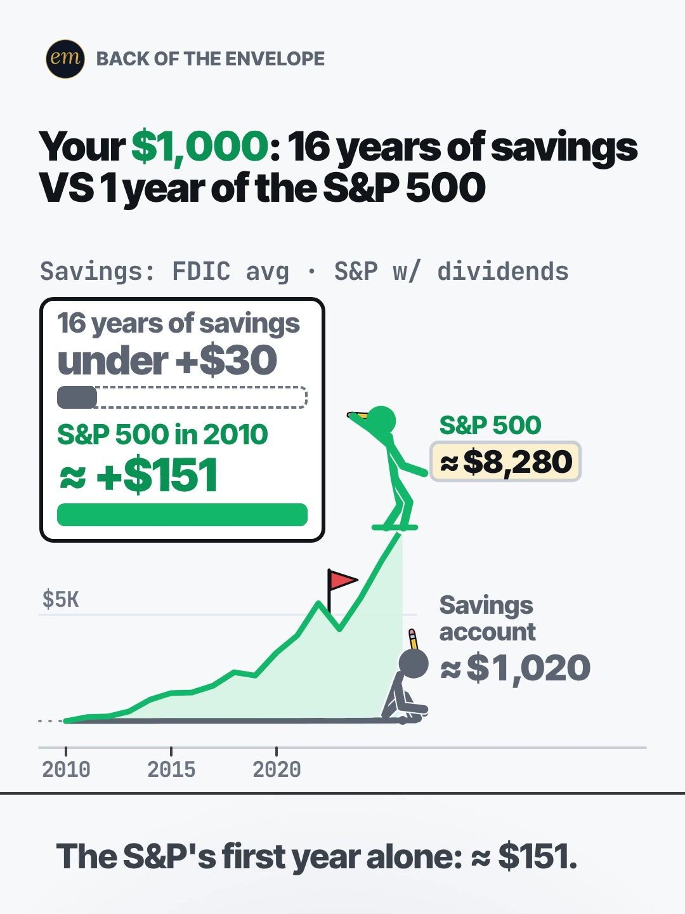

# 04b publishing sheet: 16 years of savings vs 1 year of the S&P 500

YouTube Shorts (@envelopemath) and Instagram Reels (@envelopemath). Prepared 2026-10-13. Machine-readable twin: `publishing/04b-becker-rig-savings-vs-sp500.json`.

- **Video.** `renders/channel/04b-becker-rig-savings-vs-sp500.mp4`: the pre-condense cut (38.5 s: a 36 s body + the 2.5 s card; sha256 `8d243eee…`), the hook-pass-2 Becker rig cut as `renders/channel` holds it on 2026-10-13. A condensed cut is built in `studio/specs-wip/` and not yet shipped (timing only: the numbers, captions and verdict stay). Nothing below names a timestamp except the cover, which is picked by content (the payoff card), so the copy carries over. The ship step rebuilds this sheet and re-exports both covers from the final file: `python3 publishing/tools/build_publishing.py 04b-becker-rig-savings-vs-sp500 --covers`.
- **Numbers.** Every figure comes from `teasers/v2/04-chart-race.md` (04b) and its check, `python3 teasers/v2/checks/04-chart-race.py`: 657 checks, 0 failed on `studio/specs/` and 698 checks, 0 failed with `--spec` on the three condensed cuts in `studio/specs-wip/` (run 2026-10-13), so the copy's figures hold on both cuts. `python3 publishing/tools/build_publishing.py 04b-becker-rig-savings-vs-sp500 --check` checks this sheet's limits, paste blocks and figures, recomputes every figure from the FDIC and S&P 500 tables, re-runs the check's 2,916-table sweep over the uncertain FDIC inputs, keeps each figure with its own side (savings or the S&P 500) and each year's figure beside its year.
- **Honesty rules kept.** The title asks and never gives the answer. The Instagram caption keeps every result below 'more'. The savings figures are the ones that hold in every plausible FDIC table (under $30, ≈ $1,020, ≈ $680); the dollar-and-cents $1,023.85 is never shown, as in the video. The copy says the rate is the national average, not a high-yield rate, names 2010 wherever it gives the verdict, and says which years made less (2011, 2015) or lost (2018, 2022). No advice, no urgency, and 'Not financial advice.' is in both.
- **Brand.** "S&P 500" names the index the maths is about (S&P Dow Jones Indices' total-return series); both platforms' copy says 'Not affiliated with or endorsed by S&P Dow Jones Indices.' The FDIC, FRED and BLS are named only as data sources. No logos in the video; no share price is named.
- **Cover.** The write-up names the payoff card as this Reel's cover (frame 1 as its A/B), so unlike 04a and 04c the cover shows the answer to the title's question. See the cover section.

---

## YouTube Shorts

### Title (vidIQ title score, short-form, scored against this channel)

| # | Title | Score | Chars |
|---|---|---:|---:|
| 1 | What If You Kept $1,000 in a Savings Account for 16 Years? Can It Beat 1 Year of the S&P 500? | 98 | 93 |
| 2 | What If You Put $1,000 in Savings and $1,000 in the S&P 500 in 2010? Can 16 Years Beat 1? | 98 | 89 |
| 3 | What If You Kept $1,000 in a Savings Account for 16 Years? #SavingsAccount #sp500 #investing | 90 | 92 |

**Pick (paste):**

```
What If You Kept $1,000 in a Savings Account for 16 Years? Can It Beat 1 Year of the S&P 500?
```

- 93 of 100 characters.
- It raises the write-up's title from 88 to 98, and keeps its question whole: 16 years of savings against 1 year of the S&P 500. 'It' is the savings account, so the question compares the two gains, as the video's payoff card does.
- No answer in it: the only figures are the stake and the handicap (16 years vs 1), all on frame 1's header. The answer (the S&P 500's 2010 alone) is what the video pays off.
- The '1 Year' is 2010; the description, the caption and the pinned comment name it, say 2010 was a typical year, and give the years that made less.
- The savings rate is the FDIC national average, not a high-yield rate. The title says 'a Savings Account', as the write-up's does, and the first line of the description and of the caption say 'national average'. 'An Average Savings Account' scores 96 if you want the basis in the title too (see 'also scored').
- 06b and 06c went up with the house 3-hashtag form in the title. To post this one that way, paste option 3 as it stands: its hashtags are the description's first three, as YouTube needs.
- Also scored, not used: "What If You Kept $1,000 in an Average Savings Account for 16 Years? Can It Beat 1 Year of Stocks?" 96 (names the basis in the title, 2 points under the pick, and trades 'the S&P 500' for 'Stocks' to fit; the description's and the caption's first lines say 'national average' instead); "Can 16 Years in a Savings Account Beat 1 Year in the S&P 500?" 88 (the write-up's title: the handicap duel in 61 characters, without the stake); "Can 16 Years in a Savings Account Beat 1 Year in the S&P 500? #savings #sp500 #investing" 88 (the house 3-hashtag form of the write-up's title; '#savings' is not among the description's first three hashtags, so it can't be pasted as is); "16 Years of Savings Interest vs 1 Year of the S&P 500" 87 (the write-up's A/B title); "Your $1,000: Can 16 Years of Savings Interest Beat 1 Year of the S&P 500?" 86 (the on-screen header as a question); "Savings Account vs S&P 500: Can 16 Years of Interest Beat 1 Year of Stocks?" 85 (keyword-first).

### Description (paste)

```
Can 16 years in a savings account beat 1 year in the S&P 500? $1,000 at the FDIC national average savings rate earned under $30 of interest from Jan 2010 to Dec 2025: about $1,020 in all. The same $1,000 in the S&P 500, with dividends reinvested, made about $151 in 2010 alone.

The math, shown:
• Savings: each January's FDIC national average rate, compounded once a year. It stays under 0.5% a year, and 16 years of interest come to under $30.
• S&P 500: 2010's total return was +15.06%, so $1,000 made $150.60, about $151, in its first year.
• By 2014 the S&P 500 had doubled. Savings: under $10 of interest so far.
• 2020: the S&P 500 tops $4,000.
• 2022: the S&P 500 drops ≈ 18%.
• End of 2025: the S&P 500 ≈ $8,280 (≈ ×8.28), savings ≈ $1,020 (≈ ×1.02).
• So the S&P 500's 2010 alone (≈ +$151) beat 16 years of savings (under +$30).
• 2010 wasn't a lucky pick: the S&P 500 averaged ≈ 14.1% a year over these 16 years. But some years made less: on $1,000 it made ≈ $21 in 2011 and ≈ $14 in 2015, and lost money in 2018 and 2022.

Follow for the math behind your money — shown, not hand-waved. @envelopemath

Animation and original sound: The Back of the Envelope. Savings: the FDIC national average savings rate, the January reading of each year (Forbes Advisor and wealthvieu for 2010-2020; FRED series SNDR for 2021-2025), compounded once a year. Januaries that could not be found are the midpoint of their neighbours, and 2021 uses FDIC's April reading; across every plausible value of those inputs, 16 years of interest stay under $30. It is the national average, not a high-yield rate. S&P 500: total return by year, dividends reinvested (S&P Dow Jones Indices data via Slickcharts). Prices rose about 50% over the same years (CPI-U, BLS), so savings' about $1,020 buys what about $680 did in 2010. No fees or tax. Not financial advice. Not affiliated with or endorsed by S&P Dow Jones Indices.
#SavingsAccount #sp500 #investing
```

1,938 of 5,000 characters (1,976 UTF-8 bytes; YouTube counts this limit in bytes, and `≈`, `×`, `•`, `—` take 2-3 each). No `<` or `>`, which YouTube rejects. It follows the house template: an answer-first opening line for the search snippet, then 'The math, shown:' bullets, then the follow line. The credit, assumptions and 'Not financial advice.' line comes next, and the 3 hashtags close it. The 'Doesn't Add Up' series line is left out, as on 06b and 06c: the verdict compares one named year with 16 years of a national average, which the copy spells out, so 'a number that shouldn't be true' would oversell it. The buying-power line (≈ $680) is the twist the write-up moved to the pinned comment; it sits in the credit paragraph here too.

### Hashtags (order matters)

1. `#SavingsAccount`: the side the belief is about. Savings accounts are a live search ('high yield savings account' 56,330 a month, +77.0% on its 30-day baseline), though this video uses the national average, not a high-yield rate.
2. `#sp500`: the rival ('s&p 500' 95,512 a month), the index the video races.
3. `#investing`: the broad layer ('investing' 613,566 a month, flat) and the other half of 'saving vs investing' (32,141), the video's question.

The title carries no hashtags, so YouTube shows these 3, the description's first, above the title. Over 60 hashtags and YouTube ignores all of them. `#Shorts` isn't needed.

### Tags (paste; 262 of 500 characters as YouTube counts them: commas count, and a tag with a space counts 2 more for the quotes YouTube adds)

```
saving vs investing, savings account, savings account interest, s&p 500, s&p 500 total return, compound interest, what if you invested, what if you invested $1000 in, stock market, money math, math animation, the back of the envelope, envelope math
```

Tags carry little weight. These mirror the keyword research plus the house's channel tags. Left out on purpose: 'high yield savings account' (56,330, +77.0%) and 'best high yield savings account' (25,784) are product shopping, and this video uses the national average; 'savings account vs investing', the seed, is under 750 a month.

### Pinned comment (post it, then pin it)

```
What does your savings account pay? Even at the highest January rate in our table, 0.47%, every single year since 2010, savings would be ≈ $1,078.

2010 wasn't a lucky pick: the S&P 500 averaged ≈ 14.1% a year over these 16 years, and 2010 was +15.06%. But not every year wins: on $1,000 the S&P 500 made ≈ $21 in 2011 and ≈ $14 in 2015, and lost money in 2018 and 2022. And prices rose ≈ 50% (CPI-U), so savings' ≈ $1,020 buys what ≈ $680 did in 2010.

Swap in your own amount: the S&P 500 ≈ ×8.28, average savings ≈ ×1.02.
```

The write-up's pinned comment, reordered so its question shows first in the collapsed preview and every multiple sits after its own side. It answers the comments to expect: 'my account pays 4%' (the video uses the national average and the copy says so; even 0.47%, the table's highest January, every year gives ≈ $1,078), 'you picked a good year' (2010 sat next to the 16-year average, and the weaker years are named), and it carries the buying-power twist the write-up moved here.

### Related video and end screen

- **Related video:** [Your Interest Has a Speed Limit](https://www.youtube.com/shorts/XVUeMcTg9OQ) (`XVUeMcTg9OQ`). The same 'interest' viewer: what compounding can and can't do. It is the channel's most-engaged October Short (1,141 views, 28 likes, 6 comments, breakout score 21.3). Live since Sun 4 Oct 2026.
- **Swap later:** 04a or 04c, the other chart races, once published; then point one of them at this Short.
- **End screen:** Shorts have no end screens or cards. The Related video link is the Shorts equivalent.

### Thumbnail and settings

- **Thumbnail:** in the YouTube app, pick the payoff-card frame (the 'under +$30' stub against the full '≈ +$151' bar), the same content as the Instagram cover below.
- **Settings:** Category Education. Not made for kids. Altered or synthetic content: No (it's an animated chart, not realistic footage). Remixing allowed. No captions needed: there's no narration and all the text is on screen.

### Posting window

- **When:** First Tue-Thu evening after the 04b condensed cut ships and passes QA, 21:30-22:30 ET (01:30-02:30 UTC the next day). Sunday 06:00-08:00 ET is the alternative.
- **Spacing:** Keep it at least 6 h from any other upload on the channel, and post one chart race (04a, 04b, 04c) per evening.
- **Why:** The channel's own October Shorts, median views by posting slot (vidIQ, 2026-10-13): Sunday 05:00-08:00 ET 1,198 (n = 2), weekday 22:00-00:30 ET 642 (n = 3), weekday midday 263 (n = 2). The evening slot is also the best one on Instagram, so one evening serves both. n = 7 and confounded by topic, so treat it as a test. Search demand: 'high yield savings account' is up 77.0% on its 30-day baseline, so savings rates are in people's searches; 'saving vs investing' is down 45.2%.

---

## Instagram Reels

### Caption (paste)

```
Can 16 years of savings beat 1 year of stocks? $1,000 in a savings account at the national average vs $1,000 in the S&P 500, from 2010.

POV: your $1,000. Savings gets 16 years to match what the S&P 500 made in its first year.

The math, shown:
• The S&P 500 in 2010: +15.06%, so $1,000 made ≈ $151.
• Savings: each January's FDIC national average rate, under 0.5% a year throughout.
• By 2014 the S&P 500 had doubled. Savings: under $10 of interest so far.
• 2022: the S&P 500 drops ≈ 18%.
• End of 2025: savings ≈ $1,020, under $30 of interest in 16 years. The S&P 500 ≈ $8,280.

The S&P 500's 2010 alone beat 16 years of savings.

2010 wasn't a lucky pick: the S&P 500 averaged ≈ 14.1% a year. But not every year wins: on $1,000 it made ≈ $21 in 2011 and ≈ $14 in 2015, and lost money in 2018 and 2022. And prices rose ≈ 50%, so savings' ≈ $1,020 buys what ≈ $680 did in 2010.

S&P 500 with dividends reinvested. No fees or tax. Not financial advice. Not affiliated with or endorsed by S&P Dow Jones Indices.

What does your savings account pay?

Follow for the math behind your money — shown, not hand-waved. @envelopemath
Animation and original sound: The Back of the Envelope.

#savingsaccount #sp500 #investing #personalfinance #compoundinterest
```

- 1,252 of 2,200 characters.
- **First 125 characters:** the write-up's caption line 1, then the stake, the national-average basis and the start year. The only figures are the stake, the 16 years, the 1 year and 2010, all on the header. The results sit below 'more', where Instagram search and Google indexing still read them.
- The paragraph after the verdict is the write-up's pinned comment in short: 2010 was a typical year, the weaker years by name, and the buying-power twist.
- The caption follows the house close: the follow line plus the credit.

### Hashtags (5, Instagram's cap since Dec 2025)

`#savingsaccount #sp500 #investing #personalfinance #compoundinterest`

Three are specific:

- `#savingsaccount` and `#sp500` name the two sides.
- `#compoundinterest` is what both lines do (137,873 searches a month) and the tag on the channel's 'Your Interest Has a Speed Limit', the related video.

`#investing` and `#personalfinance` are the broad layer, as on 06b.

### Alt text

- **Short (99 characters; paste this one into Instagram):** Chart, $1,000 from 2010: the S&P 500 made about $151 in 2010 alone; savings, under $30 in 16 years.
  - It stays at or under 100 characters, so it fits the field however short it is. It says 'about', not '≈', so screen readers read it cleanly, and keeps 'under $30' as a bound, as everywhere else.
- **Long (for anywhere with room, such as a website embed):** Animation on a light page: two stick figures each climb their own line from 2010 to 2025. Header: Your $1,000: 16 years of savings VS 1 year of the S&P 500. The S&P 500 figure cheers its first year, about $151, which becomes the savings figure's goal. The S&P 500 doubles by 2014, tops $4,000 in 2020 and drops about 18% in 2022, while savings crawls along the bottom, still under $10 of interest midway. Finish: the S&P 500 about $8,280; savings about $1,020, under $30 of interest in 16 years. A payoff card draws the two gains to scale: savings under $30, the S&P 500 about $151. Verdict: the S&P 500's 2010 alone beat 16 years of savings.
- **Where:** Advanced settings → Accessibility → Alt text, if your app shows it for Reels.

### Cover



- **Files:** `publishing/04b-becker-rig-savings-vs-sp500-cover-3x4.jpg` (1080×1440) and `publishing/04b-becker-rig-savings-vs-sp500-cover-9x16.jpg` (1080×1920). Both come from the pre-condense (38.5 s) render at 29.5 s (frame 885).
- **Frame, by content:** The payoff card, which the write-up names as the Instagram cover: the header 'Your $1,000: 16 years of savings / VS 1 year of the S&P 500' with $1,000 the only accent, the footer 'Savings: FDIC avg · S&P w/ dividends', and over the finished race the card: '16 years of savings / under +$30' with a grey stub on its dashed track, and 'S&P 500 in 2010 / ≈ +$151' with a full green bar. Beside it the S&P figure stands on its '≈ $8,280' plate and the grey figure sits at '≈ $1,020'; the caption reads 'The S&P's first year alone: ≈ $151.' Use the first settled frame after the card's S&P row lands, before the verdict comes in. On the pre-condense 38.5 s render the card's S&P row lands with a punch at 28.87 s (frame 866), the frame settles by 29.40 s (frame 882) and then holds still (mean frame-to-frame luma change 0.0000, 270×480 greyscale) until the verdict comes in at 32.70 s. The cover is taken at 29.5 s (frame 885), the write-up's own time, inside that hold. If the cut changes, re-pick it by content.
- **Crop:** 3:4 = 1080×1440 from y 50 to 1490 of the 1080×1920 frame. The content runs from y 112 (the badge) to y 1428 (the caption), so the crop centres it: badge, header, footer, the card, both figures, the axis and the caption; it drops the empty page below. A centred grid crop (y 240-1680) cuts the badge and the header.
- **How to set it:** In 'Edit cover', pick the payoff-card frame from the video (or upload the 9:16 JPG), then drag 'Profile grid' to the top so the tile matches the 3:4 JPG. Do not upload the 3:4 JPG as the Reel cover: Instagram centre-crops it to 9:16 in the Reels tab and cuts the header.
- **Re-export:** `ffmpeg -ss 29.5 -i renders/channel/04b-becker-rig-savings-vs-sp500.mp4 -frames:v 1 -vf "crop=1080:1440:0:50" -q:v 2 publishing/04b-becker-rig-savings-vs-sp500-cover-3x4.jpg` and `ffmpeg -ss 29.5 -i renders/channel/04b-becker-rig-savings-vs-sp500.mp4 -frames:v 1 -q:v 2 publishing/04b-becker-rig-savings-vs-sp500-cover-9x16.jpg`, or `python3 publishing/tools/build_publishing.py 04b-becker-rig-savings-vs-sp500 --covers`.
- **Why the answer is on this cover:** the write-up picks the payoff card for this Reel (the Becker look's test: the benchmark has no Becker-style precedent) and names frame 1 as its A/B. Frame 1 is the header over two small figures at the stake line and an empty page; the card is the biggest thing the video draws. The title and the caption's first 125 characters still ask.
- **Not used:** frame 1 (the header, both figures at the $1,000 line, tips '$1,041' and '$1,001'). It keeps the question open; it is the A/B in Trial Reels below.
- **Condensed cut:** the ship step re-picks this frame by content on the final file and re-exports both JPGs with `--covers`. On the condensed cut the hero punches the air as the card's S&P row lands and then hops into the verdict, so there is no fully still frame there: take the one after the card's shake and before his last hop (the write-up's choice), or any frame of the verdict hold, where the card stays up.

### First comment (post it, then pin it)

```
16 years of interest at the national average savings rate: under $30. The S&P 500's 2010 on its own: ≈ $151. What does your savings account pay?
```

### Trial Reels

**Post as a regular Reel, not a Trial.** @envelopemath has 8 followers, so a regular Reel is already shown almost entirely to non-followers, which is all a Trial Reel adds. A Trial would also keep it off the profile grid until shared. The write-up's cover A/B afterwards, if you want it: the other cut with frame 1 as its cover, as a Trial with MANUAL graduation 48-72 h later. Once the condensed cut ships, the pre-condense render is in git: `git show 471c793:renders/channel/04b-becker-rig-savings-vs-sp500.mp4 > 04b-pre-condense.mp4` (sha256 8d243eee…). Compare skip rate (October Reels ran 27.0-65.1%) and average watched %, then share the winner. vidIQ's publish tool exposes Trial (MANUAL or SS_PERFORMANCE) for this connected account. Confirm eligibility in the app.

### Posting window and settings

- **When:** Same evening as YouTube, about 15 min after the Short: 21:45-22:45 ET.
- **Why:** October Reels, median plays by posting slot (owner insights, 2026-10-13): weekday 22:00-00:30 ET 5,449 (n = 3, including the two best: 7,302 and 5,449), weekday midday 1,212 (n = 2), Sunday 05:00-08:00 ET 1,087 (n = 2). Skip rate tracks plays more closely than the hour does: 27.0-27.4% for the top two, 56.9-65.1% for the bottom two. The condense matters more than the hour.
- **Audio:** Rename the original audio to '16 years of savings vs 1 year of the S&P 500 — The Back of the Envelope' if the app allows; it is the score, with no voice.
- **Share to feed:** On.

---

## Why these choices (research evidence)

**1. Search demand (vidIQ keyword research, pulled 2026-10-13).** vidIQ refreshes each keyword on its own schedule, so the last column gives each row's snapshot date. One row is an older snapshot.

| Keyword | Est. searches/month | Competition | Overall | Note | vidIQ as of |
|---|---:|---:|---:|---|---|
| investing (topic) | 613,566 | 65.0 | 65.8 | -2.0% vs its 30-day baseline (626,326) | 2026-10-12 |
| compound interest | 137,873 | 50.6 | 65.8 | -17.3% vs its baseline (166,772) | 2026-10-12 |
| s&p 500 (topic) | 95,512 | 63.1 | 59.4 | -33.1% vs its baseline (142,756) | 2026-10-12 |
| high yield savings account | 56,330 | 46.7 | 63.9 | +77.0% vs its baseline (31,816), 65% of it US; product shopping, and the video uses the national average, so not a tag | 2026-10-12 |
| saving | 39,177 | 61.0 | 56.7 | -41.3% vs its baseline (66,734) | 2026-10-12 |
| saving vs investing | 32,141 | 39.7 | 64.5 | the video's question; -45.2% vs its baseline (58,623) | 2026-10-12 |
| best high yield savings account | 25,784 | 42.6 | 62.5 | -12.1%; product shopping, not a tag | 2026-10-12 |
| high yield savings account explained | 10,482 | 32.2 | 63.1 | flat (+0.2%) | 2026-10-12 |
| what every american with a savings account should know — and do | 8,897 | 18.5 | 68.0 | a searched video title | 2026-10-12 |
| the savings account trap nobody warns you about | 8,784 | 13.5 | 69.9 | a searched video title: the 'savings loses' angle at low competition | 2026-05-28 |
| what if you invested $1000 in | 4,986 | 39.7 | 57.2 | the stake grammar | 2026-10-12 |
| savings account vs investing | 0 (<750) | 37.0 | 25.2 | <750/month: the seed, too small to target | no snapshot |

'saving vs investing' (32,141 a month, competition 39.7) is the video's question, though it is down 45.2% on its baseline. Savings accounts themselves are rising ('high yield savings account' +77.0%, mostly US), which is the audience the hook's belief comes from, but those searchers want a product, so the copy names the national average plainly instead of chasing the phrase. Two searched video titles ('the savings account trap nobody warns you about', 'what every american with a savings account should know') sit at low competition: the 'savings loses' angle has demand.

**2. $1,000 in savings vs the S&P 500 is crowded and small; nobody runs the handicap (vidIQ YouTube search, under 4 min, since 2025).**

| Title | Channel (subs) | Views | Date |
|---|---|---:|---|
| When To Use an Index Fund vs a High Yield Savings Account | George Kamel (616,000) | 28,829 | 2026-01-11 |
| HYSA vs. S&P 500: Are You Playing It Too Safe? | Simply Money (112,000) | 1,970 | 2025-06-30 |
| I put $1,000 in the S&P 500 in 1950… 😳 #Shorts #stockmarket #stocks #money | marketsense (3) | 1,348 | 2026-05-08 |
| DAY 11 - Your Money Doesn’t Grow in a Savings Account — Here’s Why | GProf Trades (74) | 331 | 2025-11-10 |
| Trump Account vs Savings Account: What $1,000 Invested in the S&P 500 Actually Did Over 18 Years | Asset vs. Time (1,400) | 89 | 2026-06-02 |
| "$1,000 In Savings vs Stocks: Here's What Actually Won" | PawMind (46) | 35 | 2026-07-03 |
| $1,000 Saved vs $1,000 Invested: What 10 Years Does to Your Money | Billion Dollar Industries (8) | 27 | 2026-07-19 |
| $1,000 invested in S&P 500 10 years ago...😳 | Money Mechanics (10) | 9 | 2026-06-18 |
| What the Average Savings Account Does to $1,000 | Quiet Wealth (1) | 3 | 2026-08-06 |
| $1,000 in 2016: Savings vs S&P 500 vs Bitcoin — The Gap Will Shock You | Deadpieee (1) | 0 | 2026-08-13 |

Ten Shorts since 2025 set $1,000 in savings against the S&P 500. Nine are under 2,000 views, and the one above them, George Kamel's (28,829), is advice ('When To Use…'). Most give the answer in the title ('Here's What Actually Won', 'The Gap Will Shock You'), and Asset vs. Time's Short uses the same inputs as this one (the FDIC national rate, S&P 500 total return) under a statement title, for 89 views. None runs the handicap: 16 years of savings against one year of stocks. The pick asks that question.

Next door, the 'start early' comparisons travel on Instagram and TikTok with static text and music (section 3).

**3. 'Saving vs investing' travels on Instagram and TikTok as a two-sided picture with music (vidIQ IG/TikTok outlier search, since Oct 2025).**

- **@matildehere** (Instagram), "Saving VS investing 10k 10 years ago": 534.5K (122.1x). The same comparison as a split screen, music only.
- **@itsshwetadawar** (Instagram), "Why starting a Roth IRA early is important": 1.3M (156.5x). Two choices and one number in static text, with music.
- **@josuesegoviano2** (TikTok), "Open a High yield savings account": 318.2K (77.9x). The high-yield pitch the hook's belief comes from.
- **@race_charts** (Instagram), "SMOKING A PACK OF MARLBORO A DAY VS BUYING THE STOCK INSTEAD": 1.6M (60.9x). The two-line race, music only.
- None found runs a handicap (years of one against a year of the other); the travelling posts set two choices side by side and let the gap speak, which the payoff card does.

**4. Our own October numbers (vidIQ: public YouTube stats, Instagram owner insights; pulled 2026-10-13).**

| YouTube Short | Posted (ET) | Views |
|---|---|---:|
| Can You Find the Missing Dollar? (`LjHDFzVxRyM`) | Sun 07:04 | 1,254 |
| You Can Lean on $1 Million. Not on $1 Billion. (`hJBvmGA6sZ0`) | Thu 00:25 | 1,221 |
| Your Interest Has a Speed Limit (`XVUeMcTg9OQ`) | Sun 05:49 | 1,141 |
| What If You Bought Starbucks Stock Instead of a $4 Latte Every Day? (06c) (`fbpdKf4Wy8c`) | Mon 03:45 | 760 |
| Pay the Minimum on $5,000? 238 Months. (`8__HTUa2PoU`) | Mon 22:09 | 642 |
| A $2 Lottery Ticket Was Worth $6.98. Until the Fine Print. (`FW_oxA3kbsM`) | Wed 12:03 | 348 |
| You Can Carry $1 Million. Not in Pennies. (`mXbKY_R63h4`) | Thu 13:38 | 177 |
| Start Investing 10 Years Late? You Get Half. (`EqFQCJheCMU`) | Tue 22:27 | 161 |
| What If You Bought Netflix Stock Instead of Paying for Netflix? (06b) (`krfZEHhb0xU`) | Mon 12:14 | 61 |

| Instagram Reel | Posted (ET) | Plays | Skip rate | Avg watched |
|---|---|---:|---:|---:|
| $5,000 on the minimum (`DeIvYk7I4Qr`) | Mon 22:46 | 7,302 | 27.4% | 56.5% |
| $1M stack vs Burj Khalifa (`DeOEthJJ1TG`) | Thu 00:28 | 5,449 | 27.0% | 83.1% |
| Missing dollar (`DeWgFZRoR_S`) | Sun 07:05 | 1,997 | 32.0% | 81.3% |
| Powerball $6.98 (`DeMvZv9IqRw`) | Wed 12:05 | 1,825 | 58.7% | 57.9% |
| 06c latte vs Starbucks stock (`DeYuqT4pjVC`) | Mon 03:46 | 1,711 | 40.3% | 69.1% |
| $1M in pennies (`DePe11HIHwn`) | Thu 13:37 | 598 | 42.0% | 66.7% |
| 10 years late (`DeLSd9io8UK`) | Tue 22:30 | 219 | 65.1% | 30.6% |
| Speed limit (e) (`DeEW2ZMIiYd`) | Sun 05:54 | 177 | 56.9% | 31.2% |

Channel totals:

- **YouTube:** 53 subscribers, 10,221 views and 41 videos (+27 subscribers, +5,127 views and 11 videos in 30 days).
- **Instagram:** 8 followers and 20,518 views in 30 days.

06b went up on both platforms on Mon 12 Oct at 12:14 ET, midday: 61 views on YouTube by 13 Oct, and its Reel's insights are not in yet (Instagram lags). It is left out of the medians, as is 06c (760 views, 1,711 plays, 40.3% skip), both too young.

Medians by posting slot (n = 2-3 each, confounded by topic):

- **YouTube:** Sunday early morning ET 1,198, weekday 22:00-00:30 ET 642, weekday midday 263.
- **Instagram:** weekday 22:00-00:30 ET 5,449, midday 1,212, Sunday early morning 1,087.

The channel's interest Shorts split by platform: 'Your Interest Has a Speed Limit' is its most-engaged YouTube Short (1,141 views, 28 likes, 6 comments) but drew 177 plays and a 56.9% skip on Instagram, while '10 years late' (also compounding) skipped 65.1%. This is the first Becker rig race on the channel, so the cover A/B in Trial Reels is worth running.

**5. Platform rules applied.**

- **YouTube title:** 100 characters. The Shorts player shows only the opening, so the keywords come first.
- **YouTube description:** 5,000 characters.
- **YouTube hashtags:** the first 3 show; over 60 and all are ignored; `#Shorts` isn't needed.
- **YouTube tags:** 500 characters, low weight.
- **YouTube Shorts:** no end screens. The Related video link is the Shorts equivalent.
- **YouTube AI disclosure:** only for realistic altered content.
- **Instagram caption:** 2,200 characters, about 125 shown before 'more'.
- **Instagram hashtags:** 5 at most.
- **Instagram search and Google:** keywords in the caption feed Instagram search, and Google indexes public professional posts (since 10 Jul 2025).
- **Instagram grid:** a 3:4 crop of the 9:16 cover.
- **Trial Reels:** shown to non-followers only.

**6. Limits.**

- As the 06b and 02b sheets found (not re-checked here), vidIQ's YouTube authorization is a different channel (UCRC5v_El2fibbkqsZs6uFjA), so @envelopemath's YouTube Analytics (audience hours, geography) were not readable. Check Studio → Analytics → Audience → 'When your viewers are on YouTube' before posting.
- vidIQ has no hashtag-volume data; hashtag picks lean on keyword volume and the same-idea Shorts' own tags.
- Title scores are vidIQ's short-form CTR model for this channel; they rank options but do not predict views.
- The render in renders/channel is the pre-condense cut. The cover's time and frame are measured on it; the copy names no other timestamp, and the ship step re-picks the cover on the final file.
- Several FDIC readings are [click-check] rows in the write-up's sources (seen in search summaries, not on the page). The copy shows only figures that hold across the check's 2,916-table sweep.
- The vidIQ credit balance is shared with the other sheets being built in parallel, so this sheet's spend is counted from each tool's listed cost (see research.vidiq_credits).

---

## Check log (first build and adversarial pass, 2026-10-13)

- **Maths.** `python3 teasers/v2/checks/04-chart-race.py`: 657 checks, 0 failed on `studio/specs/` and 698 checks, 0 failed with `--spec` on the three condensed cuts in `studio/specs-wip/`. Every public figure traces to the 04b tables: 2010 +15.06% → $150.60 ≈ $151; 16 years of interest $23.85, under $30 in all 2,916 tables; savings ≈ $1,020 (≈ ×1.02), the S&P 500 ≈ $8,280 (≈ ×8.28); doubled by 2014; over $4,000 in 2020; 2022 ≈ −18%; ≈ 14.1% a year; 2011 ≈ $21, 2015 ≈ $14; prices ≈ +50%, ≈ $680; 0.47% every year ≈ $1,078. The data file recomputes each, the sweep included.
- **Limits.** Title 93/100. Description 1,938 characters (1,976 bytes) of 5,000. 3 hashtags. Tags 262/500 as YouTube counts them. Instagram caption 1,252/2,200, with the first 125 characters result-free. 5 hashtags. Short alt text 99. No `<` or `>`.
- **vidIQ.** Keywords pulled 2026-10-13 (table above). 7 titles scored against this channel: the pick 98, the write-up's title 88, its A/B title 87. Channel 53 subscribers / 10,221 views / 41 videos; Instagram owner insights refreshed (8 followers, 20,518 views in 30 days).
- **vidIQ re-queried.** At the adversarial check: the pick's title score 98; 'saving vs investing' 32,141 / 39.7 (−45.2%); 'compound interest' 137,873 (−17.3%); 'investing' 613,566 (−2.0%); the related video, 'Your Interest Has a Speed Limit', 1,141 views, 28 likes, 6 comments. All match.
- **Changed.**
  - The math run said 614 checks, 0 failed: the condense updated the check script since, and it now runs 657 checks, 0 failed on `studio/specs/` and 698 checks, 0 failed with `--spec` on the condensed cuts. The 04b key lines the builder looks for are the cut-independent ones (the finals and the year-1 gain, the 2,916-table sweep, the pinned years), so the check keeps passing when the condensed cut is promoted.
  - Title option 3 is now the paste-ready hashtag form, '… for 16 Years? #SavingsAccount #sp500 #investing' (vidIQ 90): 06b and 06c went up with hashtag titles, and the only hashtag form on the sheet used '#savings', which is not among the description's first three. The write-up's title moved to 'also scored'.
  - Scored 'What If You Kept $1,000 in an Average Savings Account for 16 Years? Can It Beat 1 Year of Stocks?' (96), which puts the national-average basis in the title. The pick stays (98), since the description's and the caption's first lines say 'national average'; the title bullets name the option.
  - The Instagram first comment said '16 years of savings interest: under $30' with no basis; it now says 'at the national average savings rate', as every other long item does.
  - `#sp500` was 'the tag the same-idea Shorts use': none of the 10 same-idea titles carries it. The note now just names the index.
  - The pinned-comment note said 'the national average is what most accounts paid', which the write-up does not say; it now says the copy names the national average.
  - The cover note for the condensed cut asked for 'the first settled frame after the card's S&P row lands'. On the condensed cut the hero punches the air and hops into the verdict, so no frame there is still; the note now gives the write-up's pick by content (after the card's shake, before the last hop) or a verdict-hold frame.
- **Checked.**
  - Platform limits: title 93/100 with no hashtags (the description's first three show above it), description under 5,000 bytes, tags under 500, caption under 2,200 with 5 hashtags, short alt text 99.
  - The cover JPGs (read by eye) show the payoff card ('under +$30' stub vs the full '≈ +$151' bar), the '≈ $8,280' plate and the '≈ $1,020' label, with the caption 'The S&P's first year alone: ≈ $151.'
  - Frame 1's tips, '$1,041' and '$1,001', are the same on the condensed cut (x 2010.2667 vs 2010.2665 in the write-up), so the A/B note holds.
  - The pre-condense render in git (`471c793`) has the same sha256 as `renders/channel` today (`8d243eee…`), so the Trial Reels `git show` command fetches this file.
  - No result in the title, which asks; the cover shows the answer, as the write-up chooses for this Reel, and the sheet says so.
- **Mutation test.** Five mutations of a scratch copy each fail by name: the two finals swapped between savings and the S&P 500, the savings final to the cent ($1,023.85), 2011's and 2015's figures swapped, 'under $30' turned into '$30', and the verdict without 2010. At the adversarial check, 2 more on scratch copies also fail by name: $23.85 in the first comment, and a pick whose hashtags ('#savings') are not the description's first three. The files on disk were not touched.
- **Generator.** Unchanged. The 04 check already prints the builder's 'N checks, F failed' line, so `MATH_SCRIPT` runs it directly.
- **Kept on purpose.**
  - The savings final is ≈ $1,020 everywhere; $1,023.85 and $23.85 never appear in the copy (their last digits rest on the midpoint years), and 'under $30' stays a bound.
  - 'It is the national average, not a high-yield rate': the hook's belief comes from today's high-yield accounts (the write-up's R5), so the copy names the basis plainly.
  - The cover shows the payoff card, as the write-up names it; frame 1 is the A/B.
