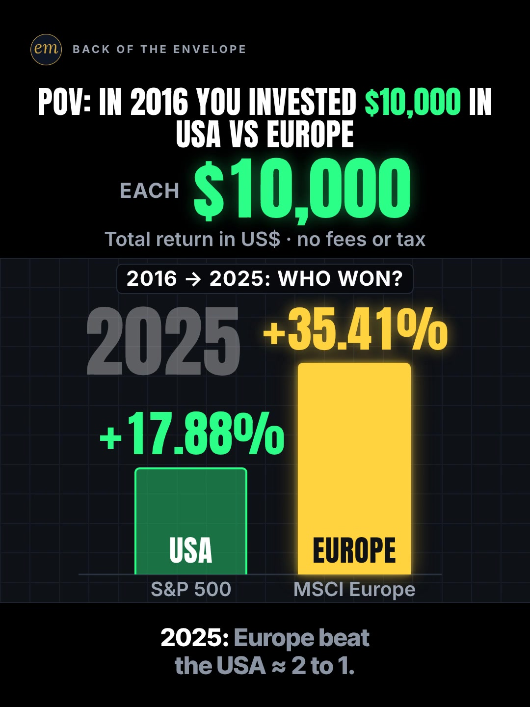

# 04c publishing sheet: $10,000 in the USA vs Europe since 2016

YouTube Shorts (@envelopemath) and Instagram Reels (@envelopemath). Prepared 2026-10-13. Machine-readable twin: `publishing/04c-scoreboard-usa-vs-europe.json`.

- **Video.** `renders/channel/04c-scoreboard-usa-vs-europe.mp4`: the pre-condense cut (39 s: a 36.5 s body + the 2.5 s card; sha256 `1a7f8c5e…`), the Scoreboard port (2026-10-08) as `renders/channel` holds it on 2026-10-13. A condensed cut is built in `studio/specs-wip/` and not yet shipped (timing only: the numbers, captions and verdict stay). Nothing below names a timestamp except the cover, which is picked by content (frame 1), so the copy carries over. The ship step rebuilds this sheet and re-exports both covers from the final file: `python3 publishing/tools/build_publishing.py 04c-scoreboard-usa-vs-europe --covers`.
- **Numbers.** Every figure comes from `teasers/v2/04-chart-race.md` (04c) and its check, `python3 teasers/v2/checks/04-chart-race.py`: 657 checks, 0 failed on `studio/specs/` and 698 checks, 0 failed with `--spec` on the three condensed cuts in `studio/specs-wip/` (run 2026-10-13), so the copy's figures hold on both cuts. `python3 publishing/tools/build_publishing.py 04c-scoreboard-usa-vs-europe --check` checks this sheet's limits, paste blocks and figures, recomputes every figure from the S&P 500 and MSCI Europe returns, keeps each figure with its own side (the USA or Europe) and each year's figure beside its year.
- **Honesty rules kept.** The title asks and never gives the decade's winner, and neither does the cover (frame 1 shows the hook's 2025 claim and the question). The Instagram caption's first 125 characters carry only that 2025 claim, which frame 1 shows, and the question. The copy names the basis wherever it gives the result: total return in US dollars (so Europe's line includes currency moves), MSCI Europe net vs the S&P 500 gross, no fees or personal tax. No advice, no urgency, and 'Not financial advice.' is in both.
- **Brand.** "S&P 500" and "MSCI Europe" name the two indexes the maths is about; both platforms' copy says 'Not affiliated with or endorsed by S&P Dow Jones Indices or MSCI.' The video has no flags or logos: the names are text only. No share price is named.

---

## YouTube Shorts

### Title (vidIQ title score, short-form, scored against this channel)

| # | Title | Score | Chars |
|---|---|---:|---:|
| 1 | What If You Invested $10,000 in the USA and Europe in 2016? Which One Won? | 97 | 74 |
| 2 | USA vs Europe Stocks: What Did $10,000 in Each Become Since 2016? | 92 | 65 |
| 3 | What If You Invested $10,000 in the USA and Europe in 2016? #USAvsEurope #sp500 #linechart | 90 | 90 |

**Pick (paste):**

```
What If You Invested $10,000 in the USA and Europe in 2016? Which One Won?
```

- 74 of 100 characters.
- It raises the write-up's title from 90 to 97. 'USA' and 'Europe' sit in the first 50 characters, as in ChartOrbit's title, which is itself among the searched 'what if you invested' phrasings.
- No winner in it: the decade's answer (the USA ≈ $39,800 vs Europe ≈ $22,700) is what the video pays off. The only figures are the stake and the start year, both on frame 1.
- The write-up's A/B title ('Europe Won 2025. Who Won the Decade?') scores 80 here; it leads the Instagram caption instead, where the first line overlays the Reel.
- 06b and 06c went up with the house 3-hashtag form in the title. To post this one that way, paste option 3 as it stands: its hashtags are the description's first three, as YouTube needs.
- Also scored, not used: "What If You Invested $10,000 in the USA and EUROPE in 2016?" 90 (the write-up's title, ChartOrbit's exact grammar, without the question); "Europe Beat the S&P 500 in 2025. What If You Invested $10,000 in Each in 2016?" 90 (the hook's claim first); "Europe Won 2025. What If You Invested $10,000 in the USA and Europe in 2016? Who Won the Decade?" 89 (both questions, 95 characters); "Europe Won 2025. Who Won the Decade?" 80 (the write-up's A/B title; it is also the Instagram caption's first line).

### Description (paste)

```
What if you invested $10,000 in the USA and $10,000 in Europe at the start of 2016? Europe won 2025, +35.41% to the USA's +17.88%. But over the decade the USA (the S&P 500) grew to about $39,800 and Europe (MSCI Europe) to about $22,700, total return in US dollars.

The math, shown:
• Each line is $10,000 grown by each year's total return in US dollars, compounded from the Dec 31, 2015 close.
• 2018: Europe −14.86%, the USA −4.38%.
• 2020: the USA has doubled your money ($20,305).
• Europe's best year-end before 2025 was $16,735, still under $17,000.
• 2025: Europe +35.41%, the USA +17.88%. Europe beat the USA ≈ 2 to 1 that year.
• End of 2025: the USA ≈ $39,800 (≈ ×3.98), Europe ≈ $22,700 (≈ ×2.27).
• Per year: the USA ≈ 14.8%, Europe ≈ 8.5%. The USA ≈ doubled twice, Europe once.
• Europe won 2025. The USA won the decade.

Follow for the math behind your money — shown, not hand-waved. @envelopemath

Animation and original sound: The Back of the Envelope. USA: S&P 500 total return by year (S&P Dow Jones Indices data via Slickcharts). Europe: MSCI Europe Index (USD), net total return by year (MSCI factsheet; YCharts). Both in US dollars, so Europe's line includes the euro and pound against the dollar. MSCI Europe is net of dividend withholding tax and the S&P 500 series is gross, a tilt of about 0.3 to 0.5 points a year toward the USA, far less than the gap. Bought at the Dec 31, 2015 close and valued at the Dec 31, 2025 close; no fund fees or personal tax. Not financial advice. Not affiliated with or endorsed by S&P Dow Jones Indices or MSCI.
#USAvsEurope #sp500 #linechart
```

1,599 of 5,000 characters (1,639 UTF-8 bytes; YouTube counts this limit in bytes, and `≈`, `×`, `•`, `—`, `−` take 2-3 each). No `<` or `>`, which YouTube rejects. It follows the house template: an answer-first opening line for the search snippet, then 'The math, shown:' bullets, then the follow line. The credit, assumptions and 'Not financial advice.' line comes next, and the 3 hashtags close it. The 'Doesn't Add Up' series line is left out, as on 06b and 06c: the verdict is a decade's total return in one currency, which the credit spells out, so 'a number that shouldn't be true' would oversell it. The verdict closes the bullets, in the video's own two lines.

### Hashtags (order matters)

1. `#USAvsEurope`: the rivalry. 'usa vs europe' is a big culture cluster on YouTube (8,000-9,400 a month for its top phrasings; 'europe vs usa income comparison' 8,566, +84.5%), and the write-up's country pair drew about 4× the comments per view; the tag puts the race in front of that crowd.
2. `#sp500`: the USA's index ('s&p 500' 95,512 a month), named on the hook's column.
3. `#linechart`: the write-up's YouTube note ('ChartOrbit's exact title grammar, plus #linechart'): the tail of the benchmark's winning era.

The title carries no hashtags, so YouTube shows these 3, the description's first, above the title. Over 60 hashtags and YouTube ignores all of them. `#Shorts` isn't needed.

### Tags (paste; 311 of 500 characters as YouTube counts them: commas count, and a tag with a space counts 2 more for the quotes YouTube adds)

```
usa vs europe, s&p 500 vs europe, european stocks, european stocks beating the s&p 500, msci europe, european stocks etf, what if you invested, what if you invested in stock 10 years ago, s&p 500, stock market, line chart race, money math, math animation, the back of the envelope, envelope math
```

Tags carry little weight. These mirror the keyword research plus the house's channel tags; 'european stocks beating the s&p 500' is the searched phrase 'european stocks being the s&p' (3,993 a month, competition 21.0) with its typo fixed, the belief the hook plants. Left out on purpose: 'european stocks to buy' (5,082) and 'best european stocks' (3,676) are advice intent; 'european defense stocks' (4,113) is a sector; 'european stocks vs us stocks', the seed, is under 750 a month.

### Pinned comment (post it, then pin it)

```
One great year isn't a great decade. Per year: the USA ≈ 14.8%, Europe ≈ 8.5%. Rule of 72: at those rates the USA doubles every ≈ 4.9 years, Europe every ≈ 8.5. Swap in your own amount: the USA ≈ ×3.98, Europe ≈ ×2.27. Next race: USA vs Japan, or USA vs China?

The basis: total return in US dollars, from the Dec 31, 2015 close to the Dec 31, 2025 close. USA = S&P 500. Europe = MSCI Europe (net), so its line includes the euro and pound against the dollar. No fund fees or personal tax.
```

The write-up's pinned comment, reworded so every rate and multiple sits after its own side. It turns the verdict into numbers a viewer can carry (the yearly rates, the rule of 72), gives the multiples for the viewer's own amount (R3) and ends on the next race, for the rivalry comments the write-up expects. The second paragraph answers the 'what about currency / dividends?' comments with the footer's basis, as the write-up's YouTube note asks.

### Related video and end screen

- **Related video:** [What If You Bought Netflix Stock Instead of Paying for Netflix?](https://www.youtube.com/shorts/krfZEHhb0xU) (`krfZEHhb0xU`). The same 'what if you invested' viewer and the same race-chart idea in 06b, the Scoreboard POV race, live since Mon 12 Oct 2026 (61 views by 13 Oct, posted midday): it can use the traffic.
- **Swap later:** 04a (S&P 500 vs gold), the other Scoreboard chart race, once published; then point 04a's Related video at this Short.
- **End screen:** Shorts have no end screens or cards. The Related video link is the Shorts equivalent.

### Thumbnail and settings

- **Thumbnail:** in the YouTube app, pick frame 1 (the 2025 columns, '+17.88%' USA vs '+35.41%' EUROPE lit, under '2016 → 2025: WHO WON?'), the same content as the Instagram cover below.
- **Settings:** Category Education. Not made for kids. Altered or synthetic content: No (it's an animated chart, not realistic footage). Remixing allowed. No captions needed: there's no narration and all the text is on screen.

### Posting window

- **When:** First Tue-Thu evening after the 04c condensed cut ships and passes QA, 21:30-22:30 ET (01:30-02:30 UTC the next day). Sunday 06:00-08:00 ET is the alternative.
- **Spacing:** Keep it at least 6 h from any other upload on the channel, post one chart race (04a, 04b, 04c) per evening, and keep the two Scoreboard races (04a, 04c) at least a day apart.
- **Why:** The channel's own October Shorts, median views by posting slot (vidIQ, 2026-10-13): Sunday 05:00-08:00 ET 1,198 (n = 2), weekday 22:00-00:30 ET 642 (n = 3), weekday midday 263 (n = 2). The evening slot is also the best one on Instagram, so one evening serves both, and an evening ET reaches Europe's next morning for the rivalry crowd. n = 7 and confounded by topic, so treat it as a test. Search demand: 'europe vs usa income comparison' is up 84.5% on its baseline; the market phrases are small and flat.

---

## Instagram Reels

### Caption (paste)

```
Europe won 2025. Who won the decade? What if you invested $10,000 in the USA and $10,000 in Europe in 2016?

POV: Jan 2016, $10,000 in each. USA = the S&P 500, Europe = MSCI Europe, both total return in US dollars, raced year by year to Dec 2025.

The math, shown:
• 2025: Europe +35.41%, the USA +17.88%. Europe beat the USA ≈ 2 to 1.
• 2018: Europe drops ≈ 15%.
• 2020: the USA has doubled your money.
• Europe's best year-end before 2025: $16,735, still under $17,000.
• End of 2025: the USA ≈ $39,800. Europe ≈ $22,700.
• Per year: the USA ≈ 14.8%, Europe ≈ 8.5%. The USA ≈ doubled twice, Europe once.

Europe won 2025. The USA won the decade.

Europe's line includes the euro and pound against the dollar. MSCI Europe is net of dividend withholding tax, a tilt of about 0.3 to 0.5 points a year toward the USA, far less than the gap. No fund fees or personal tax. Not financial advice. Not affiliated with or endorsed by S&P Dow Jones Indices or MSCI.

Next race: USA vs Japan, or USA vs China?

Follow for the math behind your money — shown, not hand-waved. @envelopemath
Animation and original sound: The Back of the Envelope.

#usavseurope #sp500 #europe #linechart #investing
```

- 1,184 of 2,200 characters.
- **First 125 characters:** the write-up's curiosity line, then the title's question. The figures are 2025 (the hook's year, on frame 1), the stake and the start year. The decade's finals and the verdict sit below 'more', where Instagram search and Google indexing still read them.
- The basis paragraph follows the verdict, so the decade's result is never quoted without its currency and net-vs-gross caveats.
- The caption follows the house close: the follow line plus the credit.

### Hashtags (5, Instagram's cap since Dec 2025)

`#usavseurope #sp500 #europe #linechart #investing`

Four are specific:

- `#usavseurope` is the rivalry, and `#europe` and `#sp500` the two sides (the write-up's caption tags `#europe #sp500`).
- `#linechart` is the format's tag, from the write-up's caption (`#linechart #investing #europe #sp500`).

`#investing`, from the write-up's caption, is the broad layer.

### Alt text

- **Short (91 characters; paste this one into Instagram):** Chart: $10,000 in the USA vs Europe, 2016 to 2025: USA about $39,800, Europe about $22,700.
  - It stays at or under 100 characters, so it fits the field however short it is. It says 'to' and 'about', not '-' and '≈', so screen readers read it cleanly. The long version carries 2025's result and the verdict.
- **Long (for anywhere with room, such as a website embed):** Animation on a black scoreboard. Header: POV: in 2016 you invested $10,000 in USA vs Europe. It opens on the 2025 result: Europe +35.41% and USA +17.88%, two columns to scale, about 2 to 1, under the question: who won from 2016 to 2025? Then two lines race from 2016 over a dashed $10,000 line. Europe drops about 15% in 2018; the USA doubles by 2020; Europe's best year-end before 2025 is still under $17,000. Europe jumps about 35% in 2025, then the USA finishes at about $39,800 and Europe at about $22,700. The USA about doubled twice, Europe once. Verdict: Europe won 2025. The USA won the decade.
- **Where:** Advanced settings → Accessibility → Alt text, if your app shows it for Reels.

### Cover



- **Files:** `publishing/04c-scoreboard-usa-vs-europe-cover-3x4.jpg` (1080×1440) and `publishing/04c-scoreboard-usa-vs-europe-cover-9x16.jpg` (1080×1920). Both come from the pre-condense (39 s) render at 0 s (frame 0).
- **Frame, by content:** Frame 1, which the write-up names as the Instagram cover: the header 'POV: IN 2016 YOU INVESTED $10,000 IN / USA VS EUROPE' with $10,000 the only accent, the hero 'EACH $10,000', the footer 'Total return in US$ · no fees or tax', the ask '2016 → 2025: WHO WON?', the dim 2025 clock, and the two 2025 columns to scale: '+17.88%' over the green USA bar and '+35.41%' over the lit yellow EUROPE bar, 'S&P 500' and 'MSCI Europe' under the floor, with the first caption '2025: Europe beat the USA ≈ 2 to 1.' It shows the hook's claim and asks the decade's question; the decade's answer is not on it. On any cut, use the first frame, while the two 2025 columns stand under the ask. On the pre-condense 39.0 s render, frame 0 (0.00 s) is that frame: the hook holds still from it (mean frame-to-frame luma change 0.0000-0.0001, 270×480 greyscale) until Europe's column bumps. If the cut changes, re-pick it by content.
- **Crop:** 3:4 = 1080×1440 from y 73 to 1513 of the 1080×1920 frame. The content runs from y 141 (the badge) to y 1445 (the caption's second line), so the crop centres it: badge, header, hero, footer, the ask, both columns with their index names and the caption; it drops the empty black floor. A centred grid crop (y 240-1680) loses the badge and leaves the header on the top edge.
- **How to set it:** In 'Edit cover', pick frame 1 of the video (or upload the 9:16 JPG), then drag 'Profile grid' to the top so the tile matches the 3:4 JPG. Do not upload the 3:4 JPG as the Reel cover: Instagram centre-crops it to 9:16 in the Reels tab and cuts the header.
- **Re-export:** `ffmpeg -ss 0 -i renders/channel/04c-scoreboard-usa-vs-europe.mp4 -frames:v 1 -vf "crop=1080:1440:0:73" -q:v 2 publishing/04c-scoreboard-usa-vs-europe-cover-3x4.jpg` and `ffmpeg -ss 0 -i renders/channel/04c-scoreboard-usa-vs-europe.mp4 -frames:v 1 -q:v 2 publishing/04c-scoreboard-usa-vs-europe-cover-9x16.jpg`, or `python3 publishing/tools/build_publishing.py 04c-scoreboard-usa-vs-europe --covers`.
- **Not used:** the climax ('USA ≈ $39,800' over both finished lines), which the write-up suggests testing against frame 1. It shows the decade's answer the title asks about; it is the A/B in Trial Reels below.
- **Condensed cut:** the ship step re-picks this frame by content on the final file (the first frame, the 2025 columns under the ask) and re-exports both JPGs with `--covers`.

### First comment (post it, then pin it)

```
Per year: the USA ≈ 14.8%, Europe ≈ 8.5%. Swap in your own amount: the USA ≈ ×3.98, Europe ≈ ×2.27. Next race: USA vs Japan, or USA vs China?
```

### Trial Reels

**Post as a regular Reel, not a Trial.** @envelopemath has 8 followers, so a regular Reel is already shown almost entirely to non-followers, which is all a Trial Reel adds. A Trial would also keep it off the profile grid until shared. The write-up's cover A/B afterwards, if you want it: the other cut with the climax frame ('USA ≈ $39,800') as its cover, as a Trial with MANUAL graduation 48-72 h later. Once the condensed cut ships, the pre-condense render is in git: `git show 471c793:renders/channel/04c-scoreboard-usa-vs-europe.mp4 > 04c-pre-condense.mp4` (sha256 1a7f8c5e…). Compare skip rate (October Reels ran 27.0-65.1%) and average watched %, then share the winner. vidIQ's publish tool exposes Trial (MANUAL or SS_PERFORMANCE) for this connected account. Confirm eligibility in the app.

### Posting window and settings

- **When:** Same evening as YouTube, about 15 min after the Short: 21:45-22:45 ET.
- **Why:** October Reels, median plays by posting slot (owner insights, 2026-10-13): weekday 22:00-00:30 ET 5,449 (n = 3, including the two best: 7,302 and 5,449), weekday midday 1,212 (n = 2), Sunday 05:00-08:00 ET 1,087 (n = 2). Skip rate tracks plays more closely than the hour does: 27.0-27.4% for the top two, 56.9-65.1% for the bottom two. The condense matters more than the hour.
- **Audio:** Rename the original audio to 'USA vs Europe since 2016 — The Back of the Envelope' if the app allows; it is the score, with no voice.
- **Share to feed:** On.

---

## Why these choices (research evidence)

**1. Search demand (vidIQ keyword research, pulled 2026-10-13).** vidIQ refreshes each keyword on its own schedule, so the last column gives each row's snapshot date. Nine rows are older snapshots.

| Keyword | Est. searches/month | Competition | Overall | Note | vidIQ as of |
|---|---:|---:|---:|---|---|
| stock market (topic) | 589,214 | 62.0 | 66.9 | +8.8% vs its 30-day baseline (541,592) | 2026-10-12 |
| s&p 500 (topic) | 95,512 | 63.1 | 59.4 | -33.1% vs its baseline (142,756) | 2026-10-12 |
| usa vs europe language comparison | 9,386 | 40.0 | 59.6 | the 'usa vs europe' cluster is culture, not markets | 2026-07-20 |
| europe vs usa income comparison | 8,566 | 35.4 | 61.1 | +84.5% vs its baseline (4,642): the money side of the rivalry | 2026-05-27 |
| i simulated the usa vs europe | 8,156 | 13.1 | 69.8 | a searched video title, competition 13.1 | 2026-05-10 |
| spending power usa vs europe | 5,267 | 38.0 | 58.1 |  | 2026-03-06 |
| europe vs usa shorts | 5,217 | 37.0 | 58.5 |  | 2026-02-25 |
| european stocks to buy | 5,082 | 34.2 | 59.5 | advice intent, not a tag | 2026-05-20 |
| what if you invested $10,000 in 10 years ago | 5,025 | 34.6 | 59.3 | the stake and the window | 2026-10-12 |
| what if you invested in stock 10 years ago | 4,615 | 35.6 | 58.6 | the window | 2026-10-12 |
| european stocks etf | 4,275 | 22.2 | 63.6 | low competition; product intent | 2026-05-20 |
| european defense stocks | 4,113 | 14.4 | 66.6 | a sector, not a tag | 2026-10-12 |
| european stocks being the s&p | 3,993 | 21.0 | 63.9 | sic ('beating'): the belief the hook plants, searched | 2026-04-15 |
| best european stocks | 3,676 | 32.4 | 59.0 | advice intent, not a tag | 2026-10-04 |
| european stocks vs us stocks | 0 (<750) | 37.7 | 24.9 | <750/month: the seed, too small to target | no snapshot |

The market phrases are small: 'european stocks vs us stocks' is under 750 a month, and the European-stock phrases sit at 3,300-5,100, mostly advice. The searched belief 'european stocks being the s&p' (3,993, competition 21.0) is the hook's wrong answer. The reach is in the rivalry: 'usa vs europe' phrasings run 5,200-9,400 a month on culture topics, and 'europe vs usa income comparison' is up 84.5%. So the title keeps ChartOrbit's 'USA and EUROPE' grammar and the hashtag names the rivalry.

**2. The race is ChartOrbit's 345x winner; since then the USA-vs-Europe Shorts are small (vidIQ YouTube search, under 4 min, since 2025).**

| Title | Channel (subs) | Views | Date |
|---|---|---:|---|
| 💴What If You Invested $5,000 in USA and EUROPE? #linechart  #datavisualization | ChartOrbit (15,400) | 2,808,312 | 2025-10-26 |
| $10K in 2005: USA vs EUROPE | PatiencePays (102) | 1,638 | 2025-12-20 |
| What If You Invested £10,000 Into the S&P 500 14 Years Ago? | Your Money Mate (6,820) | 1,528 | 2026-05-27 |
| What If You Invested $50/Month in Europe Instead of the US? | CalculatorInvest (10) | 179 | 2026-04-01 |
| S&P 500 or the Whole World? For UK Investors #Shorts | Boring Bill (76) | 38 | 2026-10-02 |
| Without AI, The U.S. Stock Market Is Actually Losing to Europe! | W Investors (0) | 1 | 2026-10-12 |

The exact race is ChartOrbit's 'What If You Invested $5,000 in USA and EUROPE?' (2,808,312 views, re-pulled; 345.09x in the write-up), from 2008. The USA-vs-Europe Shorts found since are small (1-1,638 views) and state their angle in the title ('$10K in 2005: USA vs EUROPE', 'Without AI, The U.S. Stock Market Is Actually Losing to Europe!'). None opens on 2025's Europe win and asks about the decade, which is this Short's hook, so the pick keeps the benchmark's question and adds 'Which One Won?'.

Next door, fincrisper's 'S&P 500 vs. Nasdaq 100: 100 $/month invested since 2005 🚀' (71,887 views on 104 subscribers, outlier score 519.0) shows a two-index race can travel from a small channel, and ChartOrbit's 'What If You Invested $5,000 in USA and CHINA?' (1,068,787) shows the country pairs do.

**3. Line races travel on Instagram and TikTok; no USA-vs-Europe one has yet (vidIQ IG/TikTok outlier search, since Oct 2025).**

- **@alanintelligence** (Instagram), "Sell when it drops? Sell US stocks when they drop below the 200-day SMA": 479.5K (123.6x). A two-line race on black, music only.
- **@race_charts** (Instagram), "SMOKING A PACK OF MARLBORO A DAY VS BUYING THE STOCK INSTEAD": 1.6M (60.9x). **@data.dragonn** (TikTok), "POV: Someone invested $100 every month in the GoPro Stock over the last 12 years": 1.4M (49.6x).
- **@getinfinityinsights** (Instagram), "WHAT IF YOU WERE THE LUCKIEST INVESTOR ALIVE? S&P 500, SEVEN CRASHES": 74.7K (16.0x). The question on frame 1 over the line.
- All four open on the premise or the question, with no final on frame 1, which is what this Reel's cover and caption do. A concept search for a USA-vs-Europe market Reel or TikTok since Oct 2025 found none.

**4. Our own October numbers (vidIQ: public YouTube stats, Instagram owner insights; pulled 2026-10-13).**

| YouTube Short | Posted (ET) | Views |
|---|---|---:|
| Can You Find the Missing Dollar? (`LjHDFzVxRyM`) | Sun 07:04 | 1,254 |
| You Can Lean on $1 Million. Not on $1 Billion. (`hJBvmGA6sZ0`) | Thu 00:25 | 1,221 |
| Your Interest Has a Speed Limit (`XVUeMcTg9OQ`) | Sun 05:49 | 1,141 |
| What If You Bought Starbucks Stock Instead of a $4 Latte Every Day? (06c) (`fbpdKf4Wy8c`) | Mon 03:45 | 760 |
| Pay the Minimum on $5,000? 238 Months. (`8__HTUa2PoU`) | Mon 22:09 | 642 |
| A $2 Lottery Ticket Was Worth $6.98. Until the Fine Print. (`FW_oxA3kbsM`) | Wed 12:03 | 348 |
| You Can Carry $1 Million. Not in Pennies. (`mXbKY_R63h4`) | Thu 13:38 | 177 |
| Start Investing 10 Years Late? You Get Half. (`EqFQCJheCMU`) | Tue 22:27 | 161 |
| What If You Bought Netflix Stock Instead of Paying for Netflix? (06b) (`krfZEHhb0xU`) | Mon 12:14 | 61 |

| Instagram Reel | Posted (ET) | Plays | Skip rate | Avg watched |
|---|---|---:|---:|---:|
| $5,000 on the minimum (`DeIvYk7I4Qr`) | Mon 22:46 | 7,302 | 27.4% | 56.5% |
| $1M stack vs Burj Khalifa (`DeOEthJJ1TG`) | Thu 00:28 | 5,449 | 27.0% | 83.1% |
| Missing dollar (`DeWgFZRoR_S`) | Sun 07:05 | 1,997 | 32.0% | 81.3% |
| Powerball $6.98 (`DeMvZv9IqRw`) | Wed 12:05 | 1,825 | 58.7% | 57.9% |
| 06c latte vs Starbucks stock (`DeYuqT4pjVC`) | Mon 03:46 | 1,711 | 40.3% | 69.1% |
| $1M in pennies (`DePe11HIHwn`) | Thu 13:37 | 598 | 42.0% | 66.7% |
| 10 years late (`DeLSd9io8UK`) | Tue 22:30 | 219 | 65.1% | 30.6% |
| Speed limit (e) (`DeEW2ZMIiYd`) | Sun 05:54 | 177 | 56.9% | 31.2% |

Channel totals:

- **YouTube:** 53 subscribers, 10,221 views and 41 videos (+27 subscribers, +5,127 views and 11 videos in 30 days).
- **Instagram:** 8 followers and 20,518 views in 30 days.

06b went up on both platforms on Mon 12 Oct at 12:14 ET, midday: 61 views on YouTube by 13 Oct, and its Reel's insights are not in yet (Instagram lags). It is left out of the medians, as is 06c (760 views, 1,711 plays, 40.3% skip), both too young.

Medians by posting slot (n = 2-3 each, confounded by topic):

- **YouTube:** Sunday early morning ET 1,198, weekday 22:00-00:30 ET 642, weekday midday 263.
- **Instagram:** weekday 22:00-00:30 ET 5,449, midday 1,212, Sunday early morning 1,087.

The channel has no country race yet. Its best Reels are comparisons that land on one picture ('$1M stack vs Burj Khalifa': 27.0% skip, 83.1% watched), which is what this Reel's frame 1 does with the two 2025 columns.

**5. Platform rules applied.**

- **YouTube title:** 100 characters. The Shorts player shows only the opening, so the keywords come first.
- **YouTube description:** 5,000 characters.
- **YouTube hashtags:** the first 3 show; over 60 and all are ignored; `#Shorts` isn't needed.
- **YouTube tags:** 500 characters, low weight.
- **YouTube Shorts:** no end screens. The Related video link is the Shorts equivalent.
- **YouTube AI disclosure:** only for realistic altered content.
- **Instagram caption:** 2,200 characters, about 125 shown before 'more'.
- **Instagram hashtags:** 5 at most.
- **Instagram search and Google:** keywords in the caption feed Instagram search, and Google indexes public professional posts (since 10 Jul 2025).
- **Instagram grid:** a 3:4 crop of the 9:16 cover.
- **Trial Reels:** shown to non-followers only.

**6. Limits.**

- As the 06b and 02b sheets found (not re-checked here), vidIQ's YouTube authorization is a different channel (UCRC5v_El2fibbkqsZs6uFjA), so @envelopemath's YouTube Analytics (audience hours, geography) were not readable. Check Studio → Analytics → Audience → 'When your viewers are on YouTube' before posting.
- vidIQ has no hashtag-volume data; hashtag picks lean on keyword volume, the write-up's notes and the same-idea Shorts' own tags.
- Title scores are vidIQ's short-form CTR model for this channel; they rank options but do not predict views.
- The render in renders/channel is the pre-condense cut. The cover's time and frame are measured on it; the copy names no other timestamp, and the ship step re-picks the cover on the final file.
- The write-up's caveat that a 2012 start widens the gap (≈ ×7.1 vs ≈ ×3.1) is not in the 04 check, so the copy does not use it.
- The vidIQ credit balance is shared with the other sheets being built in parallel, so this sheet's spend is counted from each tool's listed cost (see research.vidiq_credits).

---

## Check log (first build and adversarial pass, 2026-10-13)

- **Maths.** `python3 teasers/v2/checks/04-chart-race.py`: 657 checks, 0 failed on `studio/specs/` and 698 checks, 0 failed with `--spec` on the three condensed cuts in `studio/specs-wip/`. Every public figure traces to the 04c year-end table: 2025 +35.41% vs +17.88% (ratio 1.98, ≈ 2 to 1); 2018 −14.86% / −4.38%; 2020 $20,305 (doubled); Europe's best pre-2025 year-end $16,735; finals ≈ $39,800 (≈ ×3.98) and ≈ $22,700 (≈ ×2.27); ≈ 14.8% vs ≈ 8.5% a year; log2 1.994 (≈ twice) and 1.18 (once); rule of 72 ≈ 4.9 and ≈ 8.5 years. The data file recomputes each from the returns.
- **Limits.** Title 74/100. Description 1,599 characters (1,639 bytes) of 5,000. 3 hashtags. Tags 311/500 as YouTube counts them. Instagram caption 1,184/2,200, with the first 125 characters result-free. 5 hashtags. Short alt text 91. No `<` or `>`.
- **vidIQ.** Keywords pulled 2026-10-13 (table above). 6 titles scored against this channel: the pick 97, the write-up's title 90, its A/B title 80. Channel 53 subscribers / 10,221 views / 41 videos; Instagram owner insights refreshed (8 followers, 20,518 views in 30 days).
- **vidIQ re-queried.** At the adversarial check: the pick's title score 97; 'european stocks vs us stocks' under 750 a month (competition 37.7, overall 24.9: the first pull returned none); 'stock market' 589,214 (+8.8%); ChartOrbit's USA and EUROPE 2,808,312 (10,937 likes, 1,219 comments), USA and CHINA 1,068,787; 06b, the related video, 75 views (61 at the build). All match.
- **Changed.**
  - The math run said 614 checks, 0 failed: the condense updated the check script since, and it now runs 657 checks, 0 failed on `studio/specs/` and 698 checks, 0 failed with `--spec` on the condensed cuts. The 04c key lines the builder looks for are the cut-independent ones (the finals, rates and doublings, Europe's year-ends under $17,000), so the check keeps passing when the condensed cut is promoted.
  - Title option 3 is now the paste-ready hashtag form, '… in 2016? #USAvsEurope #sp500 #linechart' (vidIQ 90, the same as the write-up's title, which moved to 'also scored'): 06b and 06c went up with hashtag titles, and the sheet had none.
  - The pinned comment's rule of 72 read as a forecast ('the USA doubles every ≈ 4.9 years'); it now says 'at those rates', the decade's own rates.
  - `#sp500` was 'the tag the same-idea Shorts use': none of the 6 same-idea titles carries it. The note now says it names the USA's index, as the hook's column does.
  - The description note listed its 2-3-byte characters without the minus sign (−, 3 bytes) the description uses; `DESC_MULTIBYTE` now lists it.
  - The seed keyword row had no competition score; the re-pull gives 37.7 (overall 24.9).
- **Checked.**
  - Platform limits: title 74/100 with no hashtags (the description's first three show above it), description under 5,000 bytes, tags under 500, caption under 2,200 with 5 hashtags, short alt text 91.
  - The cover JPGs (read by eye) show frame 1: the two 2025 columns, '+17.88%' USA and '+35.41%' EUROPE lit, the ask '2016 → 2025: WHO WON?', the first caption; no decade result. The write-up's condensed beat sheet keeps that picture on frame 1 (the bump starts on frame 2).
  - The caption's first 125 characters carry 'Europe won 2025', the hook's claim on frame 1 and the write-up's caption line 1; the decade's result is below 'more'.
  - The pre-condense render in git (`471c793`) has the same sha256 as `renders/channel` today (`1a7f8c5e…`), so the Trial Reels `git show` command fetches this file.
  - Brand: 'S&P 500' and 'MSCI Europe' are named only as the indexes the maths uses; 'Not affiliated with or endorsed by S&P Dow Jones Indices or MSCI.' is in the description and the caption. No flags or logos.
- **Mutation test.** Five mutations of a scratch copy each fail by name: the two finals swapped between the USA and Europe, Europe's 2018 drop moved to 2020, the net-of-tax basis cut from the caption, the decade's result in the caption's first 125 characters, and the affiliation line cut. At the adversarial check, 2 more on scratch copies also fail by name: a bare 4.9 in the pinned comment, and '2 to 1' without its '≈' in the caption. The files on disk were not touched.
- **Generator.** Unchanged. The 04 check already prints the builder's 'N checks, F failed' line, so `MATH_SCRIPT` runs it directly.
- **Kept on purpose.**
  - 'Europe won 2025' is in the Instagram caption's first line: it is the hook's claim on frame 1, not the payoff; the decade's result stays below 'more'.
  - The basis (US dollars, net vs gross, no fees) sits in every long item, since the decade's gap is the claim the comments will test.
  - `#USAvsEurope` leads the YouTube hashtags for the rivalry crowd; the market phrases are too small to lead.
