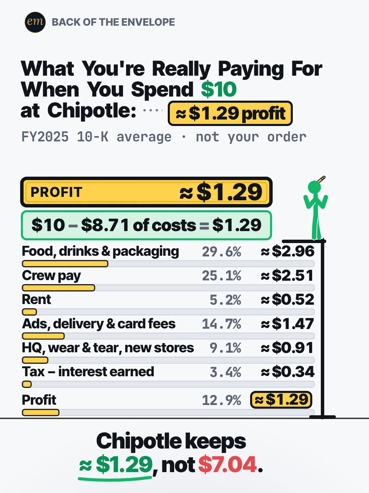

# 05a publishing sheet: what your $10 at Chipotle pays for

YouTube Shorts (@envelopemath) and Instagram Reels (@envelopemath). Prepared 2026-10-13. Machine-readable twin: `publishing/05a-becker-rig-chipotle-10.json`.

- **Video.** `renders/channel/05a-becker-rig-chipotle-10.mp4`: the pre-condense cut (27.2 s: a 24.7 s body + the 2.5 s card; sha256 `693b20b6…`). The 05 condense is in progress in parallel (timing only: the numbers, the captions' facts and the verdict stay). Nothing below names a timestamp except the cover, which is picked by content (the finished sheet), so the copy carries over to the condensed cut unchanged. The ship step rebuilds this sheet and re-exports both covers from the final file: `python3 publishing/tools/build_publishing.py 05a-becker-rig-chipotle-10 --covers`.
- **Numbers.** Every figure comes from `teasers/v2/05-split-sheet.md` (05a) and its check, `python3 teasers/v2/checks/05-split-sheet.py`: 560 checks, 0 failed on `studio/specs/` (run 2026-10-13; 583 checks, 0 failed with `--spec` on the condensed WIP specs, whose strings, numbers and verdicts are unchanged). `python3 publishing/tools/build_publishing.py 05a-becker-rig-chipotle-10 --check` checks this sheet's limits, paste blocks and figures, recomputes all 7 lines from Chipotle's FY2025 dollar lines, keeps every rounded amount 'about' or '≈' (the exact check line excepted), and never lets the $7.04 guess stand as a claim.
- **Honesty rules kept.** The title asks and never gives the result, and the YouTube thumbnail is frame 1 (the guess, no answer). The Instagram caption keeps every result below 'more'. The Instagram cover is the finished sheet, as the write-up's Instagram note asks (as on 06c and 03a). Every claim stays inside the video's verdict, "Chipotle keeps ≈ $1.29, not $7.04", and the copy says its condition: a company-wide average of Chipotle's 2025 revenue, not your order. No advice, no urgency, and 'Not financial advice.' is in both.
- **Brand.** "Chipotle" is used only to name the company whose 10-K the maths reads. Both platforms' copy says 'Not affiliated with or endorsed by Chipotle.' The video has no logo and no store footage: the name is text only. No share price is named anywhere.

---

## YouTube Shorts

### Title (vidIQ title score, short-form, scored against this channel)

| # | Title | Score | Chars |
|---|---|---:|---:|
| 1 | Where Does Your $10 Actually Go at Chipotle? How Much Is Profit? | 94 | 64 |
| 2 | How Much Profit Does Chipotle Make on Your $10 Order? | 93 | 53 |
| 3 | Does Chipotle Really Keep $7 of Your $10? | 92 | 41 |

**Pick (paste):**

```
Where Does Your $10 Actually Go at Chipotle? How Much Is Profit?
```

- 64 of 100 characters.
- It raises the write-up's title from 82 to 94. 'Where does your $10 go' is the sheet itself (every line of the $10, not only the profit), and 'Actually' is the write-up's R5 doubt cue ('Really' on screen). 'Chipotle' (72,674 searches a month, +24.0%) sits inside the first 44 characters.
- It names no result: no line, no profit figure and not the $7.04 guess. The second question promises the payoff the video lands last.
- Options 1-3 sit within 2 points (94, 93, 92); vidIQ's model ranks titles but does not predict views, so the pick is decided on what shows first and on asking for the whole sheet.
- Also scored, not used: "Where Does Your $10 Actually Go at Chipotle?" 93 (the pick's first question alone); "How Much Profit Does Chipotle Really Make on Your $10 Order?" 93 ('Really' adds nothing here); "How Much Profit Does Chipotle Make on Your $10 Order? #chipotle #businessmath #moneymath" 93 (the house 3-hashtag form); "What You're Really Paying For When You Spend $10 at Chipotle" 90 (the on-screen header); "What's the Profit Margin on a $10 Chipotle Order?" 90 (Earning Earth's '$5 Lemonade' grammar); "What's Chipotle's Real Profit on a $10 Order?" 87; "Chipotle Keeps How Much of Your $10?" 82 (the write-up's title).

### Description (paste)

```
Where does your $10 actually go at Chipotle? Food, drinks and packaging take about $2.96 and the crew about $2.51. After rent, ads, delivery and card fees, HQ, and tax (minus the interest it earns), Chipotle keeps about $1.29. Nowhere near $7.

The math, shown (each line's share of Chipotle's 2025 revenue, applied to $10):
• Food, drinks & packaging: 29.6%, about $2.96. So Chipotle keeps $10 − $2.96 = $7.04? Not even close.
• Crew pay: 25.1%, about $2.51.
• Rent: 5.2%, about $0.52.
• Ads, delivery & card fees: 14.7%, about $1.47.
• HQ, wear & tear, new stores: 9.1%, about $0.91.
• Tax minus the interest Chipotle earns: 3.4%, about $0.34 (the tax alone would be about $0.40).
• Profit: 12.9%, about $1.29. Check: $10 − $8.71 of costs = $1.29.
• The crew gets almost twice what Chipotle keeps.

Follow for the math behind your money — shown, not hand-waved. @envelopemath

Animation and original sound: The Back of the Envelope. Each line is that cost's share of Chipotle's 2025 revenue ($11.9 billion; FY2025 Form 10-K and Q4 2025 results, Feb 3, 2026), applied to $10: a company-wide average, not your order. Rent is occupancy; ads, delivery & card fees are other operating costs (marketing, delivery service fees, credit card fees, utilities, maintenance, restaurant technology); HQ, wear & tear, new stores is G&A, depreciation, pre-opening costs and impairment. Not financial advice. Not affiliated with or endorsed by Chipotle.
#Chipotle #ProfitMargin #FastFood
```

1,473 of 5,000 characters (1,495 UTF-8 bytes; YouTube counts this limit in bytes, and `•`, `−`, `—` take 2-3 each). No `<` or `>`, which YouTube rejects. It follows the house template: an answer-first opening line for the search snippet, then 'The math, shown:' bullets, then the follow line. The credit, assumptions and 'Not financial advice.' line comes next, and the 3 hashtags close it. The opening line is the title's question with the write-up's caption answer, for the search snippet. The 'Doesn't Add Up' series line is left out, as on 06b, 06c and 03a.

### Hashtags (order matters)

1. `#Chipotle`: the brand ('chipotle' 72,674 searches a month, +24.0% on its 30-day baseline).
2. `#ProfitMargin`: what the sheet measures ('restaurant profit margin' 4,250 a month); the phrase of the 21.8M-view '$5 Lemonade' Short.
3. `#FastFood`: the broad category ('fast food' 141,454 a month, down 20.8% on its baseline but by far the biggest food-business phrase).

The title carries no hashtags, so YouTube shows these 3, the description's first, above the title. Over 60 hashtags and YouTube ignores all of them. `#Shorts` isn't needed.

### Tags (paste; 263 of 500 characters as YouTube counts them: commas count, and a tag with a space counts 2 more for the quotes YouTube adds)

```
chipotle, chipotle profit, how much profit does a restaurant make, restaurant profit margin, profit margin, chipotle mexican grill, fast food, restaurant business, business explained, money math, math animation, the back of the envelope, envelope math
```

Tags carry little weight. These mirror the keyword research plus the house's channel tags; 'chipotle profit' is under 750 a month but names the video exactly. Left out on purpose: 'chipotle order' (8,938, +157.4%) and 'best chipotle order' (9,283) are ordering intent, 'why chipotle collapsed' (7,289) is a different story, and 'chipotle price increase' (4,225) is price-hike news the video does not cover.

### Pinned comment (post it, then pin it)

```
Which chain's $10 next?

The working, FY2025 ($ thousands): revenue 11,925,601. Food, beverage & packaging 3,527,043 (29.58%) · labor 2,991,680 (25.09%) · occupancy 624,898 (5.24%) · other operating costs 1,755,824 (14.72%) · G&A + depreciation + pre-opening + impairment 1,090,358 (9.14%) · income tax 473,758 minus interest and other income 73,721 = 400,037 (3.35%) · net income 1,535,761 (12.88%).
```

The question comes first so it shows in the collapsed preview: it is the write-up's own pinned ask, and it feeds reply videos (the write-up cites a reply sticker at 127.3x, H50). The second paragraph is the write-up's exact table, for the commenters who check the shares; it answers 'where is tax?' and 'what is HQ?' before they are asked.

### Related video and end screen

- **Related video:** [Can You Find the Missing Dollar?](https://www.youtube.com/shorts/LjHDFzVxRyM) (`LjHDFzVxRyM`). The same question, where did the money go, to the cent. It is the channel's best Short on YouTube (1,256 views) and holds 81.3% on Instagram.
- **Swap later:** 05c (follow your $100 Costco cart), the same split-sheet series, once published. Then point 05c's Related video at this Short.
- **End screen:** Shorts have no end screens or cards. The Related video link is the Shorts equivalent.

### Thumbnail and settings

- **Thumbnail:** in the YouTube app, pick frame 1, the write-up's YouTube cover: the red '$7.04 profit?' guess in the header, the $10.00 slab with the figure on it, and the sheet with every share but profit's '?'. It asks without answering. On the condensed cut frame 1 also carries the complete hook caption ('Food: ≈ $2.96 of your $10. So Chipotle keeps $7.04?'), as the write-up's condense rule asks. The Instagram cover below is the finished sheet, as the write-up asks.
- **Settings:** Category Education. Not made for kids. Altered or synthetic content: No (it's an animated chart, not realistic footage). Remixing allowed. No captions needed: there's no narration and all the text is on screen.

### Posting window

- **When:** First free Tue-Thu evening after the condensed cut ships and passes QA, 21:30-22:30 ET (01:30-02:30 UTC the next day). Sunday 06:00-08:00 ET is the alternative.
- **Spacing:** Keep it at least 6 h from any other upload on the channel, and on a different evening from 05b and 05c. Suggested order within the series: 05c, then 05b, then 05a.
- **Why:** The channel's own October Shorts, median views by posting slot (vidIQ, 2026-10-13): Sunday 05:00-08:00 ET 1,199 (n = 2), weekday 22:00-00:30 ET 642 (n = 3), weekday midday 263 (n = 2); 06c (Mon 03:45 ET) has 760 and 06b (Mon 12:14 ET) 61, too young to compare. The evening slot is also the best one on Instagram, so one evening serves both. n = 7 and confounded by topic, so treat it as a test. 05a goes last of the three: 'chipotle' runs +24.0% over its 30-day baseline, but the question is evergreen (the FY2025 10-K stands until Feb 2027), while 05c's Costco factoid is circulating right now.

---

## Instagram Reels

### Caption (paste)

```
Where does your $10 actually go at Chipotle? Food, crew pay, rent, fees, HQ and tax all take their cut before anything is left as profit.

Nowhere near $7.

The math, shown (each line's share of Chipotle's 2025 revenue, applied to $10):
• Food, drinks & packaging: about $2.96. So Chipotle keeps $10 − $2.96 = $7.04? Not even close.
• Crew pay: about $2.51.
• Rent: about $0.52.
• Ads, delivery & card fees: about $1.47.
• HQ, wear & tear, new stores: about $0.91.
• Tax minus the interest Chipotle earns: about $0.34.
• Profit: about $1.29. The crew gets almost twice that.
• Check: $10 − $8.71 of costs = $1.29.

A company-wide average from Chipotle's FY2025 10-K and Q4 2025 results (Feb 3, 2026), not your order. Not financial advice. Not affiliated with or endorsed by Chipotle.

Which chain's $10 next?

Follow for the math behind your money — shown, not hand-waved. @envelopemath
Animation and original sound: The Back of the Envelope.

#chipotle #fastfood #profitmargin #businessmath #personalfinance
```

- 1,008 of 2,200 characters.
- **First 125 characters:** the title's question and the cost lines the sheet walks, with no figure but the $10 stake. The write-up's caption line 1 is the verdict ('Nowhere near $7.'); the house rule moves it below 'more', because the caption overlays the Reel from frame 1. The numbers sit below the fold, where Instagram search and Google indexing still read them.
- The $7.04 guess appears once, as the video's own question with its working ($10 − $2.96), and is answered on the same line ('Not even close').
- The average line (FY2025 10-K, not your order) sits right under the math, and the closing question is the write-up's pinned ask. The caption follows the house close: the follow line plus the credit.

### Hashtags (5, Instagram's cap since Dec 2025)

`#chipotle #fastfood #profitmargin #businessmath #personalfinance`

Two are the write-up's own (`#chipotle #businessmath`; its `#backoftheenvelope` repeats the handle and `#moneymath` gives way to the broad layer):

- `#chipotle` names the brand, `#fastfood` the category (141,454 YouTube searches a month) and `#profitmargin` what the sheet measures.
- `#businessmath` says what kind of video it is: the cost breakdown, not a food review.

`#personalfinance` is the broad layer, as on 06b, 06c and 03a.

### Alt text

- **Short (82 characters; paste this one into Instagram):** Chart: where $10 at Chipotle goes, line by line. Profit is about $1.29, not $7.04.
  - It stays at or under 100 characters, so it fits the field however short it is. It says 'about', not '≈', so screen readers read it cleanly, and it keeps the verdict with its 'about'.
- **Long (for anywhere with room, such as a website embed):** Animation on a white background. The header asks what you're really paying for when you spend $10 at Chipotle, with a red guess beside it: $7.04 profit? A stick figure stands on a gold $10.00 slab and saws it into 7 pieces, a piece per cost line, each dropping into its row: food, drinks and packaging about $2.96, crew pay about $2.51, rent about $0.52, ads, delivery and card fees about $1.47, HQ, wear and tear and new stores about $0.91, and tax minus interest earned about $0.34. The last piece, profit, drops out from under him: about $1.29, stamped on a gold slab, with the check $10 − $8.71 of costs = $1.29. Verdict: Chipotle keeps about $1.29, not $7.04.
- **Where:** Advanced settings → Accessibility → Alt text, if your app shows it for Reels.

### Cover



- **Files:** `publishing/05a-becker-rig-chipotle-10-cover-3x4.jpg` (1080×1440) and `publishing/05a-becker-rig-chipotle-10-cover-9x16.jpg` (1080×1920). Both come from the pre-condense (27.2 s) render at 23 s (frame 690).
- **Frame, by content:** The finished sheet: the header reading '…at Chipotle: ≈ $1.29 profit' (the answer stamped over the struck guess), the gold 'PROFIT ≈ $1.29' slab, the check '$10 − $8.71 of costs = $1.29', all 7 rows with their shares and dollars over the lanes' bar chart of the $10, the figure on the bracket, and the verdict 'Chipotle keeps ≈ $1.29, not $7.04.' The write-up names it as the Instagram cover, a save-able cheat sheet like Yannick's finished sheet. On any cut, use a frame after the last stamp settles and before the end card. On the pre-condense 27.2 s render the sheet settles by frame 654 (21.80 s) and holds still (frame-to-frame mean luma change 0.0000) until the end card cuts in at frame 742 (24.73 s). Frame 690 (23.00 s), the middle of the hold, is used. If the cut changes, re-pick it by content.
- **Crop:** 3:4 = 1080×1440 from y 78 to 1518 of the 1080×1920 frame: the badge, the header with its answer, the footer, the PROFIT slab, the check, the 7 rows and the verdict, with even margins (34 px above the badge and below the verdict); it drops the empty floor. A centred grid crop (y 240-1680) cuts the badge and the header.
- **How to set it:** In 'Edit cover', pick the finished-sheet frame from the video (or upload the 9:16 JPG), then drag 'Profile grid' up so the tile matches the 3:4 JPG. Do not upload the 3:4 JPG as the Reel cover: Instagram centre-crops it to 9:16 in the Reels tab and cuts the header.
- **Re-export:** `ffmpeg -ss 23.0 -i renders/channel/05a-becker-rig-chipotle-10.mp4 -frames:v 1 -vf "crop=1080:1440:0:78" -q:v 2 publishing/05a-becker-rig-chipotle-10-cover-3x4.jpg` and `ffmpeg -ss 23.0 -i renders/channel/05a-becker-rig-chipotle-10.mp4 -frames:v 1 -q:v 2 publishing/05a-becker-rig-chipotle-10-cover-9x16.jpg`, or `python3 publishing/tools/build_publishing.py 05a-becker-rig-chipotle-10 --covers`.
- **Not used on Instagram:** frame 1 (the red '$7.04 profit?' guess, the $10.00 slab, every share but profit's '?'). It asks without answering, so it is the YouTube thumbnail, as the write-up's YouTube note asks; on Instagram the write-up picks the finished sheet, the frame worth saving.
- **When the condensed cut ships:** re-pick the finished sheet by content on the shipped file (a frame after the last stamp settles, before the end card) and re-export both JPGs with `--covers`.

### First comment (post it, then pin it)

```
Of your $10: food about $2.96, crew about $2.51, rent about $0.52, ads, delivery & card fees about $1.47, HQ about $0.91, tax minus interest about $0.34, profit about $1.29. A 2025 company-wide average, not your order. Which chain's $10 next?

The working, FY2025 ($ thousands): revenue 11,925,601. Food, beverage & packaging 3,527,043 (29.58%) · labor 2,991,680 (25.09%) · occupancy 624,898 (5.24%) · other operating costs 1,755,824 (14.72%) · G&A + depreciation + pre-opening + impairment 1,090,358 (9.14%) · income tax 473,758 minus interest and other income 73,721 = 400,037 (3.35%) · net income 1,535,761 (12.88%).
```

### Trial Reels

**Post as a regular Reel, not a Trial.** @envelopemath has 8 followers, so a regular Reel is already shown almost entirely to non-followers, which is all a Trial Reel adds. A Trial would also keep it off the profile grid until shared. A hook test afterwards, if you want one: the other cut as a Trial with MANUAL graduation 48-72 h later. Once the condensed cut replaces this render in renders/channel, get the pre-condense one from git with `git show 471c793:renders/channel/05a-becker-rig-chipotle-10.mp4 > 05a-27.2s.mp4` (sha256 693b20b6…). Compare skip rate (October Reels ran 27.0-65.1%; 06c's condensed cut 40.3%) and average watched %, then share the winner. vidIQ's publish tool exposes Trial (MANUAL or SS_PERFORMANCE) for this connected account. Confirm eligibility in the app.

### Posting window and settings

- **When:** Same evening as YouTube, about 15 min after the Short: 21:45-22:45 ET, on a different evening from 05b and 05c.
- **Why:** October Reels, median plays by posting slot (owner insights, 2026-10-13): weekday 22:00-00:30 ET 5,449 (n = 3, including the two best: 7,302 and 5,449), weekday midday 1,212 (n = 2), Sunday 05:00-08:00 ET 1,087 (n = 2). 06c, posted Mon 03:46 ET, has 1,711 plays with a 40.3% skip rate. Skip rate tracks plays more closely than the hour does: 27.0-27.4% for the top two, 56.9-65.1% for the bottom two. The condense matters more than the hour.
- **Audio:** Rename the original audio to 'Where your $10 goes at Chipotle — The Back of the Envelope' if the app allows; it is the score, with no voice.
- **Share to feed:** On.

---

## Why these choices (research evidence)

**1. Search demand (vidIQ keyword research, pulled 2026-10-13).** vidIQ refreshes each keyword on its own schedule, so the last column gives each row's snapshot date. Four rows are older snapshots.

| Keyword | Est. searches/month | Competition | Overall | Note | vidIQ as of |
|---|---:|---:|---:|---|---|
| chipotle | 72,674 | 56.5 | 60.9 | seed; +24.0% vs its 30-day baseline (58,623); mostly food, order and hack intent | 2026-10-12 |
| fast food | 141,454 | 71.0 | 57.7 | -20.8% vs its baseline (178,607); broad and crowded | 2026-10-12 |
| business explained | 103,071 | 36.0 | 70.5 | +2.5%; the business-breakdown viewer | 2026-10-12 |
| restaurant business | 26,475 | 43.7 | 62.1 | -45.6% vs its baseline (48,682) | 2026-10-12 |
| best chipotle order | 9,283 | 39.0 | 59.9 | ordering intent: not in the tags | 2026-10-12 |
| chipotle order | 8,938 | 55.9 | 53.0 | +157.4% vs its baseline (3,473); ordering intent: not in the tags | 2026-10-12 |
| why chipotle collapsed | 7,289 | 36.5 | 60.0 | the 2015 crisis story, not this question | 2026-06-02 |
| restaurant profit margin | 4,250 | 38.2 | 57.2 | the sheet's subject, said generally | 2026-08-31 |
| chipotle price increase | 4,225 | 33.8 | 59.0 | price-hike news: the video does not cover it, so not in the tags | 2026-04-17 |
| how much profit does a starbucks store really make? | 3,824 | 21.3 | 63.6 | the same question about another chain | 2026-10-12 |
| how much profit does a restaurant make | 3,346 | 29.6 | 59.7 |  | 2026-09-18 |
| chipotle profit | 0 (<750) | 30.5 | 27.8 | <750/month; in the tags because it names the video | no snapshot |

Nobody searches the hook's exact words ('chipotle profit' is under 750 a month); people search 'chipotle' (72,674, rising) for food, orders and hacks, and ask the profit question about restaurants in general ('how much profit does a restaurant make' 3,346; 'restaurant profit margin' 4,250). So the title leads with the viewer's own $10 and the brand, and the profit phrases go to the tags and hashtags. Ordering searches ('chipotle order' +157.4%) stay out: this video does not answer them.

**2. Food-cost breakdowns travel on YouTube; Chipotle's own $10 has not been split (vidIQ YouTube search, under 4 min, by relevance and by views).**

| Title | Channel (subs) | Views | Date |
|---|---|---:|---|
| What's the Profit Margin on a $5 Lemonade? | Earning Earth (73,600) | 21,797,912 | 2025-07-29 |
| The Secret of McDonald's Employee Salaries | Finance USA (341) | 158,455 | 2025-08-07 |
| How Much Profit Is In A Sandwich? | CORNER KITCHEN ROTHERHAM (73,800) | 33,998 | 2026-01-14 |
| The real cost of a Big Mac meal 🍔💸 | Real Money Patterns (21,100) | 24,265 | 2026-06-21 |
| This is how restaurants calculate if they're going broke! | Learn with Owner.com (54,300) | 12,003 | 2025-12-08 |
| Chipotle’s Revenue Per Store 🤯 @chipotle 🌯🥑 | Humphrey Talks (28,600) | 199 | 2021-09-15 |

The 'what does it really cost them' question breaks out on YouTube: Earning Earth's 17-second '$5 Lemonade' (21,797,912 views) and Finance USA's McDonald's Short (158,455 from a 341-subscriber channel). Two of the closest put the food cost against the price and call the rest profit (Real Money Patterns' $10 Big Mac meal, Owner.com's '$10 pizza → $7 contribution margin'): the exact belief this Short names on frame 1 and then strikes.

No Short the searches returned splits a Chipotle order into its 10-K lines, or walks past the food cost to the crew, rent, fees, HQ and tax. Chipotle itself is a huge Shorts subject, but for food: '$3 Burrito Hack at Chipotle' has 36,997,480 views and 'INSANE $3 CHIPOTLE BURRITO BOWL HACK' 27,615,379. The pick leads with the viewer's $10 and asks where it goes, which no title read here does.

**3. 'What does it really cost them?' breaks out on Instagram and TikTok (vidIQ IG/TikTok outlier search, since June 2024, at least 5K views).**

- **@yourgrandmas_bf** (TikTok), "Why your latte costs $7": 2.1M (13.4x). A coffee-shop owner splits one drink into ingredients, labor and overhead, the same split as this Short.
- **@icedcoffeehour** (Instagram), "WHAT'S THE PROFIT MARGIN ON A PIZZA?": 1.1M (3.2x). A podcast clip that opens on the question.
- **@flickman** (Instagram), "How does this business afford rent in NYC? $4.8k/mo??": 265.5K (18.5x). One franchise's P&L, line by line.
- **@owner_dot_com** (TikTok), "Why Five Guys Is So Expensive 🍔": 148.7K (61.8x). **@officialshawnlynch** (Instagram), "WHAT A $5.73 MCDONALD'S BURGER ACTUALLY COSTS TO MAKE": 47.4K (28.8x).
- All five open on a chain's price and a cost question, with no answer on screen: the shape of this Short's frame 1 and of the caption's first line. All five are talking heads or b-roll; none draws the split as a sheet.

**4. Our own October numbers (vidIQ: public YouTube stats, Instagram owner insights; refreshed 2026-10-13).**

| YouTube Short | Posted (ET) | Views |
|---|---|---:|
| Can You Find the Missing Dollar? (`LjHDFzVxRyM`) | Sun 07:04 | 1,256 |
| You Can Lean on $1 Million. Not on $1 Billion. (`hJBvmGA6sZ0`) | Thu 00:25 | 1,221 |
| Your Interest Has a Speed Limit (`XVUeMcTg9OQ`) | Sun 05:49 | 1,141 |
| What If You Bought Starbucks Stock Instead of a $4 Latte Every Day? (06c) (`fbpdKf4Wy8c`) | Mon 03:45 | 760 |
| Pay the Minimum on $5,000? 238 Months. (`8__HTUa2PoU`) | Mon 22:09 | 642 |
| A $2 Lottery Ticket Was Worth $6.98. Until the Fine Print. (`FW_oxA3kbsM`) | Wed 12:03 | 348 |
| You Can Carry $1 Million. Not in Pennies. (`mXbKY_R63h4`) | Thu 13:38 | 177 |
| Start Investing 10 Years Late? You Get Half. (`EqFQCJheCMU`) | Tue 22:27 | 161 |
| What If You Bought Netflix Stock Instead of Paying for Netflix? (06b) (`krfZEHhb0xU`) | Mon 12:14 | 61 |

| Instagram Reel | Posted (ET) | Plays | Skip rate | Avg watched |
|---|---|---:|---:|---:|
| $5,000 on the minimum (`DeIvYk7I4Qr`) | Mon 22:46 | 7,302 | 27.4% | 56.5% |
| $1M stack vs Burj Khalifa (`DeOEthJJ1TG`) | Thu 00:28 | 5,449 | 27.0% | 83.1% |
| Missing dollar (`DeWgFZRoR_S`) | Sun 07:05 | 1,997 | 32.0% | 81.3% |
| Powerball $6.98 (`DeMvZv9IqRw`) | Wed 12:05 | 1,825 | 58.7% | 57.9% |
| 06c latte vs Starbucks stock (`DeYuqT4pjVC`) | Mon 03:46 | 1,711 | 40.3% | 69.1% |
| $1M in pennies (`DePe11HIHwn`) | Thu 13:37 | 598 | 42.0% | 66.7% |
| 10 years late (`DeLSd9io8UK`) | Tue 22:30 | 219 | 65.1% | 30.6% |
| Speed limit (e) (`DeEW2ZMIiYd`) | Sun 05:54 | 177 | 56.9% | 31.2% |

Channel totals:

- **YouTube:** 53 subscribers, 10,221 views and 41 videos (+27 subscribers, +5,127 views and 11 videos in 30 days).
- **Instagram:** 8 followers and 20,518 views in 30 days.

The channel has no company-breakdown Short yet; the nearest is 06c (Starbucks, a chain's product against its stock: 760 views, 1,711 plays). The missing-dollar puzzle, the other 'where did the money go' Short, is the best on YouTube (1,256) and holds 81.3% on Instagram. 06b (Mon 12 Oct, 12:14 ET) is too young to compare; its Reel shows 7 plays so far, and Instagram's owner insights lag.

Medians by posting slot (n = 2-3 each, confounded by topic; 06b and 06c left out as too young):

- **YouTube:** Sunday early morning ET 1,199, weekday 22:00-00:30 ET 642, weekday midday 263.
- **Instagram:** weekday 22:00-00:30 ET 5,449, midday 1,212, Sunday early morning 1,087.

One weekday evening is the best Instagram slot and the second-best YouTube slot, so the plan posts both then. On Instagram, skip rate predicts plays better than the hour does (27.0-27.4% for the top two, 56.9-65.1% for the bottom two). So the window is a light-touch test, and the condense (fewer still moments) is the bigger reach lever.

**5. Platform rules applied.**

- **YouTube title:** 100 characters. The Shorts player shows only the opening, so the keywords come first.
- **YouTube description:** 5,000 characters.
- **YouTube hashtags:** the first 3 show; over 60 and all are ignored; `#Shorts` isn't needed.
- **YouTube tags:** 500 characters, low weight.
- **YouTube Shorts:** no end screens. The Related video link is the Shorts equivalent.
- **YouTube AI disclosure:** only for realistic altered content.
- **Instagram caption:** 2,200 characters, about 125 shown before 'more'.
- **Instagram hashtags:** 5 at most.
- **Instagram search and Google:** keywords in the caption feed Instagram search, and Google indexes public professional posts (since 10 Jul 2025).
- **Instagram grid:** a 3:4 crop of the 9:16 cover.
- **Trial Reels:** shown to non-followers only.

**6. Limits.**

- @envelopemath's YouTube Analytics (audience hours, geography) were not read here; the 06b and 06c sheets found vidIQ's YouTube authorization is a different channel. Check Studio → Analytics → Audience → 'When your viewers are on YouTube' before posting.
- vidIQ has no hashtag-volume data; hashtag picks lean on keyword volume and on the write-up's and the outliers' own tags.
- Title scores are vidIQ's short-form CTR model for this channel; they rank options but do not predict views.
- The write-up's sources rest on search-result text: its egress proxy blocked the primary pages. Chipotle's labor, occupancy and other operating costs ($ thousands) rest on its round-1 read of the release; the 10-K's percentages (25.1 / 5.2 / 14.7) agree, but within that 0.1-pt rounding each cent could move by ±1¢. Before posting, open the FY2025 10-K's income statement and re-run the check (the write-up's open item 1).
- Third-party claims in the research tables (a Big Mac meal's 'nearly $4.40', a pizza's '$7 contribution margin') are those videos' own descriptions, not verified here, and none is in the copy.
- The video, the cover and the video facts are the pre-condense cut; the copy is cut-independent, and the ship step refreshes the rest from the final file.

---

## Check log (first build and adversarial pass, 2026-10-13)

- **Maths.** `python3 teasers/v2/checks/05-split-sheet.py`: 560 checks, 0 failed on `studio/specs/` (583 checks, 0 failed with `--spec` on the condensed WIP specs). Every public figure traces to the 05a maths table: revenue 11,925,601 ($11.9 billion); food 3,527,043 (29.6%, ≈ $2.96), labor 2,991,680 (25.1%, ≈ $2.51), occupancy 624,898 (5.2%, ≈ $0.52), other operating 1,755,824 (14.7%, ≈ $1.47), the residual 1,090,358 (9.1%, ≈ $0.91), tax 473,758 − interest 73,721 = 400,037 (3.4%, ≈ $0.34; the tax alone ≈ $0.40), net income 1,535,761 (12.9%, ≈ $1.29); cents add to $10.00; $10 − $2.96 = $7.04; $10 − $8.71 = $1.29; crew ÷ profit = 1.95. The data file recomputes every one.
- **Limits.** Title 64/100. Description 1,473 characters (1,495 bytes) of 5,000. 3 hashtags. Tags 263/500 as YouTube counts them. Instagram caption 1,008/2,200, with the first 125 characters result-free. 5 hashtags. Short alt text 82. No `<` or `>`.
- **vidIQ.** Keywords pulled 2026-10-13 (table above). 10 titles scored against this channel: the pick 94, the write-up's title 82. Channel 53 subscribers / 10,221 views / 41 videos; Instagram owner insights refreshed (8 followers, 20,518 views in 30 days).
- **vidIQ re-queried** after the build: the pick's title score 94, as first scored. Again at the adversarial check: the pick 94; 'chipotle' 72,674 / 56.5 (+24.0%); LjHDFzVxRyM 1,254 views (1,256 at the build), still the channel's most-viewed Short. All match.
- **Mutation test.** Eight breaks on scratch copies of this file all fail by name: a bare '$1.29' in the caption, '$7.04' stated as a claim, a title that gives the profit, the affiliation line dropped from the caption, the tax line without the interest, a wrong cent ('$1.30'), 'nearly twice', and the verdict moved above the fold. (22 of 22 across 05a-05c.)
- **Kept on purpose.**
  - The YouTube thumbnail is frame 1 (the guess, no answer) and the Instagram cover is the finished sheet, each as the write-up's per-platform note asks. The no-result rule covers the title and the caption's first 125 characters.
  - The write-up's caption line 1 ('Nowhere near $7.') sits below the fold on Instagram, and in the description's opening, which is written for the search snippet.
  - The tax line is always 'minus the interest Chipotle earns' (the write-up's labelled fact), and the description says the tax alone would be about $0.40.
  - The pinned comment opens on the write-up's own question ('Which chain's $10 next?') and keeps its exact table, with 'interest and other income', the 10-K line's name.
- **Adversarial pass (2026-10-13): changed.**
  - The description's opening said 'After rent, ads, delivery and card fees, HQ and tax, Chipotle keeps about $1.29'. Read literally that is 6¢ off: after the tax alone (≈ $0.40) it would keep ≈ $1.23, and the $1.29 is after tax minus the interest Chipotle earns. It now says 'HQ, and tax (minus the interest it earns)', the write-up caption's own wording, and a new COPY_RULE requires 'interest' on every line that puts tax beside the $1.29 or the $0.34.
  - The Instagram first comment was a rounded summary. The write-up's Instagram note says 'Put the pinned comment's exact table in the first comment', so the summary and its question stay first (the collapsed preview) and the pinned comment's exact FY2025 table follows; a new COPY_RULE requires it.
  - The tag 'chipotle price increase' is dropped: the video does not cover price increases, and YouTube's spam policy counts tags that do not describe the video as misleading metadata. Its keyword row stays, marked 'not in the tags'.
  - The maths count with `--spec` on the WIP specs is now 583 checks, 0 failed: the condense's critic fixes (05b, 05c) added rows after the first build (579). Strings, numbers and verdicts are unchanged.
  - Mutation test of the new rules on scratch copies: the old 'HQ and tax' opening and a first comment without the table each fail by name.
- **Adversarial pass: checked, no change.** Every figure in the copy against the write-up's 05a table and both runs of the check (560 on studio/specs/, 583 with --spec); the title, description (bytes), tags, hashtags, caption (first 125) and both alt texts against the limits; 'Chipotle' used only to name the 10-K's company, with the affiliation line in both; no advice; frame 1 of the condensed WIP render read as a still: the hook caption is complete on it and the answer is not; the cover read as a still: the finished sheet on the 3:4 crop.
- **Still to do.** The primary-source check above, and the ship rebuild (`--covers`) on the condensed file.
