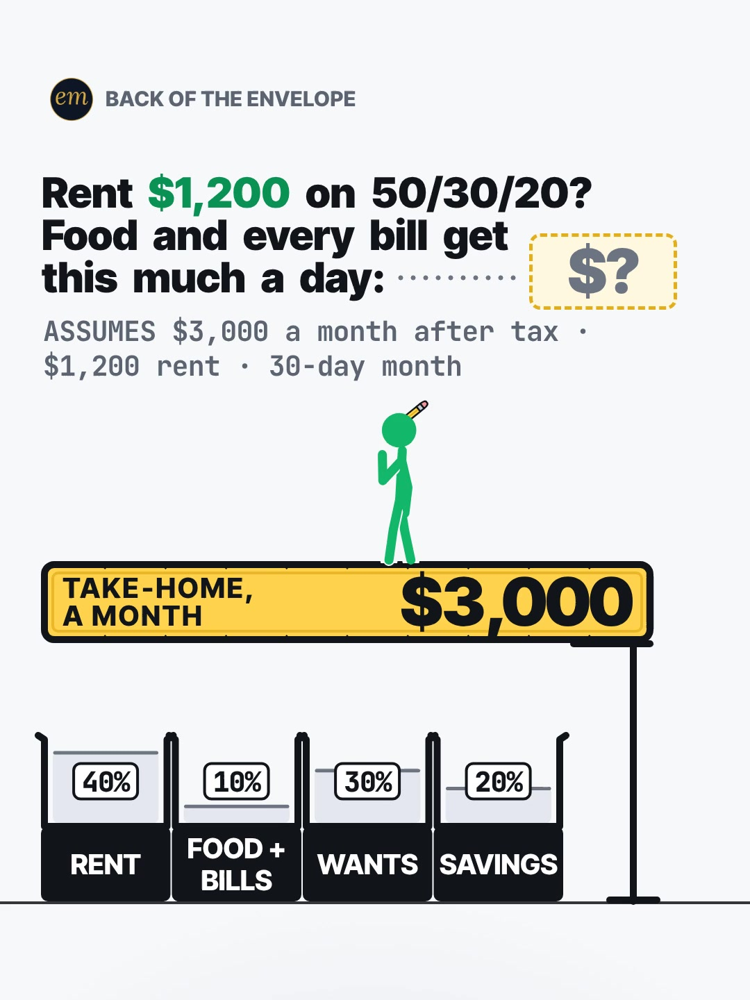

# 05b publishing sheet: $1,200 rent on the 50/30/20 rule

YouTube Shorts (@envelopemath) and Instagram Reels (@envelopemath). Prepared 2026-10-13. Machine-readable twin: `publishing/05b-becker-rig-3000-paycheck.json`.

- **Video.** `renders/channel/05b-becker-rig-3000-paycheck.mp4`: the pre-condense cut (24.6 s: a 22.1 s body + the 2.5 s card; sha256 `435bd707…`). The 05 condense is in progress in parallel (timing only: the numbers, the captions' facts and the verdict stay). Nothing below names a timestamp except the cover, which is picked by content (frame 1, the question), so the copy carries over to the condensed cut unchanged. The ship step rebuilds this sheet and re-exports both covers from the final file: `python3 publishing/tools/build_publishing.py 05b-becker-rig-3000-paycheck --covers`.
- **Numbers.** Every figure comes from `teasers/v2/05-split-sheet.md` (05b) and its check, `python3 teasers/v2/checks/05-split-sheet.py`: 560 checks, 0 failed on `studio/specs/` (run 2026-10-13; 583 checks, 0 failed with `--spec` on the condensed WIP specs, whose strings, numbers and verdicts are unchanged). `python3 publishing/tools/build_publishing.py 05b-becker-rig-3000-paycheck --check` checks this sheet's limits, paste blocks and figures, re-adds the bricks and the pinned comment's other rents, keeps every $10 'a day', and keeps the copy free of '≈' (nothing in 05b is rounded).
- **Honesty rules kept.** The title asks and never gives the result, and so does the cover (frame 1, the '$?' slot). The Instagram caption keeps every result below 'more'. Every claim stays inside the video's verdict, "$1,200 rent leaves food and every bill $10 a day", and the copy says its conditions: $3,000 a month after tax, a 30-day month, and example numbers, not statistics. The copy never says whether anyone can afford anything: no advice, no urgency, and 'Not financial advice.' is in both.
- **Source.** The rule is Elizabeth Warren and Amelia Warren Tyagi's (All Your Worth, 2005), named as the write-up's caption names it: as the rule's origin, not as an endorsement. No company or brand is named.

---

## YouTube Shorts

### Title (vidIQ title score, short-form, scored against this channel)

| # | Title | Score | Chars |
|---|---|---:|---:|
| 1 | The 50/30/20 Rule With $1,200 Rent: How Much a Day for Food and Every Bill? | 96 | 75 |
| 2 | Does the 50/30/20 Rule Work With $1,200 Rent? How Much a Day for Food and Bills? | 96 | 80 |
| 3 | The 50/30/20 Rule With $1,200 Rent: How Much a Day for Food and Bills? | 94 | 70 |

**Pick (paste):**

```
The 50/30/20 Rule With $1,200 Rent: How Much a Day for Food and Every Bill?
```

- 75 of 100 characters.
- It raises the write-up's title from 82 to 96. '50/30/20 Rule' is the first 17 characters, so the searched phrase shows however short the title is cut; the viewer's own input, '$1,200 Rent', follows, and the question asks for the answer in the unit the video gives it (a day).
- It names no result: not the $300 brick, not the 10% and not $10 a day. '$1,200' is the input the viewer holds up against their own rent, as in the header.
- Options 1 and 2 tie at 96; the pick is decided on shape (a question that asks for a number, not for a ruling) and length (75 vs 80 characters). vidIQ's model ranks titles but does not predict views.
- Also scored, not used: "50/30/20 Budget on $3,000 With $1,200 Rent: How Much Is Left for Food a Day?" 90 (both inputs); "The 50/30/20 Rule With $1,200 Rent: How Much a Day for Food? #503020 #budgeting #rent" 90 (the house 3-hashtag form); "Does the 50/30/20 Rule Work If Your Rent Is $1,200?" 88; "50/30/20 Rule With $1,200 Rent: How Much a Day for Food and Bills?" 87 (option 3 without 'The'); "Rent $1,200 on 50/30/20? Food and Every Bill Get This Much a Day" 86 (the on-screen header); "Pay $1,200 Rent? 50/30/20 Leaves Food and Bills How Much a Day?" 82 (the write-up's title); "The 50/30/20 Rule on a $3,000 Paycheck With $1,200 Rent" 73 (no question: 21 points lower).

### Description (paste)

```
The 50/30/20 rule with $1,200 rent: how much a day is left for food and every bill? On $3,000 a month after tax, $10 a day.

The math, shown ($3,000 a month after tax, $1,200 rent, a 30-day month):
• $3,000 ÷ 10 = $300 a brick: 10 bricks.
• 50/30/20 gives needs 50% (5 bricks, $1,500), wants 30% (3 bricks, $900) and savings 20% (2 bricks, $600).
• Rent is a need: $1,200 = 4 bricks.
• So food and every other bill share the last brick: $300 a month.
• $300 ÷ 30 = $10 a day.
• Check: $1,200 + $300 + $900 + $600 = $3,000.
Rent at 40% of take-home is under the 50% line, and it still leaves food and every bill 10%.

Follow for the math behind your money — shown, not hand-waved. @envelopemath

Animation and original sound: The Back of the Envelope. The 50/30/20 rule (Elizabeth Warren and Amelia Warren Tyagi, All Your Worth, 2005) splits after-tax pay: 50% needs, 30% wants, 20% savings and extra debt payments. Rent is a need, so whatever rent leaves of the needs half is what food and every other bill share. $3,000 take-home and $1,200 rent are example numbers, not statistics; in an average 30.44-day month the $300 is $9.86 a day. Not financial advice.
#503020rule #budgeting #rent
```

1,189 of 5,000 characters (1,205 UTF-8 bytes; YouTube counts this limit in bytes, and `•`, `÷`, `—` take 2-3 each). No `<` or `>`, which YouTube rejects. It follows the house template: an answer-first opening line for the search snippet, then 'The math, shown:' bullets, then the follow line. The credit, assumptions and 'Not financial advice.' line comes next, and the 3 hashtags close it. The opening line is the title's question with the write-up's caption answer, for the search snippet. The 'Doesn't Add Up' series line is left out, as on 06b, 06c and 03a.

### Hashtags (order matters)

1. `#503020rule`: the rule ('50/30/20 rule' 19,324 searches a month, flat; '50/30/20 budget' 17,517, +169.5%). The write-up's `#503020` gets a word on the end: a hashtag of digits only does not link reliably.
2. `#budgeting`: the topic ('budgeting' 166,248 a month at competition 25.8, the cluster's top opportunity).
3. `#rent`: the viewer's own input ('rent' 67,558 a month, down 27.3% on its baseline).

The title carries no hashtags, so YouTube shows these 3, the description's first, above the title. Over 60 hashtags and YouTube ignores all of them. `#Shorts` isn't needed.

### Tags (paste; 278 of 500 characters as YouTube counts them: commas count, and a tag with a space counts 2 more for the quotes YouTube adds)

```
50/30/20 rule, 50/30/20 budget, 50 30 20 rule, the 50 30 20 rule, 50 30 20 budget rule explained, how much rent can i afford, rent, budgeting, how to budget, budgeting tips, budgeting for beginners, money math, math animation, the back of the envelope, envelope math
```

Tags carry little weight. These mirror the keyword research plus the house's channel tags. 'how much rent can i afford' (3,386, an older snapshot) is the viewer's own question; the video does not answer it for them, it shows what one rent leaves. Left out on purpose: 'why is rent so high' (7,855, +81.4%) is housing-market news, and 'how to save money' (201,913) is advice intent.

### Pinned comment (post it, then pin it)

```
What's your rent, in bricks?

Take-home ÷ 10 = 1 brick, and needs get 5. Whatever rent doesn't take is food and every bill. On $3,000: $1,000 rent leaves $500 = $16.67 a day; $1,400 leaves $100 = $3.33 a day; $1,500 leaves $0. On $4,000 with $1,200 rent: $800 = $26.67 a day (30-day months).
```

The question comes first so it shows in the collapsed preview: it is the write-up's own pinned ask, and the brick count lets every viewer run it on their own rent (R3). Yannick's 'run the numbers with your own income' CTA drew 79 comments on 50,206 plays (the write-up), and rent replies can become reply videos. The other rents are the write-up's own, checked by its script.

### Related video and end screen

- **Related video:** [Pay the Minimum on $5,000? 238 Months.](https://www.youtube.com/shorts/8__HTUa2PoU) (`8__HTUa2PoU`). The same viewer, a monthly budget under pressure. It is October's debt Short (642 views), and its Instagram twin is the channel's best Reel (7,302 plays, 27.4% skip). (June's 'Why the minimum payment keeps you in debt for 19 years' has more views, 1,230, but is an older, narrated Short.)
- **Swap later:** 01b ($20 an hour) or 01c ($60k a year), the paycheck series, once published; then point theirs at this Short.
- **End screen:** Shorts have no end screens or cards. The Related video link is the Shorts equivalent.

### Thumbnail and settings

- **Thumbnail:** in the YouTube app, pick frame 1 (the question with its '$?' slot, the $3,000 slab and the four bins, the 10% bin visibly the smallest), the same content as the Instagram cover below. On the condensed cut frame 1 also carries the complete hook caption, as the write-up's condense rule asks.
- **Settings:** Category Education. Not made for kids. Altered or synthetic content: No (it's an animated chart, not realistic footage). Remixing allowed. No captions needed: there's no narration and all the text is on screen.

### Posting window

- **When:** First free Tue-Thu evening after the condensed cut ships and passes QA, 21:30-22:30 ET (01:30-02:30 UTC the next day). Sunday 06:00-08:00 ET is the alternative.
- **Spacing:** Keep it at least 6 h from any other upload on the channel, and on a different evening from 05a and 05c. Suggested order within the series: 05c, then 05b, then 05a.
- **Why:** The channel's own October Shorts, median views by posting slot (vidIQ, 2026-10-13): Sunday 05:00-08:00 ET 1,199 (n = 2), weekday 22:00-00:30 ET 642 (n = 3), weekday midday 263 (n = 2); 06c (Mon 03:45 ET) has 760 and 06b (Mon 12:14 ET) 61, too young to compare. The evening slot is also the best one on Instagram, so one evening serves both. n = 7 and confounded by topic, so treat it as a test. Search demand: '50/30/20 budget' runs +169.5% and 'budgeting tips' +154.7% over their 30-day baselines, so 05b goes second, soon after 05c.

---

## Instagram Reels

### Caption (paste)

```
The 50/30/20 rule gives needs half of your take-home. On $3,000 a month after tax with $1,200 rent, how much a day is left for food and every bill?

$10 a day.

The math, shown:
• $3,000 ÷ 10 = $300 a brick: 10 bricks.
• Needs get 50%: 5 bricks, $1,500. Wants 30%: 3 bricks, $900. Savings 20%: 2 bricks, $600.
• Rent eats 4 bricks: $1,200.
• Food and every other bill share the last brick: $300 a month. $300 ÷ 30 = $10 a day.
• Check: $1,200 + $300 + $900 + $600 = $3,000.

Rent at 40% of take-home is under the 50% line, and it still leaves food and every bill 10%.

The rule (Elizabeth Warren and Amelia Warren Tyagi, All Your Worth, 2005) splits after-tax pay: 50% needs, 30% wants, 20% savings and extra debt payments. $3,000 take-home and $1,200 rent are example numbers, with a 30-day month. Not financial advice.

What's your rent, in bricks?

Follow for the math behind your money — shown, not hand-waved. @envelopemath
Animation and original sound: The Back of the Envelope.

#503020rule #budgeting #budgetingtips #rent #personalfinance
```

- 1,046 of 2,200 characters.
- **First 125 characters:** the rule's needs half, the two inputs and the header's question, with no result. The write-up's caption line 1 is the verdict ('$10 a day for food and every bill.'); the house rule moves it below 'more', because the caption overlays the Reel from frame 1. The numbers sit below the fold, where Instagram search and Google indexing still read them.
- Nothing in 05b is rounded, so the copy carries no '≈' or 'about'; the conditions (after tax, example numbers, a 30-day month) sit under the math.
- The closing question is the write-up's pinned ask. The caption follows the house close: the follow line plus the credit.

### Hashtags (5, Instagram's cap since Dec 2025)

`#503020rule #budgeting #budgetingtips #rent #personalfinance`

One is the write-up's own, made linkable (`#503020` becomes `#503020rule`; its `#budgetmath`, `#backoftheenvelope` and `#moneymath` give way):

- `#503020rule` names the rule; `#budgeting` and `#budgetingtips` the topic ('budgeting tips' +154.7% on YouTube); `#rent` the viewer's own input.
- The 50/30/20 outliers in the research (@smobydayig, @yomamafinances) are budgeting Reels, so the budgeting layer is the one that travels.

`#personalfinance` is the broad layer, as on 06b, 06c and 03a.

### Alt text

- **Short (89 characters; paste this one into Instagram):** Chart: $3,000 take-home in $300 bricks. $1,200 rent leaves food and every bill $10 a day.
  - It stays at or under 100 characters, so it fits the field however short it is. It needs no 'about': every figure in 05b is exact, and it keeps the verdict whole.
- **Long (for anywhere with room, such as a website embed):** Animation on a white background. The header asks: rent $1,200 on 50/30/20? Food and every bill get this much a day, with an empty answer slot. A stick figure on a gold $3,000 take-home slab cracks it into 10 bricks of $300. Rent takes 4 bricks, $1,200. A bracket marks needs at 50%, 5 bricks, so food and every bill get the 1 brick left: $300 a month, and $300 ÷ 30 = $10 a day, which stamps into the header's slot. Wants get 3 bricks, $900, and savings 2, $600. The check reads $1,200 + $300 + $900 + $600 = $3,000. Verdict: $1,200 rent leaves food and every bill $10 a day.
- **Where:** Advanced settings → Accessibility → Alt text, if your app shows it for Reels.

### Cover



- **Files:** `publishing/05b-becker-rig-3000-paycheck-cover-3x4.jpg` (1080×1440) and `publishing/05b-becker-rig-3000-paycheck-cover-9x16.jpg` (1080×1920). Both come from the pre-condense (24.6 s) render at 0 s (frame 0).
- **Frame, by content:** Frame 1, the question, as the write-up names it: the header 'Rent $1,200 on 50/30/20? Food and every bill get this much a day:' with its dashed '$?' answer slot, the footer 'ASSUMES $3,000 a month after tax · $1,200 rent · 30-day month', the gold 'TAKE-HOME, A MONTH $3,000' slab scored at its brick seams with the figure on it, and the four empty bins RENT 40% · FOOD + BILLS 10% · WANTS 30% · SAVINGS 20%, the 10% bin visibly the smallest. It asks and does not answer, like the title and the caption. On any cut, use frame 1: on the condensed cut it also carries the complete hook caption ('Ten bricks of $300. Rent eats four.'), as the write-up's condense rule asks (frame 1 is the thumbnail), and the answer, $10 a day, is still not on it. On the pre-condense 24.6 s render the first frame (index 0, 0.00 s) is that clean frame, and the only one: from the second (index 1, 0.03 s) the first caption word ('Ten') starts to fade in (frame-to-frame mean luma change 0.0004), and the cleaver comes out after that. On the condensed WIP render the first frame already carries the whole hook caption, and the '$?' slot is still empty. If the cut changes, re-pick it by content.
- **Crop:** 3:4 = 1080×1440 from y 0 to 1440 of the 1080×1920 frame: the badge (from y 112), the header and its slot, the footer, the slab with the figure and the four bins down to the floor line (y 1302), with near-even margins (112 px above, 138 px below); it drops the empty caption band. A centred grid crop (y 240-1680) cuts the badge and the header.
- **How to set it:** In 'Edit cover', pick frame 1 of the video (or upload the 9:16 JPG), then drag 'Profile grid' to the top so the tile matches the 3:4 JPG. Do not upload the 3:4 JPG as the Reel cover: Instagram centre-crops it to 9:16 in the Reels tab and cuts the header.
- **Re-export:** `ffmpeg -ss 0 -i renders/channel/05b-becker-rig-3000-paycheck.mp4 -frames:v 1 -vf "crop=1080:1440:0:0" -q:v 2 publishing/05b-becker-rig-3000-paycheck-cover-3x4.jpg` and `ffmpeg -ss 0 -i renders/channel/05b-becker-rig-3000-paycheck.mp4 -frames:v 1 -q:v 2 publishing/05b-becker-rig-3000-paycheck-cover-9x16.jpg`, or `python3 publishing/tools/build_publishing.py 05b-becker-rig-3000-paycheck --covers`.
- **Not used:** the finished state ('$10' in the header slot, the gold 'FOOD + EVERY BILL $10 a day' slab, the check and the verdict). It is the save-worthy frame, but it shows the answer, and the write-up names frame 1 as the cover (as 06b's write-up does).
- **When the condensed cut ships:** re-pick frame 1 by content on the shipped file (now with the hook caption complete on it) and re-export both JPGs with `--covers`.

### First comment (post it, then pin it)

```
$1,200 rent on $3,000 a month after tax leaves food and every bill $10 a day under 50/30/20 (30-day month). What's your rent, in bricks? Take-home ÷ 10 = 1 brick; needs get 5.
```

### Trial Reels

**Post as a regular Reel, not a Trial.** @envelopemath has 8 followers, so a regular Reel is already shown almost entirely to non-followers, which is all a Trial Reel adds. A Trial would also keep it off the profile grid until shared. A hook test afterwards, if you want one: the other cut as a Trial with MANUAL graduation 48-72 h later. Once the condensed cut replaces this render in renders/channel, get the pre-condense one from git with `git show 471c793:renders/channel/05b-becker-rig-3000-paycheck.mp4 > 05b-24.6s.mp4` (sha256 435bd707…). Compare skip rate (October Reels ran 27.0-65.1%; 06c's condensed cut 40.3%) and average watched %, then share the winner. vidIQ's publish tool exposes Trial (MANUAL or SS_PERFORMANCE) for this connected account. Confirm eligibility in the app.

### Posting window and settings

- **When:** Same evening as YouTube, about 15 min after the Short: 21:45-22:45 ET, on a different evening from 05a and 05c.
- **Why:** October Reels, median plays by posting slot (owner insights, 2026-10-13): weekday 22:00-00:30 ET 5,449 (n = 3, including the two best: 7,302 and 5,449), weekday midday 1,212 (n = 2), Sunday 05:00-08:00 ET 1,087 (n = 2). 06c, posted Mon 03:46 ET, has 1,711 plays with a 40.3% skip rate. Skip rate tracks plays more closely than the hour does: 27.0-27.4% for the top two, 56.9-65.1% for the bottom two. The condense matters more than the hour.
- **Audio:** Rename the original audio to '50/30/20 with $1,200 rent — The Back of the Envelope' if the app allows; it is the score, with no voice.
- **Share to feed:** On.

---

## Why these choices (research evidence)

**1. Search demand (vidIQ keyword research, pulled 2026-10-13).** vidIQ refreshes each keyword on its own schedule, so the last column gives each row's snapshot date. Two rows are older snapshots.

| Keyword | Est. searches/month | Competition | Overall | Note | vidIQ as of |
|---|---:|---:|---:|---|---|
| 50/30/20 rule | 19,324 | 51.8 | 57.7 | seed; +0.6% vs its 30-day baseline (19,206) | 2026-10-12 |
| 50/30/20 budget | 17,517 | 22.3 | 69.1 | +169.5% vs its baseline (6,499); low competition | 2026-10-12 |
| 50 30 20 rule of money | 15,265 | 28.1 | 66.2 | -42.2% vs its baseline (26,417) | 2026-10-12 |
| 50 30 20 budget rule explained | 8,289 | 26.3 | 64.6 | +79.0% vs its baseline (4,630) | 2026-10-12 |
| the 50 30 20 rule | 7,554 | 36.7 | 60.1 |  | 2026-10-12 |
| 50 30 20 rule | 4,934 | 30.3 | 61.0 |  | 2026-10-07 |
| budgeting | 166,248 | 25.8 | 76.4 | -26.1% vs its baseline (225,000); the cluster's top opportunity | 2026-10-12 |
| how to budget | 66,391 | 33.5 | 69.8 | flat (-0.5%) | 2026-10-12 |
| budgeting tips | 49,832 | 39.0 | 66.5 | +154.7% vs its baseline (19,564) | 2026-10-12 |
| rent | 67,558 | 42.8 | 66.1 | -27.3% vs its baseline (92,940) | 2026-10-12 |
| why is rent so high | 7,855 | 40.8 | 58.6 | +81.4%; housing news, not in the tags | 2026-10-12 |
| how much rent can i afford | 3,386 | 34.9 | 57.7 | the viewer's own question | 2026-02-25 |

The rule is searched by name in every spelling: '50/30/20 rule' (19,324, flat), '50/30/20 budget' (17,517, +169.5%, competition 22.3) and the '50 30 20' variants (4,934-15,265). So the title opens on '50/30/20 Rule' and the variants go to the tags. 'budgeting' (166,248) is the cluster's best opportunity (competition 25.8) and leads the hashtags after the rule. Rent is searched as news ('why is rent so high', +81.4%) and as the viewer's own question ('how much rent can i afford', 3,386); the video answers neither for them, it shows what one rent leaves, so only the second is a tag.

**2. The 50/30/20 split is everywhere on YouTube; rent's per-day answer is not (vidIQ YouTube search, under 4 min, by views).**

| Title | Channel (subs) | Views | Date |
|---|---|---:|---|
| 50/30/20 Budget Rule for $20/hour #budgeting | Kasey Gammons (6,700) | 951,837 | 2022-11-29 |
| How I Budget My 105K Salary | Margaret Skiff (54,600) | 606,442 | 2023-08-01 |
| The Easiest Budget Ever: 50/30/20 #shorts | STICKMAN MONEY (12) | 1,133 | 2026-10-02 |
| Bills Over 50% Of Your Pay? | Katrania Lowers (143) | 1,118 | 2026-09-20 |
| $4,200 Monthly Take-Home: How Much Should You Actually Save? | The Money Muse (173) | 939 | 2026-04-18 |
| $3,500/Month Take-Home: Can You Actually Afford to Live Alone in 2026? | The Money Muse (173) | 506 | 2026-04-11 |
| The Hidden Rule Poor People Follow Without Realizing It | The Wealth Logic (21) | 189 | 2026-07-02 |

The rule run on one pay figure is a proven Short: Kasey Gammons' '50/30/20 Budget Rule for $20/hour' (951,837 views from 6,700 subscribers) and Margaret Skiff's '$105K' (606,442). This month a stick-figure channel posted the same $3,000 split ($1,500 / $900 / $600) as STICKMAN MONEY's 'Easiest Budget Ever' (1,133), with no rent figure in it.

The rent tension is being told, not counted: 'Bills Over 50% Of Your Pay?' (Sept 2026) and The Money Muse's take-home calculators say the rule 'breaks', but none read here takes a rent out of the needs half and prices what is left per day. That unit ($10 a day) is this Short's own, so the title asks for it.

**3. One paycheck through a rule travels on Instagram and TikTok (vidIQ IG/TikTok outlier search, since June 2024, at least 5K views).**

- **@tylerworley3** (TikTok), "Budget my paycheck ($713.59)": 768.2K (18.7x). One real paycheck, split on camera.
- **@moneymovesjake** (TikTok), "People think $20,000 a month automatically means you're rich": 604.4K (139.3x). A belief on screen, then the budget that tests it: this Short's shape.
- **@yomamafinances** (TikTok), "Why yo mama use the 50/30/20 budget": 573.4K (51.4x). An animated 50/30/20 explainer, the closest format.
- **@smobydayig** (Instagram), "how I would budget: $1200 bi-weekly paycheck": 468.2K (94.1x). The rule on one paycheck.
- **@everydayfinance101** (TikTok), "I make $65k/year & feel broke": 53.8K (28.3x).
- Each opens on the pay figure or the belief, with no answer on screen: the shape of this Short's frame 1 and of the caption's first line. None prices rent's leftover per day.

**4. Our own October numbers (vidIQ: public YouTube stats, Instagram owner insights; refreshed 2026-10-13).**

| YouTube Short | Posted (ET) | Views |
|---|---|---:|
| Can You Find the Missing Dollar? (`LjHDFzVxRyM`) | Sun 07:04 | 1,256 |
| You Can Lean on $1 Million. Not on $1 Billion. (`hJBvmGA6sZ0`) | Thu 00:25 | 1,221 |
| Your Interest Has a Speed Limit (`XVUeMcTg9OQ`) | Sun 05:49 | 1,141 |
| What If You Bought Starbucks Stock Instead of a $4 Latte Every Day? (06c) (`fbpdKf4Wy8c`) | Mon 03:45 | 760 |
| Pay the Minimum on $5,000? 238 Months. (`8__HTUa2PoU`) | Mon 22:09 | 642 |
| A $2 Lottery Ticket Was Worth $6.98. Until the Fine Print. (`FW_oxA3kbsM`) | Wed 12:03 | 348 |
| You Can Carry $1 Million. Not in Pennies. (`mXbKY_R63h4`) | Thu 13:38 | 177 |
| Start Investing 10 Years Late? You Get Half. (`EqFQCJheCMU`) | Tue 22:27 | 161 |
| What If You Bought Netflix Stock Instead of Paying for Netflix? (06b) (`krfZEHhb0xU`) | Mon 12:14 | 61 |

| Instagram Reel | Posted (ET) | Plays | Skip rate | Avg watched |
|---|---|---:|---:|---:|
| $5,000 on the minimum (`DeIvYk7I4Qr`) | Mon 22:46 | 7,302 | 27.4% | 56.5% |
| $1M stack vs Burj Khalifa (`DeOEthJJ1TG`) | Thu 00:28 | 5,449 | 27.0% | 83.1% |
| Missing dollar (`DeWgFZRoR_S`) | Sun 07:05 | 1,997 | 32.0% | 81.3% |
| Powerball $6.98 (`DeMvZv9IqRw`) | Wed 12:05 | 1,825 | 58.7% | 57.9% |
| 06c latte vs Starbucks stock (`DeYuqT4pjVC`) | Mon 03:46 | 1,711 | 40.3% | 69.1% |
| $1M in pennies (`DePe11HIHwn`) | Thu 13:37 | 598 | 42.0% | 66.7% |
| 10 years late (`DeLSd9io8UK`) | Tue 22:30 | 219 | 65.1% | 30.6% |
| Speed limit (e) (`DeEW2ZMIiYd`) | Sun 05:54 | 177 | 56.9% | 31.2% |

Channel totals:

- **YouTube:** 53 subscribers, 10,221 views and 41 videos (+27 subscribers, +5,127 views and 11 videos in 30 days).
- **Instagram:** 8 followers and 20,518 views in 30 days.

The nearest proven topic is a monthly payment under pressure: the 5 Oct '$5,000 on the minimum' Reel (debt payoff, not budgeting) leads the channel on Instagram plays (7,302) and skip rate (27.4%). The channel has no budgeting-rule Short yet; June's 'What You ACTUALLY Spend on Subscriptions Every Month' (`GZVld5Pt4WM`, 24 views) is the nearest. 06b (Mon 12 Oct, 12:14 ET) and 06c (Mon 12 Oct, 03:45 ET) are too young to compare.

Medians by posting slot (n = 2-3 each, confounded by topic; 06b and 06c left out as too young):

- **YouTube:** Sunday early morning ET 1,199, weekday 22:00-00:30 ET 642, weekday midday 263.
- **Instagram:** weekday 22:00-00:30 ET 5,449, midday 1,212, Sunday early morning 1,087.

One weekday evening is the best Instagram slot and the second-best YouTube slot, so the plan posts both then. On Instagram, skip rate predicts plays better than the hour does (27.0-27.4% for the top two, 56.9-65.1% for the bottom two). So the window is a light-touch test, and the condense (fewer still moments) is the bigger reach lever.

**5. Platform rules applied.**

- **YouTube title:** 100 characters. The Shorts player shows only the opening, so the keywords come first.
- **YouTube description:** 5,000 characters.
- **YouTube hashtags:** the first 3 show; over 60 and all are ignored; `#Shorts` isn't needed.
- **YouTube tags:** 500 characters, low weight.
- **YouTube Shorts:** no end screens. The Related video link is the Shorts equivalent.
- **YouTube AI disclosure:** only for realistic altered content.
- **Instagram caption:** 2,200 characters, about 125 shown before 'more'.
- **Instagram hashtags:** 5 at most.
- **Instagram search and Google:** keywords in the caption feed Instagram search, and Google indexes public professional posts (since 10 Jul 2025).
- **Instagram grid:** a 3:4 crop of the 9:16 cover.
- **Trial Reels:** shown to non-followers only.

**6. Limits.**

- @envelopemath's YouTube Analytics (audience hours, geography) were not read here; the 06b and 06c sheets found vidIQ's YouTube authorization is a different channel. Check Studio → Analytics → Audience → 'When your viewers are on YouTube' before posting.
- vidIQ has no hashtag-volume data; hashtag picks lean on keyword volume and on the write-up's and the outliers' own tags.
- Title scores are vidIQ's short-form CTR model for this channel; they rank options but do not predict views.
- The rule's definition rests on two independent summaries of the book (Wealthsimple; Citizens Bank, via search on Oct 7, 2026); the book itself was not opened (the write-up's sources). $3,000 and $1,200 are example inputs, not statistics, and the copy says so.
- The same-idea Shorts' claims (the rule 'breaks', is 'out of date') are their own, not verified here, and none is in the copy.
- The video, the cover and the video facts are the pre-condense cut; the copy is cut-independent, and the ship step refreshes the rest from the final file.

---

## Check log (first build and adversarial pass, 2026-10-13)

- **Maths.** `python3 teasers/v2/checks/05-split-sheet.py`: 560 checks, 0 failed on `studio/specs/` (583 checks, 0 failed with `--spec` on the condensed WIP specs). Every public figure traces to the 05b maths table: $3,000 ÷ 10 = $300; needs 5 bricks ($1,500), wants 3 ($900), savings 2 ($600); rent 4 bricks ($1,200, 40%); food and every bill $1,500 − $1,200 = $300 (1 brick, 10%); $300 ÷ 30 = $10 a day ($9.86 in a 30.44-day month); $1,200 + $300 + $900 + $600 = $3,000. Pinned: $500 ÷ 30 = $16.67, $100 ÷ 30 = $3.33, $0, $4,000 ÷ 2 − $1,200 = $800, ÷ 30 = $26.67. The data file recomputes every one.
- **Limits.** Title 75/100. Description 1,189 characters (1,205 bytes) of 5,000. 3 hashtags. Tags 278/500 as YouTube counts them. Instagram caption 1,046/2,200, with the first 125 characters result-free. 5 hashtags. Short alt text 89. No `<` or `>`.
- **vidIQ.** Keywords pulled 2026-10-13 (table above). 10 titles scored against this channel: the pick 96 (tied with option 2), the write-up's title 82. Channel 53 subscribers / 10,221 views / 41 videos; Instagram owner insights refreshed (8 followers, 20,518 views in 30 days).
- **vidIQ re-queried** after the build: the pick's title score 96, as first scored. Again at the adversarial check: the pick 96; '50/30/20 budget' 17,517 / 22.3 (+169.5%); 8__HTUa2PoU 642 views. All match.
- **Mutation test.** Seven breaks on scratch copies of this file all fail by name: a bare '$10' without 'a day', 'About $10 a day', a title that gives the answer, 'example numbers' dropped from the caption, a 'can't afford' judgment, a wrong pinned figure ('$16.66'), and the $300 brick moved above the fold. (22 of 22 across 05a-05c.)
- **Kept on purpose.**
  - The cover and the YouTube frame are frame 1 (the question, the '$?' slot), as the write-up names; the finished state shows the answer.
  - No 'can you afford it' or 'does it work' in the pick: the video gives a number ($10 a day) and leaves the judgment to the viewer, and the copy does too.
  - `#503020rule`, not the write-up's `#503020`: a digits-only hashtag does not link reliably.
  - The rule's authors are named as its origin (the write-up's caption does the same); no company or brand is named, so there is no affiliation line.
- **Adversarial pass (2026-10-13): changed.**
  - The related video's note called '238 Months' the channel's best debt Short on YouTube. The channel's Shorts by views put June's 'Why the minimum payment keeps you in debt for 19 years' at 1,230 to its 642 (the 03a sheet's check found the same). The note now says October's debt Short, with the best Reel as its Instagram twin.
  - The research said 'Monthly-budget maths is the channel's best-performing topic on Instagram', citing the '$5,000 on the minimum' Reel, which is debt payoff. It now calls that the nearest proven topic, a monthly payment under pressure, and says it is not budgeting.
  - The cover's measurement mixed 'frame 1' (the first frame, as the write-up and the YouTube app say) with frame index 1. It now gives indexes, and adds what the condensed WIP render's first frame shows.
  - The maths count with `--spec` on the WIP specs is now 583 checks, 0 failed: the condense's critic fixes split 05b's 'Needs get five.' into its own caption after the first build (579). No caption word, number or verdict changed, so the copy stands.
- **Adversarial pass: checked, no change.** Every figure in the copy against the write-up's 05b table and both runs of the check (560 on studio/specs/, 583 with --spec), including the pinned comment's other rents; the title, description (bytes), tags, hashtags, caption (first 125) and both alt texts against the limits; the rule's authors named only as its origin, no brand; no advice and no judgment of what anyone can afford; the cover and the condensed WIP render's first frame read as stills: the question with its empty '$?' slot, no $10 a day on either.
- **Still to do.** The ship rebuild (`--covers`) on the condensed file.
