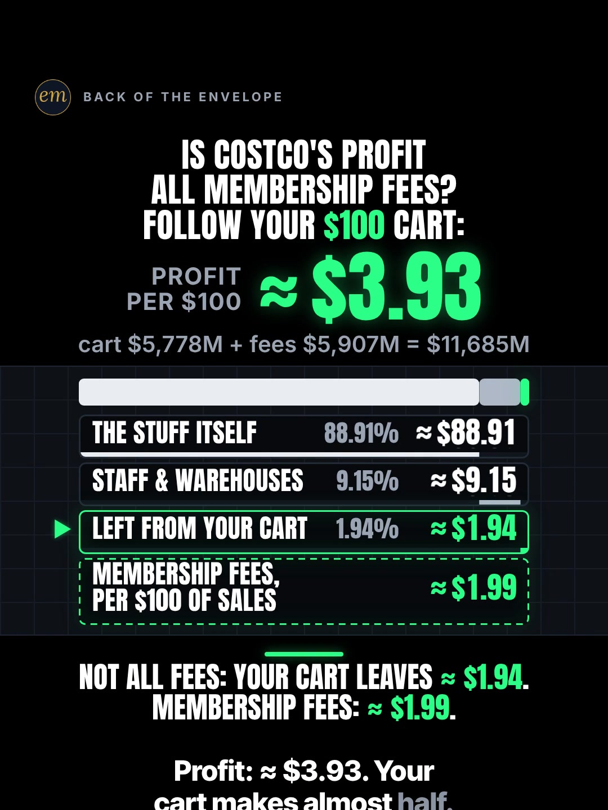

# 05c publishing sheet: is Costco's profit all membership fees?

YouTube Shorts (@envelopemath) and Instagram Reels (@envelopemath). Prepared 2026-10-13. Machine-readable twin: `publishing/05c-scoreboard-costco-100.json`.

- **Video.** `renders/channel/05c-scoreboard-costco-100.mp4`: the condensed cut (11.4 s: a 8.89 s body + the 2.51 s card; sha256 `14e41a60…`), promoted and shipped on 2026-10-13. It replaces the 25.3 s round-2 cut (the owner: "too many still moments"), which is in git (`471c793`). The condense moved the clock and merged some captions; the numbers, the captions' facts and the verdict stay, so the copy carried over unchanged. Nothing below names a timestamp except the cover, which was re-picked by content on the shipped file. The ship rebuilt this sheet and re-exported both covers from it (`python3 publishing/tools/build_publishing.py 05c-scoreboard-costco-100 --covers`); on the shipped specs the maths check runs 583 checks, 0 failed.
- **Numbers.** Every figure comes from `teasers/v2/05-split-sheet.md` (05c) and its check, `python3 teasers/v2/checks/05-split-sheet.py`: 560 checks, 0 failed on `studio/specs/` (run 2026-10-13; 583 checks, 0 failed with `--spec` on the condensed WIP specs, whose strings, numbers and verdicts are unchanged). `python3 publishing/tools/build_publishing.py 05c-scoreboard-costco-100 --check` checks this sheet's limits, paste blocks and figures, recomputes every line from Costco's FY2026 income statement, keeps every rounded amount 'about' or '≈' (the exact workings excepted), keeps '≈ $1.94' with its 'before tax', and keeps every 'half' an 'about' or 'almost'.
- **Honesty rules kept.** The title asks and never gives the result, and the YouTube thumbnail is frame 1 (the rows all '?'). The Instagram caption keeps every result below 'more'. The Instagram cover is the verdict frame, as the write-up's Instagram note asks (as on 06c and 03a). Every claim stays inside the video's verdict, "Not all fees: your cart leaves ≈ $1.94. Membership fees: ≈ $1.99.", and the copy says its conditions: company-wide FY2026 averages, before interest and tax, not your receipt. The copy never says 'Costco keeps' (the write-up's rule). No advice, no urgency, and 'Not financial advice.' is in both.
- **Brand.** "Costco" is used only to name the company whose 10-K the maths reads. Both platforms' copy says 'Not affiliated with or endorsed by Costco.' The video has no logo and no store footage; the bag icon is the kit's own. No brand handle is tagged (the write-up's Instagram note), and no share price is named.

---

## YouTube Shorts

### Title (vidIQ title score, short-form, scored against this channel)

| # | Title | Score | Chars |
|---|---|---:|---:|
| 1 | How Much Does Costco Make on Your $100 Cart? Is It Really All Membership Fees? | 96 | 78 |
| 2 | How Much Does Costco Make on Your $100 Cart? Is It All Membership Fees? | 95 | 71 |
| 3 | How Much Does Costco Make on Your $100 Cart? | 93 | 44 |

**Pick (paste):**

```
How Much Does Costco Make on Your $100 Cart? Is It Really All Membership Fees?
```

- 78 of 100 characters.
- It raises the write-up's title from 82 to 96. The first question puts the viewer's own $100 cart first ('Costco' at characters 15-20); the second asks the header's question, the factoid a dozen Shorts posted since mid-September repeat (research, section 2).
- It names no result: not ≈ $1.94, not ≈ $1.99, and not 'not all'. Both questions are the ones the video answers, in its own unit (per $100).
- The 'how costco makes money' phrasings (89,426 and 38,579 searches a month) score 89-90 as titles; the pick keeps them for the tags and the description's opening. vidIQ's model ranks titles but does not predict views.
- Also scored, not used: "Does Costco Make All Its Profit From Membership Fees?" 92 (the factoid as a yes/no, without the $100 cart); "How Does Costco Make Money? Is It Really All Membership Fees?" 90 (the exact phrase 'how does costco make money' (38,579)); "How Costco Really Makes Money: Is It All Membership Fees? Follow Your $100 Cart" 90; "How Costco Makes Money: Is It All Membership Fees? Follow Your $100 Cart" 89 (the exact phrase 'how costco makes money' (89,426)); "Does Costco Really Make All Its Money From Membership Fees? Follow Your $100 Cart" 87; "Does Costco Make All Its Profit From Membership Fees? Follow Your $100 Cart" 86; "Does Costco Make All Its Profit From Membership Fees? #costco #businessmath #moneymath" 83 (the house 3-hashtag form); "Is Costco's Profit All Membership Fees? Follow Your $100 Cart" 82 (the write-up's title and header).

### Description (paste)

```
How much does Costco make on your $100 cart, and is it all membership fees? Not all fees. Of every $100 rung up in fiscal 2026, the cart leaves about $1.94 before tax, and membership fees bring in about $1.99. About half each.

The math, shown (Costco FY2026, the 52 weeks ended Aug 30, 2026; per $100 of net sales):
• The stuff itself (merchandise costs): $264,279M ÷ $297,247M × $100 ≈ $88.91.
• Staff & warehouses (SG&A): $27,190M ÷ $297,247M × $100 ≈ $9.15.
• Left from your cart, before tax: $100 − $88.91 − $9.15 = $1.94.
• Check: $88.91 + $9.15 + $1.94 = $100.00.
• Membership fees: $5,907M ÷ $297,247M × $100 ≈ $1.99 per $100 of sales.
• Operating profit: cart $5,778M + fees $5,907M = $11,685M, about $3.93 per $100. The cart makes almost half (49.4%).

Follow for the math behind your money — shown, not hand-waved. @envelopemath

Animation and original sound: The Back of the Envelope. Source: Costco's FY2026 Form 10-K (filed Oct 6, 2026) and its Q4 and fiscal 2026 results (Sept 24, 2026). Net sales $297,247M = total revenue $303,154M − membership fees $5,907M. Company-wide averages before interest and income tax: not your receipt, and not a markup on any item. Merchandise costs include inbound freight, depot costs and fresh-food prep; SG&A is mainly wages and warehouse running costs. After interest and tax, net income was $9,226M, about $3.10 per $100 of sales, and the fees are 64% of it: not all of it either. Not financial advice. Not affiliated with or endorsed by Costco.
#Costco #CostcoMembership #BusinessModel
```

1,538 of 5,000 characters (1,570 UTF-8 bytes; YouTube counts this limit in bytes, and `÷`, `×`, `≈`, `•`, `−`, `—` take 2-3 each). No `<` or `>`, which YouTube rejects. It follows the house template: an answer-first opening line for the search snippet, then 'The math, shown:' bullets, then the follow line. The credit, assumptions and 'Not financial advice.' line comes next, and the 3 hashtags close it. The opening line is the title's question with the write-up's caption answer, for the search snippet. The 'Doesn't Add Up' series line is left out, as on 06b, 06c and 03a: the verdict is 'about half each', not a number that shouldn't be true.

### Hashtags (order matters)

1. `#Costco`: the brand ('costco' 329,799 searches a month, flat).
2. `#CostcoMembership`: the header's factoid ('how costco membership makes money' 7,618 a month; 'costco membership fees' 4,179).
3. `#BusinessModel`: the broad category ('business model explained' 46,153 a month, +119.0% on its 30-day baseline); the tag the same-idea Shorts use.

The title carries no hashtags, so YouTube shows these 3, the description's first, above the title. Over 60 hashtags and YouTube ignores all of them. `#Shorts` isn't needed.

### Tags (paste; 345 of 500 characters as YouTube counts them: commas count, and a tag with a space counts 2 more for the quotes YouTube adds)

```
how costco makes money, how does costco make money, how costco really makes money, how costco membership makes money, costco membership fees, costco, how costco works, why costco is so cheap, how companies make money, business model explained, business breakdown, money math, math animation, the back of the envelope, envelope math
```

Tags carry little weight. These mirror the keyword research plus the house's channel tags. Left out on purpose: 'costco deals' (47,392, +324.9%) and 'costco shopping' (11,242) are shopping intent, and 'how costco actually makes money' (21,802) is falling (-54.2%).

### Pinned comment (post it, then pin it)

```
Which store's $100 next?

The working, FY2026 ($ millions): net sales 297,247 (= total revenue 303,154 − membership fees 5,907). Merchandise costs 264,279 (88.909%) · SG&A 27,190 (9.147%) · left 5,778 (1.944%). Membership fees 5,907 = 1.987% of sales. Operating income 11,685 = 5,778 (49.4%) + 5,907 (50.6%). Net income 9,226, about $3.10 per $100 of sales after interest and tax; the fees are 64% of it, so not all of it either.
```

The question comes first so it shows in the collapsed preview: it is the write-up's own pinned ask. The second paragraph is the write-up's exact table. It answers the two comments to expect: 'the fees are over half' (they are 50.6% of operating income: about half each) and 'what about after tax?' (the fees are 64% of net income, still not all of it).

### Related video and end screen

- **Related video:** [What If You Bought Netflix Stock Instead of Paying for Netflix?](https://www.youtube.com/shorts/krfZEHhb0xU) (`krfZEHhb0xU`). 06b, live since Mon 12 Oct 2026: a company's recurring fee (a Netflix bill) in money math, next to this Short's membership fee. Both name a brand and say they are not affiliated with it.
- **Swap later:** 05a (where your $10 at Chipotle goes), the same split-sheet series, once published. Then point 05a's Related video at this Short.
- **End screen:** Shorts have no end screens or cards. The Related video link is the Shorts equivalent.

### Thumbnail and settings

- **Thumbnail:** in the YouTube app, pick frame 1, the write-up's YouTube cover: the header question, the hero at $100.00, the three cart rows all '?' and the membership-fees row ≈ $1.99 under them. Its hook caption ('≈ $88.91 of your $100 buys the stuff.') is already up, a row, not the answer. It asks without answering. The Instagram cover below is the verdict frame, as the write-up asks.
- **Settings:** Category Education. Not made for kids. Altered or synthetic content: No (it's an animated chart, not realistic footage). Remixing allowed. No captions needed: there's no narration and all the text is on screen.

### Posting window

- **When:** First free Tue-Thu evening after the condensed cut ships and passes QA, 21:30-22:30 ET (01:30-02:30 UTC the next day). Sunday 06:00-08:00 ET is the alternative.
- **Spacing:** Keep it at least 6 h from any other upload on the channel, on a different evening from 05a and 05b, and in a different week from 08a (also Costco on the Scoreboard look; the write-up's open item 4). Suggested order within the series: 05c, then 05b, then 05a.
- **Why:** The channel's own October Shorts, median views by posting slot (vidIQ, 2026-10-13): Sunday 05:00-08:00 ET 1,199 (n = 2), weekday 22:00-00:30 ET 642 (n = 3), weekday midday 263 (n = 2); 06c (Mon 03:45 ET) has 760 and 06b (Mon 12:14 ET) 61, too young to compare. The evening slot is also the best one on Instagram, so one evening serves both. n = 7 and confounded by topic, so treat it as a test. 05c goes first: the factoid is circulating now (a dozen same-idea Shorts since mid-September, one on 12 Oct), 'how costco really makes money' runs +237.6% and 'how costco works' +244.7% over their 30-day baselines, and Costco's FY2026 results are under three weeks old (Sept 24).

---

## Instagram Reels

### Caption (paste)

```
How much does Costco make on your $100 cart? Is its profit really all membership fees? Follow your $100 line by line, from Costco's own 10-K.

Not all fees. Your cart makes almost as much.

The math, shown (FY2026, per $100 of sales):
• The stuff itself: about $88.91.
• Staff & warehouses: about $9.15.
• Left from your cart: $100 − $88.91 − $9.15 = $1.94, before tax.
• Membership fees: about $1.99 per $100 of sales.
• Operating profit: about $3.93 per $100. Cart $5,778M + fees $5,907M = $11,685M, about half each.

Costco FY2026 Form 10-K (filed Oct 6, 2026) and Q4 and fiscal 2026 results (Sept 24, 2026), the 52 weeks ended Aug 30, 2026. Company-wide averages before interest and tax, not your receipt. Not financial advice. Not affiliated with or endorsed by Costco.

Which store's $100 next?

Follow for the math behind your money — shown, not hand-waved. @envelopemath
Animation and original sound: The Back of the Envelope.

#costco #costcomembership #businessmodel #businessmath #personalfinance
```

- 1,007 of 2,200 characters.
- **First 125 characters:** the title's two questions, with no figure but the $100 stake. The write-up's caption line 1 is the verdict ('Not all fees. Your cart makes almost as much.'); the house rule moves it below 'more', because the caption overlays the Reel from frame 1. The numbers sit below the fold, where Instagram search and Google indexing still read them.
- 'Before tax' sits on the ≈ $1.94 line and in the averages line, as on screen, and 'about half each' is the write-up's own wording (49.4% and 50.6%).
- No brand handle is tagged, as the write-up's Instagram note asks. The caption follows the house close: the follow line plus the credit.

### Hashtags (5, Instagram's cap since Dec 2025)

`#costco #costcomembership #businessmodel #businessmath #personalfinance`

Two are the write-up's own (`#costco #businessmath`; its `#backoftheenvelope` repeats the handle and `#moneymath` gives way to the broad layer):

- `#costco` names the brand and `#costcomembership` the factoid the header asks about.
- `#businessmodel` is the tag the same-idea Shorts and the @cashepreneurs outlier's subject share; `#businessmath` says what kind of video it is.

`#personalfinance` is the broad layer, as on 06b, 06c and 03a.

### Alt text

- **Short (90 characters; paste this one into Instagram):** Chart: per $100 at Costco, the cart leaves about $1.94 before tax; fees bring about $1.99.
  - It stays at or under 100 characters, so it fits the field however short it is. It says 'about', not '≈', so screen readers read it cleanly, and it keeps both halves of the verdict with 'before tax'.
- **Long (for anywhere with room, such as a website embed):** Animation on a black scoreboard. The header asks: is Costco's profit all membership fees? Follow your $100 cart. A counter starts at $100.00 and counts down to what is left as the rows land: the stuff itself about $88.91, staff and warehouses about $9.15, and left from your cart about $1.94 before tax. The rows add back to $100.00. A membership-fees row shows about $1.99 per $100 of sales. The counter turns to operating profit per $100, about $3.93: the cart makes almost half. Verdict: not all fees: your cart leaves about $1.94 before tax, and membership fees bring about $1.99.
- **Where:** Advanced settings → Accessibility → Alt text, if your app shows it for Reels.

### Cover



- **Files:** `publishing/05c-scoreboard-costco-100-cover-3x4.jpg` (1080×1440) and `publishing/05c-scoreboard-costco-100-cover-9x16.jpg` (1080×1920). Both come from the shipped (11.4 s) render at 8.3 s (frame 249).
- **Frame, by content:** The verdict frame, as the write-up's Instagram note asks (≈ $1.94 against ≈ $1.99): the header question, the hero 'PROFIT PER $100 ≈ $3.93', the footer 'cart $5,778M + fees $5,907M = $11,685M', the three landed rows (≈ $88.91, ≈ $9.15 and ≈ $1.94, with the pointer on 'Left from your cart'), the membership-fees row ≈ $1.99, and the verdict 'Not all fees: your cart leaves ≈ $1.94. Membership fees: ≈ $1.99.' On any cut, use a settled frame of the verdict hold, before the end card: on the shipped condensed cut the last caption stays under the verdict (on the pre-condense cut it had cleared by then). On the shipped 11.4 s condensed cut the verdict lands at 7.29 s and the board settles by about 7.77 s (from then the frame-to-frame mean luma change is mostly under 0.005, with blips to 0.15, 270×480 greyscale); the last caption stays under the verdict until the end card at 8.89 s. Frame 249 (8.30 s) is used. On the 25.3 s pre-condense render it was frame 660 (22.00 s), after the caption had cleared. If the cut changes, re-pick it by content.
- **Crop:** 3:4 = 1080×1440 from y 0 to 1440 of the 1080×1920 frame: the badge (from y 141), the header, the hero, the footer, the board and the verdict (to y 1281), with near-even margins (141 px above, 159 px below); it drops the empty black below. A centred grid crop (y 240-1680) cuts the badge and the header.
- **How to set it:** In 'Edit cover', pick the verdict frame from the video (or upload the 9:16 JPG), then drag 'Profile grid' to the top so the tile matches the 3:4 JPG. Do not upload the 3:4 JPG as the Reel cover: Instagram centre-crops it to 9:16 in the Reels tab and cuts the header.
- **Re-export:** `ffmpeg -ss 8.3 -i renders/channel/05c-scoreboard-costco-100.mp4 -frames:v 1 -vf "crop=1080:1440:0:0" -q:v 2 publishing/05c-scoreboard-costco-100-cover-3x4.jpg` and `ffmpeg -ss 8.3 -i renders/channel/05c-scoreboard-costco-100.mp4 -frames:v 1 -q:v 2 publishing/05c-scoreboard-costco-100-cover-9x16.jpg`, or `python3 publishing/tools/build_publishing.py 05c-scoreboard-costco-100 --covers`.
- **Not used on Instagram:** frame 1 (the hero at $100.00, the three cart rows all '?', the membership row ≈ $1.99 already landed). It asks without answering, so it is the YouTube thumbnail, as the write-up's YouTube note asks; on Instagram the write-up picks the verdict frame.
- **Shipped cut (2026-10-13):** the verdict frame was re-picked by content on the shipped file (8.3 s, the first settled frame of the verdict hold that the condense critic kept: ≈ $1.94, ≈ $1.99 and ≈ $3.93 on the board, the verdict, and the last caption under it) and both JPGs re-exported from it.

### First comment (post it, then pin it)

```
Per $100 rung up at Costco in fiscal 2026: the cart leaves about $1.94 before tax, and membership fees bring in about $1.99. Not all fees: about half each. Which store's $100 next?
```

### Trial Reels

**Post as a regular Reel, not a Trial.** @envelopemath has 8 followers, so a regular Reel is already shown almost entirely to non-followers, which is all a Trial Reel adds. A Trial would also keep it off the profile grid until shared. A hook test afterwards, if you want one: the other cut as a Trial with MANUAL graduation 48-72 h later. The condensed cut replaced the pre-condense render in renders/channel on 2026-10-13; get the pre-condense one from git with `git show 471c793:renders/channel/05c-scoreboard-costco-100.mp4 > 05c-25.3s.mp4` (sha256 38179927…). Compare skip rate (October Reels ran 27.0-65.1%; 06c's condensed cut 40.3%) and average watched %, then share the winner. vidIQ's publish tool exposes Trial (MANUAL or SS_PERFORMANCE) for this connected account. Confirm eligibility in the app.

### Posting window and settings

- **When:** Same evening as YouTube, about 15 min after the Short: 21:45-22:45 ET, on a different evening from 05a and 05b.
- **Why:** October Reels, median plays by posting slot (owner insights, 2026-10-13): weekday 22:00-00:30 ET 5,449 (n = 3, including the two best: 7,302 and 5,449), weekday midday 1,212 (n = 2), Sunday 05:00-08:00 ET 1,087 (n = 2). 06c, posted Mon 03:46 ET, has 1,711 plays with a 40.3% skip rate. Skip rate tracks plays more closely than the hour does: 27.0-27.4% for the top two, 56.9-65.1% for the bottom two. The condense matters more than the hour.
- **Audio:** Rename the original audio to 'Your $100 Costco cart vs the fees — The Back of the Envelope' if the app allows; it is the score, with no voice.
- **Share to feed:** On.

---

## Why these choices (research evidence)

**1. Search demand (vidIQ keyword research, pulled 2026-10-13).** vidIQ refreshes each keyword on its own schedule, so the last column gives each row's snapshot date. One row is an older snapshot.

| Keyword | Est. searches/month | Competition | Overall | Note | vidIQ as of |
|---|---:|---:|---:|---|---|
| how costco makes money | 89,426 | 33.5 | 70.9 | +19.7% vs its 30-day baseline (74,718); the biggest Costco question | 2026-10-12 |
| how does costco make money | 38,579 | 31.0 | 68.7 | seed; +20.2% vs its baseline (32,088) | 2026-10-12 |
| how costco actually makes money | 21,802 | 26.9 | 68.1 | -54.2% vs its baseline (47,568) | 2026-10-12 |
| how costco works | 17,539 | 46.0 | 59.6 | +244.7% vs its baseline (5,088) | 2026-10-12 |
| how costco really makes money | 17,420 | 39.5 | 62.2 | +237.6% vs its baseline (5,160) | 2026-10-12 |
| how costco membership makes money | 7,618 | 23.0 | 65.6 | the factoid the header names | 2026-10-12 |
| why costco is so cheap | 6,936 | 30.3 | 62.3 | -48.2% vs its baseline (13,401) | 2026-10-12 |
| costco membership fees | 4,179 | 35.7 | 58.2 |  | 2026-10-10 |
| costco | 329,799 | 61.2 | 64.9 | -2.5% vs its baseline (338,300); the brand, crowded | 2026-10-12 |
| how companies make money | 126,774 | 38.4 | 70.3 | +40.3% vs its baseline (90,367) | 2026-10-12 |
| business model explained | 46,153 | 42.5 | 64.8 | +119.0% vs its baseline (21,071) | 2026-10-12 |
| costco deals | 47,392 | 40.8 | 65.6 | +324.9%; shopping intent, not in the tags | 2026-10-12 |

This is the strongest search cluster of the three: 'how costco makes money' (89,426) and 'how does costco make money' (38,579) are both rising (about +20%) at low competition (31-34), and the 'really' and 'works' variants have more than tripled their baselines (+237.6%, +244.7%). The video answers that question with the fees in it, so the phrases go to the tags and the description's opening, and the title adds the 'Really' cue. Shopping searches ('costco deals', +324.9%) stay out.

**2. The factoid is everywhere on YouTube right now; nobody follows the $100 (vidIQ YouTube search, under 4 min, by views).**

| Title | Channel (subs) | Views | Date |
|---|---|---:|---|
| Why everyone loves Costco | Morning Brew (695,000) | 7,635,239 | 2025-06-30 |
| How Does Costco Make Money? | The Motley Fool (468,000) | 34,911 | 2019-02-12 |
| Costco Doesn't Make Money From Food (Here's the Real Trick) | How They Profit (2) | 1,506 | 2026-10-09 |
| Costco Makes More From the Card Than the Groceries | How It Pays Off (2) | 1,321 | 2026-10-12 |
| How Costco Actually Makes Billions (It’s Not Groceries) | The Value Ledger (9) | 1,253 | 2026-09-23 |
| Costco Barely Makes Money Selling You Anything — Here's the Real Trick | Behind The Brand (24) | 1,214 | 2026-09-26 |
| Costco (COST) Makes Half Its Profit Before You Buy Anything | SORA FINANCE CREATOR (121) | 1,185 | 2026-09-28 |
| Costco barely profits on what it sells | Raza Zaidi (441) | 1,051 | 2026-09-21 |
| Costco Doesn't Make Money Selling You Food #shorts | Ridvise (411) | 707 | 2026-09-13 |

At least a dozen small channels posted 'Costco makes its money on the membership, not the food' between mid-September and 12 Oct 2026, all under 1,600 views. Their descriptions disagree on the size: 'about half' (How They Profit, SORA), 'two-thirds' (Raza Zaidi), 'over 70%' (The Value Ledger), 'more than half' (Ridvise). The Motley Fool's 2019 version did the split on 2018 results.

None read here follows one $100 cart to the cent or sets the cart's leftover beside the fees per $100, which is this Short's whole sheet. That is why the title asks the factoid back ('Is It Really All Membership Fees?') and the copy answers with the write-up's FY2026 split (about half each), not with any of theirs.

**3. Costco's business model travels on Instagram and TikTok (vidIQ IG/TikTok outlier search, since June 2024, at least 5K views).**

- **@cashepreneurs** (Instagram), "Costco sells products at near-zero markup. Not because they're generous - because the products were never the business model.": 1.6M (6.3x). The factoid itself, which this Short tests.
- **@adivitius** (Instagram), "Costco and Sam's Club sell similar products. But the viral pay comparison is wrong.": 1.5M (11.8x). A Costco myth-bust, the same move as this Short's verdict.
- **@wealth.cap** (Instagram), "Costco's $1.50 hot dog combo stayed $1.50 since 1985.": 1.4M (7.9x). The hot-dog angle belongs to 08a.
- **@nogood.io** (TikTok), Costco's business model as marketing commentary: 1.4M (76.9x). **@revuence** (TikTok), "DO YOU KNOW WHY SUPERMARKET ROTISSERIE CHICKEN IS CHEAPER THAN A RAW ONE?": 614.1K (55.2x).
- The two Instagram business posts are static text with no voice, like this Short; @adivitius's is a myth-bust that names the claim first. A concept search for the membership factoid returned Costco shopping hacks, not breakdowns: the breakdown has not broken out on Instagram yet.

**4. Our own October numbers (vidIQ: public YouTube stats, Instagram owner insights; refreshed 2026-10-13).**

| YouTube Short | Posted (ET) | Views |
|---|---|---:|
| Can You Find the Missing Dollar? (`LjHDFzVxRyM`) | Sun 07:04 | 1,256 |
| You Can Lean on $1 Million. Not on $1 Billion. (`hJBvmGA6sZ0`) | Thu 00:25 | 1,221 |
| Your Interest Has a Speed Limit (`XVUeMcTg9OQ`) | Sun 05:49 | 1,141 |
| What If You Bought Starbucks Stock Instead of a $4 Latte Every Day? (06c) (`fbpdKf4Wy8c`) | Mon 03:45 | 760 |
| Pay the Minimum on $5,000? 238 Months. (`8__HTUa2PoU`) | Mon 22:09 | 642 |
| A $2 Lottery Ticket Was Worth $6.98. Until the Fine Print. (`FW_oxA3kbsM`) | Wed 12:03 | 348 |
| You Can Carry $1 Million. Not in Pennies. (`mXbKY_R63h4`) | Thu 13:38 | 177 |
| Start Investing 10 Years Late? You Get Half. (`EqFQCJheCMU`) | Tue 22:27 | 161 |
| What If You Bought Netflix Stock Instead of Paying for Netflix? (06b) (`krfZEHhb0xU`) | Mon 12:14 | 61 |

| Instagram Reel | Posted (ET) | Plays | Skip rate | Avg watched |
|---|---|---:|---:|---:|
| $5,000 on the minimum (`DeIvYk7I4Qr`) | Mon 22:46 | 7,302 | 27.4% | 56.5% |
| $1M stack vs Burj Khalifa (`DeOEthJJ1TG`) | Thu 00:28 | 5,449 | 27.0% | 83.1% |
| Missing dollar (`DeWgFZRoR_S`) | Sun 07:05 | 1,997 | 32.0% | 81.3% |
| Powerball $6.98 (`DeMvZv9IqRw`) | Wed 12:05 | 1,825 | 58.7% | 57.9% |
| 06c latte vs Starbucks stock (`DeYuqT4pjVC`) | Mon 03:46 | 1,711 | 40.3% | 69.1% |
| $1M in pennies (`DePe11HIHwn`) | Thu 13:37 | 598 | 42.0% | 66.7% |
| 10 years late (`DeLSd9io8UK`) | Tue 22:30 | 219 | 65.1% | 30.6% |
| Speed limit (e) (`DeEW2ZMIiYd`) | Sun 05:54 | 177 | 56.9% | 31.2% |

Channel totals:

- **YouTube:** 53 subscribers, 10,221 views and 41 videos (+27 subscribers, +5,127 views and 11 videos in 30 days).
- **Instagram:** 8 followers and 20,518 views in 30 days.

The channel has no company-breakdown Short yet. Its two brand Shorts, 06c (Starbucks: 760 views, 1,711 plays) and 06b (Netflix, Mon 12 Oct 12:14 ET: 61 views so far), are too young to compare, and 06b's Reel shows 7 plays while Instagram's owner insights catch up.

Medians by posting slot (n = 2-3 each, confounded by topic; 06b and 06c left out as too young):

- **YouTube:** Sunday early morning ET 1,199, weekday 22:00-00:30 ET 642, weekday midday 263.
- **Instagram:** weekday 22:00-00:30 ET 5,449, midday 1,212, Sunday early morning 1,087.

One weekday evening is the best Instagram slot and the second-best YouTube slot, so the plan posts both then. On Instagram, skip rate predicts plays better than the hour does (27.0-27.4% for the top two, 56.9-65.1% for the bottom two). So the window is a light-touch test, and the condense (fewer still moments) is the bigger reach lever.

**5. Platform rules applied.**

- **YouTube title:** 100 characters. The Shorts player shows only the opening, so the keywords come first.
- **YouTube description:** 5,000 characters.
- **YouTube hashtags:** the first 3 show; over 60 and all are ignored; `#Shorts` isn't needed.
- **YouTube tags:** 500 characters, low weight.
- **YouTube Shorts:** no end screens. The Related video link is the Shorts equivalent.
- **YouTube AI disclosure:** only for realistic altered content.
- **Instagram caption:** 2,200 characters, about 125 shown before 'more'.
- **Instagram hashtags:** 5 at most.
- **Instagram search and Google:** keywords in the caption feed Instagram search, and Google indexes public professional posts (since 10 Jul 2025).
- **Instagram grid:** a 3:4 crop of the 9:16 cover.
- **Trial Reels:** shown to non-followers only.

**6. Limits.**

- @envelopemath's YouTube Analytics (audience hours, geography) were not read here; the 06b and 06c sheets found vidIQ's YouTube authorization is a different channel. Check Studio → Analytics → Audience → 'When your viewers are on YouTube' before posting.
- vidIQ has no hashtag-volume data; hashtag picks lean on keyword volume and on the write-up's and the outliers' own tags.
- Title scores are vidIQ's short-form CTR model for this channel; they rank options but do not predict views.
- The write-up's sources rest on search-result text: its egress proxy blocked the primary pages. Costco's merchandise costs (264,279) and SG&A (27,190) are attributed to the FY2026 10-K by search; the identity 303,154 − 264,279 − 27,190 = 11,685 matches the independently reported $11.69B operating income. Before posting, re-run the check against the 10-K's own table (the write-up's open item 1).
- The same-idea Shorts' shares of profit from fees ('about half', 'two-thirds', 'over 70%') are their own descriptions, not verified here; the copy states only the write-up's FY2026 split.
- Slate overlap: 08a (Costco hot dogs as a unit) shares the brand and the Scoreboard look (the write-up's open item 4). Post them in different weeks, or move one, as the owner decides.
- The video, the cover and the video facts are the shipped condensed cut (2026-10-13); the copy is cut-independent and carried over from the pre-condense cut unchanged.

---

## Check log (first build and adversarial pass, 2026-10-13)

- **Maths.** `python3 teasers/v2/checks/05-split-sheet.py`: 560 checks, 0 failed on `studio/specs/` (583 checks, 0 failed with `--spec` on the condensed WIP specs). Every public figure traces to the 05c maths table: net sales 303,154 − 5,907 = 297,247; 264,279 ÷ 297,247 × $100 ≈ $88.91; 27,190 → ≈ $9.15; 5,778 → ≈ $1.94 (= $100 − $88.91 − $9.15); $88.91 + $9.15 + $1.94 = $100.00; fees 5,907 → ≈ $1.99; operating income 11,685 = 5,778 + 5,907 (49.4% / 50.6%) → ≈ $3.93; net income 9,226 → ≈ $3.10, fees 64% of it. The data file recomputes every one.
- **Limits.** Title 78/100. Description 1,538 characters (1,570 bytes) of 5,000. 3 hashtags. Tags 345/500 as YouTube counts them. Instagram caption 1,007/2,200, with the first 125 characters result-free. 5 hashtags. Short alt text 90. No `<` or `>`.
- **vidIQ.** Keywords pulled 2026-10-13 (table above). 11 titles scored against this channel: the pick 96, the write-up's title 82. Channel 53 subscribers / 10,221 views / 41 videos; Instagram owner insights refreshed (8 followers, 20,518 views in 30 days).
- **vidIQ re-queried** after the build: the pick's title score 96, as first scored. Again at the adversarial check: the pick 96; 'how costco makes money' 89,426 / 33.5 (+19.7%); krfZEHhb0xU 75 views (growing; 61 at the build). All match.
- **Mutation test.** Seven breaks on scratch copies of this file all fail by name: a bare '$1.99' in the caption, '$1.94' without 'before tax', 'Costco keeps', a bare 'half each', a title that gives the verdict ('Not All Membership Fees'), the affiliation line dropped from the description, and '$3.93' not named as operating profit. (22 of 22 across 05a-05c.)
- **Kept on purpose.**
  - The YouTube thumbnail is frame 1 (the rows all '?') and the Instagram cover is the verdict frame, each as the write-up's per-platform note asks. The no-result rule covers the title and the caption's first 125 characters.
  - Dollar lines in millions, as the video's footer shows them ($5,778M + $5,907M = $11,685M), not the write-up caption's rounded billions, so every figure traces to the footer.
  - Net income ($9,226M, ≈ $3.10 per $100, fees 64% of it) appears only in the description and the pinned comment, as in the write-up: the video's 'profit' is operating profit, before tax.
  - No brand handle and no 'Costco keeps': the write-up's rules for 05c.
- **Adversarial pass (2026-10-13): changed.**
  - The long alt text put the counter's turn to ≈ $3.93 after the verdict, and said it counts down 'as each row lands'. On the condensed cut (what ships) the counter reaches ≈ $3.93 before the verdict, and it counts down with the first two rows only. It now lists the counter's turn and the verdict as two sentences, in the shipping cut's order, and says the counter counts down to what is left.
  - The cover note for the condensed cut now names the write-up critic's pick: the first settled frame of the verdict hold, with the last caption under the verdict.
  - The maths count with `--spec` on the WIP specs is now 583 checks, 0 failed: the condense's critic fixes dropped 05c's footer return to the assumption line at the check after the first build (579). The footer's text, every figure and the verdict are unchanged, so the copy stands.
- **Adversarial pass: checked, no change.** Every figure in the copy against the write-up's 05c table and both runs of the check (560 on studio/specs/, 583 with --spec); the title, description (bytes), tags, hashtags, caption (first 125) and both alt texts against the limits; 'Costco' used only to name the 10-K's company, no handle, the affiliation line in both; no 'Costco keeps'; no advice; the cover and the condensed WIP render's frame 1 and verdict hold read as stills.
- **Still to do.** The primary-source check above.
- **Done on ship (2026-10-13).** Rebuilt with `--covers` from the shipped condensed cut (11.4 s). The verdict frame was re-picked by content at 8.3 s (frame 249), with the last caption under the verdict. The Video bullet, the cut and the check counts follow the shipped file (583 checks, 0 failed on `studio/specs/`), and the long alt text was re-read against the condensed beat sheet: every beat it names is in the shipped cut, so no copy changed.
