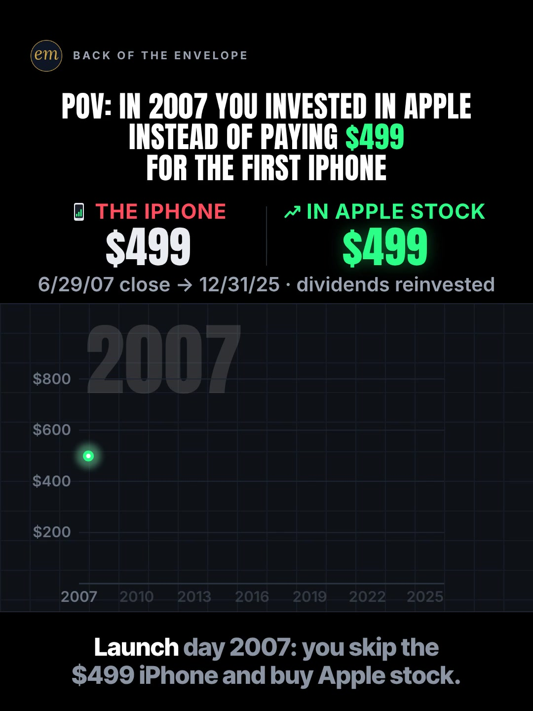

# 06a publishing sheet: the $499 first iPhone vs Apple stock

YouTube Shorts (@envelopemath) and Instagram Reels (@envelopemath). Prepared 2026-10-13. Machine-readable twin: `publishing/06a-scoreboard-first-iphone-apple.json`.

- **Video.** `renders/channel/06a-scoreboard-first-iphone-apple.mp4`: the pre-condense cut (29 s: a 26.5 s body + the 2.5 s card; sha256 `9707256d…`), the round-2 Scoreboard cut as `renders/channel` holds it on 2026-10-13 (git 471c793). A condensed cut may follow (timing only: the numbers, captions and verdict stay). Nothing below names a timestamp except the cover, which is picked by content (frame 1), so the copy carries over. The ship step rebuilds this sheet and re-exports both covers from the final file: `python3 publishing/tools/build_publishing.py 06a-scoreboard-first-iphone-apple --covers`.
- **Numbers.** Every figure comes from `teasers/v2/06-pov-race.md` (06a) and its check, `python3 teasers/v2/checks/06-pov-race.py`: 445 checks, 0 failed on `studio/specs/` (run 2026-10-13). `python3 publishing/tools/build_publishing.py 06a-scoreboard-first-iphone-apple --check` checks this sheet's limits, paste blocks and figures, recomputes every figure from the write-up's closes, and keeps each year's figure beside its year.
- **Honesty rules kept.** The title asks and never gives the result, and neither does the cover (frame 1: both counters at $499, the race not started). The Instagram caption keeps every figure but the $499 input (and the year 2007) below 'more'. The copy says the buy is at the launch-day close (the phone went on sale at 6 p.m.), shows the 2008 dip below $499 as well as the finish, and dates the finish: the 12/31/2025 close, and Apple has moved since. No advice, no urgency, and 'Not financial advice.' is in both.
- **Brand.** "Apple", "iPhone" and "AAPL" are used only to name the company, its phone and the stock the maths is about. Both platforms' copy says 'Not affiliated with or endorsed by Apple.' The video has no Apple logo and no product photo: the names are text only, and the phone is the kit's generic icon.
- **Prices.** AAPL prices are adjusted for splits and dividends (Macrotrends, bridged to StatMuse's 2007 close), so the 2007 prices sit far below the ones quoted at the time: the launch-day close was $122.04 as quoted (ATPM) and is $3.65 adjusted. The copy says "adjusted" wherever it names a share price, and the description and the pinned comment give both, because the same-idea Shorts quote at least six different launch-day prices.

---

## YouTube Shorts

### Title (vidIQ title score, short-form, scored against this channel)

| # | Title | Score | Chars |
|---|---|---:|---:|
| 1 | What If You Bought Apple Stock Instead of the $499 First iPhone? #Apple #AppleStock #stocks | 97 | 91 |
| 2 | What If You Bought Apple Stock Instead of the First iPhone? #Apple #AppleStock #stocks | 97 | 86 |
| 3 | What If You Invested $499 in Apple Instead of the First iPhone? #Apple #AppleStock #stocks | 96 | 90 |

**Pick (paste):**

```
What If You Bought Apple Stock Instead of the $499 First iPhone? #Apple #AppleStock #stocks
```

- 91 of 100 characters.
- 'What If You Bought Apple Stock' is the first 30 characters, so a title cut short still asks it; it carries 'apple stock' (18,675 searches a month) and the 'what if you …' grammar of 'what if you invested' (9,269, +79.0%). The ticker phrase 'aapl stock' (12,269, +40.2%) is in the tags and the Instagram hashtags.
- '$499 First iPhone' is the header's one input. Seven of the ten scored titles land at 96-97, so the pick is decided on angle: the $499 is what the video races, and the one-off-purchase POV posts in the write-up's evidence (GoPro $400, Crocs $50, GeForce 256 $599) all name their price.
- It raises the write-up's title from 96 to 97. vidIQ's model ranks titles but does not predict views. The 3 hashtags are the description's first 3, as the house rule asks (none or all).
- Also scored, not used: "What If You Bought Apple Stock Instead of the First iPhone in 2007? #Apple #AppleStock #stocks" 97 (95 chars; the year clock shows 2007 on frame 1); "What If You Bought Apple Stock Instead of the First iPhone? #iPhone #AppleStock #stocks" 97 (#iPhone in place of #Apple: no difference in score); "What If You Bought Apple Stock Instead of the First iPhone?" 97 (the core alone); "What If You Invested $499 in Apple Instead of the First iPhone?" 96 (the write-up's title); "The First iPhone Cost $499. What If You Bought Apple Stock Instead?" 90; "POV: You Invested in Apple Instead of Paying $499 for the First iPhone" 88 (the on-screen header as a title); "Skip the $499 First iPhone, Buy Apple Stock on Launch Day: What Did It Become?" 88.

### Description (paste)

```
What if you skipped the $499 first iPhone on launch day, 6/29/2007, and bought Apple stock instead? At the 12/31/2025 close: about $37,000, about 74× your $499.

The math, shown:
• $499 ÷ $3.65 (Apple's 6/29/2007 close, adjusted for splits and dividends) ≈ 136.7 shares. The phone went on sale at 6 p.m., so you buy at the 4 p.m. close instead of standing in line.
• End of 2007: $809. End of 2008: $348, below the $499 you put in.
• End of 2012: about $2,200. End of 2017: $5,403, over 10× your $499.
• In 2020 it passes $10,000.
• End of 2021: $23,713. 2022 knocks off about a quarter: $17,451.
• End (12/31/2025 close): 136.7 shares × $271.12 (adjusted) ≈ $37,062. On screen: ≈ $37,000.
• That is ≈ 74× your $499: about 6.2 doublings in 18.5 years, a doubling about every 3 years.

Follow for the math behind your money — shown, not hand-waved. @envelopemath

Animation and original sound: The Back of the Envelope. $499 is the 4GB first iPhone's US price on 6/29/2007 (Apple Newsroom). Apple's close that day was $122.04 as quoted at the time (ATPM); adjusted for the splits and dividends since, it is $3.65 (StatMuse's adjusted 2007 close × the raw ratio). Year-end closes adjusted for splits and dividends (Macrotrends, StatMuse); dividends reinvested, and Apple began paying them in 2012. Valued at the 12/31/2025 close ($271.12 adjusted), and Apple has moved since. No fees or taxes. Not financial advice. Not affiliated with or endorsed by Apple.
#Apple #AppleStock #stocks
```

1,482 of 5,000 characters (1,512 UTF-8 bytes; YouTube counts this limit in bytes, and `≈`, `×`, `•`, `—`, `÷` take 2-3 each). No `<` or `>`, which YouTube rejects. It follows the house template: an answer-first opening line for the search snippet, then 'The math, shown:' bullets, then the follow line. The credit, assumptions and 'Not financial advice.' line comes next, and the 3 hashtags close it. The 'Doesn't Add Up' series line is left out, as on 06c and 06b: the POV races run without it. The raw $122.04 is named once, beside its adjusted $3.65, to answer the comment the same-idea Shorts draw ('Apple was $122 in 2007').

### Hashtags (order matters)

1. `#Apple`: the brand ('apple' 2,244,206 searches a month; down 79.7% on its 30-day baseline after the September iPhone launch, still by far the biggest).
2. `#AppleStock`: the exact topic ('apple stock' 18,675 a month, competition 42.2; down 21.5% on its baseline).
3. `#stocks`: the broad category ('stocks' 221,285 a month, down 17.4%), and the same third tag as 06c and 06b, so the series shares it.

The title carries the same 3, so they show as links in the title. Over 60 hashtags and YouTube ignores all of them. `#Shorts` isn't needed. '#iPhone' in place of '#Apple' scored the same (97); '#Apple' keeps the series' brand-first pattern.

### Tags (paste; 272 of 500 characters as YouTube counts them: commas count, and a tag with a space counts 2 more for the quotes YouTube adds)

```
apple stock, what if you invested, first iphone, iphone vs apple stock, aapl stock, aapl, first iphone launch, apple, iphone, stocks, long term investing, power of compounding, opportunity cost, money math, math animation, the back of the envelope, envelope math
```

Tags carry little weight. These mirror the keyword research plus the house's channel tags. 'iphone vs apple stock' and 'what if you invested in apple' are under 750 a month, so only the first is kept, as the video's exact phrase. Left out on purpose: 'apple stock analysis' (11,644, +232.3%), 'how to invest money in apple stock' and 'aapl stock forecast' are advice intent; 'first iphone launch steve jobs 2007' (31,939) and 'steve jobs first iphone presentation' (20,794) want the keynote; 'iphone 18 pro' and 'iphone duo' want this year's phones.

### Pinned comment (post it, then pin it)

```
What was your first iPhone, and what did you pay?

The working: $499 ÷ $3.65 (Apple's 6/29/2007 close, adjusted for splits and dividends) ≈ 136.7 shares. 136.7 × $271.12 (the adjusted 12/31/2025 close) ≈ $37,062, about 74× your $499. Apple closed at $122.04 that day as quoted at the time; adjusted for the splits and dividends since, that is $3.65 (some sites show $3.66). Apple has moved since 12/31/2025. Ignores taxes and fees.
```

The question comes first so it shows in the collapsed preview: it is the write-up's own pinned question, and it asks for the viewer's own phone (R3). The second paragraph is the write-up's working, multiplied out. It also answers the comments to expect: 'Apple was $122 in 2007' (the same-idea Shorts quote at least six launch-day prices, from $3.65 adjusted to $102 as quoted, against ATPM's $122.04), 'some sites say $3.66' (the write-up's own note), and 'the stock has moved since' (the close is dated; third-party descriptions from Sep-Oct 2026 value AAPL above its 2025 close, not verified here).

### Related video and end screen

- **Related video:** [What If You Bought Netflix Stock Instead of Paying for Netflix? #Netflix #NetflixStock #stocks](https://www.youtube.com/shorts/krfZEHhb0xU) (`krfZEHhb0xU`). 06b, the same POV-race series and mechanic, live since Mon 12 Oct 2026 (12:14 ET) and the slowest start of the three (75 views at the last check), so this Short sends it traffic. One phone in Apple gave about 74×; 14 years of Netflix bills in Netflix stock about 8.7×, so the pair shows the answer depends on the stock.
- **Swap later:** Nothing to swap: with this Short live, all three POV races are up. Point 06c's Related video at this Short, so the three link in a loop (06a → 06b → 06c → 06a; 06b's already points at 06c).
- **End screen:** Shorts have no end screens or cards. The Related video link is the Shorts equivalent.

### Thumbnail and settings

- **Thumbnail:** in the YouTube app, pick frame 1 (the clean cover: the POV header and both counters at $499), the same content as the Instagram cover below.
- **Settings:** Category Education. Not made for kids. Altered or synthetic content: No (it's an animated chart, not realistic footage). Remixing allowed. No captions needed: there's no narration and all the text is on screen.

### Posting window

- **When:** First Tue-Thu evening after the final cut ships and passes QA, 21:30-22:30 ET (01:30-02:30 UTC the next day): Tue 13 Oct 2026 at the earliest. Sunday 06:00-08:00 ET is the alternative.
- **Spacing:** Keep it at least 6 h from any other upload on the channel, and give each evening slot to one Short when several formats ship together. 06c (Mon 03:45 ET) and 06b (Mon 12:14 ET) are already up, so any Tue-Thu evening clears them.
- **Why:** The channel's own October Shorts, median views by posting slot (refreshed 2026-10-13): Sunday 05:00-08:00 ET 1,199 (n = 2), weekday 22:00-00:30 ET 642 (n = 3), weekday midday 263 (n = 2). 06c, posted Mon 03:45 ET, has 760 views after a day; 06b, posted Mon 12:14 ET, has 75 after about 11 hours (both too young to compare). The evening slot is also the best one on Instagram, so one evening serves both. n = 7 (06c and 06b left out) and confounded by topic, so treat it as a test. Search demand: 'aapl stock' runs +40.2% and 'what if you invested' +79.0% over their 30-day baselines; the September 2026 iPhone launch keeps 'iphone 18 pro' (2,532,128 a month) and 'iphone duo' (3,998,667) huge, so iPhones are in the feed. The copy stays on the 2007 phone.

---

## Instagram Reels

### Caption (paste)

```
What if you skipped the $499 first iPhone in 2007 and bought Apple stock instead? The phone got old. The shares didn't.

POV: on launch day, 6/29/2007, you buy Apple stock at the close instead of standing in line for the phone. Then you just hold.

The math, shown:
• $499 ÷ $3.65 (the 6/29/2007 close, adjusted for splits and dividends) ≈ 136.7 shares.
• End of 2008: $348, below the $499 you put in.
• End of 2017: $5,403, over 10× your $499.
• In 2020 it passes $10,000. Then 2022 knocks off about a quarter.
• End of 2025: 136.7 shares × $271.12 (adjusted close) ≈ $37,062. About 74× your $499.
• About 6.2 doublings in 18.5 years: a doubling about every 3 years.

Bought at the launch-day close, the most hyped day there was, and below $499 by the end of 2008, it still came to about 74× your $499. Valued at the 12/31/2025 close; Apple has moved since.

Dividends reinvested (Apple began paying them in 2012). No fees or taxes. Not financial advice. Not affiliated with or endorsed by Apple.

What was your first iPhone?

Follow for the math behind your money — shown, not hand-waved. @envelopemath
Animation and original sound: The Back of the Envelope.

#apple #iphone #AAPL #stocks #investing
```

- 1,201 of 2,200 characters.
- **First 125 characters:** the question plus the keywords 'first iPhone' and 'Apple stock', and the write-up's own numberless verdict ('The phone got old. The shares didn't.'). The $499 is the header's input, on the cover too, and never the result. This follows the write-up's caption rule: the caption overlays the Reel from frame 1. The numbers sit below 'more', where Instagram search and Google indexing still read them.
- The paragraph after the math names the honest parts in plain words: the buy is at the launch-day close, the stake falls below $499 in 2008, and the finish is dated.
- The caption follows the house close: the follow line plus the credit.

### Hashtags (5, Instagram's cap since Dec 2025)

`#apple #iphone #AAPL #stocks #investing`

Three are specific:

- `#apple` names the company and `#iphone` the phone, the video's two sides; the write-up's caption tags both. The September iPhone launch keeps `#iphone` busy.
- `#AAPL` is the ticker ('aapl stock' 12,269 searches a month on YouTube, +40.2%), as `#NFLX` is on 06b.

`#stocks` and `#investing` are the broad layer, as on 06b (06c carries `#investing` but not `#stocks`). The write-up's caption tags `#apple #iphone #usa #investment #stocks`; `#usa` and `#investment` are dropped, as on 06c and 06b, and `#personalfinance` gives way to `#iphone` here.

### Alt text

- **Short (95 characters; paste this one into Instagram):** Chart: $499 in Apple stock on iPhone launch day 2007 grows to about $37,000 by 2025, about 74×.
  - It stays at or under 100 characters, so it fits the field however short it is. It says 'to' and 'about', not '→' and '≈', so screen readers read it cleanly. The 74 and the $37,000 keep their 'about', as everywhere else.
- **Long (for anywhere with room, such as a website embed):** Animation on a black scoreboard. The header reads: POV: in 2007 you invested in Apple instead of paying $499 for the first iPhone. Both counters start at $499: the iPhone, in white, and the same $499 in Apple stock, in green. A race runs from 2007 to 2025: the green line dips below $499 in 2008, passes $10,000 in 2020 and loses about a quarter in 2022, while the white line stays flat at $499 spent. It finishes at about $37,000, with the working underneath: about 136.7 shares × $271.12, the adjusted 12/31/2025 close. Payoff: about 74× your $499, a doubling about every 3 years.
- **Where:** Advanced settings → Accessibility → Alt text, if your app shows it for Reels.

### Cover



- **Files:** `publishing/06a-scoreboard-first-iphone-apple-cover-3x4.jpg` (1080×1440) and `publishing/06a-scoreboard-first-iphone-apple-cover-9x16.jpg` (1080×1920). Both come from the pre-condense (29 s) render at 0 s (frame 0).
- **Frame, by content:** The clean cover, frame 1: the header 'POV: IN 2007 YOU INVESTED IN APPLE / INSTEAD OF PAYING $499 / FOR THE FIRST IPHONE', both counters at $499 (THE IPHONE | IN APPLE STOCK), the footer '6/29/07 close → 12/31/25 · dividends reinvested', and the empty 2007-2025 race with only the green start dot under the 2007 year clock. $499 is the only price. It asks and does not answer, like the title and the caption. The write-up names frame 1 as the Instagram cover ('header + $499 tips'). On any cut, use a frame where both counters still read $499 and the race has not left its start. On the pre-condense render, frame 0 (0.00 s) is that frame: the race has not moved and the phone icon has not dropped. It also shows the whole first caption, 'Launch day 2007: you skip the $499 iPhone and buy Apple stock.', with 'Launch' lit (the kit lights it word by word); the grey words still read. If the cut changes, re-pick it by content.
- **Crop:** 3:4 = 1080×1440 from y 60 to 1500 of the 1080×1920 frame: the badge, the header, both counters, the footer, the empty race and the first caption; it drops the empty floor. A centred grid crop (y 240-1680) cuts the badge and leaves the header on the edge.
- **How to set it:** In 'Edit cover', pick frame 1 of the video (or upload the 9:16 JPG), then drag 'Profile grid' to the top so the tile matches the 3:4 JPG. Do not upload the 3:4 JPG as the Reel cover: Instagram centre-crops it to 9:16 in the Reels tab and cuts the header.
- **Re-export:** `ffmpeg -ss 0 -i renders/channel/06a-scoreboard-first-iphone-apple.mp4 -frames:v 1 -vf "crop=1080:1440:0:60" -q:v 2 publishing/06a-scoreboard-first-iphone-apple-cover-3x4.jpg` and `ffmpeg -ss 0 -i renders/channel/06a-scoreboard-first-iphone-apple.mp4 -frames:v 1 -q:v 2 publishing/06a-scoreboard-first-iphone-apple-cover-9x16.jpg`, or `python3 publishing/tools/build_publishing.py 06a-scoreboard-first-iphone-apple --covers`.
- **Not used:** the verdict hold (≈ $37,000 on the green counter, the finished race and '≈ 74× your $499. 2× every ≈ 3 yrs.'). It is the save-worthy frame, but it shows the answer, against the write-up's cover note and the caption rule.
- **Final cut:** if a condensed cut ships, the ship step re-picks frame 1 by content and re-exports both JPGs from it with `--covers`; the copy does not change.

### First comment (post it, then pin it)

```
Phone: $499. Apple stock: ≈ $37,000 at the 12/31/2025 close (adjusted), ≈ 74× your $499, a doubling about every 3 years. What was your first iPhone?
```

### Trial Reels

**Post as a regular Reel, not a Trial.** @envelopemath has 8 followers, so a regular Reel is already shown almost entirely to non-followers, which is all a Trial Reel adds. A Trial would also keep it off the profile grid until shared. A hook test afterwards, if a condensed cut ships: the other cut as a Trial with MANUAL graduation 48-72 h later. The pre-condense render in renders/channel today (sha256 9707256d…) stays in git: `git show 471c793:renders/channel/06a-scoreboard-first-iphone-apple.mp4 > 06a-pre-condense.mp4`. Compare skip rate (October Reels ran 27.0-65.1%; 06c's condensed cut 40.3%) and average watched %, then share the winner. vidIQ's publish tool exposes Trial (MANUAL or SS_PERFORMANCE) for this connected account. Confirm eligibility in the app.

### Posting window and settings

- **When:** Same evening as YouTube, about 15 min after the Short: 21:45-22:45 ET, Tue 13 Oct 2026 at the earliest.
- **Why:** October Reels, median plays by posting slot (refreshed 2026-10-13): weekday 22:00-00:30 ET 5,449 (n = 3, including the two best: 7,302 and 5,449), weekday midday 1,212 (n = 2), Sunday 05:00-08:00 ET 1,087 (n = 2). 06c, posted Mon 03:46 ET, has 1,711 plays with a 40.3% skip rate; 06b, posted Mon 12:14 ET, shows 7 plays so far (Instagram insights may lag). Skip rate tracks plays more closely than the hour does: 27.0-27.4% for the top two, 56.9-65.1% for the bottom two.
- **Audio:** Rename the original audio to 'First iPhone vs Apple stock — The Back of the Envelope' if the app allows; it is the score, with no voice.
- **Share to feed:** On.

---

## Why these choices (research evidence)

**1. Search demand (vidIQ keyword research, pulled 2026-10-13).** vidIQ refreshes each keyword on its own schedule, so the last column gives each row's snapshot date. One row is an older snapshot.

| Keyword | Est. searches/month | Competition | Overall | Note | vidIQ as of |
|---|---:|---:|---:|---|---|
| apple stock | 18,675 | 42.2 | 61.4 | seed; −21.5% vs its 30-day baseline (23,783); top market India (40%) | 2026-10-12 |
| aapl stock | 12,269 | 44.0 | 59.0 | the ticker phrase; +40.2% vs its baseline (8,751) | 2026-10-12 |
| apple stock analysis | 11,644 | 43.1 | 59.2 | +232.3% vs its baseline (3,504); analysis/advice intent, not in the tags | 2026-10-12 |
| first iphone launch | 9,633 | 29.7 | 63.8 | history intent next door to the video's launch day | 2026-10-12 |
| first iphone | 9,281 | 50.0 | 55.5 | −54.4% vs its baseline (20,370) | 2026-10-12 |
| what if you invested | 9,269 | 37.5 | 60.5 | +79.0% vs its baseline (5,178); the title's grammar | 2026-10-12 |
| first iphone launch steve jobs 2007 | 31,939 | 23.3 | 71.0 | +706.5% vs its baseline (3,960); keynote seekers, not in the tags | 2026-10-12 |
| apple first iphone launch | 10,496 | 50.5 | 55.8 | +160.1% vs its baseline (4,035); keynote/history intent | 2026-10-12 |
| what if you invested $1000 in apple in 2010 | 5,339 | 26.0 | 63.0 | question form; a different stake and year | 2026-10-12 |
| what if you invested $100 in apple in 2000 | 5,325 | 22.0 | 64.6 | question form; a different stake and year | 2026-09-19 |
| power of compounding | 28,342 | 46.1 | 61.4 | +24.9% vs its baseline | 2026-10-12 |
| long term investing | 24,666 | 39.3 | 63.6 |  | 2026-10-12 |
| opportunity cost | 13,526 | 43.5 | 59.6 | −27.3% vs its baseline | 2026-10-12 |
| stocks | 221,285 | 67.0 | 61.1 | −17.4% vs its baseline | 2026-10-12 |
| apple (topic) | 2,244,206 | 62.8 | 71.8 | −79.7% vs its 30-day baseline (11,079,820), after the September iPhone launch | 2026-10-12 |
| what if you invested in apple | 0 (<750) | 28.0 | 28.8 | <750/month: too small to target | no snapshot |
| iphone vs apple stock | 0 (<750) | 43.0 | 22.8 | <750/month; kept as one tag, the video's exact phrase | no snapshot |

'apple stock' is the biggest on-topic phrase (18,675 a month) at moderate competition (42.2); its ticker twin 'aapl stock' (12,269) is rising (+40.2%). The title and the hashtags carry both. 'what if you invested' (9,269, +79.0%) gives the title its grammar, and vidIQ's question index has two 'what if you invested … in apple' questions at about 5,300 a month each, with other stakes and years. The biggest 'first iphone' phrases want Steve Jobs' 2007 keynote, so they stay out of the tags. The exact phrases, 'what if you invested in apple' and 'iphone vs apple stock', are under 750 a month.

**2. The same idea on YouTube is crowded, and its giants are India-facing (vidIQ YouTube search, under 4 min, by views and by relevance).**

| Title | Channel (subs) | Views | Date |
|---|---|---:|---|
| 👉 iPhone vs Apple Shares – 2010 to 2025 Reality Check! #shorts   #finance  #money  #education | Fintech Neeraj (444,000) | 29,739,419 | 2025-07-26 |
| iPhone vs Apple Shares - Price Zyada par GROWTH kitni?! … Ankur Warikoo #shorts | warikoo (7,150,000) | 27,636,101 | 2024-11-04 |
| Stop Buying iPhones Instead do this! 🍎💰#iphone #sanjaykathuria #apple | Sanjay Kathuria  (1,420,000) | 146,640 | 2026-09-19 |
| Apple Stock to $21,000 if you Invested THIS Much | Bob Sharpe (230,000) | 27,498 | 2022-09-03 |
| What If You Invested Your iPhone MONEY? | Valuetainment Short Clips (772,000) | 9,630 | 2026-09-22 |
| What if you bought #Apple stock instead of buying the first iPhone in 2007? #aapl #shorts #iphone | GrowthShares (18,300) | 3,159 | 2025-06-10 |
| What if you bought Apple stock instead of every iPhone? | The Market Feed (9) | 1,320 | 2026-09-27 |
| The $499 Decision: Gadget vs. Growth 📱📈 | Asset vs. Time (1,400) | 1,258 | 2026-01-17 |
| POV you invested $499 in Apple stock instead of buying the original iPhone in 2007 | tickkertokk (6) | 1,160 | 2026-09-14 |
| “If You Bought Apple Stock Instead of the First iPhone… 😱📱💰” | Dollar Secrets (6) | 1,132 | 2025-09-30 |
| Every iPhone vs Apple Stock Since 2007 📱📈 #shorts | TwansFinanceStudio (1) | 1,127 | 2026-10-05 |
| “What If You Invested $499 in Apple? | Money Matters by VJ (74) | 937 | 2026-02-16 |
| Iphone vs Apple stock | Spendvest (24) | 639 | 2026-08-05 |
| Buying an iPhone Every Year vs. Buying Apple Stock | Race Charts (21) | 350 | 2026-09-21 |
| The first iPhone cost $599 in 2007. In Apple stock, that's $46,200 today. | Assetly - Invest Smarter (34) | 22 | 2026-10-07 |
| What If You Bought Apple Stock Instead of the First iPhone? | Alpha Paradox (1) | 3 | 2026-10-10 |

Sixteen videos in the two searches set the first iPhone (or every iPhone) against Apple stock, nine of them since August 2026. The two giants, Fintech Neeraj (29.7M) and warikoo (27.6M), are India-facing, in rupees. Among the US-dollar versions, only Sanjay Kathuria's every-iPhone video (146,640) and Bob Sharpe's 2022 Short (27,498) pass 10,000 views, and Bob Sharpe's puts the result in the title. The rest sit between 3 and 3,159 views.

Two titles nearly match this sheet's: Alpha Paradox's 'What If You Bought Apple Stock Instead of the First iPhone?' (option 2's core) and Money Matters by VJ's 'What If You Invested $499 in Apple?' (the write-up's). The pick adds the $499 to the first and the house hashtags to both. Two titles in the table give the answer ('$21,000', '$46,200 today'); this one asks.

Their descriptions quote at least six launch-day prices: $3.65, $3.69, $4.37, $4.359 and $4.39 split-adjusted, and $102 as quoted, against the $122.04 close ATPM reported, and they value the stake on different dates. So this sheet's copy names the $122.04 as quoted, the $3.65 adjusted, and the dated 12/31/2025 close.

**3. The format travels on Instagram and TikTok; the iPhone version hasn't yet (vidIQ IG/TikTok outlier search).**

- **@claudiagadelha** (Instagram), "WHAT IF A BOOMER INVESTED ONLY $10 A MONTH IN APPLE STOCK STARTING IN 1986? …": 886.6K (24.2x). Apple stock on an animated chart, music only, looped.
- **@race_charts** (Instagram), "SMOKING A PACK OF MARLBORO A DAY VS BUYING THE STOCK INSTEAD": 1.6M (60.9x). A product against its own maker's stock, the pairing this Short uses.
- **@investment_timeline** (TikTok), "POV: You invested in Monster instead of paying $3/day for a Monster Energy": 1.5M (140.6x). Its caption is the POV line plus hashtags, with no result.
- **@data.dragonn** (TikTok), "POV: Someone invested $100 every month in the GoPro Stock over the last 12 years": 1.4M (49.6x).
- All four open on the premise with no number from the result on frame 1, which is what this Short's cover (frame 1) and caption do. Two concept searches for an iPhone-vs-Apple-stock Reel or TikTok (since 2024, at least 5K views) found none; the nearest is @claudiagadelha's Apple-stock chart.

**4. Our own October numbers (vidIQ: public YouTube stats, Instagram owner insights; refreshed 2026-10-13).**

| YouTube Short | Posted (ET) | Views |
|---|---|---:|
| Can You Find the Missing Dollar? (`LjHDFzVxRyM`) | Sun 07:04 | 1,256 |
| You Can Lean on $1 Million. Not on $1 Billion. (`hJBvmGA6sZ0`) | Thu 00:25 | 1,221 |
| Your Interest Has a Speed Limit (`XVUeMcTg9OQ`) | Sun 05:49 | 1,141 |
| What If You Bought Starbucks Stock Instead of a $4 Latte Every Day? (06c) (`fbpdKf4Wy8c`) | Mon 03:45 | 760 |
| Pay the Minimum on $5,000? 238 Months. (`8__HTUa2PoU`) | Mon 22:09 | 642 |
| A $2 Lottery Ticket Was Worth $6.98. Until the Fine Print. (`FW_oxA3kbsM`) | Wed 12:03 | 348 |
| You Can Carry $1 Million. Not in Pennies. (`mXbKY_R63h4`) | Thu 13:38 | 177 |
| Start Investing 10 Years Late? You Get Half. (`EqFQCJheCMU`) | Tue 22:27 | 161 |
| What If You Bought Netflix Stock Instead of Paying for Netflix? (06b) (`krfZEHhb0xU`) | Mon 12:14 | 75 |

| Instagram Reel | Posted (ET) | Plays | Skip rate | Avg watched |
|---|---|---:|---:|---:|
| $5,000 on the minimum (`DeIvYk7I4Qr`) | Mon 22:46 | 7,302 | 27.4% | 56.5% |
| $1M stack vs Burj Khalifa (`DeOEthJJ1TG`) | Thu 00:28 | 5,449 | 27.0% | 83.1% |
| Missing dollar (`DeWgFZRoR_S`) | Sun 07:05 | 1,997 | 32.0% | 81.3% |
| Powerball $6.98 (`DeMvZv9IqRw`) | Wed 12:05 | 1,825 | 58.7% | 57.9% |
| 06c latte vs Starbucks stock (`DeYuqT4pjVC`) | Mon 03:46 | 1,711 | 40.3% | 69.1% |
| $1M in pennies (`DePe11HIHwn`) | Thu 13:37 | 598 | 42.0% | 66.7% |
| 10 years late (`DeLSd9io8UK`) | Tue 22:30 | 219 | 65.1% | 30.6% |
| Speed limit (e) (`DeEW2ZMIiYd`) | Sun 05:54 | 177 | 56.9% | 31.2% |
| 06b Netflix bills vs Netflix stock (`DeZov75oo9o`) | Mon 12:14 | 7 | 100.0% | 126.9% |

Channel totals:

- **YouTube:** 53 subscribers, 10,221 views and 41 videos (+27 subscribers, +5,127 views and 11 videos in 30 days).
- **Instagram:** 8 followers and 20,518 views in 30 days.

06c and 06b are live on both. 06c (Mon 03:45 ET): 760 views on YouTube and 1,711 plays on Instagram, with a 40.3% skip rate and 69.1% watched. 06b went up at Mon 12:14 ET, midday, with option 3 of its sheet as the title: 75 views on YouTube after about 11 hours, and 7 plays on Instagram so far (its 100% skip rate and 126.9% watched are on a handful of plays, and Instagram's insights may lag).

Medians by posting slot (n = 2-3 each, confounded by topic; 06c and 06b left out, too young):

- **YouTube:** Sunday early morning ET 1,199, weekday 22:00-00:30 ET 642, weekday midday 263.
- **Instagram:** weekday 22:00-00:30 ET 5,449, midday 1,212, Sunday early morning 1,087.

One weekday evening is the best Instagram slot and the second-best YouTube slot, so the plan posts both then. On Instagram, skip rate predicts plays better than the hour does (27.0-27.4% for the top two, 56.9-65.1% for the bottom two). So the window is a light-touch test, and skip rate is the number to watch.

**5. Platform rules applied.**

- **YouTube title:** 100 characters. The Shorts player shows only the opening, so the keywords come first.
- **YouTube description:** 5,000 characters.
- **YouTube hashtags:** the first 3 show; over 60 and all are ignored; `#Shorts` isn't needed.
- **YouTube tags:** 500 characters, low weight.
- **YouTube Shorts:** no end screens. The Related video link is the Shorts equivalent.
- **YouTube AI disclosure:** only for realistic altered content.
- **Instagram caption:** 2,200 characters, about 125 shown before 'more'.
- **Instagram hashtags:** 5 at most.
- **Instagram search and Google:** keywords in the caption feed Instagram search, and Google indexes public professional posts (since 10 Jul 2025).
- **Instagram grid:** a 3:4 crop of the 9:16 cover.
- **Trial Reels:** shown to non-followers only.

**6. Limits.**

- vidIQ's YouTube authorization is a different channel (UCRC5v_El2fibbkqsZs6uFjA), so @envelopemath's YouTube Analytics (audience hours, geography) were not readable. Check Studio → Analytics → Audience → 'When your viewers are on YouTube' before posting.
- vidIQ has no hashtag-volume data; hashtag picks lean on keyword volume and on the same-idea Shorts' and outliers' own tags.
- Title scores are vidIQ's short-form CTR model for this channel; they rank options but do not predict views. Seven of the ten titles scored 96-97.
- vidIQ's YouTube outlier search returned only iPhone-review and phone-comparison Shorts for this topic (3 searches), so the same-idea table comes from YouTube search instead.
- AAPL's moves after 12/31/2025 come only from third-party descriptions (e.g. a 28 Sep 2026 close of $338.40 in Alpha Paradox's, a 7 Oct 2026 close of $336.55 in Assetly's); none is verified here, and none is in the copy, which says only that Apple has moved since.

---

## Check log (adversarial pass, 2026-10-13)

- **Maths.** `python3 teasers/v2/checks/06-pov-race.py`: 445 checks, 0 failed on `studio/specs/` at this check (the first pass ran it at 442; the script has gained checks since), and 454 checks, 0 failed with `--spec` on the condensed cut in `studio/specs-wip/`, which keeps the header, the footer, all 7 captions, the verdict and every data point word for word and value for value, so the copy carries over. Every public figure traces to the 06a maths table: $499 ÷ $3.65 (5.92 × 122.04 ÷ 198.08 = 3.6474) ≈ 136.7 shares; 2007 $809; 2008 $348 (below $499); 2012 ≈ $2,200; 2017 $5,403 (10.83×); passes $10,000 in 2020; 2021 $23,713 → 2022 $17,451 (−26.4%, 'about a quarter'); 136.7 × $271.12 ≈ $37,062 ≈ $37,000; $37,065.45 ÷ $499 = 74.28 ≈ 74×; log₂ 74.28 = 6.21 ≈ 6.2 doublings in 18.51 ≈ 18.5 years, one every 2.98 ≈ 3. The data file recomputes each one from the write-up's closes.
- **Limits.** Title 91/100. Description 1,482 characters (1,512 bytes) of 5,000. 3 hashtags. Tags 272/500 as YouTube counts them. Instagram caption 1,201/2,200, with the first 125 characters result-free. 5 hashtags. Short alt text 95. No `<` or `>`.
- **vidIQ.** Keywords pulled 2026-10-13 (table above). 10 titles scored against this channel: the pick 97, the write-up's title 96. Channel 53 subscribers / 10,221 views / 41 videos; Instagram owner insights refreshed (8 followers, 20,518 views in 30 days). 145 credits by this sheet's own calls (the shared balance went from 5,330 to 5,180). Re-queried at the end: the pick's title score 97 again.
- **vidIQ re-queried (adversarial check).** The pick's title score 97; 'apple stock' 18,675 / 42.2 / 61.4 (−21.5%); channel 53 subscribers / 10,221 views / 41 videos; 06b's live title (the Related video pick, `krfZEHhb0xU`, 75 views) and 06c's (`fbpdKf4Wy8c`, 760 views, the hashtag form too). All match. About 30 credits.
- **Mutations.** Eight edits to a scratch copy of this data file each fail the numbers check by name: $809 and $348 swapped between 2007 and 2008, a bare '74×', '$271.12 (close)' without 'adjusted', a spelled-out 'seventy-four', $10,000 moved to 2021, '74×' in the title, '$37,000' in the caption's first 125 characters, and $122.04 without 'as quoted'. The adversarial check found ten more that passed, because each used a figure that is in FIGURES: '$348, above the $499', '$499 ÷ $3.66', 'a doubling about every 6 years', '3 doublings', 'Apple began paying them in 2017', 'the 6 p.m. close', 'under 10×', '2022 adds about a quarter', 'falls below $10,000' and 'doublings in 3 years'. The new COPY_RULES below catch all ten by name, and the first eight still fail.
- **Changed.**
  - The maths-check count in the intro, the facts and this log: 442 → 445 (the current run on `studio/specs/`; the write-up says 445 too).
  - 'Eight of the ten scored titles land at 96-97' (title notes and Limits): it is seven (97, 97, 96 ranked; 97, 97, 97, 96 also scored; then 90, 88, 88).
  - The pinned-comment note said the same-idea Shorts quote prices 'from $3.65 to $122.04'. Theirs run from $3.65 adjusted to $102 as quoted; the $122.04 is ATPM's, not theirs.
  - Instagram hashtags: '#stocks and #investing are the broad layer, as on 06c and 06b'. 06c's caption has `#investing` but no `#stocks`, so the note now says so.
  - Section 2 quoted a third answer-giving title, 'Your First iPhone Cost You a Car', that is not in the table, and a search did not find it. It is dropped; the two titles in the table that give the answer stay.
  - The intro said the caption keeps 'every number but the $499' below 'more'. The year 2007 is in the first line too, so it now says so.
  - Section 4 called the condense '(fewer still moments) the bigger reach lever'. That describes pacing, which this sheet does not, so it now says only that skip rate is the number to watch.
  - The research note on 'iphone duo' called it 'Apple's first foldable', a product claim that no vidIQ result or write-up source carries. It now says only that the search is for this year's phones.
  - COPY_RULES: ten new rules (see Mutations). Each direction word stays with its figure: $348 with 'below'; 10× with 'over'; $10,000 with 'passes'; 'a quarter' with 'knocks off' or 'loses'. 'Below $499' sits beside 2008, and Apple's first dividend beside 2012. The buy price after '$499 ÷' is $3.65, and $3.66 appears only as 'some sites show $3.66'. The doublings read 6.2 in 18.5 years, one every 3. The 4 p.m. is the close, and the 6 p.m. is the phone's sale.
  - No copy a viewer sees changed: the title, description, tags, pinned comment, caption, hashtags, alt text and first comment are as the first pass wrote them.
- **Found on the way.** 06b is live on both platforms (YouTube `krfZEHhb0xU`, Instagram `DeZov75oo9o`, Mon 12 Oct 12:14 ET), with its sheet's option 3 as the title (the hashtag form) and at midday rather than the evening slot. So this sheet's pick is the hashtag form the owner has now used twice, its related video is 06b, and the October tables include both races.
- **Kept on purpose.**
  - The cover is frame 1 (no result), as the write-up's own Instagram note says, not a verdict frame as on 06c.
  - The title keeps the $499 but not the 2007: the header and the year clock show 2007 on frame 1, and the 2007 variant scored the same at 95 characters.
  - The description and the pinned comment name the raw $122.04 beside the adjusted $3.65. It is in the write-up's sources, and same-idea descriptions quote at least six launch-day prices.
  - The caption's first line carries the write-up's numberless verdict ('The phone got old. The shares didn't.'): it hints at the direction, not the size, as 06b's does.
  - The audio name carries 'iPhone' and 'Apple', as 06c's carries 'Starbucks': it names the topic, and the copy says 'Not affiliated with or endorsed by Apple.'
- **On ship.** If a condensed cut replaces this render, rebuild with `--covers`: frame 1 is re-picked by content, both JPGs re-exported, and the Video bullet, the cut and the sha256 follow the final file. Re-read the long alt text against it: it names only beats the write-up keeps (the 2008 dip, $10,000 in 2020, the 2022 drop, the finish, the working and the payoff).
