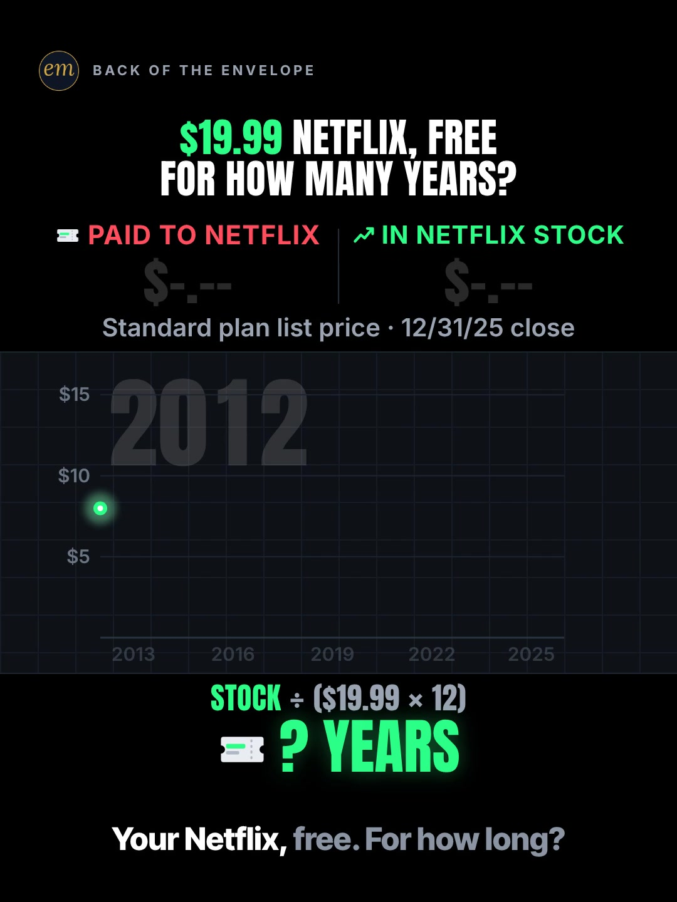

# 06b publishing sheet: your Netflix bills in Netflix stock

YouTube Shorts (@envelopemath) and Instagram Reels (@envelopemath). Prepared 2026-10-12. Machine-readable twin: `publishing/06b-scoreboard-netflix-bill.json`.

- **Video.** `renders/channel/06b-scoreboard-netflix-bill.mp4`: the condensed cut (20.8 s: an 18.3 s body + the 2.5 s card; sha256 `b5854b92…`), promoted and shipped on 2026-10-12. It replaces the 33.0 s round-2 cut (the owner: "too many still moments"). Nothing below names a timestamp except the cover, which is picked by content (frame 1), so the copy carried over unchanged. The ship rebuilt this sheet and re-exported both covers from the shipped file: `python3 publishing/tools/build_publishing.py 06b-scoreboard-netflix-bill --covers`.
- **Numbers.** Every figure comes from `teasers/v2/06-pov-race.md` (06b) and its check, `python3 teasers/v2/checks/06-pov-race.py`: 442 checks, 0 failed on `studio/specs/` (run 2026-10-12). `python3 publishing/tools/build_publishing.py 06b-scoreboard-netflix-bill --check` checks this sheet's limits, paste blocks and figures, keeps each year's figure beside its year, and re-adds the 168 bills from the plan-price schedule.
- **Honesty rules kept.** The title asks and never gives the result, and so does the cover (frame 1). The Instagram caption keeps every number below 'more'. Every claim stays inside the video's own "about 74 years of Netflix at $19.99 a month", and the copy says both of its conditions: $19.99 held flat, and the 12/31/2025 close (NFLX has moved since). No advice, no urgency, and 'Not financial advice.' is in both.
- **Brand.** "Netflix" and "NFLX" are used only to name the company, its plan and the stock the maths is about. Both platforms' copy says 'Not affiliated with or endorsed by Netflix.' The video has no Netflix logo: "Netflix" is text only, and the spend icon is the kit's generic ticket.
- **Prices.** NFLX prices are Macrotrends' split-adjusted series (Netflix pays no dividend), so the early years sit far below the prices quoted at the time (2012's average is $1.1855 in this series). The copy says "split-adjusted" wherever it names a price. Plan prices are US Standard list prices, each counted from the month it was announced; members grandfathered in 2014-2016 paid a little under list, and the copy says so.

---

## YouTube Shorts

### Title (vidIQ title score, short-form, scored against this channel)

| # | Title | Score | Chars |
|---|---|---:|---:|
| 1 | What If Your Netflix Bills Had Bought Netflix Stock? How Many Years of Free Netflix? | 96 | 84 |
| 2 | What If Every Netflix Bill Since 2012 Had Bought Netflix Stock? How Many Years of Free Netflix? | 98 | 95 |
| 3 | What If You Bought Netflix Stock Instead of Paying for Netflix? #Netflix #NetflixStock #stocks | 95 | 94 |

**Pick (paste):**

```
What If Your Netflix Bills Had Bought Netflix Stock? How Many Years of Free Netflix?
```

- 84 of 100 characters.
- The first question, 'What If Your Netflix Bills Had Bought Netflix Stock?', is the first 52 characters, so a title cut short still asks it whole; 'Netflix Stock' sits at characters 39-51. It carries the exact phrase 'netflix stock' (35,557 searches a month, +10.4%) and the 'what if you …' grammar of 'what if you invested' (9,269, +79.0%).
- The second question is the video's own hook ('$19.99 Netflix, free for how many years?') in its own unit, and none of the 13 same-idea videos in the research asks it. 'Free Netflix' means the stake paying the bill, as on screen; the tag 'free netflix subscription' (11,519 a month) is left out because those searchers want a free account.
- It raises the write-up's title from 81 to 96. Options 2 and 3 score within 2 points of it (98 and 95); vidIQ's model ranks titles but does not predict views, so the pick is decided on what shows first and on the angle.
- Also scored, not used: "What If Your Netflix Bills Had Bought Netflix Stock Instead? How Many Years of Free Netflix?" 97 (92 chars: 'Instead' adds 8 characters for 1 point); "What If Your Netflix Bills Since 2012 Had Bought Netflix Stock? How Many Years of Free Netflix?" 96 (95 chars, no gain over the pick); "What If You Bought Netflix Stock Instead of Paying Netflix Since 2012?" 95; "What If You Bought Netflix Stock Instead of Paying for Netflix?" 95 (the core of option 3); "What If Your Netflix Bills Bought Netflix Stock? How Many Years of Free Netflix?" 95 (the pick without 'Had'); "What If Your Netflix Bills Bought Netflix Stock? How Many Years of Free Netflix? #NetflixStock" 95; "How Many Years of Free Netflix Would Your Old Netflix Bills Buy in Netflix Stock?" 90; "What If Every Netflix Bill Since 2012 Bought Netflix Stock?" 89; "What If Your Netflix Bills Had Bought Netflix Stock Instead?" 88; "What If Your Netflix Bills Had Bought Netflix Stock Instead? #Netflix #NetflixStock #stocks" 88; "What If Your Netflix Bills Bought Netflix Stock Instead?" 87; "What If Your Netflix Bills Bought Netflix Stock Instead? #Netflix #NetflixStock #stocks" 87; "Netflix Stock Instead of Your Netflix Bills: How Many Years of Free Netflix?" 87; "Your Netflix Bills in Netflix Stock: How Many Years of Free Netflix?" 84; "Your 2012-2025 Netflix Bills in Netflix Stock: How Many Years of Free Netflix?" 81 (the write-up's title); "$19.99 Netflix, Free for How Many Years?" 81 (the on-screen header).

### Description (paste)

```
What if every Netflix bill from 2012 to 2025 had bought Netflix stock instead? $2,037.32 of bills vs about $17,700 in stock at the 12/31/2025 close. At today's $19.99 a month, that's about 74 years of Netflix.

The math, shown:
• 168 monthly bills at the US Standard plan's list price, from $7.99 in 2012 through seven price hikes to $17.99 in 2025: $2,037.32.
• Each year's 12 bills buy NFLX at that year's average price (split-adjusted). Netflix pays no dividend.
• End of 2020: $1,095.92 in, $9,181 in stock. ≈ 38 years of Netflix at $19.99.
• 2022: the stake halves, from $10,410 to $5,289 (≈ 22 years). You keep paying. It comes back.
• End (12/31/2025 close): 188.8 shares × $93.76 ≈ $17,700, vs $2,037.32 of bills.
• $17,706 ÷ ($19.99 × 12 = $239.88 a year) ≈ 74 years, with $19.99 held flat.

Follow for the math behind your money — shown, not hand-waved. @envelopemath

Animation and original sound: The Back of the Envelope. US Standard plan list prices, each counted from the month it was announced (Android Authority; Variety; CNBC); Standard is $19.99 a month since March 2026 (CNBC). Each year's bills buy at that year's average NFLX price, adjusted for splits (Macrotrends); valued at the 12/31/2025 close ($93.76, split-adjusted), and NFLX has moved since. Future price hikes are ignored; members grandfathered in 2014-2016 paid a little under list. No fees or taxes. Not financial advice. Not affiliated with or endorsed by Netflix.
#Netflix #NetflixStock #stocks
```

1,480 of 5,000 characters (1,505 UTF-8 bytes; YouTube counts this limit in bytes, and `≈`, `×`, `•`, `—`, `÷` take 2-3 each). No `<` or `>`, which YouTube rejects. It follows the house template: an answer-first opening line for the search snippet, then 'The math, shown:' bullets, then the follow line. The credit, assumptions and 'Not financial advice.' line comes next, and the 3 hashtags close it. The 'Doesn't Add Up' series line is left out, as on 06c: the POV races run without it, and the 74 rests on a flat $19.99 and a dated close, so 'a number that shouldn't be true' would oversell it.

### Hashtags (order matters)

1. `#Netflix`: the brand ('netflix' 1,509,447 searches a month; down 30.6% on its 30-day baseline, still by far the biggest).
2. `#NetflixStock`: the exact topic ('netflix stock' 35,557 a month, +10.4%, competition 30.0).
3. `#stocks`: the broad category ('stocks' 221,285 a month, down 17.4% on its baseline), and the same third tag as 06c, so the series shares it.

The title carries no hashtags, so YouTube shows these 3, the description's first, above the title. Over 60 hashtags and YouTube ignores all of them. `#Shorts` isn't needed.

### Tags (paste; 287 of 500 characters as YouTube counts them: commas count, and a tag with a space counts 2 more for the quotes YouTube adds)

```
netflix stock, netflix subscription, what if you invested, netflix price hike, netflix price increase, netflix stock price, netflix stock crash, nflx, netflix, stocks, dollar cost averaging, opportunity cost, money math, math animation, the back of the envelope, envelope math
```

Tags carry little weight. These mirror the keyword research plus the house's channel tags. 'netflix stock crash' covers the 2022 halving. Left out on purpose: 'free netflix subscription' (11,519 a month) and 'cancel netflix subscription' (7,402) want a free account or a how-to; 'netflix stock analysis' (12,804) and 'is netflix stock a good buy right now' (3,671) are advice intent; 'what if you invested in netflix' and 'invest instead of subscriptions' are under 750 a month.

### Pinned comment (post it, then pin it)

```
Which plan are you on? Standard is $19.99 a month since March 2026; on another plan, divide by your own bill × 12.

The working: 188.84 shares × $93.76 (12/31/2025 close, split-adjusted) ≈ $17,706, against $2,037.32 of bills (≈ 8.7×). $17,706 ÷ $239.88 a year ≈ 73.8 years. NFLX has moved since 12/31/2025, and the years move with it. Ignores taxes and future price hikes.
```

The question comes first so it shows in the collapsed preview, and it asks for the viewer's own number (R3): on Premium or the ad tier they redo the division with their own bill, as the write-up's pinned comment invites. The second paragraph is the write-up's working, multiplied out. It also answers the two comments to expect: 'prices will rise' (the 74 holds $19.99 flat after 8 hikes in 14 years, as the write-up's judges flagged) and 'the stock has fallen since' (the close is dated, and the years scale with the price; third-party Shorts from Sep-Oct 2026 describe NFLX well below its 2025 levels, not verified here).

### Related video and end screen

- **Related video:** [What If You Bought Starbucks Stock Instead of a $4 Latte Every Day?](https://www.youtube.com/shorts/fbpdKf4Wy8c) (`fbpdKf4Wy8c`). 06c, the same POV-race series and mechanic, live since Mon 12 Oct 2026. Starbucks gave about 1.4× on 12 years of lattes and Netflix about 8.7× on 14 years of bills, so the pair shows the answer depends on the stock.
- **Swap later:** 06a (first iPhone vs Apple stock), the third POV race, once published. Then point 06c's Related video at this Short.
- **End screen:** Shorts have no end screens or cards. The Related video link is the Shorts equivalent.

### Thumbnail and settings

- **Thumbnail:** in the YouTube app, pick frame 1 (the clean cover: the question and '? YEARS'), the same content as the Instagram cover below.
- **Settings:** Category Education. Not made for kids. Altered or synthetic content: No (it's an animated chart, not realistic footage). Remixing allowed. No captions needed: there's no narration and all the text is on screen.

### Posting window

- **When:** First Tue-Thu evening after the condensed cut ships and passes QA, 21:30-22:30 ET (01:30-02:30 UTC the next day): Tue 13 Oct 2026 at the earliest. Sunday 06:00-08:00 ET is the alternative.
- **Spacing:** Keep it at least 6 h from any other upload on the channel. 06c went up Mon 12 Oct 03:45 ET, so any Tue-Thu evening clears it.
- **Why:** The channel's own October Shorts, median views by posting slot (refreshed 2026-10-12): Sunday 05:00-08:00 ET 1,191 (n = 2), weekday 22:00-00:30 ET 642 (n = 3), weekday midday 263 (n = 2); 06c, posted Mon 03:45 ET, had 536 views the same day (too young to compare). The evening slot is also the best one on Instagram, so one evening serves both. n = 7 (06c left out, one day old) and confounded by topic, so treat it as a test. Search demand: 'netflix stock' runs +10.4% and 'netflix subscription' +49.0% over their 30-day baselines. Third-party Shorts from late Sep and early Oct 2026 cover NFLX's slide and analyst calls (not verified here), so the stock is in the news. The copy says only that NFLX has moved since 12/31/2025.

---

## Instagram Reels

### Caption (paste)

```
What if every Netflix bill from 2012 to 2025 had bought Netflix stock instead? Your old bills, paying for your new ones.

POV: every Standard-plan bill you paid Netflix, 2012 to 2025, buys Netflix stock instead. Each year's 12 bills buy NFLX at that year's average price (split-adjusted).

The math, shown:
• 168 bills, $7.99 a month in 2012 up to $17.99 in 2025: $2,037.32.
• End of 2020: $9,181 in stock. ≈ 38 years of Netflix at $19.99.
• 2022: it halves, to $5,289 (≈ 22 years). Then it comes back.
• End of 2025: 188.8 shares × $93.76 (split-adjusted close) ≈ $17,700 in stock.
• $17,706 ÷ $239.88 a year ≈ 74 years of Netflix at $19.99 a month.

Your old bills would pay for your new ones, if $19.99 never went up and NFLX held its 12/31/2025 close. It has moved since.

$19.99 is Standard since March 2026. US list prices; members grandfathered in 2014-2016 paid a little less. Netflix pays no dividend. No fees or taxes. Not financial advice. Not affiliated with or endorsed by Netflix.

Which plan are you on?

Follow for the math behind your money — shown, not hand-waved. @envelopemath
Animation and original sound: The Back of the Envelope.

#netflix #NFLX #stocks #investing #personalfinance
```

- 1,204 of 2,200 characters.
- **First 125 characters:** the question plus the keywords 'Netflix bill' and 'Netflix stock', with no result. The second sentence is the write-up's own caption line, which hints at the payoff without a number. This follows the write-up's caption rule: the caption overlays the Reel from frame 1. The numbers sit below 'more', where Instagram search and Google indexing still read them.
- The line after the math says the two conditions in plain words ($19.99 never going up, and the 12/31/2025 close), so the verdict is never quoted without them.
- The caption follows the house close: the follow line plus the credit.

### Hashtags (5, Instagram's cap since Dec 2025)

`#netflix #NFLX #stocks #investing #personalfinance`

Two are specific:

- `#netflix` names the brand, and `#NFLX` the ticker. Four of the same-idea Shorts in the research tag both (`#netflix #nflx`).
- Together they reach people who follow the company and people who follow the stock, the video's two sides.

`#stocks`, `#investing` and `#personalfinance` are the broad layer, as on 06c. The write-up's caption tags `#netflix #usa #investment #stocks`; `#usa` and `#investment` are dropped, as on 06c.

### Alt text

- **Short (99 characters; paste this one into Instagram):** Chart: $2,037 of Netflix bills, 2012 to 2025, vs about $17,700 in stock: about 74 years of Netflix.
  - It stays at or under 100 characters, so it fits the field however short it is. It says 'to' and 'about', not '-' and '≈', so screen readers read it cleanly. The 74 keeps its 'about', as everywhere else; the '$19.99 a month' condition does not fit in 100 characters, and the caption and the long version carry it.
- **Long (for anywhere with room, such as a website embed):** Animation on a black scoreboard. The header asks: $19.99 Netflix, free for how many years? Two counters race from 2012 to 2025: what you paid Netflix, with a ticket dropping onto its line at each of seven price hikes, and the same bills in Netflix stock, in green. An answer row turns the stock into years of today's $19.99 plan: about 38 years by 2020, about 22 after the stock halves in 2022, then a climb back. Finish: $2,037.32 of bills vs about $17,700 in stock. Payoff: about 74 years of Netflix at $19.99 a month.
- **Where:** Advanced settings → Accessibility → Alt text, if your app shows it for Reels.

### Cover



- **Files:** `publishing/06b-scoreboard-netflix-bill-cover-3x4.jpg` (1080×1440) and `publishing/06b-scoreboard-netflix-bill-cover-9x16.jpg` (1080×1920). Both come from the shipped (20.8 s) render at 0 s (frame 0).
- **Frame, by content:** The clean cover, frame 1: the question '$19.99 NETFLIX, FREE / FOR HOW MANY YEARS?' with $19.99 the only price, the board's tags PAID TO NETFLIX | IN NETFLIX STOCK over unlit counters ('$-.--'), the empty 2013-2025 race under the 2012 year clock, the working 'STOCK ÷ ($19.99 × 12)' and the empty answer '? YEARS'. It asks and does not answer, like the title and the caption. The write-up names frame 1 as the Instagram cover, and the spec designs it as one (`cover: "clean"`). On any cut, use the last frame before the first ticket falls and the counters light. On the shipped 20.8 s render, frame 0 (0.00 s) is that clean frame, and the only one: from frame 1 (0.03 s) the first ticket falls in, and the counters light at frame 8 (0.27 s; the race starts at 0.24 s). Frame 0 shows the whole first caption, 'Your Netflix, free. For how long?' (pre-typed from t −0.4 s), with 'Your Netflix,' lit (the kit lights it word by word); the grey words still read. If the cut changes, re-pick it by content.
- **Crop:** 3:4 = 1080×1440 from y 60 to 1500 of the 1080×1920 frame: the badge, the question, the board, the empty race, '? YEARS' and the caption; it drops the empty floor. A centred grid crop (y 240-1680) cuts the badge and leaves the question on the edge.
- **How to set it:** In 'Edit cover', pick frame 1 of the video (or upload the 9:16 JPG), then drag 'Profile grid' to the top so the tile matches the 3:4 JPG. Do not upload the 3:4 JPG as the Reel cover: Instagram centre-crops it to 9:16 in the Reels tab and cuts both board tags.
- **Re-export:** `ffmpeg -ss 0 -i renders/channel/06b-scoreboard-netflix-bill.mp4 -frames:v 1 -vf "crop=1080:1440:0:60" -q:v 2 publishing/06b-scoreboard-netflix-bill-cover-3x4.jpg` and `ffmpeg -ss 0 -i renders/channel/06b-scoreboard-netflix-bill.mp4 -frames:v 1 -q:v 2 publishing/06b-scoreboard-netflix-bill-cover-9x16.jpg`, or `python3 publishing/tools/build_publishing.py 06b-scoreboard-netflix-bill --covers`.
- **Not used:** the payoff hold (the question with '≈ 74 YEARS' right under it, the finished race and the verdict; 16.7-18.3 s on the shipped render). It is the save-worthy frame and 06c's cover is its verdict, but it shows the answer, against this write-up's own cover note.
- **Shipped cut (2026-10-12):** frame 1 was re-picked by content on the shipped file and both JPGs re-exported from it. It is the same picture as the 33.0 s cut's frame 1, except that one more caption word is lit: 'Your Netflix,' where the old frame lit only 'Your' (the spec now pre-types the caption from t −0.4 s).

### First comment (post it, then pin it)

```
Bills: $2,037.32. Stock: ≈ $17,700 at the 12/31/2025 close. At $19.99 a month that's ≈ 74 years of Netflix, if the price never rose. Which plan are you on?
```

### Trial Reels

**Post as a regular Reel, not a Trial.** @envelopemath has 8 followers, so a regular Reel is already shown almost entirely to non-followers, which is all a Trial Reel adds. A Trial would also keep it off the profile grid until shared. A hook test afterwards, if you want one: the other cut as a Trial with MANUAL graduation 48-72 h later. The 33.0 s render the condensed cut replaced has left renders/channel; get it from git with `git show 471c793:renders/channel/06b-scoreboard-netflix-bill.mp4 > 06b-33s.mp4` (sha256 323dc45e…). Compare skip rate (October Reels ran 27.0-65.1%; 06c's condensed cut 40.3% on its first day) and average watched %, then share the winner. vidIQ's publish tool exposes Trial (MANUAL or SS_PERFORMANCE) for this connected account. Confirm eligibility in the app.

### Posting window and settings

- **When:** Same evening as YouTube, about 15 min after the Short: 21:45-22:45 ET, Tue 13 Oct 2026 at the earliest.
- **Why:** October Reels, median plays by posting slot (refreshed 2026-10-12): weekday 22:00-00:30 ET 5,445 (n = 3, including the two best: 7,276 and 5,445), weekday midday 1,202 (n = 2), Sunday 05:00-08:00 ET 1,083 (n = 2). 06c, posted Mon 03:46 ET, had 1,685 plays the same day with a 40.3% skip rate. Skip rate tracks plays more closely than the hour does: 27.0-27.5% for the top two, 56.9-65.1% for the bottom two. The condense matters more than the hour.
- **Audio:** Rename the original audio to 'Netflix bills vs Netflix stock — The Back of the Envelope' if the app allows; it is the score, with no voice.
- **Share to feed:** On.

---

## Why these choices (research evidence)

**1. Search demand (vidIQ keyword research, pulled 2026-10-12).** vidIQ refreshes each keyword on its own schedule, so the last column gives each row's snapshot date. Six rows are older snapshots.

| Keyword | Est. searches/month | Competition | Overall | Note | vidIQ as of |
|---|---:|---:|---:|---|---|
| netflix stock | 35,557 | 30.0 | 68.8 | seed; +10.4% vs its 30-day baseline (32,208) | 2026-10-12 |
| netflix subscription | 28,272 | 45.2 | 61.8 | +49.0% vs its 30-day baseline (18,978); much of it how-to intent | 2026-10-12 |
| free netflix subscription | 11,519 | 13.8 | 70.9 | people looking for a free account: not this video's intent, so not in the tags | 2026-10-12 |
| what if you invested | 9,269 | 37.5 | 60.5 | +79.0% vs its 30-day baseline (5,178); 9,302 in the 06c sheet a day earlier | 2026-10-12 |
| cancel netflix subscription | 7,402 | 41.6 | 58.0 | +80.3% vs its baseline (4,105); how-to intent, not in the tags | 2026-10-12 |
| how many hours of work to afford a netflix subscription | 5,382 | 26.9 | 62.7 | the same re-pricing idea: a bill in another unit | 2026-09-14 |
| netflix stock crash | 5,365 | 31.2 | 60.9 | the video's 2022 halving; news intent too | 2026-08-19 |
| netflix price hike | 5,186 | 59.0 | 49.7 | flat (0%); the highest competition here | 2026-05-19 |
| netflix stock price | 4,891 | 41.6 | 56.4 |  | 2026-07-09 |
| netflix price increase | 4,125 | 38.8 | 56.9 |  | 2026-08-01 |
| nflx | 3,542 | 32.9 | 58.6 | the ticker | 2026-09-18 |
| netflix (topic) | 1,509,447 | 77.0 | 64.5 | -30.6% vs its 30-day baseline (2,173,946) | 2026-10-12 |
| what if you invested in netflix | 0 (<750) | 11.2 | 35.5 | <750/month: too small to target | no snapshot |
| netflix subscription cost | 0 (<750) | 29.7 | 28.1 | <750/month | no snapshot |
| invest instead of subscriptions | 0 (<750) |  |  | <750/month; no competition score | no snapshot |

'netflix stock' is the biggest on-topic phrase (35,557 a month) at low competition (30.0), and it is rising (+10.4%): the title and the hashtags carry it. 'what if you invested' (9,269, +79.0%) gives the title its grammar. After 'netflix subscription', the biggest Netflix phrases, 'free netflix subscription' (11,519) and 'cancel netflix subscription' (7,402), want something this video doesn't give, so they stay out of the copy. The brief's other seed phrases, 'what if you invested in netflix', 'netflix subscription cost' and 'invest instead of subscriptions', are all under 750 a month.

**2. The same idea on YouTube is crowded but small (vidIQ YouTube search, under 4 min, by views and by relevance).**

| Title | Channel (subs) | Views | Date |
|---|---|---:|---|
| Don't Just Sub To Netflix, Buy Their STOCKS! #stockmarket #investing #netflix | HD Finance (986) | 22,697 | 2023-06-20 |
| 🔥 How much you make investing your Netflix Subscriptions | Raylin Records (12,000) | 5,077 | 2022-08-16 |
| Your Netflix Bill Could’ve Bought Netflix | Invested Instead (19) | 2,351 | 2026-06-22 |
| Netflix & Chill... but what if you also invested? 💰 | Sid Panjabi (3,210) | 1,761 | 2025-04-01 |
| You paid Netflix $2,411… it could've paid YOU | The Market Feed (9) | 1,481 | 2026-09-28 |
| Netflix Subscription vs Investment | 8bitbullish (60) | 1,315 | 2025-07-14 |
| What if you’d invested £1,000 in Netflix in 2020? 👀 #Stocks #Netflix #Finance | IG UK (79,800) | 1,261 | 2025-05-15 |
| What If You Invested $15 a Month in Netflix Instead of Paying to Watch? | Your Chart Guy (10) | 1,018 | 2026-10-07 |
| Paying for Netflix every month vs buying the stock instead | Race Charts (21) | 599 | 2026-09-09 |
| What if you invested 10$ a month in Netflix instead of paying for a membership | DatasDash (87) | 593 | 2026-09-03 |
| Your Netflix Bill in Netflix Stock Since 2011 = $17,380 📺 #inflationsolved #netflix #investing | inflationsolved (35) | 134 | 2026-09-28 |
| Your Netflix fee in Netflix stock since 2007: $79K | Assetly - Invest Smarter (31) | 109 | 2026-10-08 |
| What If You Bought Netflix Stock Instead of Subscribing? | Stocks Over Stuff (73) | 123 | 2025-11-16 |
| What If You Bought Netflix Stock Instead of a Subscription? | Silver Glove (62) | 8 | 2025-09-25 |

Thirteen channels have posted the 'Netflix bill vs Netflix stock' idea, seven of them since June 2026 (the table adds IG UK's lump-sum Short for its unit). Only one passes 5,100 views: HD Finance's 10-second Short from 2023 (22,697). Two titles are near-twins of option 3 ('What If You Bought Netflix Stock Instead of a Subscription?', '… Instead of Subscribing?'), and inflationsolved's 'Your Netflix Bill in Netflix Stock Since 2011' is almost the write-up's title. None asks for the answer in years of Netflix; only IG UK's description gives one ('94 years of binge-watching', from £1,000). So the pick leads with the familiar 'what if … bought Netflix stock' and adds the one question only this video answers.

Next door, the framings travel: warikoo's 'iPhone vs Apple Shares' (27,635,784 views, India-facing, a product vs its own shares) and ChartOrbit's 'What If You Invested $5,000 in NETFLIX and DISNEY?' (15,876,424, the write-up's H16) are among the biggest Shorts the searches returned. The monthly-bill version has not broken out yet.

**3. The format travels on Instagram and TikTok; the Netflix version hasn't yet (vidIQ IG/TikTok outlier search).**

- **@velturbo.xq** (Instagram), "HBO Max is $10 a month. HBO is owned by AT&T and its stock $T can be bought for $25 a share rn.": 305.9K (21.3x).
  - A static tweet screenshot: a streaming bill set against the parent company's stock, the same thought as this Short. The account's own caption is about something else.
- **@claudiagadelha** (Instagram), "POV: YOU INVESTED $399 IN TESLA INSTEAD OF BUYING A PS4 IN 2013": 593.2K (69.4x).
- **@data.dragonn** (TikTok), "POV: Someone invested $100 every month in the GoPro Stock over the last 12 years": 1.4M (49.6x). Monthly buying, like the bills here.
- **@investment_timeline** (TikTok), "POV: You invested in Monster instead of paying $3/day for a Monster Energy": 1.5M (140.6x). Its caption is the POV line plus hashtags, with no result.
- The three POV posts open on the premise with no number from the result on frame 1, which is what this Short's cover (frame 1) and caption do. Two concept searches for a Netflix-bill Reel or TikTok (since mid-2024, at least 5K views) found none.

**4. Our own October numbers (vidIQ: public YouTube stats, Instagram owner insights; refreshed 2026-10-12).**

| YouTube Short | Posted (ET) | Views |
|---|---|---:|
| Can You Find the Missing Dollar? (`LjHDFzVxRyM`) | Sun 07:04 | 1,241 |
| You Can Lean on $1 Million. Not on $1 Billion. (`hJBvmGA6sZ0`) | Thu 00:25 | 1,221 |
| Your Interest Has a Speed Limit (`XVUeMcTg9OQ`) | Sun 05:49 | 1,141 |
| Pay the Minimum on $5,000? 238 Months. (`8__HTUa2PoU`) | Mon 22:09 | 642 |
| What If You Bought Starbucks Stock Instead of a $4 Latte Every Day? (06c) (`fbpdKf4Wy8c`) | Mon 03:45 | 536 |
| A $2 Lottery Ticket Was Worth $6.98. Until the Fine Print. (`FW_oxA3kbsM`) | Wed 12:03 | 348 |
| You Can Carry $1 Million. Not in Pennies. (`mXbKY_R63h4`) | Thu 13:38 | 177 |
| Start Investing 10 Years Late? You Get Half. (`EqFQCJheCMU`) | Tue 22:27 | 160 |

| Instagram Reel | Posted (ET) | Plays | Skip rate | Avg watched |
|---|---|---:|---:|---:|
| $5,000 on the minimum (`DeIvYk7I4Qr`) | Mon 22:46 | 7,276 | 27.5% | 56.5% |
| $1M stack vs Burj Khalifa (`DeOEthJJ1TG`) | Thu 00:28 | 5,445 | 27.0% | 83.2% |
| Missing dollar (`DeWgFZRoR_S`) | Sun 07:05 | 1,988 | 31.9% | 81.4% |
| Powerball $6.98 (`DeMvZv9IqRw`) | Wed 12:05 | 1,805 | 58.9% | 57.9% |
| 06c latte vs Starbucks stock (`DeYuqT4pjVC`) | Mon 03:46 | 1,685 | 40.3% | 69.7% |
| $1M in pennies (`DePe11HIHwn`) | Thu 13:37 | 598 | 42.0% | 66.7% |
| 10 years late (`DeLSd9io8UK`) | Tue 22:30 | 219 | 65.1% | 30.6% |
| Speed limit (e) (`DeEW2ZMIiYd`) | Sun 05:54 | 177 | 56.9% | 31.2% |

Channel totals:

- **YouTube:** 53 subscribers, 9,001 views and 40 videos (+27 subscribers, +3,907 views and 10 videos in 30 days).
- **Instagram:** 8 followers and 18,641 views in 30 days.

06c is already live on both (Mon 12 Oct, about 03:45 ET): 536 views on YouTube and 1,685 plays on Instagram the same day, with a 40.3% skip rate and 69.7% watched. That is its condensed 18.2 s cut, so it is the first read on what the condense does: its skip rate sits between the top two Reels (27.0-27.5%) and the bottom two (56.9-65.1%).

Medians by posting slot (n = 2-3 each, confounded by topic; 06c left out, one day old):

- **YouTube:** Sunday early morning ET 1,191, weekday 22:00-00:30 ET 642, weekday midday 263.
- **Instagram:** weekday 22:00-00:30 ET 5,445, midday 1,202, Sunday early morning 1,083.

One weekday evening is the best Instagram slot and the second-best YouTube slot, so the plan posts both then. On Instagram, skip rate predicts plays better than the hour does (27.0-27.5% for the top two, 56.9-65.1% for the bottom two). So the window is a light-touch test, and the owner's condense (fewer still moments) is the bigger reach lever.

**5. Platform rules applied.**

- **YouTube title:** 100 characters. The Shorts player shows only the opening, so the keywords come first.
- **YouTube description:** 5,000 characters.
- **YouTube hashtags:** the first 3 show; over 60 and all are ignored; `#Shorts` isn't needed.
- **YouTube tags:** 500 characters, low weight.
- **YouTube Shorts:** no end screens. The Related video link is the Shorts equivalent.
- **YouTube AI disclosure:** only for realistic altered content.
- **Instagram caption:** 2,200 characters, about 125 shown before 'more'.
- **Instagram hashtags:** 5 at most.
- **Instagram search and Google:** keywords in the caption feed Instagram search, and Google indexes public professional posts (since 10 Jul 2025).
- **Instagram grid:** a 3:4 crop of the 9:16 cover.
- **Trial Reels:** shown to non-followers only.

**6. Limits.**

- vidIQ's YouTube authorization is a different channel (UCRC5v_El2fibbkqsZs6uFjA), so @envelopemath's YouTube Analytics (audience hours, geography) were not readable. Check Studio → Analytics → Audience → 'When your viewers are on YouTube' before posting.
- vidIQ has no hashtag-volume data; hashtag picks lean on keyword volume and on the same-idea Shorts' and outliers' own tags.
- Title scores are vidIQ's short-form CTR model for this channel; they rank options but do not predict views.
- NFLX's moves after 12/31/2025 come only from third-party Short descriptions (e.g. a 7 Oct 2026 close of $69.70 in Assetly's); none is verified here, and none is in the copy, which says only that NFLX has moved since.

---

## Check log (adversarial pass, 2026-10-12)

- **Maths.** `python3 teasers/v2/checks/06-pov-race.py`: 443 checks, 0 failed at this check (442 checks, 0 failed after the condensed cut was promoted). Every public figure traces to the 06b maths table: 168 bills from $7.99 to $17.99, $2,037.32; 2020 $1,095.92 / $9,181 (≈ 38 years); 2021 $10,410 → 2022 $5,289 (≈ 22 years, −49.2%); 188.8 × $93.76 ≈ $17,700; 188.84 × $93.76 ≈ $17,706 (≈ 8.7×); 12 × $19.99 = $239.88; $17,706 ÷ $239.88 = 73.8 ≈ 74 years. The data file re-adds the 168 bills from the plan-price schedule.
- **Limits.** Title 84/100. Description 1,480 characters (1,505 bytes) of 5,000. 3 hashtags. Tags 287/500 as YouTube counts them. Instagram caption 1,204/2,200, with the first 125 characters result-free. 5 hashtags. Short alt text 99. No `<` or `>`.
- **vidIQ.** Keywords pulled 2026-10-12 (table above). 19 titles scored against this channel: the pick 96, the top 98, the write-up's title 81. Channel 53 subscribers / 9,001 views / 40 videos; Instagram owner insights refreshed (8 followers, 18,641 views in 30 days).
- **vidIQ re-queried.** 'netflix stock' 35,557 / 30.0 (+10.4%); 'stocks' 221,285 (−17.4%); the pick's title score 96; 06c (`fbpdKf4Wy8c`) 536 views, published 07:45 UTC (03:45 ET). All match. Outside vidIQ, Standard at $19.99 since March 2026 (Fox local stations, 27 Mar 2026, citing Netflix and Variety) and NFLX's December 2025 price of $93.76 (Digrin, split-adjusted) agree with the write-up's sources.
- **Changed.**
  - The short alt text said '74 years of Netflix', the only bare 74 in the copy. It now says 'about 74 years' (99 characters; 'Chart:' replaces 'Animation:' to fit).
  - The Instagram caption names $93.76 as the 'split-adjusted close', as the description and the pinned comment do, so the 188.8 shares read in today's shares.
  - Posting window: the rule is the first Tue-Thu evening after the cut ships, and any Tue-Thu evening clears 06c, so the earliest date is Tue 13 Oct, not Wed 14 Oct.
  - The numbers check missed two kinds of break: a swapped year count ('End of 2020: … ≈ 22 years') and a spelled-out 'seventy-four'. Both passed FIGURES. The builder now runs a data file's `COPY_RULES`, and this file's rules pin $1,095.92, $9,181 and 38 beside 2020, and the halving ($10,410, $5,289, 22) beside 2022. They also keep 74 and $17,700 'about' or '≈', and keep 74 and 73.8 with their $19.99 or $239.88. They allow no spelled-out figures except 'two', 'seven' and 'halves'. Seven mutations of this file now fail by name, and 06c's sheet is unchanged byte for byte.
- **Found on the way.** 06c is live on both platforms (YouTube `fbpdKf4Wy8c`, Instagram `DeYuqT4pjVC`, Mon 12 Oct about 03:45 ET), so it is this Short's related video, and the October tables include it.
- **Generator.** This is the first sheet built by `publishing/tools/build_publishing.py` from a data file (`publishing/data/06b-scoreboard-netflix-bill.py`). The same tool rebuilds the shipped 06c sheet byte for byte.
- **Kept on purpose.**
  - The cover is frame 1 (no result), not a verdict frame as on 06c: the 06b write-up names frame 1 as the Instagram cover and the spec designs it as one, and the outliers in section 3 open on the question too.
  - The title drops the write-up's '2012-2025': the year clock shows 2012 on frame 1, and the description and the caption give the dates.
  - No hashtags in the title (no room for three at 84 characters); the description's three show above it.
  - 'Free Netflix' in the title: the video's header ('$19.99 Netflix, free for how many years?') and first caption ('Your Netflix, free.') say it, and the video answers it (≈ 74 years at $19.99 a month); the description's first line says how. Free-account searches stay out of the tags.
  - The audio name carries 'Netflix', as 06c's carries 'Starbucks': it names the topic, and the copy says 'Not affiliated with or endorsed by Netflix.'
- **Done on ship (2026-10-12).** Rebuilt with `--covers` from the shipped condensed cut. Frame 1 was re-picked by content and is still frame 0, now with 'Your Netflix,' lit in the first caption. The Video bullet, the cut and the check counts follow the shipped file, and the long alt text was re-read against it: every beat it names is in the condensed cut (the seven hike tickets, ≈ 38 years by 2020, ≈ 22 after the 2022 halving, the finish and the payoff), so no copy changed.
