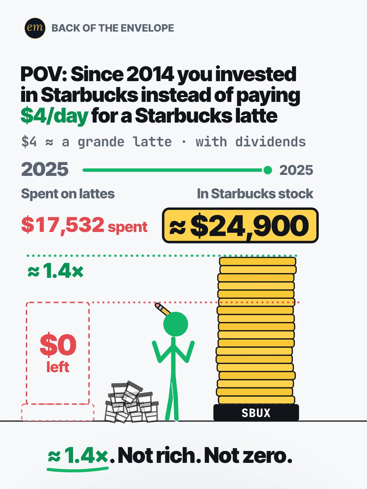

# 06c publishing sheet: $4 latte vs Starbucks stock

YouTube Shorts (@envelopemath) and Instagram Reels (@envelopemath). Prepared 2026-10-12. Machine-readable twin: `publishing/06c-becker-rig-latte-starbucks.json`.

- **Video.** `renders/channel/06c-becker-rig-latte-starbucks.mp4`: the condensed cut (18.2 s: a 15.7 s body + the 2.5 s card; sha256 `d431ea6b…`), promoted and shipped on 2026-10-12. It replaces the 30.5 s cut. Nothing below names a timestamp except the cover, which is picked by content.
- **Numbers.** Every figure comes from `teasers/v2/06-pov-race.md` (06c) and its check, `python3 teasers/v2/checks/06-pov-race.py`: 441 checks, 0 failed on `studio/specs/` with the condensed cut promoted (re-run 2026-10-12). `python3 publishing/tools/build_06c_publishing.py --check` checks this sheet's limits, paste blocks and figures.
- **Honesty rules kept.** The title asks and never gives the result. The Instagram caption keeps the result below 'more'. Every claim stays inside "≈ 1.4×. Not rich. Not zero." No advice, no urgency, and 'Not financial advice.' is in both.
- **Brand.** "Starbucks" and "SBUX" are used only to name the company and the stock the maths is about. Both platforms' copy says 'Not affiliated with or endorsed by Starbucks.' The video draws a generic cup with no logo.
- **Prices.** SBUX prices are Macrotrends' split- and dividend-adjusted series, which sit below the prices quoted at the time. The copy says "adjusted" wherever it names a close, so a viewer who looks up the 2021 close does not think the numbers are wrong.

---

## YouTube Shorts

### Title (vidIQ title score, short-form, scored against this channel)

| # | Title | Score | Chars |
|---|---|---:|---:|
| 1 | What If You Bought Starbucks Stock Instead of a $4 Latte Every Day? #Starbucks #LatteFactor #stocks | 97 | 99 |
| 2 | What If You Invested in Starbucks Instead of Buying a $4 Latte Every Day Since 2014? | 96 | 84 |
| 3 | What If Every $4 Starbucks Latte Bought Starbucks Stock Instead? | 89 | 64 |

**Pick (paste):**

```
What If You Bought Starbucks Stock Instead of a $4 Latte Every Day? #Starbucks #LatteFactor #stocks
```

- 99 of 100 characters. If YouTube Studio counts it over 100, drop `#stocks` (91 chars).
- 'Starbucks Stock' sits at characters 20-34, inside what the Shorts player shows before it truncates. It has the exact phrase 'starbucks stock' (7,441 searches a month). It also uses the 'what if you …' grammar of 'what if you invested' (9,302, +79.6%); option 2 carries that phrase word for word, for 1 point less.
- Still a question, still second person, still the same brand on both sides. It raises the write-up's title from 89 to 97.
- Also scored, not used: "What If You Bought Starbucks Stock Instead of a $4 Latte Every Day Since 2014?" 97 (78 chars, no room for hashtags); "What If You Bought Starbucks Stock Instead of a $4 Latte Every Day? #starbucks #lattefactor #investing" 97 (102 chars: over the 100 limit); "What If You Invested in Starbucks Instead of Buying a $4 Latte?" 94; "What If You Invested in Starbucks Instead of Buying a $4 Latte? #starbucks #lattefactor #investing" 94; "The Latte Factor, Tested on Starbucks Stock: $4 a Day Since 2014" 84; "$4 Latte Every Day Since 2014 vs Starbucks Stock: The Latte Factor Tested" 84; "Skip the $4 Latte, Buy Starbucks Stock? 12 Years of Math" 82; "The Latte Factor, Tested on Starbucks Itself" 82.

### Description (paste)

```
What if every $4 Starbucks latte since 2014 had bought Starbucks stock instead? The latte factor, tested on Starbucks itself: $17,532 of lattes vs about $24,900 in stock. About 1.4×. Not rich. Not zero.

The math, shown:
• $4 × 365 = $1,460 a year, each year's money buying SBUX at that year's average price (dividends reinvested).
• By the end of 2021: $11,688 in, $24,343 in stock. Doubled (2.08×).
• Then it stalls. 2022–2025: another $5,844 in, but the stake grew just $585. The 229 shares held at the end of 2021 fell from $106.24 to $84.21 (dividend-adjusted prices).
• End (12/31/2025 close): 296.0 shares × $84.21 ≈ $24,926, vs $17,532 of lattes. ≈ 1.4×.
• The cups are worth $0. The stock is not zero.

Follow for the math behind your money — shown, not hand-waved. @envelopemath

Animation and original sound: The Back of the Envelope. $4 ≈ a grande latte ($3.65 in 2014, $4.45 in 2024; FinanceBuzz via Visual Capitalist), held flat every day from 1/1/2014 to 12/31/2025. Each year buys at that year's average SBUX price, adjusted for splits and dividends (Macrotrends); valued at the 12/31/2025 adjusted close; no fees or taxes. Not financial advice. Not affiliated with or endorsed by Starbucks.
#Starbucks #LatteFactor #stocks
```

1,239 of 5,000 characters (1,264 UTF-8 bytes; YouTube counts this limit in bytes, and `≈`, `×`, `•`, `—` take 2-3 each). No `<` or `>`, which YouTube rejects. It follows the house template: an answer-first opening line for the search snippet, then 'The math, shown:' bullets, then the follow line. The credit, assumptions and 'Not financial advice.' line comes next, and the 3 hashtags close it. The 'Doesn't Add Up' series line is left out on purpose: it promises 'a number that shouldn't be true', and 06c is an honest 'meh'.

### Hashtags (order matters)

1. `#Starbucks`: the brand ('starbucks' 156,350 searches a month, +55.4% over baseline).
2. `#LatteFactor`: the debate the video answers (4,455 a month, competition 29.2).
3. `#stocks`: the broad category ('stocks' 211,921 a month; down 23.5% on its 30-day baseline, but still the biggest of the three).

In the title they show as links. With no hashtags in the title, YouTube would show the first 3 description hashtags above it instead. Over 60 hashtags and YouTube ignores all of them. `#Shorts` isn't needed.

### Tags (paste; 450 of 500 characters as YouTube counts them: commas count, and a tag with a space counts 2 more for the quotes YouTube adds)

```
starbucks stock, latte factor, the latte factor, what if you invested, buying starbucks coffee stock, starbucks stock vs coffee, what is the latte factor, skip coffee and invest, latte factor myth, the latte factor investing, $4 a day invested, sbux, starbucks stock dividends reinvested, what happened to starbucks stock, dollar cost averaging, opportunity cost, money math, math animation, the back of the envelope, envelope math
```

Tags carry little weight. These mirror the keyword research plus the house's channel tags. 'what happened to starbucks stock' covers the stall years. 'is starbucks stock a buy now' (4,548 a month) is left out because its intent is advice. 'what is the latte factor' (4,824 a month, competition 29.6) replaces 'invest instead of buying coffee', which the research below puts under 750 searches a month.

### Pinned comment (post it, then pin it)

```
A grande latte was $3.65 in 2014 and $4.45 in 2024 (FinanceBuzz). What does your daily coffee cost now?

Check the end: 296.0 shares × $84.21 (12/31/2025 close, dividend-adjusted) ≈ $24,926, vs $17,532 of lattes. ≈ 1.4×.
```

The question comes first so it shows in the collapsed preview. It asks for the viewer's own number (R3), and the second line answers the commenters who check the multiplication.

### Related video and end screen

- **Related video:** [Start Investing 10 Years Late? You Get Half.](https://www.youtube.com/shorts/EqFQCJheCMU) (`EqFQCJheCMU`). Same viewer intent: a small amount invested over years. It pairs this Short's stall with the cost of waiting, without repeating it.
- **Swap later:** 06a (first iPhone vs Apple stock) or 06b (Netflix bill vs Netflix stock): the same POV-race series, once published.
- **End screen:** Shorts have no end screens or cards. The Related video link is the Shorts equivalent.

### Thumbnail and settings

- **Thumbnail:** in the YouTube app, pick the verdict-hold frame, the same content as the Instagram cover below.
- **Settings:** Category Education. Not made for kids. Altered or synthetic content: No (it's an animated chart, not realistic footage). Remixing allowed. No captions needed: there's no narration and all the text is on screen.

### Posting window

- **When:** First Tue-Thu evening now that the condensed render has passed QA (shipped 2026-10-12); earliest Wed 14 Oct 2026, 21:30-22:30 ET (Thu 01:30-02:30 UTC). Sunday 06:00-08:00 ET is the alternative.
- **Spacing:** Keep it at least 6 h from any other upload on the channel.
- **Why:** The channel's own October Shorts, median views by posting slot: Sunday 05:00-08:00 ET 1,178 (n = 2), weekday 22:00-00:30 ET 642 (n = 3), weekday midday 262 (n = 2). The evening slot is also the best one on Instagram, so one evening serves both. n = 7 and confounded by topic, so treat it as a test. Search demand: 'starbucks' runs +55.4% over its 30-day baseline (fall menu season). Starbucks' next quarterly report is due in late October, per a third-party Short's description (not verified). Posting about two weeks earlier gives the Short time to be indexed if 'starbucks stock' interest rises then. The copy mentions neither.

---

## Instagram Reels

### Caption (paste)

```
What if every $4 Starbucks latte since 2014 had bought Starbucks stock instead? The latte factor, tested on Starbucks itself.

POV: since 2014 you invested in Starbucks instead of paying $4/day for a Starbucks latte. Each year's latte money buys SBUX at that year's average price, dividends reinvested.

The math, shown:
• $4 × 365 = $1,460 a year of lattes.
• By the end of 2021: $11,688 in, $24,343 in stock. Doubled.
• 2022–2025: another $5,844 in, but the stake grew just $585.
• End of 2025: $17,532 of lattes vs ≈ $24,900 in stock. ≈ 1.4×.

Not rich. Not zero. The cups are worth $0; the stock isn't.

Is the latte factor real? On Starbucks itself, 12 years of lattes came to about 1.4 times the money, with almost no growth after 2021.

$4 ≈ a grande latte ($3.65 in 2014, $4.45 in 2024; FinanceBuzz), held flat. Valued at the 12/31/2025 dividend-adjusted close ($84.21); no fees or taxes. Not financial advice. Not affiliated with or endorsed by Starbucks.

What do you pay for your latte now?

Follow for the math behind your money — shown, not hand-waved. @envelopemath
Animation and original sound: The Back of the Envelope.

#thelattefactor #starbucks #SBUX #investing #personalfinance
```

- 1,197 of 2,200 characters.
- **First 125 characters:** the question plus the keywords 'Starbucks latte', 'Starbucks stock' and 'latte factor', with no result. This follows the write-up's caption rule: the caption overlays the Reel from frame 1. The numbers sit below 'more', where Instagram search and Google indexing still read them.
- The caption follows the house close: the follow line plus the credit.

### Hashtags (5, Instagram's cap since Dec 2025)

`#thelattefactor #starbucks #SBUX #investing #personalfinance`

Two are specific:

- `#thelattefactor` is the tag @davidlbach opens his outlier caption with. On YouTube, 'the latte factor' also out-searches 'latte factor', 5,052 to 4,455.
- `#SBUX` reaches people who follow the ticker.

`#starbucks`, `#investing` and `#personalfinance` are the broad layer. The write-up's 6-tag caption is over the cap, so `#latte`, `#usa` and `#investment` are dropped.

### Alt text

- **Short (99 characters; paste this one into Instagram):** Animation: $17,532 of $4-a-day Starbucks lattes, 2014 to 2025, vs about $24,900 in Starbucks stock.
  - It stays at or under 100 characters, so it fits the field however short it is. It says 'a day', 'to' and 'about', not '/', '-' and '≈', so screen readers read it cleanly.
- **Long (for anywhere with room, such as a website embed):** Animation on a white background. A green stick figure pays $4 for a latte every day from 2014 to 2025, drinks it and tosses the cup onto a growing pile, while a coin lands on a tower of gold coins labelled SBUX. Counters: $17,532 spent on lattes vs about $24,900 in Starbucks stock. The stock doubles the money by 2021, then stalls. Verdict: about 1.4 times. Not rich. Not zero.
- **Where:** Advanced settings → Accessibility → Alt text, if your app shows it for Reels.

### Cover



- **Files:** `publishing/06c-becker-rig-latte-starbucks-cover-3x4.jpg` (1080×1440) and `publishing/06c-becker-rig-latte-starbucks-cover-9x16.jpg` (1080×1920). Both come from the shipped (18.2 s) render at 14.7 s (frame 441).
- **Frame, by content:** The verdict hold: '$0 left' in the empty spent column, the '≈ 1.4×' mark on the tower top, '$17,532 spent' vs '≈ $24,900', and the line '≈ 1.4×. Not rich. Not zero.' fully drawn. Use the first settled frame of that hold, before the em end card. On the shipped MP4 the verdict lands at 14.1 s and the '≈ $24,900' plate finishes growing at 14.67 s; from 14.70 s (frame 441) the frame-to-frame luma change stays at the figure's idle level (≤ 0.011 mean) until the end card at 15.73 s. If the cut changes, re-pick it by content.
- **Crop:** 3:4 = 1080×1440 from y 60 to 1500 of the 1080×1920 frame (badge, header, both numbers, both piles and the verdict line; drops the empty floor). A centred grid crop (y 240-1680) cuts the badge.
- **How to set it:** In 'Edit cover', pick the verdict frame from the video (or upload the 9:16 JPG), then drag 'Profile grid' to the top so the tile matches the 3:4 JPG. Do not upload the 3:4 JPG as the Reel cover: Instagram centre-crops it to 9:16 in the Reels tab and cuts both numbers.
- **Re-export:** `ffmpeg -ss 14.7 -i renders/channel/06c-becker-rig-latte-starbucks.mp4 -frames:v 1 -vf "crop=1080:1440:0:60" -q:v 2 publishing/06c-becker-rig-latte-starbucks-cover-3x4.jpg` and `ffmpeg -ss 14.7 -i renders/channel/06c-becker-rig-latte-starbucks.mp4 -frames:v 1 -q:v 2 publishing/06c-becker-rig-latte-starbucks-cover-9x16.jpg`, or `python3 publishing/tools/build_06c_publishing.py --covers`.

### First comment (post it, then pin it)

```
Cups: $0. Stock: ≈ $24,900, on $17,532 of lattes. A grande latte was $3.65 in 2014 and $4.45 in 2024 (FinanceBuzz). What does yours cost now?
```

### Trial Reels

**Post as a regular Reel, not a Trial.** @envelopemath has 8 followers, so a regular Reel is already shown almost entirely to non-followers, which is all a Trial Reel adds. A Trial would also keep it off the profile grid until shared. A hook test afterwards, if you want one: the other cut as a Trial with MANUAL graduation 48-72 h later. The 30.5 s render it replaced is no longer in renders/channel; get it from git with `git show 80e35e5:renders/channel/06c-becker-rig-latte-starbucks.mp4 > 06c-30.5s.mp4` (sha256 ca342ff6…, with the soundtrack it had before the v2.2 ship). Compare skip rate (October Reels ran 27.0-65.1%) and average watched %, then share the winner. vidIQ's publish tool exposes Trial (MANUAL or SS_PERFORMANCE) for this connected account. Confirm eligibility in the app.

### Posting window and settings

- **When:** Same evening as YouTube: earliest Wed 14 Oct 2026, 21:45-22:45 ET, about 15 min after the Short.
- **Why:** October Reels, median plays by posting slot: weekday 22:00-00:30 ET 5,431 (n = 3, including the two best: 7,251 and 5,431), weekday midday 1,178 (n = 2), Sunday 05:00-08:00 ET 1,042 (n = 2). Skip rate tracks plays more closely than the hour does: 27.0-27.5% for the top two, 56.9-65.1% for the bottom two. The condense matters more than the hour.
- **Audio:** Rename the original audio to 'Latte vs Starbucks stock — The Back of the Envelope' if the app allows; it is the score, with no voice.
- **Share to feed:** On.

---

## Why these choices (research evidence)

**1. Search demand (vidIQ keyword research, pulled 2026-10-11, re-queried 2026-10-12 with the same values).** vidIQ refreshes each keyword on its own schedule, so the last column gives each row's snapshot date. Four rows are older snapshots.

| Keyword | Est. searches/month | Competition | Overall | Note | vidIQ as of |
|---|---:|---:|---:|---|---|
| what if you invested | 9,302 | 37.5 | 60.5 | +79.6% vs its 30-day baseline (5,178) | 2026-10-11 |
| starbucks stock | 7,441 | 39.5 | 58.9 | seed; 'is starbucks stock a buy now' (4,548) is advice intent, not used | 2026-10-11 |
| the latte factor | 5,052 | 27.8 | 62.1 | flat (0% growth) | 2026-09-08 |
| if you invested $2 a day in coca-cola stock instead of drinking coca-cola | 5,237 | 21.2 | 64.8 | same format, other brand | 2026-10-11 |
| the latte factor is a lie | 4,511 | 23.0 | 63.5 | demand for the sceptical angle; our answer is 'not rich, not zero', so it is not in the copy | 2026-10-11 |
| latte factor | 4,455 | 29.2 | 61.0 | low competition | 2026-09-14 |
| buying starbucks coffee stock | 3,577 | 28.1 | 60.6 |  | 2026-04-13 |
| the latte factor investing | 3,465 | 13.3 | 66.4 | only 'latte factor dave ramsey show' (10.3) and 'the latte factor how small expenses add up' (12.0) are lower | 2026-06-17 |
| starbucks (topic) | 156,350 | 69.4 | 58.8 | +55.4% vs 30-day baseline (100,602): seasonal tailwind | 2026-10-11 |
| invest instead of buying coffee | 0 (<750) | 32.4 | 27.0 | <750/month: too small to target; dropped from the tags | no snapshot |

The cluster is medium volume with low competition (13-40). The title takes the two largest specific phrases ('what if you invested', 'starbucks stock'). The hashtags and caption carry 'latte factor'.

**2. The same idea on YouTube is unclaimed (vidIQ YouTube search, Shorts, by views).**

| Title | Channel (subs) | Views | Date |
|---|---|---:|---|
| The REAL Investment In STARBUCKS!! #shorts | Madhur Agarwal (187,000) | 40,278 | 2022-12-04 |
| How Much Would YOU Make Buying STARBUCKS instead of STARBUCKS? | Weekly Theta (1,160) | 9,575 | 2024-01-17 |
| $6 Starbucks a Day Since 2010: Coffee vs $SBUX Stock | Stocks with Josh (196,000) | 5,636 | 2026-06-23 |
| What If You Bought Starbucks Stock Instead of their Coffee? World's most expensive coffee! #stock | TickerTimeMachine (6) | 1,901 | 2025-05-08 |
| If you invested your Starbucks order instead… | Patrick Kenney (41,400) | 1,256 | 2025-09-16 |
| ☕ What if you invested $2 a day in Starbucks instead of buying coffee? 🤯💰 | Market Data Daily (4) | 570 | 2025-03-12 |
| Skip the $5 latte, buy Starbucks stock? 10 years of data. | Assetly - Invest Smarter (29) | 71 | 2026-10-08 |
| Skip your $5 latte and become a millionaire? #shorts | Money, Drawn (2) | 32 | 2026-09-28 |

Nobody owns 'Starbucks stock instead of the latte' on YouTube. The biggest same-idea Short found has 40,278 views: Madhur Agarwal's, India-facing, from 2022, with a broker referral in its description. The 2026-10-12 re-check found it with the query 'starbucks stock instead of coffee'. The biggest US-facing one has 9,575. Half of the 8 titles (4) frame it as '… instead of …', and 3 of those as '(what) if you bought/invested'. That's the frame the pick uses.

**3. The idea travels on Instagram and TikTok (vidIQ IG/TikTok outlier search).**

- **@davidlbach** (Instagram), "The Latte Factor! DRINKING A STARBUCKS COFFEE A DAY VS BUYING THE STOCK INSTEAD (SBUX)":
  - The outlier index reports 1.9M views (201.5x his 9.7K median). The profile endpoint shows 16.7K plays for the same reel; the two sources disagree.
  - His caption opens with `#thelattefactor`.
  - His chart runs from 1992, the IPO-era run. Ours is the 2014-2025 version, which answers his framing honestly.
- **@investment_timeline** (TikTok), "POV: You invested in Monster instead of paying $3/day for a Monster Energy": 1.5M (140.6x).
  - Its caption is the POV line plus hashtags, with no result. Our caption keeps that rule above the fold.

**4. Our own October numbers (vidIQ: public YouTube stats, Instagram owner insights).**

| YouTube Short | Posted (ET) | Views |
|---|---|---:|
| You Can Lean on $1 Million. Not on $1 Billion. (`hJBvmGA6sZ0`) | Thu 00:25 | 1,221 |
| Can You Find the Missing Dollar? (`LjHDFzVxRyM`) | Sun 07:04 | 1,215 |
| Your Interest Has a Speed Limit (`XVUeMcTg9OQ`) | Sun 05:49 | 1,141 |
| Pay the Minimum on $5,000? 238 Months. (`8__HTUa2PoU`) | Mon 22:09 | 642 |
| A $2 Lottery Ticket Was Worth $6.98. Until the Fine Print. (`FW_oxA3kbsM`) | Wed 12:03 | 348 |
| You Can Carry $1 Million. Not in Pennies. (`mXbKY_R63h4`) | Thu 13:38 | 175 |
| Start Investing 10 Years Late? You Get Half. (`EqFQCJheCMU`) | Tue 22:27 | 160 |

| Instagram Reel | Posted (ET) | Plays | Skip rate | Avg watched |
|---|---|---:|---:|---:|
| $5,000 on the minimum (`DeIvYk7I4Qr`) | Mon 22:46 | 7,251 | 27.5% | 56.5% |
| $1M stack vs Burj Khalifa (`DeOEthJJ1TG`) | Thu 00:28 | 5,431 | 27.0% | 83.1% |
| Missing dollar (`DeWgFZRoR_S`) | Sun 07:05 | 1,907 | 32.4% | 80.4% |
| Powerball $6.98 (`DeMvZv9IqRw`) | Wed 12:05 | 1,759 | 59.7% | 58.0% |
| $1M in pennies (`DePe11HIHwn`) | Thu 13:37 | 596 | 41.7% | 67.2% |
| 10 years late (`DeLSd9io8UK`) | Tue 22:30 | 219 | 65.1% | 30.6% |
| Speed limit (e) (`DeEW2ZMIiYd`) | Sun 05:54 | 177 | 56.9% | 31.2% |

Channel totals:

- **YouTube:** 53 subscribers, 8,995 views and 39 videos (+27 subscribers and +3,901 views in 30 days).
- **Instagram:** 8 followers and 18,600 views in 30 days.

Medians by posting slot (n = 2-3 each, confounded by topic):

- **YouTube:** Sunday early morning ET 1,178, weekday 22:00-00:30 ET 642, weekday midday 262.
- **Instagram:** weekday 22:00-00:30 ET 5,431, midday 1,178, Sunday early morning 1,042.

One weekday evening is the best Instagram slot and the second-best YouTube slot, so the plan posts both then. On Instagram, skip rate predicts plays better than the hour does (27.0-27.5% for the top two, 56.9-65.1% for the bottom two). So the window is a light-touch test, and the owner's condense (fewer still moments) is the bigger reach lever.

**5. Platform rules applied.**

- **YouTube title:** 100 characters. The Shorts player shows only the opening, so the keywords come first.
- **YouTube description:** 5,000 characters.
- **YouTube hashtags:** the first 3 show; over 60 and all are ignored; `#Shorts` isn't needed.
- **YouTube tags:** 500 characters, low weight.
- **YouTube Shorts:** no end screens. The Related video link is the Shorts equivalent.
- **YouTube AI disclosure:** only for realistic altered content.
- **Instagram caption:** 2,200 characters, about 125 shown before 'more'.
- **Instagram hashtags:** 5 at most.
- **Instagram search and Google:** keywords in the caption feed Instagram search, and Google indexes public professional posts (since 10 Jul 2025).
- **Instagram grid:** a 3:4 crop of the 9:16 cover.
- **Trial Reels:** shown to non-followers only.

**6. Limits.**

- vidIQ's YouTube authorization is a different channel (UCRC5v_El2fibbkqsZs6uFjA), so @envelopemath's YouTube Analytics (audience hours, geography) were not readable. Check Studio → Analytics → Audience → 'When your viewers are on YouTube' before posting.
- vidIQ has no hashtag-volume data; hashtag picks lean on keyword volume and on the outliers' own tags.
- Title scores are vidIQ's short-form CTR model for this channel; they rank options but do not predict views.

---

## Check log (adversarial pass, 2026-10-12)

- **Maths.** `python3 teasers/v2/checks/06-pov-race.py`: 436 checks, 0 failed. Every public figure traces to the 06c maths table: $1,460, $11,688 / $24,343 (2.08×), $5,844 / +$585, 229 shares, $106.24 → $84.21, 296.0 × $84.21 ≈ $24,926, $17,532, ≈ $24,900, ≈ 1.4×.
- **Limits.** Title 99/100. Description 1,239 characters (1,264 bytes) of 5,000. 3 hashtags. Tags 450/500 as YouTube counts them. Instagram caption 1,197/2,200, with the first 125 characters result-free. 5 hashtags. Short alt text 99. No `<` or `>`.
- **vidIQ re-queried.** 'starbucks stock' 7,441; 'what if you invested' 9,302 (+79.6%); 'latte factor' 4,455; 'the latte factor' 5,052; 'buying starbucks coffee stock' 3,577; the coca-cola phrase 5,237; 'starbucks' 156,350 (+55.4%). The title scores are 97 (pick) and 89 (write-up title). The channel has 53 subscribers, 8,995 views and 39 videos. All match.
- **Changed.**
  - Added "adjusted" to every named close (description, pinned comment, caption). Macrotrends' $106.24 for 2021 is dividend-adjusted, below the close quoted at the time.
  - Added 'Not affiliated with or endorsed by Starbucks.' to both platforms' copy.
  - Shortened the Instagram alt text to 99 characters and made it screen-reader-friendly.
  - Swapped the sub-750 tag 'invest instead of buying coffee' for 'what is the latte factor'.
  - Added each keyword's vidIQ snapshot date (four are older than 2026-10-11) and fixed two notes ('lowest competition', the 21-40 range).
  - Added the 40,278-view Madhur Agarwal Short, which beats the "top English Short 9,575" claim.
- **Kept on purpose.**
  - The cover and YouTube frame show the verdict. The write-up's no-result rule covers the header, the title and the caption, and the cover also carries the POV hook.
  - The title has no "since 2014": the header says it on frame 1, and adding it scores the same but leaves no room for the house's three title hashtags.
- **Re-checked when the condensed cut shipped (2026-10-12).** `06-pov-race.py` on `studio/specs/`: 441 checks, 0 failed. The copy names no timestamp, so only the video facts and the cover changed: `for_video` now points at the shipped 18.2 s MP4, and both cover JPGs were re-exported from it at 14.7 s (frame 441), the first settled frame of the verdict hold. The numbers check passes (limits, paste blocks, figures).
- **Re-shipped the same day (opening fix).** The first 0.5 s no longer hold still: the figure weighs the $4 coin in his hand until the first purchase (Becker Rig pov-race `heft`). Frame 1, the soundtrack (packet for packet), the timings and every figure are unchanged, and so is the copy. `for_video`'s sha256 follows the new file, and both covers were re-exported from it at 14.7 s.
