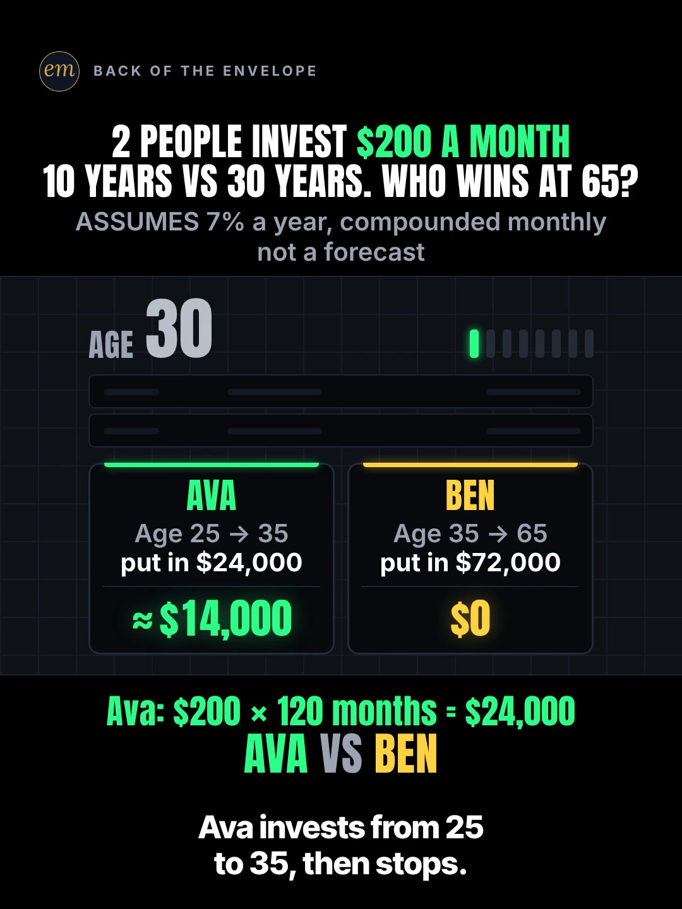

# 07a publishing sheet: 2 people invest $200 a month, 10 years vs 30 years

YouTube Shorts (@envelopemath) and Instagram Reels (@envelopemath). Prepared 2026-10-13. Machine-readable twin: `publishing/07a-scoreboard-start-at-25.json`.

- **Video.** `renders/channel/07a-scoreboard-start-at-25.mp4`: the pre-condense cut (25.3 s: a 22.8 s body + the 2.5 s card; sha256 `30f0cd64…`), the Scoreboard port (fix pass 2026-10-08) as `renders/channel` holds it on 2026-10-13. A condensed cut is in progress (timing only: the numbers, captions and verdict stay). Nothing below names a timestamp except the cover, which is picked by content (the Age 30 row landed), so the copy carries over. The ship step rebuilds this sheet and re-exports both covers from the final file: `python3 publishing/tools/build_publishing.py 07a-scoreboard-start-at-25 --covers`.
- **Numbers.** Every figure comes from `teasers/v2/07-ledger-duel.md` (07a) and its check, `python3 teasers/v2/checks/07-ledger-duel.py`: 461 checks, 0 failures on `studio/specs/` (run 2026-10-13). `python3 publishing/tools/build_publishing.py 07a-scoreboard-start-at-25 --check` checks this sheet's limits, paste blocks and figures, recomputes every ledger row, the gap, the 6% case and the ≈ 6.1% break-even from $200 a month at 7%/12, keeps each figure with its own person (Ava or Ben) and each Age row's pair together.
- **Honesty rules kept.** The title asks who has more at 65 and never says, and so does the cover (the Age 30 row, no final). The Instagram caption keeps every result below 'more'. The reversal rests on the assumed 7%: the description and the caption both say it is an assumption, not a forecast, and give the condition, Ben edges ahead at 6% and Ava's head start wins above about 6.1%, as the write-up's caption does. No advice, no urgency, and 'Not financial advice.' is in both.
- **Brand.** None. No company, fund or index is named (the 7% is a stated assumption, not a market series), so no affiliation line is needed.
- **Overlap.** The channel already posted the same ages as a lump sum ('Start Investing 10 Years Late? You Get Half.': 161 views; on Instagram a 65.1% skip rate, the highest of its October Reels). This Short's angle is the reversal (Ava stops at 35, Ben puts in 3 times as much, and Ava still finishes ahead), so the title and the caption lead with the stop, not with 'start early'.

---

## YouTube Shorts

### Title (vidIQ title score, short-form, scored against this channel)

| # | Title | Score | Chars |
|---|---|---:|---:|
| 1 | She Invests for 10 Years, Then Stops. He Invests for 30. Who Has More at 65? | 94 | 76 |
| 2 | She Invests $200 a Month for 10 Years. He Invests for 30. Who Has More at 65? | 90 | 77 |
| 3 | Start Investing at 25 or at 35? One Stops After 10 Years. Who Has More at 65? | 88 | 77 |

**Pick (paste):**

```
She Invests for 10 Years, Then Stops. He Invests for 30. Who Has More at 65?
```

- 76 of 100 characters.
- It asks the header's question ('Who wins at 65?') as 'Who Has More at 65?' and carries the twist the write-up's title adds ('One Stops at 35') as 'Then Stops', without the answer. 'She' and 'He' are Ava and Ben, the video's two panels; their plans are on screen from frame 1.
- It scores 94, 7 points over the write-up's title (87). The keyword-led versions score lower ('Compound Interest: …' 87; 'Start Investing at 25 or at 35? …' 88), so the search words ride in the description's first line, the hashtags and the tags, and the title is written for the feed. vidIQ's model ranks titles; it does not predict views.
- The same idea is already up on at least nine small channels (ten Shorts; research, section 2), mostly as '10 years vs 30 years, who wins?'. None tells it as two people with the stop in the title.
- Also scored, not used: "She Invests $200 a Month From 25 to 35. He Invests From 35 to 65. Who Has More at 65?" 88; "She Starts Investing at 25 and Stops at 35. He Starts at 35. Who Has More at 65?" 88; "2 People Invest $200 a Month. One Stops at 35. Who Has More at 65?" 87 (the write-up's title); "2 People Invest $200 a Month: 10 Years vs 30 Years. Who Wins at 65?" 87 (the on-screen header); "Start Investing at 25 and Stop at 35, or Start at 35 and Never Stop? Who Has More at 65?" 87; "Compound Interest: Invest $200 a Month for 10 Years or 30 Years? Who Has More at 65?" 87 (the keyword up front gains nothing); "Invest $200 a Month for 10 Years or for 30 Years: Who Has More at 65?" 86; "Invest From 25 to 35 or From 35 to 65: Who Has More at 65? #compoundinterest #investing #money" 85 (the 3-hashtag form).

### Description (paste)

```
Ava invests $200 a month from age 25 to 35, then stops: $24,000 in. Ben invests $200 a month from 35 to 65: $72,000 in. At an assumed 7% a year, Ava has about $281,000 at 65 and Ben about $244,000. A third of the money, and Ava still wins.

The math, shown:
• Ava: $200 × 120 months = $24,000. Ben: $200 × 360 months = $72,000, 3 times as much.
• Age 35: Ava ≈ $35,000, Ben $0. Ava stops adding; her balance keeps compounding.
• Age 45: Ava ≈ $70,000, Ben ≈ $35,000.
• Age 55: Ava ≈ $140,000, Ben ≈ $104,000.
• Age 65: Ava ≈ $281,000, Ben ≈ $244,000. Ava wins by ≈ $37,000.
• It hangs on the rate. At 6% a year, Ben edges ahead: Ben ≈ $201,000, Ava ≈ $197,000. Ava's head start wins above about 6.1%.

Follow for the math behind your money — shown, not hand-waved. @envelopemath

Animation and original sound: The Back of the Envelope. $200 deposited at each month-end at an assumed 7% a year, compounded monthly. 7% is an assumption, not a forecast. No fees or taxes; not adjusted for inflation. Not financial advice.
#compoundinterest #investing #personalfinance
```

1,064 of 5,000 characters (1,100 UTF-8 bytes; YouTube counts this limit in bytes, and `≈`, `×`, `•`, `—` take 2-3 each). No `<` or `>`, which YouTube rejects. It follows the house template: an answer-first opening line for the search snippet, then 'The math, shown:' bullets, then the follow line. The credit, assumptions and 'Not financial advice.' line comes next, and the 3 hashtags close it. The 'Doesn't Add Up' series line is left out, as on 06b and 06c: the verdict holds only above about 6.1% a year, which the copy says, so 'a number that shouldn't be true' would oversell it.

### Hashtags (order matters)

1. `#compoundinterest`: the mechanism, and the biggest on-topic phrase ('compound interest' 137,873 searches a month, competition 50.6; down 17.3% on its 30-day baseline).
2. `#investing`: the broad category ('investing' 613,566 a month, competition 65.0, flat at −2.0%).
3. `#personalfinance`: the channel's layer ('personal finance' 1,436,792 a month, −18.1%); the write-up's caption tags all three, and so did the channel's earlier start-age Short.

The title carries no hashtags, so YouTube shows these 3, the description's first, above the title. Over 60 hashtags and YouTube ignores all of them. `#Shorts` isn't needed.

### Tags (paste; 363 of 500 characters as YouTube counts them: commas count, and a tag with a space counts 2 more for the quotes YouTube adds)

```
compound interest, power of compound interest, the power of compound interest, compound interest explained, how compound interest works, start investing early, too late to start investing, investing at 25, invest $200 a month, investing for beginners, investing, personal finance, money math, math animation, the back of the envelope, envelope math
```

Tags carry little weight. These mirror the keyword research plus the house's channel tags. 'too late to start investing' (10,525 a month) is Ben's side of the question; 'investing at 25' and 'invest $200 a month' are the video's own words, with no vidIQ volume. Left out on purpose: 'how to start investing' (105,784, +13.8%) and its 'with $100' variants are how-to intent this Short doesn't answer, and the 'simple and compound interest' phrases are exam intent.

### Pinned comment (post it, then pin it)

```
What age did you start? If Ava had never stopped at 35, she'd have ≈ $525,000 at 65.

Why 7%? It's an assumption, not a forecast, and the result hangs on it: the flip point is about 6.1% a year. At 6%, Ben's 30 years come out ahead (Ben ≈ $201,000, Ava ≈ $197,000). Month-end deposits; no fees or taxes.
```

The write-up's pinned comment, reordered so its question shows first in the collapsed preview: had Ava never stopped (the seed's original version), she'd have ≈ $525,000. The second paragraph answers the comment the write-up expects ('but 7% isn't guaranteed') with the break-even and the 6% case, so the verdict is never quoted without its condition.

### Related video and end screen

- **Related video:** [Start Investing 10 Years Late? You Get Half.](https://www.youtube.com/shorts/EqFQCJheCMU) (`EqFQCJheCMU`). The channel's own lump-sum version of the same ages ($10,000 at 25 vs at 35), live since Tue 6 Oct 2026. This Short is its sequel: the early starter stops, and the late one puts in 3 times as much.
- **Swap later:** 07b or 07c, the other ledger duels, once published. Then point EqFQCJheCMU's Related video at this Short.
- **End screen:** Shorts have no end screens or cards. The Related video link is the Shorts equivalent.

### Thumbnail and settings

- **Thumbnail:** in the YouTube app, pick the Age 30 frame (Ava's first row landed at ≈ $14,000, Ben at $0, no final), the same content as the Instagram cover below.
- **Settings:** Category Education. Not made for kids. Altered or synthetic content: No (it's an animated chart, not realistic footage). Remixing allowed. No captions needed: there's no narration and all the text is on screen.

### Posting window

- **When:** First Tue-Thu evening after the 07a condensed cut ships and passes QA, 21:30-22:30 ET (01:30-02:30 UTC the next day). Sunday 06:00-08:00 ET is the alternative.
- **Spacing:** Keep it at least 6 h from any other upload on the channel, and post one ledger duel (07a, 07b, 07c) per evening.
- **Why:** The channel's own October Shorts, median views by posting slot (vidIQ, 2026-10-13): Sunday 05:00-08:00 ET 1,199 (n = 2), weekday 22:00-00:30 ET 642 (n = 3), weekday midday 263 (n = 2). The evening slot is also the best one on Instagram, so one evening serves both. n = 7 and confounded by topic, so treat it as a test. The topic is evergreen ('compound interest' −17.3%, 'the power of compound interest' +40.6% on their baselines), so no date matters more than the slot.

---

## Instagram Reels

### Caption (paste)

```
10 years of $200 a month vs 30 years of $200 a month. Who has more at 65? Compound interest, worked out row by row.

Ava invests $200 a month from 25 to 35, then stops: $24,000 in. Ben starts at 35 and never stops: $72,000 in, 3 times as much.

The math, shown:
• $200 at each month-end, at an assumed 7% a year, compounded monthly.
• Age 35: Ava ≈ $35,000, Ben $0. Ava stops adding; her balance keeps compounding.
• Age 45: Ava ≈ $70,000, Ben ≈ $35,000.
• Age 55: Ava ≈ $140,000, Ben ≈ $104,000.
• Age 65: Ava ≈ $281,000, Ben ≈ $244,000.

A third of the money, and Ava still wins, by ≈ $37,000.

7% is an assumption, not a forecast, and the result hangs on it. At 6% a year, Ben edges ahead: Ben ≈ $201,000, Ava ≈ $197,000. Ava's head start wins above about 6.1%. No fees or taxes; not adjusted for inflation. Not financial advice.

What age did you start?

Follow for the math behind your money — shown, not hand-waved. @envelopemath
Animation and original sound: The Back of the Envelope.

#compoundinterest #investing #personalfinance #investingforbeginners #moneymath
```

- 1,072 of 2,200 characters.
- **First 125 characters:** the bet, the question ('Who has more at 65?') and 'compound interest', with no result. The write-up's 'Watch the Age 65 row.' becomes the 'row by row' line, so the hook points at the ledger without the answer. The numbers sit below 'more', where Instagram search and Google indexing still read them.
- The rate paragraph gives the verdict's condition in plain words, as the write-up's caption does: 7% is an assumption, Ben edges ahead at 6%, and Ava wins above about 6.1%.
- The caption follows the house close: the follow line plus the credit.

### Hashtags (5, Instagram's cap since Dec 2025)

`#compoundinterest #investing #personalfinance #investingforbeginners #moneymath`

The write-up's four caption tags, plus one:

- `#compoundinterest`, `#investing` and `#personalfinance` are the same three as YouTube; `#moneymath` is the write-up's series tag on all three ledger duels.
- `#investingforbeginners` is the fifth: 'investing for beginners' is 295,600 searches a month on YouTube, and the channel's own start-age Short ('Start Investing 10 Years Late? You Get Half.') carries it as a tag.

### Alt text

- **Short (98 characters; paste this one into Instagram):** Chart: $200 a month at 7%, age 25 to 35 vs 35 to 65: Ava about $281,000, Ben about $244,000 at 65.
  - It stays at or under 100 characters, so it fits the field however short it is. It says 'to' and 'about', not '→' and '≈', so screen readers read it cleanly. The 7% is in it, so the two finals are never given without their rate.
- **Long (for anywhere with room, such as a website embed):** Animation on a black scoreboard. The header reads: 2 people invest $200 a month. 10 years vs 30 years. Who wins at 65? Ava, in green, invests from age 25 to 35 and puts in $24,000; Ben, in yellow, invests from 35 to 65 and puts in $72,000. An age ticker steps from 30 to 65 while both counters roll: Ava about $35,000 at 35 while Ben has $0, then both grow. At 65, Ava has about $281,000 and Ben about $244,000. Verdict: Ava wins by about $37,000 with a third of the money. Footer: assumes 7% a year, compounded monthly; not a forecast.
- **Where:** Advanced settings → Accessibility → Alt text, if your app shows it for Reels.

### Cover



- **Files:** `publishing/07a-scoreboard-start-at-25-cover-3x4.jpg` (1080×1440) and `publishing/07a-scoreboard-start-at-25-cover-9x16.jpg` (1080×1920). Both come from the pre-condense (25.3 s) render at 2.5 s (frame 75).
- **Frame, by content:** The Age 30 row, landed and settled: the header '2 PEOPLE INVEST $200 A MONTH / 10 YEARS VS 30 YEARS. WHO WINS AT 65?' over the 7% footer, the AGE 30 ticker with its first pip lit and seven to come, the two LED-off strip slots, AVA (Age 25 → 35, put in $24,000) at ≈ $14,000 and BEN (Age 35 → 65, put in $72,000) at $0, the working line 'Ava: $200 × 120 months = $24,000' over 'AVA VS BEN', and the first caption. It asks and does not answer: no final, no verdict. The write-up names this frame (Age 30 landed) as the Instagram cover: not frame 1, where Ava's odometer is mid-roll and reads as a wrong Age 30 value in a still, and not the finished table, which answers the question. On any cut, use the first settled frame after the Age 30 count lands. On the pre-condense 25.3 s render the Age 30 count lands at 2.0 s (frame 60) with a bump and a glow; the frame-to-frame luma change reaches the idle level by 2.43 s (frame 73) and stays at 0.000 until the Age 35 cut at 3.2 s. Frame 75 (2.50 s) is inside that still hold; the first caption reads 'Ava invests from 25 / to 35, then stops.', lit up to 'then' (the kit lights it word by word; the grey word still reads). The write-up's 2.1 s is mid-glow on this render. If the cut changes, re-pick it by content.
- **Crop:** 3:4 = 1080×1440 from y 60 to 1500 of the 1080×1920 frame. The content runs from y 141 (the badge) to y 1454 (the caption), so the tile keeps the badge, the header and footer, the whole stage, the working line, the matchup and the caption, and drops the empty floor. A centred grid crop (y 240-1680) cuts the badge and the header.
- **How to set it:** In 'Edit cover', pick the Age 30 frame from the video (or upload the 9:16 JPG), then drag 'Profile grid' to the top so the tile matches the 3:4 JPG. Do not upload the 3:4 JPG as the Reel cover: Instagram centre-crops it to 9:16 in the Reels tab and cuts the header.
- **Re-export:** `ffmpeg -ss 2.5 -i renders/channel/07a-scoreboard-start-at-25.mp4 -frames:v 1 -vf "crop=1080:1440:0:60" -q:v 2 publishing/07a-scoreboard-start-at-25-cover-3x4.jpg` and `ffmpeg -ss 2.5 -i renders/channel/07a-scoreboard-start-at-25.mp4 -frames:v 1 -q:v 2 publishing/07a-scoreboard-start-at-25-cover-9x16.jpg`, or `python3 publishing/tools/build_publishing.py 07a-scoreboard-start-at-25 --covers`.
- **Not used:** frame 1 (Ava's odometer mid-roll reads as a wrong Age 30 value in a still) and the verdict hold (the flooded AVA panel over the finished table and 'AVA WINS BY ≈ $37,000'), which answers the title.
- **On ship:** the condensed cut may move the Age 30 landing. `--covers` exports at COVER_T, so first re-pick the first settled frame after the landing by content and update COVER_T and COVER_FRAME.

### First comment (post it, then pin it)

```
Ava: $24,000 in, ≈ $281,000 at 65. Ben: $72,000 in, ≈ $244,000. Had Ava never stopped at 35: ≈ $525,000. What age did you start?
```

### Trial Reels

**Post as a regular Reel, not a Trial.** @envelopemath has 8 followers, so a regular Reel is already shown almost entirely to non-followers, which is all a Trial Reel adds. A Trial would also keep it off the profile grid until shared. A hook test afterwards, if you want one: the other cut as a Trial with MANUAL graduation 48-72 h later. Once the condensed cut ships, the pre-condense render is in git: `git show 471c793:renders/channel/07a-scoreboard-start-at-25.mp4 > 07a-pre-condense.mp4` (sha256 d922b569…). Compare skip rate (October Reels ran 27.0-65.1%; '10 years late', the same ages, 65.1%) and average watched %, then share the winner. vidIQ's publish tool exposes Trial (MANUAL or SS_PERFORMANCE) for this connected account. Confirm eligibility in the app.

### Posting window and settings

- **When:** Same evening as YouTube, about 15 min after the Short: 21:45-22:45 ET.
- **Why:** October Reels, median plays by posting slot (owner insights, 2026-10-13): weekday 22:00-00:30 ET 5,449 (n = 3, including the two best: 7,303 and 5,449), weekday midday 1,212 (n = 2), Sunday 05:00-08:00 ET 1,087 (n = 2). Skip rate tracks plays more closely than the hour does: 27.0-27.4% for the top two, 56.9-65.1% for the bottom two. The condense matters more than the hour.
- **Audio:** Rename the original audio to '10 years vs 30 years — The Back of the Envelope' if the app allows; it is the score, with no voice.
- **Share to feed:** On.

---

## Why these choices (research evidence)

**1. Search demand (vidIQ keyword research, pulled 2026-10-13).** vidIQ refreshes each keyword on its own schedule, so the last column gives each row's snapshot date. One row is an older snapshot.

| Keyword | Est. searches/month | Competition | Overall | Note | vidIQ as of |
|---|---:|---:|---:|---|---|
| compound interest | 137,873 | 50.6 | 65.8 | the mechanism; −17.3% vs its 30-day baseline (166,772) | 2026-10-12 |
| compound interest explained | 51,994 | 40.3 | 66.1 | −11.3% vs its baseline (58,623) | 2026-10-12 |
| how compound interest works | 18,742 | 43.5 | 60.9 | −12.4% | 2026-10-12 |
| the power of compound interest | 12,634 | 46.6 | 58.1 | +40.6% vs its baseline (8,988): the one compounding phrase rising | 2026-10-12 |
| too late to start investing | 10,525 | 40.2 | 59.9 | Ben's side of the question | 2026-10-12 |
| start investing early | 4,755 | 49.0 | 53.3 | seed; no baseline | 2026-09-07 |
| what $100 a month becomes at every age you start investing | 15,809 | 35.0 | 63.6 | the start-age idea as a by-age table; not used | 2026-10-12 |
| how to start investing | 105,784 | 47.5 | 66.0 | +13.8%; how-to intent, not in the copy | 2026-10-12 |
| investing for beginners | 295,600 | 49.0 | 69.4 | −22.0%; the fifth Instagram tag | 2026-10-12 |
| investing | 613,566 | 65.0 | 65.8 | −2.0% | 2026-10-12 |
| personal finance | 1,436,792 | 60.0 | 71.1 | −18.1% | 2026-10-12 |

'compound interest' is the biggest on-topic phrase (137,873 a month) at medium competition (50.6), so it leads the hashtags; 'the power of compound interest' is the one compounding phrase rising (+40.6%). The start-age phrases are small ('start investing early' 4,755) or how-to ('how to start investing' 105,784), which this Short doesn't answer. Search is not this Short's main door: the same idea is up on many small channels and none of it is big (section 2), so the title is written for the feed and the search words ride in the description, the hashtags and the tags.

**2. The same idea on YouTube is crowded, recent and small (vidIQ YouTube search, under 4 min, by views).**

| Title | Channel (subs) | Views | Date |
|---|---|---:|---|
| This Is What Happens When You Start Investing at 25 vs 35 | Rich & Wise (28) | 931 | 2025-04-14 |
| Invest Only 10 Years vs 30: Who Wins? 🤯 | The Money Rewind (1) | 277 | 2026-10-09 |
| Waiting 10 Years to Invest Cost $600,000 #shorts | Money In 60 (26) | 235 | 2026-10-09 |
| The Magic of Compound Interest: Why Starting at 25 Beats Starting at 35 | Plootus | Retirement & 401k Tips (215) | 216 | 2026-06-13 |
| Two friends, one wins with a third of the money #startinvesting | Richard Sterling | Simple Wealth Rules (27) | 121 | 2026-10-07 |
| The Easiest (& Laziest) Way to Get Rich | Nas The Finance Dude (183) | 49 | 2026-08-16 |
| Why Your First 10 Years of Investing Beat the Next 30 | 100xwealthlab (17) | 15 | 2026-09-23 |
| Invest for 10 Years, Then Stop - and Still Beat 30 Years #shorts | FinancialShift (5) | 13 | 2026-06-30 |
| 10 Years vs 30 Years: Who Ends Up Richer? 💰 | The Money Rewind (1) | 7 | 2026-10-08 |
| He Invested 3x As Much As His Twin. She Still Has More. #shorts | 小辉 | Holdings Vista (0) | 0 | 2026-10-06 |

'Stop at 35 and still win' is the classic compound-interest example, and at least nine channels have posted it as a Short (ten Shorts, six of them since mid-September 2026). None has reached 1,000 views: the biggest is Rich & Wise's from April 2025 (931). Nas The Finance Dude's has this Short's exact numbers ($200, 7%, $280,968 vs $243,994) and 49 views. Three titles give the answer away ('Two friends, one wins with a third of the money'; 'Invest for 10 Years, Then Stop - and Still Beat 30 Years'; 'She Still Has More'); most of the rest ask '10 years vs 30, who wins?'. The pick keeps the question and tells it as two people: she stops, he doesn't.

The channel has a near-neighbour of its own: 'Start Investing 10 Years Late? You Get Half.' (the same 25 vs 35 ages, a lump sum) drew 161 views and a 65.1% Instagram skip rate. So the copy leads with the stop and the 3× deposits, not with 'start early'.

**3. Start-age comparisons travel on Instagram and TikTok as a side-by-side with music (vidIQ IG/TikTok outlier search, since Oct 2025).**

- **@ramsey.solutions** (TikTok), "Why starting your Roth IRA young is so important": 2.7M (60.5x). A 20-year-old vs a 30-year-old side by side, music only.
- **@mike.cpa** (TikTok), "why you need to start early ROTH IRA": 1.7M (385.0x). An 18 vs 25 comparison as static text, music only, 5 s.
- **@cashflowinmotion** (Instagram), "WHEN YOU RETIRE AT 62 VS 70": 3.3M (1323.5x). Faceless text with music: an age duel with no voice, the closest in form to this Short.
- **@betterwavefinance** (Instagram), "How much you need to invest monthly to retire with $5 million": 482.1K (116.3x). A stick-figure animation of the start-age idea.
- **@its.kimberly.ash** (Instagram), "monthly investing by age to have $1M by 65": 4.1M (2293.6x). Talking head over a by-age list.
- The exact 'stops at 35' duel did not surface as an outlier on either platform; these are its cousins. Every one states the comparison on frame 1 and leaves the answer for later, which the cover (Age 30) and the caption's first line do too.

**4. Our own October numbers (vidIQ: public YouTube stats, Instagram owner insights; pulled 2026-10-13).**

| YouTube Short | Posted (ET) | Views |
|---|---|---:|
| Can You Find the Missing Dollar? (`LjHDFzVxRyM`) | Sun 07:04 | 1,256 |
| You Can Lean on $1 Million. Not on $1 Billion. (`hJBvmGA6sZ0`) | Thu 00:25 | 1,221 |
| Your Interest Has a Speed Limit (`XVUeMcTg9OQ`) | Sun 05:49 | 1,141 |
| What If You Bought Starbucks Stock Instead of a $4 Latte Every Day? (06c) (`fbpdKf4Wy8c`) | Mon 03:45 | 760 |
| Pay the Minimum on $5,000? 238 Months. (`8__HTUa2PoU`) | Mon 22:09 | 642 |
| A $2 Lottery Ticket Was Worth $6.98. Until the Fine Print. (`FW_oxA3kbsM`) | Wed 12:03 | 348 |
| You Can Carry $1 Million. Not in Pennies. (`mXbKY_R63h4`) | Thu 13:38 | 177 |
| Start Investing 10 Years Late? You Get Half. (`EqFQCJheCMU`) | Tue 22:27 | 161 |
| What If You Bought Netflix Stock Instead of Paying for Netflix? (06b) (`krfZEHhb0xU`) | Mon 12:14 | 75 |

| Instagram Reel | Posted (ET) | Plays | Skip rate | Avg watched |
|---|---|---:|---:|---:|
| $5,000 on the minimum (`DeIvYk7I4Qr`) | Mon 22:46 | 7,303 | 27.4% | 56.5% |
| $1M stack vs Burj Khalifa (`DeOEthJJ1TG`) | Thu 00:28 | 5,449 | 27.0% | 83.1% |
| Missing dollar (`DeWgFZRoR_S`) | Sun 07:05 | 1,997 | 32.0% | 81.3% |
| Powerball $6.98 (`DeMvZv9IqRw`) | Wed 12:05 | 1,825 | 58.7% | 57.9% |
| 06c latte vs Starbucks stock (`DeYuqT4pjVC`) | Mon 03:46 | 1,711 | 40.3% | 69.1% |
| $1M in pennies (`DePe11HIHwn`) | Thu 13:37 | 598 | 42.0% | 66.7% |
| 10 years late (`DeLSd9io8UK`) | Tue 22:30 | 219 | 65.1% | 30.6% |
| Speed limit (e) (`DeEW2ZMIiYd`) | Sun 05:54 | 177 | 56.9% | 31.2% |

Channel totals:

- **YouTube:** 53 subscribers, 10,221 views and 41 videos (+27 subscribers, +5,127 views and 11 videos in 30 days).
- **Instagram:** 8 followers and 20,519 views in 30 days.

06b went up on both platforms on Mon 12 Oct at 12:14 ET (75 views on YouTube by 13 Oct; its Reel shows 7 plays, Instagram's insights lag), and 06c the same morning (760 views, 1,711 plays, 40.3% skip). Both are left out of the medians as too young.

Medians by posting slot (n = 2-3 each, confounded by topic):

- **YouTube:** Sunday early morning ET 1,199, weekday 22:00-00:30 ET 642, weekday midday 263.
- **Instagram:** weekday 22:00-00:30 ET 5,449, midday 1,212, Sunday early morning 1,087.

The closest past post is '10 years late' (the same 25 vs 35 ages, a lump sum, dominoes): 161 YouTube views, and on Instagram 219 plays with a 65.1% skip rate and 30.6% watched, the weakest of the month. The channel's compounding Shorts have not travelled on Instagram yet ('Speed limit (e)' 56.9% skip). This one opens on a bet with a number on frame 1 and a count already rolling, which the two best Reels (27.0-27.4% skip) share; the cover A/B in Trial Reels is the test.

**5. Platform rules applied.**

- **YouTube title:** 100 characters. The Shorts player shows only the opening, so the keywords come first.
- **YouTube description:** 5,000 characters.
- **YouTube hashtags:** the first 3 show; over 60 and all are ignored; `#Shorts` isn't needed.
- **YouTube tags:** 500 characters, low weight.
- **YouTube Shorts:** no end screens. The Related video link is the Shorts equivalent.
- **YouTube AI disclosure:** only for realistic altered content.
- **Instagram caption:** 2,200 characters, about 125 shown before 'more'.
- **Instagram hashtags:** 5 at most.
- **Instagram search and Google:** keywords in the caption feed Instagram search, and Google indexes public professional posts (since 10 Jul 2025).
- **Instagram grid:** a 3:4 crop of the 9:16 cover.
- **Trial Reels:** shown to non-followers only.

**6. Limits.**

- As the 06b and 04b sheets found (not re-checked here), vidIQ's YouTube authorization is a different channel (UCRC5v_El2fibbkqsZs6uFjA), so @envelopemath's YouTube Analytics (audience hours, geography) were not readable. Check Studio → Analytics → Audience → 'When your viewers are on YouTube' before posting.
- vidIQ has no hashtag-volume data; hashtag picks lean on keyword volume and the same-idea Shorts' own tags.
- Title scores are vidIQ's short-form CTR model for this channel; they rank options but do not predict views.
- The render in renders/channel is the pre-condense cut. The cover's time and frame are measured on it; the copy names no other timestamp, and the ship step re-picks the cover on the final file.
- The vidIQ credit balance is shared with the other sheets being built in parallel; this sheet's spend is counted from each tool's listed cost, checked against the balance (see research.vidiq_credits).

---

## Check log (first build and adversarial pass, 2026-10-13)

- **Maths.** `python3 teasers/v2/checks/07-ledger-duel.py`: 461 checks, 0 failures. Every public figure traces to the 07a maths table: $200 × 120 = $24,000; $200 × 360 = $72,000 (3×); Age 35 ≈ $35,000 / $0; Age 45 ≈ $70,000 / ≈ $35,000; Age 55 ≈ $140,000 / ≈ $104,000; Age 65 ≈ $281,000 / ≈ $244,000, gap ≈ $37,000; at 6% ≈ $197,000 / ≈ $201,000; break-even 6.109% ≈ 6.1%; B(480) ≈ $525,000. The data file recomputes each from the formula.
- **Limits.** Title 76/100. Description 1,064 characters (1,100 bytes) of 5,000. 3 hashtags. Tags 363/500 as YouTube counts them. Instagram caption 1,072/2,200, with the first 125 characters result-free. 5 hashtags. Short alt text 98. No `<` or `>`.
- **vidIQ.** Keywords pulled 2026-10-13 (table above). 11 titles scored against this channel: the pick 94, the write-up's title 87, the header 87. Channel 53 subscribers / 10,221 views / 41 videos; Instagram owner insights refreshed (8 followers, 20,519 views in 30 days).
- **Generator.** Unchanged. The 07 check prints '461 checks, 0 failures', and the builder reads only 'N checks, F failed', so `MATH_SCRIPT` is `publishing/data/checks/07-ledger-duel.py`, a copy of the 03 adapter: it runs the 07 check unchanged, passes its output and exit code through and adds the summary line.
- **vidIQ re-queried.** At the adversarial check: the pick's title score 94; 'compound interest explained' 51,994 / 40.3 (−11.3%) and 'how compound interest works' 18,742 / 43.5 (−12.4%); channel 53 subscribers / 10,221 views / 41 videos (+27 / +5,127 / 11 in 30 days); the related video EqFQCJheCMU 162 views (161 at the build), live since Tue 6 Oct 22:27 ET. All match.
- **Changed.**
  - The Instagram caption said 'No fees, taxes or inflation.', which reads as an assumption of zero inflation; it now says 'No fees or taxes; not adjusted for inflation.', as the description and the write-up do.
  - The Overlap bullet called '10 years late' the channel's 'weakest October Reel'; by plays 'Speed limit (e)' is lower (177 vs 219). It now says what holds: the highest skip rate of the month (65.1%).
  - A title bullet said the idea is up on 'at least ten small channels'; section 2 lists ten Shorts from nine channels. It now says nine channels, ten Shorts, and section 2's 'six of them' is pinned to the Shorts.
  - `#investingforbeginners` was 'tagged by the same-idea Shorts and the start-age outliers', which the research does not show. It now cites what vidIQ does show: the channel's own start-age Short carries the tag.
- **Checked.**
  - Every copy figure against the write-up's 07a maths table and a fresh run of the 07 check (461 checks, 0 failures): the eight Age rows, the gap, the 6% pair, the 6.109% break-even and B(480).
  - Platform limits: title 76/100 with no hashtags (the description's first three show above it), description under 5,000 bytes, tags under 500, caption under 2,200 with 5 hashtags and a result-free first 125, short alt text 98.
  - The cover JPG (read by eye) shows AGE 30, Ava ≈ $14,000 and Ben $0 with both plans, no final; the render's sha256 equals `git show 471c793:renders/channel/07a-scoreboard-start-at-25.mp4`, so the Trial Reels command fetches this file.
  - No timestamp outside the cover section and no pacing claim; no brand named, so no affiliation line.
- **Mutation test.** Seven mutations of a scratch copy each fail by name: Ava's and Ben's finals swapped, the Age 45 pair swapped, a final without its '≈', the caption without the 6.1% condition, the 6% pair moved off its 6%, a spelled-out 'sixty-five', and a title that gives the result. At the adversarial check, 1 more on a scratch copy also fails by name: the caption's rate paragraph without 'Not financial advice.'. The files on disk were not touched.
- **Kept on purpose.**
  - Section 2 keeps vidIQ's channel names as spelled, and three of them contain a '|' ('Plootus | Retirement & 401k Tips'). The builder does not escape '|' in table cells, so those rows show one cell too many in rendered Markdown (the views and the date shift right); the JSON is exact. Flagged for a one-line generator fix rather than respelled here.
  - The cover is the Age 30 row, as the write-up names it, not frame 1 (a mid-roll odometer) and not the verdict (the answer).
  - The rate's condition is in the description, the caption and the pinned comment, so the verdict is never quoted without it; the alt texts carry the 7%.
  - No '$200 a month' in the title: the header shows it on frame 1, and the title scores 4 points more without it.
