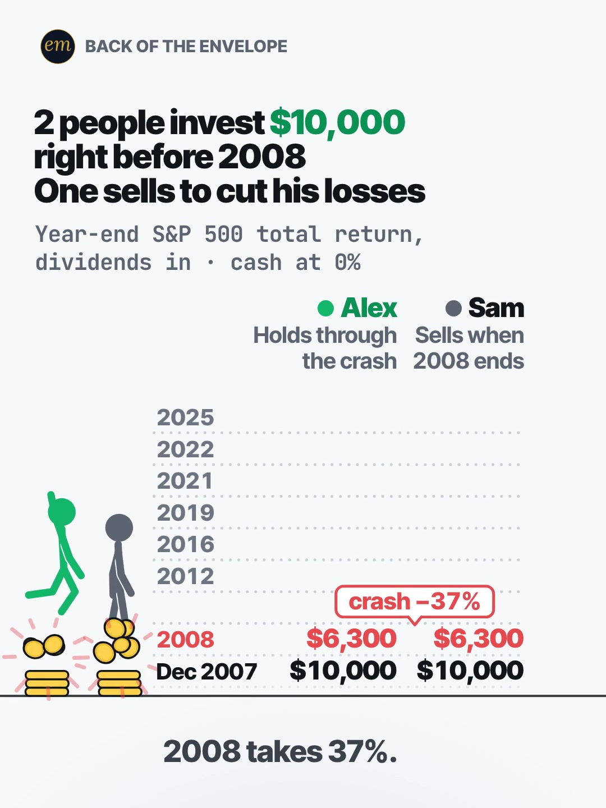

# 07b publishing sheet: $10,000 right before 2008, one sells to cut his losses

YouTube Shorts (@envelopemath) and Instagram Reels (@envelopemath). Prepared 2026-10-13. Machine-readable twin: `publishing/07b-becker-rig-panic-sell-2008.json`.

- **Video.** `renders/channel/07b-becker-rig-panic-sell-2008.mp4`: the pre-condense cut (29.9 s: a 27.4 s body + the 2.5 s card; sha256 `a8555ba1…`), the round-2 fix-pass cut (2026-10-08) as `renders/channel` holds it on 2026-10-13. A condensed cut is in progress (timing only: the numbers, captions and verdict stay). Nothing below names a timestamp except the cover, which is picked by content (the 2008 impact), so the copy carries over. The ship step rebuilds this sheet and re-exports both covers from the final file: `python3 publishing/tools/build_publishing.py 07b-becker-rig-panic-sell-2008 --covers`.
- **Numbers.** Every figure comes from `teasers/v2/07-ledger-duel.md` (07b) and its check, `python3 teasers/v2/checks/07-ledger-duel.py`: 461 checks, 0 failures on `studio/specs/` (run 2026-10-13). `python3 publishing/tools/build_publishing.py 07b-becker-rig-panic-sell-2008 --check` checks this sheet's limits, paste blocks and figures, recompounds every row from the 18 S&P 500 total returns, keeps each year's figure beside its year and every Alex figure with Alex, and keeps Sam's exact $6,300 without an '≈'.
- **Honesty rules kept.** The title asks how far apart they are by 2025 (the video's last row) and never says, and so does the cover (the 2008 impact, no later row). The Instagram caption keeps every result below 'more'. The copy says the data are past calendar-year returns, not a prediction; that both trades are at year-end closes (not the March 2009 low); that Sam's cash earns 0% (and the pinned comment gives the 5% case); and that the index has no fees or taxes. Nothing in it ties the 2008 duel to today's markets. No advice, no urgency, and 'Not financial advice.' is in both.
- **Brand.** "S&P 500" names the index the maths is about (S&P Dow Jones Indices' total-return series); both platforms' copy says 'Not affiliated with or endorsed by S&P Dow Jones Indices.' No logos in the video, and no share price is named: every figure is the index's total return with dividends reinvested, and the copy says so.
- **[click-check].** The write-up marks the Slickcharts total-return page for a hand check before posting (the proxy blocked fetching it); the verifier matched 2007-2025 against two sources. Nothing here changes that.

---

## YouTube Shorts

### Title (vidIQ title score, short-form, scored against this channel)

| # | Title | Score | Chars |
|---|---|---:|---:|
| 1 | One Sold in the 2008 Stock Market Crash to Cut His Losses. One Held. How Far Apart by 2025? | 97 | 91 |
| 2 | One Sold in the 2008 Crash to Cut His Losses. One Held. How Far Apart Are They Now? | 98 | 83 |
| 3 | 2 People Invest $10,000 Right Before 2008. One Sells in the Crash. How Far Apart Now? | 94 | 85 |

**Pick (paste):**

```
One Sold in the 2008 Stock Market Crash to Cut His Losses. One Held. How Far Apart by 2025?
```

- 91 of 100 characters.
- It is the header's bet ('2 people invest $10,000 / right before 2008 / One sells to cut his losses') told as what happened, plus the write-up's question, 'How Far Apart Now?', dated as 'by 2025': the video's last row is the end of 2025, and the copy ties nothing to today's market. 'To Cut His Losses' names the belief the verdict breaks (the write-up's R5); the title never says who comes out ahead or by how much.
- It carries '2008 stock market crash' word for word (8,277 searches a month, +88.7% on its baseline), which contains 'stock market crash' (140,294, +64.7%). The top score (98) drops 'Stock Market' for 1 point; vidIQ's model ranks titles but does not predict views, so the pick keeps the search phrase.
- It raises the write-up's title from 94 to 97, the same score as the undated 'How Far Apart Now?'. Both scored 'he/his friend' and 'you' versions reach 98 but add a friend or a 'you' the video doesn't have.
- Also scored, not used: "One Sold in the 2008 Stock Market Crash to Cut His Losses. One Held. How Far Apart Now?" 97 (the first build's pick; 'Now' reads as today, while the video's figures are end-of-2025 values, so the pick dates it for the same score); "He Sold in the 2008 Crash to Cut His Losses. His Friend Held. How Far Apart Are They Now?" 98 ('his friend' is not in the video: Alex and Sam are '2 people'); "What If You Sold in the 2008 Crash? Your $10,000 vs the Friend Who Held" 98 (second person over a duel of named people; the write-up turned down a 'you' title over named columns); "Sam Sold in the 2008 Crash to Cut His Losses. Alex Held. How Far Apart Are They Now?" 97; "$10,000 Right Before the 2008 Stock Market Crash: Sold vs Held. How Far Apart Now?" 90.

### Description (paste)

```
2 people put $10,000 each in the S&P 500 at the last close of 2007, right before the 2008 stock market crash. Both drop to $6,300. Sam sells at the end of 2008 to cut his losses and keeps cash. Alex holds: about $66,000 by the end of 2025, about 10.5× Sam's $6,300.

The math, shown:
• 2008: the S&P 500's total return is −37%, so $10,000 × 0.63 = $6,300 for both.
• Sam sells at the 2008 year-end close and holds cash at 0%: $6,300 from then on.
• Alex holds. 2009: ≈ $8,000. 2012: ≈ $10,900, his first year-end back above $10,000.
• 2016: ≈ $18,500. 2019: ≈ $28,400. 2021: ≈ $43,300.
• 2022 dips ≈ −18%: ≈ $35,500. Alex holds again.
• End of 2025: Alex ≈ $66,000, about 6.6× his $10,000. Sam: still $6,300.
• Selling didn't dodge the crash. It dodged the recovery.

Follow for the math behind your money — shown, not hand-waved. @envelopemath

Animation and original sound: The Back of the Envelope. Calendar-year S&P 500 total returns with dividends reinvested, 2008-2025 (S&P Dow Jones Indices). Both buy at the Dec 31, 2007 close, and every value is a year-end value. Sam sells at the 2008 year-end close, not the March 2009 low, and his cash earns 0%. An index with no fees or taxes; not adjusted for inflation. Past returns, not a prediction. Not financial advice. Not affiliated with or endorsed by S&P Dow Jones Indices.
#StockMarketCrash #2008crash #investing
```

1,369 of 5,000 characters (1,408 UTF-8 bytes; YouTube counts this limit in bytes, and `≈`, `×`, `•`, `—` take 2-3 each). No `<` or `>`, which YouTube rejects. It follows the house template: an answer-first opening line for the search snippet, then 'The math, shown:' bullets, then the follow line. The credit, assumptions and 'Not financial advice.' line comes next, and the 3 hashtags close it. The 'Doesn't Add Up' series line is left out, as on 06b and 06c: the verdict is a plain reading of the index's own returns, and the copy keeps it to the one duel (the dates, the year-end rule and the 0% cash).

### Hashtags (order matters)

1. `#StockMarketCrash`: the event, and the biggest on-topic phrase ('stock market crash' 140,294 searches a month, competition 60.3; +64.7% on its 30-day baseline).
2. `#2008crash`: the crash the video is about ('2008 stock market crash' 8,277 a month, competition 36.0, +88.7%); the write-up's caption tag.
3. `#investing`: the broad category ('investing' 613,566 a month, −2.0%), the same third layer as 07a.

The title carries no hashtags, so YouTube shows these 3, the description's first, above the title. Over 60 hashtags and YouTube ignores all of them. `#Shorts` isn't needed.

### Tags (paste; 350 of 500 characters as YouTube counts them: commas count, and a tag with a space counts 2 more for the quotes YouTube adds)

```
2008 stock market crash, stock market crash, 2008 financial crisis, market crash, stock market crash history, panic selling, behavioral finance, long term investing, s&p 500, s&p 500 total return, what happens if you start investing and the market crashes, investing, money math, math animation, the back of the envelope, envelope math
```

Tags carry little weight. These mirror the keyword research plus the house's channel tags. 'panic selling' (3,102 a month) is what Sam does; 'what happens if you start investing and the market crashes' (12,953) is the viewer's question the duel answers with history. Left out on purpose: 'stock market crash today' (16,833, +83.6%) and 'is stock market crash coming' (6,828) are news and prediction intent, and this Short says nothing about today's market; '2008 financial crisis explained' (26,448) promises an explainer of the crisis, which this Short is not.

### Pinned comment (post it, then pin it)

```
Would you have sold in 2008? "Sam's cash would've earned interest": even at 5% every single year from 2009 to 2025, his $6,300 grows to ≈ $14,400. That's under a quarter of Alex's ≈ $66,000.

Both buy at the Dec 31, 2007 close, and Sam sells at the Dec 31, 2008 close, not the March 2009 low. Total returns, dividends reinvested; no fees or taxes.
```

The write-up's pinned comment, with a question in front so it shows in the collapsed preview. It answers the comment the write-up expects first ('but cash earns interest') with the 5% bound, and the second paragraph answers the timing argument ('nobody sells at the year-end', the March 2009 low) with the year-end rule the footer states.

### Related video and end screen

- **Related video:** [A 50% loss needs a 100% gain](https://www.youtube.com/shorts/qGS_IphmCHs) (`qGS_IphmCHs`). The channel's own crash maths (1,097 views, June 2026): why a fall takes a bigger rise to undo. It is the step before this Short's verdict, that the money was in the recovery.
- **Swap later:** 07a or 07c, the other ledger duels, once published; then point one of them at this Short.
- **End screen:** Shorts have no end screens or cards. The Related video link is the Shorts equivalent.

### Thumbnail and settings

- **Thumbnail:** in the YouTube app, pick the 2008 impact frame (both figures in the air, '$6,300 / $6,300' in red under the 'crash −37%' pill, no later row), the same content as the Instagram cover below.
- **Settings:** Category Education. Not made for kids. Altered or synthetic content: No (it's an animated chart, not realistic footage). Remixing allowed. No captions needed: there's no narration and all the text is on screen.

### Posting window

- **When:** First Tue-Thu evening after the 07b condensed cut ships and passes QA, 21:30-22:30 ET (01:30-02:30 UTC the next day). Sunday 06:00-08:00 ET is the alternative.
- **Spacing:** Keep it at least 6 h from any other upload on the channel, and post one ledger duel (07a, 07b, 07c) per evening.
- **Why:** The channel's own October Shorts, median views by posting slot (vidIQ, 2026-10-13): Sunday 05:00-08:00 ET 1,199 (n = 2), weekday 22:00-00:30 ET 642 (n = 3), weekday midday 263 (n = 2). The evening slot is also the best one on Instagram, so one evening serves both. n = 7 and confounded by topic, so treat it as a test. Search demand: 'stock market crash' is +64.7% and '2008 stock market crash' +88.7% on their 30-day baselines, so crash searches are high now. The copy stays on the 2008 duel and names no current event; post on the normal schedule rather than chasing a news day.

---

## Instagram Reels

### Caption (paste)

```
2 people invest $10,000 right before the 2008 stock market crash. One sells to cut his losses. How far apart by 2025?

Both bought the S&P 500 at its last close of 2007. Both drop to $6,300 in 2008, when it returns −37%.

Sam sells at the end of 2008 to cut his losses, and keeps cash at 0%. Alex holds.

The math, shown:
• 2009: Alex ≈ $8,000. Sam $6,300.
• 2012: Alex ≈ $10,900, back above $10,000.
• 2021: Alex ≈ $43,300.
• 2022 dips ≈ −18%: Alex ≈ $35,500. He holds again.
• End of 2025: Alex ≈ $66,000. Sam: still $6,300.

Holding finished with ≈ 10.5× as much. Selling didn't skip the drop. It skipped the recovery.

S&P 500 total return with dividends reinvested, 2008-2025 calendar years (S&P Dow Jones Indices). Year-end closes; an index with no fees or taxes; cash at 0%. Past returns, not a prediction. Not financial advice. Not affiliated with or endorsed by S&P Dow Jones Indices.

Would you have sold?

Follow for the math behind your money — shown, not hand-waved. @envelopemath
Animation and original sound: The Back of the Envelope.

#stockmarket #investing #2008crash #sp500 #moneymath
```

- 1,103 of 2,200 characters.
- **First 125 characters:** the header's bet in its own words (2 people invest $10,000, right before the 2008 stock market crash, one sells to cut his losses) and 'How far apart by 2025?', 117 characters, with no result; 'S&P 500' opens the next line. The write-up's line 1 ('Same $10,000. Same −37%. Only one of them got the recovery.') moves below 'more' as the verdict's set-up, since 'got the recovery' says which choice did.
- The data line names the series, the publisher, the year-end rule and the 0% cash, and says the returns are past returns, not a prediction.
- The caption follows the house close: the follow line plus the credit.

### Hashtags (5, Instagram's cap since Dec 2025)

`#stockmarket #investing #2008crash #sp500 #moneymath`

The write-up's four caption tags, plus one:

- `#stockmarket`, `#investing` and `#2008crash` are the write-up's topic tags; `#moneymath` is its series tag on all three ledger duels.
- `#sp500` is the fifth: the index the duel runs on, and the tag 04b uses on both platforms.

### Alt text

- **Short (92 characters; paste this one into Instagram):** Chart: $10,000 each before 2008. Holding grew to about $66,000 by 2025; selling kept $6,300.
  - It stays at or under 100 characters, so it fits the field however short it is. It says 'about', not '≈', so screen readers read it cleanly; Sam's $6,300 is exact and has no 'about', as everywhere else.
- **Long (for anywhere with room, such as a website embed):** Animation on a light page: 2 stick figures stand on coin stacks beside a year-by-year ledger. Header: 2 people invest $10,000 right before 2008. One sells to cut his losses. 2008 takes 37%: coins burst off both stacks, and both drop to $6,300. Sam, in grey, sells, and his stack turns into a brick of cash that never grows. Alex, in green, holds: back above $10,000 by 2012, about $43,300 by 2021, a dip in 2022, then about $66,000 at the end of 2025 on a gold plate, while Sam is still at $6,300. Verdict: Selling didn't dodge the crash. It dodged the recovery.
- **Where:** Advanced settings → Accessibility → Alt text, if your app shows it for Reels.

### Cover



- **Files:** `publishing/07b-becker-rig-panic-sell-2008-cover-3x4.jpg` (1080×1440) and `publishing/07b-becker-rig-panic-sell-2008-cover-9x16.jpg` (1080×1920). Both come from the pre-condense (29.9 s) render at 1.2 s (frame 36).
- **Frame, by content:** The 2008 impact, which the write-up names as the Instagram cover: the header '2 people invest $10,000 / right before 2008 / One sells to cut his losses', the footer, the column heads (Alex, 'Holds through the crash'; Sam, 'Sells when 2008 ends'), both figures blown up off their stacks with the lost coins bursting, the 'Dec 2007' row at $10,000 / $10,000 under the red '2008' row at $6,300 / $6,300, the 'crash −37%' pill, the later years dim over empty shelves, and the caption '2008 takes 37%.'. No later row and no final number. On any cut, use a frame between the pill appearing and the figures landing. On the pre-condense 29.9 s render the impact hits at 1.0 s (frame 30; the opening's biggest frame-to-frame luma change, 5.9-6.2), the 'crash −37%' pill is up from about 1.1 s, the figures land squashed at 1.4 s and stand again at 2.6 s. Frame 36 (1.20 s) has the pill up and both figures in the air: it is a motion frame (the luma change stays near 1.1-1.3 a frame from 1.17 to 1.47 s), and any frame from 1.1 to 1.4 s shows the same content. If the cut changes, re-pick it by content.
- **Crop:** 3:4 = 1080×1440 from y 60 to 1500 of the 1080×1920 frame. The content runs from y 112 (the badge) to y 1419 (the caption), so the tile keeps the badge, the header, the footer, the column heads, the figures, the ledger and the caption, and drops the empty floor. A centred grid crop (y 240-1680) cuts the badge and the header.
- **How to set it:** In 'Edit cover', pick the 2008 impact frame from the video (or upload the 9:16 JPG), then drag 'Profile grid' to the top so the tile matches the 3:4 JPG. Do not upload the 3:4 JPG as the Reel cover: Instagram centre-crops it to 9:16 in the Reels tab and cuts the header.
- **Re-export:** `ffmpeg -ss 1.2 -i renders/channel/07b-becker-rig-panic-sell-2008.mp4 -frames:v 1 -vf "crop=1080:1440:0:60" -q:v 2 publishing/07b-becker-rig-panic-sell-2008-cover-3x4.jpg` and `ffmpeg -ss 1.2 -i renders/channel/07b-becker-rig-panic-sell-2008.mp4 -frames:v 1 -q:v 2 publishing/07b-becker-rig-panic-sell-2008-cover-9x16.jpg`, or `python3 publishing/tools/build_publishing.py 07b-becker-rig-panic-sell-2008 --covers`.
- **Not used:** the finished ledger (Alex's ≈ $66,000 on the gold plate, Sam's ringed $6,300 and the verdict). The write-up suggests it as a second cover to test; it answers the title, so it belongs in the Trial Reels test below, not on the first post.
- **On ship:** the condensed cut may move the impact. `--covers` exports at COVER_T, so first re-pick a frame with the pill up and the figures in the air by content and update COVER_T and COVER_FRAME.

### First comment (post it, then pin it)

```
Alex held: ≈ $66,000 at the end of 2025. Sam sold at the end of 2008: $6,300. Even at 5% a year from 2009 to 2025, Sam's cash would be ≈ $14,400. Would you have sold?
```

### Trial Reels

**Post as a regular Reel, not a Trial.** @envelopemath has 8 followers, so a regular Reel is already shown almost entirely to non-followers, which is all a Trial Reel adds. A Trial would also keep it off the profile grid until shared. The write-up's second cover afterwards, if you want it: the same Reel with the finished ledger as its cover, as a Trial with MANUAL graduation 48-72 h later. Once the condensed cut ships, the pre-condense render is in git: `git show 471c793:renders/channel/07b-becker-rig-panic-sell-2008.mp4 > 07b-pre-condense.mp4` (sha256 d6d3739f…), for a cut test instead. Compare skip rate (October Reels ran 27.0-65.1%; 06c, the other Becker Rig Reel, 40.3%) and average watched %, then share the winner. vidIQ's publish tool exposes Trial (MANUAL or SS_PERFORMANCE) for this connected account. Confirm eligibility in the app.

### Posting window and settings

- **When:** Same evening as YouTube, about 15 min after the Short: 21:45-22:45 ET.
- **Why:** October Reels, median plays by posting slot (owner insights, 2026-10-13): weekday 22:00-00:30 ET 5,449 (n = 3, including the two best: 7,303 and 5,449), weekday midday 1,212 (n = 2), Sunday 05:00-08:00 ET 1,087 (n = 2). Skip rate tracks plays more closely than the hour does: 27.0-27.4% for the top two, 56.9-65.1% for the bottom two. The condense matters more than the hour.
- **Audio:** Rename the original audio to 'Sold in 2008 vs held — The Back of the Envelope' if the app allows; it is the score, with no voice.
- **Share to feed:** On.

---

## Why these choices (research evidence)

**1. Search demand (vidIQ keyword research, pulled 2026-10-13).** vidIQ refreshes each keyword on its own schedule, so the last column gives each row's snapshot date. One row is an older snapshot.

| Keyword | Est. searches/month | Competition | Overall | Note | vidIQ as of |
|---|---:|---:|---:|---|---|
| stock market crash | 140,294 | 60.3 | 62.0 | +64.7% vs its 30-day baseline (85,194): crash searches are high now; the copy names no current event | 2026-10-12 |
| market crash | 114,853 | 50.2 | 65.2 | +59.4% vs its baseline (72,070) | 2026-10-12 |
| 2008 financial crisis | 104,111 | 51.5 | 64.3 | −8.0% | 2026-10-12 |
| 2008 financial crisis explained | 26,448 | 45.2 | 61.5 | +67.2%; explainer intent, not in the tags | 2026-10-12 |
| stock market crash today | 16,833 | 57.0 | 55.1 | +83.6%; news intent, not in the copy | 2026-10-12 |
| what happens if you start investing and the market crashes | 12,953 | 43.0 | 59.6 | the viewer's question the duel answers with history; no baseline | 2026-10-12 |
| 2008 stock market crash | 8,277 | 36.0 | 60.7 | seed; +88.7% vs its baseline (4,387); in the title word for word | 2026-10-12 |
| stock market crash history | 8,105 | 36.1 | 60.6 | no baseline | 2026-10-12 |
| is stock market crash coming | 6,828 | 41.2 | 57.9 | prediction intent: not in the copy | 2026-08-20 |
| pov: you buy your first stock the day before a market crash | 5,490 | 19.6 | 65.7 | the same 'bought right before' set-up; competition 19.6 | 2026-10-12 |
| panic selling | 3,102 | 30.4 | 59.1 | seed; what Sam does | 2026-10-12 |
| behavioral finance | 49,748 | 31.6 | 69.4 | −33.4% | 2026-10-12 |
| long term investing | 24,666 | 39.3 | 63.6 | −12.4% | 2026-10-12 |

'stock market crash' is the biggest on-topic phrase (140,294 a month) and it is up 64.7% on its baseline; '2008 stock market crash' (8,277) is up 88.7% at lower competition (36.0). The title carries the second word for word, which contains the first, and the hashtags carry both. The news and prediction phrases ('… today', 'is … coming') stay out of the copy: this Short is a 2008-2025 duel, not a call on today's market. 'panic selling' (3,102) names Sam's move and goes in the tags.

**2. The 2008 crash is a big topic on YouTube Shorts; the sell-vs-hold duel is new and tiny (vidIQ YouTube search, under 4 min).**

| Title | Channel (subs) | Views | Date |
|---|---|---:|---|
| $1,000 at the 2008 Crash: Gold vs S&P 500 vs Apple #shorts | Money in Data (1) | 71 | 2026-10-12 |
| What Caused the 2008 Financial Crisis? The Crash That Wiped Out $13 Trillion Explained | Patient Bull Investing (9) | 164 | 2026-09-25 |
| 2008: The Crash That Felt Like the End | Emirbek Dzhanyshbekov (7) | 57 | 2026-10-02 |
| $100,000 at the 2008 peak. Held on vs sold at the bottom #shorts | DataOverDrama (2) | 14 | 2026-10-10 |

The crash itself draws big numbers (research.adjacent_youtube_outliers): Danny Cheek's 'Stock Market Crash of 2008' (14,446,806 views), Jessica Spangler's 'A brief history of The 2008 Housing Crash' (490,682), History Intrigue's 'Live reaction to 2008 stock crash!' (70,181, September 2026). The duel this Short runs, one sells and one holds, has only tiny takes, all from the last three weeks; the closest is DataOverDrama's '$100,000 at the 2008 peak. Held on vs sold at the bottom' (14 views), which sells at the March 2009 low, the timing argument this Short's year-end rule avoids.

So the title leads with '2008 Stock Market Crash', the phrase the big crash videos are found by, and asks the one thing they don't: how far apart the seller and the holder end up.

**3. Crash-and-hold content travels on Instagram and TikTok; the duel form is the write-up's own benchmark (vidIQ IG/TikTok outlier search, since Oct 2025).**

- **@matildehere** (Instagram), "Saving VS investing 10k 10 years ago": 534.5K (122.1x). Cash vs invested, side by side, music only: Sam's choice against Alex's.
- **@getinfinityinsights** (Instagram), "WHAT IF YOU WERE THE LUCKIEST INVESTOR ALIVE? S&P 500, SEVEN CRASHES": 74.7K (16.0x). $10,000 at every bottom since 2008, as an animated chart.
- **@allsense01** (TikTok), "Vanguard CEO tells what to do if the stock market crashes": 709.9K (316.8x). Advice from an interview; the demand is for the crash question.
- **@moneystocker** (TikTok), a 2016 'markets are hideously inflated' clip set against the S&P 500 since: 82.7K (34.9x).
- The write-up's benchmark for the duel itself (not re-pulled here): Jake (@jacobdoesmoney)'s three '2 people invest $10,000' duels at 5.7-6.6x his median, and The Market Hustle's 'How Long It Took To Recover After the Worst Crashes' (190,187, 4.5x). The lecture version of the idea flopped (Master Money, 0.3x), which is why 07b is a duel. None of the outliers opens on a result; the cover (the impact) and the caption's first line don't either.

**4. Our own October numbers (vidIQ: public YouTube stats, Instagram owner insights; pulled 2026-10-13).**

| YouTube Short | Posted (ET) | Views |
|---|---|---:|
| Can You Find the Missing Dollar? (`LjHDFzVxRyM`) | Sun 07:04 | 1,256 |
| You Can Lean on $1 Million. Not on $1 Billion. (`hJBvmGA6sZ0`) | Thu 00:25 | 1,221 |
| Your Interest Has a Speed Limit (`XVUeMcTg9OQ`) | Sun 05:49 | 1,141 |
| What If You Bought Starbucks Stock Instead of a $4 Latte Every Day? (06c) (`fbpdKf4Wy8c`) | Mon 03:45 | 760 |
| Pay the Minimum on $5,000? 238 Months. (`8__HTUa2PoU`) | Mon 22:09 | 642 |
| A $2 Lottery Ticket Was Worth $6.98. Until the Fine Print. (`FW_oxA3kbsM`) | Wed 12:03 | 348 |
| You Can Carry $1 Million. Not in Pennies. (`mXbKY_R63h4`) | Thu 13:38 | 177 |
| Start Investing 10 Years Late? You Get Half. (`EqFQCJheCMU`) | Tue 22:27 | 161 |
| What If You Bought Netflix Stock Instead of Paying for Netflix? (06b) (`krfZEHhb0xU`) | Mon 12:14 | 75 |

| Instagram Reel | Posted (ET) | Plays | Skip rate | Avg watched |
|---|---|---:|---:|---:|
| $5,000 on the minimum (`DeIvYk7I4Qr`) | Mon 22:46 | 7,303 | 27.4% | 56.5% |
| $1M stack vs Burj Khalifa (`DeOEthJJ1TG`) | Thu 00:28 | 5,449 | 27.0% | 83.1% |
| Missing dollar (`DeWgFZRoR_S`) | Sun 07:05 | 1,997 | 32.0% | 81.3% |
| Powerball $6.98 (`DeMvZv9IqRw`) | Wed 12:05 | 1,825 | 58.7% | 57.9% |
| 06c latte vs Starbucks stock (`DeYuqT4pjVC`) | Mon 03:46 | 1,711 | 40.3% | 69.1% |
| $1M in pennies (`DePe11HIHwn`) | Thu 13:37 | 598 | 42.0% | 66.7% |
| 10 years late (`DeLSd9io8UK`) | Tue 22:30 | 219 | 65.1% | 30.6% |
| Speed limit (e) (`DeEW2ZMIiYd`) | Sun 05:54 | 177 | 56.9% | 31.2% |

Channel totals:

- **YouTube:** 53 subscribers, 10,221 views and 41 videos (+27 subscribers, +5,127 views and 11 videos in 30 days).
- **Instagram:** 8 followers and 20,519 views in 30 days.

06b went up on both platforms on Mon 12 Oct at 12:14 ET (75 views on YouTube by 13 Oct; its Reel shows 7 plays, Instagram's insights lag), and 06c the same morning (760 views, 1,711 plays, 40.3% skip). Both are left out of the medians as too young.

Medians by posting slot (n = 2-3 each, confounded by topic):

- **YouTube:** Sunday early morning ET 1,199, weekday 22:00-00:30 ET 642, weekday midday 263.
- **Instagram:** weekday 22:00-00:30 ET 5,449, midday 1,212, Sunday early morning 1,087.

This is the channel's first Short on a real market crash. The nearest past post is June's 'A 50% loss needs a 100% gain' (1,097 YouTube views), the related video above. 06c is the only Becker Rig Reel so far (40.3% skip, 69.1% watched); this one opens on the 2008 impact itself, with no number from the answer on screen.

**5. Platform rules applied.**

- **YouTube title:** 100 characters. The Shorts player shows only the opening, so the keywords come first.
- **YouTube description:** 5,000 characters.
- **YouTube hashtags:** the first 3 show; over 60 and all are ignored; `#Shorts` isn't needed.
- **YouTube tags:** 500 characters, low weight.
- **YouTube Shorts:** no end screens. The Related video link is the Shorts equivalent.
- **YouTube AI disclosure:** only for realistic altered content.
- **Instagram caption:** 2,200 characters, about 125 shown before 'more'.
- **Instagram hashtags:** 5 at most.
- **Instagram search and Google:** keywords in the caption feed Instagram search, and Google indexes public professional posts (since 10 Jul 2025).
- **Instagram grid:** a 3:4 crop of the 9:16 cover.
- **Trial Reels:** shown to non-followers only.

**6. Limits.**

- As the 06b and 04b sheets found (not re-checked here), vidIQ's YouTube authorization is a different channel (UCRC5v_El2fibbkqsZs6uFjA), so @envelopemath's YouTube Analytics (audience hours, geography) were not readable. Check Studio → Analytics → Audience → 'When your viewers are on YouTube' before posting.
- vidIQ has no hashtag-volume data; hashtag picks lean on keyword volume and the same-idea Shorts' own tags.
- Title scores are vidIQ's short-form CTR model for this channel; they rank options but do not predict views.
- The render in renders/channel is the pre-condense cut. The cover's time and frame are measured on it; the copy names no other timestamp, and the ship step re-picks the cover on the final file.
- The S&P 500 returns are the write-up's, from search results ([click-check] on Slickcharts); the verifier matched them against two sources. The Jake and Market Hustle figures are the write-up's benchmark, not re-pulled.
- The vidIQ credit balance is shared with the other sheets being built in parallel; this sheet's spend is counted from each tool's listed cost, checked against the balance (see research.vidiq_credits).

---

## Check log (first build and adversarial pass, 2026-10-13)

- **Maths.** `python3 teasers/v2/checks/07-ledger-duel.py`: 461 checks, 0 failures. Every public figure traces to the 07b maths table: 2008 −37% → $10,000 × 0.63 = $6,300 exactly; 2009 ≈ $8,000; 2012 ≈ $10,900 (first year-end back above $10,000); 2016 ≈ $18,500; 2019 ≈ $28,400; 2021 ≈ $43,300; 2022 ≈ −18% → ≈ $35,500; 2025 ≈ $66,000; ≈ 10.5× Sam's $6,300; ≈ 6.6× the $10,000; 5% from 2009 to 2025 → ≈ $14,400, under a quarter. The data file recompounds each from the 18 yearly returns.
- **Limits.** Title 91/100. Description 1,369 characters (1,408 bytes) of 5,000. 3 hashtags. Tags 350/500 as YouTube counts them. Instagram caption 1,103/2,200, with the first 125 characters result-free. 5 hashtags. Short alt text 92. No `<` or `>`.
- **vidIQ.** Keywords pulled 2026-10-13 (table above). 7 titles scored against this channel: the pick 97, the top 98, the write-up's title 94. Channel 53 subscribers / 10,221 views / 41 videos; Instagram owner insights refreshed (8 followers, 20,519 views in 30 days).
- **Generator.** Unchanged. `MATH_SCRIPT` is `publishing/data/checks/07-ledger-duel.py` (see the 07a sheet): the 07 check prints 'N checks, F failures', and the adapter adds the builder's form.
- **vidIQ re-queried.** At the adversarial check: the first build's pick 97 and the dated pick 97; '2008 stock market crash' 8,277 / 36.0 (+88.7%, baseline 4,387); channel 53 subscribers / 10,221 views / 41 videos; the related video 'A 50% loss needs a 100% gain' 1,097 views, posted 2 Jun 2026. All match.
- **Changed.**
  - The title asked 'How Far Apart Now?', but the video's last row is the end of 2025 and the copy ties nothing to today's market (crash searches are up 64.7% this month). The pick is now '… How Far Apart by 2025?' (91 characters), which vidIQ scores the same, 97; the undated version moved to 'also scored'.
  - The Instagram hook ended 'How far apart now?' at exactly 125 characters, so the dated question would not fit. It is now the header's own words, '2 people invest $10,000 right before the 2008 stock market crash. One sells to cut his losses. How far apart by 2025?' (117), and 'S&P 500' moves to the next line ('Both bought the S&P 500 at its last close of 2007.').
  - The research section said 'this one opens on an impact at 1.0 s, the write-up's answer to the opening hold the condense is fixing': a timestamp outside the cover and a pacing claim. It now says what the opening shows.
  - The tag '2008 financial crisis explained' promised an explainer of the crisis, which this Short is not; it is out of the tags and the tags note says why.
  - The title note put '2008 stock market crash' at characters 13-35; it is 17-39.
  - `#sp500` was 'the tag the savings-vs-index posts in 04b's research use', which 04b's research does not show (its own adversarial pass found none of its same-idea titles carries it). It now says 04b uses it.
- **Checked.**
  - Every copy figure against the write-up's 07b maths table and a fresh run of the 07 check (461 checks, 0 failures): all 18 total returns recompounded, $6,300 exact, ≈ 10.5× and ≈ 6.6×, the 5% case ≈ $14,400.
  - Platform limits: title 91/100 with no hashtags, description under 5,000 bytes, tags under 500, caption under 2,200 with 5 hashtags and a result-free first 125, short alt text 92.
  - Brand: 'S&P 500' only names the index the maths runs on, and both long texts carry 'Not affiliated with or endorsed by S&P Dow Jones Indices.'; no share price is named.
  - The cover JPG (read by eye) shows the 2008 impact: both figures in the air, '$6,300 / $6,300' in red under 'crash −37%', no later row. The render's sha256 equals the file at `471c793`.
- **Mutation test.** Eight mutations of a scratch copy each fail by name: the 2016 and 2019 rows swapped, Sam's $6,300 made 'about', the pinned 5% case without its 5%, 10.5× without its '≈', the caption without the S&P DJI line, Alex's ≈ $66,000 given to Sam, Sam's $6,300 given to Alex, and a caption hook with the result. At the adversarial check, 5 more on scratch copies also fail by name: the title back to 'Now', the caption's hook back to 'now', a hook with the result, the new line's $6,300 made 'about', and its −37% moved off 2008. The files on disk were not touched.
- **Kept on purpose.**
  - The pick is 1 point under the top title, to keep the '2008 stock market crash' search phrase whole.
  - 'Sold in the 2008 Stock Market Crash' is the write-up's 'One Sells in the Crash'; the description, the caption and the pinned comment give the exact sale, the Dec 31, 2008 close.
  - The pinned comment gives the 5% case and the year-end rule, the two comment fights the write-up expects; the copy never says what anyone should do in a crash.
  - The cover is the impact, as the write-up names it; the finished ledger is the Trial Reels test.
