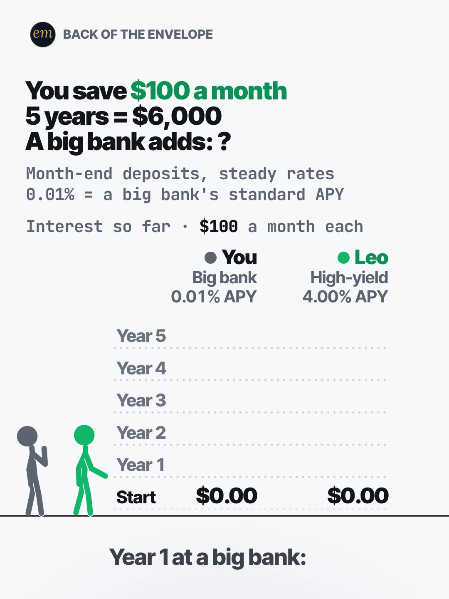

# 07c publishing sheet: $100 a month for 5 years, big bank vs high-yield

YouTube Shorts (@envelopemath) and Instagram Reels (@envelopemath). Prepared 2026-10-13. Machine-readable twin: `publishing/07c-becker-rig-savings-rate.json`.

- **Video.** `renders/channel/07c-becker-rig-savings-rate.mp4`: the condensed cut (15.8 s: a 13.3 s body + the 2.5 s card; sha256 `1bd0c66b…`), promoted and shipped on 2026-10-13. It replaces the 21.6 s pre-condense cut (the Becker Rig port, fix pass 2026-10-08; the owner: "too many still moments"), which is in git (`c4a3014`). The condense moved the clock; the numbers, the captions' facts and the verdict stay, so the copy carried over unchanged. Nothing below names a timestamp except the cover, which was re-picked by content (the frame-1 picture) on the shipped file. The ship rebuilt this sheet and re-exported both covers from it (`python3 publishing/tools/build_publishing.py 07c-becker-rig-savings-rate --covers`); on the shipped specs the maths check runs 535 checks, 0 failures.
- **Numbers.** Every figure comes from `teasers/v2/07-ledger-duel.md` (07c) and its check, `python3 teasers/v2/checks/07-ledger-duel.py`: 461 checks, 0 failures on `studio/specs/` (run 2026-10-13). `python3 publishing/tools/build_publishing.py 07c-becker-rig-savings-rate --check` checks this sheet's limits, paste blocks and figures, recomputes every year's interest from $100 a month at each APY's monthly rate, keeps each year's pair together with the big bank first, and keeps every lone figure with its own account.
- **Honesty rules kept.** The title asks how much interest a big bank pays and never says, and so does the cover (frame 1: the '?', no number from the answer). The Instagram caption keeps every result below 'more'. The copy says both rates are held for 5 years and that rates move, that deposits are at each month-end, and that 4.00% is a round rate below the top offers found; the write-up's ≈ 419× is kept out, as the write-up keeps it off screen and out of the caption. No advice, no urgency, and 'Not financial advice.' is in both.
- **Brand.** "Chase" is named only as the source of the 0.01% (Chase Savings' standard APY on its Oct 2, 2026 rate sheet), where the write-up's caption names it; the video says 'a big bank' and shows no logo. Both platforms' copy says 'Not affiliated with or endorsed by Chase.' The FDIC is named only as the source of the national average. No share price is named.
- **[click-check] before posting.** The write-up's sources mark Chase's Oct 2, 2026 rate sheet (read through a search engine; the fetch was blocked) and The College Investor's Sep 28 list for a hand check. The copy names Chase, so open the rate sheet first; if the standard rate has changed, the 0.01% line and the figures need the write-up's rework, not an edit here.

---

## YouTube Shorts

### Title (vidIQ title score, short-form, scored against this channel)

| # | Title | Score | Chars |
|---|---|---:|---:|
| 1 | How Much Interest Does a Big Bank Pay on $100 a Month for 5 Years? Big Bank vs High-Yield | 97 | 89 |
| 2 | You Save $100 a Month for 5 Years. How Much Interest Does a Big Bank Pay You? | 94 | 77 |
| 3 | You Save $100 a Month for 5 Years. How Much Does a Big Bank Add? | 89 | 64 |

**Pick (paste):**

```
How Much Interest Does a Big Bank Pay on $100 a Month for 5 Years? Big Bank vs High-Yield
```

- 89 of 100 characters.
- It asks the header's one blank ('A big bank adds: ?') in search words: 'How much interest does a big bank pay', then the stake ($100 a month for 5 years) and the duel ('Big Bank vs High-Yield', the write-up's search words). The answer, ≈ $1.48, is not in it.
- It raises the write-up's title from 89 to 97. 'Chase' stays out of the title, as the write-up decided: the screen says 'big bank', and the rate sheet is still a [click-check].
- The '$6,000 of savings' version scores 94 but misstates the stake (a $6,000 balance would earn more than $100 a month building up to it), so it is not used.
- Also scored, not used: "How Much Interest Does a Big Bank Pay on $6,000 of Savings? Big Bank vs High-Yield" 94 ('on $6,000 of savings' reads as a $6,000 balance for 5 years; the deposits build up over 60 months); "Save $100 a Month for 5 Years: Big Bank Savings vs High-Yield Savings. How Much Interest?" 90; "Big Bank Savings vs High-Yield Savings: What Does $100 a Month Earn in 5 Years?" 90.

### Description (paste)

```
$100 a month for 5 years is $6,000 saved. At a big bank's 0.01% APY, it earns about $1.48 of interest. In a high-yield savings account at 4.00% APY, the same deposits earn about $617.90.

The math, shown:
• $100 at each month-end for 60 months: $6,000 in each account.
• Each APY is applied as its monthly rate, so 12 months compound to exactly the APY.
• Year 1: ≈ $0.05 at the big bank vs ≈ $21.84 at high-yield.
• Year 3: ≈ $0.53 vs ≈ $214.11.
• Year 5: ≈ $1.48 vs ≈ $617.90.
• Save $200 a month? Double both: ≈ $2.95 vs ≈ $1,235.80.
• Same $6,000. Different account.

Follow for the math behind your money — shown, not hand-waved. @envelopemath

Animation and original sound: The Back of the Envelope. 0.01% APY is Chase Savings' standard rate on its Oct 2, 2026 rate sheet. Top high-yield offers in late Sep and early Oct 2026 ran about 4.15-4.50%; 4.00% is a round rate below all of them. Both rates are held for 5 years, and rates move. Interest is left in; no taxes or fees. Not financial advice. Not affiliated with or endorsed by Chase.
#HighYieldSavings #SavingsAccount #personalfinance
```

1,097 of 5,000 characters (1,129 UTF-8 bytes; YouTube counts this limit in bytes, and `≈`, `•`, `—` take 2-3 each). No `<` or `>`, which YouTube rejects. It follows the house template: an answer-first opening line for the search snippet, then 'The math, shown:' bullets, then the follow line. The credit, assumptions and 'Not financial advice.' line comes next, and the 3 hashtags close it. The 'Doesn't Add Up' series line is left out, as on 06b and 06c: the write-up's judges noted that 'a big bank pays almost nothing' is a familiar fact, so the copy lets the dollar figures do the work.

### Hashtags (order matters)

1. `#HighYieldSavings`: the option the duel prices ('high yield savings account' 56,330 searches a month, competition 46.7, +77.0% on its 30-day baseline; 64.7% of the searches from the US); the write-up's caption tag.
2. `#SavingsAccount`: the account the viewer already has, the 'You' side of the duel.
3. `#personalfinance`: the broad layer ('personal finance' 1,436,792 a month, −18.1%), as on 07a; the write-up's caption tag.

The title carries no hashtags, so YouTube shows these 3, the description's first, above the title. Over 60 hashtags and YouTube ignores all of them. `#Shorts` isn't needed.

### Tags (paste; 303 of 500 characters as YouTube counts them: commas count, and a tag with a space counts 2 more for the quotes YouTube adds)

```
high yield savings account, hysa, savings account, savings account interest, high interest savings account, big bank savings account, savings account interest rate truth, save $100 a month, saving money, compound interest, money math, math animation, the back of the envelope, envelope math
```

Tags carry little weight. These mirror the keyword research plus the house's channel tags. 'savings account interest rate truth' (4,676 a month) is this Short's angle; 'big bank savings account' and 'save $100 a month' are the video's own words, with no vidIQ volume. Left out on purpose: 'best high yield savings account' (25,784) and 'best interest rate savings account' (5,228) and 'which bank pays highest interest on savings account' (5,190) are product-pick intent this Short doesn't answer, and 'chase savings account' (4,035) names a brand the video doesn't show, with its rate sheet still a [click-check].

### Pinned comment (post it, then pin it)

```
What does your savings account pay? Not at Chase? The FDIC's national average is 0.37% APY (Sep 2026): ≈ $55 on the same $100 a month over 5 years, still under a tenth of 4.00%'s ≈ $618.

Both rates held for 5 years; rates move. Deposits at each month-end, interest left in.
```

The write-up's pinned comment, with its closing question moved to the front so it shows in the collapsed preview (R3: the viewer's own rate). It answers the comment the write-up expects first ('my bank pays more') with the FDIC national average, and the second line repeats the rate assumption.

### Related video and end screen

- **Related video:** [Your Interest Has a Speed Limit](https://www.youtube.com/shorts/XVUeMcTg9OQ) (`XVUeMcTg9OQ`). The same 'interest' viewer: what compounding can and can't do. It is the channel's most-engaged October Short (1,141 views, 28 likes, 6 comments), live since Sun 4 Oct 2026.
- **Swap later:** 04b (16 years of savings vs 1 year of the S&P 500), the other savings-rate Short, once published; or 07a or 07b.
- **End screen:** Shorts have no end screens or cards. The Related video link is the Shorts equivalent.

### Thumbnail and settings

- **Thumbnail:** in the YouTube app, pick the frame-1 picture ('A big bank adds: ?', the empty Year rows over $0.00 / $0.00, You pondering beside Leo), the same content as the Instagram cover below.
- **Settings:** Category Education. Not made for kids. Altered or synthetic content: No (it's an animated chart, not realistic footage). Remixing allowed. No captions needed: there's no narration and all the text is on screen.

### Posting window

- **When:** First free Tue-Thu evening, 21:30-22:30 ET (01:30-02:30 UTC the next day); the condensed cut shipped on 2026-10-13. Sunday 06:00-08:00 ET is the alternative.
- **Spacing:** Keep it at least 6 h from any other upload on the channel, post one ledger duel (07a, 07b, 07c) per evening, and keep it off 04b's evening (both show how little a low-rate savings account earns).
- **Why:** The channel's own October Shorts, median views by posting slot (vidIQ, 2026-10-13): Sunday 05:00-08:00 ET 1,199 (n = 2), weekday 22:00-00:30 ET 642 (n = 3), weekday midday 263 (n = 2). The evening slot is also the best one on Instagram, so one evening serves both. n = 7 and confounded by topic, so treat it as a test. Search demand: 'high yield savings account' is up 77.0% on its 30-day baseline and 'hysa' 28.1%, so savings rates are in people's searches now.

---

## Instagram Reels

### Caption (paste)

```
$100 a month for 5 years = $6,000 saved. What does a big bank add? Big bank savings vs a high-yield account, year by year.

You save $100 at the end of every month at a big bank, at 0.01% APY. Leo saves the same $100 a month in a high-yield account at 4.00% APY. The ledger shows the interest so far, year by year.

The math, shown:
• Year 1: ≈ $0.05 vs ≈ $21.84.
• Year 3: ≈ $0.53 vs ≈ $214.11.
• Year 5: ≈ $1.48 vs ≈ $617.90.

Same $6,000. Different account.

Save $200 a month? Double both. 0.01% is Chase Savings' standard APY on its Oct 2, 2026 rate sheet; top high-yield offers in late Sep and early Oct 2026 ran about 4.15-4.50%. Both rates held for 5 years; rates move. Interest left in; no taxes or fees. Not financial advice. Not affiliated with or endorsed by Chase.

What does your savings account pay?

Follow for the math behind your money — shown, not hand-waved. @envelopemath
Animation and original sound: The Back of the Envelope.

#savings #highyieldsavings #hysa #personalfinance #moneymath
```

- 1,010 of 2,200 characters.
- **First 125 characters:** the write-up's numberless line 1 and 'Big bank savings vs a high-yield account', with no result. The numbers sit below 'more', where Instagram search and Google indexing still read them.
- The rates paragraph is the write-up's caption line 2 without its numbers' repeat: the Chase sheet date, 'double both', the high-yield range and the rates-move caveat.
- The caption follows the house close: the follow line plus the credit.

### Hashtags (5, Instagram's cap since Dec 2025)

`#savings #highyieldsavings #hysa #personalfinance #moneymath`

The write-up's four caption tags, plus one:

- `#savings`, `#highyieldsavings` and `#personalfinance` are the write-up's topic tags; `#moneymath` is its series tag on all three ledger duels.
- `#hysa` is the fifth: 'hysa' is 32,445 searches a month on YouTube (+28.1%), and John Liang's 'Bank account vs high yield saving account #hysa' (section 2) carries it in its title.

### Alt text

- **Short (92 characters; paste this one into Instagram):** Chart: $100 a month for 5 years: about $1.48 of interest at 0.01% vs about $617.90 at 4.00%.
  - It stays at or under 100 characters, so it fits the field however short it is. It says 'about', not '≈', so screen readers read it cleanly, and each figure keeps its rate.
- **Long (for anywhere with room, such as a website embed):** Animation on a light page: 2 stick figures beside a year-by-year ledger of interest. Header: You save $100 a month. 5 years = $6,000. A big bank adds: ? 'You', in grey, saves at a big bank at 0.01% APY; Leo, in green, at a high-yield account at 4.00% APY. Each year's interest lands in the ledger, and Leo's coin stack grows while You stands on a bare floor. Year 1: about $0.05 vs about $21.84. Year 3: about $0.53 vs about $214.11. Year 5: about $1.48 vs about $617.90, and Leo's total grows onto a gold plate. Verdict: Same $6,000, different account.
- **Where:** Advanced settings → Accessibility → Alt text, if your app shows it for Reels.

### Cover



- **Files:** `publishing/07c-becker-rig-savings-rate-cover-3x4.jpg` (1080×1440) and `publishing/07c-becker-rig-savings-rate-cover-9x16.jpg` (1080×1920). Both come from the shipped (15.8 s) render at 0 s (frame 0).
- **Frame, by content:** The frame-1 picture, which the write-up names as the Instagram cover: the header 'You save $100 a month / 5 years = $6,000 / A big bank adds: ?' with '$100 a month' in green, the 2-line footer, the stake line 'Interest so far · $100 a month each', the column heads (You: Big bank, 0.01% APY; Leo: High-yield, 4.00% APY), the Start row at $0.00 / $0.00 with Years 1-5 dim over empty shelves, You pondering on the bare floor beside Leo, and the caption 'Year 1 at a big bank:' with no number. It asks and does not answer. Not the end frame (Leo on his gold tower), which answers the question. On any cut, use the first still frame after the first caption is complete and before Year 1 drops. On the shipped 15.8 s condensed cut frame 0 already shows the whole first caption, 'Year 1 at a big bank:', over the Start row at $0.00 / $0.00 and Years 1-5 empty; only You's ponder moves over the next frames (frame-to-frame luma change 0.01-0.34 on 270×480 greyscale), and Year 1 starts to drop at about 0.3 s (it lands at 0.4 s). Frame 0 is the write-up's frame-1 picture. On the 21.6 s pre-condense render frame 0 showed only 'Year', so the cover was frame 15 (0.50 s). If the cut changes, re-pick it by content.
- **Crop:** 3:4 = 1080×1440 from y 60 to 1500 of the 1080×1920 frame. The content runs from y 112 (the badge) to y 1429 (the caption), so the tile keeps the badge, the header, the footer, the stake line, both column heads, the figures, the ledger and the caption, and drops the empty floor. A centred grid crop (y 240-1680) cuts the badge and the header.
- **How to set it:** In 'Edit cover', pick the opening frame from the video (or upload the 9:16 JPG), then drag 'Profile grid' to the top so the tile matches the 3:4 JPG. Do not upload the 3:4 JPG as the Reel cover: Instagram centre-crops it to 9:16 in the Reels tab and cuts the header.
- **Re-export:** `ffmpeg -ss 0 -i renders/channel/07c-becker-rig-savings-rate.mp4 -frames:v 1 -vf "crop=1080:1440:0:60" -q:v 2 publishing/07c-becker-rig-savings-rate-cover-3x4.jpg` and `ffmpeg -ss 0 -i renders/channel/07c-becker-rig-savings-rate.mp4 -frames:v 1 -q:v 2 publishing/07c-becker-rig-savings-rate-cover-9x16.jpg`, or `python3 publishing/tools/build_publishing.py 07c-becker-rig-savings-rate --covers`.
- **Not used:** the end frame (Leo's ≈ $617.90 on the gold plate, the red-ringed ≈ $1.48 and the verdict), which answers the title.
- **Shipped cut (2026-10-13):** the first caption is whole on frame 0 and Year 1 drops at 0.3-0.4 s, so the cover was re-picked by content on the shipped file (frame 0, was frame 15) and both JPGs re-exported: the same picture as the pre-condense cover. The copy did not change.

### First comment (post it, then pin it)

```
Big bank, 0.01% APY: ≈ $1.48 in 5 years. High-yield, 4.00% APY: ≈ $617.90. The FDIC's national average, 0.37%: ≈ $55. What does yours pay?
```

### Trial Reels

**Post as a regular Reel, not a Trial.** @envelopemath has 8 followers, so a regular Reel is already shown almost entirely to non-followers, which is all a Trial Reel adds. A Trial would also keep it off the profile grid until shared. A hook test afterwards, if you want one: the other cut as a Trial with MANUAL graduation 48-72 h later. The pre-condense render is in git: `git show c4a3014:renders/channel/07c-becker-rig-savings-rate.mp4 > 07c-pre-condense.mp4` (sha256 cba00966…; at 471c793 it carries the v2.2 soundtrack, dcafa5e0…). Compare skip rate (October Reels ran 27.0-65.1%; 06c, the other Becker Rig Reel, 40.3%) and average watched %, then share the winner. vidIQ's publish tool exposes Trial (MANUAL or SS_PERFORMANCE) for this connected account. Confirm eligibility in the app.

### Posting window and settings

- **When:** Same evening as YouTube, about 15 min after the Short: 21:45-22:45 ET.
- **Why:** October Reels, median plays by posting slot (owner insights, 2026-10-13): weekday 22:00-00:30 ET 5,449 (n = 3, including the two best: 7,303 and 5,449), weekday midday 1,212 (n = 2), Sunday 05:00-08:00 ET 1,087 (n = 2). Skip rate tracks plays more closely than the hour does: 27.0-27.4% for the top two, 56.9-65.1% for the bottom two. The condense matters more than the hour.
- **Audio:** Rename the original audio to 'Big bank vs high-yield — The Back of the Envelope' if the app allows; it is the score, with no voice.
- **Share to feed:** On.

---

## Why these choices (research evidence)

**1. Search demand (vidIQ keyword research, pulled 2026-10-13).** vidIQ refreshes each keyword on its own schedule, so the last column gives each row's snapshot date. Four rows are older snapshots.

| Keyword | Est. searches/month | Competition | Overall | Note | vidIQ as of |
|---|---:|---:|---:|---|---|
| high yield savings account | 56,330 | 46.7 | 63.9 | seed; +77.0% vs its 30-day baseline (31,816); 64.7% of searches from the US | 2026-10-12 |
| hysa | 32,445 | 46.8 | 61.7 | +28.1% | 2026-10-12 |
| best high yield savings account | 25,784 | 42.6 | 62.5 | −12.1%; product-pick intent, not in the copy | 2026-10-12 |
| chase bank | 22,976 | 39.2 | 63.4 | +15.8%; Chase is named only as the 0.01% source | 2026-10-12 |
| which bank pays highest interest on savings account | 5,190 | 24.8 | 63.4 | product-pick intent; not in the tags | 2026-05-13 |
| best interest rate savings account | 5,228 | 45.5 | 55.1 | product intent | 2026-10-12 |
| high interest savings account | 4,751 | 39.8 | 57.0 |  | 2026-09-22 |
| savings account interest rate truth | 4,676 | 33.0 | 59.7 | this Short's angle | 2026-07-23 |
| chase savings account | 4,035 | 29.4 | 60.5 | seed; not in the title or tags (the rate sheet is a [click-check]) | 2026-05-31 |
| saving money | 92,579 | 45.5 | 66.3 | −31.7% | 2026-10-12 |
| compound interest | 137,873 | 50.6 | 65.8 | −17.3% (the 07a pull) | 2026-10-12 |

'high yield savings account' is the biggest on-topic phrase (56,330 a month), it is up 77.0% on its baseline, and two-thirds of its searches are from the US, this channel's market. The title carries 'big bank' and 'high-yield' rather than the full phrase, which scored lower; the hashtags and tags carry it whole. The product-pick phrases ('best high yield savings account') stay out: this Short compares two rates and recommends no account. The 'savings account interest' long tail is mostly other countries' banks.

**2. Big bank vs high-yield is a big, settled topic on YouTube Shorts, mostly advice and product picks (vidIQ YouTube search, under 4 min, by relevance).**

| Title | Channel (subs) | Views | Date |
|---|---|---:|---|
| How To Grow Your Savings Account 🏦📈 #personalfinance #money #bank #banking | Garner Ted (101,000) | 598,517 | 2024-11-05 |
| Why HYSA’s Are a Bad Idea | Steve | Call to Leap (748,000) | 421,681 | 2023-11-17 |
| What RICH PEOPLE know about HYSA that you don’t (High Yield Savings Account) | Investing Simplified - Professor G (475,000) | 389,107 | 2023-11-22 |
| Know THIS Before You Open a High Yield Savings Account | Investing with Matt (6,930) | 318,303 | 2023-02-26 |
| What’s The Best HYSA For 2026? | Steve | Call to Leap (748,000) | 205,270 | 2026-01-14 |
| $10,000 HYSA vs S&P 500 | Investing with Matt (6,930) | 191,735 | 2023-07-17 |
| Bank account vs high yield saving account #hysa | John Liang (658,000) | 58,298 | 2023-11-18 |

The idea travels: Garner Ted's 'How To Grow Your Savings Account' (598,517 views) says outright that big banks pay very little, and Investing with Matt's two-account '$10,000 HYSA vs S&P 500' (191,735) has a vidIQ outlier score of 428.9. Nearly all of them are talking heads recommending an account or a list of them, several with affiliate links, and none shows the interest year by year on the same monthly deposits.

So the title asks the number question in search words and recommends nothing; the ledger, the '?' and the 0.01% source are what this Short adds.

**3. Savings-rate content travels on Instagram and TikTok, mostly as advice (vidIQ IG/TikTok outlier search, since Oct 2025).**

- **@trusted.finance** (Instagram), "There's only 24 weeks left of 2026": 771.4K (104.8x). Faceless text and a savings table, no voice: the closest in form to this Short.
- **@vinnyrodriguez** (Instagram), "Ranking High Yield Savings Accounts tier list": 76.6K (28.3x).
- **@josuesegoviano2** (TikTok), "Open a High yield savings account": 318.2K (77.9x). Talking head over statements showing interest paid.
- **@falatinglwfs** (TikTok), "You can lose your money in an HYSA": 639.9K (103.9x). The contrarian warning.
- **@only.living.trust.book** (TikTok), "YOUR BANK IS PRAYING YOU NEVER FIGURE THIS OUT": 73.3K (62.9x). An animated explainer that ends in a product pitch.
- The demand is real and mostly met with advice; this Short shows the year-by-year numbers and leaves the choice to the viewer, which is why the copy asks 'What does your savings account pay?' instead of telling anyone to switch.

**4. Our own October numbers (vidIQ: public YouTube stats, Instagram owner insights; pulled 2026-10-13).**

| YouTube Short | Posted (ET) | Views |
|---|---|---:|
| Can You Find the Missing Dollar? (`LjHDFzVxRyM`) | Sun 07:04 | 1,256 |
| You Can Lean on $1 Million. Not on $1 Billion. (`hJBvmGA6sZ0`) | Thu 00:25 | 1,221 |
| Your Interest Has a Speed Limit (`XVUeMcTg9OQ`) | Sun 05:49 | 1,141 |
| What If You Bought Starbucks Stock Instead of a $4 Latte Every Day? (06c) (`fbpdKf4Wy8c`) | Mon 03:45 | 760 |
| Pay the Minimum on $5,000? 238 Months. (`8__HTUa2PoU`) | Mon 22:09 | 642 |
| A $2 Lottery Ticket Was Worth $6.98. Until the Fine Print. (`FW_oxA3kbsM`) | Wed 12:03 | 348 |
| You Can Carry $1 Million. Not in Pennies. (`mXbKY_R63h4`) | Thu 13:38 | 177 |
| Start Investing 10 Years Late? You Get Half. (`EqFQCJheCMU`) | Tue 22:27 | 161 |
| What If You Bought Netflix Stock Instead of Paying for Netflix? (06b) (`krfZEHhb0xU`) | Mon 12:14 | 75 |

| Instagram Reel | Posted (ET) | Plays | Skip rate | Avg watched |
|---|---|---:|---:|---:|
| $5,000 on the minimum (`DeIvYk7I4Qr`) | Mon 22:46 | 7,303 | 27.4% | 56.5% |
| $1M stack vs Burj Khalifa (`DeOEthJJ1TG`) | Thu 00:28 | 5,449 | 27.0% | 83.1% |
| Missing dollar (`DeWgFZRoR_S`) | Sun 07:05 | 1,997 | 32.0% | 81.3% |
| Powerball $6.98 (`DeMvZv9IqRw`) | Wed 12:05 | 1,825 | 58.7% | 57.9% |
| 06c latte vs Starbucks stock (`DeYuqT4pjVC`) | Mon 03:46 | 1,711 | 40.3% | 69.1% |
| $1M in pennies (`DePe11HIHwn`) | Thu 13:37 | 598 | 42.0% | 66.7% |
| 10 years late (`DeLSd9io8UK`) | Tue 22:30 | 219 | 65.1% | 30.6% |
| Speed limit (e) (`DeEW2ZMIiYd`) | Sun 05:54 | 177 | 56.9% | 31.2% |

Channel totals:

- **YouTube:** 53 subscribers, 10,221 views and 41 videos (+27 subscribers, +5,127 views and 11 videos in 30 days).
- **Instagram:** 8 followers and 20,519 views in 30 days.

06b went up on both platforms on Mon 12 Oct at 12:14 ET (75 views on YouTube by 13 Oct; its Reel shows 7 plays, Instagram's insights lag), and 06c the same morning (760 views, 1,711 plays, 40.3% skip). Both are left out of the medians as too young.

Medians by posting slot (n = 2-3 each, confounded by topic):

- **YouTube:** Sunday early morning ET 1,199, weekday 22:00-00:30 ET 642, weekday midday 263.
- **Instagram:** weekday 22:00-00:30 ET 5,449, midday 1,212, Sunday early morning 1,087.

The channel's interest Shorts split by platform: 'Your Interest Has a Speed Limit' is its most-engaged YouTube Short (1,141 views, 28 likes, 6 comments) but drew 177 plays and a 56.9% skip on Instagram. This one opens on a question the viewer can answer about their own account, the 'You' column, which the two best Reels' openers (27.0-27.4% skip) share: a number to react to on frame 1.

**5. Platform rules applied.**

- **YouTube title:** 100 characters. The Shorts player shows only the opening, so the keywords come first.
- **YouTube description:** 5,000 characters.
- **YouTube hashtags:** the first 3 show; over 60 and all are ignored; `#Shorts` isn't needed.
- **YouTube tags:** 500 characters, low weight.
- **YouTube Shorts:** no end screens. The Related video link is the Shorts equivalent.
- **YouTube AI disclosure:** only for realistic altered content.
- **Instagram caption:** 2,200 characters, about 125 shown before 'more'.
- **Instagram hashtags:** 5 at most.
- **Instagram search and Google:** keywords in the caption feed Instagram search, and Google indexes public professional posts (since 10 Jul 2025).
- **Instagram grid:** a 3:4 crop of the 9:16 cover.
- **Trial Reels:** shown to non-followers only.

**6. Limits.**

- As the 06b and 04b sheets found (not re-checked here), vidIQ's YouTube authorization is a different channel (UCRC5v_El2fibbkqsZs6uFjA), so @envelopemath's YouTube Analytics (audience hours, geography) were not readable. Check Studio → Analytics → Audience → 'When your viewers are on YouTube' before posting.
- vidIQ has no hashtag-volume data; hashtag picks lean on keyword volume and the same-idea Shorts' own tags.
- Title scores are vidIQ's short-form CTR model for this channel; they rank options but do not predict views.
- The render in renders/channel is the condensed cut, shipped on 2026-10-13. The cover's time and frame were re-measured on it; the copy names no other timestamp.
- Chase's 0.01% and the high-yield offers are the write-up's, read from search results; the rate sheet and The College Investor's list are [click-check] items that were not opened here.
- The vidIQ credit balance is shared with the other sheets being built in parallel; this sheet's spend is counted from each tool's listed cost, checked against the balance (see research.vidiq_credits).

---

## Check log (first build and adversarial pass, 2026-10-13)

- **Maths.** `python3 teasers/v2/checks/07-ledger-duel.py`: 461 checks, 0 failures. Every public figure traces to the 07c maths table: 60 × $100 = $6,000; Year 1 ≈ $0.05 / ≈ $21.84; Year 3 ≈ $0.53 / ≈ $214.11; Year 5 ≈ $1.48 / ≈ $617.90 (≈ $618); $200 a month ≈ $2.95 / ≈ $1,235.80; the FDIC's 0.37% ≈ $55, under a tenth. The data file recomputes each from q = (1 + APY)^(1/12) − 1, including the two rounding edges (5.4999 and 52.503 cents).
- **Limits.** Title 89/100. Description 1,097 characters (1,129 bytes) of 5,000. 3 hashtags. Tags 303/500 as YouTube counts them. Instagram caption 1,010/2,200, with the first 125 characters result-free. 5 hashtags. Short alt text 92. No `<` or `>`.
- **vidIQ.** Keywords pulled 2026-10-13 (table above). 6 titles scored against this channel: the pick 97, the write-up's title 89. Channel 53 subscribers / 10,221 views / 41 videos; Instagram owner insights refreshed (8 followers, 20,519 views in 30 days).
- **Generator.** Unchanged. `MATH_SCRIPT` is `publishing/data/checks/07-ledger-duel.py` (see the 07a sheet): the 07 check prints 'N checks, F failures', and the adapter adds the builder's form.
- **vidIQ re-queried.** At the adversarial check: the pick's title score 97; 'best high yield savings account' 25,784 / 42.6 (−12.1%); channel 53 subscribers / 10,221 views / 41 videos; the related video 'Your Interest Has a Speed Limit' 1,141 views, 28 likes, 6 comments (the other October Shorts have 1-10 likes and 1 comment each). All match.
- **Changed.**
  - The tag 'which bank pays highest interest on savings account' is product-pick intent, which the tags note already rules out for 'best high yield savings account'; this Short names no bank to switch to. It is out of the tags.
  - `#hysa` was 'tagged by the high-yield Shorts and outliers in sections 2 and 3', which the research does not show; it now cites the one that does (John Liang's '… #hysa' title).
  - 'is a 428.9 outlier' now says what the number is: vidIQ's outlier score.
  - The spacing note said 04b is about savings 'at a big bank'; 04b uses the national average. It now says both show how little a low-rate savings account earns.
- **Checked.**
  - Every copy figure against the write-up's 07c maths table and a fresh run of the 07 check (461 checks, 0 failures): each year to the cent from q = (1 + APY)^(1/12) − 1, both rounding edges, $200 a month doubled, the FDIC's 0.37% ≈ $55.
  - Platform limits: title 89/100 with no hashtags, description under 5,000 bytes, tags under 500, caption under 2,200 with 5 hashtags and a result-free first 125, short alt text 92.
  - Brand: 'Chase' only as the dated source of the 0.01%, in the description and the caption, each with 'Not affiliated with or endorsed by Chase.'; never in the title, the hashtags, the tags or the picture.
  - The cover JPG (read by eye) shows the frame-1 picture: 'A big bank adds: ?', both plans, the Start row at $0.00 / $0.00, empty Year rows, and the caption 'Year 1 at a big bank:' with no number. The render's sha256 equals the file at `471c793`.
- **Mutation test.** Six mutations of a scratch copy each fail by name: the Year 3 pair reversed, the two accounts swapped in the first comment, the ≈ 419× ratio added, Chase's 0.01% without its sheet date, ≈ $55 without the FDIC, and a wrong Year 1 cent. At the adversarial check, 1 more on a scratch copy also fails by name: Chase's 0.01% without its Oct 2, 2026 rate sheet. The files on disk were not touched.
- **Kept on purpose.**
  - Section 2 keeps vidIQ's channel names as spelled, and two of them contain a '|' ('Steve | Call to Leap'). The builder does not escape '|' in table cells, so those rows show one cell too many in rendered Markdown (the views and the date shift right); the JSON is exact. Flagged for a one-line generator fix rather than respelled here.
  - The cover is the frame-1 picture, as the write-up names it, taken once the first caption is complete (frame 0 shows only 'Year').
  - Chase is named in the description and the caption only, as the source of the 0.01%, as the write-up's caption does; never in the title, the hashtags or the tags.
  - The ≈ 419× ratio stays out of every line, as the write-up keeps it off screen and out of the caption.
- **Done on ship (2026-10-13).** Rebuilt with `--covers` from the shipped condensed cut (15.8 s). Its first caption is whole on frame 0, so the cover was re-picked by content (frame 0; was frame 15) and shows the same picture. The Video bullet, the cut and the check counts follow the shipped file (535 checks, 0 failures on `studio/specs/`), and the long alt text was re-read against the condensed beat sheet: every beat it names (Years 1, 3 and 5 with their pairs, Leo's stack, the gold plate and the verdict) is in the shipped cut, so no copy changed.
