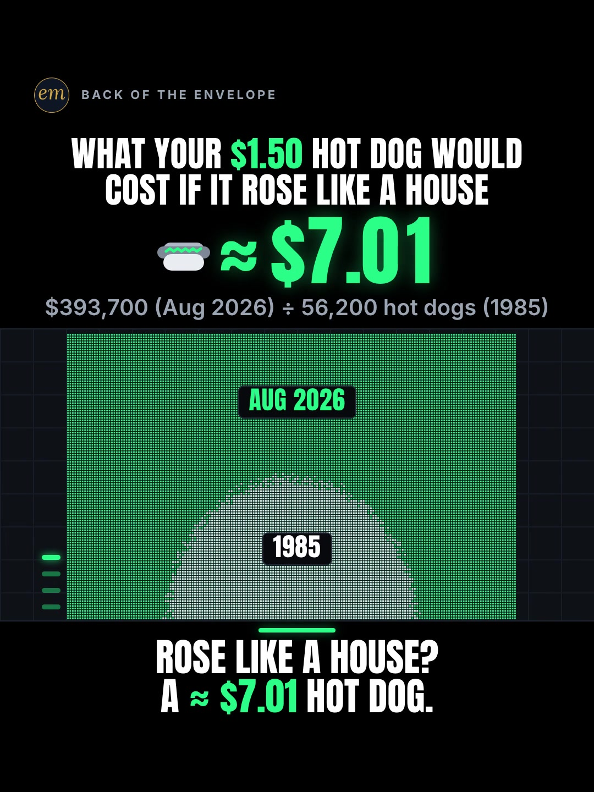

# 08a publishing sheet: your $1.50 Costco hot dog, risen like a house

YouTube Shorts (@envelopemath) and Instagram Reels (@envelopemath). Prepared 2026-10-13. Machine-readable twin: `publishing/08a-scoreboard-costco-hot-dogs.json`.

- **Video.** `renders/channel/08a-scoreboard-costco-hot-dogs.mp4`: the condensed cut (16.433 s: a 13.93 s body + the 2.503 s card; sha256 `2916e9f8…`), promoted and shipped on 2026-10-13. It replaces the 24.5 s pre-condense cut (the owner: "too many still moments"), which is in git (`c4a3014`). The condense moved the clock and merged some captions; the numbers, the captions' facts and the verdict stay, so the copy carried over unchanged. Nothing below names a timestamp except the cover, which was re-picked by content (the verdict frame) on the shipped file. The ship rebuilt this sheet and re-exported both covers from it (`python3 publishing/tools/build_publishing.py 08a-scoreboard-costco-hot-dogs --covers`); on the shipped specs the maths check runs 682 checks, 0 failed.
- **Numbers.** Every figure comes from `teasers/v2/08-unit-ladder.md` (08a) and its check, `python3 teasers/v2/checks/08-unit-ladder.py`: 677 checks, 0 failed on `studio/specs/` (run 2026-10-13; the builder runs it through the adapter `publishing/data/checks/08-unit-ladder.py`). `python3 publishing/tools/build_publishing.py 08a-scoreboard-costco-hot-dogs --check` checks this sheet's limits, paste blocks and figures, re-divides every rung by $1.50, pairs each rung's price with its own count, keeps each house beside its year (1985 or Aug 2026), keeps every rounded count and the ≈ $7.01 'about' or '≈', and keeps 'sticker prices, not adjusted for inflation' in the copy.
- **Honesty rules kept.** The title asks and never gives the result, and so does the YouTube thumbnail (frame 1: the $1.50 hero and the header). The Instagram caption keeps every result below 'more'. The Instagram cover is the verdict frame, as the write-up's Instagram note asks (as on 06c and 05c). Every claim stays inside the video's verdict, "Rose like a house? A ≈ $7.01 hot dog.", and the copy says its condition: sticker prices, not adjusted for inflation. Nothing says 'same hot dog' (the frank and the drink changed; only the price stayed, the write-up's rule). No advice, no urgency, and 'Not financial advice.' is in both.
- **Brand.** "Costco" is used only to name the company whose $1.50 combo and $65 membership the maths divides by. Both platforms' copy says 'Not affiliated with or endorsed by Costco.' The video has no logo and no store footage; the hot-dog icon is the kit's own. No brand handle is tagged, and no share price is named.

---

## YouTube Shorts

### Title (vidIQ title score, short-form, scored against this channel)

| # | Title | Score | Chars |
|---|---|---:|---:|
| 1 | What Would Your $1.50 Costco Hot Dog Cost If It Rose Like House Prices? | 96 | 71 |
| 2 | What Would a Costco Hot Dog Cost If It Rose Like House Prices? | 96 | 62 |
| 3 | What Would a Costco Hot Dog Cost If It Rose Like House Prices? #Costco #CostcoHotDog #HousingMarket | 96 | 99 |

**Pick (paste):**

```
What Would Your $1.50 Costco Hot Dog Cost If It Rose Like House Prices?
```

- 71 of 100 characters.
- It raises the write-up's title from 90 to 96. The change is grammar, not content: 'What Would … Cost' is a question, and 'House Prices' is the searched phrase ('housing market' 155,960 a month, +19.5%; 'home prices' 26,555, +197.5%). The write-up's title, the same idea as a statement ending 'Like a House', scored 90.
- It names no result: not ≈ $7.01, not ≈ 4.7×, not a count. '$1.50' is the input, on screen at frame 1 in the header, the hero and the footer.
- It is a different question from the dozen 'Why is Costco's hot dog still $1.50?' Shorts (research, section 2): those answer why the price is frozen, or put it through CPI ('about $4.66'). None prices it against a house. vidIQ's model ranks titles but does not predict views.
- Also scored, not used: "What Would a Costco Hot Dog Cost If It Rose Like House Prices? #costco #hotdog #housingmarket" 96 (the first build's option 3; its #hotdog is not one of the description's hashtags, so the builder's check would reject it as the pick); "What Would a Costco Hot Dog Cost If It Rose Like House Prices Since 1985?" 96 (73 chars; the year is already on screen in the footer at frame 1); "Costco's Hot Dog Is Still $1.50. What If It Rose Like a House?" 95 (the frozen price first, then the question); "Costco's Hot Dog Has Been $1.50 Since 1985. What If It Rose Like a House?" 95; "What Your $1.50 Costco Hot Dog Would Cost If It Rose Like a House" 90 (the write-up's title); "What If Costco's $1.50 Hot Dog Rose Like House Prices?" 87; "A New House in Costco Hot Dogs: 1985 vs 2026" 86 (round 1's judge title; it states a comparison instead of asking).

### Description (paste)

```
What would your $1.50 Costco hot dog cost if it rose like house prices? Costco never raised it: hot dog + soda, $1.50 in 1985, still $1.50. A median new house went from 56,200 hot dogs in 1985 to about 262,467 in Aug 2026. Had the hot dog risen like the house, it would cost about $7.01.

The math, shown (hot dogs = price ÷ $1.50):
• Your Costco membership: $65 ÷ $1.50 ≈ 43 hot dogs.
• A month of median rent, 2026: $1,531 ÷ $1.50 ≈ 1,021 hot dogs.
• A median new house, 1985: $84,300 ÷ $1.50 = 56,200 hot dogs.
• A median new house, Aug 2026: $393,700 ÷ $1.50 ≈ 262,467 hot dogs, ≈ 4.7× the 1985 count.
• Rose like a house? $393,700 (Aug 2026) ÷ 56,200 hot dogs (1985) ≈ $7.01 a hot dog.

Follow for the math behind your money — shown, not hand-waved. @envelopemath

Animation and original sound: The Back of the Envelope. Costco's hot dog + soda has cost $1.50 since 1985 (NPR, 2024; WTVG, 29 Apr 2026). Only the price stayed the same: the frank became Kirkland Signature in 2009 and the drink grew to 20 oz. Costco Gold Star membership: $65 a year since Sep 2024. Rent: U.S. Census Bureau median asking rent, Q2 2026. Houses: U.S. Census Bureau median sales price of new houses sold, 1985 (annual) and Aug 2026 (preliminary). Sticker prices, not adjusted for inflation. Not financial advice. Not affiliated with or endorsed by Costco.
#Costco #CostcoHotDog #HousingMarket
```

1,376 of 5,000 characters (1,405 UTF-8 bytes; YouTube counts this limit in bytes, and `≈`, `×`, `•`, `—`, `÷` take 2-3 each). No `<` or `>`, which YouTube rejects. It follows the house template: an answer-first opening line for the search snippet, then 'The math, shown:' bullets, then the follow line. The credit, assumptions and 'Not financial advice.' line comes next, and the 3 hashtags close it. The opening line is the title's question with the write-up's caption answer, for the search snippet. The 'Doesn't Add Up' series line is left out, as on 06b, 06c and 05c: the ≈ $7.01 is an honest sticker-to-sticker counterfactual, not a number that shouldn't be true.

### Hashtags (order matters)

1. `#Costco`: the brand ('costco' 329,799 searches a month, flat at -2.5%).
2. `#CostcoHotDog`: the unit ('costco hot dog' 21,845 a month, +39.4% on its 30-day baseline).
3. `#HousingMarket`: the ruler's other end ('housing market' 155,960 a month, +19.5%); the write-up's own caption tag.

The title carries no hashtags, so YouTube shows these 3, the description's first, above the title. Over 60 hashtags and YouTube ignores all of them. `#Shorts` isn't needed.

### Tags (paste; 326 of 500 characters as YouTube counts them: commas count, and a tag with a space counts 2 more for the quotes YouTube adds)

```
costco hot dog, costco 1.50 hot dog, why costco hot dog is $1.50, why costco hasn't raised its hot dog price since 1985, costco hot dog price, costco, housing market, house prices, home prices, housing affordability, inflation, cost in units of, money math, math animation, the back of the envelope, envelope math
```

Tags carry little weight. These mirror the keyword research plus the house's channel tags. 'why costco hasn't raised its hot dog price since 1985' (4,747 a month) has the lowest competition in the set (10.3). 'inflation' is in because the sticker-price framing will draw that comment. 'cost in units of' (HD Guy's series name) is in although it is under 750 a month: it names the format. Left out on purpose: 'costco hot dog combo options' (18,883) is menu intent, and 'costco deals' (47,392) shopping intent.

### Pinned comment (post it, then pin it)

```
What should we price in hot dogs next? Any price ÷ 1.5 = your hot dogs.

Yes, these are sticker prices, not adjusted for inflation. That's the point of the hot dog: Costco never raised the $1.50 (the frank became Kirkland Signature in 2009 and the soda grew to 20 oz, but the price didn't move). The house went from $84,300 in 1985 to $393,700 in Aug 2026, ≈ 4.7×. Spread over 1985's 56,200 hot dogs: $393,700 (Aug 2026) ÷ 56,200 hot dogs (1985) ≈ $7.01 a hot dog.
```

The question comes first so it shows in the collapsed preview: it is the write-up's own pinned ask, with its rule ('any price ÷ 1.5'). The second paragraph is the write-up's pinned comment. It answers the comment to expect, 'inflation!' (the write-up's caveat: engagement, not an error), and says what changed while the price did not, so nobody reads 'same hot dog'.

### Related video and end screen

- **Related video:** [What If You Bought Starbucks Stock Instead of a $4 Latte Every Day? #Starbucks #LatteFactor #stocks](https://www.youtube.com/shorts/fbpdKf4Wy8c) (`fbpdKf4Wy8c`). 06c, live since Mon 12 Oct 2026 and the channel's best-performing brand Short (760 views): a small, habitual purchase priced against something bigger, the same move as this Short's frozen $1.50.
- **Swap later:** 08b (rent in hours of work at $15/hr) or 08c (a year of college in Big Macs), the same unit-ladder series, once published. Then point that Short's Related video at this one.
- **End screen:** Shorts have no end screens or cards. The Related video link is the Shorts equivalent.

### Thumbnail and settings

- **Thumbnail:** in the YouTube app, pick frame 1: the header 'WHAT YOUR $1.50 HOT DOG WOULD / COST IF IT ROSE LIKE A HOUSE', the hero '$1.50' beside the hot-dog icon, the footer 'Hot dog + soda: $1.50 in 1985. Still $1.50.', the big hot dog and the label 'YOUR HOT DOG + SODA'. It asks without answering, like the title beside it in search. The Instagram cover below is the verdict frame, as the write-up asks.
- **Settings:** Category Education. Not made for kids. Altered or synthetic content: No (it's an animated chart, not realistic footage). Remixing allowed. No captions needed: there's no narration and all the text is on screen.

### Posting window

- **When:** First free Tue-Thu evening, 21:30-22:30 ET (01:30-02:30 UTC the next day); the condensed cut shipped on 2026-10-13. Sunday 06:00-08:00 ET is the alternative.
- **Spacing:** Keep it at least 6 h from any other upload on the channel, on a different evening from 08b and 08c, and in a different week from 05c (also Costco on the Scoreboard look; 05c's sheet asks the same). Suggested order within the series: 08b, then 08c, then 08a.
- **Why:** The channel's own October Shorts, median views by posting slot (vidIQ, 2026-10-13): Sunday 05:00-08:00 ET 1,199 (n = 2), weekday 22:00-00:30 ET 642 (n = 3), weekday midday 263 (n = 2); 06c (Mon 03:45 ET) has 760 and 06b (Mon 12:14 ET) 75, too young to compare. The evening slot is also the best one on Instagram, so one evening serves both. n = 7 and confounded by topic, so treat it as a test. 08a goes last of the three: the Costco hot-dog cluster is crowded right now (a dozen 'why is it still $1.50' Shorts since August), and 05c brings the same brand in the same look; 'costco hot dog' still runs +39.4% and 'home prices' +197.5% over their 30-day baselines, so the topic will hold.

---

## Instagram Reels

### Caption (paste)

```
What would your $1.50 Costco hot dog cost if it rose like a house? Hot dog + soda: $1.50 in 1985. Still $1.50. Priced in hot dogs.

Costco never raised the $1.50. If it had risen like a new house: ≈ $7.01.

The math, shown (hot dogs = price ÷ $1.50):
• Your $65 Costco membership: ≈ 43 hot dogs.
• A month of median rent, $1,531 (2026): ≈ 1,021 hot dogs.
• A median new house in 1985, $84,300: 56,200 hot dogs.
• A median new house in Aug 2026, $393,700: ≈ 262,467 hot dogs, ≈ 4.7× the 1985 count.
• $393,700 (Aug 2026) ÷ 56,200 hot dogs (1985) ≈ $7.01 a hot dog.

Sticker prices, not adjusted for inflation: that's the point of a price that never moved. Only the price stayed the same: the frank became Kirkland Signature in 2009 and the drink grew to 20 oz.

Census median asking rent (Q2 2026); Census median new-house prices (1985 annual, Aug 2026 preliminary). Costco Gold Star membership $65 a year. Not financial advice. Not affiliated with or endorsed by Costco.

What should we price in hot dogs next?

Follow for the math behind your money — shown, not hand-waved. @envelopemath
Animation and original sound: The Back of the Envelope.

#costco #costcohotdog #housingmarket #moneymath #personalfinance
```

- 1,210 of 2,200 characters.
- **First 125 characters:** the header's question plus the footer, 'Hot dog + soda: $1.50 in 1985. Still $1.50.', with no figure but the input. The write-up's caption line 1 is the verdict ('Costco never raised the $1.50. If it had risen like a new house: ≈ $7.01.'); the house rule moves it below 'more', because the caption overlays the Reel from frame 1. The numbers sit below the fold, where Instagram search and Google indexing still read them.
- The working is written the way the video's footer prints it, '$393,700 (Aug 2026) ÷ 56,200 hot dogs (1985)', so each figure keeps its year. 'Sticker prices, not adjusted for inflation' follows the math, as in the write-up's caption.
- No brand handle is tagged. The caption follows the house close: the follow line plus the credit.

### Hashtags (5, Instagram's cap since Dec 2025)

`#costco #costcohotdog #housingmarket #moneymath #personalfinance`

Three are the write-up's own (`#costco #housingmarket #moneymath`); its `#hotdog` becomes `#costcohotdog`:

- `#costco` names the brand and `#costcohotdog` the exact unit ('costco hot dog' 21,845 searches a month, +39.4%); a bare `#hotdog` reaches food posts.
- `#housingmarket` is the ruler's other end, and `#moneymath` says what kind of video it is.

`#personalfinance` is the broad layer, as on 06b, 06c and 05c.

### Alt text

- **Short (89 characters; paste this one into Instagram):** Chart: a $1.50 Costco hot dog, risen like a new house since 1985, would cost about $7.01.
  - It stays at or under 100 characters, so it fits the field however short it is. It says 'about', not '≈', so screen readers read it cleanly, and it keeps the verdict with its basis (a new house, since 1985).
- **Long (for anywhere with room, such as a website embed):** Animation on a black scoreboard. The header asks what your $1.50 hot dog would cost if it rose like a house; the footer says hot dog + soda, $1.50 in 1985, still $1.50. Each price is divided by $1.50 and the hot dogs pile up: a $65 Costco membership is about 43 hot dogs; a month of median rent, $1,531, about 1,021; a median new house in 1985, $84,300, is 56,200 hot dogs, a wall of dots; a median new house in Aug 2026, $393,700, is about 262,467. The 1985 wall shrinks to a white mound inside the bigger green 2026 wall. Payoff: rose like a house? $393,700 (Aug 2026) divided by 56,200 hot dogs (1985) is about $7.01 a hot dog.
- **Where:** Advanced settings → Accessibility → Alt text, if your app shows it for Reels.

### Cover



- **Files:** `publishing/08a-scoreboard-costco-hot-dogs-cover-3x4.jpg` (1080×1440) and `publishing/08a-scoreboard-costco-hot-dogs-cover-9x16.jpg` (1080×1920). Both come from the shipped (16.433 s) render at 13.6 s (frame 408).
- **Frame, by content:** The verdict frame, as the write-up's Instagram note asks: the header 'WHAT YOUR $1.50 HOT DOG WOULD / COST IF IT ROSE LIKE A HOUSE', the hero '≈ $7.01' beside the hot-dog icon, the footer's working '$393,700 (Aug 2026) ÷ 56,200 hot dogs (1985)', the white 1985 mound (tagged '1985') inside the green wall tagged 'AUG 2026', and the verdict 'ROSE LIKE A HOUSE? / A ≈ $7.01 HOT DOG.' (captions hide from the payoff, so nothing sits under it). On any cut, use a settled frame of the verdict hold, after the glow fades and before the end card. On the shipped 16.433 s condensed cut the verdict lands with the hero at frame 370 (12.33 s); its glow settles by about frame 400 (13.33 s), and the board then holds still (frame-to-frame mean luma change 0.000-0.003 on 270×480 greyscale) until the end card at frame 418 (13.93 s). Frame 408 (13.60 s) is used. On the 24.5 s pre-condense render the same hold was frames 580-660, and frame 630 (21.00 s) was used. If the cut changes, re-pick it by content.
- **Crop:** 3:4 = 1080×1440 from y 0 to 1440 of the 1080×1920 frame: the badge (from y 141), the header, the hero, the working, the split wall and the verdict (to y 1298), with even margins (141 px above, 142 px below); it drops the empty black below. A centred grid crop (y 240-1680) cuts the badge and the header.
- **How to set it:** In 'Edit cover', pick the verdict frame from the video (or upload the 9:16 JPG), then drag 'Profile grid' to the top so the tile matches the 3:4 JPG. Do not upload the 3:4 JPG as the Reel cover: Instagram centre-crops it to 9:16 in the Reels tab and cuts the header.
- **Re-export:** `ffmpeg -ss 13.6 -i renders/channel/08a-scoreboard-costco-hot-dogs.mp4 -frames:v 1 -vf "crop=1080:1440:0:0" -q:v 2 publishing/08a-scoreboard-costco-hot-dogs-cover-3x4.jpg` and `ffmpeg -ss 13.6 -i renders/channel/08a-scoreboard-costco-hot-dogs.mp4 -frames:v 1 -q:v 2 publishing/08a-scoreboard-costco-hot-dogs-cover-9x16.jpg`, or `python3 publishing/tools/build_publishing.py 08a-scoreboard-costco-hot-dogs --covers`.
- **Not used on Instagram:** frame 1 (the header, the $1.50 hero, the hot dog and 'YOUR HOT DOG + SODA'). It asks without answering, so it is the YouTube thumbnail, where it sits beside a title that asks; on Instagram the write-up picks the verdict frame, the save-able answer.
- **Shipped cut (2026-10-13):** the verdict frame was re-picked by content on the shipped file (frame 408, 13.60 s, a settled frame of the verdict hold; was frame 630) and both JPGs re-exported: the same picture as the pre-condense cover. The copy did not change.

### First comment (post it, then pin it)

```
Costco never raised the $1.50. Risen like a new house, it would be ≈ $7.01: $393,700 (Aug 2026) ÷ 56,200 hot dogs (1985). Sticker prices, not adjusted for inflation. What should we price next?
```

### Trial Reels

**Post as a regular Reel, not a Trial.** @envelopemath has 8 followers, so a regular Reel is already shown almost entirely to non-followers, which is all a Trial Reel adds. A Trial would also keep it off the profile grid until shared. A hook test afterwards, if you want one: the other cut as a Trial with MANUAL graduation 48-72 h later. The pre-condense render is in git: `git show c4a3014:renders/channel/08a-scoreboard-costco-hot-dogs.mp4 > 08a-24.5s.mp4` (sha256 e3200c2c…; at 471c793 it carries the v2.2 soundtrack, 9b736e4e…). Compare skip rate (October Reels ran 27.0-65.1%; 06c's condensed cut 40.3%) and average watched %, then share the winner. vidIQ's publish tool exposes Trial (MANUAL or SS_PERFORMANCE) for this connected account. Confirm eligibility in the app.

### Posting window and settings

- **When:** Same evening as YouTube, about 15 min after the Short: 21:45-22:45 ET, on a different evening from 08b and 08c and in a different week from 05c.
- **Why:** October Reels, median plays by posting slot (owner insights, 2026-10-13): weekday 22:00-00:30 ET 5,449 (n = 3, including the two best: 7,303 and 5,449), weekday midday 1,212 (n = 2), Sunday 05:00-08:00 ET 1,087 (n = 2). 06c, posted Mon 03:46 ET, has 1,711 plays with a 40.3% skip rate. Skip rate tracks plays more closely than the hour does: 27.0-27.4% for the top two, 56.9-65.1% for the bottom two. The condense matters more than the hour.
- **Audio:** Rename the original audio to 'Your $1.50 hot dog, risen like a house — The Back of the Envelope' if the app allows; it is the score, with no voice.
- **Share to feed:** On.

---

## Why these choices (research evidence)

**1. Search demand (vidIQ keyword research, pulled 2026-10-13).** vidIQ refreshes each keyword on its own schedule, so the last column gives each row's snapshot date. Two rows are older snapshots.

| Keyword | Est. searches/month | Competition | Overall | Note | vidIQ as of |
|---|---:|---:|---:|---|---|
| costco hot dog | 21,845 | 47.5 | 59.9 | seed; +39.4% vs its 30-day baseline (15,676) | 2026-10-12 |
| costco 1.50 hot dog | 8,792 | 43.5 | 57.9 | the frozen price, as searched | 2026-10-12 |
| why costco 1.50 hot dog business | 7,786 | 27.2 | 64.0 |  | 2026-09-06 |
| costco hot dog business | 5,786 | 23.6 | 64.3 |  | 2026-10-12 |
| why costco hot dog is $1.50 | 5,691 | 31.2 | 61.2 |  | 2026-10-12 |
| why costco hasn't raised its hot dog price since 1985 | 4,747 | 10.3 | 68.8 | the lowest competition here | 2026-10-12 |
| why costco hot dog is still $1.50 animated | 4,504 | 21.7 | 64.0 | searchers asking for an animation | 2026-10-12 |
| costco | 329,799 | 61.2 | 64.9 | -2.5% vs its baseline (338,300); the brand, crowded | 2026-10-12 |
| housing market | 155,960 | 58.8 | 63.0 | +19.5% vs its baseline (130,552) | 2026-10-12 |
| housing crisis | 69,307 | 61.0 | 59.0 | +54.9% vs its baseline (44,753) | 2026-10-12 |
| home prices | 26,555 | 56.0 | 57.2 | +197.5% vs its baseline (8,925) | 2026-10-12 |
| housing affordability | 18,505 | 52.5 | 57.2 | -11.5% vs its baseline (20,900) | 2026-10-12 |
| inflation | 204,408 | 65.5 | 61.4 | +4.8%; the comment the sticker-price framing will draw | 2026-10-12 |
| costco hot dog combo options | 18,883 | 26.0 | 67.9 | menu intent, not in the tags | 2026-05-29 |
| house prices then and now | 0 (<750) | 38.6 | 24.6 | <750/month | no snapshot |
| if prices rose like houses | 0 (<750) |  |  | <750/month: no search demand of its own | no snapshot |
| cost in units of | 0 (<750) | 31.1 | 27.6 | <750/month: HD Guy's series name is not searched | no snapshot |

The hot dog is searched as a question about its frozen price: 'costco hot dog' (21,845, +39.4%) and a long tail of 'why is it still $1.50' phrasings at 4,500-8,800 each, several at very low competition (10.3 for 'why costco hasn't raised its hot dog price since 1985'). The house side is the bigger, rising cluster ('housing market' 155,960, +19.5%; 'home prices' +197.5%). The title joins them with the video's own question; the counterfactual itself ('if prices rose like houses') and HD Guy's 'cost in units of' have no search demand, so the copy leads with the searched words and lets the video carry the idea.

**2. The frozen price is a crowded, proven topic; nobody prices it against a house (vidIQ YouTube search, under 4 min, by views and by relevance).**

| Title | Channel (subs) | Views | Date |
|---|---|---:|---|
| Costco's hot dog has remained $1.50 since it was first introduced in 1984 thanks to his CEO | viewsaddict (76,900) | 2,114,377 | 2024-10-05 |
| 40年も値上げを封じられたコストコ #雑学 | 雑学コレクターズ (14,900) | 2,723,766 | 2026-09-18 |
| Costco Founder Jim Sinegal Won't Increase Hot Dog Cost🌭 | Our Future (583,000) | 2,152,504 | 2022-06-28 |
| Costco mantiene hot dogs a $1,50 desde 1985 🌭 | Sabiondo Gourmet (84,600) | 607,078 | 2026-08-08 |
| Cost in Units of Costco Hotdog Combos | HD Guy (189,000) | 80,377 | 2026-08-04 |
| How Costco's Hot Dog Combo Is So CHEAP 🤯 | Ethan Ethier (146,000) | 23,213 | 2023-06-18 |
| Costco's $1.50 hot dog actually costs $65 #shorts | Tony Talks Business (13,200) | 2,910 | 2026-10-03 |
| Why Costco Refuses to Raise Its $1.50 Hot Dog Price | Oddly Rational (16) | 1,347 | 2026-10-02 |
| Costco's Hot Dog Has Cost $1.50 Since 1985. The Number That Explains It: About 2¢ | So We Ran The Numbers (12) | 1,175 | 2026-10-04 |
| Costco's Hot Dog Is Still $1.50. Inflation Says $4.66 | Cash Trail (0) | 12 | 2026-09-28 |

The $1.50 hot dog is one of the most-repeated business Shorts there is: three passed 2 million views (viewsaddict 2,114,377; Our Future 2,152,504; a Japanese version 2,723,766 in September), and at least a dozen small channels posted 'why is it still $1.50' since August, most under 1,600 views. The ones that do the maths run it through CPI and land at about $4.20-$4.67, and Cash Trail's title gives its answer away ('Inflation Says $4.66', 12 views).

None re-prices it against a house, which is this Short's whole ladder. HD Guy's 'Cost in Units of Costco Hotdog Combos' (80,377, 1.44x) used the same unit as a ruler with no reason for it; this Short makes the frozen price the reason. That is why the title asks the counterfactual and holds the answer back, and why the copy says 'sticker prices, not adjusted for inflation' instead of competing with the CPI figures.

**3. The frozen hot dog travels on Instagram and TikTok, as a chart too (vidIQ IG/TikTok outlier search, since June 2025, at least 10K views).**

- **@chartboom_ig** (Instagram), "U.S. national debt vs Costco hot dog price": 1.4M (14.8x). The same chart on TikTok (**@chartboomhq**): 965.1K (4.2x).
  - An animated chart with music only, looped: the flat $1.50 against a number that kept climbing. It is the closest format to this Short, and it travelled on both platforms.
- **@wealth.cap** (Instagram), "Costco's $1.50 hot dog combo stayed $1.50 since 1985.": 1.4M (7.9x). The frozen price as a business story.
- **@tjuslivin** (TikTok), "Me enjoying my $1.50 dinner after spending $359.77": 834.9K (15.6x). The $1.50 as the viewer's own purchase, which is this Short's 'your $1.50 hot dog'.
- The hot dog's price is the shared hook; none of the outliers re-prices it against a house. The chart pair shows a faceless, music-only version can travel.

**4. Our own October numbers (vidIQ: public YouTube stats, Instagram owner insights; refreshed 2026-10-13).**

| YouTube Short | Posted (ET) | Views |
|---|---|---:|
| Can You Find the Missing Dollar? (`LjHDFzVxRyM`) | Sun 07:04 | 1,256 |
| You Can Lean on $1 Million. Not on $1 Billion. (`hJBvmGA6sZ0`) | Thu 00:25 | 1,221 |
| Your Interest Has a Speed Limit (`XVUeMcTg9OQ`) | Sun 05:49 | 1,141 |
| What If You Bought Starbucks Stock Instead of a $4 Latte Every Day? (06c) (`fbpdKf4Wy8c`) | Mon 03:45 | 760 |
| Pay the Minimum on $5,000? 238 Months. (`8__HTUa2PoU`) | Mon 22:09 | 642 |
| A $2 Lottery Ticket Was Worth $6.98. Until the Fine Print. (`FW_oxA3kbsM`) | Wed 12:03 | 348 |
| You Can Carry $1 Million. Not in Pennies. (`mXbKY_R63h4`) | Thu 13:38 | 177 |
| Start Investing 10 Years Late? You Get Half. (`EqFQCJheCMU`) | Tue 22:27 | 161 |
| What If You Bought Netflix Stock Instead of Paying for Netflix? (06b) (`krfZEHhb0xU`) | Mon 12:14 | 75 |

| Instagram Reel | Posted (ET) | Plays | Skip rate | Avg watched |
|---|---|---:|---:|---:|
| $5,000 on the minimum (`DeIvYk7I4Qr`) | Mon 22:46 | 7,303 | 27.4% | 56.5% |
| $1M stack vs Burj Khalifa (`DeOEthJJ1TG`) | Thu 00:28 | 5,449 | 27.0% | 83.1% |
| Missing dollar (`DeWgFZRoR_S`) | Sun 07:05 | 1,997 | 32.0% | 81.3% |
| Powerball $6.98 (`DeMvZv9IqRw`) | Wed 12:05 | 1,825 | 58.7% | 57.9% |
| 06c latte vs Starbucks stock (`DeYuqT4pjVC`) | Mon 03:46 | 1,711 | 40.3% | 69.1% |
| $1M in pennies (`DePe11HIHwn`) | Thu 13:37 | 598 | 42.0% | 66.7% |
| 10 years late (`DeLSd9io8UK`) | Tue 22:30 | 219 | 65.1% | 30.6% |
| Speed limit (e) (`DeEW2ZMIiYd`) | Sun 05:54 | 177 | 56.9% | 31.2% |

Channel totals:

- **YouTube:** 53 subscribers, 10,221 views and 41 videos (+27 subscribers, +5,127 views and 11 videos in 30 days).
- **Instagram:** 8 followers and 20,519 views in 30 days.

The channel has no unit-ladder Short yet. Its two brand Shorts, 06c (Starbucks: 760 views, 1,711 plays) and 06b (Netflix, Mon 12 Oct 12:14 ET: 75 views so far), are too young to compare, and 06b's Reel shows 7 plays while Instagram's owner insights catch up.

Medians by posting slot (n = 2-3 each, confounded by topic; 06b and 06c left out as too young):

- **YouTube:** Sunday early morning ET 1,199, weekday 22:00-00:30 ET 642, weekday midday 263.
- **Instagram:** weekday 22:00-00:30 ET 5,449, midday 1,212, Sunday early morning 1,087.

One weekday evening is the best Instagram slot and the second-best YouTube slot, so the plan posts both then. On Instagram, skip rate predicts plays better than the hour does (27.0-27.4% for the top two, 56.9-65.1% for the bottom two). So the window is a light-touch test, and the condense (fewer still moments) is the bigger reach lever.

**5. Platform rules applied.**

- **YouTube title:** 100 characters. The Shorts player shows only the opening, so the keywords come first.
- **YouTube description:** 5,000 characters.
- **YouTube hashtags:** the first 3 show; over 60 and all are ignored; `#Shorts` isn't needed.
- **YouTube tags:** 500 characters, low weight.
- **YouTube Shorts:** no end screens. The Related video link is the Shorts equivalent.
- **YouTube AI disclosure:** only for realistic altered content.
- **Instagram caption:** 2,200 characters, about 125 shown before 'more'.
- **Instagram hashtags:** 5 at most.
- **Instagram search and Google:** keywords in the caption feed Instagram search, and Google indexes public professional posts (since 10 Jul 2025).
- **Instagram grid:** a 3:4 crop of the 9:16 cover.
- **Trial Reels:** shown to non-followers only.

**6. Limits.**

- @envelopemath's YouTube Analytics (audience hours, geography) were not read here; the 06b and 06c sheets found vidIQ's YouTube authorization is a different channel. Check Studio → Analytics → Audience → 'When your viewers are on YouTube' before posting.
- vidIQ has no hashtag-volume data; hashtag picks lean on keyword volume and on the write-up's and the outliers' own tags.
- Title scores are vidIQ's short-form CTR model for this channel; they rank options but do not predict views.
- The write-up's Census sources (rent, both houses) were confirmed from search-result text that quotes them, plus a second source; census.gov and FRED were blocked to direct fetches. The Aug 2026 house price is preliminary and may be revised.
- The same-idea Shorts' CPI figures ($4.20-$4.67) and the Japanese Short's sales figure are their own descriptions, not verified here; the copy states only the write-up's sticker-price maths.
- Slate overlap: 05c (Costco's $100 cart) shares the brand and the Scoreboard look. Post them in different weeks, as 05c's sheet also asks, or move one, as the owner decides.
- The video, the cover and the video facts are the condensed cut, shipped on 2026-10-13; the copy is cut-independent and carried over unchanged.

---

## Check log (adversarial pass, 2026-10-13)

- **Maths.** `python3 teasers/v2/checks/08-unit-ladder.py`: 677 checks, 0 failed on `studio/specs/`. Every public figure traces to the 08a maths table: $65 ÷ $1.50 = 43.33 ≈ 43; $1,531 ÷ $1.50 = 1,020.67 ≈ 1,021; $84,300 ÷ $1.50 = 56,200 exactly; $393,700 ÷ $1.50 = 262,466.67 ≈ 262,467; $393,700 ÷ $84,300 = 4.6702 ≈ 4.7×; $1.50 × 4.670225 = $393,700 ÷ 56,200 = $7.0053 ≈ $7.01. The data file recomputes every one.
- **Limits.** Title 71/100. Description 1,376 characters (1,405 bytes) of 5,000. 3 hashtags. Tags 326/500 as YouTube counts them. Instagram caption 1,210/2,200, with the first 125 characters result-free. 5 hashtags. Short alt text 89. No `<` or `>`.
- **vidIQ.** Keywords pulled 2026-10-13 (table above). 10 titles scored against this channel (9 at the first build, option 3 with the description's hashtags at the adversarial check): the pick 96, the write-up's title 90. Channel 53 subscribers / 10,221 views / 41 videos; Instagram owner insights refreshed (8 followers, 20,519 views in 30 days).
- **vidIQ re-queried** after the build: the pick's title score 96, as first scored. At the adversarial check: the pick's title score 96; 'costco hot dog' 21,845 / 47.5 (+39.4%); 06c (`fbpdKf4Wy8c`) 760 views, its title as in the related-video pick. All match.
- **Changed at the adversarial check.**
  - Option 3 used `#costco #hotdog #housingmarket`, which are not the description's hashtags, so the builder's check would have rejected it if picked. It now carries the description's three (`#Costco #CostcoHotDog #HousingMarket`, 99 characters, re-scored 96); the old form moves to 'also scored'.
  - The numbers check let a rung swap through: '$65 ÷ $1.50 ≈ 1,021' and '$1,531 ÷ $1.50 ≈ 43' passed every rule. `COPY_RULES` now pair each rung's price with its own count ($65 → 43, $1,531 → 1,021, $84,300 → 56,200, $393,700 → 262,467, wherever a price is followed by a count; the footer's '÷ 56,200' working is a divisor and exempt), and keep $65 named as the membership. The swap now fails by name.
  - The tags note read as if 'cost in units of' were left out; it is in the tags. The note now says so.
- **Generator.** Unchanged. The 08 check prints 'PASSED: all 677 checks', and the builder reads only 'N checks, F failed', so `MATH_SCRIPT` is the adapter `publishing/data/checks/08-unit-ladder.py` (a copy of the 02 adapter: it runs the check unchanged and adds the summary line).
- **Mutation test.** Seven breaks on scratch copies of this file all fail by name: a title that gives the verdict, a bare '262,467' in the caption, $84,300 beside 2026, the affiliation line dropped from the description, 'same hot dog' in the first comment, '$7.01' changed to '$7.00', and a result in the caption's first 125 characters. (19 of 19 across 08a-08c.) At the adversarial check, three more on scratch copies also fail by name: the membership and rent counts swapped in the description, 262,467 beside $84,300 in the long alt text, and $1,531 called the membership in the caption.
- **Kept on purpose.**
  - The YouTube thumbnail is frame 1 (the question) and the Instagram cover is the verdict frame, as the write-up's Instagram note asks. The no-result rule covers the title and the caption's first 125 characters.
  - The working is always written as the video's footer prints it, '$393,700 (Aug 2026) ÷ 56,200 hot dogs (1985)', so no house figure loses its year.
  - 'House Prices' in the title, not 'a House': it is the searched phrase and scored 6 points higher; every house in the copy is the Census median new house, and the description says so.
  - No CPI figure anywhere: the write-up's maths is sticker to sticker, and the copy says so in every long text instead of borrowing the same-idea Shorts' inflation numbers.
- **Checked and kept.** Every figure in the copy against the 08a maths table and the check's output; the title (71/100), description (bytes), tags, hashtags, caption, first 125 characters and both alt texts against the platform limits; 'Costco' only as the company whose prices are divided, with the affiliation line in both long texts and no handle; frame 1 (thumbnail) and frame 630 (cover) read from the render and the covers re-exported byte for byte.
- **Done on ship (2026-10-13).** Rebuilt with `--covers` from the shipped condensed cut (16.433 s). The verdict frame was re-picked by content (frame 408, 13.60 s; was frame 630) and shows the same picture. The Video bullet, the cut and the check counts follow the shipped file (682 checks, 0 failed on `studio/specs/`), and the long alt text was re-read against the condensed beat sheet: every beat it names (the four rungs and their counts, the 1985 mound inside the 2026 wall and the ≈ $7.01 payoff) is in the shipped cut, so no copy changed.
