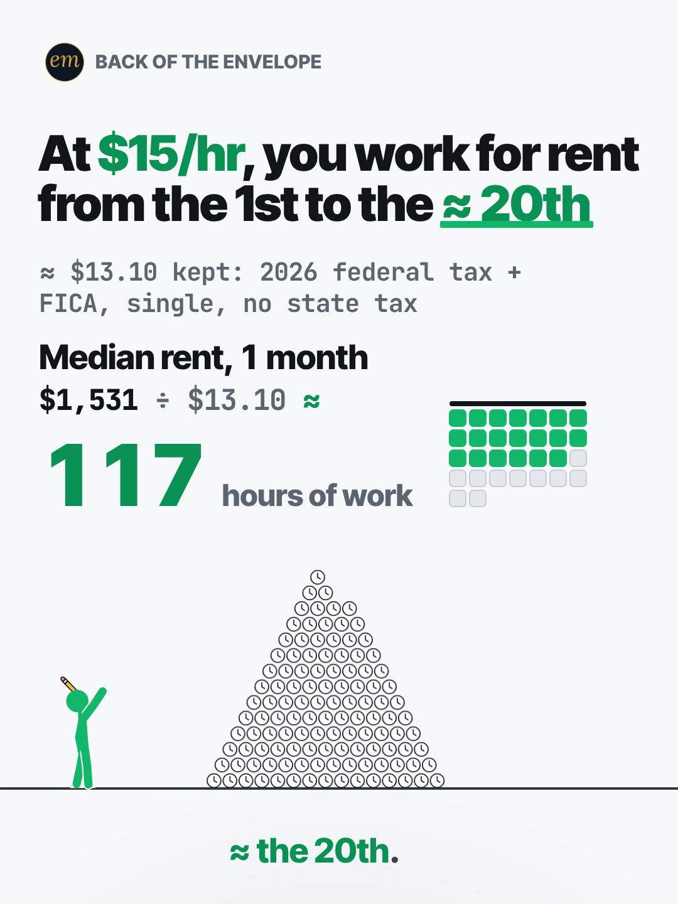

# 08b publishing sheet: at $15/hr, rent in hours of work

YouTube Shorts (@envelopemath) and Instagram Reels (@envelopemath). Prepared 2026-10-13. Machine-readable twin: `publishing/08b-becker-rig-hours-at-15.json`.

- **Video.** `renders/channel/08b-becker-rig-hours-at-15.mp4`: the pre-condense cut (29.5 s: a 27 s body + the 2.5 s card; sha256 `ad72ecac…`). The 08 condense is in progress in parallel (timing only: the numbers, the captions' facts and the verdict stay). Nothing below names a timestamp except the cover, which is picked by content (the landed blank), so the copy carries over to the condensed cut unchanged. The ship step rebuilds this sheet and re-exports both covers from the final file: `python3 publishing/tools/build_publishing.py 08b-becker-rig-hours-at-15 --covers`.
- **Numbers.** Every figure comes from `teasers/v2/08-unit-ladder.md` (08b) and its check, `python3 teasers/v2/checks/08-unit-ladder.py`: 677 checks, 0 failed on `studio/specs/` (run 2026-10-13; the builder runs it through the adapter `publishing/data/checks/08-unit-ladder.py`). `python3 publishing/tools/build_publishing.py 08b-becker-rig-hours-at-15 --check` checks this sheet's limits, paste blocks and figures, recomputes the take-home from the 2026 tax parameters, re-divides every rung by $13.10, pairs each price with its own count and rung, re-derives '≈ the 20th' and the 19th-21st calendar range (and keeps the 19th and 21st inside it), keeps every rounded figure 'about' or '≈', and keeps the rent named as the median and the 14 years as 'every cent you keep'.
- **Honesty rules kept.** The title asks and never gives the result, and so does the YouTube thumbnail (frame 1: the blank and '? hours of work'). The Instagram caption keeps every result below 'more'. The Instagram cover is the landed blank with the 117-hour pile, as the write-up's Instagram note asks. Every claim stays inside the video's verdict, "≈ 14 years of full-time work. Every cent you keep.", and the copy says its conditions: the Census median rent (not yours), 2026 federal tax + FICA for a single filer with no state tax, and sticker prices with no loan interest. The copy never calls $15 the minimum wage, not even as a hashtag. No advice, no urgency, and 'Not financial advice.' is in both.
- **Brand.** Kelley Blue Book (Cox Automotive) is named only as the source of the average new-car price; both platforms' copy says 'Not affiliated with or endorsed by Kelley Blue Book or Cox Automotive.' The Census Bureau, the IRS and the SSA are public sources. The video draws no logo and names no car or brand.

---

## YouTube Shorts

### Title (vidIQ title score, short-form, scored against this channel)

| # | Title | Score | Chars |
|---|---|---:|---:|
| 1 | How Many Hours of Work Is Rent at $15 an Hour? Until What Day of the Month? | 98 | 75 |
| 2 | How Many Hours of Work Is Rent at $15 an Hour? A Car? A House? | 97 | 62 |
| 3 | How Many Hours Do You Work Just to Pay Rent at $15 an Hour? | 95 | 59 |

**Pick (paste):**

```
How Many Hours of Work Is Rent at $15 an Hour? Until What Day of the Month?
```

- 75 of 100 characters.
- It raises the write-up's title from 82 to 98. The write-up's '…' cliffhanger scores lowest of the 10; two plain questions in the viewer's terms (hours of work, the day of the month) score highest. The video answers both: ≈ 117 hours, and from the 1st to ≈ the 20th.
- It names no result: not ≈ 117, not ≈ the 20th, not ≈ 14 years. '$15 an hour' is the input, on screen at frame 1 in the header.
- 'Rent' here is the Census median asking rent, as the video's HUD and the description say ('Median rent, 1 month'); the title asks about rent in general, as the header does, and never says 'your rent'. vidIQ's model ranks titles but does not predict views.
- Also scored, not used: "How Many Hours of Work Is Rent at $15 an Hour?" 94 (the first question alone); "How Many Hours of Work Is Rent at $15 an Hour? #Rent #HourlyWage #PersonalFinance" 94 (the house 3-hashtag form, with the description's hashtags (re-scored at the adversarial check)); "How Many Hours of Work Is Rent at $15 an Hour? #rent #minimumwage #personalfinance" 94 (the first build's hashtag form; #minimumwage is dropped (see the hashtags)); "At $15 an Hour, How Many Days a Month Do You Work Just for Rent?" 91; "Rent, a Car, a House: How Many Hours of Work at $15 an Hour?" 89 (close to the round-1 judge's title); "At $15 an Hour, You Work for Rent From the 1st Until When?" 85 (the header as a question); "At $15/hr, You Work for Rent From the 1st Until…" 82 (the write-up's title).

### Description (paste)

```
How many hours of work is rent at $15 an hour? After 2026 federal tax and FICA, $15 an hour keeps about $13.10. Median rent, $1,531 a month, takes about 117 of a full-time month's 173 work hours, so from the 1st you work for rent until about the 20th.

The math, shown (hours = price ÷ $13.10):
• Kept per hour: $15 × 2,080 hours = $31,200 a year, minus $1,564.00 federal income tax and $2,386.80 FICA = $27,249.20; ÷ 2,080 ≈ $13.10.
• Median rent, 1 month: $1,531 ÷ $13.10 ≈ 117 hours, 67.4% of a full-time month (2,080 ÷ 12 ≈ 173.33 hours). From the 1st, that runs to about the 20th.
• Median rent, 1 year: $18,372 ÷ $13.10 ≈ 1,402 hours.
• An average new car: $50,089 ÷ $13.10 ≈ 3,824 hours.
• A median new house: $393,700 ÷ $13.10 ≈ 30,053 hours, ÷ 2,080 a year ≈ 14 years of full-time work, every cent you keep.

Follow for the math behind your money — shown, not hand-waved. @envelopemath

Animation and original sound: The Back of the Envelope. Rent: U.S. Census Bureau median asking rent, Q2 2026. Car: Kelley Blue Book average new-vehicle transaction price, Aug 2026 (Cox Automotive). House: U.S. Census Bureau median sales price of new houses sold, Aug 2026. Take-home: 2026 federal income tax for a single filer ($16,100 standard deduction, 10% and 12% brackets) and 7.65% FICA (IRS; SSA); 40 hours a week, 52 weeks; no state income tax, benefit premiums or retirement deferrals. The median rent, not yours. Sticker prices, no loan interest. Not financial advice. Not affiliated with or endorsed by Kelley Blue Book or Cox Automotive.
#Rent #HourlyWage #PersonalFinance
```

1,580 of 5,000 characters (1,615 UTF-8 bytes; YouTube counts this limit in bytes, and `≈`, `×`, `•`, `—`, `÷` take 2-3 each). No `<` or `>`, which YouTube rejects. It follows the house template: an answer-first opening line for the search snippet, then 'The math, shown:' bullets, then the follow line. The credit, assumptions and 'Not financial advice.' line comes next, and the 3 hashtags close it. The opening line is the title's two questions with the write-up's caption answer, for the search snippet. The 'Doesn't Add Up' series line is left out, as on 06b, 06c and 05c: the verdict is a plain count of hours, not a number that shouldn't be true.

### Hashtags (order matters)

1. `#Rent`: the bill the video prices ('rent' 67,558 searches a month; 'why is rent so high' +81.4% on its baseline).
2. `#HourlyWage`: the ruler, and the write-up's own caption tag ('hourly wage' 5,307 searches a month at competition 23.5, overall 64.0; 'minimum wage' has 11,780 at 61.0, overall 52.1). It replaces the first build's #MinimumWage: shown as a link above a title that says '$15 an Hour', that would label $15 the minimum wage, which the copy rules out, and on this slate #MinimumWage already tags 02b's $7.25 federal-minimum row.
3. `#PersonalFinance`: the broad category, and the channel's own most-used title tag (4 of its October Shorts carry it).

The title carries no hashtags, so YouTube shows these 3, the description's first, above the title. Over 60 hashtags and YouTube ignores all of them. `#Shorts` isn't needed.

### Tags (paste; 299 of 500 characters as YouTube counts them: commas count, and a tag with a space counts 2 more for the quotes YouTube adds)

```
rent, why is rent so high, why rent is so expensive, rent due, living on 15 an hour, budgeting 15 an hour, 15 an hour, hourly wage, real hourly wage, minimum wage, cost of living, how many hours of work does it cost, money math, math animation, the back of the envelope, envelope math
```

Tags carry little weight. These mirror the keyword research plus the house's channel tags. 'why is rent so high' (7,855 a month) is rising (+81.4%), and 'budgeting 15 an hour' (4,556) has the lowest competition in the set (7.6). 'how many hours of work does it cost' carries the unit idea ('how many hours of your life does it cost…', 4,219), and 'rent due' (31,369) the day the count starts from, the 1st. 'minimum wage' stays a tag only: tags are not shown, and the visible copy never calls $15 the minimum wage. Left out on purpose: 'how much rent can i afford' (3,386) asks for advice the video does not give (the copy rules out 'afford', as 06b's sheet leaves out advice-intent tags), '15 an hour online jobs' and the side-hustle phrasings (job-search intent), and 'take home pay' (lane 1's subject; here it lives only in the footer).

### Pinned comment (post it, then pin it)

```
Your wage? Divide the price by what you KEEP per hour, not by your wage. At $15/hr you keep 87.3% (≈ $13.10). At $20/hr it's ≈ $17.12 (85.6%), at $25/hr ≈ $21.14 (84.5%), before state tax. Your rent ÷ that = your hours.

Median rent at $15/hr: ≈ 117 of 173 work hours (67.4% of the month), so you work for rent from the 1st to ≈ the 20th. That's 20.2 days of a 30-day month; on a Monday-Friday calendar it's the 19th, 20th or 21st, depending on the weekday of the 1st.
```

The question comes first so it shows in the collapsed preview, and it asks for the viewer's own number (R3): the write-up's pinned rule for any wage and rent. The second paragraph is the write-up's working, plus the calendar range its check asserts. It answers the two comments to expect: 'my rent isn't $1,531' (divide your own) and 'it depends on the month' (20.2 days of a 30-day month; the 19th to the 21st on a real calendar). 'Not every state…' is answered by 'before state tax'.

### Related video and end screen

- **Related video:** [Pay the Minimum on $5,000? 238 Months. #CreditCard #PersonalFinance #maths](https://www.youtube.com/shorts/8__HTUa2PoU) (`8__HTUa2PoU`). A bill measured in time (238 months), the same move as this Short's rent in hours, and the channel's best post on Instagram (7,303 plays, 27.4% skip rate).
- **Swap later:** 08a (a Costco hot dog risen like a house) or 08c (a year of college in Big Macs), the same unit-ladder series, once published. Then point that Short's Related video at this one.
- **End screen:** Shorts have no end screens or cards. The Related video link is the Shorts equivalent.

### Thumbnail and settings

- **Thumbnail:** in the YouTube app, pick frame 1: the header 'At $15/hr, you work for rent / from the 1st to the ___', the footer '≈ $13.10 kept: 2026 federal tax + FICA, single, no state tax', the HUD 'Median rent, 1 month / $1,531 ÷ $13.10 = / ? hours of work' and the figure beside the gold $1,531 coin. It asks without answering, like the title beside it in search. The Instagram cover below is the landed blank, as the write-up asks.
- **Settings:** Category Education. Not made for kids. Altered or synthetic content: No (it's an animated chart, not realistic footage). Remixing allowed. No captions needed: there's no narration and all the text is on screen.

### Posting window

- **When:** First free Tue-Thu evening after the condensed cut ships and passes QA, 21:30-22:30 ET (01:30-02:30 UTC the next day). Sunday 06:00-08:00 ET is the alternative.
- **Spacing:** Keep it at least 6 h from any other upload on the channel, and on a different evening from 08a and 08c. Suggested order within the series: 08b, then 08c, then 08a.
- **Why:** The channel's own October Shorts, median views by posting slot (vidIQ, 2026-10-13): Sunday 05:00-08:00 ET 1,199 (n = 2), weekday 22:00-00:30 ET 642 (n = 3), weekday midday 263 (n = 2); 06c (Mon 03:45 ET) has 760 and 06b (Mon 12:14 ET) 75, too young to compare. The evening slot is also the best one on Instagram, so one evening serves both. n = 7 and confounded by topic, so treat it as a test. 08b goes first of the three: its hook scored highest with the write-up's judges (7.0 of 10), 'why is rent so high' runs +81.4% over its baseline, and the $15 wage is in the news (a same-idea Short's description says Florida's minimum reached $15 on Sept 30, 2026; not verified here, and not in the copy).

---

## Instagram Reels

### Caption (paste)

```
At $15 an hour, how many hours of work is rent? Count every hour you work from the 1st of the month: which day does rent stop taking them?

At $15/hr, rent takes every hour you work from the 1st to ≈ the 20th.

The math, shown (hours = price ÷ $13.10, what $15 an hour keeps after 2026 federal tax and FICA):
• Median rent, 1 month, $1,531: ≈ 117 hours, 67.4% of a full-time month's 173.33. From the 1st, ≈ the 20th.
• Median rent, 1 year, $18,372: ≈ 1,402 hours.
• An average new car, $50,089: ≈ 3,824 hours.
• A median new house, $393,700: ≈ 30,053 hours, ≈ 14 years of full-time work, every cent you keep.

Single filer, $16,100 standard deduction, 7.65% FICA, no state income tax; 40 hours a week, 52 weeks. The Census median rent, not yours. Sticker prices, no loan interest. Rent: Census, Q2 2026. Car: Kelley Blue Book, Aug 2026. House: Census, Aug 2026. Not financial advice. Not affiliated with or endorsed by Kelley Blue Book or Cox Automotive.

Your wage? Divide the price by what you keep per hour, not by your wage.

Follow for the math behind your money — shown, not hand-waved. @envelopemath
Animation and original sound: The Back of the Envelope.

#rent #hourlywage #costofliving #personalfinance #moneymath
```

- 1,223 of 2,200 characters.
- **First 125 characters:** the two questions the header asks (hours of work, and the day of the month), with no figure but the $15 input. The write-up's caption line 1 ('At $15/hr, rent takes every hour you work from the 1st to ≈ the 20th.') is the answer, so the house rule moves it below 'more', because the caption overlays the Reel from frame 1. The numbers sit below the fold, where Instagram search and Google indexing still read them.
- The conditions follow the math, as on screen in the footer: single, no state tax, 2026 federal tax + FICA; the median rent, not yours; sticker prices with no loan interest.
- The caption follows the house close: the write-up's own question for the viewer's wage, then the follow line plus the credit.

### Hashtags (5, Instagram's cap since Dec 2025)

`#rent #hourlywage #costofliving #personalfinance #moneymath`

Three are the write-up's own (`#hourlywage #rent #moneymath`); its `#housing` gives way to `#costofliving`:

- `#rent` names the bill and `#hourlywage` the ruler.
- `#costofliving` is what the ladder measures, rent, a car and a house in hours of work ('cost of living' 129,747 searches a month). It replaces the first build's `#minimumwage`, which would label $15 the minimum wage; the caption never does.

`#personalfinance` is the broad layer, as on 06b, 06c and 08a.

### Alt text

- **Short (89 characters; paste this one into Instagram):** Chart: at $15 an hour, median rent is about 117 hours of work: the 1st to about the 20th.
  - It stays at or under 100 characters, so it fits the field however short it is. It says 'about', not '≈', so screen readers read it cleanly, and it keeps 'median' on the rent.
- **Long (for anywhere with room, such as a website embed):** Animation on a light page with a green stick figure. The header says: at $15/hr, you work for rent from the 1st to the blank. The footer: about $13.10 kept after 2026 federal tax and FICA, single, no state tax. The figure punches a gold $1,531 coin (median rent, 1 month) into a pyramid of clock icons: $1,531 divided by $13.10 is about 117 hours of work. The header's blank ticks through the days while a month grid fills, and lands on about the 20th. Then a year of median rent, $18,372, is about 1,402 hours; an average new car, $50,089, about 3,824 hours; a median new house, $393,700, about 30,053 hours on a gold plate. Payoff: about 14 years of full-time work, every cent you keep.
- **Where:** Advanced settings → Accessibility → Alt text, if your app shows it for Reels.

### Cover



- **Files:** `publishing/08b-becker-rig-hours-at-15-cover-3x4.jpg` (1080×1440) and `publishing/08b-becker-rig-hours-at-15-cover-9x16.jpg` (1080×1920). Both come from the pre-condense (29.5 s) render at 7.3 s (frame 219).
- **Frame, by content:** The landed blank, as the write-up's Instagram note asks: the header 'At $15/hr, you work for rent / from the 1st to the ≈ 20th' with its green rule, the footer '≈ $13.10 kept: 2026 federal tax + FICA, single, no state tax', the HUD 'Median rent, 1 month / $1,531 ÷ $13.10 ≈ / 117 hours of work', the month grid filled to the 20th (20 green days of 30), the 117-hour pyramid of clocks with the figure pointing up at the header, and the caption '≈ the 20th.' On any cut, use a settled frame after the blank lands and before the next rung's cut, with the caption still up. On the pre-condense 29.5 s render the blank lands at frame 192 (6.40 s); the frame settles by about frame 200 (6.67 s) and holds still (frame-to-frame mean luma change under 0.0002) with the caption '≈ the 20th.' until it clears at about frame 236 (7.87 s); rung 2 cuts at frame 252 (8.40 s). Frame 219 (7.30 s) is used. If the cut changes, re-pick it by content.
- **Crop:** 3:4 = 1080×1440 from y 45 to 1485 of the 1080×1920 frame. The content runs from y 112 (the badge) to y 1418 (the caption), so the crop centres it (67 px above and below): badge, header, footer, HUD, month grid, the pile with the figure, and the caption; it drops the empty page below. A centred grid crop (y 240-1680) cuts the badge and the header.
- **How to set it:** In 'Edit cover', pick the landed-blank frame from the video (or upload the 9:16 JPG), then drag 'Profile grid' to the top so the tile matches the 3:4 JPG. Do not upload the 3:4 JPG as the Reel cover: Instagram centre-crops it to 9:16 in the Reels tab and cuts the header.
- **Re-export:** `ffmpeg -ss 7.3 -i renders/channel/08b-becker-rig-hours-at-15.mp4 -frames:v 1 -vf "crop=1080:1440:0:45" -q:v 2 publishing/08b-becker-rig-hours-at-15-cover-3x4.jpg` and `ffmpeg -ss 7.3 -i renders/channel/08b-becker-rig-hours-at-15.mp4 -frames:v 1 -q:v 2 publishing/08b-becker-rig-hours-at-15-cover-9x16.jpg`, or `python3 publishing/tools/build_publishing.py 08b-becker-rig-hours-at-15 --covers`.
- **Not used on Instagram:** frame 1 (the blank '___', '? hours of work' and the $1,531 coin). It asks without answering, so it is the YouTube thumbnail, where it sits beside a title that asks; on Instagram the write-up picks the landed blank, the date that travels.
- **Not used:** the end screen ('≈ 14 years' on the gold plate). It is the payoff; the write-up's cover note picks the blank instead.
- **When the condensed cut ships:** re-pick the landed blank by content on the shipped file and re-export both JPGs with `--covers`.

### First comment (post it, then pin it)

```
Median rent at $15/hr: ≈ 117 of 173 work hours a month (67.4%), so you work for rent from the 1st to ≈ the 20th. A median new house: ≈ 30,053 hours, ≈ 14 years of full-time work, every cent you keep. What's your wage?
```

### Trial Reels

**Post as a regular Reel, not a Trial.** @envelopemath has 8 followers, so a regular Reel is already shown almost entirely to non-followers, which is all a Trial Reel adds. A Trial would also keep it off the profile grid until shared. A hook test afterwards, if you want one: the other cut as a Trial with MANUAL graduation 48-72 h later. Once the condensed cut replaces this render in renders/channel, get the pre-condense one from git with `git show 471c793:renders/channel/08b-becker-rig-hours-at-15.mp4 > 08b-29.5s.mp4` (sha256 95b20844…). Compare skip rate (October Reels ran 27.0-65.1%; 06c's condensed cut 40.3%) and average watched %, then share the winner. vidIQ's publish tool exposes Trial (MANUAL or SS_PERFORMANCE) for this connected account. Confirm eligibility in the app.

### Posting window and settings

- **When:** Same evening as YouTube, about 15 min after the Short: 21:45-22:45 ET, on a different evening from 08a and 08c.
- **Why:** October Reels, median plays by posting slot (owner insights, 2026-10-13): weekday 22:00-00:30 ET 5,449 (n = 3, including the two best: 7,303 and 5,449), weekday midday 1,212 (n = 2), Sunday 05:00-08:00 ET 1,087 (n = 2). 06c, posted Mon 03:46 ET, has 1,711 plays with a 40.3% skip rate. Skip rate tracks plays more closely than the hour does: 27.0-27.4% for the top two, 56.9-65.1% for the bottom two. The condense matters more than the hour.
- **Audio:** Rename the original audio to 'Rent in hours at $15/hr — The Back of the Envelope' if the app allows; it is the score, with no voice.
- **Share to feed:** On.

---

## Why these choices (research evidence)

**1. Search demand (vidIQ keyword research, pulled 2026-10-13).** vidIQ refreshes each keyword on its own schedule, so the last column gives each row's snapshot date. Five rows are older snapshots.

| Keyword | Est. searches/month | Competition | Overall | Note | vidIQ as of |
|---|---:|---:|---:|---|---|
| rent | 67,558 | 42.8 | 66.1 | seed; -27.3% vs its 30-day baseline (92,940) | 2026-10-12 |
| why rent is so expensive | 13,473 | 41.6 | 60.3 |  | 2026-10-12 |
| minimum wage | 11,780 | 61.0 | 52.1 | -33.9% vs its baseline (17,822) | 2026-10-12 |
| why is rent so high | 7,855 | 40.8 | 58.6 | +81.4% vs its baseline (4,331) | 2026-10-12 |
| budgeting 15 an hour | 4,556 | 7.6 | 69.7 | the lowest competition here | 2026-06-02 |
| how many hours of your life does it cost purchase hourly wage | 4,219 | 20.9 | 64.1 | a price in hours of work, the same idea | 2026-10-05 |
| living on 15 an hour | 3,580 | 39.5 | 56.0 |  | 2026-03-30 |
| real hourly wage | 3,540 | 26.3 | 61.3 |  | 2026-10-12 |
| how much rent can i afford | 3,386 | 34.9 | 57.7 | advice intent; not in the tags | 2026-02-25 |
| cost of living | 129,747 | 81.5 | 53.2 | -2.4%; the highest competition here | 2026-10-12 |
| rent due | 31,369 | 42.1 | 63.4 | -8.3%; rent day, where the count starts (adversarial check) | 2026-10-12 |
| hourly wage | 5,307 | 23.5 | 64.0 | the ruler; the write-up's own tag (adversarial check) | 2026-08-20 |
| $15 an hour | 0 (<750) | 35.5 | 25.8 | <750/month as typed | no snapshot |
| how many hours to pay rent | 0 (<750) |  |  | <750/month | no snapshot |

Rent is searched as a complaint ('why rent is so expensive' 13,473; 'why is rent so high' 7,855, +81.4%), and the wage as a budget ('budgeting 15 an hour' 4,556 at competition 7.6; 'living on 15 an hour' 3,580). The exact idea, a price in hours of work, has its own long-tail search (4,219). The video's own phrasings ('$15 an hour', 'how many hours to pay rent') are under 750 a month, so the title uses the searched words ('hours of work', 'rent', '$15 an hour') in a question.

**2. Rent in hours of work is a fresh idea on YouTube; the $15 wage is not (vidIQ YouTube search, under 4 min, by relevance and by views).**

| Title | Channel (subs) | Views | Date |
|---|---|---:|---|
| Businesses CUTTING WAGES? ($15/hour to work at Taco Bell) | Reventure Consulting (688,000) | 2,439,837 | 2023-06-16 |
| Would you work for $15 an hour? 🤔💵#shorts #finance #interview | Chris Stocks (671,000) | 11,499 | 2023-01-23 |
| How Much Rent Can You REALLY Afford? | NerdWallet (304,000) | 6,700 | 2025-07-10 |
| Budget $17/hr Full Time. Rent $1,200/mo #howtobudget | Jaimie Hines (803) | 1,915 | 2025-08-25 |
| Why $15/hr is the new minimum #finance #inflation #work | Mike The Vet 2.0 (3,370) | 174 | 2026-09-08 |
| $1,000 Rent Costs 138 Work Hours at Minimum Wage | ThePriceSignal (1) | 9 | 2026-10-12 |
| Florida's $15 Minimum Wage Is Here — Here's What It Actually Buys You | Floriflation (3) | 9 | 2026-10-12 |
| How Long to Earn $1 Million on Minimum Wage? 😩 #shorts | Cash Cubed (12) | 5 | 2026-10-11 |

Two searches built for this idea ('how many hours you work just to pay rent', 'hours of work to afford rent car house') returned no Shorts at all. The nearest twin is a day old: ThePriceSignal's '$1,000 Rent Costs 138 Work Hours at Minimum Wage' (9 views), which divides a hypothetical rent by gross pay. Nobody puts the hours on the calendar, which is this Short's blank, or divides by what you keep after tax.

The $15 wage itself is a crowded, proven subject (Reventure's '$15/hour to work at Taco Bell', 2,439,837 views), and two new Shorts on 11-12 Oct tie it to the minimum wage. That is why the title asks in hours and days and leaves the minimum-wage framing out of the visible copy and the hashtags (it stays a tag).

**3. Wage-against-bills posts travel on Instagram and TikTok (vidIQ IG/TikTok outlier search, since June 2025, at least 10K views).**

- **@moneymovesjake** (TikTok), "If you make $25/hour, you take home about $17.50 after taxes.": 166.4K (397.1x). Text on screen and music only, reframing prices as hours of take-home work: the closest concept to this Short.
- **@saadmughal228** (Instagram), "$35 AN HOUR IS THE NEW 'JUST GETTING BY.'": 901K (72.1x). **@tyskywalka2.0** (TikTok), "If you make 20/hr you can't afford to live on your own": 796K (49.9x). The wage-vs-rent claim as an opinion; this Short does the division instead.
- **@mastermoneyco** (Instagram), "4 DEAD SIMPLE NUMBERS That Tell You What You Actually Make": 1.8M (28.4x). True hourly take-home pay, the idea in this Short's footer.
- **@stacknreps** (Instagram), "If I made $15/hour these would be my 3 choices…": 93.3K (24.7x). $15 an hour as the filter in the hook, as in the write-up's H57.
- The wage in the hook filters the viewer in on both platforms; none of the outliers lays the hours on a calendar.

**4. Our own October numbers (vidIQ: public YouTube stats, Instagram owner insights; refreshed 2026-10-13).**

| YouTube Short | Posted (ET) | Views |
|---|---|---:|
| Can You Find the Missing Dollar? (`LjHDFzVxRyM`) | Sun 07:04 | 1,256 |
| You Can Lean on $1 Million. Not on $1 Billion. (`hJBvmGA6sZ0`) | Thu 00:25 | 1,221 |
| Your Interest Has a Speed Limit (`XVUeMcTg9OQ`) | Sun 05:49 | 1,141 |
| What If You Bought Starbucks Stock Instead of a $4 Latte Every Day? (06c) (`fbpdKf4Wy8c`) | Mon 03:45 | 760 |
| Pay the Minimum on $5,000? 238 Months. (`8__HTUa2PoU`) | Mon 22:09 | 642 |
| A $2 Lottery Ticket Was Worth $6.98. Until the Fine Print. (`FW_oxA3kbsM`) | Wed 12:03 | 348 |
| You Can Carry $1 Million. Not in Pennies. (`mXbKY_R63h4`) | Thu 13:38 | 177 |
| Start Investing 10 Years Late? You Get Half. (`EqFQCJheCMU`) | Tue 22:27 | 161 |
| What If You Bought Netflix Stock Instead of Paying for Netflix? (06b) (`krfZEHhb0xU`) | Mon 12:14 | 75 |

| Instagram Reel | Posted (ET) | Plays | Skip rate | Avg watched |
|---|---|---:|---:|---:|
| $5,000 on the minimum (`DeIvYk7I4Qr`) | Mon 22:46 | 7,303 | 27.4% | 56.5% |
| $1M stack vs Burj Khalifa (`DeOEthJJ1TG`) | Thu 00:28 | 5,449 | 27.0% | 83.1% |
| Missing dollar (`DeWgFZRoR_S`) | Sun 07:05 | 1,997 | 32.0% | 81.3% |
| Powerball $6.98 (`DeMvZv9IqRw`) | Wed 12:05 | 1,825 | 58.7% | 57.9% |
| 06c latte vs Starbucks stock (`DeYuqT4pjVC`) | Mon 03:46 | 1,711 | 40.3% | 69.1% |
| $1M in pennies (`DePe11HIHwn`) | Thu 13:37 | 598 | 42.0% | 66.7% |
| 10 years late (`DeLSd9io8UK`) | Tue 22:30 | 219 | 65.1% | 30.6% |
| Speed limit (e) (`DeEW2ZMIiYd`) | Sun 05:54 | 177 | 56.9% | 31.2% |

Channel totals:

- **YouTube:** 53 subscribers, 10,221 views and 41 videos (+27 subscribers, +5,127 views and 11 videos in 30 days).
- **Instagram:** 8 followers and 20,519 views in 30 days.

The channel's best Reel is also a bill measured in time ('$5,000 on the minimum': 7,303 plays, 27.4% skip rate), this Short's related video. 06c (760 views, 1,711 plays) and 06b (Mon 12 Oct 12:14 ET: 75 views so far) are too young to compare, and 06b's Reel shows 7 plays while Instagram's owner insights catch up.

Medians by posting slot (n = 2-3 each, confounded by topic; 06b and 06c left out as too young):

- **YouTube:** Sunday early morning ET 1,199, weekday 22:00-00:30 ET 642, weekday midday 263.
- **Instagram:** weekday 22:00-00:30 ET 5,449, midday 1,212, Sunday early morning 1,087.

One weekday evening is the best Instagram slot and the second-best YouTube slot, so the plan posts both then. On Instagram, skip rate predicts plays better than the hour does (27.0-27.4% for the top two, 56.9-65.1% for the bottom two). So the window is a light-touch test, and the condense (fewer still moments) is the bigger reach lever.

**5. Platform rules applied.**

- **YouTube title:** 100 characters. The Shorts player shows only the opening, so the keywords come first.
- **YouTube description:** 5,000 characters.
- **YouTube hashtags:** the first 3 show; over 60 and all are ignored; `#Shorts` isn't needed.
- **YouTube tags:** 500 characters, low weight.
- **YouTube Shorts:** no end screens. The Related video link is the Shorts equivalent.
- **YouTube AI disclosure:** only for realistic altered content.
- **Instagram caption:** 2,200 characters, about 125 shown before 'more'.
- **Instagram hashtags:** 5 at most.
- **Instagram search and Google:** keywords in the caption feed Instagram search, and Google indexes public professional posts (since 10 Jul 2025).
- **Instagram grid:** a 3:4 crop of the 9:16 cover.
- **Trial Reels:** shown to non-followers only.

**6. Limits.**

- @envelopemath's YouTube Analytics (audience hours, geography) were not read here; the 06b and 06c sheets found vidIQ's YouTube authorization is a different channel. Check Studio → Analytics → Audience → 'When your viewers are on YouTube' before posting.
- vidIQ has no hashtag-volume data; hashtag picks lean on keyword volume and on the write-up's and the outliers' own tags.
- Title scores are vidIQ's short-form CTR model for this channel; they rank options but do not predict views.
- The write-up's rent ($1,531) is a single-publisher Census figure, cross-checked only against the same series' previous quarter and by its verifier; census.gov was blocked to direct fetches. The Aug 2026 house price is preliminary.
- Florida's $15 minimum wage (Sept 30, 2026) comes only from a same-idea Short's description; it is not verified here and is not in the copy.
- The video, the cover and the video facts are the pre-condense cut; the copy is cut-independent, and the ship step refreshes the rest from the final file.

---

## Check log (adversarial pass, 2026-10-13)

- **Maths.** `python3 teasers/v2/checks/08-unit-ladder.py`: 677 checks, 0 failed on `studio/specs/`. Every public figure traces to the 08b maths table: $15 × 2,080 = $31,200; tax 10% × $12,400 + 12% × ($15,100 − $12,400) = $1,564.00; FICA 7.65% = $2,386.80; kept $27,249.20 ÷ 2,080 = $13.10058 ≈ $13.10 (87.3%); $1,531 ÷ $13.10 = 116.87 ≈ 117 (67.4% of 173.33; 20.23 days of 30 → ≈ the 20th); $18,372 → ≈ 1,402; $50,089 → ≈ 3,824; $393,700 → ≈ 30,053 ÷ 2,080 = 14.45 ≈ 14 years. The data file recomputes every one, and the calendar range.
- **Limits.** Title 75/100. Description 1,580 characters (1,615 bytes) of 5,000. 3 hashtags. Tags 299/500 as YouTube counts them. Instagram caption 1,223/2,200, with the first 125 characters result-free. 5 hashtags. Short alt text 89. No `<` or `>`.
- **vidIQ.** Keywords pulled 2026-10-13 (table above). 10 titles scored against this channel (9 at the first build, the #HourlyWage hashtag form at the adversarial check): the pick 98, the write-up's title 82. Channel 53 subscribers / 10,221 views / 41 videos; Instagram owner insights refreshed (8 followers, 20,519 views in 30 days).
- **vidIQ re-queried** after the build: the pick's title score 98, as first scored. At the adversarial check: the pick's title score 98; 'why is rent so high' 7,855 / 40.8 (+81.4%); the related video `8__HTUa2PoU`'s title as in the pick. All match.
- **Changed at the adversarial check.**
  - `#MinimumWage` was the second of the three hashtags shown as links above the title, right over '$15 an Hour', and `#minimumwage` was in the caption. That labels $15 the minimum wage, the claim the copy rules out ($15 is not the federal minimum, which this slate's 02b tags with the same hashtag at $7.25). YouTube now shows `#Rent #HourlyWage #PersonalFinance` ('hourly wage' 5,307 a month at competition 23.5, overall 64.0, against 'minimum wage' 52.1; `#hourlywage` is the write-up's own tag), and Instagram uses `#costofliving` ('cost of living' 129,747) in its place. The `COPY_RULES` minimum-wage rule now covers hashtags. 'minimum wage' stays an unshown tag.
  - The tag 'how much rent can i afford' asked for advice the video does not give (the copy rules out 'afford'; 06b's sheet leaves advice-intent tags out). It is now 'rent due' (31,369), the day the count starts from. Tags 299/500.
  - The numbers check let a wrong day through: 'From the 1st, ≈ the 21st' passed, because 21 is in FIGURES for the 19th-21st range. `COPY_RULES` now keep the 19th and the 21st inside 'the 19th, 20th or 21st', and 20.2 with 'days of a 30-day month'. They also pair each price with its own count ($1,531 → 117, $18,372 → 1,402, $50,089 → 3,824, $393,700 → 30,053) and each of the last three with its rung (year, car, house).
- **Generator.** Unchanged. `MATH_SCRIPT` is the adapter `publishing/data/checks/08-unit-ladder.py` (see the 08a sheet).
- **Mutation test.** Six breaks on scratch copies of this file all fail by name: a bare 'the 20th', '≈ 117' not named as the median rent, '14 years' without 'every cent you keep', a bare '$13.10', 'minimum wage' in the copy, and ≈ 1,402 changed to 1,400. (19 of 19 across 08a-08c.) At the adversarial check, five more on scratch copies also fail by name: 'From the 1st, ≈ the 21st', $18,372 → ≈ 3,824, the car and house rows swapped, `#minimumwage` back in the caption, and 20.2 moved off its 30-day month.
- **Kept on purpose.**
  - The YouTube thumbnail is frame 1 (the blank) and the Instagram cover is the landed blank, as the write-up's Instagram note asks. The no-result rule covers the title and the caption's first 125 characters.
  - '$13.10' appears either as the defined unit ('÷ $13.10', the operand on screen) or as what you keep ('≈ $13.10'), never as a bare wage.
  - The rent is always 'median', and the copy says 'the median rent, not yours', as the write-up's honesty change for the VO did ('Median rent', not 'Your rent').
  - 'minimum wage' as an unshown tag only: neither the copy nor the hashtags call $15 the minimum wage.
- **Checked and kept.** Every figure in the copy against the 08b maths table and the check's output (the take-home, the 67.4% month, the 19th-21st range and the $20/$25 wages recomputed); the limits; Kelley Blue Book and Cox Automotive named only as the car price's source, with the affiliation line in both long texts; frame 1 (thumbnail) and frame 219 (cover) read from the render, and the covers re-exported byte for byte.
- **Still to do.** The ship rebuild (`--covers`) on the condensed file.
