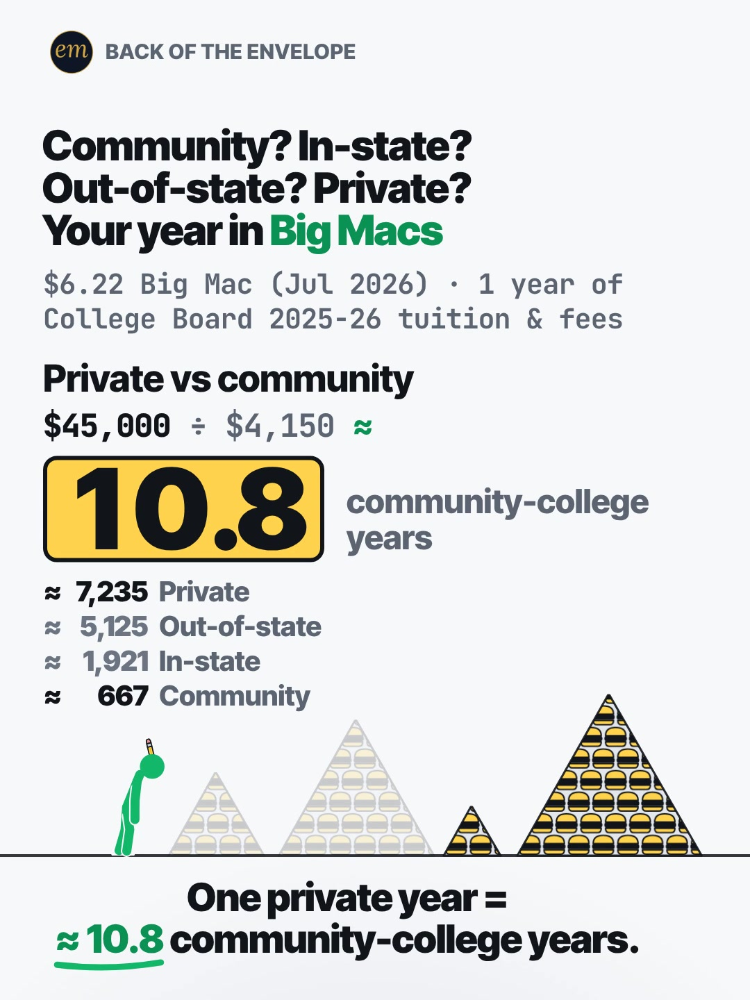

# 08c publishing sheet: a year of college in Big Macs

YouTube Shorts (@envelopemath) and Instagram Reels (@envelopemath). Prepared 2026-10-13. Machine-readable twin: `publishing/08c-becker-rig-college-in-big-macs.json`.

- **Video.** `renders/channel/08c-becker-rig-college-in-big-macs.mp4`: the pre-condense cut (24.5 s: a 22 s body + the 2.5 s card; sha256 `3424714c…`). The 08 condense is in progress in parallel (timing only: the numbers, the captions' facts and the verdict stay). Nothing below names a timestamp except the cover, which is picked by content (the end state), so the copy carries over to the condensed cut unchanged. The ship step rebuilds this sheet and re-exports both covers from the final file: `python3 publishing/tools/build_publishing.py 08c-becker-rig-college-in-big-macs --covers`.
- **Numbers.** Every figure comes from `teasers/v2/08-unit-ladder.md` (08c) and its check, `python3 teasers/v2/checks/08-unit-ladder.py`: 677 checks, 0 failed on `studio/specs/` (run 2026-10-13; the builder runs it through the adapter `publishing/data/checks/08-unit-ladder.py`). `python3 publishing/tools/build_publishing.py 08c-becker-rig-college-in-big-macs --check` checks this sheet's limits, paste blocks and figures, re-divides every row by $6.22, recomputes the ≈ 10.8 ratio both ways and the pinned full-budget figures, keeps every count beside its own row and every row's price with its own count, keeps every rounded figure 'about' or '≈', and keeps 'tuition & fees' and 'before grants' in the copy.
- **Honesty rules kept.** The title asks and never gives the result: the YouTube thumbnail is frame 1, which the hook pre-fills with the first row only (community ≈ 667), the other three rows and the ≈ 10.8 still to come. The Instagram caption keeps every result below 'more'. The Instagram cover is the end state, as the write-up's Instagram note asks. Every claim stays inside the video's verdict, "One private year = ≈ 10.8 community-college years.", and the copy says its basis: 1 year of College Board 2025-26 average published tuition & fees, sticker prices before grants or aid. No advice (nothing on which school is worth it), no urgency, and 'Not financial advice.' is in both.
- **Brand.** "Big Mac" (McDonald's) is used only as the unit, at The Economist's Big Mac index price; The Economist and the College Board are named as the sources. Both platforms' copy says 'Not affiliated with or endorsed by McDonald's, The Economist or the College Board.' The video draws a generic burger icon, with no logo. No brand handle is tagged.

---

## YouTube Shorts

### Title (vidIQ title score, short-form, scored against this channel)

| # | Title | Score | Chars |
|---|---|---:|---:|
| 1 | How Many Big Macs Is a Year of College? Community vs In-State vs Out-of-State vs Private | 97 | 88 |
| 2 | How Many Big Macs Is a Year of College? Community vs In-State vs Private | 96 | 72 |
| 3 | How Many Big Macs Is a Year of College? Community? In-State? Private? | 95 | 69 |

**Pick (paste):**

```
How Many Big Macs Is a Year of College? Community vs In-State vs Out-of-State vs Private
```

- 88 of 100 characters.
- It raises the write-up's title from 81 to 97. The write-up's three bare questions come first and the unit last; the pick asks the unit question first ('How Many Big Macs…') and then names the rows.
- It names no result: not a count and not ≈ 10.8. 'A year of college' is the header's 'your year'; the description's first line says it is 1 year of published tuition & fees, before aid, as the footer does.
- No same-idea Short prices college in Big Macs (research, section 2), and HD Guy's Big Mac ladder (1,749,195 views) shows the unit travels. vidIQ's model ranks titles but does not predict views.
- Also scored, not used: "How Many Big Macs Is One Year of College Tuition? Community vs Private" 95 ('tuition' in the title, two rows); "How Many Big Macs Is a Year of College? #college #tuition #bigmac" 94 (the house 3-hashtag form; if used, write the hashtags as the description does (#College #Tuition #BigMac), which the builder's check requires); "Community College vs Private College: How Many Big Macs Is One Year?" 93; "How Many Big Macs Does One Year of College Cost?" 90; "A Year of College in Big Macs: Community, In-State, Out-of-State or Private?" 86 (a statement of the same idea); "Community? In-State? Private? Your Year of College in Big Macs" 81 (the write-up's title).

### Description (paste)

```
How many Big Macs is a year of college? 1 year of published tuition & fees, at $6.22 a Big Mac: community college ≈ 667, in-state ≈ 1,921, out-of-state ≈ 5,125, private ≈ 7,235. One private year ≈ 10.8 community-college years.

The math, shown (Big Macs = 1 year of tuition & fees ÷ $6.22):
• Community college (public 2-year, in-district): $4,150 ÷ $6.22 ≈ 667 Big Macs.
• In-state (public 4-year): $11,950 ÷ $6.22 ≈ 1,921 Big Macs.
• Out-of-state (public 4-year): $31,880 ÷ $6.22 ≈ 5,125 Big Macs.
• Private (nonprofit 4-year): $45,000 ÷ $6.22 ≈ 7,235 Big Macs.
• Private vs community: $45,000 ÷ $4,150 ≈ 10.8 community-college years, the same ratio in Big Macs.

Follow for the math behind your money — shown, not hand-waved. @envelopemath

Animation and original sound: The Back of the Envelope. Big Mac: $6.22, US, July 2026 (The Economist's Big Mac index). Tuition & fees: College Board, Trends in College Pricing and Student Aid 2025, average published prices for 2025-26, 1 year. Sticker prices, before grants, scholarships or aid; tuition & fees only, no housing, food or books. Not financial advice. Not affiliated with or endorsed by McDonald's, The Economist or the College Board.
#College #Tuition #BigMac
```

1,218 of 5,000 characters (1,256 UTF-8 bytes; YouTube counts this limit in bytes, and `≈`, `•`, `—`, `÷` take 2-3 each). No `<` or `>`, which YouTube rejects. It follows the house template: an answer-first opening line for the search snippet, then 'The math, shown:' bullets, then the follow line. The credit, assumptions and 'Not financial advice.' line comes next, and the 3 hashtags close it. The opening line is the title's question with the write-up's caption answer, for the search snippet. The 'Doesn't Add Up' series line is left out, as on 06b, 06c and 05c: the order of the rows is what viewers expect, and only the size of the gap surprises.

### Hashtags (order matters)

1. `#College`: the subject ('college' 120,886 searches a month).
2. `#Tuition`: the basis of every row ('tuition' 26,212 a month, +11.8%; 'why college tuition is so expensive' 8,331).
3. `#BigMac`: the unit ('big mac' 33,042 a month; 'big mac index' 9,861); the write-up's own caption tag.

The title carries no hashtags, so YouTube shows these 3, the description's first, above the title. Over 60 hashtags and YouTube ignores all of them. `#Shorts` isn't needed.

### Tags (paste; 351 of 500 characters as YouTube counts them: commas count, and a tag with a space counts 2 more for the quotes YouTube adds)

```
college tuition, cost of college, community college vs university, community college, in-state vs out-of-state tuition, private college, why college tuition is so expensive, college tuition explained, college tuition tier list, student loans, big mac, big mac index, money math, math animation, the back of the envelope, envelope math
```

Tags carry little weight. These mirror the keyword research plus the house's channel tags. 'college tuition tier list' (5,286 a month, competition 20.4) is the searched form of a ranked list like this one; 'student loans' (47,897) runs +105.6% over its baseline. Left out on purpose: 'is college worth it' (18,538) asks for a verdict this video does not give, and 'free college' and the scholarship phrasings promise a how-to.

### Pinned comment (post it, then pin it)

```
Which row was yours?

These are sticker tuition & fees for 1 year, before grants or scholarships. With housing, food and books (College Board's full budget), private runs $65,470 a year: 4 years = $261,880 ≈ 42,103 Big Macs, a Big Mac a day for ≈ 115 years. 4 years in-state, all-in ($123,960): ≈ 19,929 Big Macs.
```

The question comes first so it shows in the collapsed preview: it is the write-up's own pinned ask. The second paragraph is the write-up's pinned comment: the full-budget figures moved there when hook pass 2 made every on-screen row 1 year of tuition & fees, and it answers the comment to expect, 'nobody pays sticker' (before grants, and here is the all-in budget).

### Related video and end screen

- **Related video:** [You Can Lean on $1 Million. Not on $1 Billion. #moneyfacts #billion #Animation](https://www.youtube.com/shorts/hJBvmGA6sZ0) (`hJBvmGA6sZ0`). A big number made visible in everyday things (stacks of bills), the same move as this Short's piles of Big Macs, and the channel's second-best YouTube Short (1,221 views).
- **Swap later:** 08a (a Costco hot dog risen like a house) or 08b (rent in hours of work at $15/hr), the same unit-ladder series, once published. Then point that Short's Related video at this one.
- **End screen:** Shorts have no end screens or cards. The Related video link is the Shorts equivalent.

### Thumbnail and settings

- **Thumbnail:** in the YouTube app, pick frame 1: the header 'Community? In-state? / Out-of-state? Private? / Your year in Big Macs', the footer '$6.22 Big Mac (Jul 2026) · 1 year of / College Board 2025-26 tuition & fees', the HUD 'Community / $4,150 ÷ $6.22 ≈ / 667 Big Macs' and the figure pointing at the community pile. The hook pre-fills the first row by design; the other three rows and the ≈ 10.8 stay open, so it asks more than it answers, like the title beside it. The Instagram cover below is the end state, as the write-up asks.
- **Settings:** Category Education. Not made for kids. Altered or synthetic content: No (it's an animated chart, not realistic footage). Remixing allowed. No captions needed: there's no narration and all the text is on screen.

### Posting window

- **When:** First free Tue-Thu evening after the condensed cut ships and passes QA, 21:30-22:30 ET (01:30-02:30 UTC the next day). Sunday 06:00-08:00 ET is the alternative.
- **Spacing:** Keep it at least 6 h from any other upload on the channel, and on a different evening from 08a and 08b. Suggested order within the series: 08b, then 08c, then 08a.
- **Why:** The channel's own October Shorts, median views by posting slot (vidIQ, 2026-10-13): Sunday 05:00-08:00 ET 1,199 (n = 2), weekday 22:00-00:30 ET 642 (n = 3), weekday midday 263 (n = 2); 06c (Mon 03:45 ET) has 760 and 06b (Mon 12:14 ET) 75, too young to compare. The evening slot is also the best one on Instagram, so one evening serves both. n = 7 and confounded by topic, so treat it as a test. 08c goes second: 'student loans' runs +105.6% over its baseline, while 'community college' is down 66.1% as the start-of-term peak passes, so sooner is better than later.

---

## Instagram Reels

### Caption (paste)

```
Community college, in-state, out-of-state or private: which row is yours? A year of college tuition & fees, priced in Big Macs.

The math, shown (1 year of published tuition & fees ÷ $6.22 a Big Mac):
• Community college: $4,150 ÷ $6.22 ≈ 667 Big Macs.
• In-state: $11,950 ÷ $6.22 ≈ 1,921 Big Macs.
• Out-of-state: $31,880 ÷ $6.22 ≈ 5,125 Big Macs.
• Private: $45,000 ÷ $6.22 ≈ 7,235 Big Macs.

One private year = ≈ 10.8 community-college years ($45,000 ÷ $4,150).

Sticker prices, before grants, scholarships or aid; tuition & fees only, no housing, food or books. Big Mac: $6.22, US, July 2026 (The Economist's Big Mac index). College Board 2025-26 averages. Not financial advice. Not affiliated with or endorsed by McDonald's, The Economist or the College Board.

Which row was yours?

Follow for the math behind your money — shown, not hand-waved. @envelopemath
Animation and original sound: The Back of the Envelope.

#college #tuition #bigmac #studentloans #moneymath
```

- 973 of 2,200 characters.
- **First 125 characters:** the write-up's own caption line 1, 'Community, in-state, out-of-state or private: which row is yours?', with 'college' added for search, then the unit. It has no figure, so it needs no move below 'more'; the counts and the verdict follow, where Instagram search and Google indexing still read them.
- Each row keeps its own name and working ('In-state: $11,950 ÷ $6.22 ≈ 1,921 Big Macs'), and the basis follows the math: sticker tuition & fees for 1 year, before aid, with no housing, food or books.
- No brand handle is tagged. The caption follows the house close: the write-up's own question, then the follow line plus the credit.

### Hashtags (5, Instagram's cap since Dec 2025)

`#college #tuition #bigmac #studentloans #moneymath`

Four are the write-up's own (`#college #tuition #bigmac #moneymath`), and its Instagram note adds the student-loans crowd:

- `#college` and `#tuition` name the subject and the basis; `#bigmac` the unit.
- `#studentloans` reaches the people paying for it ('student loans' 47,897 searches a month, +105.6% on its baseline), as the write-up's Instagram note asks.

`#moneymath` says what kind of video it is. `#personalfinance`, the broad layer on 06b, 06c and 08a, gives way to `#studentloans` here.

### Alt text

- **Short (95 characters; paste this one into Instagram):** Chart: 1 year of college tuition in $6.22 Big Macs: about 667 community to about 7,235 private.
  - It stays at or under 100 characters, so it fits the field however short it is. It says 'about', not '≈', so screen readers read it cleanly, and it keeps each count beside its row.
- **Long (for anywhere with room, such as a website embed):** Animation on a light page with a green stick figure. The header asks: community? In-state? Out-of-state? Private? Your year in Big Macs. The footer: $6.22 Big Mac (July 2026), 1 year of College Board 2025-26 tuition & fees. Frame 1 already shows community college at about 667 Big Macs ($4,150 divided by $6.22), a pyramid of burgers. The figure punches a gold coin for each next row and the burgers pile up: in-state, $11,950, about 1,921; out-of-state, $31,880, about 5,125; private, $45,000, about 7,235, on a gold plate. A recap lists all 4 rows. Then private vs community: $45,000 divided by $4,150 is about 10.8 community-college years, and the community pile hops over to stand at the foot of the private mountain.
- **Where:** Advanced settings → Accessibility → Alt text, if your app shows it for Reels.

### Cover



- **Files:** `publishing/08c-becker-rig-college-in-big-macs-cover-3x4.jpg` (1080×1440) and `publishing/08c-becker-rig-college-in-big-macs-cover-9x16.jpg` (1080×1920). Both come from the pre-condense (24.5 s) render at 20 s (frame 600).
- **Frame, by content:** The end state, as the write-up's Instagram note asks: the header naming all four rows, the footer, the HUD 'Private vs community / $45,000 ÷ $4,150 ≈' with 10.8 on the big gold plate and 'community-college years', the four-row recap (≈ 7,235 Private, ≈ 5,125 Out-of-state, ≈ 1,921 In-state, ≈ 667 Community), the lit community pile at the foot of the lit private mountain with the in-state and out-of-state piles dimmed, the slumped figure, and the verdict 'One private year = / ≈ 10.8 community-college years.' On any cut, use a settled frame of the end hold, after the figure's slump and before the end card. On the pre-condense 24.5 s render the answer lands at frame 520 (17.35 s); the figure's hop and slump settle by about frame 559 (18.63 s), and the frame then holds still (frame-to-frame mean luma change under 0.0001) until the end card at frame 660 (22.00 s). Frame 600 (20.00 s) is used. If the cut changes, re-pick it by content.
- **Crop:** 3:4 = 1080×1440 from y 68 to 1508 of the 1080×1920 frame. The content runs from y 112 (the badge) to y 1465 (the verdict's underline), so the crop centres it (44 px above, 43 below): badge, header, footer, the plate, the recap, the piles and the verdict; it drops the empty page below. A centred grid crop (y 240-1680) cuts the badge and the header.
- **How to set it:** In 'Edit cover', pick the end-state frame from the video (or upload the 9:16 JPG), then drag 'Profile grid' to the top so the tile matches the 3:4 JPG. Do not upload the 3:4 JPG as the Reel cover: Instagram centre-crops it to 9:16 in the Reels tab and cuts the header.
- **Re-export:** `ffmpeg -ss 20.0 -i renders/channel/08c-becker-rig-college-in-big-macs.mp4 -frames:v 1 -vf "crop=1080:1440:0:68" -q:v 2 publishing/08c-becker-rig-college-in-big-macs-cover-3x4.jpg` and `ffmpeg -ss 20.0 -i renders/channel/08c-becker-rig-college-in-big-macs.mp4 -frames:v 1 -q:v 2 publishing/08c-becker-rig-college-in-big-macs-cover-9x16.jpg`, or `python3 publishing/tools/build_publishing.py 08c-becker-rig-college-in-big-macs --covers`.
- **Not used on Instagram:** frame 1 (the community row pre-filled, the other three to come). It asks more than it answers, so it is the YouTube thumbnail, where it sits beside a title that asks; on Instagram the write-up picks the end state, the four-row recap people save.
- **When the condensed cut ships:** re-pick the end state by content on the shipped file (a settled frame of the end hold, before the end card) and re-export both JPGs with `--covers`.

### First comment (post it, then pin it)

```
1 year of tuition & fees in $6.22 Big Macs: community ≈ 667, in-state ≈ 1,921, out-of-state ≈ 5,125, private ≈ 7,235. One private year = ≈ 10.8 community-college years. Sticker prices, before grants or aid. Which row was yours?
```

### Trial Reels

**Post as a regular Reel, not a Trial.** @envelopemath has 8 followers, so a regular Reel is already shown almost entirely to non-followers, which is all a Trial Reel adds. A Trial would also keep it off the profile grid until shared. A hook test afterwards, if you want one: the other cut as a Trial with MANUAL graduation 48-72 h later. Once the condensed cut replaces this render in renders/channel, get the pre-condense one from git with `git show 471c793:renders/channel/08c-becker-rig-college-in-big-macs.mp4 > 08c-24.5s.mp4` (sha256 3424714c…). Compare skip rate (October Reels ran 27.0-65.1%; 06c's condensed cut 40.3%) and average watched %, then share the winner. vidIQ's publish tool exposes Trial (MANUAL or SS_PERFORMANCE) for this connected account. Confirm eligibility in the app.

### Posting window and settings

- **When:** Same evening as YouTube, about 15 min after the Short: 21:45-22:45 ET, on a different evening from 08a and 08b.
- **Why:** October Reels, median plays by posting slot (owner insights, 2026-10-13): weekday 22:00-00:30 ET 5,449 (n = 3, including the two best: 7,303 and 5,449), weekday midday 1,212 (n = 2), Sunday 05:00-08:00 ET 1,087 (n = 2). 06c, posted Mon 03:46 ET, has 1,711 plays with a 40.3% skip rate. Skip rate tracks plays more closely than the hour does: 27.0-27.4% for the top two, 56.9-65.1% for the bottom two. The condense matters more than the hour.
- **Audio:** Rename the original audio to 'A year of college in Big Macs — The Back of the Envelope' if the app allows; it is the score, with no voice.
- **Share to feed:** On.

---

## Why these choices (research evidence)

**1. Search demand (vidIQ keyword research, pulled 2026-10-13).** vidIQ refreshes each keyword on its own schedule, so the last column gives each row's snapshot date. Three rows are older snapshots.

| Keyword | Est. searches/month | Competition | Overall | Note | vidIQ as of |
|---|---:|---:|---:|---|---|
| college | 120,886 | 65.5 | 59.3 | -5.6% vs its 30-day baseline (128,093) | 2026-10-12 |
| student loans | 47,897 | 53.1 | 60.7 | +105.6% vs its baseline (23,294) | 2026-10-12 |
| big mac | 33,042 | 58.0 | 57.3 | -4.0% vs its baseline (34,401); the unit | 2026-10-12 |
| tuition | 26,212 | 70.0 | 51.6 | +11.8% vs its baseline (23,445) | 2026-10-12 |
| is college worth it | 18,538 | 52.0 | 57.4 | +11.0%; a verdict this video does not give, not in the tags | 2026-10-12 |
| big mac index | 9,861 | 45.1 | 57.7 | flat (+0.6%); the unit's own source | 2026-10-12 |
| community college | 8,597 | 40.6 | 59.0 | -66.1% vs its baseline (25,329): the start-of-term peak passing | 2026-10-12 |
| why college tuition is so expensive | 8,331 | 43.0 | 57.9 |  | 2026-08-30 |
| college tuition explained | 6,560 | 28.1 | 62.9 |  | 2026-10-12 |
| us college tuition | 5,427 | 42.5 | 56.4 |  | 2026-09-27 |
| college tuition tier list | 5,286 | 20.4 | 65.2 | a ranked list of schools' costs, like this one | 2026-10-12 |
| how much does college really cost for parents | 3,825 | 21.2 | 63.6 |  | 2026-10-12 |
| community college vs university | 3,746 | 23.6 | 62.6 | the first row against the rest | 2026-06-28 |
| cost of college | 0 (<750) | 44.5 | 22.2 | <750/month | no snapshot |
| out of state tuition | 0 (<750) | 16.4 | 33.4 | <750/month | no snapshot |

College cost is searched as a question about why it is so high ('why college tuition is so expensive' 8,331) and as a ranking ('college tuition tier list' 5,286, competition 20.4), and the money behind it is rising ('student loans' 47,897, +105.6%). The unit has its own demand ('big mac' 33,042; 'big mac index' 9,861). 'Cost of college' and 'out of state tuition' are under 750 a month as typed, so the title uses 'a year of college' and the row names, the header's own words.

**2. The four rows are a known list; nobody prices them in Big Macs (vidIQ YouTube search, under 4 min, by relevance).**

| Title | Channel (subs) | Views | Date |
|---|---|---:|---|
| How to Go to College for Free | Gohar Khan (7,960,000) | 12,492,633 | 2025-05-10 |
| Cost in Units of Big Macs | HD Guy (189,000) | 1,749,195 | 2026-08-02 |
| SOVIEL KOSTET DAS COLLEGE IN DEN USA! | Die Achtermeiers in Texas (15,000) | 95,914 | 2025-11-01 |
| Going to a big college vs community college | Matthew McKenna (26,300) | 30,057 | 2025-10-24 |
| Why are Big Mac prices studied by economists? | Uptin (273,000) | 22,778 | 2023-02-19 |
| How Much Should You Save for College? | Beyond the Waypoint (162) | 750 | 2026-03-03 |
| What Is The Average College Tuition Cost? - College Admissions Insider | College Admissions Insider (94) | 445 | 2025-08-15 |

A search for college tuition in Big Macs returned nothing on topic. The College Board's four rows travel as a plain list in dollars (a German Short with the same rows, 95,914 views), and the community-college question travels as an opinion ('Going to a big college vs community college', 30,057).

The unit is proven on its own: HD Guy's 'Cost in Units of Big Macs' (1,749,195 views, 56x) used it on military prices. HD Guy's 'University Degrees' as the unit got 64,954 (the write-up's contrast), which is why this Short keeps college as the subject and the Big Mac as the ruler, and the title asks in that order.

**3. College-cost rankings travel on Instagram and TikTok (vidIQ IG/TikTok outlier search, since June 2025, at least 10K views).**

- **@tineocollegeprep** (Instagram), "Top ROI Colleges Best Value Schools": 1.1M (24.3x). A static ranked list with music only, looped: the save-able table, like this Short's recap and its Instagram cover.
- **@highiquniversity** (Instagram), "Community College Is For Bums 🥀": 796.9K (19.7x), and **@dani_versity** (TikTok), the same line: 628.6K (6.9x). The community-college row is a live argument; this Short prices it instead of arguing it.
- **@mikelrutkowski** (TikTok), "College degrees ranked by ROI": 385.3K (54.5x). A ranked list filled in on screen, row by row, as this Short's header promises.
- **@remyw.anders** (Instagram), "Well, my grandkids ain't going to college now.": 424.2K (39.4x). Rising tuition as a skit.
- Ranked, row-by-row lists of college costs travel on both platforms; none prices them in a unit the viewer buys.

**4. Our own October numbers (vidIQ: public YouTube stats, Instagram owner insights; refreshed 2026-10-13).**

| YouTube Short | Posted (ET) | Views |
|---|---|---:|
| Can You Find the Missing Dollar? (`LjHDFzVxRyM`) | Sun 07:04 | 1,256 |
| You Can Lean on $1 Million. Not on $1 Billion. (`hJBvmGA6sZ0`) | Thu 00:25 | 1,221 |
| Your Interest Has a Speed Limit (`XVUeMcTg9OQ`) | Sun 05:49 | 1,141 |
| What If You Bought Starbucks Stock Instead of a $4 Latte Every Day? (06c) (`fbpdKf4Wy8c`) | Mon 03:45 | 760 |
| Pay the Minimum on $5,000? 238 Months. (`8__HTUa2PoU`) | Mon 22:09 | 642 |
| A $2 Lottery Ticket Was Worth $6.98. Until the Fine Print. (`FW_oxA3kbsM`) | Wed 12:03 | 348 |
| You Can Carry $1 Million. Not in Pennies. (`mXbKY_R63h4`) | Thu 13:38 | 177 |
| Start Investing 10 Years Late? You Get Half. (`EqFQCJheCMU`) | Tue 22:27 | 161 |
| What If You Bought Netflix Stock Instead of Paying for Netflix? (06b) (`krfZEHhb0xU`) | Mon 12:14 | 75 |

| Instagram Reel | Posted (ET) | Plays | Skip rate | Avg watched |
|---|---|---:|---:|---:|
| $5,000 on the minimum (`DeIvYk7I4Qr`) | Mon 22:46 | 7,303 | 27.4% | 56.5% |
| $1M stack vs Burj Khalifa (`DeOEthJJ1TG`) | Thu 00:28 | 5,449 | 27.0% | 83.1% |
| Missing dollar (`DeWgFZRoR_S`) | Sun 07:05 | 1,997 | 32.0% | 81.3% |
| Powerball $6.98 (`DeMvZv9IqRw`) | Wed 12:05 | 1,825 | 58.7% | 57.9% |
| 06c latte vs Starbucks stock (`DeYuqT4pjVC`) | Mon 03:46 | 1,711 | 40.3% | 69.1% |
| $1M in pennies (`DePe11HIHwn`) | Thu 13:37 | 598 | 42.0% | 66.7% |
| 10 years late (`DeLSd9io8UK`) | Tue 22:30 | 219 | 65.1% | 30.6% |
| Speed limit (e) (`DeEW2ZMIiYd`) | Sun 05:54 | 177 | 56.9% | 31.2% |

Channel totals:

- **YouTube:** 53 subscribers, 10,221 views and 41 videos (+27 subscribers, +5,127 views and 11 videos in 30 days).
- **Instagram:** 8 followers and 20,519 views in 30 days.

The channel's 'big number in everyday things' Shorts are among its best: the $1M stack (1,221 views on YouTube, this Short's related video; 5,449 plays and 83.1% watched on Instagram). 06c (760 views, 1,711 plays) and 06b (Mon 12 Oct 12:14 ET: 75 views so far) are too young to compare.

Medians by posting slot (n = 2-3 each, confounded by topic; 06b and 06c left out as too young):

- **YouTube:** Sunday early morning ET 1,199, weekday 22:00-00:30 ET 642, weekday midday 263.
- **Instagram:** weekday 22:00-00:30 ET 5,449, midday 1,212, Sunday early morning 1,087.

One weekday evening is the best Instagram slot and the second-best YouTube slot, so the plan posts both then. On Instagram, skip rate predicts plays better than the hour does (27.0-27.4% for the top two, 56.9-65.1% for the bottom two). So the window is a light-touch test, and the condense (fewer still moments) is the bigger reach lever.

**5. Platform rules applied.**

- **YouTube title:** 100 characters. The Shorts player shows only the opening, so the keywords come first.
- **YouTube description:** 5,000 characters.
- **YouTube hashtags:** the first 3 show; over 60 and all are ignored; `#Shorts` isn't needed.
- **YouTube tags:** 500 characters, low weight.
- **YouTube Shorts:** no end screens. The Related video link is the Shorts equivalent.
- **YouTube AI disclosure:** only for realistic altered content.
- **Instagram caption:** 2,200 characters, about 125 shown before 'more'.
- **Instagram hashtags:** 5 at most.
- **Instagram search and Google:** keywords in the caption feed Instagram search, and Google indexes public professional posts (since 10 Jul 2025).
- **Instagram grid:** a 3:4 crop of the 9:16 cover.
- **Trial Reels:** shown to non-followers only.

**6. Limits.**

- @envelopemath's YouTube Analytics (audience hours, geography) were not read here; the 06b and 06c sheets found vidIQ's YouTube authorization is a different channel. Check Studio → Analytics → Audience → 'When your viewers are on YouTube' before posting.
- vidIQ has no hashtag-volume data; hashtag picks lean on keyword volume and on the write-up's and the outliers' own tags.
- Title scores are vidIQ's short-form CTR model for this channel; they rank options but do not predict views.
- The write-up's College Board figures were read from search text that quotes the report plus one independent summary (collegeboard.org was blocked), then confirmed by its verifier. The $6.22 Big Mac was read from The Economist's own dataset on GitHub.
- The same-idea and outlier posts' own figures (HD Guy's $5.79 Big Mac, the German Short's 2024-25 prices) are theirs, not verified here, and not in the copy.
- The video, the cover and the video facts are the pre-condense cut; the copy is cut-independent, and the ship step refreshes the rest from the final file.

---

## Check log (adversarial pass, 2026-10-13)

- **Maths.** `python3 teasers/v2/checks/08-unit-ladder.py`: 677 checks, 0 failed on `studio/specs/`. Every public figure traces to the 08c maths table: $4,150 ÷ $6.22 = 667.20 ≈ 667; $11,950 → 1,921.22 ≈ 1,921; $31,880 → 5,125.40 ≈ 5,125; $45,000 → 7,234.73 ≈ 7,235; $45,000 ÷ $4,150 = 10.843 ≈ 10.8 (the same in Big Macs); pinned 4 × $65,470 = $261,880 → 42,102.89 ≈ 42,103, ÷ 365 = 115.35 ≈ 115 years; 4 × $30,990 = $123,960 → ≈ 19,929. The data file recomputes every one.
- **Limits.** Title 88/100. Description 1,218 characters (1,256 bytes) of 5,000. 3 hashtags. Tags 351/500 as YouTube counts them. Instagram caption 973/2,200, with the first 125 characters result-free. 5 hashtags. Short alt text 95. No `<` or `>`.
- **vidIQ.** Keywords pulled 2026-10-13 (table above). 9 titles scored against this channel: the pick 97, the write-up's title 81. Channel 53 subscribers / 10,221 views / 41 videos; Instagram owner insights refreshed (8 followers, 20,519 views in 30 days).
- **vidIQ re-queried** after the build: the pick's title score 97, as first scored. At the adversarial check: the pick's title score 97; 'student loans' 47,897 / 53.1 (+105.6%); the related video `hJBvmGA6sZ0`'s title as in the pick (1,222 views, 1,221 at the first build). All match.
- **Changed at the adversarial check.**
  - The numbers check let a wrong price through: 'In-state: $31,880 ÷ $6.22 ≈ 1,921 Big Macs' passed, because the count sat beside its own row. `COPY_RULES` now pair each row's price with its own count ($4,150 → 667, $11,950 → 1,921, $31,880 → 5,125, $45,000 → 7,235, in the 11 places a price is followed by a count). The swap now fails by name, as do a wrong price in the long alt text and in the description.
  - The 'also scored' hashtag title is written in lower case; its note now says to use the description's capitalisation if it is ever picked, which the builder's check requires.
- **Generator.** Unchanged. `MATH_SCRIPT` is the adapter `publishing/data/checks/08-unit-ladder.py` (see the 08a sheet).
- **Mutation test.** Six breaks on scratch copies of this file all fail by name: two rows' counts swapped, '≈ 10.8×' instead of community-college years, 'before grants' dropped from the pinned comment, a full-budget figure before its basis, a spelled-out 'four', and counts in the title. (19 of 19 across 08a-08c.) At the adversarial check, three more on scratch copies also fail by name: $31,880 on the in-state row of the caption, $45,000 on the out-of-state row of the long alt text, and $31,880 on the private row of the description.
- **Kept on purpose.**
  - The YouTube thumbnail is frame 1 (one row pre-filled, as the hook designs it) and the Instagram cover is the end state, as the write-up's Instagram note asks. The no-result rule covers the title and the caption's first 125 characters.
  - 'A year of college' in the title, as the header's 'your year': the description's first line and the caption's first sentence both say it is 1 year of published tuition & fees.
  - The College Board's 2-year and 4-year categories are written with digits, and 'One private year' is the only spelled-out number (the verdict's own words).
  - The full-budget figures ($65,470 a year, ≈ 42,103 Big Macs, ≈ 115 years) stay in the pinned comment, labelled, as in the write-up.
- **Checked and kept.** Every figure in the copy against the 08c maths table and the check's output (each row re-divided, the 10.8 both ways, the pinned budgets); the limits; 'Big Mac' only as the unit, McDonald's, The Economist and the College Board in the affiliation line of both long texts, no handles; frame 1 (thumbnail: the community row pre-filled, as the hook designs it) and frame 600 (cover) read from the render, and the covers re-exported byte for byte.
- **Still to do.** The ship rebuild (`--covers`) on the condensed file.
