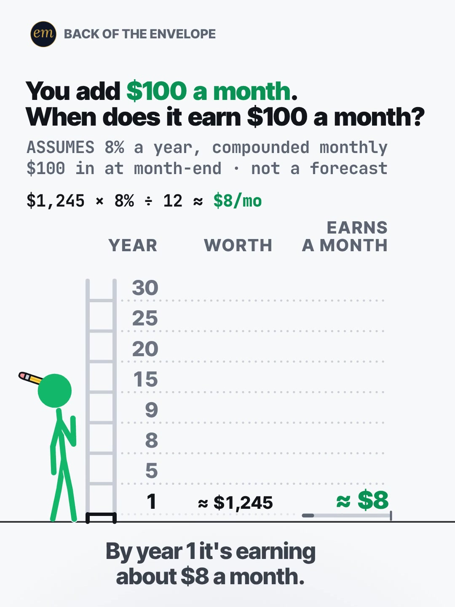

# 09a publishing sheet: you add $100 a month, when does it earn $100 a month?

YouTube Shorts (@envelopemath) and Instagram Reels (@envelopemath). Prepared 2026-10-13. Machine-readable twin: `publishing/09a-becker-rig-100-a-month-doubles.json`.

- **Video.** `renders/channel/09a-becker-rig-100-a-month-doubles.mp4`: the pre-condense cut (31 s: a 28.5 s body + the 2.5 s card; sha256 `ccf60e08…`), the Becker Rig port after its QA fix pass (2026-10-08). The 09 condense is in progress in parallel (timing only: the numbers, the captions' facts and the verdict stay). Nothing below names a timestamp except the cover, which is picked by content (the question frame), so the copy carries over to the condensed cut unchanged. The ship step rebuilds this sheet and re-exports both covers from the final file: `python3 publishing/tools/build_publishing.py 09a-becker-rig-100-a-month-doubles --covers`.
- **Numbers.** Every figure comes from `teasers/v2/09-growth-ladder.md` (09a) and its check, `python3 teasers/v2/checks/09-growth-ladder.py`: 509 checks, 0 failed on `studio/specs/` (run 2026-10-13; the builder runs it through the adapter `publishing/data/checks/09-growth-ladder.py`). `python3 publishing/tools/build_publishing.py 09a-becker-rig-100-a-month-doubles --check` checks this sheet's limits, paste blocks and figures, recomputes every rung from $100 a month at 8% ÷ 12, re-finds the crossing month (106) and the pinned 7% and 10% years, keeps every rung's figures beside their own year and every rounded figure 'about' or '≈'.
- **Honesty rules kept.** The title asks when the growth reaches $100 a month and never says the year, and neither does the cover (the question frame: ≈ $8 a month against the $100 asked about). The Instagram caption keeps the year below 'more'. 'Earns' is defined everywhere it is used, as the write-up does: the balance × 8% ÷ 12, growth that stays in the account, not a payout. The 8% is called an assumption, not a forecast, with the deposit convention (month-end, compounded monthly) and no fees, taxes or inflation. No advice, no urgency, and 'Not financial advice.' is in both.
- **Brand.** No company or product is in the video. The copy names the S&P 500 only to say where the 8% comes from (the write-up's caption line); both platforms' copy says 'Not affiliated with or endorsed by S&P Dow Jones Indices.' No share price is named.
- **[click-check].** The S&P 500 figures behind '≈ 10% before inflation, ≈ 7% after' (Official Data Foundation 10.09% / 6.81%, a live figure read 2026-10-07; A Wealth of Common Sense 9.94% for 1928-2024) come from search results; the write-up marks both pages for a hand check before posting (the proxy blocked fetching them). Nothing here changes that.

---

## YouTube Shorts

### Title (vidIQ title score, short-form, scored against this channel)

| # | Title | Score | Chars |
|---|---|---:|---:|
| 1 | You Invest $100 a Month. When Does It Earn $100 a Month? Compound Interest, Year by Year | 93 | 88 |
| 2 | You Add $100 a Month. When Does It Earn $100 a Month? | 92 | 53 |
| 3 | You Invest $100 a Month. When Does It Earn $100 a Month? | 92 | 56 |

**Pick (paste):**

```
You Invest $100 a Month. When Does It Earn $100 a Month? Compound Interest, Year by Year
```

- 88 of 100 characters.
- It asks the header's question, the one the ladder answers, and names no result: not the year, not ≈ $105, not ≈ $994. '$100 a month' is the input, on screen at frame 1 in the header. The topic words ride in the tail, after the whole question.
- It raises the write-up's title from 92 to 93. Every hashtag-free version that keeps the header's 'When does it earn $100 a month?' scores 90-93; the keyword-first version scores 87, and the header's question with three hashtags scores lowest (82). vidIQ's model ranks titles but does not predict views, so the pick is decided on the searched words it adds without moving the question.
- 'Earn' is the write-up's own word, and the description, the caption and the pinned comment define it (growth that stays in the account, not a payout), as the write-up asks.
- Also scored, not used: "You Add $100 a Month. When Does Your Money Earn $100 a Month?" 92; "If You Invest $100 a Month, When Does It Earn $100 a Month on Its Own?" 90; "Invest $100 a Month: When Does It Earn More Than You Put In?" 89; "You Invest $100 a Month. What Year Does Your Money Earn More Than You Add?" 89; "The Compound Interest Crossover: When Does $100 a Month Earn $100 a Month?" 87 (the keyword up front loses 5); "You Add $100 a Month. When Does It Earn $100 a Month? #compoundinterest #investing #ruleof72" 82 (the house 3-hashtag form).

### Description (paste)

```
When does $100 a month start earning $100 a month on its own? At an assumed 8% a year, the crossover comes in year 9: month 106 grows about $100.91, more than you add. By year 30 it earns about $994 a month.

The math, shown (Earns a month = the balance × 8% ÷ 12, the next month's growth):
• Year 1: ≈ $1,245, earning ≈ $8 a month.
• Year 5: ≈ $7,348, earning ≈ $49 a month.
• Year 8: ≈ $13,387, earning ≈ $89 a month. Not yet.
• Year 9: ≈ $15,743, earning ≈ $105 a month. More than the $100 you add.
• Year 20: ≈ $58,902, earning ≈ $393 a month.
• Year 30: ≈ $149,036, earning ≈ $994 a month, almost 10 times your $100.
• The amount cancels out: $50 or $500 a month, it's still year 9.
• "Earns" is growth at the assumed rate that stays in the account, not a payout.

Follow for the math behind your money — shown, not hand-waved. @envelopemath

Animation and original sound: The Back of the Envelope. $100 deposited at each month-end at an assumed 8% a year, compounded monthly. 8% is an assumption, not a forecast: the S&P 500 has returned about 10% a year since 1928 before inflation, about 7% after (Official Data Foundation: 10.09% and 6.81%, read Oct 2026; A Wealth of Common Sense, from NYU Stern data: 9.94% before inflation, 1928-2024). No fees, taxes or inflation adjustment. Not financial advice. Not affiliated with or endorsed by S&P Dow Jones Indices.
#compoundinterest #investing #ruleof72
```

1,406 of 5,000 characters (1,450 UTF-8 bytes; YouTube counts this limit in bytes, and `≈`, `×`, `•`, `—`, `÷` take 2-3 each). No `<` or `>`, which YouTube rejects. It follows the house template: an answer-first opening line for the search snippet, then 'The math, shown:' bullets, then the follow line. The credit, assumptions and 'Not financial advice.' line comes next, and the 3 hashtags close it. The opening line is the title's question with the answer, for the search snippet, and carries 'crossover' (the searched name for this moment: 'crossover point' 20,589 a month, +233.5%). The 'Doesn't Add Up' series line is left out, as on 06b, 06c and 08b: the verdict is a plain reading of an assumed rate, not a number that shouldn't be true.

### Hashtags (order matters)

1. `#compoundinterest`: the mechanism, and the biggest on-topic phrase ('compound interest' 137,873 searches a month, competition 50.6; −17.3% on its 30-day baseline).
2. `#investing`: the broad category ('investing' 613,566 a month, competition 65.0, flat at −2.0%).
3. `#ruleof72`: the write-up's own tag and the pinned comment's explanation ('rule of 72' 7,756 a month, +86.9% on its baseline, the one rising phrase here). It names the shortcut, not the year: 72 ÷ 8 needs the footer's 8% and the pinned comment.

The title carries no hashtags, so YouTube shows these 3, the description's first, above the title. Over 60 hashtags and YouTube ignores all of them. `#Shorts` isn't needed.

### Tags (paste; 392 of 500 characters as YouTube counts them: commas count, and a tag with a space counts 2 more for the quotes YouTube adds)

```
invest 100 a month, investing 100 a month, what happens when you invest 100 dollars a month, if you invest 100 dollars a month, crossover point, crossover point investing, compound interest, compound interest explained, how compound interest works, rule of 72, power of compounding, investing for beginners, money math, math animation, the back of the envelope, envelope math
```

Tags carry little weight. These mirror the keyword research plus the house's channel tags. The four '$100 a month' phrases are the video's own stake (7,909, 3,372, 5,295 and 5,286 a month); 'crossover point investing' (4,868) has the lowest competition here (24.4). Left out on purpose: 'passive income' (235,675) and 'how to make money', because 'earns' here is growth that stays in the account, not income; 'how to invest 100 dollars a month' and 'investing 100 a month on roth' are how-to intent; 'how long to double your money' is under 750 a month.

### Pinned comment (post it, then pin it)

```
Year 9 isn't a coincidence: 72 ÷ 8 = 9. Monthly growth passes your deposit exactly when (1 + 8%/12)^n = 2, the lump-sum doubling time (≈ 8.7 years). At 7% it's year 11. At 10%, year 8.

Which rate would you use? The year doesn't depend on the amount, only on the rate.
```

The write-up's pinned comment, unchanged, then a question for the viewer's own rate. It answers the two comments the write-up expects: '8% is too high or too low' (7% → year 11, 10% → year 8, both asserted by the check) and 'why 9?' (the Rule of 72). The caption and the description define 'earns' for the third ('that's compounding, not earning').

### Related video and end screen

- **Related video:** [Your Interest Has a Speed Limit #CompoundInterest #Math #personalfinance](https://www.youtube.com/shorts/XVUeMcTg9OQ) (`XVUeMcTg9OQ`). The channel's compounding-frequency Short ($1 at 100% compounded every second only reaches $2.72), and its best YouTube breakout (score 21.3, 1,141 views, 6 comments). Someone who watches growth pass a deposit is the viewer for the limit on compounding.
- **Swap later:** 09b ($1,000 at birth) or 09c ($1 a day × your number), the same growth-ladder series, once published. Then point that Short's Related video at this one.
- **End screen:** Shorts have no end screens or cards. The Related video link is the Shorts equivalent.

### Thumbnail and settings

- **Thumbnail:** in the YouTube app, pick the question frame, the same content as the Instagram cover below: 'You add $100 a month. / When does it earn $100 a month?' over the 8% footer, the working line '$1,245 × 8% ÷ 12 ≈ $8/mo', rung 1 at ≈ $1,245 / ≈ $8 with its gauge a sliver of the way to $100, and seven dim rungs. It asks without answering, like the title beside it in search.
- **Settings:** Category Education. Not made for kids. Altered or synthetic content: No (it's an animated chart, not realistic footage). Remixing allowed. No captions needed: there's no narration and all the text is on screen.

### Posting window

- **When:** First free Tue-Thu evening after the 09 condensed cut ships and passes QA, 21:30-22:30 ET (01:30-02:30 UTC the next day). Sunday 06:00-08:00 ET is the alternative.
- **Spacing:** Keep it at least 6 h from any other upload on the channel, on a different evening from 09b and 09c, and away from 07a (the other $-a-month compounding Short). Suggested order within the series: 09a, then 09b, then 09c.
- **Why:** The channel's own October Shorts, median views by posting slot (vidIQ, 2026-10-13): Sunday 05:00-08:00 ET 1,199 (n = 2), weekday 22:00-00:30 ET 642 (n = 3), weekday midday 263 (n = 2); 06c (Mon 03:45 ET) has 760 and 06b (Mon 12:14 ET) 75, too young to compare. The evening slot is also the best one on Instagram, so one evening serves both. n = 7 and confounded by topic, so treat it as a test. 09a goes first of the three: its hook scored highest with the write-up's judges (7.0 of 10), and its search words are the ones rising ('rule of 72' +86.9%, 'crossover point' +233.5% on their baselines).

---

## Instagram Reels

### Caption (paste)

```
You invest $100 a month. When does it earn $100 a month on its own? Compound interest, worked out year by year. Sooner than you'd guess.

At an assumed 8% a year, compounded monthly. "Earns" here means the balance × 8% ÷ 12: growth that stays in the account, not a payout.

The math, shown:
• Year 1: ≈ $1,245, earning ≈ $8 a month.
• Year 8: ≈ $13,387, earning ≈ $89 a month. Not yet.
• Year 9: ≈ $15,743, earning ≈ $105 a month. Month 106 grows ≈ $100.91 on its own, more than you add.
• Year 30: ≈ $149,036, earning ≈ $994 a month, almost 10 times your $100.
• And the year doesn't depend on the amount: $50 or $500 a month, it's still year 9.

8% is an assumption, not a forecast: the S&P 500 has returned ≈ 10% a year since 1928 before inflation, ≈ 7% after. Deposits at month-end; no fees, taxes or inflation. Not financial advice. Not affiliated with or endorsed by S&P Dow Jones Indices.

Which rate would you use?

Follow for the math behind your money — shown, not hand-waved. @envelopemath
Animation and original sound: The Back of the Envelope.

#compoundinterest #investing #ruleof72 #moneymath #investingforbeginners
```

- 1,130 of 2,200 characters.
- **First 125 characters:** the header's question, the searched words and the write-up's numberless line 1, which hints that the answer is sooner than the viewer guesses without giving it. The write-up keeps 'year 9' out of the first 100 characters; here it first appears below 'more'. The numbers sit below the fold, where Instagram search and Google indexing still read them.
- The definition of 'earns' comes right after the hook, before any figure, as the write-up's caption does: the comment fight it expects is 'that's compounding, not earning'.
- The caption follows the house close: the write-up's rate question, then the follow line plus the credit.

### Hashtags (5, Instagram's cap since Dec 2025)

`#compoundinterest #investing #ruleof72 #moneymath #investingforbeginners`

The write-up's four caption tags, plus one:

- `#compoundinterest`, `#investing` and `#ruleof72` are the same three as YouTube; `#moneymath` is the write-up's series tag.
- `#investingforbeginners` is the fifth, as on 07a and 02a: 'investing for beginners' is 295,600 searches a month on YouTube, and the channel's own start-age Short (`EqFQCJheCMU`) carries it as a tag.

### Alt text

- **Short (100 characters; paste this one into Instagram):** Chart: $100 a month at 8%: its growth passes $100 a month in year 9; by year 30, about $994 a month.
  - It stays at or under 100 characters, so it fits the field however short it is. It says 'about', not '≈', so screen readers read it cleanly, and it keeps the 8% beside the result.
- **Long (for anywhere with room, such as a website embed):** Animation on a light page with a green stick figure at the foot of a ladder whose rungs are years. The header asks: you add $100 a month; when does it earn $100 a month? The footer: assumes 8% a year, compounded monthly, $100 in at month-end, not a forecast. A working line multiplies each year's worth by 8% and divides by 12. The figure throws a coin up to each rung, and a gauge under each monthly figure shows how far it is from $100: year 1, about $1,245, earning about $8 a month; year 5, about $7,348, earning about $49; year 8, about $13,387, earning about $89, tagged under $100; year 9, about $15,743, earning about $105, tagged beats your $100; year 15, about $34,604, earning about $231; year 20, about $58,902, earning about $393; year 25, about $95,103, earning about $634; year 30, about $149,036, earning about $994 a month, heaved onto a gold plate. Verdict: from year 9 it earns more than you add, and $50 or $500 a month is still year 9.
- **Where:** Advanced settings → Accessibility → Alt text, if your app shows it for Reels.

### Cover



- **Files:** `publishing/09a-becker-rig-100-a-month-doubles-cover-3x4.jpg` (1080×1440) and `publishing/09a-becker-rig-100-a-month-doubles-cover-9x16.jpg` (1080×1920). Both come from the pre-condense (31 s) render at 1.8 s (frame 54).
- **Frame, by content:** The question frame, settled: the header 'You add $100 a month. / When does it earn $100 a month?' ('$100 a month' in green), the footer 'ASSUMES 8% a year, compounded monthly / $100 in at month-end · not a forecast', the working line '$1,245 × 8% ÷ 12 ≈ $8/mo', the column heads Year / Worth / Earns a month, rung 1 at ≈ $1,245 / ≈ $8 with its $100 gauge filled a sliver (8%), seven dim rungs (5 to 30) over empty shelves, the figure at the foot of the ladder with a hand on his chin, and the first caption 'By year 1 it's earning / about $8 a month.' fully lit. It asks and does not answer: ≈ $8 against the $100 the header asks about. On any cut, use a settled frame after rung 1's gauge has filled and the first caption is fully lit, before the first throw. On the pre-condense 31.0 s render rung 1 is settled at frame 0; the nod and the gauge fill are done by about frame 20, and from about frame 30 (1.00 s) to the wind-up at about frame 68 (2.25 s) the frame-to-frame mean luma change stays under 0.0001 (the figure's idle sway). Frame 54 (1.80 s) is inside that hold, with the first caption fully lit. If the cut changes, re-pick it by content.
- **Crop:** 3:4 = 1080×1440 from y 62 to 1502 of the 1080×1920 frame. The content runs from y 112 (the badge) to y 1452 (the caption), so the crop centres it (50 px above and below): badge, header, footer, working line, column heads, the whole ladder with the figure, and the caption; it drops the empty page below. A centred grid crop (y 240-1680) cuts the badge and the header.
- **How to set it:** In 'Edit cover', pick the question frame from the video (or upload the 9:16 JPG), then drag 'Profile grid' to the top so the tile matches the 3:4 JPG. Do not upload the 3:4 JPG as the Reel cover: Instagram centre-crops it to 9:16 in the Reels tab and cuts the header.
- **Re-export:** `ffmpeg -ss 1.8 -i renders/channel/09a-becker-rig-100-a-month-doubles.mp4 -frames:v 1 -vf "crop=1080:1440:0:62" -q:v 2 publishing/09a-becker-rig-100-a-month-doubles-cover-3x4.jpg` and `ffmpeg -ss 1.8 -i renders/channel/09a-becker-rig-100-a-month-doubles.mp4 -frames:v 1 -q:v 2 publishing/09a-becker-rig-100-a-month-doubles-cover-9x16.jpg`, or `python3 publishing/tools/build_publishing.py 09a-becker-rig-100-a-month-doubles --covers`.
- **Not used:** the crossing (the 'beats your $100' tag over ≈ $105, the figure celebrating), the write-up's other cover option. It is livelier, but rung 9 beating $100 is the answer to the title.
- **Not used:** the end hold ('From year 9 / it earns more than you add.' with rung 9 relit), the verdict.
- **When the condensed cut ships:** re-pick the question frame by content on the shipped file and re-export both JPGs with `--covers`.

### First comment (post it, then pin it)

```
Year 1: ≈ $8 a month. Year 8: ≈ $89. Year 9: ≈ $105, more than the $100 you add (month 106 grows ≈ $100.91). Any monthly amount: still year 9. Which rate would you use?
```

### Trial Reels

**Post as a regular Reel, not a Trial.** @envelopemath has 8 followers, so a regular Reel is already shown almost entirely to non-followers, which is all a Trial Reel adds. A Trial would also keep it off the profile grid until shared. A hook test afterwards, if you want one: the other cut as a Trial with MANUAL graduation 48-72 h later. Once the condensed cut replaces this render in renders/channel, get the pre-condense one from git with `git show 471c793:renders/channel/09a-becker-rig-100-a-month-doubles.mp4 > 09a-31.0s.mp4` (sha256 3dddeb79…). Compare skip rate (October Reels ran 27.0-65.1%; 06c's condensed cut 40.3%) and average watched %, then share the winner. A cover test (the question frame vs the crossing) is the other use. vidIQ's publish tool exposes Trial (MANUAL or SS_PERFORMANCE) for this connected account. Confirm eligibility in the app.

### Posting window and settings

- **When:** Same evening as YouTube, about 15 min after the Short: 21:45-22:45 ET, on a different evening from 09b and 09c.
- **Why:** October Reels, median plays by posting slot (owner insights, 2026-10-13): weekday 22:00-00:30 ET 5,449 (n = 3, including the two best: 7,303 and 5,449), weekday midday 1,212 (n = 2), Sunday 05:00-08:00 ET 1,087 (n = 2). 06c, posted Mon 03:46 ET, has 1,711 plays with a 40.3% skip rate. Skip rate tracks plays more closely than the hour does: 27.0-27.4% for the top two, 56.9-65.1% for the bottom two. The condense matters more than the hour.
- **Audio:** Rename the original audio to '$100 a month, year by year — The Back of the Envelope' if the app allows; it is the score, with no voice.
- **Share to feed:** On.

---

## Why these choices (research evidence)

**1. Search demand (vidIQ keyword research, pulled 2026-10-13).** vidIQ refreshes each keyword on its own schedule, so the last column gives each row's snapshot date. Two rows are older snapshots.

| Keyword | Est. searches/month | Competition | Overall | Note | vidIQ as of |
|---|---:|---:|---:|---|---|
| compound interest | 137,873 | 50.6 | 65.8 | the mechanism; −17.3% vs its 30-day baseline (166,772) | 2026-10-12 |
| crossover point | 20,589 | 33.1 | 65.4 | +233.5% vs its baseline (6,173): the searched name for growth passing the deposit | 2026-10-12 |
| how compound interest works | 18,742 | 43.5 | 60.9 | −12.4% | 2026-10-12 |
| invest 100 a month | 7,909 | 52.0 | 54.1 | the video's stake | 2026-10-12 |
| rule of 72 | 7,756 | 59.0 | 51.2 | +86.9% vs its baseline (4,149); the pinned comment's shortcut | 2026-10-12 |
| what happens when you invests 100 dollars a month | 5,295 | 31.7 | 60.7 | the same stake, as typed in search | 2026-10-12 |
| if you invest 100 dollars a month | 5,286 | 39.2 | 57.7 |  | 2026-10-12 |
| the compound interest secret 100 a month | 4,984 | 22.9 | 64.0 | an older snapshot | 2026-04-21 |
| crossover point investing | 4,868 | 24.4 | 63.3 | the lowest competition here | 2026-10-12 |
| investing $100 a month | 3,372 | 51.6 | 51.0 | seed; US research mode | 2026-09-30 |
| passive income | 235,675 | 59.0 | 64.5 | −22.3%; not used: 'earns' here is growth that stays in the account | 2026-10-12 |
| investing for beginners | 295,600 | 49.0 | 69.4 | −22.0%; the fifth Instagram tag | 2026-10-12 |
| how long to double your money | 0 (<750) | 34.7 | 26.1 | <750/month | no snapshot |

'compound interest' is the biggest on-topic phrase (137,873 a month), so it leads the hashtags and rides in the title's tail. The moment this Short is about has its own rising name, 'crossover point' (20,589, +233.5%), and 'crossover point investing' has the lowest competition in the set (24.4), so the description's first line uses the word. The stake is searched as typed ('invest 100 a month' 7,909; 'what happens when you invests 100 dollars a month' 5,295), and 'rule of 72' is rising (+86.9%). 'passive income' (235,675) is left out: the growth stays in the account.

**2. $100 a month is a proven stake; the crossover is a small, new idea (vidIQ YouTube search, under 4 min, by views and by relevance).**

| Title | Channel (subs) | Views | Date |
|---|---|---:|---|
| How $100 a Month Can Make You a Millionaire | The Ramsey Show Highlights (4,600,000) | 5,145,566 | 2024-08-05 |
| The Power of Compounding | Brian Feroldi (319,000) | 3,281,682 | 2025-05-23 |
| Will investing $100 every month till you're 65 make you a millionaire? Debatable. @GeorgeKamel | Humphrey Yang (2,090,000) | 313,583 | 2024-08-05 |
| This Is When Your Money Starts Working Harder Than You | The Money Guy Show (705,000) | 195,754 | 2026-04-10 |
| The Wealth Crossover Point: When Your Portfolio Grows Faster Than You Can Contribute | Erin Talks Money | Erin Moriarity (441,000) | 17,584 | 2026-02-07 |
| Is your money earning more than you are yet? #finance #money #investing | Vantage Point (15) | 299 | 2026-10-02 |
| When Does Your Money Start Making More Than You Put In? | The Investing Crossover Point | Money Made Simple (17) | 6 | 2026-09-09 |
| How $100 A Month Actually Makes You Wealthy (The Year 9 Crossover) | FinAndCare (0) | 5 | 2026-09-22 |
| How Much Can $100 a Month Grow in 20 Years? 📈💰 #diyinvestor #diyinvesting #financialsense #financial | DollarMira (6) | 20 | 2026-10-10 |

$100 a month travels when it is aimed at a million (Ramsey's 12-second clip, 5,145,566 views; Humphrey Yang's 'Debatable.', 313,583). The crossover, the month the growth passes the deposit, is a newer idea with a talk-clip hit (The Money Guy's 'This Is When Your Money Starts Working Harder Than You', 195,754) and a run of small 2026 Shorts. One of them, FinAndCare's 'How $100 A Month Actually Makes You Wealthy (The Year 9 Crossover)' (5 views), puts this Short's answer in its title; the pick asks instead.

None of them shows the crossing on a ladder with the monthly figure against a $100 gauge, and none says the year is the same for any amount, this Short's second bust.

**3. Monthly-amount growth travels on Instagram and TikTok as a table or a climb with music (vidIQ IG/TikTok outlier search, since June 2025, at least 10K views).**

- **@theschoolofmoneysg** (Instagram), "Your money makes money at $100k": 55.9K (79.3x). An animated tipping point in compound interest: the closest concept to this Short.
- **@propertywithharley** (Instagram), "Future Portfolio Value (now vs 2046)": 1.3M (33.9x). A year-by-year table, music only, looped. **@aaronlevi__** (Instagram): 228.8K (67.8x), a balance climbing, music only.
- **@data.dragonn** (TikTok), "POV: Someone invested $100 every month in the GoPro Stock over the last 12 years": 1.4M (49.6x). The same $100-a-month stake as an animated chart.
- **@keysfinance** (TikTok), "How to retire with $2M": 3.3M (1457.8x). Monthly amounts by starting age.
- The music-only table and climb formats, this Short's form, are the ones that travel without a voice. None of the outliers names the month the growth passes the deposit.

**4. Our own October numbers (vidIQ: public YouTube stats, Instagram owner insights; refreshed 2026-10-13).**

| YouTube Short | Posted (ET) | Views |
|---|---|---:|
| Can You Find the Missing Dollar? (`LjHDFzVxRyM`) | Sun 07:04 | 1,256 |
| You Can Lean on $1 Million. Not on $1 Billion. (`hJBvmGA6sZ0`) | Thu 00:25 | 1,221 |
| Your Interest Has a Speed Limit (`XVUeMcTg9OQ`) | Sun 05:49 | 1,141 |
| What If You Bought Starbucks Stock Instead of a $4 Latte Every Day? (06c) (`fbpdKf4Wy8c`) | Mon 03:45 | 760 |
| Pay the Minimum on $5,000? 238 Months. (`8__HTUa2PoU`) | Mon 22:09 | 642 |
| A $2 Lottery Ticket Was Worth $6.98. Until the Fine Print. (`FW_oxA3kbsM`) | Wed 12:03 | 348 |
| You Can Carry $1 Million. Not in Pennies. (`mXbKY_R63h4`) | Thu 13:38 | 177 |
| Start Investing 10 Years Late? You Get Half. (`EqFQCJheCMU`) | Tue 22:27 | 161 |
| What If You Bought Netflix Stock Instead of Paying for Netflix? (06b) (`krfZEHhb0xU`) | Mon 12:14 | 75 |

| Instagram Reel | Posted (ET) | Plays | Skip rate | Avg watched |
|---|---|---:|---:|---:|
| $5,000 on the minimum (`DeIvYk7I4Qr`) | Mon 22:46 | 7,303 | 27.4% | 56.5% |
| $1M stack vs Burj Khalifa (`DeOEthJJ1TG`) | Thu 00:28 | 5,449 | 27.0% | 83.1% |
| Missing dollar (`DeWgFZRoR_S`) | Sun 07:05 | 1,997 | 32.0% | 81.3% |
| Powerball $6.98 (`DeMvZv9IqRw`) | Wed 12:05 | 1,825 | 58.7% | 57.9% |
| 06c latte vs Starbucks stock (`DeYuqT4pjVC`) | Mon 03:46 | 1,711 | 40.3% | 69.1% |
| $1M in pennies (`DePe11HIHwn`) | Thu 13:37 | 598 | 42.0% | 66.7% |
| 10 years late (`DeLSd9io8UK`) | Tue 22:30 | 219 | 65.1% | 30.6% |
| Speed limit (e) (`DeEW2ZMIiYd`) | Sun 05:54 | 177 | 56.9% | 31.2% |

Channel totals:

- **YouTube:** 53 subscribers, 10,221 views and 41 videos (+27 subscribers, +5,127 views and 11 videos in 30 days).
- **Instagram:** 8 followers and 20,519 views in 30 days.

The channel's compounding Shorts so far: 'Your Interest Has a Speed Limit' is the best YouTube breakout (1,141 views, score 21.3) but one of the weakest Reels (177 plays, 56.9% skip), and '10 years late' (the start-age lump sum) the weakest of the month on YouTube (161 views) and the Reel with the month's highest skip rate (65.1%; 219 plays). Both open on a claim with the answer in it; this Short opens on a question with ≈ $8 against $100 on frame 1. 06c (760 views, 1,711 plays) and 06b (Mon 12 Oct 12:14 ET: 75 views so far; its Reel shows 7 plays while Instagram's owner insights catch up) are left out of the medians as too young.

Medians by posting slot (n = 2-3 each, confounded by topic):

- **YouTube:** Sunday early morning ET 1,199, weekday 22:00-00:30 ET 642, weekday midday 263.
- **Instagram:** weekday 22:00-00:30 ET 5,449, midday 1,212, Sunday early morning 1,087.

One weekday evening is the best Instagram slot and the second-best YouTube slot, so the plan posts both then. On Instagram, skip rate predicts plays better than the hour does (27.0-27.4% for the top two, 56.9-65.1% for the bottom two). So the window is a light-touch test, and the condense (fewer still moments) is the bigger reach lever.

**5. Platform rules applied.**

- **YouTube title:** 100 characters. The Shorts player shows only the opening, so the keywords come first.
- **YouTube description:** 5,000 characters.
- **YouTube hashtags:** the first 3 show; over 60 and all are ignored; `#Shorts` isn't needed.
- **YouTube tags:** 500 characters, low weight.
- **YouTube Shorts:** no end screens. The Related video link is the Shorts equivalent.
- **YouTube AI disclosure:** only for realistic altered content.
- **Instagram caption:** 2,200 characters, about 125 shown before 'more'.
- **Instagram hashtags:** 5 at most.
- **Instagram search and Google:** keywords in the caption feed Instagram search, and Google indexes public professional posts (since 10 Jul 2025).
- **Instagram grid:** a 3:4 crop of the 9:16 cover.
- **Trial Reels:** shown to non-followers only.

**6. Limits.**

- @envelopemath's YouTube Analytics (audience hours, geography) were not read here; the 06b and 06c sheets found vidIQ's YouTube authorization is a different channel. Check Studio → Analytics → Audience → 'When your viewers are on YouTube' before posting.
- vidIQ has no hashtag-volume data; hashtag picks lean on keyword volume and on the write-up's and the outliers' own tags.
- Title scores are vidIQ's short-form CTR model for this channel; they rank options but do not predict views.
- The S&P 500 figures behind the caption's '≈ 10% / ≈ 7%' come from search results the write-up could not open (the proxy blocked the pages); they are marked [click-check] there, and the 10.09% / 6.81% figure is a live one that will drift.
- The video, the cover and the video facts are the pre-condense cut; the copy is cut-independent, and the ship step refreshes the rest from the final file.
- The vidIQ credit balance is shared with the other sheets being built in parallel, so this sheet's spend is counted from each tool's listed cost (see research.vidiq_credits).

---

## Check log (first build and adversarial pass, 2026-10-13)

- **Maths.** `python3 teasers/v2/checks/09-growth-ladder.py`: 509 checks, 0 failed on `studio/specs/`. Every public figure traces to the 09a maths table: W(n) = 100 × ((1 + r)^n − 1) ÷ r at r = 8% ÷ 12; year 1 ≈ $1,245 / ≈ $8; 5 ≈ $7,348 / ≈ $49; 8 ≈ $13,387 / ≈ $89; 9 ≈ $15,743 / ≈ $105; 15 ≈ $34,604 / ≈ $231; 20 ≈ $58,902 / ≈ $393; 25 ≈ $95,103 / ≈ $634; 30 ≈ $149,036 / ≈ $994 (9.94 × $100); month 106 grows ≈ $100.91 (year 9); 72 ÷ 8 = 9; 104.32 months ≈ 8.7 years; at 7% year 11, at 10% year 8. The data file recomputes every one.
- **Limits.** Title 88/100. Description 1,406 characters (1,450 bytes) of 5,000. 3 hashtags. Tags 392/500 as YouTube counts them. Instagram caption 1,130/2,200, with the first 125 characters result-free. 5 hashtags. Short alt text 100. No `<` or `>`.
- **vidIQ.** Keywords pulled 2026-10-13 (table above). 9 titles scored against this channel: the pick 93, the write-up's title 92. Channel 53 subscribers / 10,221 views / 41 videos; Instagram owner insights refreshed (8 followers, 20,519 views in 30 days).
- **vidIQ re-queried** after the build: the pick's title score 93, as first scored.
- **vidIQ re-queried.** At the adversarial check: the pick's title score 93; 'crossover point' 20,589 / 33.1 (+233.5%, baseline 6,173); the related video XVUeMcTg9OQ 1,141 views and 6 comments, live since Sun 4 Oct 05:49 ET. All match.
- **Changed.**
  - The Related video note called XVUeMcTg9OQ 'the channel's other compounding Short'; section 4 counts '10 years late' as one too. It now says the compounding-frequency Short.
  - Section 4 called '10 years late' the weakest of the month 'on both'; by Reel plays 'Speed limit (e)' is lower (177 vs 219). It now says what holds: the weakest YouTube views and the month's highest Reel skip rate (65.1%).
  - `#investingforbeginners` was 'tagged by the same-idea $100 a month Shorts in section 2', which the research does not show (no tags were pulled for them). It now cites what vidIQ does show: the channel's own start-age Short `EqFQCJheCMU` carries the tag.
  - A title bullet said every version keeping the header's question scores 90-93; the 3-hashtag version keeps it and scores 82. It now says 'hashtag-free'.
- **Checked.**
  - Every copy figure against the write-up's 09a maths table and a fresh run of the 09 check (509 checks, 0 failures, exit 0), by hand and by the builder's FIGURES, MATH_RELATIONS and COPY_RULES.
  - Platform limits, recounted from the JSON: title 88/100 with no hashtags (the description's first three show above it), description 1,406 characters (1,450 bytes) of 5,000, tags 392/500 as YouTube counts them, caption 1,130/2,200 with 5 hashtags and a result-free first 125, short alt text 100/100, no < or >.
  - Policy: no brand in the video; the S&P 500 is named only for the rate's context, with 'Not affiliated with or endorsed by S&P Dow Jones Indices.' in the description and the caption; sources are named descriptively, as 06b and 06c name theirs; no share price; 'Not financial advice.' in both; no advice, urgency or promise wording (a copy rule). 'Earns' is defined as growth that stays in the account, not a payout, in the description, the caption and the pinned comment's context, and nothing calls it income (a copy rule).
  - The title asks the header's question and the video answers it (year 9); the description's first line gives the answer for the search snippet, as the house template does.
  - The cover JPG (read by eye) shows the header's question, the working line '$1,245 × 8% ÷ 12 ≈ $8/mo', rung 1 at ≈ $8 with its gauge well short of $100 and seven dim rungs: no answer. The render's sha256 equals `git show 471c793:renders/channel/09a-becker-rig-100-a-month-doubles.mp4`, so the Trial Reels command fetches this file.
  - No timestamp outside the cover section and the video facts, and no pacing claim.
- **Generator.** Unchanged. The 09 check prints '509 checks, 0 failures', and the builder reads only 'N checks, F failed', so `MATH_SCRIPT` is `publishing/data/checks/09-growth-ladder.py`, a copy of the 07 adapter: it runs the 09 check unchanged, passes its output and exit code through and adds the summary line.
- **Mutation test.** Six mutations of a scratch copy each fail by name: year 8 given year 9's ≈ $105, year 30's ≈ $994 without its '≈', a title that says year 9, the caption without 'not a payout', a spelled-out 'ten', and year 20's worth a dollar off. At the adversarial check, 3 more on a scratch copy also fail by name: the caption without its affiliation line, the S&P 500 figures without 'since 1928', and 'Year 9' in the caption's first 125 characters. The files on disk were not touched.
- **Kept on purpose.**
  - The cover is the question frame (≈ $8 against $100), not the crossing the write-up also offers: the crossing shows rung 9 beating $100, the title's answer.
  - 'Earns' is defined in the description, the caption and the pinned note; 'passive income' stays out of the tags, because the growth is not paid out.
  - `#ruleof72` above the title: it names the shortcut, not the year; working out 9 needs the footer's 8% and 72 ÷ 8, which only the pinned comment does.
  - The S&P 500 is named only for the 8%'s context, with the affiliation line; the write-up's [click-check] on its two sources stands.
  - Section 2 keeps vidIQ's spelling of two names that contain a '|' (the channel 'Erin Talks Money | Erin Moriarity' and the title '… | The Investing Crossover Point'). The builder does not escape '|' in table cells, so those two rows show one cell too many in rendered Markdown (the views and the date shift right); the JSON is exact. The same generator issue the 07a check flagged; left for its one-line generator fix.
- **Still to do.** The ship rebuild (`--covers`) on the condensed file.
