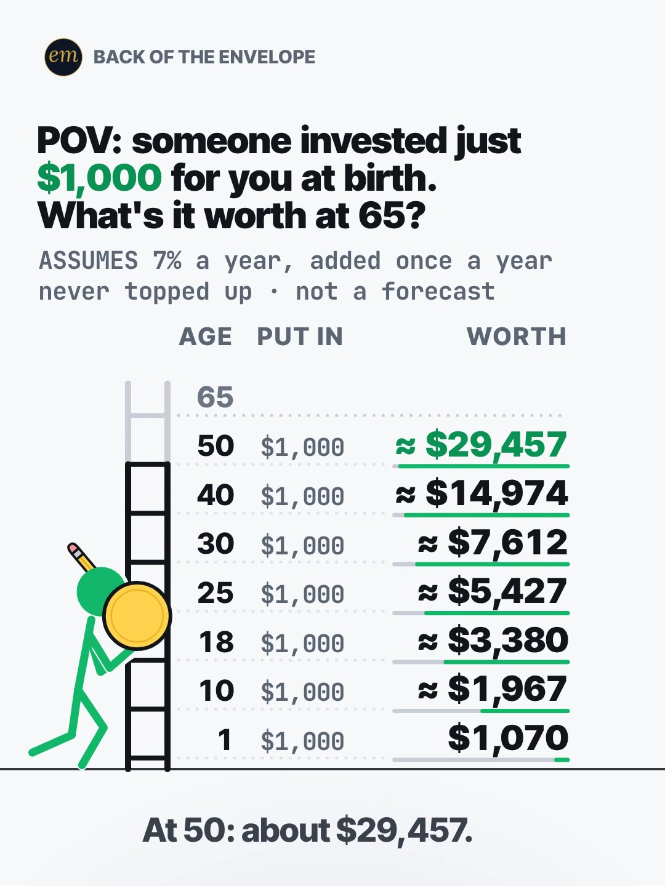

# 09b publishing sheet: $1,000 invested for you at birth, what's it worth at 65?

YouTube Shorts (@envelopemath) and Instagram Reels (@envelopemath). Prepared 2026-10-13. Machine-readable twin: `publishing/09b-becker-rig-1000-times-1-07.json`.

- **Video.** `renders/channel/09b-becker-rig-1000-times-1-07.mp4`: the pre-condense cut (29.5 s: a 27 s body + the 2.5 s card; sha256 `5d8f22d5…`), the assembly-fix-pass cut (2026-10-08). The 09 condense is in progress in parallel (timing only: the numbers, the captions' facts and the verdict stay). Nothing below names a timestamp except the cover, which is picked by content (the heave), so the copy carries over to the condensed cut unchanged. The ship step rebuilds this sheet and re-exports both covers from the final file: `python3 publishing/tools/build_publishing.py 09b-becker-rig-1000-times-1-07 --covers`.
- **Numbers.** Every figure comes from `teasers/v2/09-growth-ladder.md` (09b) and its check, `python3 teasers/v2/checks/09-growth-ladder.py`: 509 checks, 0 failed on `studio/specs/` (run 2026-10-13; the builder runs it through the adapter `publishing/data/checks/09-growth-ladder.py`). `python3 publishing/tools/build_publishing.py 09b-becker-rig-1000-times-1-07 --check` checks this sheet's limits, paste blocks and figures, recomputes every rung from $1,000 × 1.07 per birthday, the 'over 81 times', the pinned at-25 figure and its × 5.4, keeps every rung's figure beside its own age and every rounded figure 'about' or '≈'.
- **Honesty rules kept.** The title asks what the gift is worth at 65 and never says, and neither does the cover (the heave: the last, heavy coin on its way to the empty age-65 rung). The Instagram caption keeps every result below 'more'. The copy says the 7% is an assumption, not a forecast, credited once a year with nothing added or taken out, and that the figures read as rough today's dollars only because 7% is close to the S&P 500's return after inflation, as the write-up's caption does. No 'millionaire' anywhere: ≈ $81,273 is the answer. No advice, no urgency, and 'Not financial advice.' is in both.
- **Brand.** No company or product is in the video. The copy names the S&P 500 only to explain the 7% (the write-up's caption line); both platforms' copy says 'Not affiliated with or endorsed by S&P Dow Jones Indices.' No share price is named.
- **[click-check].** The '≈ 6.8% a year after inflation since 1928' is the Official Data Foundation figure (6.81%, a live figure read 2026-10-07) that the write-up marks for a hand check before posting (confirmed in search results; the proxy blocked the page). Nothing here changes that.

---

## YouTube Shorts

### Title (vidIQ title score, short-form, scored against this channel)

| # | Title | Score | Chars |
|---|---|---:|---:|
| 1 | What If Someone Invested $1,000 for You the Day You Were Born? What's It Worth at 65? | 98 | 85 |
| 2 | What If Someone Invested Just $1,000 for You the Day You Were Born? What's It Worth at 65? | 98 | 90 |
| 3 | Someone Invested $1,000 for You at Birth and Never Added a Cent. What's It Worth at 65? | 96 | 87 |

**Pick (paste):**

```
What If Someone Invested $1,000 for You the Day You Were Born? What's It Worth at 65?
```

- 85 of 100 characters.
- It asks the header's question and names no result: not ≈ $81,273, not 'over 81 times', no rung. '$1,000' and '65' are the inputs, on screen at frame 1 in the header.
- It raises the write-up's title from 90 to 98: the 'POV:' opener scores 8 points under the same question as a 'What if'. The video still opens on the POV header, so the title and frame 1 say the same thing two ways. vidIQ's model ranks titles but does not predict views.
- The same idea is up on YouTube with the answer in the title ('$1,000 at birth becomes $81,000 by 65', research section 2); the pick keeps the question.
- Also scored, not used: "POV: Someone Invested Just $1,000 for You at Birth. What's It Worth at 65? Compound Interest, Age by Age" 96 (104 characters, over YouTube's 100); "POV: Someone Invested Just $1,000 for You at Birth. What's It Worth at 65?" 90 (the write-up's title); "$1,000 Invested at Birth and Never Touched: What's It Worth at 65?" 86.

### Description (paste)

```
What if someone invested $1,000 for you the day you were born, and nobody touched it again? At an assumed 7% a year it's about $81,273 at 65: over 81 times the gift.

The math, shown (worth = $1,000 × 1.07 for every birthday):
• Age 1: $1,000 × 1.07 = $1,070.
• Age 10: ≈ $1,967. It roughly doubles every 10 years (72 ÷ 7 ≈ 10).
• Age 18: ≈ $3,380.
• Age 30: ≈ $7,612.
• Age 40: ≈ $14,974.
• Age 50: ≈ $29,457.
• Age 65: ≈ $81,273, over 81 times the $1,000. Never topped up.
• A different gift? Scale every rung: $500 halves them, $5,000 multiplies them by 5.

Follow for the math behind your money — shown, not hand-waved. @envelopemath

Animation and original sound: The Back of the Envelope. One $1,000 at birth at an assumed 7% a year, credited once a year on each birthday; nothing added or taken out. 7% is an assumption, not a forecast. It is close to what the S&P 500 has returned after inflation since 1928 (about 6.8% a year: Official Data Foundation, read Oct 2026), so read these as rough today's dollars. No fees or taxes. Not financial advice. Not affiliated with or endorsed by S&P Dow Jones Indices.
#compoundinterest #investingforkids #generationalwealth
```

1,171 of 5,000 characters (1,206 UTF-8 bytes; YouTube counts this limit in bytes, and `≈`, `×`, `•`, `—`, `÷` take 2-3 each). No `<` or `>`, which YouTube rejects. It follows the house template: an answer-first opening line for the search snippet, then 'The math, shown:' bullets, then the follow line. The credit, assumptions and 'Not financial advice.' line comes next, and the 3 hashtags close it. The opening line is the title's question with the answer, for the search snippet. The 'Doesn't Add Up' series line is left out, as on 06b, 06c and 08b: the verdict is a plain reading of an assumed rate, not a number that shouldn't be true.

### Hashtags (order matters)

1. `#compoundinterest`: the mechanism, and the write-up's first caption tag ('compound interest' 137,873 searches a month, competition 50.6).
2. `#investingforkids`: the parents who would make this gift: the tag the same-idea Shorts and the 'invest for your kid' outliers use ('how to start investing for kids' 5,322 a month).
3. `#generationalwealth`: the frame those posts travel under ('generational wealth' 43,615 a month; 'how to build generational wealth' 24,160, +35.1% on its baseline). The copy itself only says what one $1,000 becomes.

The title carries no hashtags, so YouTube shows these 3, the description's first, above the title. Over 60 hashtags and YouTube ignores all of them. `#Shorts` isn't needed.

### Tags (paste; 393 of 500 characters as YouTube counts them: commas count, and a tag with a space counts 2 more for the quotes YouTube adds)

```
1000 invested at birth, invest 1000 at birth, investing for kids, how to start investing for kids, investing account for kids, stock investing for kids, generational wealth, how to build generational wealth, compound interest, the power of compound interest, 1000 dollars invested, what if you invested 1000, money math, math animation, the back of the envelope, envelope math
```

Tags carry little weight. These mirror the keyword research plus the house's channel tags. vidIQ indexes no 'at birth' money phrase (its 'at birth' matches are all stories), so the first two tags are the video's own words; 'how to start investing for kids' (5,322) and 'investing account for kids' (3,960) carry the parent intent. Left out on purpose: 'trump account' (22,489, +20.2%), the 2025 law's $1,000-at-birth account: the write-up doesn't cover it, its terms are not verified here, and naming it would tie the maths to a program; 'make your kid a millionaire' phrasings, because the answer is ≈ $81,273, not a million.

### Pinned comment (post it, then pin it)

```
Got the $1,000 at 25 instead of at birth? It's ≈ $14,974 at 65, not ≈ $81,273. Those first 25 years multiply it by 5.4.

Same 7% a year, credited once a year, nothing added. How old were you when your first $1,000 went in?
```

The write-up's pinned comment, unchanged, then its conditions and a question that invites 'I got mine at …' replies, as the write-up wants. ≈ $14,974 is the age-40 rung's own figure (40 years of growth either way), so the viewer can check it on the ladder. The caption answers the two comment fights the write-up expects ('where do you get 7%?' and 'inflation') with the after-inflation framing.

### Related video and end screen

- **Related video:** [Start Investing 10 Years Late? You Get Half. #investing #compoundinterest #personalfinance](https://www.youtube.com/shorts/EqFQCJheCMU) (`EqFQCJheCMU`). The channel's own lump-sum start-age Short ($10,000 at 25 vs at 35, at 7%), live since Tue 6 Oct 2026. This Short's pinned comment asks the same 'what if it went in later?' with $1,000 at birth vs at 25.
- **Swap later:** 09a ($100 a month) or 09c ($1 a day × your number), the same growth-ladder series, once published. Then point EqFQCJheCMU's Related video at this Short.
- **End screen:** Shorts have no end screens or cards. The Related video link is the Shorts equivalent.

### Thumbnail and settings

- **Thumbnail:** in the YouTube app, pick the heave frame, the same content as the Instagram cover below: the POV header over the 7% footer, rungs 1 to 50 filled ($1,070 up to ≈ $29,457), the age-65 rung still empty at the top, and the figure buckling under the last, heavy coin. It asks without answering, like the title beside it in search.
- **Settings:** Category Education. Not made for kids. Altered or synthetic content: No (it's an animated chart, not realistic footage). Remixing allowed. No captions needed: there's no narration and all the text is on screen.

### Posting window

- **When:** First free Tue-Thu evening after the 09 condensed cut ships and passes QA, 21:30-22:30 ET (01:30-02:30 UTC the next day). Sunday 06:00-08:00 ET is the alternative.
- **Spacing:** Keep it at least 6 h from any other upload on the channel, and on a different evening from 09a and 09c. Suggested order within the series: 09a, then 09b, then 09c.
- **Why:** The channel's own October Shorts, median views by posting slot (vidIQ, 2026-10-13): Sunday 05:00-08:00 ET 1,199 (n = 2), weekday 22:00-00:30 ET 642 (n = 3), weekday midday 263 (n = 2); 06c (Mon 03:45 ET) has 760 and 06b (Mon 12:14 ET) 75, too young to compare. The evening slot is also the best one on Instagram, so one evening serves both. n = 7 and confounded by topic, so treat it as a test. Money set aside at birth is in the news: 'how to build generational wealth' runs +35.1% and 'trump account' +20.2% over their baselines, and several 2026 Shorts describe a federal $1,000-at-birth account (per their descriptions; not verified here, and not in the copy).

---

## Instagram Reels

### Caption (paste)

```
What if someone invested $1,000 for you the day you were born, and nobody touched it again? What's it worth at 65? One gift. Never topped up.

At an assumed 7% a year, credited once a year, it roughly doubles every 10 years (72 ÷ 7 ≈ 10):
• Age 10: ≈ $1,967.
• Age 30: ≈ $7,612.
• Age 50: ≈ $29,457.
• Age 65: ≈ $81,273, over 81 times the gift.

7% is close to what the S&P 500 has returned after inflation since 1928 (≈ 6.8% a year), so read these as rough today's dollars. A different gift? Scale every rung: $500 halves them, $5,000 multiplies them by 5.

7% is an assumption, not a forecast. Nothing added or taken out; no fees or taxes. Not financial advice. Not affiliated with or endorsed by S&P Dow Jones Indices.

How old were you when your first $1,000 went in?

Follow for the math behind your money — shown, not hand-waved. @envelopemath
Animation and original sound: The Back of the Envelope.

#compoundinterest #investingforkids #generationalwealth #moneymath #personalfinance
```

- 990 of 2,200 characters.
- **First 125 characters:** the gift, the question and the write-up's line 1, with no figure but the $1,000 input and the age 65. The numbers sit below 'more', where Instagram search and Google indexing still read them.
- The rate paragraph is the write-up's caption: 7% is close to the S&P 500's after-inflation return, so the rungs read as rough today's dollars, with the scaling rule for other gifts.
- The caption follows the house close: the write-up's 'I got mine at …' question, then the follow line plus the credit.

### Hashtags (5, Instagram's cap since Dec 2025)

`#compoundinterest #investingforkids #generationalwealth #moneymath #personalfinance`

The write-up tags `#compoundinterest #investing #moneymath #mathtok`; two give way to the parent audience:

- `#compoundinterest` and `#moneymath` stay; `#investingforkids` and `#generationalwealth` replace `#investing` and `#mathtok` (a TikTok tag).
- The three Instagram outliers for this idea ('How to make your kid a millionaire (2026 edition)', 0.2-1.4M views, research section 3) reach parents under these tags. This Short borrows the audience, not the claim.

`#personalfinance` is the broad layer, as on 07a and 09c.

### Alt text

- **Short (98 characters; paste this one into Instagram):** Chart: $1,000 at birth at 7% a year, never topped up: about $81,273 at 65, over 81 times the gift.
  - It stays at or under 100 characters, so it fits the field however short it is. It says 'about', not '≈', so screen readers read it cleanly, and it keeps the 7% and 'never topped up' beside the result.
- **Long (for anywhere with room, such as a website embed):** Animation on a light page with a green stick figure at the foot of a ladder whose rungs are ages. The header says: POV: someone invested just $1,000 for you at birth. What's it worth at 65? The footer: assumes 7% a year, added once a year, never topped up, not a forecast. Columns: age, put in, worth. The figure throws a coin up to each rung, and each coin becomes its row's worth, with $1,000 put in on every rung: age 1, $1,070; age 10, about $1,967; age 18, about $3,380; age 25, about $5,427; age 30, about $7,612; age 40, about $14,974; age 50, about $29,457. The last coin is too heavy: he buckles under it, presses it overhead and heaves it onto a gold plate at age 65, about $81,273. Verdict: about $81,273 at 65, over 81 times the gift, never topped up.
- **Where:** Advanced settings → Accessibility → Alt text, if your app shows it for Reels.

### Cover



- **Files:** `publishing/09b-becker-rig-1000-times-1-07-cover-3x4.jpg` (1080×1440) and `publishing/09b-becker-rig-1000-times-1-07-cover-9x16.jpg` (1080×1920). Both come from the pre-condense (29.5 s) render at 14.6 s (frame 438).
- **Frame, by content:** The heave, its first beat: the header 'POV: someone invested just / $1,000 for you at birth. / What's it worth at 65?' ($1,000 in green), the footer 'ASSUMES 7% a year, added once a year / never topped up · not a forecast', the heads Age / Put in / Worth, rungs 1 to 50 filled ($1,070, ≈ $1,967, ≈ $3,380, ≈ $5,427, ≈ $7,612, ≈ $14,974, ≈ $29,457, with $1,000 put in on each), the age-65 rung empty at the top, the figure buckled at the foot of the ladder with the last, heavy gold coin in his arms, and the caption 'At 50: about $29,457.' It asks and does not answer: the age-65 shelf the title asks about is still empty. On any cut, use a frame from the buckle, after the heavy coin is in his arms and before he lifts it. On the pre-condense 29.5 s render the heavy coin drops into his arms at about frame 426 (14.2 s); from about frame 432 (14.40 s) to frame 446 (14.87 s) the frame-to-frame mean luma change stays under 0.0009 (his strain wobble), and he hitches the coin up from about frame 447. Frame 438 (14.60 s) is inside that buckle, with the caption fully lit. If the cut changes, re-pick it by content.
- **Crop:** 3:4 = 1080×1440 from y 50 to 1490 of the 1080×1920 frame. The content runs from y 112 (the badge) to y 1428 (the caption), so the crop centres it (62 px above and below): badge, header, footer, heads, the whole ladder with the figure and the coin, and the caption; it drops the empty page below. A centred grid crop (y 240-1680) cuts the badge and the header.
- **How to set it:** In 'Edit cover', pick the heave frame from the video (or upload the 9:16 JPG), then drag 'Profile grid' to the top so the tile matches the 3:4 JPG. Do not upload the 3:4 JPG as the Reel cover: Instagram centre-crops it to 9:16 in the Reels tab and cuts the header.
- **Re-export:** `ffmpeg -ss 14.6 -i renders/channel/09b-becker-rig-1000-times-1-07.mp4 -frames:v 1 -vf "crop=1080:1440:0:50" -q:v 2 publishing/09b-becker-rig-1000-times-1-07-cover-3x4.jpg` and `ffmpeg -ss 14.6 -i renders/channel/09b-becker-rig-1000-times-1-07.mp4 -frames:v 1 -q:v 2 publishing/09b-becker-rig-1000-times-1-07-cover-9x16.jpg`, or `python3 publishing/tools/build_publishing.py 09b-becker-rig-1000-times-1-07 --covers`.
- **Not used:** frame 1 (the POV header over eight empty age rungs, the figure thinking), the write-up's other cover option. It asks too, but shows nothing climbing; the heave shows the ladder and the strain, the format's own gag.
- **Not used:** the gold plate and the verdict ('≈ $81,273 at 65. / Over 81× the gift, never topped up.'), the answer to the title.
- **When the condensed cut ships:** re-pick the buckle by content on the shipped file and re-export both JPGs with `--covers`.

### First comment (post it, then pin it)

```
Age 10: ≈ $1,967. Age 30: ≈ $7,612. Age 50: ≈ $29,457. Age 65: ≈ $81,273, over 81 times the gift, never topped up. Got it at 25 instead? ≈ $14,974 at 65.
```

### Trial Reels

**Post as a regular Reel, not a Trial.** @envelopemath has 8 followers, so a regular Reel is already shown almost entirely to non-followers, which is all a Trial Reel adds. A Trial would also keep it off the profile grid until shared. A hook test afterwards, if you want one: the other cut as a Trial with MANUAL graduation 48-72 h later. Once the condensed cut replaces this render in renders/channel, get the pre-condense one from git with `git show 471c793:renders/channel/09b-becker-rig-1000-times-1-07.mp4 > 09b-29.5s.mp4` (sha256 5d8f22d5…). Compare skip rate (October Reels ran 27.0-65.1%; 06c's condensed cut 40.3%) and average watched %, then share the winner. A cover test (the heave vs frame 1) is the other use. vidIQ's publish tool exposes Trial (MANUAL or SS_PERFORMANCE) for this connected account. Confirm eligibility in the app.

### Posting window and settings

- **When:** Same evening as YouTube, about 15 min after the Short: 21:45-22:45 ET, on a different evening from 09a and 09c.
- **Why:** October Reels, median plays by posting slot (owner insights, 2026-10-13): weekday 22:00-00:30 ET 5,449 (n = 3, including the two best: 7,303 and 5,449), weekday midday 1,212 (n = 2), Sunday 05:00-08:00 ET 1,087 (n = 2). 06c, posted Mon 03:46 ET, has 1,711 plays with a 40.3% skip rate. Skip rate tracks plays more closely than the hour does: 27.0-27.4% for the top two, 56.9-65.1% for the bottom two. The condense matters more than the hour.
- **Audio:** Rename the original audio to '$1,000 at birth, age by age — The Back of the Envelope' if the app allows; it is the score, with no voice.
- **Share to feed:** On.

---

## Why these choices (research evidence)

**1. Search demand (vidIQ keyword research, pulled 2026-10-13).** vidIQ refreshes each keyword on its own schedule, so the last column gives each row's snapshot date. Six rows are older snapshots.

| Keyword | Est. searches/month | Competition | Overall | Note | vidIQ as of |
|---|---:|---:|---:|---|---|
| compound interest | 137,873 | 50.6 | 65.8 | the mechanism; −17.3% vs its 30-day baseline (166,772) | 2026-10-12 |
| generational wealth | 43,615 | 61.0 | 57.2 | −17.9% vs its baseline (53,133); the US is its top market | 2026-10-12 |
| how to build generational wealth | 24,160 | 52.0 | 58.5 | +35.1% vs its baseline (17,888) | 2026-10-12 |
| trump account | 22,489 | 43.0 | 61.8 | +20.2%; not used (see the tags note) | 2026-10-12 |
| how to start investing for kids | 5,322 | 44.5 | 55.6 | the parent intent | 2026-04-11 |
| what if you invested $1000 in | 4,986 | 39.7 | 57.2 | the title's grammar | 2026-10-12 |
| stock investing for kids | 4,912 | 44.0 | 55.5 |  | 2026-02-25 |
| $1000 invested | 4,705 | 32.7 | 59.8 |  | 2026-09-15 |
| invested $1000 at 22 and forgot about it | 4,379 | 36.0 | 58.2 | the same left-alone lump, from 22 | 2026-08-17 |
| investing account for kids | 3,960 | 32.7 | 59.1 |  | 2026-06-11 |
| investing for your child | 0 (<750) | 36.0 | 25.6 | <750/month (seed, US research mode) | no snapshot |
| at birth (matching terms) | 0 (<750) |  |  | no money phrase indexed: every match is a story ('switched at birth') | no snapshot |

Nobody searches 'at birth' for money: the gift is searched as a parent's project ('generational wealth' 43,615; 'how to build generational wealth' 24,160, +35.1%; 'how to start investing for kids' 5,322) or as a 'what if you invested $1000' (4,986). So the title uses the 'what if' grammar, the hashtags carry the parent words, and the copy says only what one $1,000 becomes. 'trump account' (22,489, rising) is the news hook next door, left out of the copy (tags note).

**2. The $1,000-at-birth idea is up on YouTube, small and with the answer in the title (vidIQ YouTube search, under 4 min, by relevance and by views).**

| Title | Channel (subs) | Views | Date |
|---|---|---:|---|
| QUANTO TERIA INVESTINDO R$ 100 POR MÊS DESDE QUE NASCEU? | PROJETO TRIVIA (105,000) | 1,613,770 | 2026-07-26 |
| How to save money for your child!!! #wealth #savings #money #investing #finance #529 #investments | Your Rich BFF (1,290,000) | 289,876 | 2023-01-23 |
| Can $1,000 at birth change a child's future? A Republican proposal aims to find out | WTHR (403,000) | 4,899 | 2025-06-10 |
| The POWER of Compound Growth | Krish Kara (852) | 3,604 | 2026-03-18 |
| $1,000 invested at birth.Add $100/month. | Lloyd Ross (11,600) | 1,374 | 2025-08-26 |
| $1,000 at birth becomes $81,000 by 65 #Shorts | Money_Charts (16) | 621 | 2026-06-18 |
| Could $1,000 Turn Into $490,000? 🤯 | Pinnacle Financial Advisors  (53) | 142 | 2026-09-18 |
| $1,000 Invested at Birth Becomes $148,780 by Age 65 | YAWN & EARN (0) | 74 | 2026-08-10 |

Five channels have posted a 1,000-at-birth ladder (Krish Kara's in pounds, Lloyd Ross's with $100 a month added on); the biggest is Krish Kara's £1,000 at 8% (3,604 views). Money_Charts' '$1,000 at birth becomes $81,000 by 65' (621 views) is this Short's maths with the answer in the title, and two others do the same at 8% and 10%. None asks, and none frames the gift as yours ('for you'), which is the POV header's move. The pick asks.

Next door, a by-age ladder from birth travels when it is monthly (PROJETO TRIVIA, Portuguese, 1,613,770), and a 2025 news clip on $1,000-at-birth accounts (WTHR, 4,899) shows the gift is in the news.

**3. Money for a child travels on Instagram and TikTok, mostly as a millionaire plan (vidIQ IG/TikTok outlier search, since June 2025, at least 10K views).**

- **@billionaireunions** (Instagram), "How to make your kid a millionaire (2026 edition)": 1.4M (32.7x). Faceless text with music, the form closest to this Short. The same line went out on **@iamginakaur** (614.3K, 41.2x) and **@bossymommas** (201.8K, 62.8x): one template, three outliers.
- **@george.kamel** (TikTok), "…the millionaire loophole inside Trump Accounts": 831.2K (13.8x). A calculator on a child's account.
- **@valeefloressx** (TikTok), "I kept my son's $250 birthday money": 71.5K (93.8x). A gift invested instead of spent.
- The audience is parents, and the hook is a million. This Short answers ≈ $81,273 at 65 for one $1,000 never topped up, so it takes the parents' hashtags (`#investingforkids`, `#generationalwealth`) and leaves the millionaire promise alone.

**4. Our own October numbers (vidIQ: public YouTube stats, Instagram owner insights; refreshed 2026-10-13).**

| YouTube Short | Posted (ET) | Views |
|---|---|---:|
| Can You Find the Missing Dollar? (`LjHDFzVxRyM`) | Sun 07:04 | 1,256 |
| You Can Lean on $1 Million. Not on $1 Billion. (`hJBvmGA6sZ0`) | Thu 00:25 | 1,221 |
| Your Interest Has a Speed Limit (`XVUeMcTg9OQ`) | Sun 05:49 | 1,141 |
| What If You Bought Starbucks Stock Instead of a $4 Latte Every Day? (06c) (`fbpdKf4Wy8c`) | Mon 03:45 | 760 |
| Pay the Minimum on $5,000? 238 Months. (`8__HTUa2PoU`) | Mon 22:09 | 642 |
| A $2 Lottery Ticket Was Worth $6.98. Until the Fine Print. (`FW_oxA3kbsM`) | Wed 12:03 | 348 |
| You Can Carry $1 Million. Not in Pennies. (`mXbKY_R63h4`) | Thu 13:38 | 177 |
| Start Investing 10 Years Late? You Get Half. (`EqFQCJheCMU`) | Tue 22:27 | 161 |
| What If You Bought Netflix Stock Instead of Paying for Netflix? (06b) (`krfZEHhb0xU`) | Mon 12:14 | 75 |

| Instagram Reel | Posted (ET) | Plays | Skip rate | Avg watched |
|---|---|---:|---:|---:|
| $5,000 on the minimum (`DeIvYk7I4Qr`) | Mon 22:46 | 7,303 | 27.4% | 56.5% |
| $1M stack vs Burj Khalifa (`DeOEthJJ1TG`) | Thu 00:28 | 5,449 | 27.0% | 83.1% |
| Missing dollar (`DeWgFZRoR_S`) | Sun 07:05 | 1,997 | 32.0% | 81.3% |
| Powerball $6.98 (`DeMvZv9IqRw`) | Wed 12:05 | 1,825 | 58.7% | 57.9% |
| 06c latte vs Starbucks stock (`DeYuqT4pjVC`) | Mon 03:46 | 1,711 | 40.3% | 69.1% |
| $1M in pennies (`DePe11HIHwn`) | Thu 13:37 | 598 | 42.0% | 66.7% |
| 10 years late (`DeLSd9io8UK`) | Tue 22:30 | 219 | 65.1% | 30.6% |
| Speed limit (e) (`DeEW2ZMIiYd`) | Sun 05:54 | 177 | 56.9% | 31.2% |

Channel totals:

- **YouTube:** 53 subscribers, 10,221 views and 41 videos (+27 subscribers, +5,127 views and 11 videos in 30 days).
- **Instagram:** 8 followers and 20,519 views in 30 days.

The closest past post is '10 years late' (a $10,000 lump sum at 25 vs 35, at 7%, dominoes): 161 YouTube views, and on Instagram 219 plays with the month's highest skip rate (65.1%) and lowest average watched (30.6%). It opened on its answer ('You Get Half.'); this Short opens on a POV question with an age ladder on frame 1. 06c (760 views, 1,711 plays) and 06b (Mon 12 Oct 12:14 ET: 75 views so far; its Reel shows 7 plays while Instagram's owner insights catch up) are left out of the medians as too young.

Medians by posting slot (n = 2-3 each, confounded by topic):

- **YouTube:** Sunday early morning ET 1,199, weekday 22:00-00:30 ET 642, weekday midday 263.
- **Instagram:** weekday 22:00-00:30 ET 5,449, midday 1,212, Sunday early morning 1,087.

One weekday evening is the best Instagram slot and the second-best YouTube slot, so the plan posts both then. On Instagram, skip rate predicts plays better than the hour does (27.0-27.4% for the top two, 56.9-65.1% for the bottom two). So the window is a light-touch test, and the condense (fewer still moments) is the bigger reach lever.

**5. Platform rules applied.**

- **YouTube title:** 100 characters. The Shorts player shows only the opening, so the keywords come first.
- **YouTube description:** 5,000 characters.
- **YouTube hashtags:** the first 3 show; over 60 and all are ignored; `#Shorts` isn't needed.
- **YouTube tags:** 500 characters, low weight.
- **YouTube Shorts:** no end screens. The Related video link is the Shorts equivalent.
- **YouTube AI disclosure:** only for realistic altered content.
- **Instagram caption:** 2,200 characters, about 125 shown before 'more'.
- **Instagram hashtags:** 5 at most.
- **Instagram search and Google:** keywords in the caption feed Instagram search, and Google indexes public professional posts (since 10 Jul 2025).
- **Instagram grid:** a 3:4 crop of the 9:16 cover.
- **Trial Reels:** shown to non-followers only.

**6. Limits.**

- @envelopemath's YouTube Analytics (audience hours, geography) were not read here; the 06b and 06c sheets found vidIQ's YouTube authorization is a different channel. Check Studio → Analytics → Audience → 'When your viewers are on YouTube' before posting.
- vidIQ has no hashtag-volume data; hashtag picks lean on keyword volume and on the write-up's and the outliers' own tags.
- Title scores are vidIQ's short-form CTR model for this channel; they rank options but do not predict views.
- The '≈ 6.8% after inflation since 1928' is a live Official Data Foundation figure read from search results (the write-up's [click-check]); it will drift.
- The federal $1,000-at-birth account ('Trump Accounts') appears here only from keyword data and third-party Short descriptions; none of it is verified, and none is in the copy.
- The video, the cover and the video facts are the pre-condense cut; the copy is cut-independent, and the ship step refreshes the rest from the final file.
- The vidIQ credit balance is shared with the other sheets being built in parallel, so this sheet's spend is counted from each tool's listed cost (see research.vidiq_credits).

---

## Check log (first build and adversarial pass, 2026-10-13)

- **Maths.** `python3 teasers/v2/checks/09-growth-ladder.py`: 509 checks, 0 failed on `studio/specs/`. Every public figure traces to the 09b maths table: V(a) = $1,000 × 1.07^a; age 1 $1,070; 10 ≈ $1,967; 18 ≈ $3,380; 25 ≈ $5,427; 30 ≈ $7,612; 40 ≈ $14,974; 50 ≈ $29,457; 65 ≈ $81,273 (81.27×, 'over 81'); 72 ÷ 7 = 10.3 ≈ 10; the gift at 25: ≈ $14,974 at 65, × 5.4 short of birth (1.07^25 = 5.43). The data file recomputes every one.
- **Limits.** Title 85/100. Description 1,171 characters (1,206 bytes) of 5,000. 3 hashtags. Tags 393/500 as YouTube counts them. Instagram caption 990/2,200, with the first 125 characters result-free. 5 hashtags. Short alt text 98. No `<` or `>`.
- **vidIQ.** Keywords pulled 2026-10-13 (table above). 6 titles scored against this channel: the pick 98 (tied with the 'Just' version), the write-up's title 90. Channel 53 subscribers / 10,221 views / 41 videos; Instagram owner insights refreshed (8 followers, 20,519 views in 30 days).
- **vidIQ re-queried** after the build: the pick's title score 98, as first scored.
- **vidIQ re-queried.** At the adversarial check: the pick's title score 98; 'generational wealth' 43,615 / 61.0 (−17.9%, baseline 53,133); the related video EqFQCJheCMU 162 views (161 at the build), live since Tue 6 Oct 22:27 ET. All match.
- **Changed.**
  - Section 2 said five channels posted 'the one-gift-at-birth ladder'; of the five, Krish Kara's is in pounds and Lloyd Ross's adds $100 a month. It now says so, and so does the research note.
  - Section 4 called '10 years late' the weakest Reel of the month; by plays 'Speed limit (e)' is lower (177 vs 219). It now says what holds: the month's highest skip rate (65.1%) and lowest average watched (30.6%).
  - The Instagram hashtag note said `#personalfinance` is used 'as on the other sheets of the batch'; 09a doesn't use it. It now names 07a and 09c.
- **Checked.**
  - Every copy figure against the write-up's 09b maths table and a fresh run of the 09 check (509 checks, 0 failures, exit 0), by hand and by the builder's FIGURES, MATH_RELATIONS and COPY_RULES.
  - Platform limits, recounted from the JSON: title 85/100 with no hashtags (the description's first three show above it), description 1,171 characters (1,206 bytes) of 5,000, tags 393/500 as YouTube counts them, caption 990/2,200 with 5 hashtags and a result-free first 125, short alt text 98/100, no < or >.
  - Policy: no brand in the video; the S&P 500 is named only for the rate's context, with 'Not affiliated with or endorsed by S&P Dow Jones Indices.' in the description and the caption; sources are named descriptively, as 06b and 06c name theirs; no share price; 'Not financial advice.' in both; no advice, urgency or promise wording (a copy rule). No 'millionaire' and no 'Trump Account' in the copy (a copy rule).
  - `#generationalwealth` re-weighed as possible hype beyond the verdict: kept, because a gift at birth is money passed down a generation and the copy never claims more than ≈ $81,273; the millionaire framing its outliers use stays out.
  - The cover JPG (read by eye) shows rungs 1 to 50 filled, the age-65 shelf empty and the figure buckled under the last coin: no answer. The render's sha256 equals `git show 471c793:renders/channel/09b-becker-rig-1000-times-1-07.mp4`.
  - No timestamp outside the cover section and the video facts, and no pacing claim.
- **Generator.** Unchanged. `MATH_SCRIPT` is the adapter `publishing/data/checks/09-growth-ladder.py` (see the 09a sheet).
- **Mutation test.** Five mutations of a scratch copy each fail by name: ≈ $7,612 moved to age 40, 'over 81 times' cut to '81 times', a 'millionaire' line, ≈ $81,273 in the caption's first 125 characters, and the pinned ≈ $14,974 without its 'at 25'. At the adversarial check, 3 more on a scratch copy also fail by name: the short alt text without 'never topped up', the caption without 'rough today's dollars', and a 'your kid could be a millionaire' line. The files on disk were not touched.
- **Kept on purpose.**
  - The cover is the heave (the empty age-65 rung over a half-built ladder), the write-up's second option, not frame 1 (eight empty rungs) and not the verdict (the answer).
  - The title drops the header's 'POV:' (8 points lower in vidIQ) but keeps its gift and its question; the video still opens on the POV header.
  - No 'millionaire', and no 'Trump Account', though both are where the attention is: the answer is ≈ $81,273, and the account is not in the write-up.
  - ≈ $14,974 appears twice on purpose: the age-40 rung, and the same $1,000 put in at 25 (40 years of growth either way); the copy rules allow it only beside age 40 or with 'at 25'.
- **Still to do.** The ship rebuild (`--covers`) on the condensed file.
