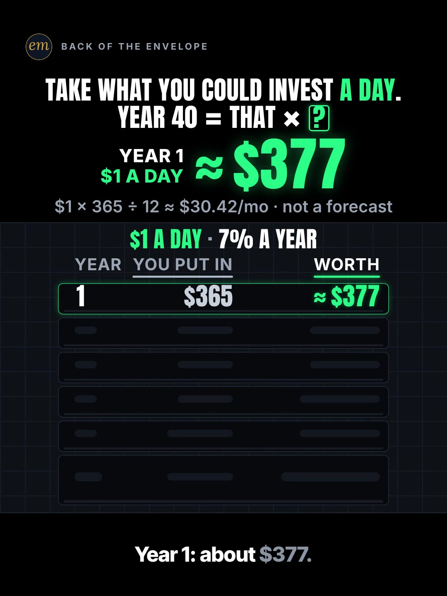

# 09c publishing sheet: take what you could invest a day, year 40 = that × ?

YouTube Shorts (@envelopemath) and Instagram Reels (@envelopemath). Prepared 2026-10-13. Machine-readable twin: `publishing/09c-scoreboard-5-a-day-millionaire.json`.

- **Video.** `renders/channel/09c-scoreboard-5-a-day-millionaire.mp4`: the pre-condense cut (34 s: a 31.5 s body + the 2.5 s card; sha256 `20c57655…`), the assembly-fix-pass cut (2026-10-08). The 09 condense is in progress in parallel (timing only: the numbers, the captions' facts and the verdict stay). Nothing below names a timestamp except the cover, which is picked by content (the question frame), so the copy carries over to the condensed cut unchanged. The ship step rebuilds this sheet and re-exports both covers from the final file: `python3 publishing/tools/build_publishing.py 09c-scoreboard-5-a-day-millionaire --covers`.
- **Numbers.** Every figure comes from `teasers/v2/09-growth-ladder.md` (09c) and its check, `python3 teasers/v2/checks/09-growth-ladder.py`: 509 checks, 0 failed on `studio/specs/` (run 2026-10-13; the builder runs it through the adapter `publishing/data/checks/09-growth-ladder.py`). `python3 publishing/tools/build_publishing.py 09c-scoreboard-5-a-day-millionaire --check` checks this sheet's limits, paste blocks and figures, recomputes every row from $1 × 365 ÷ 12 a month at an effective 7% a year, the × 75,176 multiplier, the $5 and $10 lines, the ≈ $13.30 a day and the 7% ÷ 12 variant, keeps every row's figures beside their own year and every rounded figure 'about' or '≈'.
- **Honesty rules kept.** The title asks what $1 a day becomes and never says, and neither does the cover (the question frame: the blank '× ?' over year 1's ≈ $377). The Instagram caption keeps every result below 'more'. The copy says the 7% is an assumption, not a forecast, and which 7% it is (each dollar grows 7% a year), gives the other calculator convention (7% ÷ 12 a month → ≈ 79,838), and reads the rows as rough today's dollars only if the daily amount rises with prices, as the write-up's caption does. The $5-a-day meme is busted, not promised: $5 a day is ≈ $375,880, and a million takes ≈ $13.30 a day. No advice, no urgency, and 'Not financial advice.' is in both.
- **Brand.** No company or product is in the video. The copy names the S&P 500 only to explain the 7% (the write-up's caption line); both platforms' copy says 'Not affiliated with or endorsed by S&P Dow Jones Indices.' No share price is named.
- **[click-check].** The S&P 500 figures behind '≈ 7% after inflation, ≈ 10% before' (Official Data Foundation 6.81% / 10.09%, a live figure read 2026-10-07) come from search results; the write-up marks the page for a hand check before posting (the proxy blocked fetching it). Nothing here changes that.
- **Overlap.** Two other Shorts start from a daily amount: 02a ('"It's Just $3 a Day." What It Really Costs You by 65 — Find Your Age'), $3 a day at 7% by age, not yet posted, and 06c, a $4 latte a day into one stock, live. This one answers for any daily amount with one multiplier and busts the $5 meme, so it goes out on a different evening from 02a.

---

## YouTube Shorts

### Title (vidIQ title score, short-form, scored against this channel)

| # | Title | Score | Chars |
|---|---|---:|---:|
| 1 | What Is $1 a Day Worth After 40 Years of Investing? Now Multiply by Your Own Daily Amount | 98 | 89 |
| 2 | If You Invested Every Day for 40 Years, What Would You Multiply Your Daily Amount By? | 97 | 85 |
| 3 | What Is $1 a Day Worth After 40 Years of Investing? Multiply by Yours | 96 | 69 |

**Pick (paste):**

```
What Is $1 a Day Worth After 40 Years of Investing? Now Multiply by Your Own Daily Amount
```

- 89 of 100 characters.
- It asks and names no result: not ≈ $75,176, not × 75,176, not ≈ $13.30 a day. '$1 a day' and '40 years' are the inputs, on screen at frame 1 (the input strip and the header's YEAR 40).
- It raises the write-up's title from 87 to 98. The header's symbols ('= That × What?') score lowest; the same job in words scores highest. vidIQ's model ranks titles but does not predict views.
- 'Does $5 a Day Really Make You a Millionaire in 40 Years?' scores 94 and rides the biggest search phrase ('your life if you invested $5 a day', 43,958). It is left out on purpose: the write-up's judges found millionaire hooks the benchmark's weakest, and the video answers it only in the verdict. The $5 example lives in the description and the caption.
- Also scored, not used: "Does $5 a Day Really Make You a Millionaire in 40 Years?" 94 (the meme the verdict busts; not used, because the write-up's hook passes moved every 09 hook off 'millionaire' and the header asks '× ?'); "Invest What You Can Every Day for 40 Years. Your Daily Amount × What?" 90; "Invest $1 a Day for 40 Years. What's It Worth? Now Multiply by What You Could Invest" 90; "Take What You Could Invest a Day. Year 40 = That × What?" 87 (the write-up's title).

### Description (paste)

```
What is $1 a day worth after 40 years of investing? At an assumed 7% a year, year 40 comes to about $75,176: your daily amount × 75,176. A million by year 40 takes about $13.30 a day, not $5.

The math, shown ($1 a day = $1 × 365 ÷ 12 ≈ $30.42 a month, put in at each month-end):
• Year 1: $365 in, ≈ $377.
• Year 10: $3,650 in, ≈ $5,203.
• Year 20: $7,300 in, ≈ $15,438.
• Year 30: $10,950 in, ≈ $35,571.
• Year 40: $14,600 in, ≈ $75,176.
• Every row scales with the amount, so year 40 ≈ your daily amount × 75,176.
• $5 a day: ≈ $375,880, not the million the meme promises. $10 a day: ≈ $751,761.
• A million by year 40: $1,000,000 ÷ 75,176 ≈ $13.30 a day.

Follow for the math behind your money — shown, not hand-waved. @envelopemath

Animation and original sound: The Back of the Envelope. $1 × 365 ÷ 12 deposited at each month-end at an assumed 7% a year, effective: each dollar grows 7% a year. If your calculator uses 7% ÷ 12 a month (about 7.2% a year), the multiplier is about 79,838. 7% is an assumption, not a forecast: the S&P 500 has returned about 7% a year after inflation since 1928, about 10% before (Official Data Foundation: 6.81% and 10.09%, read Oct 2026), so read these as rough today's dollars if your daily amount rises with prices. No fees or taxes. Not financial advice. Not affiliated with or endorsed by S&P Dow Jones Indices.
#compoundinterest #investing #personalfinance
```

1,400 of 5,000 characters (1,446 UTF-8 bytes; YouTube counts this limit in bytes, and `≈`, `×`, `•`, `—`, `÷` take 2-3 each). No `<` or `>`, which YouTube rejects. It follows the house template: an answer-first opening line for the search snippet, then 'The math, shown:' bullets, then the follow line. The credit, assumptions and 'Not financial advice.' line comes next, and the 3 hashtags close it. The opening line is the title's question with the answer, for the search snippet. The 'Doesn't Add Up' series line is left out, as on 06b, 06c and 08b: the verdict is a plain reading of an assumed rate, not a number that shouldn't be true.

### Hashtags (order matters)

1. `#compoundinterest`: the mechanism, and the biggest on-topic phrase ('compound interest' 137,873 searches a month, competition 50.6; −17.3% on its 30-day baseline).
2. `#investing`: the broad category and the write-up's first caption tag ('investing' 613,566 a month, flat at −2.0%).
3. `#personalfinance`: the channel's layer ('personal finance' 1,436,792 a month), as on 07a and 02a.

The title carries no hashtags, so YouTube shows these 3, the description's first, above the title. Over 60 hashtags and YouTube ignores all of them. `#Shorts` isn't needed.

### Tags (paste; 402 of 500 characters as YouTube counts them: commas count, and a tag with a space counts 2 more for the quotes YouTube adds)

```
your life if you invested $5 a day, your life if you invested 5 dollars a day, what happens if you invested $10 a day, invest 5 dollar a day, pov you invested just $5 a day, how much to invest to become a millionaire, compound interest, compound interest explained, how compound interest works, investing for beginners, money math, math animation, the back of the envelope, envelope math
```

Tags carry little weight. These mirror the keyword research plus the house's channel tags. The '$5 a day' phrases are the meme the verdict busts ('your life if you invested $5 a day' 43,958 a month), 'what happens if you invested $10 a day' (5,384, competition 23.9) is the pinned comment's $10, and 'how much to invest to become a millionaire' (3,517) is the verdict's own question. Left out on purpose: 'how to become a millionaire' (121,786) and 'how to get rich', which are how-to intent the Short doesn't serve; the 'dollar a day' phrases, which are all about earning one online.

### Pinned comment (post it, then pin it)

```
$10 a day? ≈ $751,761 by year 40. Reply with yours.

The rule: year 40 ≈ your daily amount × 75,176, at an assumed 7% a year, put in monthly. A million by year 40 takes ≈ $13.30 a day.
```

The write-up's pinned comment ('$10 a day? ≈ $751,761. Reply with yours.'), with its year added, then the rule for working out the viewer's own number, as the write-up wants ('the comments should be viewers' own multiplications'). The caption answers the comment fight it expects ('S&P does 10%!') with the after-inflation framing and the other convention.

### Related video and end screen

- **Related video:** [What If You Bought Starbucks Stock Instead of a $4 Latte Every Day? #Starbucks #LatteFactor #stocks](https://www.youtube.com/shorts/fbpdKf4Wy8c) (`fbpdKf4Wy8c`). The channel's live daily-amount Short (a $4 latte a day into one stock), live since Mon 12 Oct 2026 (760 views by 13 Oct). This one is the same habit's maths at a stated rate, for any daily amount.
- **Swap later:** 09a ($100 a month) or 09b ($1,000 at birth), the same growth-ladder series, once published. Then point that Short's Related video at this one.
- **End screen:** Shorts have no end screens or cards. The Related video link is the Shorts equivalent.

### Thumbnail and settings

- **Thumbnail:** in the YouTube app, pick the question frame, the same content as the Instagram cover below: 'TAKE WHAT YOU COULD INVEST A DAY. / YEAR 40 = THAT × ?' with the green boxed blank, the hero at ≈ $377 tagged 'YEAR 1 / $1 A DAY', the footer working '$1 × 365 ÷ 12 ≈ $30.42/mo · not a forecast', the strip '$1 A DAY · 7% A YEAR' and row 1 lit over five dark slots. It asks without answering, like the title beside it in search.
- **Settings:** Category Education. Not made for kids. Altered or synthetic content: No (it's an animated chart, not realistic footage). Remixing allowed. No captions needed: there's no narration and all the text is on screen.

### Posting window

- **When:** First free Tue-Thu evening after the 09 condensed cut ships and passes QA, 21:30-22:30 ET (01:30-02:30 UTC the next day). Sunday 06:00-08:00 ET is the alternative.
- **Spacing:** Keep it at least 6 h from any other upload on the channel, on a different evening from 09a and 09b, and away from 02a (the other daily-amount compounding Short). Suggested order within the series: 09a, then 09b, then 09c.
- **Why:** The channel's own October Shorts, median views by posting slot (vidIQ, 2026-10-13): Sunday 05:00-08:00 ET 1,199 (n = 2), weekday 22:00-00:30 ET 642 (n = 3), weekday midday 263 (n = 2); 06c (Mon 03:45 ET) has 760 and 06b (Mon 12:14 ET) 75, too young to compare. The evening slot is also the best one on Instagram, so one evening serves both. n = 7 and confounded by topic, so treat it as a test. The topic is evergreen ('your life if you invested $5 a day' −1.8% on its baseline), so no date matters more than the slot; 09c goes last of the three: its hook scored 6.75 with the write-up's judges, level with 09b and under 09a (7.0), and both judges flagged '× 75,176' as a long number to remember.

---

## Instagram Reels

### Caption (paste)

```
Take what you could invest a day. What does it become after 40 years of investing? Multiply by your own number.

The board is $1 a day (≈ $30.42 a month), put in at each month-end at an assumed 7% a year. Every row scales with the amount, so year 40 ≈ your daily amount × 75,176.

The math, shown:
• Year 1: ≈ $377 ($365 in).
• Year 10: ≈ $5,203 ($3,650 in).
• Year 20: ≈ $15,438 ($7,300 in).
• Year 30: ≈ $35,571 ($10,950 in).
• Year 40: ≈ $75,176 ($14,600 in).

$5 a day ≈ $375,880: not the million the meme promises. $10 a day ≈ $751,761. A million in 40 years takes ≈ $13.30 a day.

Why 7%? The S&P 500 has returned ≈ 7% a year after inflation since 1928 (≈ 10% before), so read these as rough today's dollars if your daily amount rises with prices. "7% a year" here means each dollar grows 7% a year; if your calculator uses 7% ÷ 12 a month (≈ 7.2% a year), the multiplier is ≈ 79,838. 7% is an assumption, not a forecast. No fees or taxes. Not financial advice. Not affiliated with or endorsed by S&P Dow Jones Indices.

What's your daily number?

Follow for the math behind your money — shown, not hand-waved. @envelopemath
Animation and original sound: The Back of the Envelope.

#compoundinterest #investing #personalfinance #moneymath #investingforbeginners
```

- 1,267 of 2,200 characters.
- **First 125 characters:** the header's question without its symbols, plus the write-up's numberless line 1. The multiplier, the rows and the million line sit below 'more', where Instagram search and Google indexing still read them.
- The rate paragraph is the write-up's: which 7% this is (each dollar grows 7% a year), the other calculator convention, and the after-inflation reading.
- The caption follows the house close: the write-up's 'reply with yours' as a question, then the follow line plus the credit.

### Hashtags (5, Instagram's cap since Dec 2025)

`#compoundinterest #investing #personalfinance #moneymath #investingforbeginners`

The write-up tags `#investing #compoundinterest #moneymath #mathtok`:

- `#compoundinterest`, `#investing` and `#moneymath` stay; `#personalfinance` is the same third tag as YouTube.
- `#investingforbeginners` replaces `#mathtok` (a TikTok tag), as on 07a and 02a: 'investing for beginners' is 295,600 searches a month on YouTube, and the channel's own start-age Short (`EqFQCJheCMU`) carries it as a tag.

### Alt text

- **Short (99 characters; paste this one into Instagram):** Chart: $1 a day at 7% a year; year 40, about $75,176. So year 40 is your daily amount times 75,176.
  - It stays at or under 100 characters, so it fits the field however short it is. It says 'about' and 'times', not '≈' and '×', so screen readers read it cleanly, and it keeps the 7% beside the result.
- **Long (for anywhere with room, such as a website embed):** Animation on a black scoreboard. The header reads: take what you could invest a day; year 40 equals that times a blank. A strip says $1 a day, 7% a year, and the footer works it out: $1 times 365 divided by 12 is about $30.42 a month, not a forecast. A board fills year by year while a big counter tagged with the year counts up: year 1, $365 in, about $377; year 5, $1,825 in, about $2,166; year 10, $3,650 in, about $5,203; year 20, $7,300 in, about $15,438; year 30, $10,950 in, about $35,571; year 40, $14,600 in, about $75,176. Then the counter becomes times 75,176, tagged: year 40, about, daily amount. Verdict: a million by year 40 takes about $13.30 a day.
- **Where:** Advanced settings → Accessibility → Alt text, if your app shows it for Reels.

### Cover



- **Files:** `publishing/09c-scoreboard-5-a-day-millionaire-cover-3x4.jpg` (1080×1440) and `publishing/09c-scoreboard-5-a-day-millionaire-cover-9x16.jpg` (1080×1920). Both come from the pre-condense (34 s) render at 2.5 s (frame 75).
- **Frame, by content:** The question frame, settled: the header 'TAKE WHAT YOU COULD INVEST A DAY. / YEAR 40 = THAT × ?' ('A DAY' in green, the '?' a green boxed blank), the hero odometer at ≈ $377 tagged 'YEAR 1 / $1 A DAY', the footer working '$1 × 365 ÷ 12 ≈ $30.42/mo · not a forecast', the input strip '$1 A DAY · 7% A YEAR', the heads Year / You put in / Worth, row 1 lit (1 · $365 · ≈ $377) over five dark slots, and the caption 'Year 1: about $377.' fully lit. It asks and does not answer: the multiplier is still a blank. On any cut, use the last settled frame on row 1, after its glow fades and the caption is fully lit, before the row 5 cut. On the pre-condense 34.0 s render row 1's count lands before frame 0 and its landing glow fades by about frame 13 (0.43 s); from there the frame-to-frame mean luma change is 0.0000 until the row 5 cut at frame 90 (3.0 s), apart from the caption's last word lighting at about frame 58 (1.93 s). Frame 75 (2.50 s) is inside that hold, with the caption fully lit. If the cut changes, re-pick it by content.
- **Crop:** 3:4 = 1080×1440 from y 60 to 1500 of the 1080×1920 frame. The content runs from y 141 (the badge) to y 1417 (the caption), so the crop centres it (81 px above, 83 below): badge, header, hero and tag, footer, input strip, the whole board and the caption; it drops the empty floor. A centred grid crop (y 240-1680) cuts the badge and the header.
- **How to set it:** In 'Edit cover', pick the question frame from the video (or upload the 9:16 JPG), then drag 'Profile grid' to the top so the tile matches the 3:4 JPG. Do not upload the 3:4 JPG as the Reel cover: Instagram centre-crops it to 9:16 in the Reels tab and cuts the header.
- **Re-export:** `ffmpeg -ss 2.5 -i renders/channel/09c-scoreboard-5-a-day-millionaire.mp4 -frames:v 1 -vf "crop=1080:1440:0:60" -q:v 2 publishing/09c-scoreboard-5-a-day-millionaire-cover-3x4.jpg` and `ffmpeg -ss 2.5 -i renders/channel/09c-scoreboard-5-a-day-millionaire.mp4 -frames:v 1 -q:v 2 publishing/09c-scoreboard-5-a-day-millionaire-cover-9x16.jpg`, or `python3 publishing/tools/build_publishing.py 09c-scoreboard-5-a-day-millionaire --covers`.
- **Not used:** the hero beat ('× 75,176' under the header's blank, tagged YEAR 40 ≈ DAILY AMOUNT), the write-up's other cover option. It fills the blank: the answer to the title.
- **Not used:** the verdict hold ('A MILLION BY YEAR 40: / ≈ $13.30 A DAY').
- **When the condensed cut ships:** re-pick the question frame by content on the shipped file and re-export both JPGs with `--covers`.

### First comment (post it, then pin it)

```
Year 40 on $1 a day: ≈ $75,176, so year 40 ≈ your daily amount × 75,176. $5 a day ≈ $375,880. A million by year 40 takes ≈ $13.30 a day. What's your daily number?
```

### Trial Reels

**Post as a regular Reel, not a Trial.** @envelopemath has 8 followers, so a regular Reel is already shown almost entirely to non-followers, which is all a Trial Reel adds. A Trial would also keep it off the profile grid until shared. A hook test afterwards, if you want one: the other cut as a Trial with MANUAL graduation 48-72 h later. Once the condensed cut replaces this render in renders/channel, get the pre-condense one from git with `git show 471c793:renders/channel/09c-scoreboard-5-a-day-millionaire.mp4 > 09c-34.0s.mp4` (sha256 cd58e2ea…). Compare skip rate (October Reels ran 27.0-65.1%; 06c's condensed cut 40.3%) and average watched %, then share the winner. vidIQ's publish tool exposes Trial (MANUAL or SS_PERFORMANCE) for this connected account. Confirm eligibility in the app.

### Posting window and settings

- **When:** Same evening as YouTube, about 15 min after the Short: 21:45-22:45 ET, on a different evening from 09a and 09b.
- **Why:** October Reels, median plays by posting slot (owner insights, 2026-10-13): weekday 22:00-00:30 ET 5,449 (n = 3, including the two best: 7,303 and 5,449), weekday midday 1,212 (n = 2), Sunday 05:00-08:00 ET 1,087 (n = 2). 06c, posted Mon 03:46 ET, has 1,711 plays with a 40.3% skip rate. Skip rate tracks plays more closely than the hour does: 27.0-27.4% for the top two, 56.9-65.1% for the bottom two. The condense matters more than the hour.
- **Audio:** Rename the original audio to 'Your daily amount × ? — The Back of the Envelope' if the app allows; it is the score, with no voice.
- **Share to feed:** On.

---

## Why these choices (research evidence)

**1. Search demand (vidIQ keyword research, pulled 2026-10-13).** vidIQ refreshes each keyword on its own schedule, so the last column gives each row's snapshot date. Six rows are older snapshots.

| Keyword | Est. searches/month | Competition | Overall | Note | vidIQ as of |
|---|---:|---:|---:|---|---|
| compound interest | 137,873 | 50.6 | 65.8 | the mechanism; −17.3% vs its 30-day baseline (166,772) | 2026-10-12 |
| how to become a millionaire | 121,786 | 53.5 | 64.1 | −1.1%; US 22,452; how-to intent, not in the copy | 2026-10-12 |
| your life if you invested $5 a day | 43,958 | 56.5 | 59.0 | −1.8% vs its baseline (44,753): the meme the verdict busts | 2026-10-12 |
| your life if you invested 5 dollars a day | 5,410 | 31.2 | 61.0 |  | 2026-08-16 |
| what happens if you invested $10 a day | 5,384 | 23.9 | 63.9 | the pinned comment's $10 | 2026-08-24 |
| invest 5 dollar a day | 5,320 | 24.9 | 63.4 |  | 2026-07-22 |
| pov your life if you invested $10 a day | 5,314 | 38.0 | 58.2 |  | 2026-08-28 |
| pov: you invested just $5 a day | 4,849 | 13.0 | 67.8 | the lowest competition here | 2026-10-10 |
| how much to invest to become a millionaire | 3,517 | 41.5 | 55.2 | the verdict's own question | 2026-03-22 |
| make 1 dollar a day online | 8,568 | 31.7 | 62.5 | earning, not investing; not used | 2026-06-10 |

The daily-amount idea is searched as the $5 meme ('your life if you invested $5 a day' 43,958, and a dozen long-tail versions at about 5,000 each, several at low competition: 'pov: you invested just $5 a day' 13.0). That is the belief the verdict busts, so it rides in the description, the caption and the tags, not the title. 'how to become a millionaire' (121,786) is how-to intent; the Short answers only 'how much a day for a million at 7% in 40 years' (≈ $13.30), which is in the copy and the tags.

**2. '$5 a day makes you a millionaire' is a crowded, small meme on YouTube (vidIQ YouTube search, under 4 min, by views).**

| Title | Channel (subs) | Views | Date |
|---|---|---:|---|
| Invest just $5 per day in SCHD for Financial Freedom | Investing Simplified - Professor G (475,000) | 459,944 | 2023-06-24 |
| How $5 a Day Can Make You a Millionaire | True Worth Investing (23,500) | 1,449 | 2025-05-13 |
| Skip Coffee, Become a Millionaire: The $5 Daily Investment That Changes Everything | Compounded Daily (64) | 1,394 | 2026-05-01 |
| How $5/Day Makes You $500,000 | CashCapy (106) | 1,271 | 2026-06-16 |
| $5 a Day = Millionaire?! 💰 #shorts #personalfinance #compoundinterest | Explaining stuff using animation (19) | 1,184 | 2026-08-28 |
| $5 a Day Could Make You a Millionaire (Coffee Money) #shorts | Money Decoded (9) | 1,179 | 2026-07-04 |
| She Said NO to $5 Coffee — Now She's a Millionaire | RichToons Studio (104) | 1,173 | 2026-04-17 |
| The $1 Rule That Can Make You a Millionaire! 💵 (SHOCKING!) | İnvestopia (8) | 520 | 2025-02-06 |

Since 2025, seven small channels have posted a daily-amount Short aimed at a big round number, all between 500 and 1,500 views: five put '$5 a day' (or '$5 coffee') and 'millionaire' in the title, CashCapy says '$500,000' and İnvestopia 'The $1 Rule'; their rates are 8-10% a year per their descriptions (not checked here). Most say yes in the title. None gives a multiplier for any daily amount, and none says what a million takes at 7%: this Short's '× 75,176' and '≈ $13.30 a day'. The pick asks about $1 a day instead of repeating the meme, and the description and caption bust it with the write-up's $5 line (≈ $375,880).

Next door, an animated saving explainer is the biggest Short the searches returned (Zack D. Films' 'How Saving Every Month Builds Wealth', 30,892,724 views).

**3. 'Your number × a constant' and 'how much a day' travel on Instagram and TikTok (vidIQ IG/TikTok outlier search, since June 2025, at least 10K views).**

- **@itsjoeyviola** (Instagram), "Multiply your monthly income by these 5 numbers": 276K (152.1x). The P1 multiplier grammar the header uses ('take what you could invest a day … × ?').
- **@daily.money.matters** (Instagram), "How much money do you need to spend in a day to blow $10,000 in a year?": 2.7M (36.9x). **@kliqclip** (TikTok), $27.40 a day invested over 40 years: 755.2K (327.4x). The daily amount is the hook on both.
- **@betterwavefinance** (Instagram), "How much you need to invest monthly to retire with $5 million": 482.1K (116.3x), a stick-figure animation; **@trellthetrainer** (TikTok), "HOW TO RETIRE WITH $5M": 2.7M (33.4x). The amount needed for a target, the verdict's direction (≈ $13.30 a day for a million).
- All of them state the question on frame 1 and leave the number for later, which the cover (the blank '× ?') and the caption's first line do too.

**4. Our own October numbers (vidIQ: public YouTube stats, Instagram owner insights; refreshed 2026-10-13).**

| YouTube Short | Posted (ET) | Views |
|---|---|---:|
| Can You Find the Missing Dollar? (`LjHDFzVxRyM`) | Sun 07:04 | 1,256 |
| You Can Lean on $1 Million. Not on $1 Billion. (`hJBvmGA6sZ0`) | Thu 00:25 | 1,221 |
| Your Interest Has a Speed Limit (`XVUeMcTg9OQ`) | Sun 05:49 | 1,141 |
| What If You Bought Starbucks Stock Instead of a $4 Latte Every Day? (06c) (`fbpdKf4Wy8c`) | Mon 03:45 | 760 |
| Pay the Minimum on $5,000? 238 Months. (`8__HTUa2PoU`) | Mon 22:09 | 642 |
| A $2 Lottery Ticket Was Worth $6.98. Until the Fine Print. (`FW_oxA3kbsM`) | Wed 12:03 | 348 |
| You Can Carry $1 Million. Not in Pennies. (`mXbKY_R63h4`) | Thu 13:38 | 177 |
| Start Investing 10 Years Late? You Get Half. (`EqFQCJheCMU`) | Tue 22:27 | 161 |
| What If You Bought Netflix Stock Instead of Paying for Netflix? (06b) (`krfZEHhb0xU`) | Mon 12:14 | 75 |

| Instagram Reel | Posted (ET) | Plays | Skip rate | Avg watched |
|---|---|---:|---:|---:|
| $5,000 on the minimum (`DeIvYk7I4Qr`) | Mon 22:46 | 7,303 | 27.4% | 56.5% |
| $1M stack vs Burj Khalifa (`DeOEthJJ1TG`) | Thu 00:28 | 5,449 | 27.0% | 83.1% |
| Missing dollar (`DeWgFZRoR_S`) | Sun 07:05 | 1,997 | 32.0% | 81.3% |
| Powerball $6.98 (`DeMvZv9IqRw`) | Wed 12:05 | 1,825 | 58.7% | 57.9% |
| 06c latte vs Starbucks stock (`DeYuqT4pjVC`) | Mon 03:46 | 1,711 | 40.3% | 69.1% |
| $1M in pennies (`DePe11HIHwn`) | Thu 13:37 | 598 | 42.0% | 66.7% |
| 10 years late (`DeLSd9io8UK`) | Tue 22:30 | 219 | 65.1% | 30.6% |
| Speed limit (e) (`DeEW2ZMIiYd`) | Sun 05:54 | 177 | 56.9% | 31.2% |

Channel totals:

- **YouTube:** 53 subscribers, 10,221 views and 41 videos (+27 subscribers, +5,127 views and 11 videos in 30 days).
- **Instagram:** 8 followers and 20,519 views in 30 days.

The two best Reels are a big number made physical ('$1M stack vs Burj Khalifa', 27.0% skip) and a bill measured in time ('$5,000 on the minimum', 27.4%); the channel's '$1 million' Shorts also lead on YouTube (1,221 views). This Short ends on a million made daily (≈ $13.30 a day). The compounding Shorts so far have two of the month's three worst skip rates ('10 years late' 65.1%, 'Speed limit (e)' 56.9%; 'Powerball $6.98' 58.7% sits between them). 06c (760 views, 1,711 plays) and 06b (Mon 12 Oct 12:14 ET: 75 views so far; its Reel shows 7 plays while Instagram's owner insights catch up) are left out of the medians as too young.

Medians by posting slot (n = 2-3 each, confounded by topic):

- **YouTube:** Sunday early morning ET 1,199, weekday 22:00-00:30 ET 642, weekday midday 263.
- **Instagram:** weekday 22:00-00:30 ET 5,449, midday 1,212, Sunday early morning 1,087.

One weekday evening is the best Instagram slot and the second-best YouTube slot, so the plan posts both then. On Instagram, skip rate predicts plays better than the hour does (27.0-27.4% for the top two, 56.9-65.1% for the bottom two). So the window is a light-touch test, and the condense (fewer still moments) is the bigger reach lever.

**5. Platform rules applied.**

- **YouTube title:** 100 characters. The Shorts player shows only the opening, so the keywords come first.
- **YouTube description:** 5,000 characters.
- **YouTube hashtags:** the first 3 show; over 60 and all are ignored; `#Shorts` isn't needed.
- **YouTube tags:** 500 characters, low weight.
- **YouTube Shorts:** no end screens. The Related video link is the Shorts equivalent.
- **YouTube AI disclosure:** only for realistic altered content.
- **Instagram caption:** 2,200 characters, about 125 shown before 'more'.
- **Instagram hashtags:** 5 at most.
- **Instagram search and Google:** keywords in the caption feed Instagram search, and Google indexes public professional posts (since 10 Jul 2025).
- **Instagram grid:** a 3:4 crop of the 9:16 cover.
- **Trial Reels:** shown to non-followers only.

**6. Limits.**

- @envelopemath's YouTube Analytics (audience hours, geography) were not read here; the 06b and 06c sheets found vidIQ's YouTube authorization is a different channel. Check Studio → Analytics → Audience → 'When your viewers are on YouTube' before posting.
- vidIQ has no hashtag-volume data; hashtag picks lean on keyword volume and on the write-up's and the outliers' own tags.
- Title scores are vidIQ's short-form CTR model for this channel; they rank options but do not predict views.
- The S&P 500 figures behind the caption's '≈ 7% / ≈ 10%' come from search results the write-up could not open (the proxy blocked the page); they are marked [click-check] there, and the live figure will drift.
- The same-idea Shorts' 8-10% results come from their own descriptions and are not checked here; none is in the copy.
- The video, the cover and the video facts are the pre-condense cut; the copy is cut-independent, and the ship step refreshes the rest from the final file.
- The vidIQ credit balance is shared with the other sheets being built in parallel, so this sheet's spend is counted from each tool's listed cost (see research.vidiq_credits).

---

## Check log (first build and adversarial pass, 2026-10-13)

- **Maths.** `python3 teasers/v2/checks/09-growth-ladder.py`: 509 checks, 0 failed on `studio/specs/`. Every public figure traces to the 09c maths table: m = $1 × 365 ÷ 12 ≈ $30.42 at r = 1.07^(1/12) − 1; year 1 $365 / ≈ $377; 5 $1,825 / ≈ $2,166; 10 $3,650 / ≈ $5,203; 20 $7,300 / ≈ $15,438; 30 $10,950 / ≈ $35,571; 40 $14,600 / ≈ $75,176 (× 75,176); $5 a day ≈ $375,880; $10 a day ≈ $751,761; a million ≈ $13.30 a day; 7% ÷ 12 → ≈ 79,838 (≈ 7.2% a year). The data file recomputes every one.
- **Limits.** Title 89/100. Description 1,400 characters (1,446 bytes) of 5,000. 3 hashtags. Tags 402/500 as YouTube counts them. Instagram caption 1,267/2,200, with the first 125 characters result-free. 5 hashtags. Short alt text 99. No `<` or `>`.
- **vidIQ.** Keywords pulled 2026-10-13 (table above). 7 titles scored against this channel: the pick 98, the write-up's title 87. Channel 53 subscribers / 10,221 views / 41 videos; Instagram owner insights refreshed (8 followers, 20,519 views in 30 days).
- **vidIQ re-queried** after the build: the pick's title score 98, as first scored.
- **vidIQ re-queried.** At the adversarial check: the pick's title score 98; 'your life if you invested $5 a day' 43,958 / 56.5 (−1.8%, baseline 44,753); the related video fbpdKf4Wy8c 760 views, live since Mon 12 Oct 03:45 ET. All match.
- **Changed.**
  - The pinned comment and the Instagram first comment said 'A million takes ≈ $13.30 a day' with no horizon (it holds only for year 40). Both now say 'A million by year 40 takes ≈ $13.30 a day', and the ≈ $13.30 copy rule now requires 'a million by year 40' or 'a million in 40 years' before it; the old rule passed the bare line.
  - The short alt text ended on a fragment ('so your daily amount times 75,176'). It is now 'Chart: $1 a day at 7% a year; year 40, about $75,176. So year 40 is your daily amount times 75,176.' (99 characters).
  - The Related video note called 06c 'its second-best YouTube start', which the research does not show; it now gives the views with their date (760 by 13 Oct). It and the intro also each called a different Short 'the channel's other daily-amount Short' (06c, 02a): 06c is now the live one and 02a the not-yet-posted $3-a-day Short, with 02a's full title.
  - The posting order's reason cited 09c's length, a pacing claim the condense will change; it now cites the judges' score (6.75, level with 09b, under 09a's 7.0) and their note that '× 75,176' is a long number to remember. The Trial Reels line about length is cut for the same reason.
  - `#personalfinance` was 'as on 07a, the other compounding Short of the batch' (09a and 09b are compounding Shorts too): now 'as on 07a and 02a'. `#investingforbeginners` was 'tagged by the same-idea $5 a day Shorts', which the research does not show: now the channel's own `EqFQCJheCMU` tag.
  - Section 2 said 'at least seven channels have posted $5 a day makes you a millionaire'; of the seven listed since 2025, five say so, CashCapy says $500,000 and İnvestopia 'The $1 Rule'. It now says that, and so does the research note.
  - Section 4 said the compounding Shorts have 'the worst skip rates'; 'Powerball $6.98' (58.7%) sits between them. It now says two of the three worst.
- **Checked.**
  - Every copy figure against the write-up's 09c maths table and a fresh run of the 09 check (509 checks, 0 failures, exit 0), by hand and by the builder's FIGURES, MATH_RELATIONS and COPY_RULES.
  - Platform limits, recounted from the JSON: title 89/100 with no hashtags (the description's first three show above it), description 1,400 characters (1,446 bytes) of 5,000, tags 402/500 as YouTube counts them, caption 1,267/2,200 with 5 hashtags and a result-free first 125, short alt text 99/100, no < or >.
  - Policy: no brand in the video; the S&P 500 is named only for the rate's context, with 'Not affiliated with or endorsed by S&P Dow Jones Indices.' in the description and the caption; sources are named descriptively, as 06b and 06c name theirs; no share price; 'Not financial advice.' in both; no advice, urgency or promise wording (a copy rule). The $5 meme is busted, not promised ('not the million the meme promises'), and no 'millionaire' is in the copy (copy rules); the tags carry the searched '$5 a day' phrases, which the description and the caption answer.
  - The cover JPG (read by eye) shows the boxed '× ?' blank, the hero at ≈ $377 tagged YEAR 1 / $1 A DAY and row 1 over five dark slots: no answer. The render's sha256 equals `git show 471c793:renders/channel/09c-scoreboard-5-a-day-millionaire.mp4`.
  - No timestamp outside the cover section and the video facts, and no pacing claim.
- **Generator.** Unchanged. `MATH_SCRIPT` is the adapter `publishing/data/checks/09-growth-ladder.py` (see the 09a sheet).
- **Mutation test.** Five mutations of a scratch copy each fail by name: the $5 line moved to $10, the multiplier one off (75,177), row 20's figures under year 30, the caption without 'each dollar grows 7% a year', and ≈ $13.30 without its '≈'. At the adversarial check, 3 more on a scratch copy also fail by name: the pinned comment's million line without its horizon, the same in the first comment, and the alt text's multiplier without 'times'. The files on disk were not touched.
- **Kept on purpose.**
  - The cover is the question frame (the blank '× ?'), not the hero beat the write-up also offers ('× 75,176' fills the blank).
  - The title asks about $1 a day, the board's unit, not about '$5 a day … millionaire' (94 in vidIQ): the write-up moved every 09 hook off 'millionaire', and the header asks '× ?'.
  - The spec's file name says '5-a-day-millionaire'; the copy says what the video does ($1 a day as the unit, the $5 meme as an example).
- **Still to do.** The ship rebuild (`--covers`) on the condensed file.
