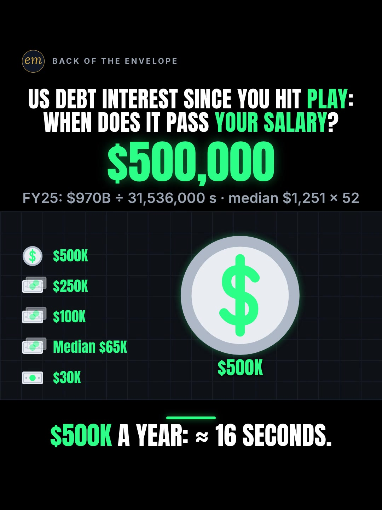

# 10a publishing sheet: US debt interest vs your salary

YouTube Shorts (@envelopemath) and Instagram Reels (@envelopemath). Prepared 2026-10-13. Machine-readable twin: `publishing/10a-scoreboard-debt-interest-live.json`.

- **Video.** `renders/channel/10a-scoreboard-debt-interest-live.mp4`: the recut to the earlier verdict (owner-approved 2026-10-13; 21.1 s: the 18.6 s body + the 2.5 s card; sha256 `0b2867fe…`). The counter stops on its $500,000 pass and the verdict reads "$500K a year: ≈ 16 seconds.". Nothing below names a timestamp except the cover, which is picked by content (the verdict hold).
- **Numbers.** Every figure comes from `teasers/v2/10-cost-counter.md` (10a, the recut) and its check, `python3 teasers/v2/checks/10-cost-counter.py`: the default run on studio/specs/, which holds the recut (0 failures required at every build) (the builder runs it through the adapter `publishing/data/checks/10-cost-counter.py`). `python3 publishing/tools/build_publishing.py 10a-scoreboard-debt-interest-live --check` checks this sheet's limits, paste blocks and figures, recomputes the rate and every salary row from $970 billion, reads the cut's spec and holds the copy to its stop and verdict, holds every figure to the write-up's one rounding (≈ $30,800 a second; ≈ 1.0 / 2.1 / 3.3 / 8 / 16 seconds), keeps $970 billion beside fiscal 2025 and the 12% beside its own line (net interest on the public debt, 11 months), bans the write-up's overclaims ('live', 'in real time') and bans any row past the recut's stop.
- **Honesty rules kept.** The title asks and never gives the result, and so does the YouTube thumbnail (frame 1: the $0 odometer and the five-pip salary ladder). The Instagram caption keeps every result below 'more'. The Instagram cover is the verdict frame, as the write-up's Instagram note asks. Every claim stays inside the video's verdict, "$500K a year: ≈ 16 seconds.": $500,000 is the ladder's top row and the counter's stop, and any other salary (between the rows, under $30,000 or over $500,000) goes through the swap-in rule, as the video captions it. The copy says its conditions: fiscal 2025's $970 billion of net interest, spread evenly over the year (an average rate; fiscal 2026 ran higher, so the counter runs slow), and gross salaries. No advice, no urgency, and 'Not financial advice.' is in both. The copy names no party, person or policy, as the write-up's tone rule asks.
- **Brand.** No company or brand is named. The sources are public agencies (U.S. Treasury, CBO, BLS); the video has no logo. Because nothing branded is named, no 'Not affiliated with or endorsed by …' line is needed, and no share price is named.
- **If 10a is rebuilt on FY2026.** The write-up's preferred posting plan rebuilds this Short on fiscal 2026 net interest once Treasury's September 2026 statement is out (due about 2026-10-13). Then every figure here changes, the verdict's included (at $1.0-1.1 trillion the $500,000 row moves from ≈ 16 s to ≈ 14-16 s, the write-up says); this sheet's numbers check fails by name (MATH_KEY_LINES, MATH_RELATIONS) until the data file is rebuilt on the new numbers. If it ships on FY2025, the copy below is correct as it stands.

---

## YouTube Shorts

### Title (vidIQ title score, short-form, scored against this channel)

| # | Title | Score | Chars |
|---|---|---:|---:|
| 1 | US Debt Interest Since You Hit Play: When Does It Pass Your Salary? | 93 | 67 |
| 2 | The US Pays Interest on Its Debt Every Second. When Does It Pass Your Salary? | 95 | 77 |
| 3 | When Does US Debt Interest Pass Your Salary? #NationalDebt #USDebt #MoneyMath | 93 | 77 |

**Pick (paste):**

```
US Debt Interest Since You Hit Play: When Does It Pass Your Salary?
```

- 67 of 100 characters.
- The pick is the write-up's title and the on-screen header, unchanged: 'US Debt Interest' in the first 16 characters, then the viewer's own stake, 'your salary'. The Shorts player shows the opening, so 'US Debt Interest Since You Hit Play' is what a scroller reads; the question finishes it.
- It names no result: no rate, no seconds, no row, and no top row, so the recut needs no new title (the write-up re-checked the hook: the question is about the viewer's salary, and the recut still answers it). The answer's unit is not even hinted ('how many seconds' scored 89-92 and gives the surprise away).
- Option 2 scores 2 points higher but says the US 'pays' interest every second; the write-up's rate is fiscal 2025's total spread evenly over the year, so the pick keeps the counter's own wording. vidIQ's model ranks titles but does not predict views; 10 of the 11 titles scored sit between 90 and 95.
- Also scored, not used: "When Does US Debt Interest Pass Your Salary? #NationalDebt #USDebt #Debt" 93 (option 3 at the first build: '#Debt' is not one of the description's hashtags, so the check would refuse it as the title); "When Does US Debt Interest Pass Your Salary? Counted Since You Hit Play" 93; "Find Your Salary: When Does US Debt Interest Pass It?" 93 (the VO's first line as the title); "US Debt Interest Adds Up Every Second. When Does It Pass Your Salary?" 93 (the honest wording of option 2, 2 points lower); "US National Debt Interest Since You Hit Play: When Does It Pass Your Salary?" 92 (adding 'National' costs a point); "National Debt Interest vs Your Salary: How Many Seconds?" 92 (names the answer's unit, seconds); "How Fast Does Interest on the National Debt Pass Your Salary?" 90; "How Many Seconds of US Debt Interest Equal Your Salary?" 89.

### Description (paste)

```
When does US debt interest pass your salary? At fiscal 2025's rate, about $30,800 a second: a year of median full-time pay goes by in about 2.1 seconds, $100,000 in about 3.3 seconds and $500,000 in about 16 seconds.

The math, shown:
• Net interest the US paid in fiscal 2025: $970 billion (Treasury; CBO).
• ÷ 31,536,000 seconds in a year ≈ $30,800 a second, ≈ $111 million an hour.
• $30,000 a year: ≈ 1.0 second.
• Median full-time pay, $1,251 a week × 52 = $65,052 (BLS): ≈ 2.1 seconds.
• $100,000: ≈ 3.3 seconds. $250,000: ≈ 8 seconds.
• $500,000, the top row: ≈ 16 seconds.
• Any other salary: yearly pay ÷ 30,800 = your seconds.
• And $0 of it pays the debt down: interest is the cost of carrying the debt, not a repayment.

Follow for the math behind your money — shown, not hand-waved. @envelopemath

Animation and original sound: The Back of the Envelope. Net interest, fiscal 2025: $970 billion (U.S. Treasury's final Monthly Treasury Statement for fiscal 2025; CBO, The Budget and Economic Outlook: 2026 to 2036). Spread evenly over a 365-day year; real interest payments are lumpy, so this is the average rate. Fiscal 2026 ran hotter: CBO's August 2026 review put net interest on the public debt 12% above the same 11 months of fiscal 2025, so this counter runs slow. Salaries are yearly gross pay. Median pay: BLS median usual weekly earnings of full-time wage and salary workers, Q2 2026, × 52. Not financial advice.
#NationalDebt #USDebt #MoneyMath
```

1,465 of 5,000 characters (1,501 UTF-8 bytes; YouTube counts this limit in bytes, and `≈`, `×`, `•`, `—`, `÷` take 2-3 each). No `<` or `>`, which YouTube rejects. It follows the house template: an answer-first opening line for the search snippet, then 'The math, shown:' bullets, then the follow line. The credit, assumptions and 'Not financial advice.' line comes next, and the 3 hashtags close it. The opening line is the title's question with the write-up's caption answer, for the search snippet: the $100,000 row and the verdict's $500,000, as the write-up's caption line 1 pairs them, with the median between. '$500,000, the top row' says where the ladder ends, and the swap-in line covers every other salary, above it included, as the video does. The credit line names which interest line each figure is: $970 billion is net interest (the write-up's basis), and the 12% is CBO's wider 'net interest on the public debt' line, with its 11 months. The 'Doesn't Add Up' series line is left out, as on 06b, 06c and 08a: the counter is an average rate, not a number that shouldn't be true.

### Hashtags (order matters)

1. `#NationalDebt`: the topic ('national debt' 25,193 searches a month, +2.0% on its 30-day baseline) and the write-up's own first tag.
2. `#USDebt`: the bigger phrase ('us debt' 44,622 a month; -33.1% as the August $40 trillion spike fades, still the largest debt phrase). It replaces the write-up's #interest, which reaches rate and savings posts.
3. `#MoneyMath`: the write-up's tag and the format's shared third tag: 10a, 10b and 10c all carry it, so the counter series links up.

The title carries no hashtags, so YouTube shows these 3, the description's first, above the title. Over 60 hashtags and YouTube ignores all of them. `#Shorts` isn't needed.

### Tags (paste; 316 of 500 characters as YouTube counts them: commas count, and a tag with a space counts 2 more for the quotes YouTube adds)

```
us debt interest, national debt interest, interest on national debt, national debt, us national debt, us debt, national debt explained, how the national debt works, can we pay off the national debt, debt crisis, net interest, salary, money math, math animation, the back of the envelope, envelope math
```

Tags carry little weight. These mirror the keyword research plus the house's channel tags. 'interest on national debt' (4,270 a month) is the question as people type it; with 'the' it is under 750. 'can we pay off the national debt' (5,321 a month) is answered by the '$0 of it pays the debt down' line; 'how the national debt works' (5,231) has the lowest competition of the debt questions (37.5). Left out on purpose: 'national debt clock live' (8,779), the biggest counter phrase, because the write-up bans 'live' and 'in real time' for 10a (a fixed average is not a live feed); 'interest rates' (63,613) is a different topic; and every phrase that names a politician or a party (the write-up's tone rule). The recut changes no tag: none names a row.

### Pinned comment (post it, then pin it)

```
Which row are you? Your seconds = yearly pay ÷ 30,800 (median pay: $65,052 ÷ 30,800 ≈ 2.1 seconds).

The $970 billion is fiscal 2025 net interest (a gross figure is bigger), spread evenly over 31,536,000 seconds. Fiscal 2026 ran hotter (CBO: net interest on the public debt up 12% over the same 11 months), so this counter runs slow. The rows are gross salaries, before tax. And $0 of it pays the debt down.
```

The question comes first so it shows in the collapsed preview, and it asks for the viewer's own row (R3), with the write-up's swap-in rule worked for the median, as the video's own label works it ($65,052 ÷ 30,800 ≈ 2.1 seconds). The rule is also how a salary above the ladder's top row ($500,000) gets its answer, so the comment carries it for everyone. The write-up's pinned comment pairs the rule with '$100,000 ≈ 3.3', but 3.3 is the exact rate's answer: the rule's rounded 30,800 gives 100,000 ÷ 30,800 = 3.247, so 3.2, and a viewer checking it on a calculator would catch it. The median is the row where both give 2.1. The second paragraph answers the four comment fights the write-up expects: net vs gross interest, 'that's last year's number', 'my salary is before tax' and 'does any of it pay the debt down?'. It answers with the CBO line, not a new number, as the write-up asks. The recut changes nothing here: it names no row past the stop.

### Related video and end screen

- **Related video:** [Pay the Minimum on $5,000? 238 Months. #CreditCard #PersonalFinance #maths](https://www.youtube.com/shorts/8__HTUa2PoU) (`8__HTUa2PoU`). The cost of carrying a debt, at household size: interest that never pays the balance down, as this Short's '$0 of it pays the debt down'. It is the channel's best post on Instagram (7,303 plays, 27.4% skip rate) and has 642 views on YouTube.
- **Swap later:** 10b (40 years of your pay vs 1 minute of new US debt), the same counter on the debt itself, once published; then point 10b's Related video back at this Short, so the pair links both ways.
- **End screen:** Shorts have no end screens or cards. The Related video link is the Shorts equivalent.

### Thumbnail and settings

- **Thumbnail:** in the YouTube app, pick frame 1: the header 'US DEBT INTEREST SINCE YOU HIT PLAY: / WHEN DOES IT PASS YOUR SALARY?', the odometer on '$0', the footer 'FY25: $970B ÷ 31,536,000 s · median $1,251 × 52', the five-pip salary ladder '$30K · Median $65K · $100K · $250K · $500K' (bottom to top) with $30K lit as the next target, the empty bill tagged '$30K', the label stack '≈ $30,800 / EVERY SECOND' and the caption 'Find your salary.' (read on the recut's frame 1). It asks without answering, like the title beside it in search. The Instagram cover below is the verdict frame, as the write-up asks.
- **Settings:** Category Education. Not made for kids. Altered or synthetic content: No (it's an animated chart, not realistic footage). Remixing allowed. No captions needed: there's no narration and all the text is on screen.

### Posting window

- **When:** After the owner's FY2026 decision (see the intro) and once the recut ships and passes QA: the first free Tue-Thu evening, 21:30-22:30 ET (01:30-02:30 UTC the next day). Sunday 06:00-08:00 ET is the alternative.
- **Spacing:** Keep it at least 6 h from any other upload on the channel. 10a and 10b are both about the federal debt: post them at least a week apart, or as a labelled pair (10b as 'Part 2: the debt itself'), as the write-up asks. Suggested order within the series: 10c, then 10a, then 10b.
- **Why:** The channel's own October Shorts, median views by posting slot (vidIQ, 2026-10-13): Sunday 05:00-08:00 ET 1,198 (n = 2), weekday 22:00-00:30 ET 642 (n = 3), weekday midday 263 (n = 2); 06c (Mon 03:45 ET) has 760 and 06b (Mon 12:14 ET) 75, too young to compare. The evening slot is also the best one on Instagram, so one evening serves both. n = 7 and confounded by topic, so treat it as a test. 10a waits for the FY2026 decision: the write-up prefers to post it on fiscal 2026's figure once Treasury's September statement is out. Interest on the debt is in the news ('debt crisis' +235.9% over its 30-day baseline; U.S. Money Reserve's '$1 Trillion Interest Payments' Short broke out at 52.92x in September).

---

## Instagram Reels

### Caption (paste)

```
When does US debt interest pass your salary? Find your row on the ladder: the counter starts at $0 the moment you hit play.

$100,000 a year of pay ≈ 3.3 seconds of US debt interest. $500,000 ≈ 16 seconds.

The math, shown:
• Net interest, fiscal 2025: $970 billion (Treasury; CBO).
• ÷ 31,536,000 seconds in a year ≈ $30,800 a second, ≈ $111 million an hour.
• $30,000 a year: ≈ 1.0 second.
• A year of median full-time pay, $1,251 a week × 52 = $65,052 (BLS): ≈ 2.1 seconds.
• $100,000: ≈ 3.3 seconds. $250,000: ≈ 8 seconds.
• $500,000, the top row: ≈ 16 seconds.

Any other salary (between the rows, under $30,000 or over $500,000): divide your yearly pay by 30,800.

And $0 of it pays the debt down: interest is the cost of carrying the debt, not a repayment. Fiscal 2026 ran hotter: CBO's August review put net interest on the public debt 12% above the same 11 months of fiscal 2025, so this counter runs slow.

An average rate (real interest payments are lumpy); salaries are gross. Not financial advice.

Which row are you?

Follow for the math behind your money — shown, not hand-waved. @envelopemath
Animation and original sound: The Back of the Envelope.

#nationaldebt #usdebt #interest #economy #moneymath
```

- 1,217 of 2,200 characters.
- **First 125 characters:** the header's question plus the VO's first instruction ('Find your salary.', here 'Find your row on the ladder'), with no figure but the counter's $0 start; the hook is 123 characters, so it shows whole before 'more'. The write-up's caption line 1 is the result ('$100,000 a year of pay ≈ 3.3 seconds of US debt interest. $500,000 ≈ 16 seconds.', the recut's); the house rule moves it to the second paragraph, below 'more', because the caption overlays the Reel from frame 1. The numbers sit below the fold, where Instagram search and Google indexing still read them.
- The write-up's caption sentences are kept, in its order: the $970 billion, the division (with the recut's '≈ $111 million an hour'), median pay, the swap-in rule, '$0 of it pays the debt down' and the fiscal 2026 sentence, which names CBO's line and its 11 months. The ladder stops at '$500,000, the top row', the counter's stop, and the swap-in line says it covers every other salary, under $30,000 and over $500,000 included.
- No brand is named and no handle is tagged. The caption follows the house close: the follow line plus the credit.

### Hashtags (5, Instagram's cap since Dec 2025)

`#nationaldebt #usdebt #interest #economy #moneymath`

Three are the write-up's own (`#nationaldebt #interest #moneymath`), plus two:

- `#nationaldebt` and `#usdebt` name the topic the way it is searched ('national debt' 25,193 a month, 'us debt' 44,622).
- `#interest` is the write-up's word for what the counter counts, and `#moneymath` says what kind of video it is.

`#economy` is the broad layer ('economy' 378,531 a month, +9.8%): for a federal-debt Short it fits better than the house's usual `#personalfinance`.

### Alt text

- **Short (94 characters; paste this one into Instagram):** Chart: US debt interest passes $100,000 in about 3.3 seconds and $500,000 in about 16 seconds.
  - It stays at or under 100 characters, so it fits the field however short it is. It says 'about', not '≈', so screen readers read it cleanly, and it pairs the verdict's $500,000 with the $100,000 row, as the write-up's caption does.
- **Long (for anywhere with room, such as a website embed):** Animation on a black scoreboard. The header asks: US debt interest since you hit play: when does it pass your salary? A green counter starts at $0 and climbs at about $30,800 a second, fiscal 2025's $970 billion of net interest divided by the 31,536,000 seconds in a year, about $111 million an hour. It lights a ladder of yearly salaries as it passes them: $30,000 at about 1.0 second, median pay ($65,052) at about 2.1, $100,000 at about 3.3 and $250,000 at about 8. A caption gives the rule for any other salary: yearly pay divided by 30,800. The counter stops on exactly $500,000, the top row, as a coin pops. Payoff: $500K a year: about 16 seconds.
- **Where:** Advanced settings → Accessibility → Alt text, if your app shows it for Reels.

### Cover



- **Files:** `publishing/10a-scoreboard-debt-interest-live-cover-3x4.jpg` (1080×1440) and `publishing/10a-scoreboard-debt-interest-live-cover-9x16.jpg` (1080×1920). Both come from the recut (21.1 s) render at 18.5 s (frame 555).
- **Frame, by content:** The recut's verdict frame, as the write-up's Instagram note asks: the header 'US DEBT INTEREST SINCE YOU HIT PLAY: / WHEN DOES IT PASS YOUR SALARY?', the odometer on '$500,000', the footer's working 'FY25: $970B ÷ 31,536,000 s · median $1,251 × 52', the ladder with all five pips lit ($30K · Median $65K · $100K · $250K · $500K), the big lit coin tagged '$500K', and the verdict '$500K A YEAR: ≈ 16 SECONDS.' with nothing under it (the last caption has gone). On the recut's 21.1 s render the counter stops on $500,000 at its pass and the verdict follows; the last caption ('$500,000: passed.') clears at frame 551 (18.37 s), the board then holds still (frame-to-frame mean luma change under 0.001) to frame 558, and the end card starts at frame 559 (18.63 s): the write-up's 18.4-18.55 s window. Frame 555 (18.50 s) is the cover, read from the recut render's frame (a preview export, not the JPGs on disk). If the cut changes, re-pick it by content.
- **Crop:** 3:4 = 1080×1440 from y 0 to 1440 of the 1080×1920 frame: the badge (from y 141), the header, the odometer, the footer's working, the lit ladder and coin, and the verdict (to y 1262 on the recut's frame 555), with 141 px above and 177 px below; it drops the empty black below. A centred grid crop (y 240-1680) cuts the badge and the header.
- **How to set it:** In 'Edit cover', pick the verdict frame from the video (or upload the 9:16 JPG), then drag 'Profile grid' to the top so the tile matches the 3:4 JPG. Do not upload the 3:4 JPG as the Reel cover: Instagram centre-crops it to 9:16 in the Reels tab and cuts the header.
- **Re-export:** `ffmpeg -ss 18.5 -i renders/channel/10a-scoreboard-debt-interest-live.mp4 -frames:v 1 -vf "crop=1080:1440:0:0" -q:v 2 publishing/10a-scoreboard-debt-interest-live-cover-3x4.jpg` and `ffmpeg -ss 18.5 -i renders/channel/10a-scoreboard-debt-interest-live.mp4 -frames:v 1 -q:v 2 publishing/10a-scoreboard-debt-interest-live-cover-9x16.jpg`, or `python3 publishing/tools/build_publishing.py 10a-scoreboard-debt-interest-live --covers`.
- **Not used on Instagram:** frame 1 (the $0 odometer, the unlit ladder and 'Find your salary.'). It asks without answering, so it is the YouTube thumbnail, where it sits beside a title that asks; on Instagram the write-up picks the verdict frame, the save-able answer.
- **If the cut changes again:** re-pick the verdict frame by content (a settled frame of the verdict hold, after the last caption and before the end card), update RECUT_BODY_S, RECUT_S, COVER_T and COVER_FRAME, and re-export with `--covers`.

### First comment (post it, then pin it)

```
Yearly pay ÷ 30,800 = your seconds (median pay: $65,052 ÷ 30,800 ≈ 2.1 seconds). Which row are you?
```

### Trial Reels

**Post as a regular Reel, not a Trial.** @envelopemath has 8 followers, so a regular Reel is already shown almost entirely to non-followers, which is all a Trial Reel adds. A Trial would also keep it off the profile grid until shared. A hook test afterwards, if you want one: the same recut as a Trial with a different caption opening or cover (for example frame 1 as the cover), with MANUAL graduation 48-72 h later. Not the round-2 cut: it runs past this verdict, so this copy (the caption's top row and the alt text) would not describe it. Compare skip rate (October Reels ran 27.0-65.1%; 06c's condensed cut 40.3%) and average watched %, then share the winner. vidIQ's publish tool exposes Trial (MANUAL or SS_PERFORMANCE) for this connected account. Confirm eligibility in the app.

### Posting window and settings

- **When:** Same evening as YouTube, about 15 min after the Short: 21:45-22:45 ET, after the FY2026 decision and once the recut ships, and at least a week apart from 10b (or as a labelled pair).
- **Why:** October Reels, median plays by posting slot (owner insights, 2026-10-13): weekday 22:00-00:30 ET 5,449 (n = 3, including the two best: 7,303 and 5,449), weekday midday 1,212 (n = 2), Sunday 05:00-08:00 ET 1,087 (n = 2). 06c, posted Mon 03:46 ET, has 1,711 plays with a 40.3% skip rate. Skip rate tracks plays more closely than the hour does: 27.0-27.4% for the top two, 56.9-65.1% for the bottom two. The condense and the recut (21.1 s with the card, was 39.0 s) matter more than the hour.
- **Audio:** Rename the original audio to 'US debt interest vs your salary — The Back of the Envelope' if the app allows; it is the score, with no voice.
- **Share to feed:** On.

---

## Why these choices (research evidence)

**1. Search demand (vidIQ keyword research, pulled 2026-10-13).** vidIQ refreshes each keyword on its own schedule, so the last column gives each row's snapshot date. Two rows are older snapshots.

| Keyword | Est. searches/month | Competition | Overall | Note | vidIQ as of |
|---|---:|---:|---:|---|---|
| national debt | 25,193 | 62.0 | 54.6 | seed; +2.0% vs its 30-day baseline (24,706) | 2026-10-12 |
| us debt | 44,622 | 66.0 | 55.2 | -33.1%: the August spike fading; still the biggest debt phrase | 2026-10-12 |
| us national debt | 10,191 | 62.0 | 51.1 | -66.1% vs its baseline (30,039) | 2026-10-12 |
| national debt interest | 4,591 | 43.0 | 55.6 | the exact topic | 2026-03-01 |
| national debt clock live | 8,779 | 37.8 | 60.2 | the biggest counter phrase; 'live' is banned by the write-up, so not in the tags | 2026-10-12 |
| national debt clock | 4,838 | 43.7 | 55.5 |  | 2026-10-12 |
| debt crisis | 31,084 | 63.3 | 54.9 | +235.9% vs its baseline (9,254) | 2026-10-12 |
| how the national debt works | 5,231 | 37.5 | 58.3 | question intent the description answers | 2026-10-12 |
| can we pay off the national debt | 5,321 | 41.0 | 57.0 | the '$0 of it pays the debt down' line answers it | 2026-08-02 |
| interest rates | 63,613 | 66.5 | 56.4 | +22.8%; a different topic (rates, not the interest bill): not in the tags | 2026-10-12 |
| economy | 378,531 | 75.5 | 59.8 | +9.8% vs its baseline (344,793); the broad layer (#economy on Instagram) | 2026-10-12 |
| average salary in america | 0 (<750) | 38.5 | 24.6 | <750/month: the salary side has no search demand of its own | no snapshot |
| interest on national debt | 4,270 | 40.0 | 56.5 | the question as people type it (no 'the'): in the tags; found at the adversarial check | 2026-10-12 |
| interest on the national debt | 0 (<750) | 47.0 | 21.2 | <750/month with 'the': the tag uses the searched form above | no snapshot |

The debt is searched as a topic and as questions: 'us debt' (44,622) and 'national debt' (25,193) lead, and the questions people type ('how the national debt works', 'can we pay off the national debt', about 5,200-5,300 each) are ones the description answers. The interest bill itself is a mid-sized phrase ('national debt interest' 4,591; 'interest on national debt' 4,270, though under 750 with 'the'), so the title leads with 'US Debt Interest' and lets 'debt' carry the volume. The counter phrases ('national debt clock live' 8,779) promise a live feed, which the write-up bans for this average-rate counter, and money 'per second' has no search demand of its own (every 'per second' phrase vidIQ returns is anime, gaming or code). Salary searches are tiny ('average salary in america' under 750): the salary is the hook, not the search term.

**2. The interest bill per second is a proven idea, but nobody measures it against a salary (vidIQ YouTube search and outliers, Shorts, under 4 min).**

| Title | Channel (subs) | Views | Date |
|---|---|---:|---|
| Interest is the United States' Second Largest Expenditure | Principles by Ray Dalio (3,190,000) | 1,805,286 | 2025-10-28 |
| America Spends $222,000+ Per Second… | The Iced Coffee Hour (1,660,000) | 810,279 | 2025-12-15 |
| US Debt Crisis: $1 Trillion Interest Payments Explained #shorts | U.S. Money Reserve (12,100) | 25,935 | 2026-09-12 |
| US DEBT CLOCK Live Stream | DEBT CLOCK (195) | 26,839 | 2018-12-08 |
| The INSANE Cost to Run America (Per SECOND!) | MentalForge (67) | 17,638 | 2026-04-28 |
| ¿Sabías que EE.UU. pierde $11,000 por segundo? #shortsfinancieros | Simple Finanzas (25,900) | 3,068 | 2025-06-26 |
| Nick Shirley Watches America’s Debt Grow in Real Time ⏳ | RealTalk America (192) | 1,443 | 2026-09-26 |
| Government debt is growing by $10,000 per second | Boyce Watkins (389,000) | 1,224 | 2023-05-04 |

Per-second government money travels: The Iced Coffee Hour's 'America Spends $222,000+ Per Second…' has 810,279 views (22.32x its channel), a 67-subscriber channel's 'The INSANE Cost to Run America (Per SECOND!)' 17,638 (22.88x), and the interest bill itself is breaking out this autumn (U.S. Money Reserve's '$1 Trillion Interest Payments Explained', 52.92x in September; Ray Dalio's 'Interest is the United States' Second Largest Expenditure', 1,805,286).

None of them gives the viewer a row. They state the per-second figure (their own, not verified here) and stop; this Short turns it into a question about the viewer's salary and answers it on a ladder. Most of the debt Shorts that top the searches are news clips that name politicians; the write-up's tone rule keeps this copy to the maths. The two that travel best run 19-24 s, the recut's length (21.1 s with the card).

**3. Debt counters travel on Instagram (vidIQ IG/TikTok outlier search, since June 2025, at least 10K views).**

- **@americafirstalert** (Instagram), a debt-clock screen recording: 319.6K (170.8x). Music only and looped, a counter as the whole video, which is this Short's format.
- **@aiisfunne** (Instagram), a debt counter ticking over archive campaign footage: 1.7M (326.7x). The ticker carries it; the political framing is the creator's, and this Short names no person.
- **@tommoneymays** (Instagram), "IMAGINE SOMEONE HANDS YOU $1,000,000,000,000": 1.1M (87.2x). Government-sized money made personal, the move this Short makes with a salary.
- None of them asks the viewer a question or gives the viewer a row; the counter alone carried two of them past 300K.

**4. Our own October numbers (vidIQ: public YouTube stats, Instagram owner insights; refreshed 2026-10-13).**

| YouTube Short | Posted (ET) | Views |
|---|---|---:|
| Can You Find the Missing Dollar? (`LjHDFzVxRyM`) | Sun 07:04 | 1,254 |
| You Can Lean on $1 Million. Not on $1 Billion. (`hJBvmGA6sZ0`) | Thu 00:25 | 1,221 |
| Your Interest Has a Speed Limit (`XVUeMcTg9OQ`) | Sun 05:49 | 1,141 |
| What If You Bought Starbucks Stock Instead of a $4 Latte Every Day? (06c) (`fbpdKf4Wy8c`) | Mon 03:45 | 760 |
| Pay the Minimum on $5,000? 238 Months. (`8__HTUa2PoU`) | Mon 22:09 | 642 |
| A $2 Lottery Ticket Was Worth $6.98. Until the Fine Print. (`FW_oxA3kbsM`) | Wed 12:03 | 348 |
| You Can Carry $1 Million. Not in Pennies. (`mXbKY_R63h4`) | Thu 13:38 | 177 |
| Start Investing 10 Years Late? You Get Half. (`EqFQCJheCMU`) | Tue 22:27 | 161 |
| What If You Bought Netflix Stock Instead of Paying for Netflix? (06b) (`krfZEHhb0xU`) | Mon 12:14 | 75 |

| Instagram Reel | Posted (ET) | Plays | Skip rate | Avg watched |
|---|---|---:|---:|---:|
| $5,000 on the minimum (`DeIvYk7I4Qr`) | Mon 22:46 | 7,303 | 27.4% | 56.5% |
| $1M stack vs Burj Khalifa (`DeOEthJJ1TG`) | Thu 00:28 | 5,449 | 27.0% | 83.1% |
| Missing dollar (`DeWgFZRoR_S`) | Sun 07:05 | 1,997 | 32.0% | 81.3% |
| Powerball $6.98 (`DeMvZv9IqRw`) | Wed 12:05 | 1,825 | 58.7% | 57.9% |
| 06c latte vs Starbucks stock (`DeYuqT4pjVC`) | Mon 03:46 | 1,711 | 40.3% | 69.1% |
| $1M in pennies (`DePe11HIHwn`) | Thu 13:37 | 598 | 42.0% | 66.7% |
| 10 years late (`DeLSd9io8UK`) | Tue 22:30 | 219 | 65.1% | 30.6% |
| Speed limit (e) (`DeEW2ZMIiYd`) | Sun 05:54 | 177 | 56.9% | 31.2% |

Channel totals:

- **YouTube:** 53 subscribers, 10,221 views and 41 videos (+27 subscribers, +5,127 views and 11 videos in 30 days).
- **Instagram:** 8 followers and 20,519 views in 30 days.

The channel has no counter Short yet. Its two brand Shorts, 06c (Starbucks: 760 views, 1,711 plays) and 06b (Netflix, Mon 12 Oct 12:14 ET: 75 views so far), are too young to compare, and 06b's Reel shows 7 plays while Instagram's owner insights catch up.

Medians by posting slot (n = 2-3 each, confounded by topic; 06b and 06c left out as too young):

- **YouTube:** Sunday early morning ET 1,198, weekday 22:00-00:30 ET 642, weekday midday 263.
- **Instagram:** weekday 22:00-00:30 ET 5,449, midday 1,212, Sunday early morning 1,087.

One weekday evening is the best Instagram slot and the second-best YouTube slot, so the plan posts both then. On Instagram, skip rate predicts plays better than the hour does (27.0-27.4% for the top two, 56.9-65.1% for the bottom two). So the window is a light-touch test, and the cut's length and pace (fewer still moments) are the bigger reach lever.

**5. Platform rules applied.**

- **YouTube title:** 100 characters. The Shorts player shows only the opening, so the keywords come first.
- **YouTube description:** 5,000 characters.
- **YouTube hashtags:** the first 3 show; over 60 and all are ignored; `#Shorts` isn't needed.
- **YouTube tags:** 500 characters, low weight.
- **YouTube Shorts:** no end screens. The Related video link is the Shorts equivalent.
- **YouTube AI disclosure:** only for realistic altered content.
- **Instagram caption:** 2,200 characters, about 125 shown before 'more'.
- **Instagram hashtags:** 5 at most.
- **Instagram search and Google:** keywords in the caption feed Instagram search, and Google indexes public professional posts (since 10 Jul 2025).
- **Instagram grid:** a 3:4 crop of the 9:16 cover.
- **Trial Reels:** shown to non-followers only.

**6. Limits.**

- @envelopemath's YouTube Analytics (audience hours, geography) were not read here; the 06b and 06c sheets found vidIQ's YouTube authorization is a different channel. Check Studio → Analytics → Audience → 'When your viewers are on YouTube' before posting.
- vidIQ has no hashtag-volume data; hashtag picks lean on keyword volume and on the write-up's and the outliers' own tags.
- Title scores are vidIQ's short-form CTR model for this channel; they rank options but do not predict views.
- The write-up's sources were confirmed from search results: Treasury's statement and cbo.gov were blocked to direct fetches, and the $970 billion and the CBO August review are marked [click-check] there. Open them once before posting.
- The figures in other creators' titles and descriptions (per-second spending, interest and debt) are theirs, not verified here; the copy states only the write-up's maths.
- The write-up prefers to post 10a on fiscal 2026 net interest once Treasury's September 2026 statement is out; this sheet is built on fiscal 2025, as the video is today.

---

## Check log (recut update and adversarial re-check, 2026-10-13)

- **Maths.** `python3 teasers/v2/checks/10-cost-counter.py`: the default run on studio/specs/, which holds the recut (0 failures required at every build). Every public figure traces to the 10a maths table: $970,000,000,000 ÷ 31,536,000 = $30,758.50 ≈ $30,800 a second; × 3,600 = $110,730,594 ≈ $111 million an hour; $30,000 ÷ r = 0.975 ≈ 1.0 s; $65,052 ÷ r = 2.115 ≈ 2.1 s; $100,000 ÷ r = 3.251 ≈ 3.3 s; $250,000 ÷ r = 8.128 ≈ 8 s; $500,000 ÷ r = 16.256 ≈ 16 s; the stop r × 16.25568 = $500,000.30 ($500,000.33 at the stored rate), so '$500,000' with no '≈'; $65,052 ÷ 30,800 = 2.112 ≈ 2.1; CBO: ($1,052B − $941B) ÷ $941B = 11.8% ≈ 12%. The data file recomputes every one and reads the cut's spec (its verdict, final, stop and five rows).
- **Limits.** Title 67/100. Description 1,465 characters (1,501 bytes) of 5,000. 3 hashtags. Tags 316/500 as YouTube counts them. Instagram caption 1,217/2,200, with the first 125 characters result-free. 5 hashtags. Short alt text 94. No `<` or `>`.
- **The recut (owner-approved 2026-10-13).** The video now stops on its $500,000 pass, and the verdict is '$500K a year: ≈ 16 seconds.' (the write-up's 10a section and its Review log, 'Recut to the earlier verdict' and 'Recut, fix pass'). Rewritten to match:
  - the description's opening line and its math (the top row is '$500,000, the top row: ≈ 16 seconds', and '≈ $111 million an hour' follows the rate, as the write-up's caption now has it);
  - the caption's result line (the write-up's new line 1, '$100,000 a year of pay ≈ 3.3 seconds of US debt interest. $500,000 ≈ 16 seconds.') and its ladder;
  - the swap-in line, now 'any other salary (between the rows, under $30,000 or over $500,000)': the recut's ladder tops out at $500K, and the write-up says the rule covers salaries above it;
  - both alt texts (the short one pairs $100,000 with the top row, $500,000; the long one has the stop on exactly $500,000, the coin and the verdict, quoted), the thumbnail's ladder (five pips, read on the recut's frame 1), the cover frame (the recut's frame 555, 18.50 s, inside the write-up's 18.4-18.55 s), the video facts, the trial note and the posting notes.
  - Unchanged, because none names a row past the stop: the title (it asks the same question, and the write-up re-checked the hook), the tags, the hashtags, the pinned comment and the first comment.
- **New guards (COPY_RULES, MATH_RELATIONS).** A rule bans any row past the stop anywhere in the copy, tags and hashtags. A relation reads the cut's spec (the WIP spec before the ship step, `studio/specs/` after) and holds the copy to it: the stop at 16.25568 s on '$500,000', five rows topping out at $500,000, and the verdict '$500K a year: ≈ 16 seconds.', which the long alt text quotes word for word (≈ as 'about').
- **Mutation test** (scratch copies of this file, each built with `--out` to a scratch folder; each must exit 1 and fail by name): the earlier cuts' top row (its figure and its time) back in the description, the same in the caption's result line, the long alt text's payoff off the spec's verdict ('about 17 seconds'), '$500K in 16 Seconds' in the title, '$500,000' moved into the caption's first 125 characters, the spec's verdict changed under the copy, a sixth row past the stop added to the cut's spec, a beat timestamp in the caption, '≈ 17 seconds' for the top row and 'Not financial advice.' dropped from the caption: 10 of 10 caught (20 of 20 across 10a and 10c). The adversarial pass's guards (a title that gives the result, 'live', a second rounding of the rate, the 12% without its line, a politician's name, $970 billion beside 2026, the swap-in example) are in COPY_RULES unchanged.
- **Kept on purpose.**
  - The pick is the write-up's own title (93), not the top score (95): the top one says the US 'pays' interest every second, which the write-up calls an average.
  - The YouTube thumbnail is frame 1 (the question) and the Instagram cover is the verdict frame, as the write-up's Instagram note asks. The no-result rule covers the title and the caption's first 125 characters.
  - 'Fiscal 2025' wherever the $970 billion appears, and the fiscal 2026 sentence in the past tense with CBO's own line (net interest on the public debt, 11 months), as the write-up's caption has it.
  - 'national debt clock live' (8,779 a month) stays out of the tags: the write-up bans 'live' and 'in real time' for this counter.
  - The pinned and first comments work the swap-in rule for the median ($65,052 ÷ 30,800 ≈ 2.1 seconds), not '$100,000 ≈ 3.3' as the write-up's pinned comment does: 100,000 ÷ 30,800 = 3.247 is 3.2 (the adversarial pass's fix, kept).
- **Checked and kept.** Every figure in the copy against the 10a maths table and the check's output; the title (67/100), description (bytes), tags, hashtags, caption, first 125 characters and both alt texts against the platform limits; no brand, party or person anywhere; no beat timestamp in the copy; frame 1 (thumbnail) and frame 555 (cover) read from the recut render.
- **Generator.** Unchanged. `MATH_SCRIPT` is the adapter `publishing/data/checks/10-cost-counter.py` (it runs the 10 check unchanged and adds the builder's summary line); `MATH_ARGS` points it at the WIP specs until the ship step, then at `studio/specs/`.
- **Done on ship (2026-10-13).** The recut's spec and render were promoted and shipped (sound bible v2.5: `verify --strict-cues` passed on the recut, both covers re-exported with `--covers` from frame 555 of the shipped file). Still open: the owner's FY2026 decision (a rebuild changes every figure here, the verdict's included).
