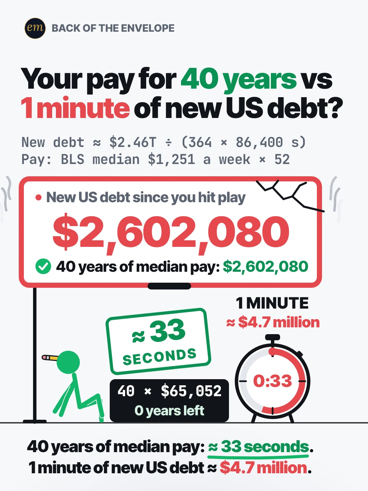

# 10b publishing sheet: 40 years of your pay vs 1 minute of new US debt

YouTube Shorts (@envelopemath) and Instagram Reels (@envelopemath). Prepared 2026-10-13. Machine-readable twin: `publishing/10b-becker-rig-debt-vs-your-pay.json`.

- **Video.** `renders/channel/10b-becker-rig-debt-vs-your-pay.mp4`: the pre-condense cut (39.1 s: a 36.6 s body + the 2.5 s card; sha256 `8eebe247…`). The 10 condense is in progress in parallel (timing only: the numbers, the captions' facts and the verdict stay). Nothing below names a timestamp except the cover, which is picked by content (the end hold), so the copy carries over to the condensed cut unchanged. The ship step rebuilds this sheet and re-exports both covers from the final file: `python3 publishing/tools/build_publishing.py 10b-becker-rig-debt-vs-your-pay --covers`.
- **Numbers.** Every figure comes from `teasers/v2/10-cost-counter.md` (10b) and its check, `python3 teasers/v2/checks/10-cost-counter.py`: 1005 checks, 0 failed on `studio/specs/` (run 2026-10-13; the builder runs it through the adapter `publishing/data/checks/10-cost-counter.py`). `python3 publishing/tools/build_publishing.py 10b-becker-rig-debt-vs-your-pay --check` checks this sheet's limits, paste blocks and figures, recomputes the 364-day growth and the rate from the two Debt to the Penny readings, holds every figure to the write-up's one rounding (≈ $2.46 trillion, ≈ $78,000 a second, ≈ $4.7 million a minute, ≈ 33 seconds, ≈ 72 years, ≈ $117,000), keeps each reading beside its date, keeps every '≈ 33 seconds' with the median pay it measures, and bans the write-up's overclaims ('live', 'fiscal 2026', 'FY2026', 'under 1 second').
- **Honesty rules kept.** The title asks and never gives the result, and so does the YouTube thumbnail (frame 1: the $0 board, the full stack of 40 bricks and the stopwatch at 0:00). The Instagram caption keeps every result below 'more'. The Instagram cover is the end hold, as the write-up's Instagram note asks. Every claim stays inside the video's verdict, "40 years of median pay: ≈ 33 seconds. 1 minute of new US debt ≈ $4.7 million.", and the copy says its conditions: the 364 days between two confirmed Debt to the Penny readings (never 'fiscal 2026', which could not be confirmed), an average rate, gross federal debt, and median pay with no raises. The header's 'your pay' is answered for every viewer by the flip point (≈ $117,000 a year) and the swap-in rule. No advice, no urgency, and 'Not financial advice.' is in both. The copy names no party, person or policy, as the write-up's tone rule asks.
- **Brand.** No company or brand is named in the copy except the source of the debt readings: PrimeRates, which published both Debt to the Penny readings, is named in the description's credit line as a publisher, as 06b names CNBC and Variety. The video's board is a generic 'debt clock' with no real branding; no share price is named.

---

## YouTube Shorts

### Title (vidIQ title score, short-form, scored against this channel)

| # | Title | Score | Chars |
|---|---|---:|---:|
| 1 | Which Is Bigger: 40 Years of Your Pay or 1 Minute of New US Debt? | 96 | 65 |
| 2 | Which Is Bigger: 40 Years of Your Pay or 1 Minute of New US National Debt? | 96 | 74 |
| 3 | Which Is Bigger: 40 Years of Your Pay or 1 Minute of New US Debt? #NationalDebt #USDebt #Debt | 96 | 93 |

**Pick (paste):**

```
Which Is Bigger: 40 Years of Your Pay or 1 Minute of New US Debt?
```

- 65 of 100 characters.
- The question comes first ('Which Is Bigger:'), then the two sides exactly as the header sets them: 40 years of your pay, 1 minute of new US debt. Both sides are inputs, so a title cut short still asks.
- It names no result: not which side wins, not ≈ $4.7 million, not ≈ 33 seconds. The answer is lopsided, and the title leaves the viewer holding the wrong answer the write-up exploits ('my 40 years, obviously').
- 'New US debt' is the growth, not the total, which is what the counter counts; 'national debt' is in the description, the tags and the hashtags, and option 2 puts it in the title at the same score. vidIQ's model ranks titles but does not predict views; the question-first titles all scored 96, and the header-first ones 88.
- Also scored, not used: "Which Is Bigger: Your Whole Working Life or 1 Minute of US National Debt?" 96 ('working life' is the video's own phrase, but the title loses the header's '40 years'); "Your Pay for 40 Years vs 1 Minute of New US Debt: Which Is Bigger?" 88 (the on-screen header first, the question last: 8 points lower); "40 Years of Your Paychecks vs 1 Minute of US National Debt: Which Is Bigger?" 88.

### Description (paste)

```
Which is bigger: 40 years of your pay or 1 minute of new US debt? 1 minute of new US debt is about $4.7 million. 40 years of median pay ($2,602,080) goes by in about 33 seconds.

The math, shown:
• Treasury's Debt to the Penny: $37.638 trillion on Sept. 30, 2025; $40.097 trillion on Sept. 29, 2026.
• That's ≈ $2.46 trillion more in 364 days.
• ÷ (364 × 86,400 seconds) ≈ $78,000 a second, ≈ $4.7 million a minute, ≈ 72 years of median pay.
• 40 years of median pay: $1,251 a week × 52 × 40 = $2,602,080. At ≈ $78,000 a second: ≈ 33 seconds.
• Earn more than ≈ $117,000 a year? Your 40 years beat 1 minute.
• Yours: yearly pay × 40 ÷ 78,000 = your working life in seconds.

Follow for the math behind your money — shown, not hand-waved. @envelopemath

Animation and original sound: The Back of the Envelope. Debt: U.S. Treasury, Debt to the Penny (total public debt outstanding), the readings of Sept. 30, 2025 and Sept. 29, 2026 (the final reading before the fiscal year ended), via PrimeRates. The growth is spread evenly over those 364 days; the debt grows in steps, so this is the average rate. It is gross federal debt, including debt the government owes itself. Pay: BLS median usual weekly earnings of full-time wage and salary workers, Q2 2026, × 52; a working life is 40 years of it, with no raises. Not financial advice.
#NationalDebt #DebtClock #MoneyMath
```

1,367 of 5,000 characters (1,402 UTF-8 bytes; YouTube counts this limit in bytes, and `≈`, `×`, `•`, `—`, `÷` take 2-3 each). No `<` or `>`, which YouTube rejects. It follows the house template: an answer-first opening line for the search snippet, then 'The math, shown:' bullets, then the follow line. The credit, assumptions and 'Not financial advice.' line comes next, and the 3 hashtags close it. The opening line is the title's question with the write-up's verdict, for the search snippet. The credit line says why the window is 364 days and not a fiscal year (the last confirmed reading is Sept. 29), as the write-up's Review log asks; nothing says 'fiscal 2026'. The 'Doesn't Add Up' series line is left out, as on 06b, 06c and 08a: the counter is an average rate, not a number that shouldn't be true.

### Hashtags (order matters)

1. `#NationalDebt`: the topic ('national debt' 25,193 searches a month, +2.0% on its 30-day baseline) and the write-up's own first tag, shared with 10a.
2. `#DebtClock`: the genre the video's board belongs to ('national debt clock' 4,838 a month; 'the debt clock is ticking' 5,151) and the write-up's tag. The board is a generic counter, with no real branding.
3. `#MoneyMath`: the write-up's tag and the format's shared third tag: 10a, 10b and 10c all carry it, so the counter series links up.

The title carries no hashtags, so YouTube shows these 3, the description's first, above the title. Over 60 hashtags and YouTube ignores all of them. `#Shorts` isn't needed.

### Tags (paste; 350 of 500 characters as YouTube counts them: commas count, and a tag with a space counts 2 more for the quotes YouTube adds)

```
new us debt, national debt, us national debt, us debt, us debt 40 trillion, 40 trillion debt animated, national debt clock, debt clock, the debt clock is ticking, how fast is the national debt growing, debt per second, lifetime earnings, working life, median pay, money math, math animation, the back of the envelope, envelope math
```

Tags carry little weight. These mirror the keyword research plus the house's channel tags. '40 trillion debt animated' (5,396 a month) has the lowest competition in the set (17.3) and asks for exactly this kind of video; 'us debt 40 trillion' (6,189) is the August milestone's phrase (the debt passed $40 trillion in August 2026, the write-up's Euronews source). Left out on purpose: 'national debt clock live' (8,779), because the write-up bans 'live' for this average-rate counter; 'us debt clock' (5,153), which is also a website's name; any 'fiscal 2026' phrase (the 364-day window is not the fiscal year); and every phrase that names a politician or a party (the write-up's tone rule).

### Pinned comment (post it, then pin it)

```
Earn more than ≈ $117,000 a year? Your 40 years beat 1 minute. Yours: yearly pay × 40 ÷ 78,000 = your working life in seconds.

"The debt includes what the government owes itself": of the ≈ $2.46 trillion, $2.09 trillion is held by the public. That part alone is ≈ $66,000 a second, ≈ $4.0 million a minute, still more than 40 years of median pay ($2,602,080). Why 364 days? Those are the official readings either side of the fiscal year we could confirm.
```

The first paragraph is the write-up's pinned comment: the flip point first, so it shows in the collapsed preview, then the swap-in rule, which answers the header's 'your pay' for every viewer (R3). The second paragraph answers the comments the write-up expects: 'the debt includes money the government owes itself' (with its PrimeRates figure, $2.09 trillion held by the public) and 'why 364 days?' (the write-up's own answer).

### Related video and end screen

- **Related video:** [You Can Lean on $1 Million. Not on $1 Billion. #moneyfacts #billion #Animation](https://www.youtube.com/shorts/hJBvmGA6sZ0) (`hJBvmGA6sZ0`). Big money made physical, the same move as this Short's 40 bricks of pay, and one of the channel's best Shorts (1,221 views on YouTube; its Reel 5,449 plays at a 27.0% skip rate).
- **Swap later:** 10a (US debt interest vs your salary), the counter on the same debt's interest, once published; then point 10a's Related video at this Short, so the pair links both ways.
- **End screen:** Shorts have no end screens or cards. The Related video link is the Shorts equivalent.

### Thumbnail and settings

- **Thumbnail:** in the YouTube app, pick frame 1: the header 'Your pay for 40 years vs / 1 minute of new US debt?' ('40 years' in green, '1 minute' in red), the 2-line footer, the board 'New US debt since you hit play' on '$0' over '≈ $78,000 every second', the figure hugging the full stack of 40 cash bricks on the plinth '40 × $65,052 / 40 years left', and the '1 MINUTE' stopwatch at 0:00. It asks without answering, like the title beside it in search. The Instagram cover below is the end hold, as the write-up asks.
- **Settings:** Category Education. Not made for kids. Altered or synthetic content: No (it's an animated chart, not realistic footage). Remixing allowed. No captions needed: there's no narration and all the text is on screen.

### Posting window

- **When:** First free Tue-Thu evening after the condensed cut ships and passes QA, at least a week after 10a, 21:30-22:30 ET (01:30-02:30 UTC the next day). Sunday 06:00-08:00 ET is the alternative.
- **Spacing:** Keep it at least 6 h from any other upload on the channel. 10a and 10b are both about the federal debt: post them at least a week apart, or as a labelled pair (this one as 'Part 2: the debt itself'), as the write-up asks. Suggested order within the series: 10c, then 10a, then 10b.
- **Why:** The channel's own October Shorts, median views by posting slot (vidIQ, 2026-10-13): Sunday 05:00-08:00 ET 1,198 (n = 2), weekday 22:00-00:30 ET 642 (n = 3), weekday midday 263 (n = 2); 06c (Mon 03:45 ET) has 760 and 06b (Mon 12:14 ET) 75, too young to compare. The evening slot is also the best one on Instagram, so one evening serves both. n = 7 and confounded by topic, so treat it as a test. 10b goes last of the three: it shares 10a's topic, and the $40 trillion news has cooled ('us debt 40 trillion' -68.1% on its 30-day baseline), while 'debt crisis' runs +235.9%. Its numbers are dated readings, so they do not go stale.

---

## Instagram Reels

### Caption (paste)

```
Which is bigger: 40 years of your pay, or 1 minute of new US debt? The new-debt counter starts at $0 the moment you hit play.

40 years of median pay ≈ 33 seconds of new US debt. 1 minute of it ≈ $4.7 million, or ≈ 72 years of median pay.

The math, shown:
• Treasury's Debt to the Penny: $37.638 trillion on Sept. 30, 2025; $40.097 trillion on Sept. 29, 2026.
• That's ≈ $2.46 trillion more in 364 days.
• ÷ (364 × 86,400 seconds) ≈ $78,000 a second.
• 40 years of median pay: $1,251 a week × 52 × 40 = $2,602,080. At ≈ $78,000 a second: ≈ 33 seconds.

Earn more than ≈ $117,000 a year? Your 40 years beat 1 minute. Yours: yearly pay × 40 ÷ 78,000 = your working life in seconds.

An average over those 364 days (the debt grows in steps). Gross federal debt, including debt the government owes itself. Median full-time pay (BLS), with no raises. Not financial advice.

What should we race against the counter next?

Follow for the math behind your money — shown, not hand-waved. @envelopemath
Animation and original sound: The Back of the Envelope.

#nationaldebt #debtclock #usdebt #economy #moneymath
```

- 1,103 of 2,200 characters.
- **First 125 characters:** the header's two sides as a question plus the counter's $0 start, with no figure but the inputs (40 years, 1 minute). The write-up's caption line 1 is the verdict ('40 years of median pay ≈ 33 seconds of new US debt. 1 minute of it ≈ $4.7 million, or ≈ 72 years of median pay.'); the house rule moves it to the second paragraph, below 'more', because the caption overlays the Reel from frame 1. The numbers sit below the fold, where Instagram search and Google indexing still read them.
- The write-up's caption sentences are kept: the two Debt to the Penny readings with their dates, the 364-day growth, the division and the 40-year working life. Its pinned comment (the flip point and the swap-in rule) follows the math, so the header's 'your pay' is answered in the caption too.
- The caption follows the house close: the follow line plus the credit.

### Hashtags (5, Instagram's cap since Dec 2025)

`#nationaldebt #debtclock #usdebt #economy #moneymath`

Three are the write-up's own (`#nationaldebt #debtclock #moneymath`), plus two:

- `#nationaldebt` and `#usdebt` name the topic the way it is searched ('national debt' 25,193 a month, 'us debt' 44,622), as on 10a.
- `#debtclock` names the genre of the video's board, and `#moneymath` says what kind of video it is.

`#economy` is the broad layer ('economy' 378,531 a month, +9.8%), as on 10a.

### Alt text

- **Short (99 characters; paste this one into Instagram):** Chart: new US debt eats 40 years of median pay in about 33 seconds; 1 minute is about $4.7 million.
  - It stays at or under 100 characters, so it fits the field however short it is. It says 'about', not '≈', so screen readers read it cleanly, and it keeps both halves of the verdict, each with its basis (median pay; new debt).
- **Long (for anywhere with room, such as a website embed):** Animation on a white page. The header asks: your pay for 40 years vs 1 minute of new US debt? A green stick figure hugs a stack of 40 cash bricks, each a year of median pay ($65,052), beside a 1-minute stopwatch. A debt board counts up from $0 at about $78,000 a second (about $2.46 trillion of new debt in 364 days) and swallows the bricks in turn: 3, 10, 20 and 30 years of median pay go by as the board turns red and starts to steam. It stops on $2,602,080 as the last brick goes; the board cracks and the blast knocks the figure to the floor. The stopwatch stops at 0:33. Payoff: 40 years of median pay: about 33 seconds; 1 minute of new US debt is about $4.7 million.
- **Where:** Advanced settings → Accessibility → Alt text, if your app shows it for Reels.

### Cover



- **Files:** `publishing/10b-becker-rig-debt-vs-your-pay-cover-3x4.jpg` (1080×1440) and `publishing/10b-becker-rig-debt-vs-your-pay-cover-9x16.jpg` (1080×1920). Both come from the pre-condense (39.1 s) render at 35.5 s (frame 1065).
- **Frame, by content:** The end hold, as the write-up's Instagram note asks: the header 'Your pay for 40 years vs / 1 minute of new US debt?', the 2-line footer, the cracked red board on '$2,602,080' with '✓ 40 years of median pay: $2,602,080' under it, the green '≈ 33 SECONDS' stamp over the emptied plinth ('40 × $65,052 / 0 years left'), the stopwatch stopped at 0:33 with its end label '≈ $4.7 million', the figure sitting on the floor looking up at the board, and the verdict '40 years of median pay: ≈ 33 seconds. / 1 minute of new US debt ≈ $4.7 million.' On any cut, use a frame of the end hold after the figure has sat up and before the end card (not the white impact frame of the burst). On the pre-condense 39.1 s render the counter stops on the 40-year pass with the burst at about frame 999 (33.3 s); the impact settles by about frame 1022 (34.07 s), the figure sits up between about 34.6 and 35.0 s, and from then on the frame changes only by the board's steam and vibration (frame-to-frame mean luma change about 0.03) until the end card at about frame 1099 (36.63 s). Frame 1065 (35.50 s) is used; the write-up's suggestion (≈ 34.5 s) falls just before he sits up. If the cut changes, re-pick it by content.
- **Crop:** 3:4 = 1080×1440 from y 60 to 1500 of the 1080×1920 frame. The content runs from y 113 (the badge) to y 1447 (the verdict's second line), so the crop centres it (53 px above and below): badge, header, footer, board, stamp, plinth, stopwatch, the figure and the verdict; it drops the empty page below. A centred grid crop (y 240-1680) cuts the badge and the header.
- **How to set it:** In 'Edit cover', pick the end-hold frame from the video (or upload the 9:16 JPG), then drag 'Profile grid' to the top so the tile matches the 3:4 JPG. Do not upload the 3:4 JPG as the Reel cover: Instagram centre-crops it to 9:16 in the Reels tab and cuts the header.
- **Re-export:** `ffmpeg -ss 35.5 -i renders/channel/10b-becker-rig-debt-vs-your-pay.mp4 -frames:v 1 -vf "crop=1080:1440:0:60" -q:v 2 publishing/10b-becker-rig-debt-vs-your-pay-cover-3x4.jpg` and `ffmpeg -ss 35.5 -i renders/channel/10b-becker-rig-debt-vs-your-pay.mp4 -frames:v 1 -q:v 2 publishing/10b-becker-rig-debt-vs-your-pay-cover-9x16.jpg`, or `python3 publishing/tools/build_publishing.py 10b-becker-rig-debt-vs-your-pay --covers`.
- **Not used on Instagram:** frame 1 (the $0 board, the full stack and the stopwatch at 0:00). It asks without answering, so it is the YouTube thumbnail, where it sits beside a title that asks; on Instagram the write-up picks the end hold, the save-able answer.
- **Not used:** the burst itself, a white impact frame, as the write-up's Instagram note warns.
- **When the condensed cut ships:** re-pick the end hold by content on the shipped file (after the figure sits up, before the end card) and re-export both JPGs with `--covers`.

### First comment (post it, then pin it)

```
Earn more than ≈ $117,000 a year? Your 40 years beat 1 minute. Yours: yearly pay × 40 ÷ 78,000 = your working life in seconds.
```

### Trial Reels

**Post as a regular Reel, not a Trial.** @envelopemath has 8 followers, so a regular Reel is already shown almost entirely to non-followers, which is all a Trial Reel adds. A Trial would also keep it off the profile grid until shared. A hook test afterwards, if you want one: the other cut as a Trial with MANUAL graduation 48-72 h later. Once the condensed cut replaces this render in renders/channel, get the pre-condense one from git with `git show 471c793:renders/channel/10b-becker-rig-debt-vs-your-pay.mp4 > 10b-39.1s.mp4` (sha256 8eebe247…). Compare skip rate (October Reels ran 27.0-65.1%; 06c's condensed cut 40.3%) and average watched %, then share the winner. vidIQ's publish tool exposes Trial (MANUAL or SS_PERFORMANCE) for this connected account. Confirm eligibility in the app.

### Posting window and settings

- **When:** Same evening as YouTube, about 15 min after the Short: 21:45-22:45 ET, at least a week after 10a (or as its labelled Part 2).
- **Why:** October Reels, median plays by posting slot (owner insights, 2026-10-13): weekday 22:00-00:30 ET 5,449 (n = 3, including the two best: 7,303 and 5,449), weekday midday 1,212 (n = 2), Sunday 05:00-08:00 ET 1,087 (n = 2). 06c, posted Mon 03:46 ET, has 1,711 plays with a 40.3% skip rate. Skip rate tracks plays more closely than the hour does: 27.0-27.4% for the top two, 56.9-65.1% for the bottom two. The condense matters more than the hour.
- **Audio:** Rename the original audio to 'Your 40 years vs 1 minute of US debt — The Back of the Envelope' if the app allows; it is the score, with no voice.
- **Share to feed:** On.

---

## Why these choices (research evidence)

**1. Search demand (vidIQ keyword research, pulled 2026-10-13).** vidIQ refreshes each keyword on its own schedule, so the last column gives each row's snapshot date. Four rows are older snapshots.

| Keyword | Est. searches/month | Competition | Overall | Note | vidIQ as of |
|---|---:|---:|---:|---|---|
| national debt | 25,193 | 62.0 | 54.6 | seed; +2.0% vs its 30-day baseline (24,706) | 2026-10-12 |
| us debt | 44,622 | 66.0 | 55.2 | -33.1% vs its baseline (66,734); still the biggest debt phrase | 2026-10-12 |
| us national debt | 10,191 | 62.0 | 51.1 | -66.1% vs its baseline (30,039) | 2026-10-12 |
| us debt 40 trillion | 6,189 | 50.0 | 54.0 | -68.1% vs its baseline (19,376): the August milestone fading | 2026-10-12 |
| 40 trillion debt animated | 5,396 | 17.3 | 66.5 | searchers asking for an animation; the lowest competition here | 2026-09-20 |
| 40 trillion dollar debt | 5,037 | 37.3 | 58.2 |  | 2026-10-04 |
| the debt clock is ticking | 5,151 | 32.2 | 60.4 |  | 2026-09-16 |
| national debt clock | 4,838 | 43.7 | 55.5 |  | 2026-10-12 |
| national debt clock live | 8,779 | 37.8 | 60.2 | 'live' is banned by the write-up: not in the tags | 2026-10-12 |
| us debt clock | 5,153 | 58.7 | 49.8 | flat (0%); also a website's name: not in the tags | 2026-06-19 |
| debt crisis | 31,084 | 63.3 | 54.9 | +235.9% vs its baseline (9,254) | 2026-10-12 |
| how fast is the national debt growing | 0 (<750) |  |  | <750/month: not searched as such | no snapshot |
| lifetime earnings | 0 (<750) | 40.1 | 24.0 | <750/month: the pay side has no search demand of its own | no snapshot |

The debt is searched by its size and its milestone: 'us debt' (44,622) and 'national debt' (25,193) lead, and the $40 trillion milestone left a long tail ('us debt 40 trillion' 6,189, fading; '40 trillion debt animated' 5,396 at competition 17.3, people asking for exactly this kind of video). The clock phrases ('the debt clock is ticking' 5,151, 'national debt clock' 4,838) are the counter's genre. The video's own question ('how fast is the national debt growing') and its yardstick ('lifetime earnings') are not searched, so the copy leads with the searched words and lets the duel carry the idea.

**2. The debt's growth is big news, but nobody measures it against a working life (vidIQ YouTube search and outliers, Shorts, under 4 min).**

| Title | Channel (subs) | Views | Date |
|---|---|---:|---|
| Joe sounds alarm over national debt surpassing $40 trillion | MS NOW (10,000,000) | 839,517 | 2026-08-20 |
| The U.S. National Debt Hit a Record High of $40 Trillion | The New York Times (5,300,000) | 235,279 | 2026-08-20 |
| The US National Debt Has Surpassed $40 Trillion For the First Time In History. | Kagan Dunlap (1,090,000) | 210,296 | 2026-08-21 |
| U.s. National Debt Grows To Large For National Debt Clock | SaveOurSovereignty2 (1,250) | 100,523 | 2008-10-07 |
| National Debt In America Is Now Over $40 Trillion | Noor (389) | 1,834 | 2026-08-20 |
| The US debt is growing at a terrifying speed  #america | WealthForge (181) | 191 | 2026-04-06 |
| America Borrows $80,000 Every Second  #usa #economics #nationaldebt | The Cost of Everything (4) | 34 | 2026-10-08 |

The $40 trillion milestone in August drew news Shorts in the hundreds of thousands (MS NOW 839,517; The New York Times 235,279; Kagan Dunlap 210,296), most of them naming politicians. Per-second versions exist but stay tiny: 'America Borrows $80,000 Every Second' (34 views, five days before this sheet) is the closest twin, and 'The US debt is growing at a terrifying speed' has 191.

None of them puts the viewer's pay against the counter. This Short's duel (40 years of your pay vs 1 minute) is the twist the write-up adds to HD Guy's counters, and the copy keeps to the maths, with no party or person, as its tone rule asks.

**3. Debt counters and pay yardsticks both travel on Instagram and TikTok (vidIQ IG/TikTok outlier search, since June 2025, at least 10K views).**

- **@infostorylab** (TikTok), "America’s $40 Trillion Debt Bomb — How Fast Can It Grow?": 470.9K (247.3x). How fast the debt grows is the hook, which is this Short's counter.
- **@americafirstalert** (Instagram), a debt-clock screen recording: 319.6K (170.8x). Music only and looped, a counter as the whole video.
- **@realmizkif** (TikTok), "we are in America's $40 Trillion Debt Problem 🤯": 236.8K (28.2x). The milestone itself.
- **@kriskrohn** (Instagram), "A six-figure salary isn’t what it used to be.": 1.7M (184.0x). The other half of this Short: a salary as the yardstick.
- The debt Reels state the size or the speed; none sets it against the viewer's own pay. That pairing is what this Short adds.

**4. Our own October numbers (vidIQ: public YouTube stats, Instagram owner insights; refreshed 2026-10-13).**

| YouTube Short | Posted (ET) | Views |
|---|---|---:|
| Can You Find the Missing Dollar? (`LjHDFzVxRyM`) | Sun 07:04 | 1,254 |
| You Can Lean on $1 Million. Not on $1 Billion. (`hJBvmGA6sZ0`) | Thu 00:25 | 1,221 |
| Your Interest Has a Speed Limit (`XVUeMcTg9OQ`) | Sun 05:49 | 1,141 |
| What If You Bought Starbucks Stock Instead of a $4 Latte Every Day? (06c) (`fbpdKf4Wy8c`) | Mon 03:45 | 760 |
| Pay the Minimum on $5,000? 238 Months. (`8__HTUa2PoU`) | Mon 22:09 | 642 |
| A $2 Lottery Ticket Was Worth $6.98. Until the Fine Print. (`FW_oxA3kbsM`) | Wed 12:03 | 348 |
| You Can Carry $1 Million. Not in Pennies. (`mXbKY_R63h4`) | Thu 13:38 | 177 |
| Start Investing 10 Years Late? You Get Half. (`EqFQCJheCMU`) | Tue 22:27 | 161 |
| What If You Bought Netflix Stock Instead of Paying for Netflix? (06b) (`krfZEHhb0xU`) | Mon 12:14 | 75 |

| Instagram Reel | Posted (ET) | Plays | Skip rate | Avg watched |
|---|---|---:|---:|---:|
| $5,000 on the minimum (`DeIvYk7I4Qr`) | Mon 22:46 | 7,303 | 27.4% | 56.5% |
| $1M stack vs Burj Khalifa (`DeOEthJJ1TG`) | Thu 00:28 | 5,449 | 27.0% | 83.1% |
| Missing dollar (`DeWgFZRoR_S`) | Sun 07:05 | 1,997 | 32.0% | 81.3% |
| Powerball $6.98 (`DeMvZv9IqRw`) | Wed 12:05 | 1,825 | 58.7% | 57.9% |
| 06c latte vs Starbucks stock (`DeYuqT4pjVC`) | Mon 03:46 | 1,711 | 40.3% | 69.1% |
| $1M in pennies (`DePe11HIHwn`) | Thu 13:37 | 598 | 42.0% | 66.7% |
| 10 years late (`DeLSd9io8UK`) | Tue 22:30 | 219 | 65.1% | 30.6% |
| Speed limit (e) (`DeEW2ZMIiYd`) | Sun 05:54 | 177 | 56.9% | 31.2% |

Channel totals:

- **YouTube:** 53 subscribers, 10,221 views and 41 videos (+27 subscribers, +5,127 views and 11 videos in 30 days).
- **Instagram:** 8 followers and 20,519 views in 30 days.

The channel has no counter Short yet. The two 'big money made physical' Shorts are among its best: the $1M stack vs the Burj Khalifa (1,221 views, 5,449 plays at a 27.0% skip rate) and $1M in pennies (177 views, 598 plays). Its two brand Shorts, 06c and 06b, are too young to compare, and 06b's Reel shows 7 plays while Instagram's owner insights catch up.

Medians by posting slot (n = 2-3 each, confounded by topic; 06b and 06c left out as too young):

- **YouTube:** Sunday early morning ET 1,198, weekday 22:00-00:30 ET 642, weekday midday 263.
- **Instagram:** weekday 22:00-00:30 ET 5,449, midday 1,212, Sunday early morning 1,087.

One weekday evening is the best Instagram slot and the second-best YouTube slot, so the plan posts both then. On Instagram, skip rate predicts plays better than the hour does (27.0-27.4% for the top two, 56.9-65.1% for the bottom two). So the window is a light-touch test, and the condense (fewer still moments) is the bigger reach lever.

**5. Platform rules applied.**

- **YouTube title:** 100 characters. The Shorts player shows only the opening, so the keywords come first.
- **YouTube description:** 5,000 characters.
- **YouTube hashtags:** the first 3 show; over 60 and all are ignored; `#Shorts` isn't needed.
- **YouTube tags:** 500 characters, low weight.
- **YouTube Shorts:** no end screens. The Related video link is the Shorts equivalent.
- **YouTube AI disclosure:** only for realistic altered content.
- **Instagram caption:** 2,200 characters, about 125 shown before 'more'.
- **Instagram hashtags:** 5 at most.
- **Instagram search and Google:** keywords in the caption feed Instagram search, and Google indexes public professional posts (since 10 Jul 2025).
- **Instagram grid:** a 3:4 crop of the 9:16 cover.
- **Trial Reels:** shown to non-followers only.

**6. Limits.**

- @envelopemath's YouTube Analytics (audience hours, geography) were not read here; the 06b and 06c sheets found vidIQ's YouTube authorization is a different channel. Check Studio → Analytics → Audience → 'When your viewers are on YouTube' before posting.
- vidIQ has no hashtag-volume data; hashtag picks lean on keyword volume and on the write-up's and the outliers' own tags.
- Title scores are vidIQ's short-form CTR model for this channel; they rank options but do not predict views.
- The two Debt to the Penny readings rest on search results (PrimeRates, citing Treasury; the API and page fetches were blocked) and are marked [click-check] in the write-up. Open them once before posting. If the 2026-09-30 reading can be read, the write-up's optional upgrade (a full fiscal year, 'FY2026' in the footer) changes the footer, the rate and this sheet.
- The figures in other creators' titles and descriptions (per-second debt growth) are theirs, not verified here; the copy states only the write-up's maths.
- The video, the cover and the video facts are the pre-condense cut; the copy is cut-independent, and the ship step refreshes the rest from the final file.

---

## Check log (first build, 2026-10-13)

- **Maths.** `python3 teasers/v2/checks/10-cost-counter.py`: 1005 checks, 0 failed on `studio/specs/`. Every public figure traces to the 10b maths table: $40,096,954,633,566.68 − $37,637,553,494,935.61 = $2,459,401,138,631.07 ≈ $2.46 trillion; ÷ 31,449,600 s = $78,201.35 ≈ $78,000 a second; × 60 = $4,692,081 ≈ $4.7 million; $1,251 × 52 × 40 = $2,602,080 ≈ $2.6 million; $2,602,080 ÷ r = 33.27 ≈ 33 s; 1 minute ÷ 40 = $117,302 ≈ $117,000; 1 minute ÷ $65,052 = 72.1 ≈ 72 years; $2.09T ÷ 31,449,600 s = $66,456 ≈ $66,000, × 60 ≈ $4.0 million. The data file recomputes every one, and the 364 days from the two dates.
- **Limits.** Title 65/100. Description 1,367 characters (1,402 bytes) of 5,000. 3 hashtags. Tags 350/500 as YouTube counts them. Instagram caption 1,103/2,200, with the first 125 characters result-free. 5 hashtags. Short alt text 99. No `<` or `>`.
- **vidIQ.** Keywords pulled 2026-10-13 (table above; the debt rows shared with 10a). 6 titles scored against this channel: the pick (the write-up's own title) 96, tied with three others. Channel 53 subscribers / 10,221 views / 41 videos; Instagram owner insights refreshed (8 followers, 20,519 views in 30 days).
- **vidIQ re-queried** after the build: the pick's title score 96, as first scored.
- **Generator.** Unchanged. `MATH_SCRIPT` is the adapter `publishing/data/checks/10-cost-counter.py`, shared with 10a and 10c.
- **Mutation test.** Breaks on scratch copies of this file all fail by name: a title that gives the verdict, 'fiscal 2026' in the description, a second rounding of the rate ('$78,201'), '≈ 33 seconds' with 'your working life' in place of median pay (the first version of that rule read whole lines and missed it in the one-line long alt text; it now looks 90 characters back), a reading moved beside the wrong date, and a result in the caption's first 125 characters. (20 of 20 across 10a-10c.)
- **Kept on purpose.**
  - The YouTube thumbnail is frame 1 (the question) and the Instagram cover is the end hold, as the write-up's Instagram note asks; not the burst, which is a white impact frame.
  - Every '≈ 33 seconds' names median pay: the counter eats the median's 40 years, not the viewer's; the flip point (≈ $117,000) and the swap-in rule answer 'your pay'.
  - '364 days', never a fiscal year: the 2026-09-30 reading could not be confirmed (the write-up's Review log, V4).
  - The public-debt answer ($2.09 trillion, ≈ $66,000 a second) sits in the pinned comment, as the write-up's TikTok reply, not in the description.
- **Still to do.** An adversarial pass of this sheet; the ship rebuild (`--covers`) on the condensed file, re-reading the long alt text against it.
