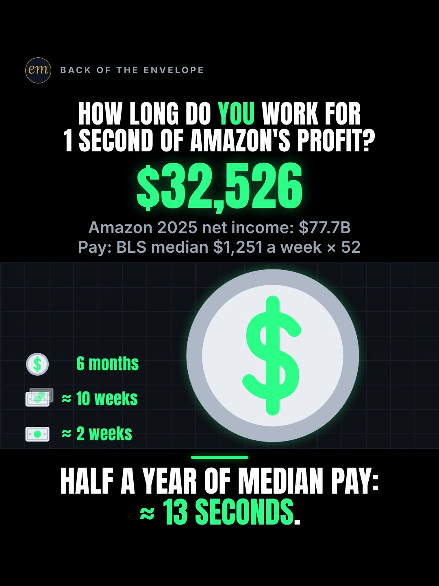

# 10c publishing sheet: 1 second of Amazon's profit in weeks of your work

YouTube Shorts (@envelopemath) and Instagram Reels (@envelopemath). Prepared 2026-10-13. Machine-readable twin: `publishing/10c-scoreboard-amazon-makes.json`.

- **Video.** `renders/channel/10c-scoreboard-amazon-makes.mp4`: the recut to the earlier verdict (owner-approved 2026-10-13; 18.067 s: the 15.55 s body + the 2.517 s card; sha256 `0f85ac87…`). The counter stops on half a year of median pay, $32,526, and the verdict reads "Half a year of median pay: ≈ 13 seconds.". Nothing below names a timestamp except the cover, which is picked by content (the verdict hold).
- **Numbers.** Every figure comes from `teasers/v2/10-cost-counter.md` (10c, the recut) and its check, `python3 teasers/v2/checks/10-cost-counter.py`: the default run on studio/specs/, which holds the recut (0 failures required at every build) (the builder runs it through the adapter `publishing/data/checks/10-cost-counter.py`). `python3 publishing/tools/build_publishing.py 10c-scoreboard-amazon-makes --check` checks this sheet's limits, paste blocks and figures, recomputes the profit rate and every answer from $77.7 billion and $1,251 a week, reads the cut's spec and holds the copy to its stop and verdict, holds every figure to the write-up's one rounding (≈ $2,464 a second; ≈ 2 and ≈ 10 weeks; ≈ $12,319; ≈ 13 seconds), keeps $77.7 billion beside 2025 and named as net income, bans 'live', a share price and any person's name, and bans any answer past the recut's stop.
- **Honesty rules kept.** The title asks and never gives the result, and so does the YouTube thumbnail (frame 1: the $0 odometer and the ladder of profit targets, no answer on screen). The Instagram caption keeps every result below 'more'. The Instagram cover is the finished board with the verdict, as the write-up's Instagram note asks. Every claim stays inside the video's verdict, "Half a year of median pay: ≈ 13 seconds.": the half year ($32,526) is the ladder's top row and the counter's stop. The copy says its conditions: Amazon's full-year 2025 net income as Amazon reports it (profit, not sales), spread evenly over the year (an average rate), and gross median full-time pay. No advice, no urgency, and 'Not financial advice.' is in both.
- **Brand.** "Amazon" is used only to name the company whose reported profit the maths divides. Both platforms' copy says 'Not affiliated with or endorsed by Amazon.' The video has no Amazon logo or brand colours: the name is text in the header. No brand handle is tagged, no share price or ticker is named, and no person is named.
- **Open with the owner: the verdict's wording.** The write-up puts a shorter verdict to the owner ("Half a year of pay: / ≈ 13 seconds.", set a little bigger). Until the owner answers, the owner's wording stands, and this sheet quotes it. If it changes, the spec's verdict changes, this sheet's check fails by name, and the long alt text and the cover lines take the new words; the rest of the copy does not quote the verdict.

---

## YouTube Shorts

### Title (vidIQ title score, short-form, scored against this channel)

| # | Title | Score | Chars |
|---|---|---:|---:|
| 1 | How Long Would You Have to Work for 1 Second of Amazon's Profit? | 98 | 64 |
| 2 | How Much Profit Does Amazon Make Every Second? How Long Do You Work for It? | 97 | 75 |
| 3 | 1 Second of Amazon's Profit: How Long Would You Have to Work for It? | 97 | 68 |

**Pick (paste):**

```
How Long Would You Have to Work for 1 Second of Amazon's Profit?
```

- 64 of 100 characters.
- The pick is the header's question with 'Would You Have to', which raises it from 88 to 98: 'How Long' opens it, 'Amazon's Profit' closes it, and '1 Second' (the input) sits in the middle. A title cut short still asks.
- It names no result and not even the answer's unit: no weeks, no ≈ $2,464, no half year, no ≈ 13 seconds. The wrong answer the viewer holds ('a few minutes of my work') stays intact until the first pass. The recut needs no new title: the write-up re-checked the hook, which asks about 1 second, and the recut still answers it.
- 'Profit' is the word on screen and in the copy, and the copy says it is net income, not sales: the same-idea Shorts on Amazon divide its revenue instead ('Amazon makes $22,700 every second'). vidIQ's model ranks titles but does not predict views; the three question-first titles scored 97-98, the header itself 88.
- Also scored, not used: "Amazon Makes a Profit Every Second. How Long Do You Work for 1 Second of It?" 89; "How Long Do You Work for 1 Second of Amazon's Profit?" 88 (the write-up's title and the on-screen header); "How Long Do You Work for 1 Second of Amazon's Profit? #Amazon #MoneyMath #Profit" 88 (the house 3-hashtag form, but not in the description's order (#Amazon #Profit #MoneyMath), so the check would refuse it as the title as written).

### Description (paste)

```
How long would you have to work for 1 second of Amazon's profit? About 2 weeks, at median full-time pay. Amazon kept $77.7 billion in 2025: about $2,464 a second. Half a year of median pay goes by in about 13 seconds.

The math, shown:
• Amazon's 2025 net income: $77.7 billion.
• ÷ 31,536,000 seconds in a year ≈ $2,464 a second.
• Median full-time pay is $1,251 a week (BLS): $2,464 ÷ $1,251 ≈ 2 weeks of work per second.
• 5 seconds: ≈ $12,319, ≈ 10 weeks of median pay.
• Half a year of median pay, $1,251 × 52 ÷ 2 = $32,526: ≈ 13 seconds.
• Yours: 2,464 ÷ your weekly pay = your weeks per second.

Follow for the math behind your money — shown, not hand-waved. @envelopemath

Animation and original sound: The Back of the Envelope. Profit: Amazon's net income for full-year 2025 (GAAP, as Amazon reports it), from its Q4 2025 results (February 2026), spread evenly over a 365-day year; profit is seasonal and lumpy, so this is the year's average rate. Pay: BLS median usual weekly earnings of full-time wage and salary workers, Q2 2026 (gross, before tax). Not financial advice. Not affiliated with or endorsed by Amazon.
#Amazon #Profit #MoneyMath
```

1,153 of 5,000 characters (1,182 UTF-8 bytes; YouTube counts this limit in bytes, and `≈`, `×`, `•`, `—`, `÷` take 2-3 each). No `<` or `>`, which YouTube rejects. It follows the house template: an answer-first opening line for the search snippet, then 'The math, shown:' bullets, then the follow line. The credit, assumptions and 'Not financial advice.' line comes next, and the 3 hashtags close it. The opening line is the title's question with the write-up's caption answer, for the search snippet: the hook's own answer (≈ 2 weeks) and the verdict's half year (≈ 13 seconds). The half year is worked from the footer's pay ($1,251 × 52 ÷ 2 = $32,526), as the video's last label works it. The credit line answers the comment fights the write-up expects before they start: 'that's before tax' (the weeks are gross median pay) and 'net income includes one-off gains' (it is the net income Amazon reports). The 'Doesn't Add Up' series line is left out, as on 06b, 06c and 08a: the counter is an average rate, not a number that shouldn't be true.

### Hashtags (order matters)

1. `#Amazon`: the brand ('amazon' 873,376 searches a month, +4.2% on its 30-day baseline) and the write-up's first tag.
2. `#Profit`: the counter's subject and the write-up's tag ('amazon profit' 3,398 a month): profit, not sales, is the point.
3. `#MoneyMath`: the write-up's tag and the format's shared third tag: 10a, 10b and 10c all carry it, so the counter series links up.

The title carries no hashtags, so YouTube shows these 3, the description's first, above the title. Over 60 hashtags and YouTube ignores all of them. `#Shorts` isn't needed.

### Tags (paste; 328 of 500 characters as YouTube counts them: commas count, and a tag with a space counts 2 more for the quotes YouTube adds)

```
amazon profit, amazon profit per second, how much money does amazon make every second, how much does amazon make every minute, how much does amazon make, amazon net income, amazon 2025, amazon, profit per second, median pay, weeks of work, salary, money math, math animation, the back of the envelope, envelope math
```

Tags carry little weight. These mirror the keyword research plus the house's channel tags. 'how much money does amazon make every second' (4,651 a month) is the video's question as people type it, at the lowest competition of the set (25.0); 'how much does amazon make every minute' (5,275) is its sibling. Left out on purpose: 'amazon stock' (34,058, +69.3%), because this Short names no share price and is not about the stock; 'jeff bezos' (198,267), because the write-up names no person; and 'amazon fba', 'amazon earnings' and the seller phrases, which want how-to-sell videos. The recut changes no tag: none names an answer.

### Pinned comment (post it, then pin it)

```
How many weeks is yours? 2,464 ÷ your weekly pay = weeks of your work per second of Amazon's profit. Median ($1,251): ≈ 2.

The $77.7 billion is Amazon's net income for 2025, as Amazon reports it, not its sales, spread evenly over the year. The weeks are median full-time pay before tax.
```

The question comes first so it shows in the collapsed preview, and it asks for the viewer's own number (R3): the write-up's pinned comment, with its swap-in rule and the median's answer. The second paragraph answers the comment fights the write-up expects: 'that's before tax' and 'net income includes one-off gains'. 'AWS makes all the profit' is answered only if asked, with the release's own segment figures, as the write-up says. The write-up's recut leaves the pinned comment unchanged: it carries the hook's own answer, not the verdict.

### Related video and end screen

- **Related video:** [What If You Bought Starbucks Stock Instead of a $4 Latte Every Day? #Starbucks #LatteFactor #stocks](https://www.youtube.com/shorts/fbpdKf4Wy8c) (`fbpdKf4Wy8c`). 06c, live since Mon 12 Oct 2026 and the channel's best-performing brand Short (760 views): a household brand's money set against the viewer's own, the same move as this Short.
- **Swap later:** 10a (US debt interest vs your salary), the same Scoreboard counter on a salary ladder, once published; then point 10a's Related video at this Short.
- **End screen:** Shorts have no end screens or cards. The Related video link is the Shorts equivalent.

### Thumbnail and settings

- **Thumbnail:** in the YouTube app, pick frame 1: the header 'HOW LONG DO YOU WORK FOR / 1 SECOND OF AMAZON'S PROFIT?', the odometer on '$0', the footer 'Amazon 2025 net income: $77.7B / Pay: BLS median $1,251 a week × 52', the ladder of profit targets '≈ $2,464 · ≈ $12,319 · $32,526' (bottom to top; no answer yet) beside the empty bill tagged '≈ $2,464', the label stack '≈ $2,464 every second / AMAZON'S PROFIT SINCE YOU HIT PLAY' and the caption 'How long do you work for this?' (read on the recut's frame 1). It asks without answering, like the title beside it in search. The Instagram cover below is the finished board with the verdict, as the write-up asks.
- **Settings:** Category Education. Not made for kids. Altered or synthetic content: No (it's an animated chart, not realistic footage). Remixing allowed. No captions needed: there's no narration and all the text is on screen.

### Posting window

- **When:** Once the recut ships and passes QA (its sound included: the write-up says 10c must not ship on the committed Scoreboard pack): the first free Tue-Thu evening, 21:30-22:30 ET (01:30-02:30 UTC the next day). Sunday 06:00-08:00 ET is the alternative.
- **Spacing:** Keep it at least 6 h from any other upload on the channel, and on a different evening from 10a and 10b. Suggested order within the series: 10c, then 10a, then 10b.
- **Why:** The channel's own October Shorts, median views by posting slot (vidIQ, 2026-10-13): Sunday 05:00-08:00 ET 1,198 (n = 2), weekday 22:00-00:30 ET 642 (n = 3), weekday midday 263 (n = 2); 06c (Mon 03:45 ET) has 760 and 06b (Mon 12:14 ET) 75, too young to compare. The evening slot is also the best one on Instagram, so one evening serves both. n = 7 and confounded by topic, so treat it as a test. 10c goes first of the three: it waits on no data decision (10a waits for fiscal 2026's interest figure), it is not about the federal debt (so 10a and 10b can be spaced a week apart after it), and its question is searched as people type it ('how much money does amazon make every second?', 4,651 a month). Its figure is dated full-year 2025, so a newer Amazon report does not make it wrong.

---

## Instagram Reels

### Caption (paste)

```
How long would you have to work for 1 second of Amazon's profit? The profit counter starts at $0 the moment you hit play.

1 second of Amazon's profit ≈ 2 weeks of median full-time pay.

The math, shown:
• Amazon kept $77.7 billion in 2025 (net income).
• ÷ 31,536,000 seconds in a year ≈ $2,464 a second.
• Median full-time pay is $1,251 a week (BLS): $2,464 ÷ $1,251 ≈ 2 weeks of it per second.
• 5 seconds: ≈ $12,319, ≈ 10 weeks.
• Half a year of median pay, $1,251 × 52 ÷ 2 = $32,526: ≈ 13 seconds.

Yours: 2,464 ÷ your weekly pay.

Source: Amazon's Q4 2025 results (February 2026); pay: BLS, gross. The year's average rate: profit is seasonal and lumpy. Not financial advice. Not affiliated with or endorsed by Amazon.

How many weeks is yours?

Follow for the math behind your money — shown, not hand-waved. @envelopemath
Animation and original sound: The Back of the Envelope.

#amazon #profit #salary #moneymath #personalfinance
```

- 936 of 2,200 characters.
- **First 125 characters:** the header's question plus the counter's $0 start, with no figure but the input (1 second); the hook is 121 characters, so it shows whole before 'more'. The write-up's caption line 1 is the hook's answer ('1 second of Amazon's profit ≈ 2 weeks of median full-time pay.'); the house rule moves it to the second paragraph, below 'more', because the caption overlays the Reel from frame 1. The numbers sit below the fold, where Instagram search and Google indexing still read them.
- The write-up's caption sentences are kept: net income, the division, the median's weeks, 5 seconds ≈ 10 weeks, half a year of it ($32,526) in ≈ 13 seconds (the recut's verdict, worked from the footer's pay as the video's last label works it), the swap-in rule and its source line. The ladder ends on the half year, the counter's stop.
- No brand handle is tagged. The caption follows the house close: the follow line plus the credit.

### Hashtags (5, Instagram's cap since Dec 2025)

`#amazon #profit #salary #moneymath #personalfinance`

Three are the write-up's own (`#amazon #moneymath #profit`), plus two:

- `#amazon` names the brand and `#profit` the counter's subject; `#salary` is the unit the answers come in (weeks of pay).
- `#moneymath` says what kind of video it is, as on 10a and 10b.

`#personalfinance` is the broad layer, as on 06b, 06c and 08a: the answers are about the viewer's own pay.

### Alt text

- **Short (96 characters; paste this one into Instagram):** Chart: 1 second of Amazon's 2025 profit, about $2,464, is about 2 weeks of median full-time pay.
  - It stays at or under 100 characters, so it fits the field however short it is. It says 'about', not '≈', so screen readers read it cleanly, and it keeps the hook's answer with its basis (2025 profit; median full-time pay). The recut does not change it.
- **Long (for anywhere with room, such as a website embed):** Animation on a black scoreboard. The header asks: how long do you work for 1 second of Amazon's profit? A green counter starts at $0 and climbs at about $2,464 a second: Amazon's 2025 net income, $77.7 billion, spread over the year. A ladder of targets turns into answers in weeks of median full-time pay ($1,251 a week): 1 second, about $2,464, is about 2 weeks; 5 seconds, about $12,319, about 10 weeks. A caption gives the rule for your own pay: 2,464 divided by your weekly pay. The counter stops on exactly $32,526, half a year of median pay, as a coin pops and grows to the biggest object on the stage and the top row turns to 6 months. Payoff: half a year of median pay: about 13 seconds.
- **Where:** Advanced settings → Accessibility → Alt text, if your app shows it for Reels.

### Cover



- **Files:** `publishing/10c-scoreboard-amazon-makes-cover-3x4.jpg` (1080×1440) and `publishing/10c-scoreboard-amazon-makes-cover-9x16.jpg` (1080×1920). Both come from the recut (18.067 s) render at 15 s (frame 450).
- **Frame, by content:** The recut's finished board with the verdict, as the write-up's Instagram note asks: the header 'HOW LONG DO YOU WORK FOR / 1 SECOND OF AMAZON'S PROFIT?', the odometer on '$32,526', the 2-line footer 'Amazon 2025 net income: $77.7B / Pay: BLS median $1,251 a week × 52', the ladder reading '≈ 2 weeks · ≈ 10 weeks · 6 months' (bottom to top) beside the big lit coin, and the two-line verdict 'HALF A YEAR OF MEDIAN PAY: / ≈ 13 SECONDS.' with nothing under it (the last caption has gone). The hook's own answer (≈ 2 weeks) is the ladder's bottom row. On the recut's 18.07 s render the counter stops on $32,526 at its pass, the coin grows and the verdict follows; the last caption ('≈ 13 seconds: half a year.') clears at frame 437 (14.57 s), the board then holds near-still (frame-to-frame mean luma change under 0.003, the coin's glow) to frame 466, and the end card starts at frame 467 (15.57 s): the write-up's 14.6-15.5 s window. Frame 450 (15.00 s) is the cover, read from the recut render's frame (a preview export, not the JPGs on disk). If the cut changes, re-pick it by content.
- **Crop:** 3:4 = 1080×1440 from y 0 to 1440 of the 1080×1920 frame: the badge (from y 141), the header, the odometer, the footer, the ladder and the coin, and the verdict (to y 1289 on the recut's frame 450), with 141 px above and 150 px below; it drops the empty black below. A centred grid crop (y 240-1680) cuts the badge and the header.
- **How to set it:** In 'Edit cover', pick the verdict frame from the video (or upload the 9:16 JPG), then drag 'Profile grid' to the top so the tile matches the 3:4 JPG. Do not upload the 3:4 JPG as the Reel cover: Instagram centre-crops it to 9:16 in the Reels tab and cuts the header.
- **Re-export:** `ffmpeg -ss 15.0 -i renders/channel/10c-scoreboard-amazon-makes.mp4 -frames:v 1 -vf "crop=1080:1440:0:0" -q:v 2 publishing/10c-scoreboard-amazon-makes-cover-3x4.jpg` and `ffmpeg -ss 15.0 -i renders/channel/10c-scoreboard-amazon-makes.mp4 -frames:v 1 -q:v 2 publishing/10c-scoreboard-amazon-makes-cover-9x16.jpg`, or `python3 publishing/tools/build_publishing.py 10c-scoreboard-amazon-makes --covers`.
- **Not used on Instagram:** frame 1 (the $0 odometer, the ladder of profit targets and 'How long do you work for this?'). It asks without answering, so it is the YouTube thumbnail, where it sits beside a title that asks; on Instagram the write-up picks the finished board, the save-able answer.
- **If the cut changes again** (the owner's verdict wording included): re-pick the verdict frame by content (a settled frame of the verdict hold, after the last caption and before the end card), update RECUT_BODY_S, RECUT_S, COVER_T and COVER_FRAME, and re-export with `--covers`.

### First comment (post it, then pin it)

```
2,464 ÷ your weekly pay = weeks of your work per second of Amazon's profit. Median ($1,251): ≈ 2. Yours?
```

### Trial Reels

**Post as a regular Reel, not a Trial.** @envelopemath has 8 followers, so a regular Reel is already shown almost entirely to non-followers, which is all a Trial Reel adds. A Trial would also keep it off the profile grid until shared. A hook test afterwards, if you want one: the same recut as a Trial with a different caption opening or cover (for example frame 1 as the cover), with MANUAL graduation 48-72 h later. Not the round-2 cut: it runs past this verdict, so this copy (the caption's top row and the alt text) would not describe it. Compare skip rate (October Reels ran 27.0-65.1%; 06c's condensed cut 40.3%) and average watched %, then share the winner. vidIQ's publish tool exposes Trial (MANUAL or SS_PERFORMANCE) for this connected account. Confirm eligibility in the app.

### Posting window and settings

- **When:** Same evening as YouTube, about 15 min after the Short: 21:45-22:45 ET, once the recut ships, on a different evening from 10a and 10b.
- **Why:** October Reels, median plays by posting slot (owner insights, 2026-10-13): weekday 22:00-00:30 ET 5,449 (n = 3, including the two best: 7,303 and 5,449), weekday midday 1,212 (n = 2), Sunday 05:00-08:00 ET 1,087 (n = 2). 06c, posted Mon 03:46 ET, has 1,711 plays with a 40.3% skip rate. Skip rate tracks plays more closely than the hour does: 27.0-27.4% for the top two, 56.9-65.1% for the bottom two. The condense and the recut (about 18 s with the card, was 33.5 s) matter more than the hour.
- **Audio:** Rename the original audio to '1 second of Amazon's profit — The Back of the Envelope' if the app allows; it is the score, with no voice.
- **Share to feed:** On.

---

## Why these choices (research evidence)

**1. Search demand (vidIQ keyword research, pulled 2026-10-13).** vidIQ refreshes each keyword on its own schedule, so the last column gives each row's snapshot date. One row is an older snapshot.

| Keyword | Est. searches/month | Competition | Overall | Note | vidIQ as of |
|---|---:|---:|---:|---|---|
| amazon profit | 3,398 | 44.5 | 53.8 | seed: the exact topic | 2026-10-12 |
| how much does amazon make every minute? | 5,275 | 36.0 | 58.9 | the same per-time question, in minutes | 2026-07-21 |
| how much money does amazon make every second? | 4,651 | 25.0 | 62.8 | the video's question as people type it; low competition | 2026-10-12 |
| how much money does amazon actually make per order? | 4,113 | 23.9 | 62.8 |  | 2026-10-12 |
| amazon | 873,376 | 64.6 | 67.4 | +4.2% vs its 30-day baseline (837,907); the brand | 2026-10-12 |
| amazon stock | 34,058 | 37.6 | 65.6 | +69.3%; stock intent, no share price here: not in the tags | 2026-10-12 |
| amazon web services | 27,004 | 57.5 | 56.7 | +48.1%; the segment the 'AWS makes all the profit' comment names | 2026-10-12 |
| jeff bezos | 198,267 | 71.0 | 59.0 | a person the write-up does not name: not in the copy or tags | 2026-10-12 |
| personal finance | 1,436,792 | 60.0 | 71.1 | -18.1% vs its baseline (1,754,064); the broad layer | 2026-10-12 |

People ask this exact question: 'how much money does amazon make every second?' (4,651, competition 25.0) and 'every minute?' (5,275). 'amazon profit' itself is small (3,398), and the brand is huge (873,376). The searches around the brand pull elsewhere: 'amazon stock' is rising (+69.3%) and 'jeff bezos' is big, but this Short names no share price and no person, so neither is in the copy or tags; 'amazon earnings' and its matching terms are all seller and self-publishing phrases. The title asks the question; the tags carry the searched phrasings.

**2. Amazon per second is a known idea, always as revenue and never in the viewer's own time (vidIQ YouTube search and outliers, Shorts, under 4 min).**

| Title | Channel (subs) | Views | Date |
|---|---|---:|---|
| How Much Money Amazon Warehouse Employees Make | Caleb Hammer (3,970,000) | 4,590,278 | 2025-03-20 |
| America Spends $222,000+ Per Second… | The Iced Coffee Hour (1,660,000) | 810,279 | 2025-12-15 |
| How much Amazon earns in 1 Minute #shorts #mangeshshinde | Mangesh Shinde Shorts (1,300,000) | 401,502 | 2024-10-21 |
| How Companies Make $1,000,000 In SECONDS! 😱💸 | SnipStory (4,220) | 203,086 | 2026-10-04 |
| Amazon makes $22,700 every second 🤯💸 #amazon #money #shorts | Dollar Clock (0) | 32 | 2026-10-10 |
| 💰 Biggest Companies’ Revenue Per Second 🤯 | PerSecond World (0) | 1 | 2026-10-12 |

Company-money-per-time Shorts travel: 'How much Amazon earns in 1 Minute' has 401,502 views and 'How Companies Make $1,000,000 In SECONDS!' 203,086 (6.97x). Two brand-new channels posted the same idea in the last week ('Amazon makes $22,700 every second', 32 views; 'Biggest Companies' Revenue Per Second', 1), both on revenue.

None uses profit, and none answers in the viewer's own unit. The biggest Amazon money Short in the searches is the other side of the ledger: Caleb Hammer's 'How Much Money Amazon Warehouse Employees Make' (4,590,278). This Short joins the two: Amazon's profit, priced in weeks of median pay. The copy names net income and its source, so it is not read as another revenue counter.

**3. Per-second fortunes and profit-vs-pay both travel on Instagram and TikTok (vidIQ IG/TikTok outlier search, since January 2025, at least 10K views).**

- **@money_reel** (TikTok), "Making $300 A Second, … Pays His $1,000 Illegal Fence Fine In 4 Seconds.": 1.5M (3333.3x). The same story as **@xsfund** (Instagram): 953.1K (45.6x).
  - A fortune re-priced per second against a cost: the move this Short makes with a company's profit and a week of pay. Their per-second figure is theirs, not verified here, and they are about a person; this Short names none.
- **@cbseveningnews** (TikTok), "U.S. CORPORATE PROFITS": 1M (18.5x). Profit set against pay, as a news chart.
- **@tc_theinvestor** (Instagram), "The number of hours needed to escape poverty living on minimum wage": 172.2K (33.1x). Work time as the unit.
- The per-second Reels state a dollar figure; none converts it into the viewer's own working time, which is this Short's answer.

**4. Our own October numbers (vidIQ: public YouTube stats, Instagram owner insights; refreshed 2026-10-13).**

| YouTube Short | Posted (ET) | Views |
|---|---|---:|
| Can You Find the Missing Dollar? (`LjHDFzVxRyM`) | Sun 07:04 | 1,254 |
| You Can Lean on $1 Million. Not on $1 Billion. (`hJBvmGA6sZ0`) | Thu 00:25 | 1,221 |
| Your Interest Has a Speed Limit (`XVUeMcTg9OQ`) | Sun 05:49 | 1,141 |
| What If You Bought Starbucks Stock Instead of a $4 Latte Every Day? (06c) (`fbpdKf4Wy8c`) | Mon 03:45 | 760 |
| Pay the Minimum on $5,000? 238 Months. (`8__HTUa2PoU`) | Mon 22:09 | 642 |
| A $2 Lottery Ticket Was Worth $6.98. Until the Fine Print. (`FW_oxA3kbsM`) | Wed 12:03 | 348 |
| You Can Carry $1 Million. Not in Pennies. (`mXbKY_R63h4`) | Thu 13:38 | 177 |
| Start Investing 10 Years Late? You Get Half. (`EqFQCJheCMU`) | Tue 22:27 | 161 |
| What If You Bought Netflix Stock Instead of Paying for Netflix? (06b) (`krfZEHhb0xU`) | Mon 12:14 | 75 |

| Instagram Reel | Posted (ET) | Plays | Skip rate | Avg watched |
|---|---|---:|---:|---:|
| $5,000 on the minimum (`DeIvYk7I4Qr`) | Mon 22:46 | 7,303 | 27.4% | 56.5% |
| $1M stack vs Burj Khalifa (`DeOEthJJ1TG`) | Thu 00:28 | 5,449 | 27.0% | 83.1% |
| Missing dollar (`DeWgFZRoR_S`) | Sun 07:05 | 1,997 | 32.0% | 81.3% |
| Powerball $6.98 (`DeMvZv9IqRw`) | Wed 12:05 | 1,825 | 58.7% | 57.9% |
| 06c latte vs Starbucks stock (`DeYuqT4pjVC`) | Mon 03:46 | 1,711 | 40.3% | 69.1% |
| $1M in pennies (`DePe11HIHwn`) | Thu 13:37 | 598 | 42.0% | 66.7% |
| 10 years late (`DeLSd9io8UK`) | Tue 22:30 | 219 | 65.1% | 30.6% |
| Speed limit (e) (`DeEW2ZMIiYd`) | Sun 05:54 | 177 | 56.9% | 31.2% |

Channel totals:

- **YouTube:** 53 subscribers, 10,221 views and 41 videos (+27 subscribers, +5,127 views and 11 videos in 30 days).
- **Instagram:** 8 followers and 20,519 views in 30 days.

The channel has no counter Short yet. Its brand Shorts are the nearest kind: 06c (Starbucks: 760 views, 1,711 plays at a 40.3% skip rate) and 06b (Netflix, Mon 12 Oct 12:14 ET: 75 views so far), both too young to compare; 06b's Reel shows 7 plays while Instagram's owner insights catch up.

Medians by posting slot (n = 2-3 each, confounded by topic; 06b and 06c left out as too young):

- **YouTube:** Sunday early morning ET 1,198, weekday 22:00-00:30 ET 642, weekday midday 263.
- **Instagram:** weekday 22:00-00:30 ET 5,449, midday 1,212, Sunday early morning 1,087.

One weekday evening is the best Instagram slot and the second-best YouTube slot, so the plan posts both then. On Instagram, skip rate predicts plays better than the hour does (27.0-27.4% for the top two, 56.9-65.1% for the bottom two). So the window is a light-touch test, and the cut's length and pace (fewer still moments) are the bigger reach lever.

**5. Platform rules applied.**

- **YouTube title:** 100 characters. The Shorts player shows only the opening, so the keywords come first.
- **YouTube description:** 5,000 characters.
- **YouTube hashtags:** the first 3 show; over 60 and all are ignored; `#Shorts` isn't needed.
- **YouTube tags:** 500 characters, low weight.
- **YouTube Shorts:** no end screens. The Related video link is the Shorts equivalent.
- **YouTube AI disclosure:** only for realistic altered content.
- **Instagram caption:** 2,200 characters, about 125 shown before 'more'.
- **Instagram hashtags:** 5 at most.
- **Instagram search and Google:** keywords in the caption feed Instagram search, and Google indexes public professional posts (since 10 Jul 2025).
- **Instagram grid:** a 3:4 crop of the 9:16 cover.
- **Trial Reels:** shown to non-followers only.

**6. Limits.**

- @envelopemath's YouTube Analytics (audience hours, geography) were not read here; the 06b and 06c sheets found vidIQ's YouTube authorization is a different channel. Check Studio → Analytics → Audience → 'When your viewers are on YouTube' before posting.
- vidIQ has no hashtag-volume data; hashtag picks lean on keyword volume and on the write-up's and the outliers' own tags.
- Title scores are vidIQ's short-form CTR model for this channel; they rank options but do not predict views.
- The $77.7 billion rests on Amazon's own Q4 2025 release (company newsroom) and two copies of its figures, found by search; the write-up's round could not fetch pages directly. Open the release once before posting.
- The figures in other creators' titles and descriptions (revenue per second, a person's earnings per second) are theirs, not verified here; the copy states only the write-up's maths.

---

## Check log (recut update and adversarial re-check, 2026-10-13)

- **Maths.** `python3 teasers/v2/checks/10-cost-counter.py`: the default run on studio/specs/, which holds the recut (0 failures required at every build). Every public figure traces to the 10c maths table: $77,700,000,000 ÷ 31,536,000 = $2,463.85 ≈ $2,464 a second; ÷ $1,251 = 1.97 ≈ 2 weeks; × 5 = $12,319.25 ≈ $12,319, ÷ $1,251 = 9.85 ≈ 10 weeks; $1,251 × 52 ÷ 2 = $32,526 (6 months, exact), ÷ k = 13.201 ≈ 13 s ($32,526 ÷ $2,464 = 13.20 too); the stop k × 13.2013 = $32,526.03 ($32,526.02 at the stored rate), so '$32,526' with no '≈'. The data file recomputes every one and reads the cut's spec (its verdict, final, stop and three rows).
- **Limits.** Title 64/100. Description 1,153 characters (1,182 bytes) of 5,000. 3 hashtags. Tags 328/500 as YouTube counts them. Instagram caption 936/2,200, with the first 125 characters result-free. 5 hashtags. Short alt text 96. No `<` or `>`.
- **The recut (owner-approved 2026-10-13).** The video now stops on half a year of median pay ($32,526), and the verdict is 'Half a year of median pay: / ≈ 13 seconds.' (the write-up's 10c section and its Review log, 'Recut to the earlier verdict' and 'Recut, fix pass'). Rewritten to match:
  - the description's opening line and its math (the half year is the last row, worked from the footer's pay: $1,251 × 52 ÷ 2 = $32,526, as the video's last label works it);
  - the caption's ladder (the write-up's caption now ends on 'half a year of it ($32,526) goes by every ≈ 13 seconds');
  - the long alt text (the stop on exactly $32,526, the coin, the top row turning to 6 months, the verdict quoted), the thumbnail's ladder (three targets, read on the recut's frame 1), the cover frame (the recut's frame 450, 15.00 s, inside the write-up's 14.6-15.5 s), the video facts, the trial note and the posting notes (10c's sound pack).
  - Unchanged, because none names an answer past the stop: the title (it asks about 1 second, and the write-up re-checked the hook), the tags, the hashtags, the short alt text, the pinned comment and the first comment.
- **New guards (COPY_RULES, MATH_RELATIONS).** A rule bans any answer past the stop anywhere in the copy, tags and hashtags (a year of pay, its figure, its seconds). A relation reads the cut's spec (the WIP spec before the ship step, `studio/specs/` after) and holds the copy to it: the stop at 13.2013 s on '$32,526', three rows topping out at $32,526, and the verdict 'Half a year of median pay: / ≈ 13 seconds.', which the long alt text quotes word for word (≈ as 'about'). If the owner takes the shorter verdict, that relation fails by name.
- **Mutation test** (scratch copies of this file, each built with `--out` to a scratch folder; each must exit 1 and fail by name): the earlier cuts' year row back in the caption, its time in the description's opening line, the long alt text's payoff off the spec's verdict ('about 14 seconds'), 'Half a Year' in the title, '$32,526' moved into the caption's first 125 characters, the spec's verdict changed to the owner's shorter wording, a fourth row past the stop added to the cut's spec, a beat timestamp in the caption, the affiliation line dropped from the caption and 'a whole year' in the pinned comment: 10 of 10 caught (20 of 20 across 10a and 10c). The adversarial pass's guards (a title that gives the answer, 'amazon stock' in the tags, a second rounding of the rate, '≈ 3 weeks', a result in the first 125 characters) are in COPY_RULES unchanged.
- **Kept on purpose.**
  - The pick (98) is not the write-up's title (88): it adds 'Would You Have to' and keeps every word of the question; the on-screen header stays as it is.
  - The YouTube thumbnail is frame 1 (the question) and the Instagram cover is the finished board with the verdict, as the write-up's Instagram note asks.
  - 'Profit' is always named as net income (as Amazon reports it), and never as sales: the same-idea Shorts divide revenue.
  - No share price, ticker or person: 'amazon stock' (+69.3%) and 'jeff bezos' are big searches, and neither is in the write-up's video.
  - The owner's verdict wording ('Half a year of median pay:'), as the write-up says, until the owner answers its follow-up.
- **Checked and kept.** Every figure in the copy against the 10c maths table and the check's output (the swap-in rule's 2,464 ÷ 1,251 = 1.97 ≈ 2 matches the exact rate); the title (64/100), description (bytes), tags, hashtags, caption, first 125 characters and both alt texts against the platform limits; 'Amazon' only as the company whose reported net income is divided, the affiliation line in both long texts, '#Amazon' as a descriptive tag, no handle, logo, stock or person; no beat timestamp in the copy; frame 1 (thumbnail) and frame 450 (cover) read from the recut render.
- **Generator.** Unchanged. `MATH_SCRIPT` is the adapter `publishing/data/checks/10-cost-counter.py`, shared with 10a and 10b; `MATH_ARGS` points it at the WIP specs until the ship step, then at `studio/specs/`.
- **Done on ship (2026-10-13).** The recut's spec and render were promoted and shipped with the Scoreboard pack of sound bible v2.5 (the working-tree pack the write-up named; `verify --strict-cues` passed on the recut, its 16 kHz octave now 1.19 dB inside the window), and both covers re-exported with `--covers` from frame 450 of the shipped file. Still open: the owner's answer on the verdict's wording (a change re-picks the cover and updates the long alt text).
